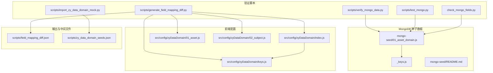
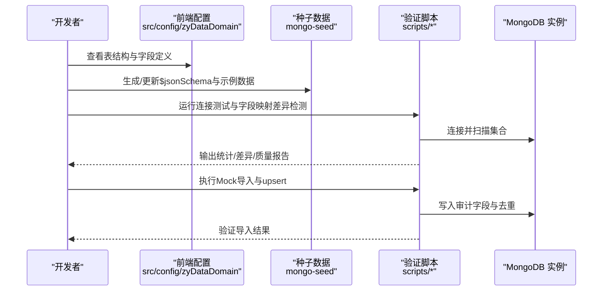
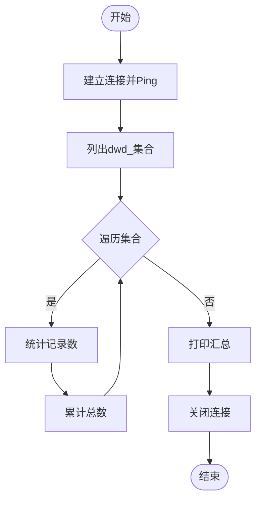
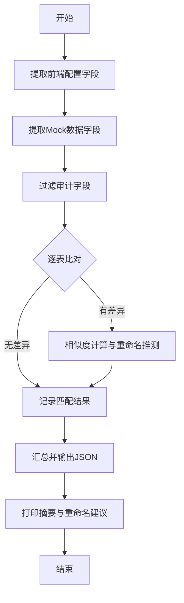
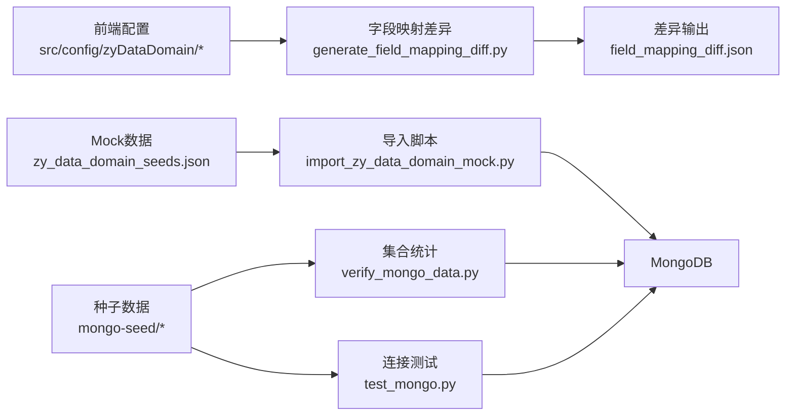

# 验证策略

<cite>
**本文引用的文件**
- [verify_mongo_data.py](file://scripts/verify_mongo_data.py)
- [test_mongo.py](file://scripts/test_mongo.py)
- [generate_field_mapping_diff.py](file://scripts/generate_field_mapping_diff.py)
- [field_mapping_diff.json](file://scripts/field_mapping_diff.json)
- [check_mongo_fields.py](file://check_mongo_fields.py)
- [mongo-seed\README.md](file://mongo-seed/README.md)
- [mongo-seed\01_asset_domain.js](file://mongo-seed/01_asset_domain.js)
- [mongo-seed\_keys.js](file://mongo-seed/_keys.js)
- [src\config\zyDataDomain\index.js](file://src/config/zyDataDomain/index.js)
- [src\config\zyDataDomain\keys.js](file://src/config/zyDataDomain/keys.js)
- [src\config\zyDataDomain\01_asset.js](file://src/config/zyDataDomain/01_asset.js)
- [src\config\zyDataDomain\02_subject.js](file://src/config/zyDataDomain/02_subject.js)
- [scripts\import_zy_data_domain_mock.py](file://scripts/import_zy_data_domain_mock.py)
- [scripts\zy_data_domain_seeds.json](file://scripts/zy_data_domain_seeds.json)
</cite>

## 目录
1. [简介](#简介)
2. [项目结构](#项目结构)
3. [核心组件](#核心组件)
4. [架构总览](#架构总览)
5. [详细组件分析](#详细组件分析)
6. [依赖分析](#依赖分析)
7. [性能考虑](#性能考虑)
8. [故障排查指南](#故障排查指南)
9. [结论](#结论)
10. [附录](#附录)

## 简介
本文件系统化梳理投资组合管理系统中“种子数据验证策略”的实现与使用方法，覆盖以下方面：
- 数据完整性验证机制：字段存在性检查、数据类型验证、业务规则校验
- MongoDB 数据验证工具链：verify_mongo_data.py 的集合与记录统计、test_mongo.py 的连通性与集合扫描
- 字段映射差异检测：generate_field_mapping_diff.py 的前端配置与Mock数据字段比对、输出结果解读
- 数据质量检查流程：重复数据检测、外键关联验证、数据一致性保证
- 验证失败处理策略：错误报告生成与自动修复建议
- 验证工具配置与扩展：参数化配置、自定义验证规则接入点

## 项目结构
围绕验证策略的相关文件主要分布在以下位置：
- scripts：验证与导入脚本（MongoDB连接测试、数据验证、字段映射差异分析、Mock导入）
- mongo-seed：MongoDB种子数据与Schema校验模板（包含$jsonSchema与示例数据）
- src/config/zyDataDomain：前端数据域配置（表结构、字段定义、枚举与审计字段）
- logs：日志输出目录（用于存放验证过程中的日志）

**图表来源**
- [verify_mongo_data.py:1-36](file://scripts/verify_mongo_data.py#L1-L36)
- [test_mongo.py:1-18](file://scripts/test_mongo.py#L1-L18)
- [generate_field_mapping_diff.py:1-329](file://scripts/generate_field_mapping_diff.py#L1-L329)
- [mongo-seed\01_asset_domain.js:1-200](file://mongo-seed/01_asset_domain.js#L1-L200)
- [mongo-seed\_keys.js:1-161](file://mongo-seed/_keys.js#L1-L161)
- [src\config\zyDataDomain\index.js:1-80](file://src/config/zyDataDomain/index.js#L1-L80)
- [src\config\zyDataDomain\keys.js:1-73](file://src/config/zyDataDomain/keys.js#L1-L73)
- [src\config\zyDataDomain\01_asset.js:1-137](file://src/config/zyDataDomain/01_asset.js#L1-L137)
- [src\config\zyDataDomain\02_subject.js:1-59](file://src/config/zyDataDomain/02_subject.js#L1-L59)

**章节来源**
- [mongo-seed\README.md:1-125](file://mongo-seed/README.md#L1-L125)
- [mongo-seed\01_asset_domain.js:1-200](file://mongo-seed/01_asset_domain.js#L1-L200)
- [mongo-seed\_keys.js:1-161](file://mongo-seed/_keys.js#L1-L161)
- [src\config\zyDataDomain\index.js:1-80](file://src/config/zyDataDomain/index.js#L1-L80)
- [src\config\zyDataDomain\keys.js:1-73](file://src/config/zyDataDomain/keys.js#L1-L73)
- [src\config\zyDataDomain\01_asset.js:1-137](file://src/config/zyDataDomain/01_asset.js#L1-L137)
- [src\config\zyDataDomain\02_subject.js:1-59](file://src/config/zyDataDomain/02_subject.js#L1-L59)

## 核心组件
- MongoDB 连接与集合扫描工具
  - verify_mongo_data.py：连接MongoDB，列出以“dwd_”为前缀的集合，统计各集合记录数与总量，输出错误信息与常见原因提示
  - test_mongo.py：轻量连接测试，列出dwd_集合并打印非空集合的数量与条目数
- 字段映射差异检测
  - generate_field_mapping_diff.py：从前端配置JS文件与Mock JSON中抽取字段，进行字段匹配与相似度推测，输出差异与可能重命名映射
  - field_mapping_diff.json：差异检测结果的持久化输出
- 数据质量检查辅助
  - check_mongo_fields.py：针对指定集合读取一条文档，输出字段清单、空值与空字符串统计
- 种子数据导入与Mock数据
  - import_zy_data_domain_mock.py：将前端Mock数据导入MongoDB，自动补全审计字段并使用upsert避免重复
  - zy_data_domain_seeds.json：Mock种子数据样例

**章节来源**
- [verify_mongo_data.py:1-36](file://scripts/verify_mongo_data.py#L1-L36)
- [test_mongo.py:1-18](file://scripts/test_mongo.py#L1-L18)
- [generate_field_mapping_diff.py:1-329](file://scripts/generate_field_mapping_diff.py#L1-L329)
- [field_mapping_diff.json:1-800](file://scripts/field_mapping_diff.json#L1-L800)
- [check_mongo_fields.py:1-26](file://check_mongo_fields.py#L1-L26)
- [import_zy_data_domain_mock.py:1-161](file://scripts/import_zy_data_domain_mock.py#L1-L161)
- [scripts\zy_data_domain_seeds.json:1-52](file://scripts/zy_data_domain_seeds.json#L1-L52)

## 架构总览
验证策略围绕“配置-数据-校验”闭环展开：
- 前端配置（src/config/zyDataDomain）定义表结构与字段属性
- 种子数据（mongo-seed）提供MongoDB集合的$jsonSchema与示例数据
- 验证脚本（scripts）执行连接测试、字段映射比对、质量检查与Mock导入
- 输出与中间文件（field_mapping_diff.json、zy_data_domain_seeds.json）支撑后续修复与回归

**图表来源**
- [src\config\zyDataDomain\index.js:1-80](file://src/config/zyDataDomain/index.js#L1-L80)
- [mongo-seed\01_asset_domain.js:1-200](file://mongo-seed/01_asset_domain.js#L1-L200)
- [scripts\generate_field_mapping_diff.py:1-329](file://scripts/generate_field_mapping_diff.py#L1-L329)
- [scripts\verify_mongo_data.py:1-36](file://scripts/verify_mongo_data.py#L1-L36)
- [scripts\import_zy_data_domain_mock.py:1-161](file://scripts/import_zy_data_domain_mock.py#L1-L161)

## 详细组件分析

### MongoDB 连接与集合统计（verify_mongo_data.py）
- 功能要点
  - 建立MongoDB连接并执行ping确认服务可达
  - 列出以“dwd_”为前缀的集合，遍历统计每集合记录数与总记录数
  - 输出汇总信息与异常时的常见原因提示
- 适用场景
  - 验证MongoDB实例状态与数据库存在性
  - 快速评估种子数据导入后的集合规模与完整性

**图表来源**
- [verify_mongo_data.py:1-36](file://scripts/verify_mongo_data.py#L1-L36)

**章节来源**
- [verify_mongo_data.py:1-36](file://scripts/verify_mongo_data.py#L1-L36)

### MongoDB 连接测试（test_mongo.py）
- 功能要点
  - 连接MongoDB并列出dwd_集合
  - 遍历集合，仅对非空集合输出条目数
  - 简洁输出“完成!”提示
- 适用场景
  - 快速确认MongoDB可用性与集合存在性

**章节来源**
- [test_mongo.py:1-18](file://scripts/test_mongo.py#L1-L18)

### 字段映射差异检测（generate_field_mapping_diff.py）
- 功能要点
  - 从前端配置JS文件提取表名与字段定义（支持多文件聚合）
  - 从Mock JSON中提取字段（兼容大文件与部分解析）
  - 过滤审计字段，计算配置独有与Mock独有字段
  - 使用相似度算法与缩写映射推测可能的字段重命名
  - 生成摘要与差异详情，并输出到JSON文件
- 关键配置
  - CONFIG_DIR：前端配置目录
  - MOCK_DIR：Mock数据目录
  - OUTPUT_FILE：输出差异结果文件
  - AUDIT_FIELDS：审计字段集合（忽略比对）
- 结果解读
  - summary：统计配置表数、Mock文件数、共同表数、仅配置/仅Mock表数、字段差异表数、全局可能重命名映射
  - tables：逐表字段匹配、仅配置字段、仅Mock字段、可能重命名映射与匹配率

**图表来源**
- [generate_field_mapping_diff.py:1-329](file://scripts/generate_field_mapping_diff.py#L1-L329)

**章节来源**
- [generate_field_mapping_diff.py:1-329](file://scripts/generate_field_mapping_diff.py#L1-L329)
- [field_mapping_diff.json:1-800](file://scripts/field_mapping_diff.json#L1-L800)

### 数据质量检查（check_mongo_fields.py）
- 功能要点
  - 指定集合列表进行字段检查
  - 输出字段总数、字段清单、空值与空字符串数量
- 适用场景
  - 快速定位字段缺失、空值过多等质量问题

**章节来源**
- [check_mongo_fields.py:1-26](file://check_mongo_fields.py#L1-L26)

### 种子数据导入与Mock数据（import_zy_data_domain_mock.py）
- 功能要点
  - 从前端Mock文件提取种子数据，或从JSON文件加载
  - 连接MongoDB并执行导入，自动补全审计字段与时间戳
  - 使用批量upsert避免重复导入，输出导入统计与验证结果
- 关键配置
  - MONGO_URI、DB_NAME：MongoDB连接参数
  - MOCK_JS_PATH：前端Mock数据路径
  - BIZ_DT：业务日期
- 适用场景
  - 将Mock数据导入MongoDB供后端API查询与Agent对话使用

**章节来源**
- [import_zy_data_domain_mock.py:1-161](file://scripts/import_zy_data_domain_mock.py#L1-L161)
- [scripts\zy_data_domain_seeds.json:1-52](file://scripts/zy_data_domain_seeds.json#L1-L52)

## 依赖分析
- 前端配置与MongoDB种子数据的耦合
  - 前端配置定义字段与业务规则，种子数据提供Schema与示例，二者需保持字段一致性
  - 通过generate_field_mapping_diff.py进行比对，发现字段差异与可能重命名映射
- 验证脚本与MongoDB的耦合
  - verify_mongo_data.py与test_mongo.py直接依赖MongoDB连接
  - check_mongo_fields.py依赖具体集合的存在性
- Mock导入与配置的耦合
  - import_zy_data_domain_mock.py依赖前端Mock数据结构与审计字段约定

**图表来源**
- [src\config\zyDataDomain\index.js:1-80](file://src/config/zyDataDomain/index.js#L1-L80)
- [mongo-seed\01_asset_domain.js:1-200](file://mongo-seed/01_asset_domain.js#L1-L200)
- [scripts\generate_field_mapping_diff.py:1-329](file://scripts/generate_field_mapping_diff.py#L1-L329)
- [scripts\verify_mongo_data.py:1-36](file://scripts/verify_mongo_data.py#L1-L36)
- [scripts\test_mongo.py:1-18](file://scripts/test_mongo.py#L1-L18)
- [scripts\import_zy_data_domain_mock.py:1-161](file://scripts/import_zy_data_domain_mock.py#L1-L161)
- [scripts\zy_data_domain_seeds.json:1-52](file://scripts/zy_data_domain_seeds.json#L1-L52)

**章节来源**
- [src\config\zyDataDomain\index.js:1-80](file://src/config/zyDataDomain/index.js#L1-L80)
- [mongo-seed\01_asset_domain.js:1-200](file://mongo-seed/01_asset_domain.js#L1-L200)
- [scripts\generate_field_mapping_diff.py:1-329](file://scripts/generate_field_mapping_diff.py#L1-L329)
- [scripts\verify_mongo_data.py:1-36](file://scripts/verify_mongo_data.py#L1-L36)
- [scripts\test_mongo.py:1-18](file://scripts/test_mongo.py#L1-L18)
- [scripts\import_zy_data_domain_mock.py:1-161](file://scripts/import_zy_data_domain_mock.py#L1-L161)
- [scripts\zy_data_domain_seeds.json:1-52](file://scripts/zy_data_domain_seeds.json#L1-L52)

## 性能考虑
- 字段映射差异检测
  - 对大文件采用分块读取与对象边界探测，避免内存溢出
  - 相似度计算使用序列相似度与缩写映射，复杂度与字段数量线性相关
- 集合统计
  - count_documents遍历统计，建议在生产环境配合索引与分页策略
- Mock导入
  - bulk_write + upsert减少网络往返，提升导入效率

[本节为通用指导，无需特定文件引用]

## 故障排查指南
- MongoDB连接失败
  - verify_mongo_data.py与test_mongo.py均会输出常见原因：服务未启动、连接地址不正确、端口被占用
  - 建议先运行test_mongo.py确认连通性，再执行verify_mongo_data.py进行统计
- 字段映射差异
  - 通过field_mapping_diff.json查看仅配置/仅Mock字段与可能重命名映射
  - 若出现大量相似字段但未自动匹配，可调整相似度阈值或人工核对
- 数据质量异常
  - 使用check_mongo_fields.py快速定位空值与空字符串过多的字段
  - 结合前端配置的required标记与种子数据的示例字段进行交叉验证
- Mock导入失败
  - 检查zy_data_domain_seeds.json格式与集合名称是否与前端配置一致
  - 确认MongoDB连接参数与数据库权限

**章节来源**
- [verify_mongo_data.py:30-36](file://scripts/verify_mongo_data.py#L30-L36)
- [test_mongo.py:1-18](file://scripts/test_mongo.py#L1-L18)
- [field_mapping_diff.json:1-800](file://scripts/field_mapping_diff.json#L1-L800)
- [check_mongo_fields.py:1-26](file://check_mongo_fields.py#L1-L26)
- [import_zy_data_domain_mock.py:136-140](file://scripts/import_zy_data_domain_mock.py#L136-L140)

## 结论
本验证策略通过“配置-数据-校验”闭环，实现了对种子数据的完整性、一致性与可维护性的系统化保障。结合MongoDB连接测试、字段映射差异检测与Mock导入工具，能够快速定位问题并提供修复建议，确保前端配置与后端数据的一致性。

[本节为总结性内容，无需特定文件引用]

## 附录

### MongoDB数据验证工具使用说明
- verify_mongo_data.py
  - 作用：连接MongoDB，统计dwd_集合数量与记录总数
  - 参数：无（硬编码本地连接与数据库名）
  - 输出：集合明细与总计
- test_mongo.py
  - 作用：连接MongoDB，列出dwd_集合并打印非空集合条目数
  - 参数：无（硬编码本地连接与数据库名）
  - 输出：集合列表与条目数

**章节来源**
- [verify_mongo_data.py:1-36](file://scripts/verify_mongo_data.py#L1-L36)
- [test_mongo.py:1-18](file://scripts/test_mongo.py#L1-L18)

### 字段映射差异检测使用说明
- generate_field_mapping_diff.py
  - 输入：前端配置目录、Mock数据目录、审计字段集合
  - 输出：field_mapping_diff.json（摘要与逐表差异）
  - 使用建议：定期运行，生成差异报告并纳入CI/CD回归检查
- 结果解读
  - summary.tables_with_field_diff：字段差异表数量
  - summary.all_possible_renames：可能的字段重命名映射清单
  - tables.*.match_rate：字段匹配率，辅助判断兼容性

**章节来源**
- [generate_field_mapping_diff.py:1-329](file://scripts/generate_field_mapping_diff.py#L1-L329)
- [field_mapping_diff.json:1-800](file://scripts/field_mapping_diff.json#L1-L800)

### 数据质量检查流程
- 重复数据检测
  - 建议：基于主键字段（如AST_CD、PORT_ID等）建立唯一索引，导入时使用upsert
  - 工具：import_zy_data_domain_mock.py已内置upsert逻辑
- 外键关联验证
  - 建议：利用mongo-seed/_keys.js中的主键池与跨表约定，确保外键字段（如ISR_ID、CUSTOMER_ID等）在相关表中存在
  - 工具：前端配置keys.js提供枚举与默认审计字段，便于一致性校验
- 数据一致性保证
  - 建议：遵循mongo-seed/README.md中的Schema设计原则（审计字段、业务日期格式、金额/比率字段类型、$jsonSchema校验）
  - 工具：mongo-seed/01_asset_domain.js展示如何为集合添加$jsonSchema与索引

**章节来源**
- [mongo-seed\README.md:114-125](file://mongo-seed/README.md#L114-L125)
- [mongo-seed\01_asset_domain.js:28-37](file://mongo-seed/01_asset_domain.js#L28-L37)
- [mongo-seed\_keys.js:1-161](file://mongo-seed/_keys.js#L1-L161)
- [src\config\zyDataDomain\keys.js:63-63](file://src/config/zyDataDomain/keys.js#L63-L63)

### 验证失败处理策略与自动修复建议
- 错误报告生成
  - verify_mongo_data.py：输出错误信息与常见原因提示
  - generate_field_mapping_diff.py：输出差异摘要与可能重命名映射
- 自动修复建议
  - 字段重命名：根据field_mapping_diff.json中的“可能重命名映射”进行字段别名映射或配置更新
  - 缺失字段：对照前端配置的required字段与种子数据示例字段补齐
  - 数据导入：使用import_zy_data_domain_mock.py的upsert能力避免重复并自动补全审计字段

**章节来源**
- [verify_mongo_data.py:30-36](file://scripts/verify_mongo_data.py#L30-L36)
- [generate_field_mapping_diff.py:196-329](file://scripts/generate_field_mapping_diff.py#L196-L329)
- [field_mapping_diff.json:1-800](file://scripts/field_mapping_diff.json#L1-L800)
- [import_zy_data_domain_mock.py:105-120](file://scripts/import_zy_data_domain_mock.py#L105-L120)

### 配置选项与自定义验证规则扩展
- 配置选项
  - generate_field_mapping_diff.py
    - CONFIG_DIR：前端配置目录
    - MOCK_DIR：Mock数据目录
    - OUTPUT_FILE：输出文件路径
    - AUDIT_FIELDS：审计字段集合（忽略比对）
  - import_zy_data_domain_mock.py
    - MONGO_URI、DB_NAME：MongoDB连接参数
    - MOCK_JS_PATH：前端Mock数据路径
    - BIZ_DT：业务日期
- 自定义验证规则扩展
  - 字段类型与必填：在前端配置中设置字段类型与required标记，结合种子数据$jschema进行约束
  - 业务规则：在前端配置中定义枚举与默认值（如BIZ_DT），导入时自动填充审计字段
  - 外键规则：在前端配置keys.js中维护主键池与枚举，确保跨表一致性

**章节来源**
- [generate_field_mapping_diff.py:14-21](file://scripts/generate_field_mapping_diff.py#L14-L21)
- [import_zy_data_domain_mock.py:17-26](file://scripts/import_zy_data_domain_mock.py#L17-L26)
- [src\config\zyDataDomain\keys.js:6-72](file://src/config/zyDataDomain/keys.js#L6-L72)