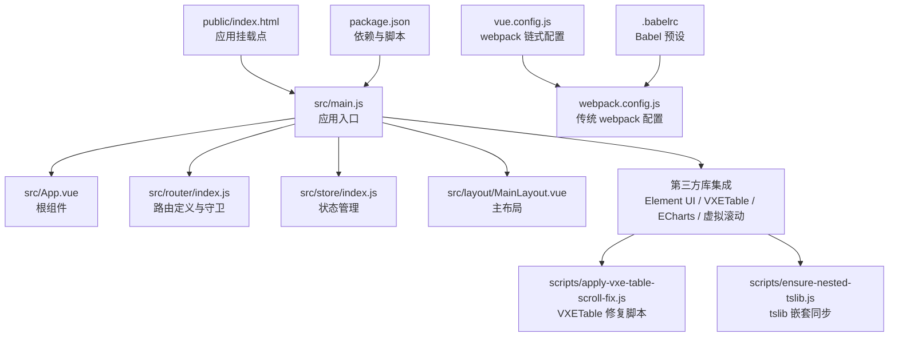
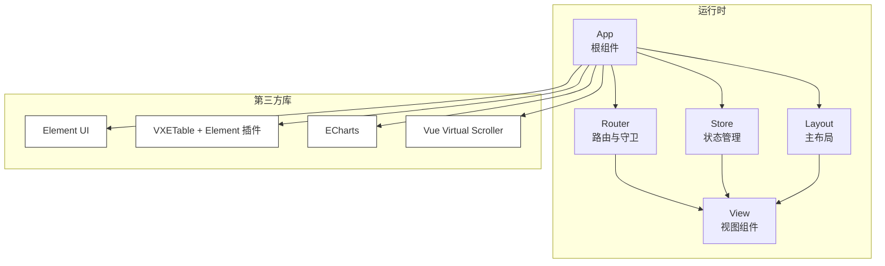
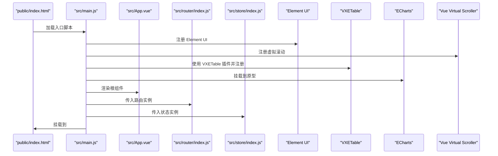
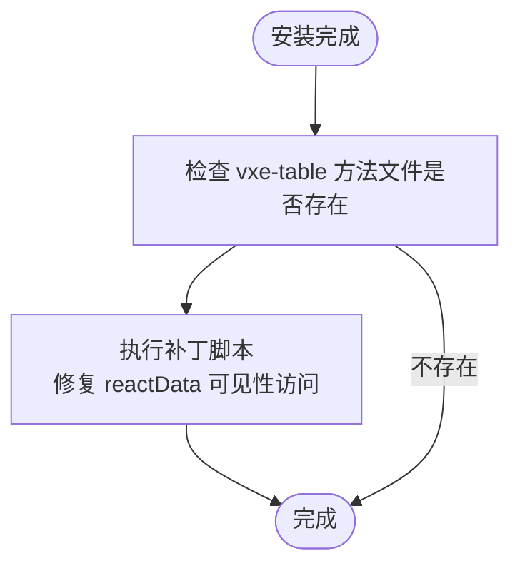
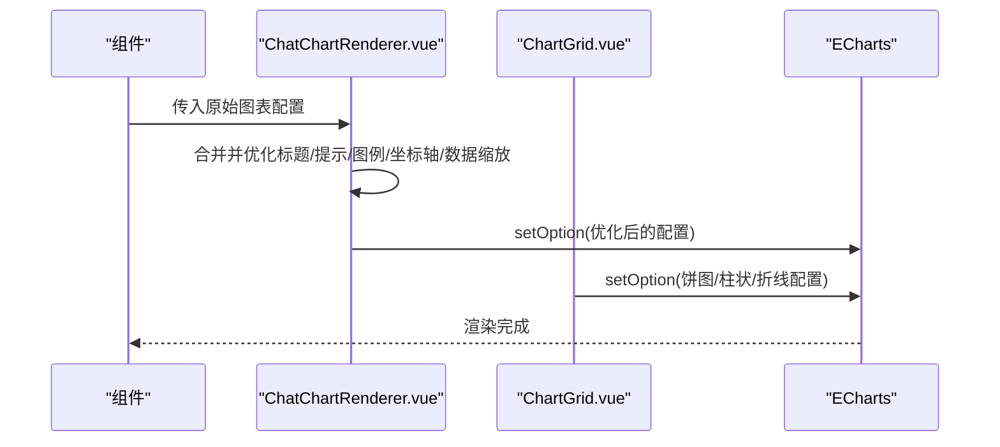
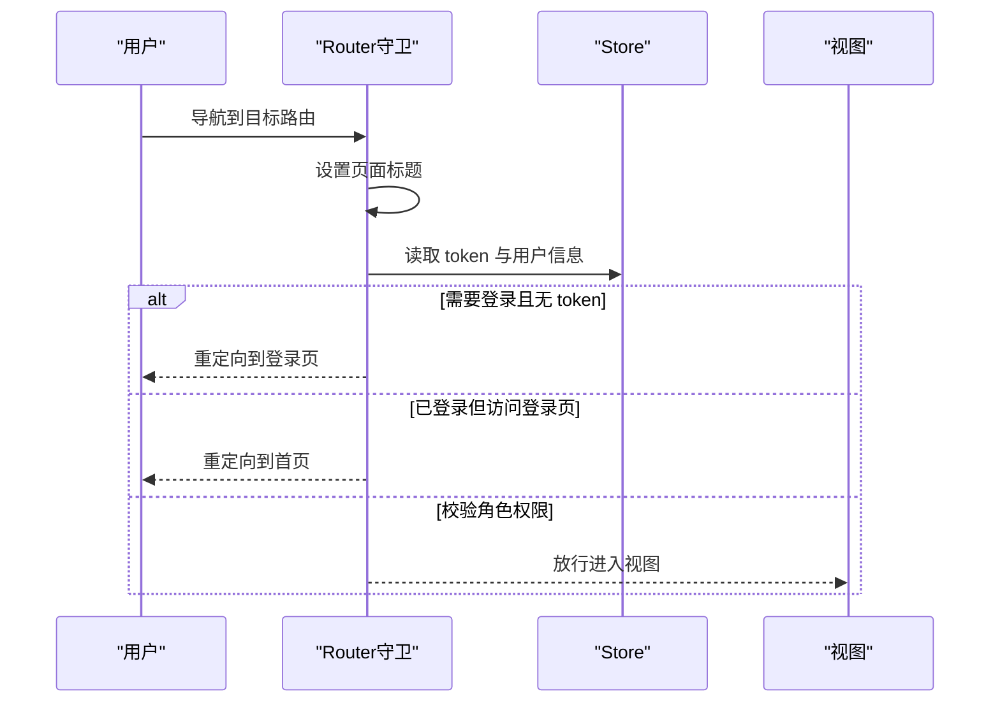
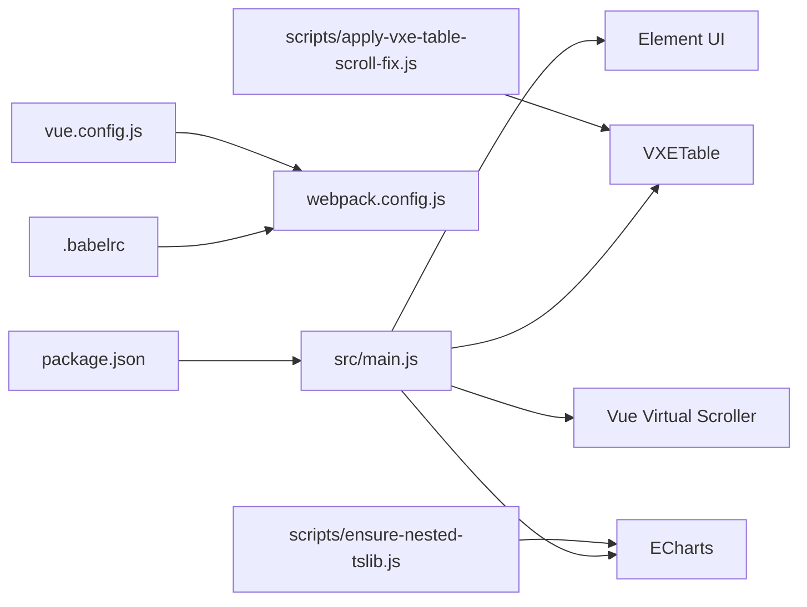

# 应用架构

<cite>
**本文引用的文件**
- [src/main.js](file://src/main.js)
- [src/App.vue](file://src/App.vue)
- [src/router/index.js](file://src/router/index.js)
- [src/store/index.js](file://src/store/index.js)
- [src/layout/MainLayout.vue](file://src/layout/MainLayout.vue)
- [public/index.html](file://public/index.html)
- [vue.config.js](file://vue.config.js)
- [webpack.config.js](file://webpack.config.js)
- [.babelrc](file://.babelrc)
- [package.json](file://package.json)
- [scripts/apply-vxe-table-scroll-fix.js](file://scripts/apply-vxe-table-scroll-fix.js)
- [scripts/ensure-nested-tslib.js](file://scripts/ensure-nested-tslib.js)
- [src/components/ChatChartRenderer.vue](file://src/components/ChatChartRenderer.vue)
- [src/views/analysis/DataHub/ChartGrid.vue](file://src/views/analysis/DataHub/ChartGrid.vue)
- [src/components/ChatDataTable.vue](file://src/components/ChatDataTable.vue)
</cite>

## 目录
1. [引言](#引言)
2. [项目结构](#项目结构)
3. [核心组件](#核心组件)
4. [架构总览](#架构总览)
5. [详细组件分析](#详细组件分析)
6. [依赖关系分析](#依赖关系分析)
7. [性能考虑](#性能考虑)
8. [故障排查指南](#故障排查指南)
9. [结论](#结论)
10. [附录](#附录)

## 引言
本文件面向投资组合管理系统（Vue 2 应用）的架构文档，聚焦应用初始化流程、插件集成策略、全局配置管理、第三方库（Element UI、VXETable、ECharts、虚拟滚动）的集成方式与配置要点，并结合路由与状态管理的集成模式，给出构建配置差异与启动流程图，帮助开发者快速理解从启动到运行的完整过程。

## 项目结构
该应用采用典型的 Vue CLI 项目布局，按功能域划分 views、components、layout、router、store、api、utils 等目录；公共入口与构建配置位于根目录。

**图示来源**
- [public/index.html:1-12](file://public/index.html#L1-L12)
- [src/main.js:1-31](file://src/main.js#L1-L31)
- [src/App.vue:1-116](file://src/App.vue#L1-L116)
- [src/router/index.js:1-378](file://src/router/index.js#L1-L378)
- [src/store/index.js:1-44](file://src/store/index.js#L1-L44)
- [src/layout/MainLayout.vue:1-330](file://src/layout/MainLayout.vue#L1-L330)
- [scripts/apply-vxe-table-scroll-fix.js:1-52](file://scripts/apply-vxe-table-scroll-fix.js#L1-L52)
- [scripts/ensure-nested-tslib.js:1-26](file://scripts/ensure-nested-tslib.js#L1-L26)
- [vue.config.js:1-17](file://vue.config.js#L1-L17)
- [webpack.config.js:1-63](file://webpack.config.js#L1-L63)
- [.babelrc:1-14](file://.babelrc#L1-L14)
- [package.json:1-45](file://package.json#L1-L45)

**章节来源**
- [public/index.html:1-12](file://public/index.html#L1-L12)
- [src/main.js:1-31](file://src/main.js#L1-L31)
- [src/App.vue:1-116](file://src/App.vue#L1-L116)
- [src/router/index.js:1-378](file://src/router/index.js#L1-L378)
- [src/store/index.js:1-44](file://src/store/index.js#L1-L44)
- [src/layout/MainLayout.vue:1-330](file://src/layout/MainLayout.vue#L1-L330)
- [scripts/apply-vxe-table-scroll-fix.js:1-52](file://scripts/apply-vxe-table-scroll-fix.js#L1-L52)
- [scripts/ensure-nested-tslib.js:1-26](file://scripts/ensure-nested-tslib.js#L1-L26)
- [vue.config.js:1-17](file://vue.config.js#L1-L17)
- [webpack.config.js:1-63](file://webpack.config.js#L1-L63)
- [.babelrc:1-14](file://.babelrc#L1-L14)
- [package.json:1-45](file://package.json#L1-L45)

## 核心组件
- 应用入口与初始化
  - 入口文件负责引入第三方库、全局样式、插件注册与 Vue 实例创建。
  - 关键点：Element UI、VXETable（含 Element 插件）、ECharts、虚拟滚动组件均在此集中注册。
  - Vue 实例通过渲染函数挂载至 #app。
- 根组件 App
  - 提供全局基础样式与通用类名规范（滚动条、数字颜色、卡片、页面容器等）。
- 主布局 MainLayout
  - 提供侧边菜单、面包屑、头部用户信息与下拉菜单、内容区过渡动画。
  - 与 Vuex 状态联动控制侧栏折叠与用户信息展示。
- 路由与守卫
  - 定义多级嵌套路由与权限守卫，支持标题动态设置、登录态校验与角色权限控制。
- 状态管理
  - 模块化组织 user、asset、strategy、portfolio、benchmark、monitor、agent。
  - 提供 loading、collapsed 等全局状态与对应 mutations/actions。

**章节来源**
- [src/main.js:1-31](file://src/main.js#L1-L31)
- [src/App.vue:13-115](file://src/App.vue#L13-L115)
- [src/layout/MainLayout.vue:144-218](file://src/layout/MainLayout.vue#L144-L218)
- [src/router/index.js:351-375](file://src/router/index.js#L351-L375)
- [src/store/index.js:13-43](file://src/store/index.js#L13-L43)

## 架构总览
应用采用“入口文件初始化 + 根组件 + 主布局 + 路由 + 状态管理”的分层架构，配合第三方 UI 与可视化库实现业务界面与交互。

**图示来源**
- [src/main.js:5-22](file://src/main.js#L5-L22)
- [src/App.vue:1-116](file://src/App.vue#L1-L116)
- [src/layout/MainLayout.vue:1-330](file://src/layout/MainLayout.vue#L1-L330)
- [src/router/index.js:1-378](file://src/router/index.js#L1-L378)
- [src/store/index.js:1-44](file://src/store/index.js#L1-L44)

## 详细组件分析

### 应用初始化与插件集成
- 初始化流程
  - 引入 Vue、App、router、store、第三方 UI 与可视化库。
  - 注册 Element UI、虚拟滚动、VXETable 及其 Tooltip 插件。
  - 将 ECharts 挂载到 Vue 原型以供全组件使用。
  - 创建 Vue 实例并挂载到 #app。
- 全局样式与主题
  - 引入 Element UI 主题与 VXETable 样式。
  - 在 App.vue 中定义全局字体、滚动条、表格与按钮字号、数字颜色、卡片与页面容器样式。
- 开发与生产差异
  - 生产环境关闭 productionTip，减少提示开销。
  - 构建阶段通过 DefinePlugin 注入环境变量，webpack 配置提供开发服务器与输出规则。

**图示来源**
- [public/index.html:8-11](file://public/index.html#L8-L11)
- [src/main.js:1-31](file://src/main.js#L1-L31)
- [src/App.vue:1-116](file://src/App.vue#L1-L116)
- [src/router/index.js:1-5](file://src/router/index.js#L1-L5)
- [src/store/index.js:1-11](file://src/store/index.js#L1-L11)

**章节来源**
- [src/main.js:1-31](file://src/main.js#L1-L31)
- [src/App.vue:13-115](file://src/App.vue#L13-L115)
- [public/index.html:8-11](file://public/index.html#L8-L11)
- [webpack.config.js:39-44](file://webpack.config.js#L39-L44)

### Element UI 集成策略
- 全局引入主题样式与组件库。
- 在 App.vue 中针对表格、按钮等进行字号与配色的统一优化。
- 主布局中使用 ElContainer/Aside/Header/Main/Menu 等组件构建整体布局。

**章节来源**
- [src/main.js:5-6](file://src/main.js#L5-L6)
- [src/App.vue:46-58](file://src/App.vue#L46-L58)
- [src/layout/MainLayout.vue:3-141](file://src/layout/MainLayout.vue#L3-L141)

### VXETable 与 Element 插件集成
- 引入 VXETable 与 Element 插件样式，并通过插件注册 VXE 组件生态。
- 在组件中可直接使用表格能力，结合虚拟滚动提升大数据量渲染性能。
- 为规避滚动时 Tooltip/ValidTooltip 的初始化问题，提供补丁脚本自动修复。

**图示来源**
- [scripts/apply-vxe-table-scroll-fix.js:1-52](file://scripts/apply-vxe-table-scroll-fix.js#L1-L52)
- [src/main.js:9-12](file://src/main.js#L9-L12)

**章节来源**
- [src/main.js:9-20](file://src/main.js#L9-L20)
- [scripts/apply-vxe-table-scroll-fix.js:1-52](file://scripts/apply-vxe-table-scroll-fix.js#L1-L52)

### ECharts 图表配置
- 全局注入 ECharts 到 Vue 原型，便于各组件直接使用。
- 在聊天图表渲染器中对标题、提示框、图例、坐标轴、数据缩放等进行统一优化。
- 在数据看板中根据图表类型（饼图/柱状/折线）设置选项与网格布局。

**图示来源**
- [src/main.js:22](file://src/main.js#L22)
- [src/components/ChatChartRenderer.vue:65-313](file://src/components/ChatChartRenderer.vue#L65-L313)
- [src/views/analysis/DataHub/ChartGrid.vue:89-127](file://src/views/analysis/DataHub/ChartGrid.vue#L89-L127)

**章节来源**
- [src/main.js:22](file://src/main.js#L22)
- [src/components/ChatChartRenderer.vue:65-313](file://src/components/ChatChartRenderer.vue#L65-L313)
- [src/views/analysis/DataHub/ChartGrid.vue:89-127](file://src/views/analysis/DataHub/ChartGrid.vue#L89-L127)

### 虚拟滚动组件使用
- 在入口文件引入虚拟滚动样式与插件。
- 在复杂表格组件中结合虚拟滚动与搜索、分页状态持久化，提升大数据量渲染体验。
- 通过监听过滤与分页变化，持久化展开状态，避免虚拟滚动重建导致的状态丢失。

**章节来源**
- [src/main.js:13-14](file://src/main.js#L13-L14)
- [src/components/ChatDataTable.vue:780-809](file://src/components/ChatDataTable.vue#L780-L809)

### 路由与状态管理集成
- 路由
  - 使用 hash 模式，定义多级嵌套路由与懒加载视图。
  - 全局前置守卫动态设置标题、校验登录态与角色权限。
- 状态管理
  - 模块化 Store，提供 loading/collapsed 等全局状态与动作。
  - 主布局通过映射获取用户名、角色并控制侧栏折叠。

**图示来源**
- [src/router/index.js:351-375](file://src/router/index.js#L351-L375)
- [src/store/index.js:23-42](file://src/store/index.js#L23-L42)
- [src/layout/MainLayout.vue:144-218](file://src/layout/MainLayout.vue#L144-L218)

**章节来源**
- [src/router/index.js:346-375](file://src/router/index.js#L346-L375)
- [src/store/index.js:13-43](file://src/store/index.js#L13-L43)
- [src/layout/MainLayout.vue:144-218](file://src/layout/MainLayout.vue#L144-L218)

## 依赖关系分析
- 入口依赖
  - main.js 依赖 App、router、store，并引入 Element UI、VXETable、ECharts、虚拟滚动。
- 构建与工具链
  - package.json 定义脚本与依赖；.babelrc 配置转译目标；vue.config.js 与 webpack.config.js 提供构建与开发服务器配置。
- 第三方脚本
  - apply-vxe-table-scroll-fix.js 与 ensure-nested-tslib.js 在 postinstall 阶段保证运行稳定性。

**图示来源**
- [package.json:9-28](file://package.json#L9-L28)
- [src/main.js:1-31](file://src/main.js#L1-L31)
- [.babelrc:1-14](file://.babelrc#L1-L14)
- [vue.config.js:1-17](file://vue.config.js#L1-L17)
- [webpack.config.js:1-63](file://webpack.config.js#L1-L63)
- [scripts/apply-vxe-table-scroll-fix.js:1-52](file://scripts/apply-vxe-table-scroll-fix.js#L1-L52)
- [scripts/ensure-nested-tslib.js:1-26](file://scripts/ensure-nested-tslib.js#L1-L26)

**章节来源**
- [package.json:1-45](file://package.json#L1-L45)
- [src/main.js:1-31](file://src/main.js#L1-L31)
- [.babelrc:1-14](file://.babelrc#L1-L14)
- [vue.config.js:1-17](file://vue.config.js#L1-L17)
- [webpack.config.js:1-63](file://webpack.config.js#L1-L63)
- [scripts/apply-vxe-table-scroll-fix.js:1-52](file://scripts/apply-vxe-table-scroll-fix.js#L1-L52)
- [scripts/ensure-nested-tslib.js:1-26](file://scripts/ensure-nested-tslib.js#L1-L26)

## 性能考虑
- 虚拟滚动
  - 在大数据表格中显著降低 DOM 节点数量，提升渲染性能。
  - 结合搜索与分页状态持久化，避免重建导致的滚动位置与展开状态丢失。
- 图表优化
  - 对 ECharts 的标题、提示、图例、坐标轴、数据缩放进行统一优化，减少重复配置与渲染抖动。
- 构建优化
  - 使用 DefinePlugin 注入环境变量，webpack 输出带 contenthash，利于缓存。
  - vue.config.js 通过别名指向 tslib，减少模块解析成本。

**章节来源**
- [src/components/ChatDataTable.vue:780-809](file://src/components/ChatDataTable.vue#L780-L809)
- [src/components/ChatChartRenderer.vue:65-313](file://src/components/ChatChartRenderer.vue#L65-L313)
- [webpack.config.js:10-11](file://webpack.config.js#L10-L11)
- [vue.config.js:3-8](file://vue.config.js#L3-L8)

## 故障排查指南
- VXETable 滚动异常
  - 症状：滚动时访问 Tooltip/ValidTooltip 的 reactData 可见性报错。
  - 处理：确保 postinstall 成功执行补丁脚本，修复 es 与 lib 两份产物中的条件判断。
- ECharts/zrender 缺少 tslib
  - 症状：打包时报 ENOENT，找不到 tslib.es6.js。
  - 处理：确保 postinstall 执行 ensure-nested-tslib.js，将根目录 tslib 同步到 echarts/zrender 的 node_modules 内部。
- 开发服务器无法热更新
  - 检查 webpack devServer 配置端口与静态目录是否正确。
- 路由跳转失败或白屏
  - 检查路由守卫逻辑与懒加载组件路径是否正确。

**章节来源**
- [scripts/apply-vxe-table-scroll-fix.js:1-52](file://scripts/apply-vxe-table-scroll-fix.js#L1-L52)
- [scripts/ensure-nested-tslib.js:1-26](file://scripts/ensure-nested-tslib.js#L1-L26)
- [webpack.config.js:53-61](file://webpack.config.js#L53-L61)
- [src/router/index.js:351-375](file://src/router/index.js#L351-L375)

## 结论
该应用以 Vue 2 为基础，通过入口文件集中初始化第三方库与全局样式，结合 Element UI、VXETable、ECharts 与虚拟滚动实现丰富的交互与可视化能力；路由与状态管理提供清晰的权限控制与全局状态抽象；构建配置兼顾开发效率与生产性能。遵循本文档的集成策略与排障建议，可稳定支撑投资组合管理系统的持续演进。

## 附录
- 构建与开发命令
  - 开发：npm run dev
  - 构建：npm run build
  - 代码检查：npm run lint
- 关键配置参考
  - vue.config.js：webpack 链式配置与别名
  - webpack.config.js：入口、输出、loader、插件与开发服务器
  - .babelrc：转译目标与浏览器兼容
  - package.json：依赖、脚本与浏览器列表

**章节来源**
- [package.json:5-9](file://package.json#L5-L9)
- [vue.config.js:1-17](file://vue.config.js#L1-L17)
- [webpack.config.js:1-63](file://webpack.config.js#L1-L63)
- [.babelrc:1-14](file://.babelrc#L1-L14)