# 数据流架构

<cite>
**本文引用的文件**
- [src/utils/request.js](file://src/utils/request.js)
- [src/utils/apiError.js](file://src/utils/apiError.js)
- [src/api/agent.js](file://src/api/agent.js)
- [src/api/portfolio.js](file://src/api/portfolio.js)
- [src/api/asset.js](file://src/api/asset.js)
- [src/api/dataAsset.js](file://src/api/dataAsset.js)
- [src/api/zyDataDomain.js](file://src/api/zyDataDomain.js)
- [src/store/index.js](file://src/store/index.js)
- [src/store/modules/user.js](file://src/store/modules/user.js)
- [src/store/modules/asset.js](file://src/store/modules/asset.js)
- [src/store/modules/portfolio.js](file://src/store/modules/portfolio.js)
- [src/views/portfolio/PortfolioList.vue](file://src/views/portfolio/PortfolioList.vue)
- [src/views/asset/AssetList.vue](file://src/views/asset/AssetList.vue)
- [src/components/chatUtils.js](file://src/components/chatUtils.js)
- [package.json](file://package.json)
</cite>

## 目录
1. [简介](#简介)
2. [项目结构](#项目结构)
3. [核心组件](#核心组件)
4. [架构总览](#架构总览)
5. [详细组件分析](#详细组件分析)
6. [依赖关系分析](#依赖关系分析)
7. [性能考量](#性能考量)
8. [故障排查指南](#故障排查指南)
9. [结论](#结论)
10. [附录](#附录)

## 简介
本文件面向投资组合管理系统，系统性梳理从前端到后端的数据流路径，涵盖API请求发起、响应处理、状态更新机制、请求/响应拦截器设计、错误处理策略、数据缓存与兜底方案、异步加载与loading管理、数据校验与格式转换、以及数据同步策略。文档同时提供数据流图与API调用序列图，帮助开发者构建高效、可靠、可维护的数据交互体系。

## 项目结构
前端采用Vue 2 + Vuex + Element UI 技术栈，API层通过统一的axios实例封装请求与拦截器，Store模块负责状态管理与异步动作编排，页面组件通过$store.dispatch与API模块协作完成数据加载与更新。

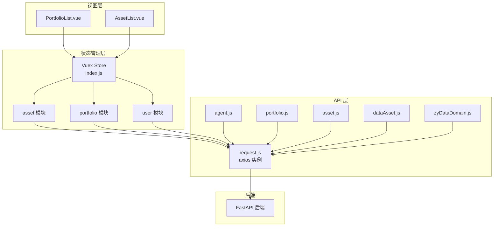

**图表来源**
- [src/views/portfolio/PortfolioList.vue:154-356](file://src/views/portfolio/PortfolioList.vue#L154-L356)
- [src/views/asset/AssetList.vue:162-338](file://src/views/asset/AssetList.vue#L162-L338)
- [src/store/index.js:13-43](file://src/store/index.js#L13-L43)
- [src/store/modules/asset.js:1-183](file://src/store/modules/asset.js#L1-L183)
- [src/store/modules/portfolio.js:1-106](file://src/store/modules/portfolio.js#L1-L106)
- [src/store/modules/user.js:1-119](file://src/store/modules/user.js#L1-L119)
- [src/utils/request.js:1-100](file://src/utils/request.js#L1-L100)
- [src/api/agent.js:1-168](file://src/api/agent.js#L1-L168)
- [src/api/portfolio.js:1-72](file://src/api/portfolio.js#L1-L72)
- [src/api/asset.js:1-284](file://src/api/asset.js#L1-L284)
- [src/api/dataAsset.js:1-59](file://src/api/dataAsset.js#L1-L59)
- [src/api/zyDataDomain.js:1-190](file://src/api/zyDataDomain.js#L1-L190)

**章节来源**
- [src/views/portfolio/PortfolioList.vue:154-356](file://src/views/portfolio/PortfolioList.vue#L154-L356)
- [src/views/asset/AssetList.vue:162-338](file://src/views/asset/AssetList.vue#L162-L338)
- [src/store/index.js:13-43](file://src/store/index.js#L13-L43)
- [src/store/modules/asset.js:1-183](file://src/store/modules/asset.js#L1-L183)
- [src/store/modules/portfolio.js:1-106](file://src/store/modules/portfolio.js#L1-L106)
- [src/store/modules/user.js:1-119](file://src/store/modules/user.js#L1-L119)
- [src/utils/request.js:1-100](file://src/utils/request.js#L1-L100)
- [src/api/agent.js:1-168](file://src/api/agent.js#L1-L168)
- [src/api/portfolio.js:1-72](file://src/api/portfolio.js#L1-L72)
- [src/api/asset.js:1-284](file://src/api/asset.js#L1-L284)
- [src/api/dataAsset.js:1-59](file://src/api/dataAsset.js#L1-L59)
- [src/api/zyDataDomain.js:1-190](file://src/api/zyDataDomain.js#L1-L190)

## 核心组件
- 统一请求客户端：基于axios创建实例，内置请求/响应拦截器，集中处理鉴权、错误提示与超时提示。
- API模块：按功能域划分，如组合、资产、Agent、数据资产、ZY数据域等，封装具体REST接口。
- Vuex模块：资产、组合、用户等模块负责状态与异步动作，协调API调用与UI状态。
- 页面组件：通过$store.dispatch触发动作，结合API模块完成数据加载、更新与删除等操作。

**章节来源**
- [src/utils/request.js:1-100](file://src/utils/request.js#L1-L100)
- [src/api/agent.js:1-168](file://src/api/agent.js#L1-L168)
- [src/api/portfolio.js:1-72](file://src/api/portfolio.js#L1-L72)
- [src/api/asset.js:1-284](file://src/api/asset.js#L1-L284)
- [src/api/dataAsset.js:1-59](file://src/api/dataAsset.js#L1-L59)
- [src/api/zyDataDomain.js:1-190](file://src/api/zyDataDomain.js#L1-L190)
- [src/store/modules/asset.js:1-183](file://src/store/modules/asset.js#L1-L183)
- [src/store/modules/portfolio.js:1-106](file://src/store/modules/portfolio.js#L1-L106)
- [src/store/modules/user.js:1-119](file://src/store/modules/user.js#L1-L119)

## 架构总览
从前端到后端的数据流遵循“组件 -> Store 动作 -> API模块 -> axios拦截器 -> 后端”的链路。拦截器负责注入Authorization、统一错误提示与超时提示，API模块负责参数构造与超时策略，Store动作负责状态更新与异常捕获。

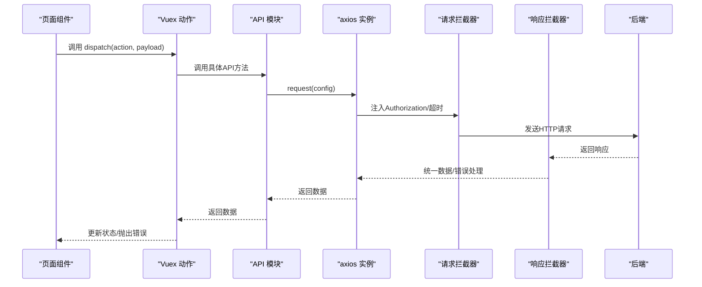

**图表来源**
- [src/views/portfolio/PortfolioList.vue:190-270](file://src/views/portfolio/PortfolioList.vue#L190-L270)
- [src/store/modules/asset.js:48-94](file://src/store/modules/asset.js#L48-L94)
- [src/store/modules/portfolio.js:38-87](file://src/store/modules/portfolio.js#L38-L87)
- [src/api/asset.js:8-21](file://src/api/asset.js#L8-L21)
- [src/api/portfolio.js:7-21](file://src/api/portfolio.js#L7-L21)
- [src/utils/request.js:11-97](file://src/utils/request.js#L11-L97)

## 详细组件分析

### 请求与响应拦截器
- 请求拦截器：从Vuex state读取token，注入Authorization头；对422/403/404等状态进行友好提示；对超时/网络错误进行区分提示。
- 响应拦截器：统一剥离data外层包装；对401登出、422/403/404等进行提示；对无响应场景（超时/网络失败）给出明确指引。

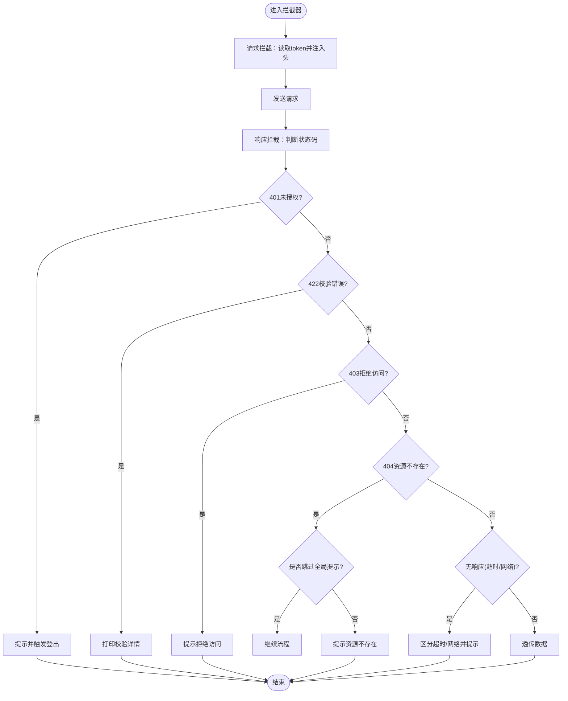

**图表来源**
- [src/utils/request.js:11-97](file://src/utils/request.js#L11-L97)

**章节来源**
- [src/utils/request.js:11-97](file://src/utils/request.js#L11-L97)

### 错误处理策略
- 统一错误文案提取：从后端HTTPException或自定义封装中提取可读错误信息，便于组件显示。
- 组件级错误处理：页面组件在调用API或dispatch动作时，捕获错误并提示，避免全局未处理异常。
- 网络与超时提示：根据错误类型区分超时与网络问题，提供针对性提示与检查项。

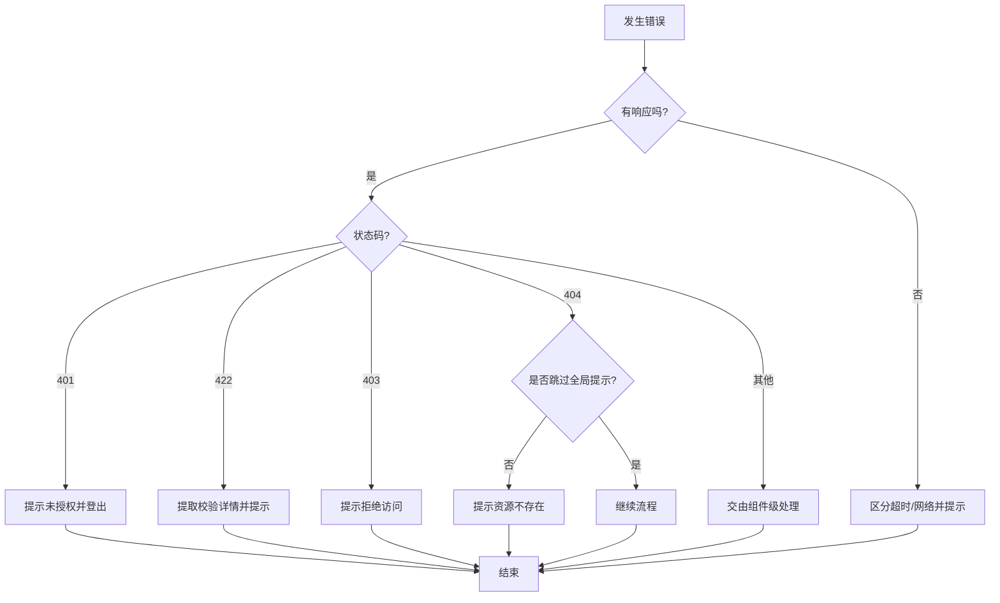

**图表来源**
- [src/utils/request.js:33-96](file://src/utils/request.js#L33-L96)
- [src/utils/apiError.js:6-17](file://src/utils/apiError.js#L6-L17)

**章节来源**
- [src/utils/request.js:33-96](file://src/utils/request.js#L33-L96)
- [src/utils/apiError.js:6-17](file://src/utils/apiError.js#L6-L17)

### 数据缓存与兜底机制
- ZY数据域CRUD：当后端返回404/405/501或网络不可达时，自动切换到本地mock兜底，避免因后端未实现而中断体验；一旦某集合被判定404，本会话内该集合均走mock。
- 数据资产同步：提供同步与刷新统计接口，支持较长超时，保障大数据量同步过程稳定。

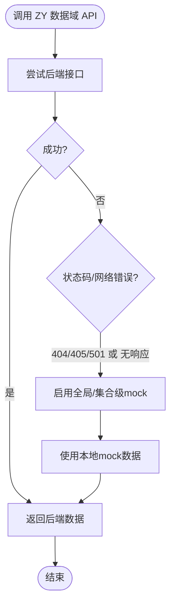

**图表来源**
- [src/api/zyDataDomain.js:26-62](file://src/api/zyDataDomain.js#L26-L62)
- [src/api/zyDataDomain.js:69-96](file://src/api/zyDataDomain.js#L69-L96)
- [src/api/dataAsset.js:34-47](file://src/api/dataAsset.js#L34-L47)

**章节来源**
- [src/api/zyDataDomain.js:26-62](file://src/api/zyDataDomain.js#L26-L62)
- [src/api/zyDataDomain.js:69-96](file://src/api/zyDataDomain.js#L69-L96)
- [src/api/dataAsset.js:34-47](file://src/api/dataAsset.js#L34-L47)

### 异步数据加载与loading管理
- Store动作：fetchAssetList等动作在开始前设置loading，结束后清理，确保UI loading状态与实际请求生命周期一致。
- 页面组件：在created钩子或用户操作时触发$store.dispatch，使用v-loading绑定store中的loading状态，实现细粒度loading控制。
- 分页与搜索：页面组件将分页、搜索条件传递给store动作，动作内部计算skip/limit并调用API。

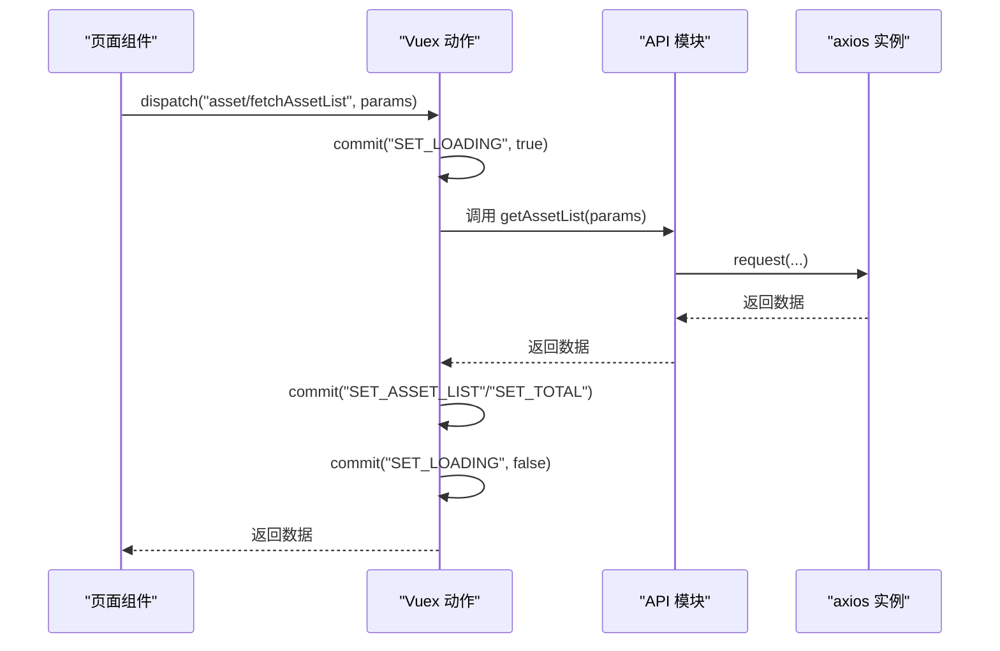

**图表来源**
- [src/views/asset/AssetList.vue:204-219](file://src/views/asset/AssetList.vue#L204-L219)
- [src/store/modules/asset.js:48-94](file://src/store/modules/asset.js#L48-L94)
- [src/api/asset.js:8-21](file://src/api/asset.js#L8-L21)

**章节来源**
- [src/views/asset/AssetList.vue:204-219](file://src/views/asset/AssetList.vue#L204-L219)
- [src/store/modules/asset.js:48-94](file://src/store/modules/asset.js#L48-L94)

### 数据验证与格式转换
- 参数校验：API模块对必填参数进行构造与过滤，如日期、是否替换、仅缺失日期等布尔开关。
- 响应格式化：Store动作对后端返回的分页数据进行标准化映射，统一字段名与结构。
- Markdown与表格渲染：聊天工具对Markdown进行预处理与XSS消毒，表格段落转为结构化数据，便于组件渲染与交互。

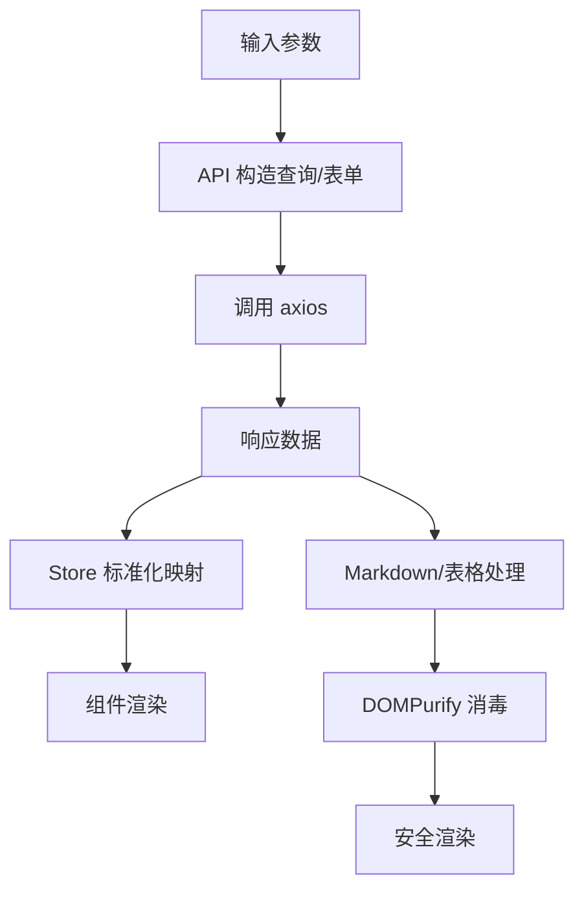

**图表来源**
- [src/api/asset.js:131-172](file://src/api/asset.js#L131-L172)
- [src/store/modules/asset.js:62-86](file://src/store/modules/asset.js#L62-L86)
- [src/components/chatUtils.js:167-233](file://src/components/chatUtils.js#L167-L233)

**章节来源**
- [src/api/asset.js:131-172](file://src/api/asset.js#L131-L172)
- [src/store/modules/asset.js:62-86](file://src/store/modules/asset.js#L62-L86)
- [src/components/chatUtils.js:167-233](file://src/components/chatUtils.js#L167-L233)

### 数据同步策略
- 数据资产同步：提供同步与刷新统计接口，支持长超时，保障大规模数据同步稳定性。
- 组合分析：组合详情与分析数据通过独立接口获取，避免一次性加载过多数据。

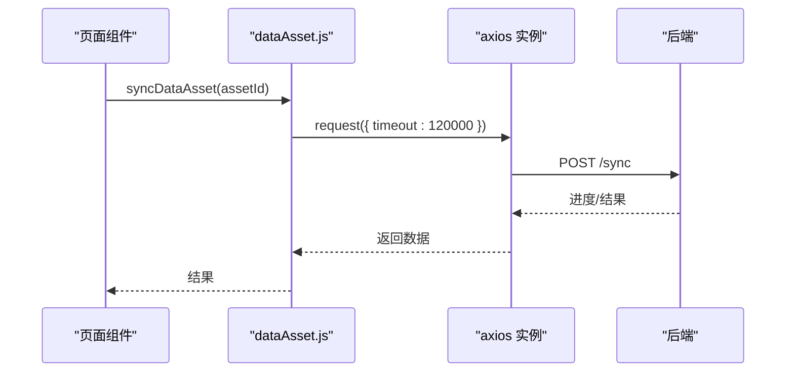

**图表来源**
- [src/api/dataAsset.js:34-47](file://src/api/dataAsset.js#L34-L47)
- [src/api/portfolio.js:49-55](file://src/api/portfolio.js#L49-L55)

**章节来源**
- [src/api/dataAsset.js:34-47](file://src/api/dataAsset.js#L34-L47)
- [src/api/portfolio.js:49-55](file://src/api/portfolio.js#L49-L55)

### 组合管理数据流
- 列表加载：页面组件触发store动作，API调用后端获取组合列表，Store更新状态并返回。
- 性能分析：点击“业绩”时调用分析接口，渲染图表；错误时提示并阻止图表渲染。
- 删除与创建：通过store动作封装API调用，完成后刷新列表。

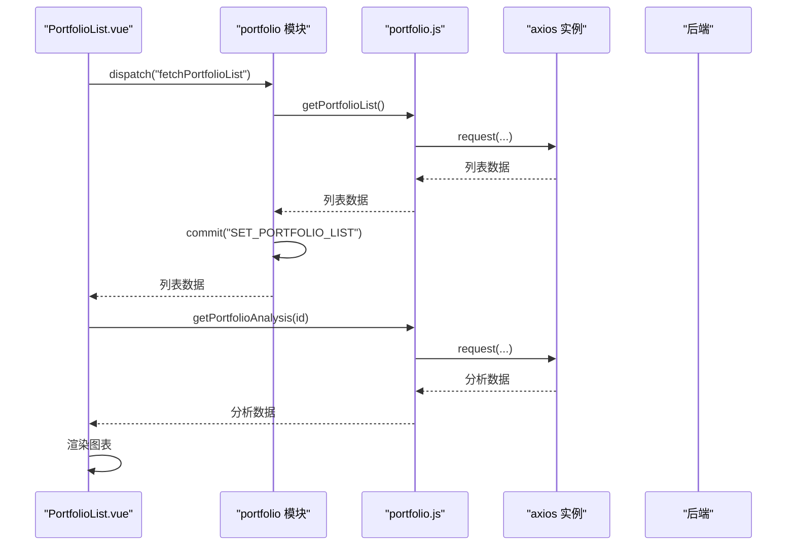

**图表来源**
- [src/views/portfolio/PortfolioList.vue:190-270](file://src/views/portfolio/PortfolioList.vue#L190-L270)
- [src/store/modules/portfolio.js:38-87](file://src/store/modules/portfolio.js#L38-L87)
- [src/api/portfolio.js:7-72](file://src/api/portfolio.js#L7-L72)

**章节来源**
- [src/views/portfolio/PortfolioList.vue:190-270](file://src/views/portfolio/PortfolioList.vue#L190-L270)
- [src/store/modules/portfolio.js:38-87](file://src/store/modules/portfolio.js#L38-L87)
- [src/api/portfolio.js:7-72](file://src/api/portfolio.js#L7-L72)

### 资产管理数据流
- 列表加载：页面组件将搜索条件与分页参数传递给store动作，动作计算skip/limit并调用API。
- 导入与模板：提供Excel模板下载与批量导入接口，导入过程使用进度提示与错误聚合展示。
- 删除与编辑：删除通过store动作封装API调用，编辑占位提示后端未实现。

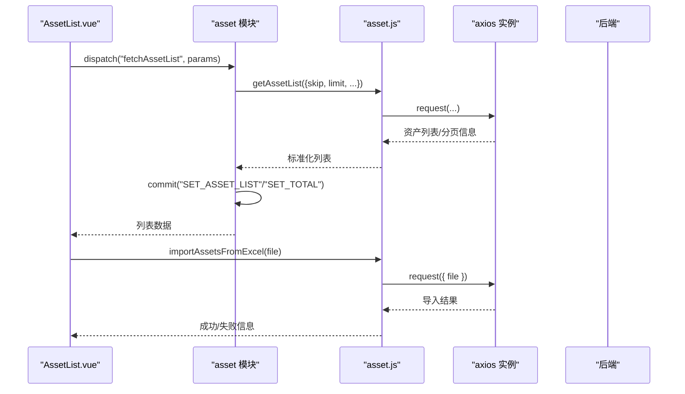

**图表来源**
- [src/views/asset/AssetList.vue:204-219](file://src/views/asset/AssetList.vue#L204-L219)
- [src/store/modules/asset.js:48-94](file://src/store/modules/asset.js#L48-L94)
- [src/api/asset.js:87-105](file://src/api/asset.js#L87-L105)

**章节来源**
- [src/views/asset/AssetList.vue:204-219](file://src/views/asset/AssetList.vue#L204-L219)
- [src/store/modules/asset.js:48-94](file://src/store/modules/asset.js#L48-L94)
- [src/api/asset.js:87-105](file://src/api/asset.js#L87-L105)

### Agent流式对话数据流
- 非流式对话：使用axios封装POST请求，支持较长超时。
- 流式对话：使用原生fetch与SSE，支持AbortSignal中止，避免会话切换时的串扰。

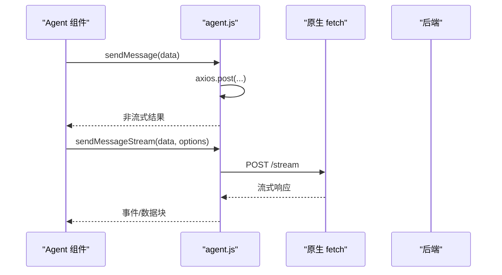

**图表来源**
- [src/api/agent.js:4-112](file://src/api/agent.js#L4-L112)

**章节来源**
- [src/api/agent.js:4-112](file://src/api/agent.js#L4-L112)

## 依赖关系分析
- axios版本：项目使用axios ^0.27.2，具备拦截器与超时控制能力，满足本项目数据流需求。
- UI与可视化：Element UI、ECharts、vxe-table等组件用于表格、图表与对话渲染。
- Markdown与安全：marked与dompurify用于Markdown渲染与XSS防护。

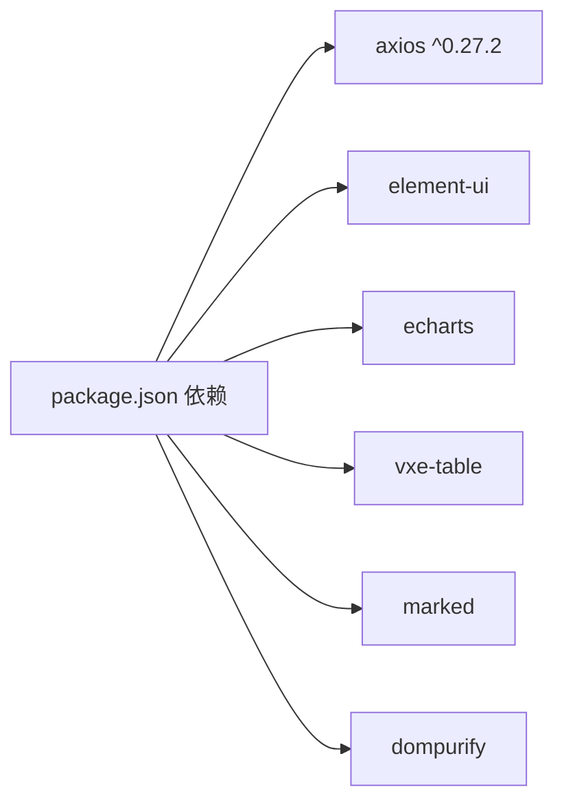

**图表来源**
- [package.json:11-28](file://package.json#L11-L28)

**章节来源**
- [package.json:11-28](file://package.json#L11-L28)

## 性能考量
- 超时策略：axios默认60s，部分长耗时接口（如AI对话、批量导入、数据同步）单独提升超时，避免误判超时。
- 分页与懒加载：资产列表采用分页与skip/limit，减少单次传输数据量。
- 流式渲染：Agent流式对话使用SSE与AbortSignal，避免阻塞与重复渲染。
- 缓存与兜底：ZY数据域在后端不可用时自动切换mock，保障可用性与一致性。

[本节为通用指导，无需特定文件引用]

## 故障排查指南
- 401未授权：拦截器会提示并触发登出，检查token是否过期或丢失。
- 422校验错误：打印后端校验详情，核对字段类型与必填项。
- 403拒绝访问：检查权限与角色，确认接口白名单。
- 404资源不存在：确认接口路径与集合是否存在；对于ZY数据域，可能是后端未实现，系统会自动兜底mock。
- 超时/网络失败：区分策略轻量接口与行情/批量接口，检查后端服务、网络与代理配置。
- 组件错误：页面组件捕获错误并提示，查看错误消息与后端返回的message/detail。

**章节来源**
- [src/utils/request.js:33-96](file://src/utils/request.js#L33-L96)
- [src/utils/apiError.js:6-17](file://src/utils/apiError.js#L6-L17)
- [src/api/zyDataDomain.js:26-62](file://src/api/zyDataDomain.js#L26-L62)

## 结论
本项目通过统一的axios实例与拦截器、清晰的API模块划分、规范的Vuex动作与状态管理、以及完善的错误处理与兜底机制，构建了稳定、可扩展的数据流架构。建议在后续迭代中持续优化超时策略、增强mock数据的可配置性，并完善前端缓存策略以进一步提升性能与用户体验。

[本节为总结，无需特定文件引用]

## 附录
- 最佳实践
  - 在API模块中集中处理参数校验与超时配置，避免分散逻辑。
  - 使用Vuex动作封装异步流程，保持组件简洁，状态更新可追溯。
  - 对长耗时接口提供明确的loading与进度反馈，必要时支持中止。
  - 对后端不可用场景启用mock兜底，确保前端体验连续性。
  - 对Markdown与表格渲染进行XSS消毒与结构化处理，提升安全性与交互性。

[本节为通用指导，无需特定文件引用]