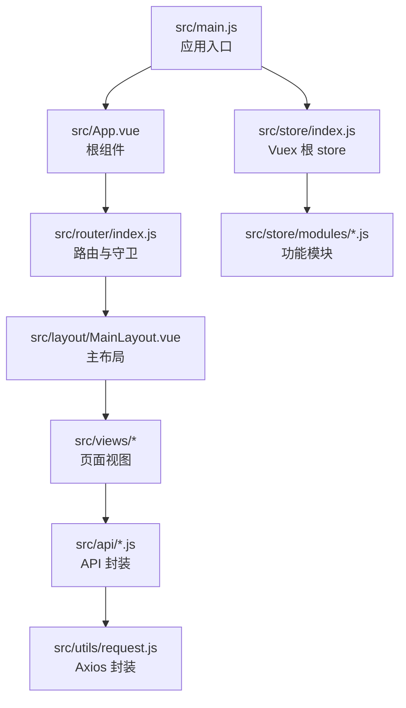
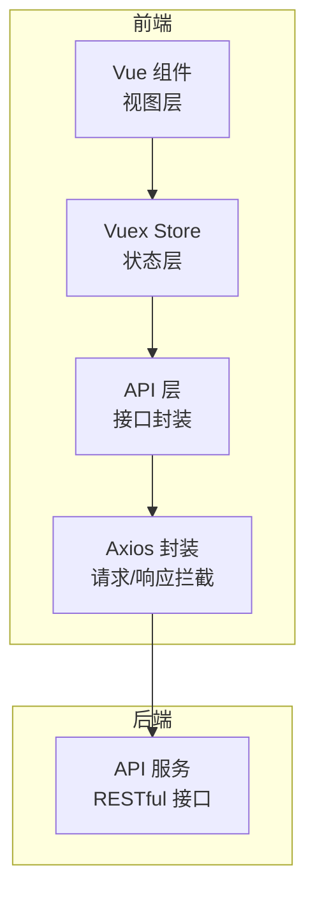
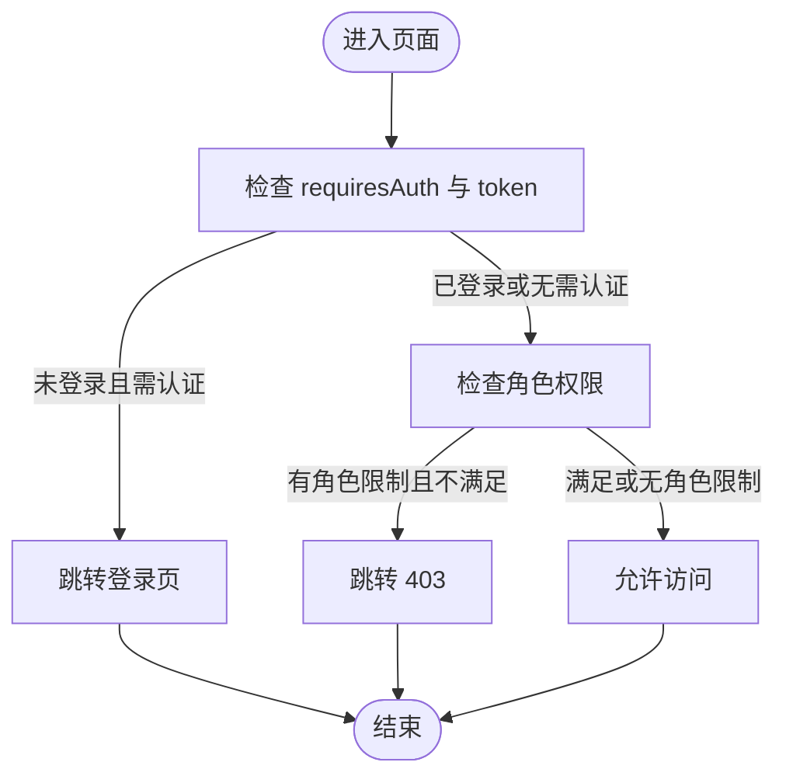
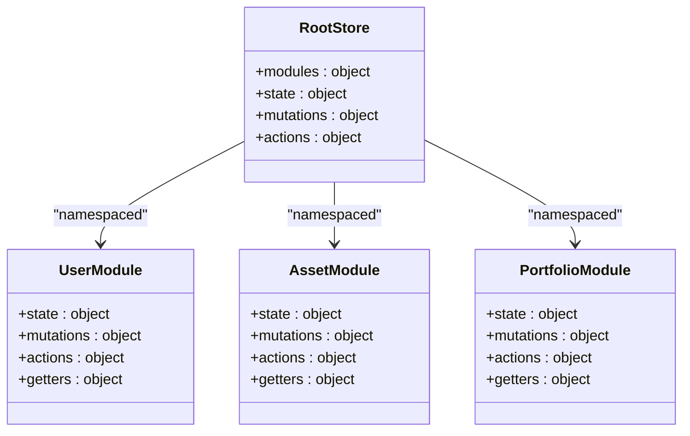
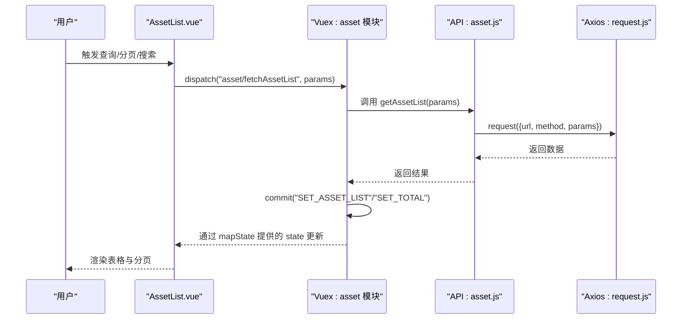
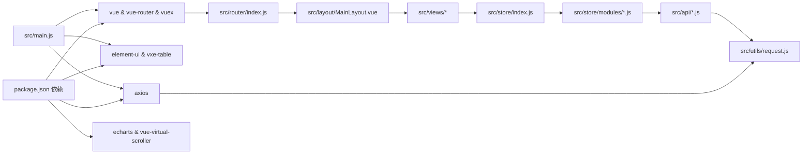

# 架构设计

<cite>
**本文引用的文件**
- [src/main.js](file://src/main.js)
- [src/App.vue](file://src/App.vue)
- [src/router/index.js](file://src/router/index.js)
- [src/layout/MainLayout.vue](file://src/layout/MainLayout.vue)
- [src/store/index.js](file://src/store/index.js)
- [src/store/modules/user.js](file://src/store/modules/user.js)
- [src/store/modules/asset.js](file://src/store/modules/asset.js)
- [src/store/modules/portfolio.js](file://src/store/modules/portfolio.js)
- [src/api/asset.js](file://src/api/asset.js)
- [src/api/portfolio.js](file://src/api/portfolio.js)
- [src/utils/request.js](file://src/utils/request.js)
- [src/views/asset/AssetList.vue](file://src/views/asset/AssetList.vue)
- [src/views/portfolio/PortfolioList.vue](file://src/views/portfolio/PortfolioList.vue)
- [package.json](file://package.json)
- [vue.config.js](file://vue.config.js)
</cite>

## 目录
1. [引言](#引言)
2. [项目结构](#项目结构)
3. [核心组件](#核心组件)
4. [架构总览](#架构总览)
5. [详细组件分析](#详细组件分析)
6. [依赖关系分析](#依赖关系分析)
7. [性能考量](#性能考量)
8. [故障排查指南](#故障排查指南)
9. [结论](#结论)
10. [附录](#附录)

## 引言
本架构设计文档面向“投资组合管理系统”，聚焦前端采用 Vue.js + Vuex + Vue Router 的单页应用（SPA），围绕 MVVM 架构模式与 Flux 架构在 Vuex 中的应用进行系统性说明。文档涵盖组件化与模块化组织方式、组件通信机制、路由与权限控制、状态管理策略、前后端分离与 API 设计原则、数据流、系统边界与技术决策，并通过多种图示帮助开发者快速理解整体设计。

## 项目结构
项目采用典型的 Vue CLI 生成的前端工程结构，按功能域划分目录，便于扩展与维护：
- src/main.js：应用入口，初始化 Vue 实例、注册插件与全局依赖。
- src/App.vue：根组件，承载路由出口。
- src/router/index.js：路由定义与守卫，实现嵌套路由与权限控制。
- src/layout/MainLayout.vue：主布局，包含侧边菜单、面包屑、头部用户信息与路由视图容器。
- src/store/index.js：Vuex 根 store，注册各功能模块。
- src/store/modules/*：按领域拆分的状态模块（如 user、asset、portfolio 等）。
- src/api/*：API 层封装，统一对外接口。
- src/utils/request.js：Axios 封装，统一处理请求/响应拦截与错误提示。
- src/views/*：页面级视图组件，按模块组织。
- package.json：依赖与脚本。
- vue.config.js：构建别名与 Webpack 配置增强。

**图表来源**
- [src/main.js:1-31](file://src/main.js#L1-L31)
- [src/App.vue:1-116](file://src/App.vue#L1-L116)
- [src/router/index.js:1-378](file://src/router/index.js#L1-L378)
- [src/layout/MainLayout.vue:1-330](file://src/layout/MainLayout.vue#L1-L330)
- [src/store/index.js:1-44](file://src/store/index.js#L1-L44)
- [src/api/asset.js:1-284](file://src/api/asset.js#L1-L284)
- [src/utils/request.js:1-100](file://src/utils/request.js#L1-L100)

**章节来源**
- [src/main.js:1-31](file://src/main.js#L1-L31)
- [src/App.vue:1-116](file://src/App.vue#L1-L116)
- [src/router/index.js:1-378](file://src/router/index.js#L1-L378)
- [src/layout/MainLayout.vue:1-330](file://src/layout/MainLayout.vue#L1-L330)
- [src/store/index.js:1-44](file://src/store/index.js#L1-L44)
- [package.json:1-45](file://package.json#L1-L45)
- [vue.config.js:1-17](file://vue.config.js#L1-L17)

## 核心组件
- 应用入口与渲染
  - 在入口文件中注册 Element UI、虚拟滚动、vxe-table 及其插件，注入全局图表库，挂载根实例。
- 根组件与路由出口
  - 根组件仅包含一个路由出口，负责承载所有页面视图。
- 主布局与导航
  - 主布局提供侧边菜单、面包屑、头部用户信息与内容区域，支持折叠与路由联动。
- 路由系统
  - 使用 hash 模式，定义多级嵌套路由，结合 meta 控制标题、图标与权限；全局前置守卫实现登录态与角色校验。
- 状态管理
  - 根 store 注册 user、asset、portfolio、strategy、benchmark、monitor、agent 等模块，提供通用 loading/collapsed 状态与动作。
- API 与请求封装
  - API 文件集中定义接口方法；Axios 封装统一添加 Authorization 头、处理 401/403/404 等错误并提示。

**章节来源**
- [src/main.js:1-31](file://src/main.js#L1-L31)
- [src/App.vue:1-116](file://src/App.vue#L1-L116)
- [src/layout/MainLayout.vue:1-330](file://src/layout/MainLayout.vue#L1-L330)
- [src/router/index.js:1-378](file://src/router/index.js#L1-L378)
- [src/store/index.js:1-44](file://src/store/index.js#L1-L44)
- [src/utils/request.js:1-100](file://src/utils/request.js#L1-L100)

## 架构总览
系统采用前后端分离架构，前端 SPA 通过 Axios 与后端 API 交互。MVVM 体现在：
- Model：Vuex 模块（user、asset、portfolio 等）承载业务状态与数据。
- View：Vue 组件（页面视图与布局）负责渲染与用户交互。
- ViewModel：Vuex Actions/Mutations 与组件计算属性/方法承担数据映射与行为协调。

Flux 在 Vuex 中的体现：
- 单向数据流：View 触发 Action -> Mutations 修改 State -> State 驱动 View 更新。
- 集中式状态：各模块 namespaced，避免命名冲突，保持清晰边界。
- 命令式更新：通过 dispatch/action 与 commit/mutation 改变状态。

**图表来源**
- [src/views/asset/AssetList.vue:162-339](file://src/views/asset/AssetList.vue#L162-L339)
- [src/views/portfolio/PortfolioList.vue:154-357](file://src/views/portfolio/PortfolioList.vue#L154-L357)
- [src/store/modules/asset.js:1-183](file://src/store/modules/asset.js#L1-L183)
- [src/store/modules/portfolio.js:1-106](file://src/store/modules/portfolio.js#L1-L106)
- [src/api/asset.js:1-284](file://src/api/asset.js#L1-L284)
- [src/api/portfolio.js:1-72](file://src/api/portfolio.js#L1-L72)
- [src/utils/request.js:1-100](file://src/utils/request.js#L1-L100)

## 详细组件分析

### 路由与权限控制
- 嵌套路由
  - 根路径重定向至工作台；子路由按模块组织（资产库、策略、组合、数据分析、AI 助手、系统管理），部分模块进一步细分子路由。
- 权限控制
  - 路由元信息包含 requiresAuth、roles 等；全局守卫根据 token 与用户角色决定放行或跳转。
- 菜单联动
  - 主布局根据当前路由动态展开/高亮菜单项，面包屑基于 matched 元信息生成。

**图表来源**
- [src/router/index.js:351-375](file://src/router/index.js#L351-L375)
- [src/layout/MainLayout.vue:144-218](file://src/layout/MainLayout.vue#L144-L218)

**章节来源**
- [src/router/index.js:1-378](file://src/router/index.js#L1-L378)
- [src/layout/MainLayout.vue:1-330](file://src/layout/MainLayout.vue#L1-L330)

### 状态管理与模块化
- 模块注册
  - 根 store 注册 user、asset、portfolio、strategy、benchmark、monitor、agent 等模块，提供全局 loading/collapsed 状态与动作。
- 用户模块
  - 维护 token、用户信息、权限；提供登录、登出、获取用户信息等动作；支持权限判断 getter。
- 资产模块
  - 管理资产列表、分类、选中集合、总数与加载状态；提供列表、选项、增删改等 Actions。
- 组合模块
  - 管理组合列表、当前组合、基准集合；提供列表、创建、更新、删除、详情等 Actions。

**图表来源**
- [src/store/index.js:13-43](file://src/store/index.js#L13-L43)
- [src/store/modules/user.js:1-119](file://src/store/modules/user.js#L1-L119)
- [src/store/modules/asset.js:1-183](file://src/store/modules/asset.js#L1-L183)
- [src/store/modules/portfolio.js:1-106](file://src/store/modules/portfolio.js#L1-L106)

**章节来源**
- [src/store/index.js:1-44](file://src/store/index.js#L1-L44)
- [src/store/modules/user.js:1-119](file://src/store/modules/user.js#L1-L119)
- [src/store/modules/asset.js:1-183](file://src/store/modules/asset.js#L1-L183)
- [src/store/modules/portfolio.js:1-106](file://src/store/modules/portfolio.js#L1-L106)

### 组件通信与数据流
- 页面组件与状态
  - 视图组件通过 mapState/mapGetters/mapActions 与 Vuex 交互；发起 Actions 获取/更新数据，读取 State 渲染 UI。
- API 调用与错误处理
  - API 方法封装具体接口；Axios 封装统一添加 Authorization 头与错误提示；组件在异常分支捕获并反馈用户。
- 示例：资产列表页
  - 组件在 created 生命周期触发 asset/fetchAssetList；通过本地计算属性映射 store 中的 assetList 与 loading；分页与搜索参数传递给 Actions；删除操作调用 asset/deleteAsset 并刷新列表。

**图表来源**
- [src/views/asset/AssetList.vue:162-339](file://src/views/asset/AssetList.vue#L162-L339)
- [src/store/modules/asset.js:47-94](file://src/store/modules/asset.js#L47-L94)
- [src/api/asset.js:7-21](file://src/api/asset.js#L7-L21)
- [src/utils/request.js:11-25](file://src/utils/request.js#L11-L25)

**章节来源**
- [src/views/asset/AssetList.vue:162-339](file://src/views/asset/AssetList.vue#L162-L339)
- [src/store/modules/asset.js:1-183](file://src/store/modules/asset.js#L1-L183)
- [src/api/asset.js:1-284](file://src/api/asset.js#L1-L284)
- [src/utils/request.js:1-100](file://src/utils/request.js#L1-L100)

### 组件化与模块化组织
- 组件化原则
  - 页面视图组件（views）负责页面级逻辑与布局；复用性强的 UI 抽象为通用组件（components）。
  - 通过 props、events、slots 实现父子通信与插槽扩展。
- 模块化组织
  - 按领域拆分 Vuex 模块，namespaced 避免命名冲突；API 按功能域拆分文件，职责单一。
  - 路由按模块组织，嵌套子路由形成清晰的导航层级。

**章节来源**
- [src/router/index.js:1-378](file://src/router/index.js#L1-L378)
- [src/layout/MainLayout.vue:1-330](file://src/layout/MainLayout.vue#L1-L330)
- [src/store/index.js:1-44](file://src/store/index.js#L1-L44)

## 依赖关系分析
- 运行时依赖
  - Vue 生态（vue、vue-router、vuex）、UI 框架（element-ui）、表格（vxe-table）、图表（echarts）、虚拟滚动（vue-virtual-scroller）、HTTP 客户端（axios）等。
- 构建与工具
  - Vue CLI 插件（babel、router、vuex）、Webpack 别名优化（tslib）。
- 关键依赖链
  - main.js -> App.vue -> router/index.js -> layout/MainLayout.vue -> views/* -> store/modules/* -> api/* -> utils/request.js。

**图表来源**
- [package.json:11-28](file://package.json#L11-L28)
- [src/main.js:1-31](file://src/main.js#L1-L31)
- [src/utils/request.js:1-100](file://src/utils/request.js#L1-L100)
- [src/router/index.js:1-378](file://src/router/index.js#L1-L378)
- [src/layout/MainLayout.vue:1-330](file://src/layout/MainLayout.vue#L1-L330)
- [src/store/index.js:1-44](file://src/store/index.js#L1-L44)
- [src/api/asset.js:1-284](file://src/api/asset.js#L1-L284)

**章节来源**
- [package.json:1-45](file://package.json#L1-L45)
- [vue.config.js:1-17](file://vue.config.js#L1-L17)

## 性能考量
- 虚拟滚动与表格优化
  - 使用 vue-virtual-scroller 与 vxe-table，对长列表与大数据表格提供滚动性能优化。
- 图表渲染
  - 使用 ECharts 渲染组合权益曲线，建议在组件销毁时 dispose 实例，避免内存泄漏。
- 请求超时与并发
  - Axios 默认较长超时，针对大量数据导入场景可适当放宽；注意避免同时发起过多请求导致阻塞。
- 构建别名
  - 通过 vue.config.js 配置 tslib 别名，减少嵌套依赖带来的体积与打包问题。

**章节来源**
- [src/views/portfolio/PortfolioList.vue:351-355](file://src/views/portfolio/PortfolioList.vue#L351-L355)
- [vue.config.js:1-17](file://vue.config.js#L1-L17)

## 故障排查指南
- 登录态与权限
  - 401：自动清除 token 并提示重新登录；检查后端鉴权与前端 Authorization 头是否正确。
  - 403：权限不足，确认用户角色与路由 meta.roles 的匹配。
  - 404：资源不存在，检查接口路径与后端服务状态。
- 网络与超时
  - 超时/网络错误：根据提示检查后端服务是否启动、网络连通性、环境变量 VUE_APP_BASE_URL。
- 组件级错误
  - 在组件中对 API 调用进行 try/catch 并提示用户；关注后端返回的 detail/message 字段。

**章节来源**
- [src/utils/request.js:27-96](file://src/utils/request.js#L27-L96)
- [src/router/index.js:351-375](file://src/router/index.js#L351-L375)

## 结论
本系统以 Vue 生态为核心，采用 MVVM 与 Flux（Vuex）相结合的架构，实现了清晰的组件化与模块化组织。通过路由守卫与权限元信息实现细粒度的访问控制；通过 Axios 封装与 API 层解耦前后端；通过 Vuex 模块化管理业务状态，保障了可维护性与扩展性。建议在后续迭代中持续完善权限体系、引入更完善的错误边界与日志上报，并对关键流程增加单元/集成测试以提升质量。

## 附录
- 系统边界
  - 前端：Vue SPA，负责视图渲染、用户交互、状态管理与 API 调用。
  - 后端：RESTful API，提供资产、组合、策略等业务数据与操作接口。
- 技术决策
  - 使用 Vue 2.x 与 Element UI 快速搭建界面；使用 Vuex 管理全局状态；使用 Axios 统一网络层。
- 架构约束与权衡
  - 前后端分离带来灵活性与独立演进能力，但需关注跨域、鉴权与缓存策略；路由 hash 模式便于部署但不利于 SEO；模块化拆分提升可维护性，需注意模块间依赖与命名空间管理。