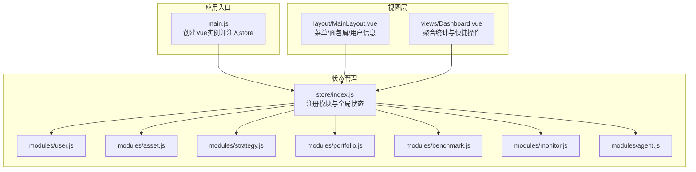
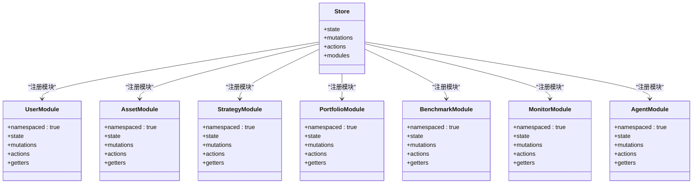
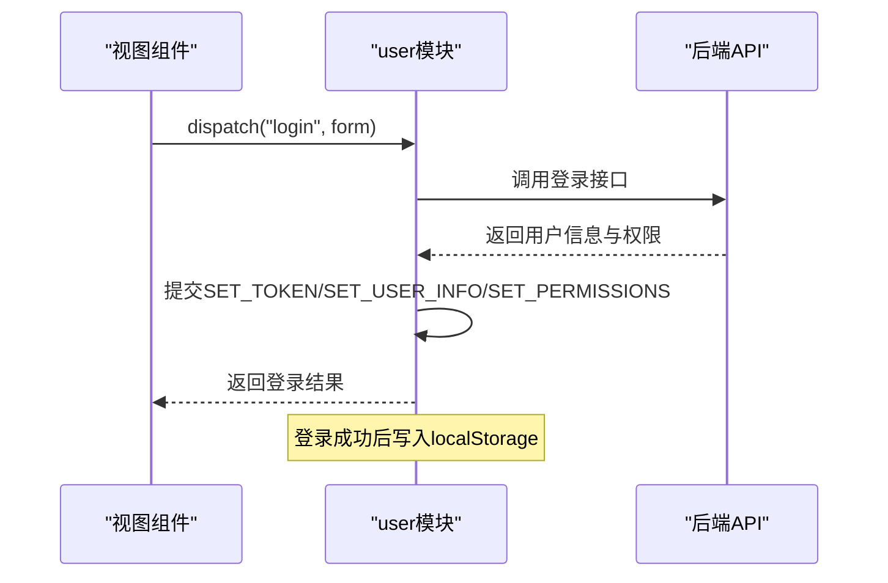
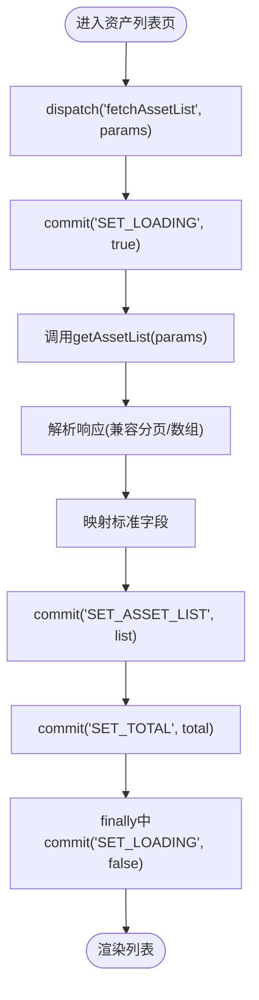
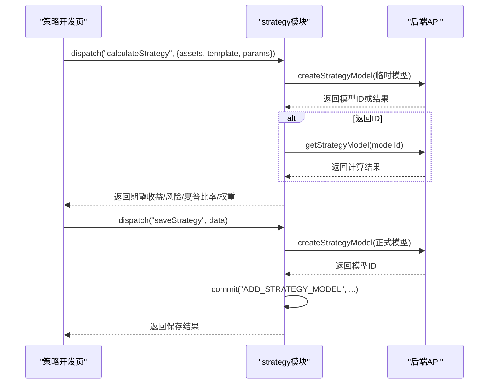
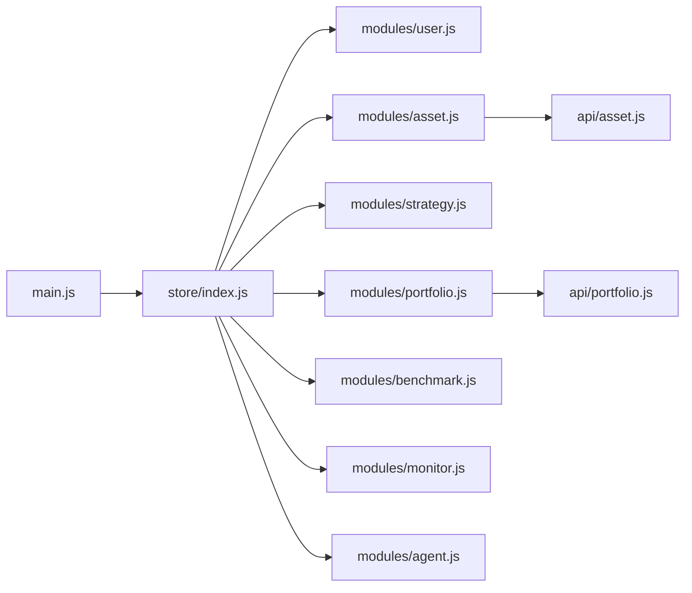
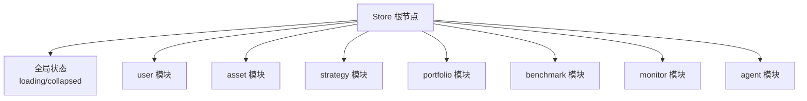

# 状态管理架构

<cite>
**本文引用的文件**
- [src/store/index.js](file://src/store/index.js)
- [src/store/modules/user.js](file://src/store/modules/user.js)
- [src/store/modules/asset.js](file://src/store/modules/asset.js)
- [src/store/modules/strategy.js](file://src/store/modules/strategy.js)
- [src/store/modules/portfolio.js](file://src/store/modules/portfolio.js)
- [src/store/modules/benchmark.js](file://src/store/modules/benchmark.js)
- [src/store/modules/monitor.js](file://src/store/modules/monitor.js)
- [src/store/modules/agent.js](file://src/store/modules/agent.js)
- [src/main.js](file://src/main.js)
- [src/layout/MainLayout.vue](file://src/layout/MainLayout.vue)
- [src/views/Dashboard.vue](file://src/views/Dashboard.vue)
- [src/api/asset.js](file://src/api/asset.js)
- [src/api/portfolio.js](file://src/api/portfolio.js)
</cite>

## 目录
1. [简介](#简介)
2. [项目结构](#项目结构)
3. [核心组件](#核心组件)
4. [架构总览](#架构总览)
5. [详细组件分析](#详细组件分析)
6. [依赖分析](#依赖分析)
7. [性能考虑](#性能考虑)
8. [故障排查指南](#故障排查指南)
9. [结论](#结论)
10. [附录](#附录)

## 简介
本文件面向投资组合管理系统，系统采用 Vue + Vuex 架构进行状态管理。本文档聚焦于 Vuex 的模块化设计、命名空间使用、模块职责划分、响应式更新机制、异步 Action 处理、Getter 计算属性设计、模块间通信方式、状态持久化策略以及开发工具集成，并通过状态树结构图与模块依赖关系图帮助读者建立整体认知。同时提供状态流转示例，指导开发者遵循最佳实践。

## 项目结构
- Store 入口集中注册所有模块，统一导出 Store 实例供根组件注入。
- 模块按领域拆分：用户(user)、资产(asset)、策略(strategy)、组合(portfolio)、基准(benchmark)、监控(monitor)、智能助理(agent)。
- 组件通过 mapState/mapGetters/mapActions 将 Store 与视图绑定，实现响应式更新与交互。

图表来源
- [src/main.js:26-30](file://src/main.js#L26-L30)
- [src/store/index.js:13-22](file://src/store/index.js#L13-L22)
- [src/layout/MainLayout.vue:144-217](file://src/layout/MainLayout.vue#L144-L217)
- [src/views/Dashboard.vue:180-256](file://src/views/Dashboard.vue#L180-L256)

章节来源
- [src/store/index.js:1-44](file://src/store/index.js#L1-L44)
- [src/main.js:1-31](file://src/main.js#L1-L31)

## 核心组件
- Store 入口：集中注册模块，定义全局状态与基础 Mutations/Actions。
- 用户模块(user)：令牌、用户信息、权限与登录登出流程。
- 资产模块(asset)：资产列表、分类、选项、增删改查与加载状态。
- 策略模块(strategy)：模板与模型的生命周期管理、回测、实盘发布与监控。
- 组合模块(portfolio)：组合列表、当前组合、基准集合与 CRUD。
- 基准模块(benchmark)：业绩基准的查询与维护。
- 监控模块(monitor)：监控上下文、净值/持仓/信号/事件/报告等多维数据的异步加载与状态聚合。
- 智能助理模块(agent)：对话列表、消息分页、流式输出与场景管理。

章节来源
- [src/store/modules/user.js:1-119](file://src/store/modules/user.js#L1-L119)
- [src/store/modules/asset.js:1-183](file://src/store/modules/asset.js#L1-L183)
- [src/store/modules/strategy.js:1-468](file://src/store/modules/strategy.js#L1-L468)
- [src/store/modules/portfolio.js:1-106](file://src/store/modules/portfolio.js#L1-L106)
- [src/store/modules/benchmark.js:1-138](file://src/store/modules/benchmark.js#L1-L138)
- [src/store/modules/monitor.js:1-416](file://src/store/modules/monitor.js#L1-L416)
- [src/store/modules/agent.js:1-230](file://src/store/modules/agent.js#L1-L230)

## 架构总览
- 命名空间：各模块均启用 namespaced: true，避免状态/动作/Getter 冲突。
- 响应式更新：组件通过 mapState/mapGetters 订阅模块状态；Mutations 同步修改；Actions 异步协调。
- 数据来源：API 层封装请求细节，模块 Actions 调用 API 并提交 Mutations 更新 Store。
- 全局状态：Store 定义 loading/collapsed 等全局 UI 状态，供通用布局与交互使用。

图表来源
- [src/store/index.js:13-22](file://src/store/index.js#L13-L22)
- [src/store/modules/user.js:112-119](file://src/store/modules/user.js#L112-L119)
- [src/store/modules/asset.js:176-183](file://src/store/modules/asset.js#L176-L183)
- [src/store/modules/strategy.js:461-468](file://src/store/modules/strategy.js#L461-L468)
- [src/store/modules/portfolio.js:99-106](file://src/store/modules/portfolio.js#L99-L106)
- [src/store/modules/benchmark.js:132-138](file://src/store/modules/benchmark.js#L132-L138)
- [src/store/modules/monitor.js:409-416](file://src/store/modules/monitor.js#L409-L416)
- [src/store/modules/agent.js:223-230](file://src/store/modules/agent.js#L223-L230)

## 详细组件分析

### 用户状态(user)
- 职责：登录/登出、用户信息缓存、权限校验。
- 命名空间：启用 namespaced: true。
- 关键点：
  - 登录：模拟 API 返回用户角色与权限，写入本地存储并提交状态。
  - 权限：提供 hasPermission Getter，支持“全部权限”通配。
  - 登出：清理 token 与用户信息本地存储。

图表来源
- [src/store/modules/user.js:28-100](file://src/store/modules/user.js#L28-L100)

章节来源
- [src/store/modules/user.js:1-119](file://src/store/modules/user.js#L1-L119)

### 资产状态(asset)
- 职责：资产列表、分类、选项、增删改查、加载状态。
- 命名空间：启用 namespaced: true。
- 关键点：
  - 列表加载：兼容后端分页包装与直返数组，统一映射字段。
  - 选项加载：兼容不同字段名，统一 label/value 输出。
  - 增删改：调用 API 后同步更新本地列表与计数。

图表来源
- [src/store/modules/asset.js:47-94](file://src/store/modules/asset.js#L47-L94)

章节来源
- [src/store/modules/asset.js:1-183](file://src/store/modules/asset.js#L1-L183)
- [src/api/asset.js:7-21](file://src/api/asset.js#L7-L21)

### 策略状态(strategy)
- 职责：模板与模型的生命周期、回测、实盘发布/配置、监控与日志。
- 命名空间：启用 namespaced: true。
- 关键点：
  - 回测：runBacktest 返回完整响应，便于组件统一处理。
  - 实盘：livePublishModel/liveUnpublishModel/updateLiveConfig 等联动更新模型状态。
  - 计算与保存：calculateStrategy 与 saveStrategy 协同完成策略开发流程。

图表来源
- [src/store/modules/strategy.js:365-429](file://src/store/modules/strategy.js#L365-L429)

章节来源
- [src/store/modules/strategy.js:1-468](file://src/store/modules/strategy.js#L1-L468)

### 组合状态(portfolio)
- 职责：组合列表、当前组合、基准集合与 CRUD。
- 命名空间：启用 namespaced: true。
- 关键点：
  - 列表加载：调用 getPortfolioList 后更新本地列表。
  - 详情获取：在内存中查找当前组合并提交到 currentPortfolio。

章节来源
- [src/store/modules/portfolio.js:1-106](file://src/store/modules/portfolio.js#L1-L106)
- [src/api/portfolio.js:7-13](file://src/api/portfolio.js#L7-L13)

### 基准状态(benchmark)
- 职责：业绩基准的查询、创建、更新、删除。
- 命名空间：启用 namespaced: true。
- 关键点：
  - 列表加载：兼容数组与 data 包装，统一映射。
  - 活跃基准过滤：通过 Getter 提供活跃基准集合。

章节来源
- [src/store/modules/benchmark.js:1-138](file://src/store/modules/benchmark.js#L1-L138)

### 监控状态(monitor)
- 职责：监控上下文、净值/持仓/信号/事件/报告等多维数据的异步加载与状态聚合。
- 命名空间：启用 namespaced: true。
- 关键点：
  - 上下文解析：resolveMonitorId 支持显式 ID 或当前激活 ID。
  - 并发分析：fetchAssetAnalysis 并行请求相关指标，合并到状态。
  - 加载状态：统一 SET_LOADING 控制全局 Loading。

章节来源
- [src/store/modules/monitor.js:1-416](file://src/store/modules/monitor.js#L1-L416)

### 智能助理(agent)
- 职责：对话列表、消息分页、流式输出、场景管理。
- 命名空间：启用 namespaced: true。
- 关键点：
  - 分页加载：loadConversation 支持 prepend 历史追加，去重合并。
  - 流式输出：appendStreamContent/finishStreaming 累积并落盘最后一条消息。
  - 场景映射：conversationScenes 记录对话与场景的映射。

章节来源
- [src/store/modules/agent.js:1-230](file://src/store/modules/agent.js#L1-L230)

## 依赖分析
- Store 注册：store/index.js 统一引入并注册 user/asset/strategy/portfolio/benchmark/monitor/agent。
- 组件依赖：MainLayout.vue 与 Dashboard.vue 通过 mapState/mapGetters/mapActions 使用 Store。
- API 依赖：各模块内部依赖对应 API 文件，如 asset 依赖 src/api/asset.js，portfolio 依赖 src/api/portfolio.js。

图表来源
- [src/main.js:26-30](file://src/main.js#L26-L30)
- [src/store/index.js:3-9](file://src/store/index.js#L3-L9)
- [src/store/modules/asset.js:1](file://src/store/modules/asset.js#L1)
- [src/store/modules/portfolio.js:36](file://src/store/modules/portfolio.js#L36)
- [src/api/asset.js:1](file://src/api/asset.js#L1)
- [src/api/portfolio.js:1](file://src/api/portfolio.js#L1)

章节来源
- [src/store/index.js:1-44](file://src/store/index.js#L1-L44)
- [src/layout/MainLayout.vue:144-217](file://src/layout/MainLayout.vue#L144-L217)
- [src/views/Dashboard.vue:180-256](file://src/views/Dashboard.vue#L180-L256)

## 性能考虑
- 列表加载优化：资产模块对后端响应格式做兼容处理，减少 UI 层判断成本。
- 并发请求：监控模块对相关指标使用 Promise.all 并行获取，降低等待时间。
- 状态粒度：将 loading 等 UI 状态置于全局 Store，避免每个模块重复定义。
- 本地存储：用户模块将 token 与用户信息持久化至 localStorage，减少重复登录开销。
- 建议：对高频列表（如资产、组合、策略）增加本地分页与虚拟滚动，进一步提升渲染性能。

## 故障排查指南
- 登录无效果：检查 user.login 是否正确提交 SET_TOKEN/SET_USER_INFO/SET_PERMISSIONS，确认 localStorage 是否写入。
- 列表为空：检查 asset.fetchAssetList 的 API 返回格式是否符合预期，关注分页包装与数组分支。
- 实盘发布失败：核对 strategy.livePublishModel 的错误分支与后端返回 code/message，确保状态更新分支命中。
- 监控数据为空：确认 monitor.setActiveMonitorContext 已设置 activeMonitorId，且各接口返回 data 字段。
- 对话消息重复：检查 agent.loadConversation 的 prepend 逻辑与去重集合，避免竞态导致的重复插入。

章节来源
- [src/store/modules/user.js:28-100](file://src/store/modules/user.js#L28-L100)
- [src/store/modules/asset.js:47-94](file://src/store/modules/asset.js#L47-L94)
- [src/store/modules/strategy.js:230-256](file://src/store/modules/strategy.js#L230-L256)
- [src/store/modules/monitor.js:81-106](file://src/store/modules/monitor.js#L81-L106)
- [src/store/modules/agent.js:111-159](file://src/store/modules/agent.js#L111-L159)

## 结论
本系统通过模块化的 Vuex 架构清晰划分了用户、资产、策略、组合、基准、监控与智能助理七大领域的状态边界，配合命名空间与统一的异步处理模式，实现了高内聚低耦合的状态管理。组件通过 mapState/mapGetters/mapActions 与 Store 解耦，响应式更新自然流畅。建议在后续迭代中持续完善错误处理与性能优化，保持状态树简洁与模块职责单一。

## 附录

### 状态树结构示意

图表来源
- [src/store/index.js:23-42](file://src/store/index.js#L23-L42)
- [src/store/modules/user.js:112-119](file://src/store/modules/user.js#L112-L119)
- [src/store/modules/asset.js:176-183](file://src/store/modules/asset.js#L176-L183)
- [src/store/modules/strategy.js:461-468](file://src/store/modules/strategy.js#L461-L468)
- [src/store/modules/portfolio.js:99-106](file://src/store/modules/portfolio.js#L99-L106)
- [src/store/modules/benchmark.js:132-138](file://src/store/modules/benchmark.js#L132-L138)
- [src/store/modules/monitor.js:409-416](file://src/store/modules/monitor.js#L409-L416)
- [src/store/modules/agent.js:223-230](file://src/store/modules/agent.js#L223-L230)

### 模块间通信方式
- 命名空间调用：组件通过命名空间路径访问模块，如 'user/login'、'asset/fetchAssetList'。
- 组件间协作：Dashboard 聚合 portfolio/strategy/asset 三个模块的数据，形成仪表板概览。
- 全局动作：Store 提供 toggleCollapsed/setLoading 等全局动作，供通用布局使用。

章节来源
- [src/views/Dashboard.vue:190-217](file://src/views/Dashboard.vue#L190-L217)
- [src/layout/MainLayout.vue:144-217](file://src/layout/MainLayout.vue#L144-L217)
- [src/store/index.js:35-42](file://src/store/index.js#L35-L42)