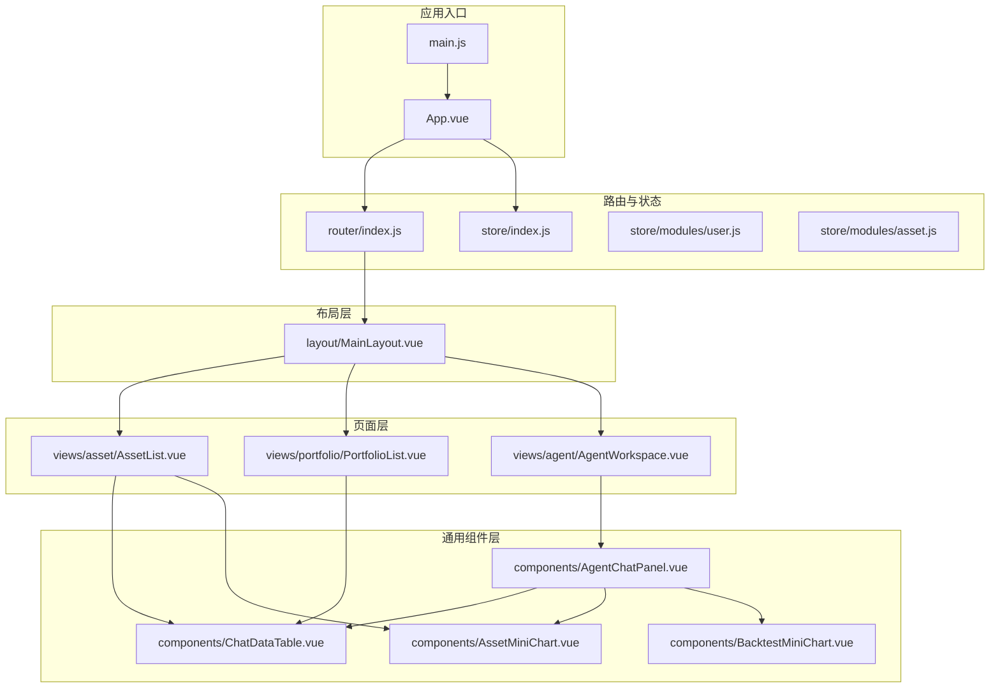
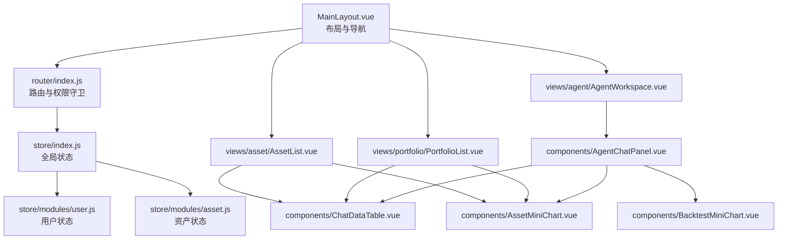
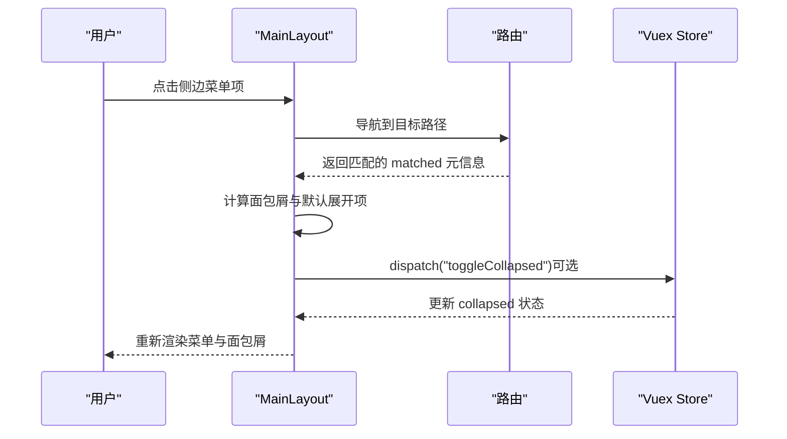
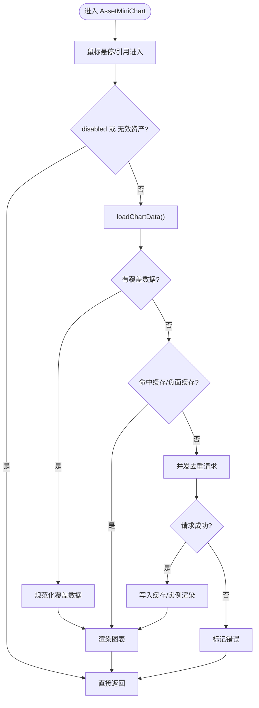
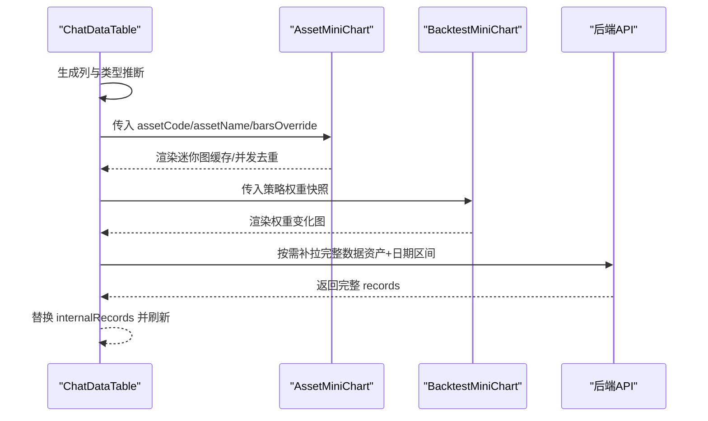
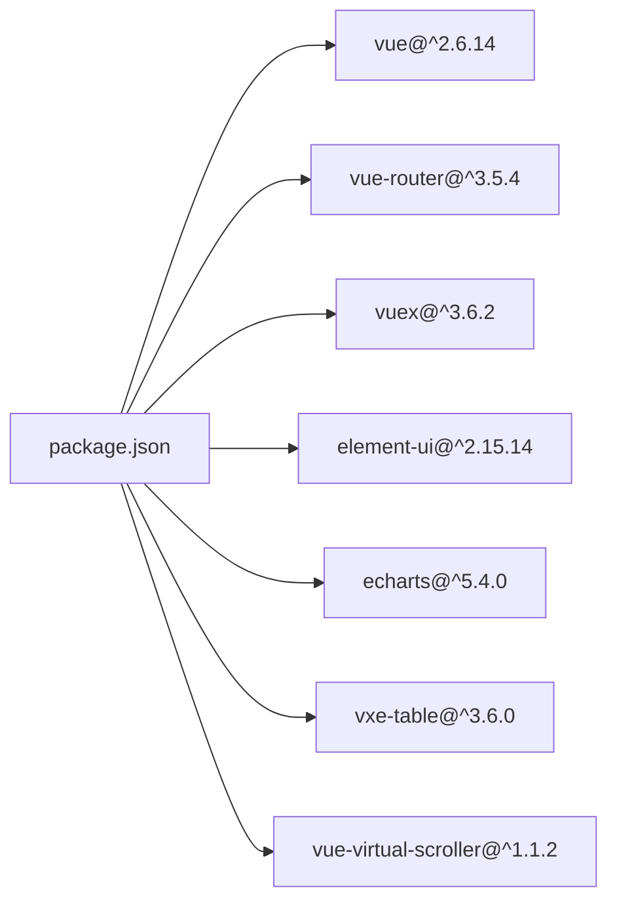
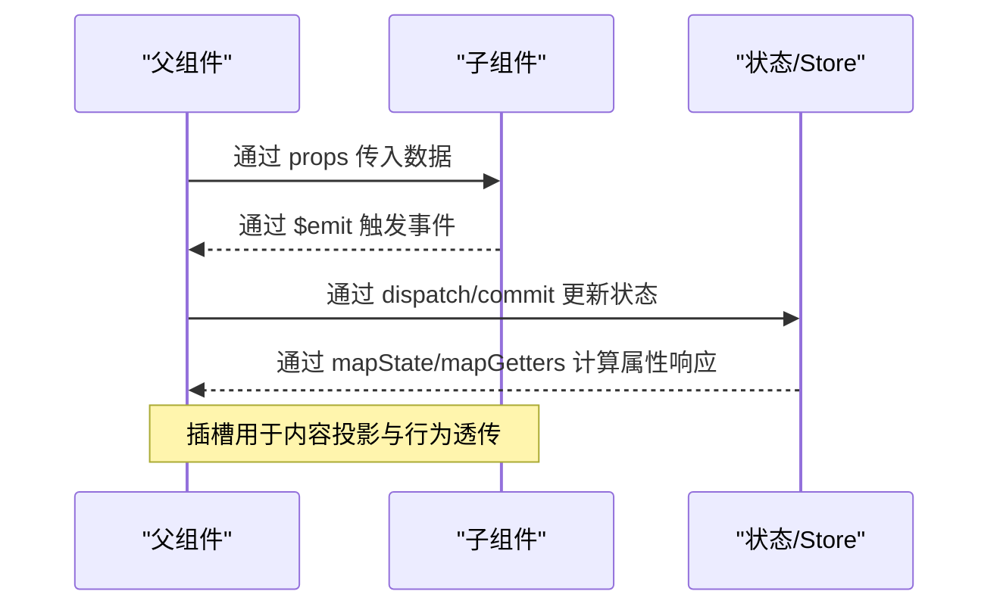

# 组件架构

<cite>
**本文引用的文件**
- [MainLayout.vue](file://src/layout/MainLayout.vue)
- [App.vue](file://src/App.vue)
- [main.js](file://src/main.js)
- [index.js](file://src/router/index.js)
- [index.js](file://src/store/index.js)
- [user.js](file://src/store/modules/user.js)
- [asset.js](file://src/store/modules/asset.js)
- [AssetMiniChart.vue](file://src/components/AssetMiniChart.vue)
- [BacktestMiniChart.vue](file://src/components/BacktestMiniChart.vue)
- [ChatDataTable.vue](file://src/components/ChatDataTable.vue)
- [AgentChatPanel.vue](file://src/components/AgentChatPanel.vue)
- [AssetList.vue](file://src/views/asset/AssetList.vue)
- [PortfolioList.vue](file://src/views/portfolio/PortfolioList.vue)
- [AgentWorkspace.vue](file://src/views/agent/AgentWorkspace.vue)
- [package.json](file://package.json)
</cite>

## 目录
1. [引言](#引言)
2. [项目结构](#项目结构)
3. [核心组件](#核心组件)
4. [架构总览](#架构总览)
5. [组件详解](#组件详解)
6. [依赖关系分析](#依赖关系分析)
7. [性能考量](#性能考量)
8. [故障排查指南](#故障排查指南)
9. [结论](#结论)
10. [附录](#附录)

## 引言
本文件面向投资组合管理系统，系统化梳理组件化架构设计与实现，重点覆盖：
- 可复用组件的设计模式与职责边界
- 组件间通信机制（props、事件、插槽、Vuex）
- 布局组件 MainLayout 的结构与导航联动
- 页面级组件的组织方式与数据流
- 生命周期管理、数据绑定策略与指令使用
- 组件继承关系与通信示意
- 开发最佳实践与常见问题排查

## 项目结构
系统采用典型的 Vue 2 + Element UI + Vuex + Vue Router 组织方式，采用“布局层-页面层-通用组件层”的分层结构：
- 布局层：MainLayout 提供统一的侧边菜单、面包屑、头部用户信息与主内容区
- 页面层：views 下按业务域划分（资产、组合、策略、分析、系统等），页面内组合多个通用组件
- 通用组件层：components 下封装可复用的可视化与交互组件（如迷你图、数据表格、对话面板等）

**图表来源**
- [main.js:1-31](file://src/main.js#L1-L31)
- [App.vue:1-116](file://src/App.vue#L1-L116)
- [index.js:1-378](file://src/router/index.js#L1-L378)
- [index.js:1-44](file://src/store/index.js#L1-L44)
- [user.js:1-119](file://src/store/modules/user.js#L1-L119)
- [asset.js:1-183](file://src/store/modules/asset.js#L1-L183)
- [MainLayout.vue:1-330](file://src/layout/MainLayout.vue#L1-L330)
- [AssetList.vue:1-346](file://src/views/asset/AssetList.vue#L1-L346)
- [PortfolioList.vue:1-372](file://src/views/portfolio/PortfolioList.vue#L1-L372)
- [AgentWorkspace.vue:1-512](file://src/views/agent/AgentWorkspace.vue#L1-L512)
- [AssetMiniChart.vue:1-493](file://src/components/AssetMiniChart.vue#L1-L493)
- [BacktestMiniChart.vue:1-200](file://src/components/BacktestMiniChart.vue#L1-L200)
- [ChatDataTable.vue:1-800](file://src/components/ChatDataTable.vue#L1-L800)
- [AgentChatPanel.vue:1-200](file://src/components/AgentChatPanel.vue#L1-L200)

**章节来源**
- [main.js:1-31](file://src/main.js#L1-L31)
- [App.vue:1-116](file://src/App.vue#L1-L116)
- [index.js:1-378](file://src/router/index.js#L1-L378)
- [index.js:1-44](file://src/store/index.js#L1-L44)

## 核心组件
- 布局组件 MainLayout：负责侧边菜单、面包屑、头部用户信息、主内容区与路由视图切换动画
- 通用组件：
  - AssetMiniChart：资产迷你图，支持 hover 弹出、缓存与并发去重、覆盖数据渲染
  - BacktestMiniChart：回测权重变化迷你图，支持指标摘要与权重堆叠面积图
  - ChatDataTable：可搜索/排序/分页的表格，集成资产芯片与回测芯片，支持“加载完整数据”
  - AgentChatPanel：对话面板，支持虚拟滚动、流式输出、工具阶段进度、Markdown/HTML/表格/图表混合渲染
- 页面组件：
  - AssetList：资产列表页，组合 AssetForm/AssetQuote/AssetDetail 对话框
  - PortfolioList：组合列表页，集成业绩详情对话框与权益曲线图表
  - AgentWorkspace：AI 助手工作区，三栏布局（对话列表/场景选择/聊天/信息面板）

**章节来源**
- [MainLayout.vue:1-330](file://src/layout/MainLayout.vue#L1-L330)
- [AssetMiniChart.vue:1-493](file://src/components/AssetMiniChart.vue#L1-L493)
- [BacktestMiniChart.vue:1-200](file://src/components/BacktestMiniChart.vue#L1-L200)
- [ChatDataTable.vue:1-800](file://src/components/ChatDataTable.vue#L1-L800)
- [AgentChatPanel.vue:1-200](file://src/components/AgentChatPanel.vue#L1-L200)
- [AssetList.vue:1-346](file://src/views/asset/AssetList.vue#L1-L346)
- [PortfolioList.vue:1-372](file://src/views/portfolio/PortfolioList.vue#L1-L372)
- [AgentWorkspace.vue:1-512](file://src/views/agent/AgentWorkspace.vue#L1-L512)

## 架构总览
系统采用“布局-页面-组件”三层架构，结合 Vuex 状态管理与 Element UI 组件库，形成清晰的职责分离与可复用性。

**图表来源**
- [index.js:1-378](file://src/router/index.js#L1-L378)
- [index.js:1-44](file://src/store/index.js#L1-L44)
- [user.js:1-119](file://src/store/modules/user.js#L1-L119)
- [asset.js:1-183](file://src/store/modules/asset.js#L1-L183)
- [MainLayout.vue:1-330](file://src/layout/MainLayout.vue#L1-L330)
- [AssetList.vue:1-346](file://src/views/asset/AssetList.vue#L1-L346)
- [PortfolioList.vue:1-372](file://src/views/portfolio/PortfolioList.vue#L1-L372)
- [AgentWorkspace.vue:1-512](file://src/views/agent/AgentWorkspace.vue#L1-L512)
- [AssetMiniChart.vue:1-493](file://src/components/AssetMiniChart.vue#L1-L493)
- [BacktestMiniChart.vue:1-200](file://src/components/BacktestMiniChart.vue#L1-L200)
- [ChatDataTable.vue:1-800](file://src/components/ChatDataTable.vue#L1-L800)
- [AgentChatPanel.vue:1-200](file://src/components/AgentChatPanel.vue#L1-L200)

## 组件详解

### 布局组件 MainLayout 设计
- 结构组成：侧边栏（El-Aside）、顶部导航（El-Header）、主内容区（El-Main），内部嵌套 El-Container
- 导航联动：
  - 侧边菜单根据当前路由动态展开与选中，面包屑基于 matched 元信息生成
  - 顶部用户下拉菜单支持登出、个人中心、修改密码等命令
- 响应式与动画：支持折叠/展开，侧边宽度与过渡动画；页面切换使用淡入淡出过渡
- 与状态管理：通过 Vuex 读取 collapsed 状态，触发 toggleCollapsed；读取用户信息与角色判断

**图表来源**
- [MainLayout.vue:144-217](file://src/layout/MainLayout.vue#L144-L217)
- [index.js:1-378](file://src/router/index.js#L1-L378)
- [index.js:35-42](file://src/store/index.js#L35-L42)

**章节来源**
- [MainLayout.vue:1-330](file://src/layout/MainLayout.vue#L1-L330)
- [index.js:1-378](file://src/router/index.js#L1-L378)
- [index.js:1-44](file://src/store/index.js#L1-L44)

### 通用组件：AssetMiniChart
- 设计要点：
  - 使用 el-popover 悬停触发，插槽承载引用元素，支持禁用与覆盖数据
  - 模块级缓存与并发去重，预取并发控制，缩短首次悬浮等待
  - 规范化数据（normalizeBars），支持 barsOverride 与 ECharts 实例复用
- 生命周期：组件销毁时 dispose 实例，避免内存泄漏
- 性能优化：缓存、并发去重、预取、实例复用、懒渲染

**图表来源**
- [AssetMiniChart.vue:143-432](file://src/components/AssetMiniChart.vue#L143-L432)

**章节来源**
- [AssetMiniChart.vue:1-493](file://src/components/AssetMiniChart.vue#L1-L493)

### 通用组件：BacktestMiniChart
- 设计要点：
  - 展示策略权重快照的堆叠面积图，支持指标摘要（总收益、夏普、最大回撤）
  - 降采样至最多 30 个点，优化渲染性能
  - ECharts 实例复用与 DOM 变更检测
- 适用场景：在 ChatDataTable 的策略芯片中展示权重变化趋势

**章节来源**
- [BacktestMiniChart.vue:1-200](file://src/components/BacktestMiniChart.vue#L1-L200)

### 通用组件：ChatDataTable
- 设计要点：
  - 表格列自动生成与类型推断，支持百分比字段识别与对齐
  - 搜索（全字段模糊匹配，带防抖与 IME 合成兼容）、排序、分页
  - 资产芯片区：代表资产与参考资产分组，支持展开/折叠与分批渲染
  - 回测芯片区：展示策略关联的权重变化图
  - “加载完整数据”：在后端缩略场景下，按推断的资产与日期区间补拉完整数据
  - 性能：展开状态缓存、搜索输入框与 IME 状态管理、分页与虚拟滚动友好
- 与 AssetMiniChart/BacktestMiniChart 的协作：通过 barsOverride 与权重快照实现数据一致性

**图表来源**
- [ChatDataTable.vue:1-800](file://src/components/ChatDataTable.vue#L1-L800)
- [AssetMiniChart.vue:1-493](file://src/components/AssetMiniChart.vue#L1-L493)
- [BacktestMiniChart.vue:1-200](file://src/components/BacktestMiniChart.vue#L1-L200)

**章节来源**
- [ChatDataTable.vue:1-800](file://src/components/ChatDataTable.vue#L1-L800)

### 页面组件：AssetList
- 设计要点：
  - 搜索表单、VXE 表格、分页、批量导入与下载模板
  - 弹窗组合：资产表单、行情查看、详情查看
  - 与 Vuex 资产模块交互：fetchAssetList、addAsset、updateAsset、deleteAsset
- 事件与插槽：通过 is-dialog 控制弹窗显示，事件回调触发刷新

**章节来源**
- [AssetList.vue:1-346](file://src/views/asset/AssetList.vue#L1-L346)
- [asset.js:1-183](file://src/store/modules/asset.js#L1-L183)

### 页面组件：PortfolioList
- 设计要点：
  - 列表展示组合关键指标，支持查看详情、业绩、基准对比
  - 业绩详情对话框内集成权益曲线图表（ECharts）
  - 删除确认、格式化数字与百分比、状态标签
- 生命周期：beforeDestroy 释放图表实例

**章节来源**
- [PortfolioList.vue:1-372](file://src/views/portfolio/PortfolioList.vue#L1-L372)

### 页面组件：AgentWorkspace
- 设计要点：
  - 三栏布局：左侧对话列表、中间场景选择与聊天面板、右侧场景信息与快捷问题
  - 与 AgentChatPanel 通信：场景切换、新建/删除对话、快捷问题
  - 与 Vuex agent 模块交互：加载对话、创建对话、设置当前场景
- 事件与插槽：通过 ref 调用 cancelStreaming，事件回调更新对话列表

**章节来源**
- [AgentWorkspace.vue:1-512](file://src/views/agent/AgentWorkspace.vue#L1-L512)
- [AgentChatPanel.vue:1-200](file://src/components/AgentChatPanel.vue#L1-L200)

## 依赖关系分析
- 运行时依赖：Vue 2、Vue Router、Vuex、Element UI、ECharts、vxe-table、vue-virtual-scroller
- 构建与服务：@vue/cli-service、babel、postinstall 脚本
- 组件间耦合：
  - ChatDataTable 与 AssetMiniChart/BacktestMiniChart 通过 props 与事件解耦
  - 页面组件通过 Vuex 与 API 模块解耦，降低耦合度
- 外部依赖集成：
  - main.js 注册 Element UI、VXETable、ECharts、虚拟滚动
  - App.vue 提供全局样式与通用卡片/数字格式化样式

**图表来源**
- [package.json:1-45](file://package.json#L1-L45)

**章节来源**
- [package.json:1-45](file://package.json#L1-L45)

## 性能考量
- 渲染性能
  - 虚拟滚动：AgentChatPanel 使用 vue-virtual-scroller，减少 DOM 节点数量
  - 表格分页与预览：ChatDataTable 支持 previewLimit 与分页，避免一次性渲染大量数据
  - 图表实例复用：AssetMiniChart/BacktestMiniChart/ChatChartRenderer 在容器变更时复用实例，减少初始化开销
- 网络性能
  - AssetMiniChart 模块级缓存与并发去重，预取并发控制，缩短首次悬浮等待
  - ChatDataTable 在后端缩略场景下按需补拉完整数据，避免重复请求
- 内存与生命周期
  - 组件销毁时 dispose ECharts 实例，防止内存泄漏
  - 防抖定时器在 beforeDestroy 清理，避免卸载后回调

[本节为通用指导，无需特定文件引用]

## 故障排查指南
- 登录与权限
  - 路由守卫检查 token 与角色，未登录跳转登录页，角色不符跳 403
- 用户信息与登出
  - Vuex user 模块维护 token、userInfo、permissions；登出清理本地存储
- 资产列表
  - fetchAssetList 抛错时清空列表并抛出异常；分页与搜索参数正确传递
- 图表渲染
  - ECharts 未全局注册时组件会记录警告；确保 main.js 中注册
- 聊天面板
  - 流式输出中可通过 cancelStreaming 取消；工具阶段进度与空状态需正确处理

**章节来源**
- [index.js:351-375](file://src/router/index.js#L351-L375)
- [user.js:1-119](file://src/store/modules/user.js#L1-L119)
- [asset.js:47-94](file://src/store/modules/asset.js#L47-L94)
- [main.js:1-31](file://src/main.js#L1-L31)
- [AgentChatPanel.vue:1-200](file://src/components/AgentChatPanel.vue#L1-L200)

## 结论
本系统通过清晰的分层架构与可复用组件，实现了高内聚、低耦合的前端体系。布局组件统一导航与状态，页面组件聚焦业务场景，通用组件承担可视化与交互细节。结合 Vuex 与路由守卫，系统具备良好的扩展性与可维护性。建议在后续迭代中持续完善组件文档与测试，强化错误处理与性能监控。

[本节为总结，无需特定文件引用]

## 附录

### 组件通信示意（Props/事件/插槽）

[本图为概念示意，无需图表来源]

### 组件开发最佳实践
- 设计原则
  - 单一职责：每个组件聚焦单一功能
  - 可复用性：通过 props 与事件抽象行为，避免强耦合
  - 可测试性：尽量无副作用，必要时注入依赖（如 $echarts）
- Props 传递
  - 明确类型与默认值；对外暴露稳定接口
  - 对于复杂对象，提供最小化字段集合并文档化
- 事件触发
  - 语义化命名；避免传递过多上下文，必要时封装 payload
- 插槽使用
  - 以内容投影为主，行为透传为辅；避免过度使用作用域插槽
- 生命周期管理
  - 在 beforeDestroy 中释放资源（DOM、实例、定时器）
- 数据绑定策略
  - 优先使用计算属性与响应式数据；避免直接修改 props
- 指令使用
  - 仅在必要时使用 v-html/v-text 等，注意安全与可读性
- 指令与事件
  - 事件命名采用 kebab-case；避免在模板中写复杂逻辑

[本节为通用指导，无需特定文件引用]