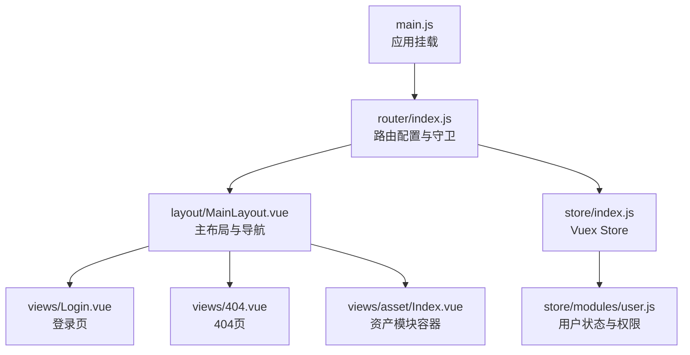
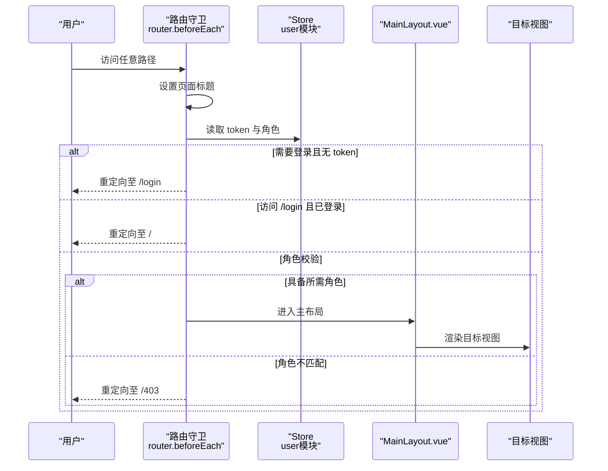
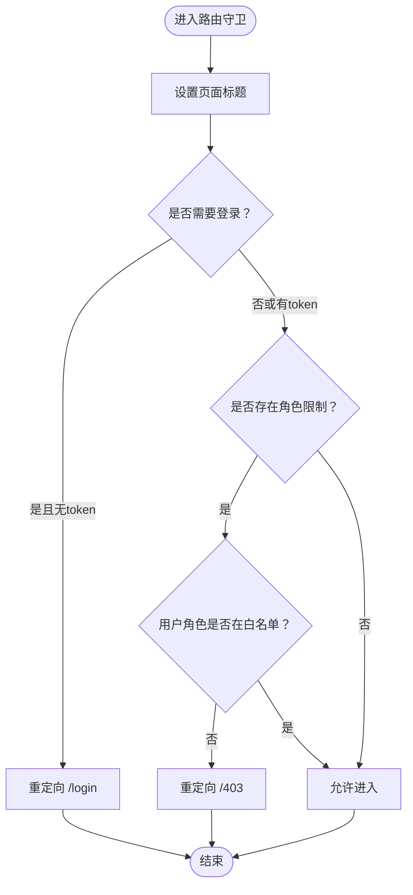
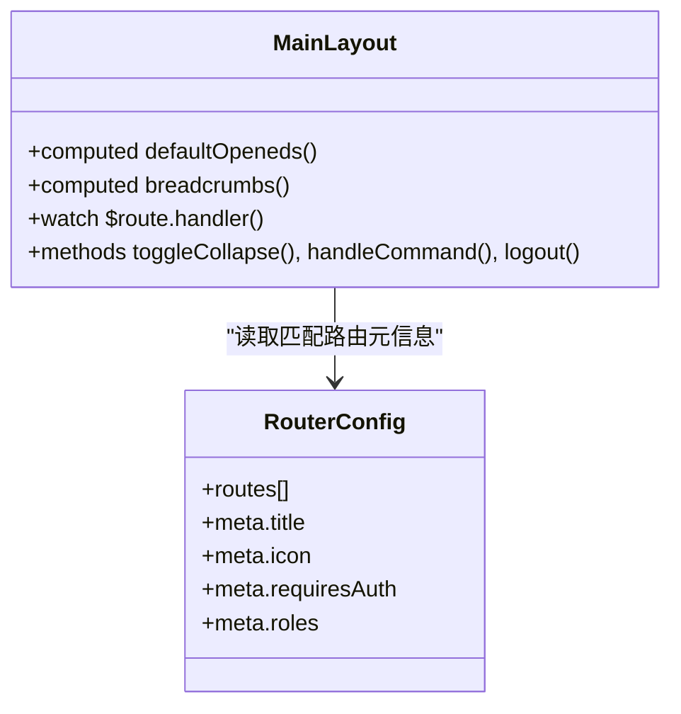
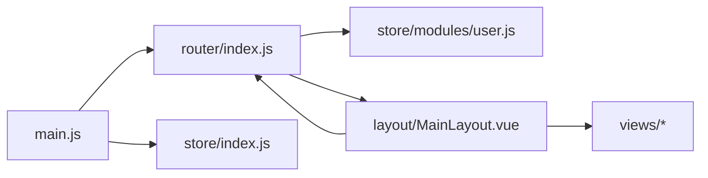

# 路由架构

<cite>
**本文引用的文件**
- [src/router/index.js](file://src/router/index.js)
- [src/layout/MainLayout.vue](file://src/layout/MainLayout.vue)
- [src/main.js](file://src/main.js)
- [src/store/index.js](file://src/store/index.js)
- [src/store/modules/user.js](file://src/store/modules/user.js)
- [src/views/Login.vue](file://src/views/Login.vue)
- [src/views/404.vue](file://src/views/404.vue)
- [src/views/asset/Index.vue](file://src/views/asset/Index.vue)
</cite>

## 目录
1. [简介](#简介)
2. [项目结构](#项目结构)
3. [核心组件](#核心组件)
4. [架构总览](#架构总览)
5. [详细组件分析](#详细组件分析)
6. [依赖关系分析](#依赖关系分析)
7. [性能考量](#性能考量)
8. [故障排查指南](#故障排查指南)
9. [结论](#结论)

## 简介
本文件面向“投资组合管理系统”的前端路由架构，系统基于 Vue Router 实现，采用 Hash 模式，结合 Vuex 状态管理完成权限控制、菜单导航与面包屑生成。本文档重点阐述：
- 路由表的组织结构与嵌套路由设计
- 权限控制机制（基于角色）在路由中的应用
- 菜单导航的动态生成与侧边栏交互
- 面包屑导航的设计与实现
- 路由守卫的使用、导航拦截与重定向逻辑
- 路由懒加载与性能优化策略
- 路由配置图与导航流程图，帮助开发者快速理解整体设计

## 项目结构
路由系统主要由以下部分组成：
- 路由入口与配置：src/router/index.js
- 应用挂载点：src/main.js
- 布局容器与导航：src/layout/MainLayout.vue
- 用户状态与权限：src/store/modules/user.js、src/store/index.js
- 登录页与 404 页：src/views/Login.vue、src/views/404.vue
- 子路由占位容器：src/views/asset/Index.vue（用于资产模块子路由展示）

图表来源
- [src/main.js:1-31](file://src/main.js#L1-L31)
- [src/router/index.js:1-378](file://src/router/index.js#L1-L378)
- [src/layout/MainLayout.vue:1-330](file://src/layout/MainLayout.vue#L1-L330)
- [src/store/index.js:1-44](file://src/store/index.js#L1-L44)
- [src/store/modules/user.js:1-119](file://src/store/modules/user.js#L1-L119)
- [src/views/Login.vue:1-165](file://src/views/Login.vue#L1-L165)
- [src/views/404.vue:1-60](file://src/views/404.vue#L1-L60)
- [src/views/asset/Index.vue:1-9](file://src/views/asset/Index.vue#L1-L9)

章节来源
- [src/router/index.js:1-378](file://src/router/index.js#L1-L378)
- [src/layout/MainLayout.vue:1-330](file://src/layout/MainLayout.vue#L1-L330)
- [src/main.js:1-31](file://src/main.js#L1-L31)
- [src/store/index.js:1-44](file://src/store/index.js#L1-L44)
- [src/store/modules/user.js:1-119](file://src/store/modules/user.js#L1-L119)
- [src/views/Login.vue:1-165](file://src/views/Login.vue#L1-L165)
- [src/views/404.vue:1-60](file://src/views/404.vue#L1-L60)
- [src/views/asset/Index.vue:1-9](file://src/views/asset/Index.vue#L1-L9)

## 核心组件
- 路由配置与守卫：集中定义所有路由、嵌套路由、默认重定向、404 重定向以及全局前置守卫，实现登录态校验与角色权限拦截。
- 主布局与导航：提供侧边栏菜单、顶部导航、面包屑、页面切换动画等，负责菜单项与路由的联动。
- 用户状态与权限：维护 token、用户信息、角色与权限集合，供路由守卫读取判断。
- 应用挂载：将 router 与 store 注入到根实例，启动应用。

章节来源
- [src/router/index.js:1-378](file://src/router/index.js#L1-L378)
- [src/layout/MainLayout.vue:1-330](file://src/layout/MainLayout.vue#L1-L330)
- [src/store/modules/user.js:1-119](file://src/store/modules/user.js#L1-L119)
- [src/main.js:1-31](file://src/main.js#L1-L31)

## 架构总览
系统采用 Hash 模式路由，通过一个顶层布局组件承载侧边栏菜单、面包屑与主内容区域，子路由在布局内通过 router-view 渲染。全局守卫统一处理标题更新、登录态与角色权限检查。

图表来源
- [src/router/index.js:351-375](file://src/router/index.js#L351-L375)
- [src/layout/MainLayout.vue:134-138](file://src/layout/MainLayout.vue#L134-L138)
- [src/store/modules/user.js:102-110](file://src/store/modules/user.js#L102-L110)

## 详细组件分析

### 路由表组织与嵌套路由
- 顶层路由
  - 登录页：独立路由，无需登录态。
  - 主布局路由：根路径指向主布局，内部包含多个业务模块的子路由；默认重定向至工作台。
  - AI 助手路由：独立的顶级路由组，复用主布局，包含聊天、历史、记忆、报告、模板、数据模板、场景管理等子路由。
  - 404 与通配符：通配符重定向至 404 页面。
- 嵌套路由
  - 资产模块：父级 Index 容器，子路由包括列表、新增、编辑、行情等。
  - 策略模块：包含模板库、策略模型、基准管理、回测执行等子路由。
  - 组合模块：包含列表、创建、详情、再平衡、历史、业绩、基准、多组合对比等子路由。
  - 数据分析模块：包含资产分析、大类资产指数、监控、导入、数据接入中心、数据资产、ZY 数据域等子路由。
  - 系统管理：仅管理员可见，包含用户管理、角色管理、操作日志等子路由。
- 路由元信息
  - title：用于页面标题与面包屑显示。
  - icon：用于侧边栏菜单图标。
  - requiresAuth：是否需要登录态。
  - roles：角色白名单，用于权限拦截。
  - hidden：用于隐藏菜单项（如新增/编辑模板等）。

章节来源
- [src/router/index.js:7-344](file://src/router/index.js#L7-L344)

### 权限控制机制与路由守卫
- 登录态控制
  - 通过匹配路由的 meta.requiresAuth 判断是否需要登录；若未登录则重定向至登录页。
  - 若已登录却访问登录页，则重定向至首页。
- 角色控制
  - 当路由 meta.roles 存在时，读取用户角色进行比对；不满足则重定向至 403。
- 页面标题
  - 根据 meta.title 动态设置 document.title。

图表来源
- [src/router/index.js:351-375](file://src/router/index.js#L351-L375)

章节来源
- [src/router/index.js:351-375](file://src/router/index.js#L351-L375)
- [src/store/modules/user.js:102-110](file://src/store/modules/user.js#L102-L110)

### 菜单导航与面包屑设计
- 侧边栏菜单
  - 使用 Element UI 的 el-menu 与 el-submenu 组件构建，支持折叠与唯一展开。
  - 菜单项的 index 与路由 path 对应，实现点击即跳转。
  - 通过计算属性 defaultOpeneds 根据当前路由自动展开对应一级菜单。
  - 通过 activeMenu 与 watch 监听路由变化，高亮当前菜单项。
  - 管理员角色可见“系统管理”菜单。
- 面包屑
  - 通过 $route.matched 过滤出具有 meta.title 的条目，逐级渲染。
  - 首页固定为“首页”，后续为当前路由链上的标题。

图表来源
- [src/layout/MainLayout.vue:144-217](file://src/layout/MainLayout.vue#L144-L217)
- [src/router/index.js:7-344](file://src/router/index.js#L7-L344)

章节来源
- [src/layout/MainLayout.vue:144-217](file://src/layout/MainLayout.vue#L144-L217)
- [src/router/index.js:7-344](file://src/router/index.js#L7-L344)

### 主布局组件与页面切换动画
- 主布局容器
  - 采用 Element UI 的容器布局，左侧为侧边栏，右侧为主内容区。
  - 顶部包含折叠按钮与面包屑，右侧为用户下拉菜单。
- 页面切换动画
  - 在主内容区使用过渡动画包裹 router-view，实现页面切换的淡入淡出效果。
- 退出登录
  - 提供确认对话框，调用用户模块的登出动作并跳转至登录页。

章节来源
- [src/layout/MainLayout.vue:1-330](file://src/layout/MainLayout.vue#L1-L330)

### 登录与 404 页面
- 登录页
  - 提供用户名/密码输入与验证，调用用户模块的登录动作，成功后跳转至首页。
- 404 页面
  - 提供“返回首页”按钮，便于用户快速回到系统。

章节来源
- [src/views/Login.vue:1-165](file://src/views/Login.vue#L1-L165)
- [src/views/404.vue:1-60](file://src/views/404.vue#L1-L60)

### 子路由占位容器
- 资产模块的 Index 容器通过 router-view 承载其子路由内容，实现模块级的嵌套展示。

章节来源
- [src/views/asset/Index.vue:1-9](file://src/views/asset/Index.vue#L1-L9)

## 依赖关系分析
- 路由配置依赖 Vuex 用户模块的状态与动作，用于守卫判断。
- 主布局依赖路由元信息（title、icon、roles）以生成菜单与面包屑。
- 应用入口将路由与状态注入根实例，保证全局可用。

图表来源
- [src/router/index.js:1-378](file://src/router/index.js#L1-L378)
- [src/layout/MainLayout.vue:1-330](file://src/layout/MainLayout.vue#L1-330)
- [src/store/modules/user.js:1-119](file://src/store/modules/user.js#L1-L119)
- [src/store/index.js:1-44](file://src/store/index.js#L1-L44)
- [src/main.js:1-31](file://src/main.js#L1-L31)

章节来源
- [src/router/index.js:1-378](file://src/router/index.js#L1-L378)
- [src/layout/MainLayout.vue:1-330](file://src/layout/MainLayout.vue#L1-L330)
- [src/store/modules/user.js:1-119](file://src/store/modules/user.js#L1-L119)
- [src/store/index.js:1-44](file://src/store/index.js#L1-L44)
- [src/main.js:1-31](file://src/main.js#L1-L31)

## 性能考量
- 路由懒加载
  - 所有路由组件均通过动态导入实现按需加载，减少首屏体积与初次渲染时间。
- 页面切换动画
  - 使用过渡组件包裹 router-view，避免频繁切换造成闪烁。
- 菜单与面包屑
  - 通过计算属性与 watch 仅在必要时更新，降低不必要的重渲染。
- 建议优化
  - 可考虑对高频访问的页面进行预加载或预取，进一步缩短首屏等待。
  - 对大型模块的子路由可按功能拆分，配合路由级别的懒加载实现更细粒度的资源控制。

章节来源
- [src/router/index.js:11-12, 23, 37, 43, 49, 55, 70, 88, 94, 106, 118, 133, 139, 145, 151, 157, 163, 169, 175, 222, 228, 234, 244, 286, 299, 311, 317, 323, 330:11-12](file://src/router/index.js#L11-L12)
- [src/layout/MainLayout.vue:134-138](file://src/layout/MainLayout.vue#L134-L138)

## 故障排查指南
- 无法进入受保护页面
  - 检查路由 meta.requiresAuth 与用户 token 是否存在；若无 token，守卫会重定向至登录页。
- 角色受限访问
  - 若路由设置了 meta.roles，请确认用户角色是否在白名单内；否则会被重定向至 403。
- 登录后仍被重定向到登录页
  - 检查登录流程是否正确提交 token 并持久化；确认用户模块状态是否更新。
- 菜单不显示或不生效
  - 确认路由 meta.title 与 meta.icon 是否正确设置；检查侧边栏菜单项的 index 与路由 path 是否一致。
- 面包屑不显示
  - 确认路由链上每个节点都有 meta.title；确保面包屑计算逻辑未被覆盖。

章节来源
- [src/router/index.js:351-375](file://src/router/index.js#L351-L375)
- [src/store/modules/user.js:102-110](file://src/store/modules/user.js#L102-L110)
- [src/layout/MainLayout.vue:170-172](file://src/layout/MainLayout.vue#L170-L172)

## 结论
该路由架构以清晰的路由表组织与嵌套路由为核心，结合全局守卫实现了完善的登录态与角色权限控制；主布局组件承担了菜单、面包屑与页面切换动画的职责，提升了用户体验。通过动态导入实现的懒加载与合理的性能优化建议，有助于在功能扩展的同时保持良好的首屏性能与运行效率。开发者在新增路由或调整权限时，应遵循现有模式，确保一致性与可维护性。