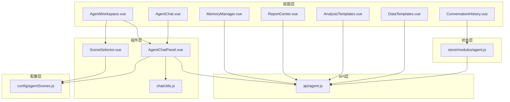
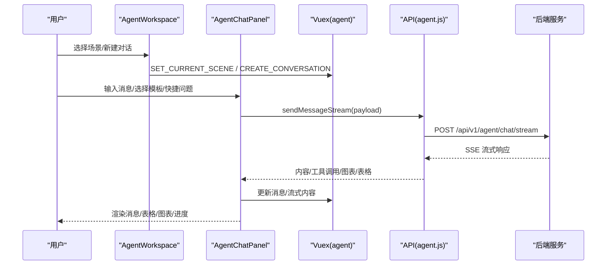
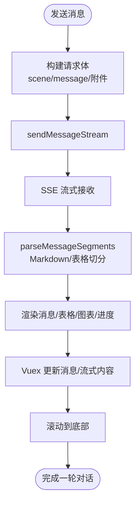
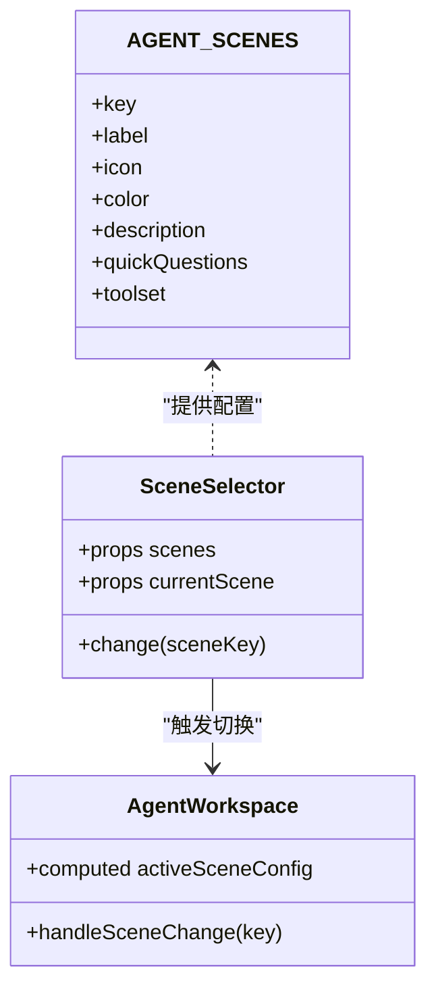
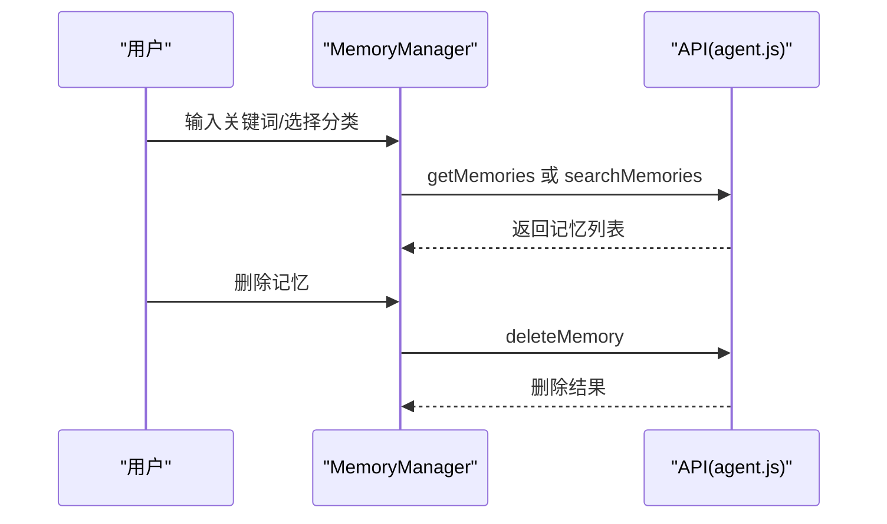
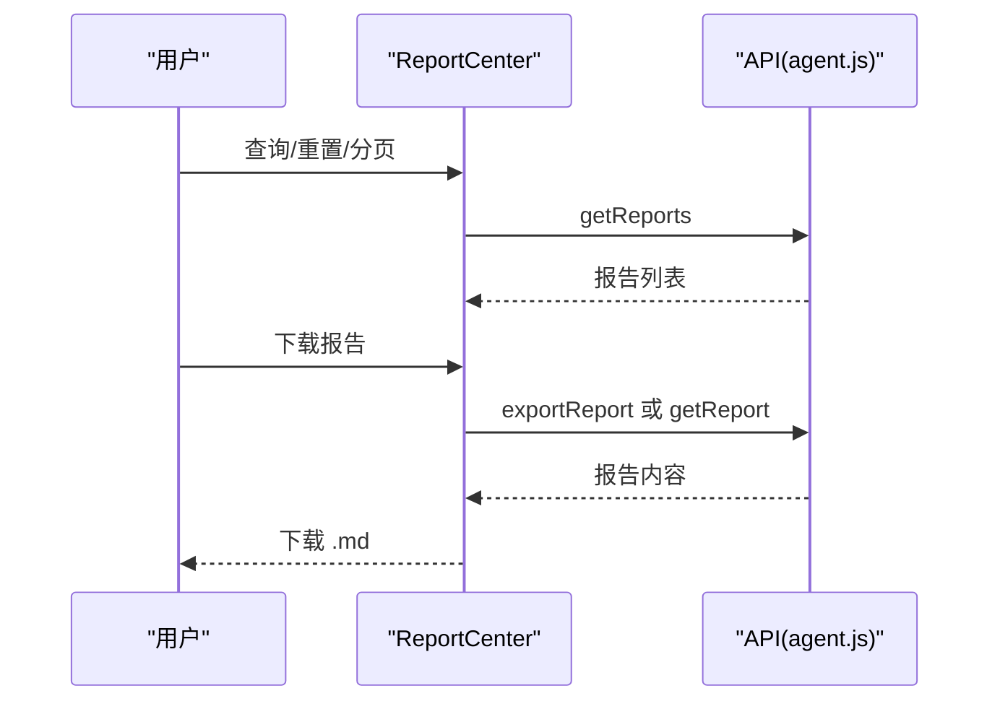
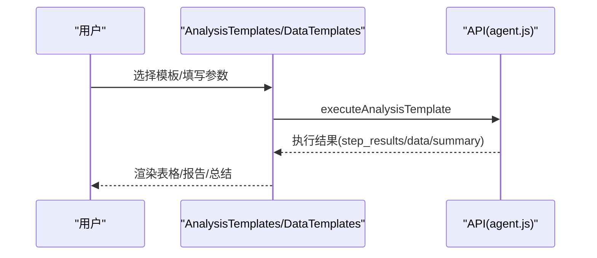
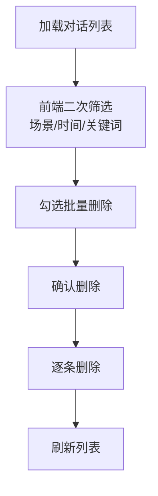
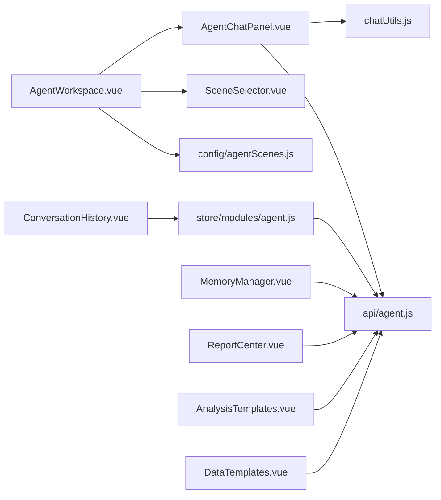

# AI智能助手模块

<cite>
**本文引用的文件**
- [AgentChat.vue](file://src/views/agent/AgentChat.vue)
- [AgentWorkspace.vue](file://src/views/agent/AgentWorkspace.vue)
- [AgentChatPanel.vue](file://src/components/AgentChatPanel.vue)
- [SceneSelector.vue](file://src/components/SceneSelector.vue)
- [agent.js](file://src/store/modules/agent.js)
- [agent.js](file://src/api/agent.js)
- [agentScenes.js](file://src/config/agentScenes.js)
- [chatUtils.js](file://src/components/chatUtils.js)
- [MemoryManager.vue](file://src/views/agent/MemoryManager.vue)
- [ReportCenter.vue](file://src/views/agent/ReportCenter.vue)
- [AnalysisTemplates.vue](file://src/views/agent/AnalysisTemplates.vue)
- [DataTemplates.vue](file://src/views/agent/DataTemplates.vue)
- [ConversationHistory.vue](file://src/views/agent/ConversationHistory.vue)
</cite>

## 目录
1. [简介](#简介)
2. [项目结构](#项目结构)
3. [核心组件](#核心组件)
4. [架构总览](#架构总览)
5. [详细组件分析](#详细组件分析)
6. [依赖关系分析](#依赖关系分析)
7. [性能考量](#性能考量)
8. [故障排查指南](#故障排查指南)
9. [结论](#结论)
10. [附录](#附录)

## 简介
本模块为数智平台的AI智能助手，提供面向金融与数据资产管理的对话式智能体验。系统围绕“对话管理、上下文理解、多轮对话处理、知识记忆管理、报告生成、场景管理、分析模板与数据模板、对话历史管理”等能力展开，支持：
- 场景化对话（智能匹配、数据分析、大类资产研究、企业数据问答、信用评级等）
- 流式对话与工具链执行（数据查询、分析、可视化、回测等）
- 记忆检索与管理（研究结论、用户偏好、资产别名、策略洞察）
- 报告中心（模板类型、状态管理、下载导出）
- 分析模板与数据模板（参数化执行、步骤可视化、Markdown总结）
- 对话历史管理（筛选、批量删除、跳转）

## 项目结构
AI智能助手模块主要由以下层次构成：
- 视图层：工作区页面、聊天页面、场景管理、记忆管理、报告中心、模板管理、历史管理
- 组件层：聊天面板、场景选择器、工具渲染组件（Markdown/表格/图表）、输入框、进度条等
- 状态层：Vuex模块管理对话、消息、场景、记忆、报告、模板等状态
- API层：封装与后端服务的交互，包括对话、记忆、报告、模板、附件上传等
- 配置层：场景配置、快捷问题、工具集映射

**图表来源**
- [AgentWorkspace.vue:1-512](file://src/views/agent/AgentWorkspace.vue#L1-L512)
- [AgentChat.vue:1-249](file://src/views/agent/AgentChat.vue#L1-L249)
- [AgentChatPanel.vue:1-800](file://src/components/AgentChatPanel.vue#L1-L800)
- [SceneSelector.vue:1-127](file://src/components/SceneSelector.vue#L1-L127)
- [agent.js:1-230](file://src/store/modules/agent.js#L1-L230)
- [agent.js:1-168](file://src/api/agent.js#L1-L168)
- [agentScenes.js:1-98](file://src/config/agentScenes.js#L1-L98)
- [chatUtils.js:1-479](file://src/components/chatUtils.js#L1-L479)

**章节来源**
- [AgentWorkspace.vue:1-512](file://src/views/agent/AgentWorkspace.vue#L1-L512)
- [AgentChat.vue:1-249](file://src/views/agent/AgentChat.vue#L1-L249)
- [AgentChatPanel.vue:1-800](file://src/components/AgentChatPanel.vue#L1-L800)
- [SceneSelector.vue:1-127](file://src/components/SceneSelector.vue#L1-L127)
- [agent.js:1-230](file://src/store/modules/agent.js#L1-L230)
- [agent.js:1-168](file://src/api/agent.js#L1-L168)
- [agentScenes.js:1-98](file://src/config/agentScenes.js#L1-L98)
- [chatUtils.js:1-479](file://src/components/chatUtils.js#L1-L479)

## 核心组件
- 工作区页面：三栏布局，左侧对话列表，中间场景选择与聊天面板，右侧场景信息与快捷问题
- 聊天面板：消息渲染（Markdown/表格/图表）、流式输出、工具执行进度、数据导入卡片、资产/回测点击联动
- 场景选择器：横向标签式切换场景，支持禁用状态提示
- Vuex模块：管理对话列表、当前对话、消息、场景、记忆、报告、模板等状态
- API封装：提供对话、记忆、报告、模板、附件上传等REST接口
- 场景配置：内置多场景（智能匹配、数据分析、资产研究、企业数据问答、信用评级等）

**章节来源**
- [AgentWorkspace.vue:1-512](file://src/views/agent/AgentWorkspace.vue#L1-L512)
- [AgentChatPanel.vue:1-800](file://src/components/AgentChatPanel.vue#L1-L800)
- [SceneSelector.vue:1-127](file://src/components/SceneSelector.vue#L1-L127)
- [agent.js:1-230](file://src/store/modules/agent.js#L1-L230)
- [agent.js:1-168](file://src/api/agent.js#L1-L168)
- [agentScenes.js:1-98](file://src/config/agentScenes.js#L1-L98)

## 架构总览
系统采用前后端分离架构，前端通过Vuex集中管理状态，组件通过API层与后端交互。对话采用SSE流式传输，消息内容支持Markdown、表格、图表等多种结构化元素。场景配置驱动对话行为，工具链执行贯穿数据查询、分析、可视化、回测等环节。

**图表来源**
- [AgentWorkspace.vue:158-234](file://src/views/agent/AgentWorkspace.vue#L158-L234)
- [AgentChatPanel.vue:784-800](file://src/components/AgentChatPanel.vue#L784-L800)
- [agent.js:78-112](file://src/api/agent.js#L78-L112)
- [agent.js:84-213](file://src/store/modules/agent.js#L84-L213)

## 详细组件分析

### 对话管理与多轮对话处理
- 对话列表：支持新建、切换、删除、时间排序、场景标签
- 聊天面板：消息虚拟滚动、流式渲染、工具执行进度、Markdown表格/图表解析、数据导入卡片
- 上下文与场景：当前场景影响欢迎语、快捷问题、工具集；对话与场景映射持久化
- 流式控制：SSE请求归属会话，切换会话或组件销毁时中止流，避免串话

**图表来源**
- [AgentChatPanel.vue:784-800](file://src/components/AgentChatPanel.vue#L784-L800)
- [chatUtils.js:167-233](file://src/components/chatUtils.js#L167-L233)
- [agent.js:78-112](file://src/api/agent.js#L78-L112)
- [agent.js:200-212](file://src/store/modules/agent.js#L200-L212)

**章节来源**
- [AgentChat.vue:73-133](file://src/views/agent/AgentChat.vue#L73-L133)
- [AgentWorkspace.vue:158-234](file://src/views/agent/AgentWorkspace.vue#L158-L234)
- [AgentChatPanel.vue:440-487](file://src/components/AgentChatPanel.vue#L440-L487)
- [agent.js:84-213](file://src/store/modules/agent.js#L84-L213)

### 场景管理
- 场景配置：内置多场景，含图标、颜色、描述、快捷问题、工具集映射
- 场景选择器：横向标签切换，支持禁用提示
- 场景与对话：切换场景不影响对话内容，但会影响快捷问题与工具集；新建对话时可关联场景

**图表来源**
- [agentScenes.js:1-98](file://src/config/agentScenes.js#L1-L98)
- [SceneSelector.vue:1-127](file://src/components/SceneSelector.vue#L1-L127)
- [AgentWorkspace.vue:135-173](file://src/views/agent/AgentWorkspace.vue#L135-L173)

**章节来源**
- [agentScenes.js:1-98](file://src/config/agentScenes.js#L1-L98)
- [SceneSelector.vue:1-127](file://src/components/SceneSelector.vue#L1-L127)
- [AgentWorkspace.vue:135-173](file://src/views/agent/AgentWorkspace.vue#L135-L173)

### 知识记忆管理
- 记忆列表：支持关键词搜索、分类筛选、分页、查看详情
- 搜索与删除：关键词分词搜索、按分类二次过滤、删除确认
- 分类标签：研究结论、用户偏好、资产别名、策略洞察

**图表来源**
- [MemoryManager.vue:190-291](file://src/views/agent/MemoryManager.vue#L190-L291)
- [agent.js:52-76](file://src/api/agent.js#L52-L76)

**章节来源**
- [MemoryManager.vue:1-470](file://src/views/agent/MemoryManager.vue#L1-L470)
- [agent.js:52-76](file://src/api/agent.js#L52-L76)

### 报告中心
- 报告列表：按类型、状态筛选，分页展示，支持下载与删除
- 下载策略：优先调用导出接口，失败时回退到详情接口
- 状态标签：草稿、已填充、审查中、已批准

**图表来源**
- [ReportCenter.vue:122-205](file://src/views/agent/ReportCenter.vue#L122-L205)
- [agent.js:114-129](file://src/api/agent.js#L114-L129)

**章节来源**
- [ReportCenter.vue:1-260](file://src/views/agent/ReportCenter.vue#L1-L260)
- [agent.js:114-129](file://src/api/agent.js#L114-L129)

### 分析模板与数据模板
- 分析模板：支持分类（数据分析、信用评级）、状态（启用/归档）、参数定义、步骤定义、输出模板
- 数据模板：按数据分析分类，运行时参数化，步骤可视化，Markdown总结
- 执行流程：参数校验、调用后端执行、渲染表格与报告、支持下载

**图表来源**
- [AnalysisTemplates.vue:238-277](file://src/views/agent/AnalysisTemplates.vue#L238-L277)
- [DataTemplates.vue:206-216](file://src/views/agent/DataTemplates.vue#L206-L216)
- [agent.js:131-154](file://src/api/agent.js#L131-L154)

**章节来源**
- [AnalysisTemplates.vue:1-509](file://src/views/agent/AnalysisTemplates.vue#L1-L509)
- [DataTemplates.vue:1-309](file://src/views/agent/DataTemplates.vue#L1-L309)
- [agent.js:131-154](file://src/api/agent.js#L131-L154)

### 对话历史管理
- 历史列表：场景筛选、时间范围筛选、关键词搜索、批量删除、跳转对话
- 状态同步：与Vuex对话场景映射保持一致，跳转时恢复场景与对话

**图表来源**
- [ConversationHistory.vue:169-254](file://src/views/agent/ConversationHistory.vue#L169-L254)
- [agent.js:84-193](file://src/store/modules/agent.js#L84-L193)

**章节来源**
- [ConversationHistory.vue:1-349](file://src/views/agent/ConversationHistory.vue#L1-L349)
- [agent.js:84-193](file://src/store/modules/agent.js#L84-L193)

## 依赖关系分析
- 组件耦合：AgentWorkspace聚合AgentChatPanel与SceneSelector；AgentChatPanel依赖chatUtils进行消息解析与渲染
- 状态耦合：AgentChatPanel与Vuex agent模块强耦合，负责消息、流式状态、场景映射
- API耦合：所有页面通过API封装访问后端，统一错误处理与超时控制
- 配置耦合：场景配置驱动UI与行为，快捷问题与工具集映射

**图表来源**
- [AgentChatPanel.vue:228-242](file://src/components/AgentChatPanel.vue#L228-L242)
- [AgentWorkspace.vue:107-111](file://src/views/agent/AgentWorkspace.vue#L107-L111)
- [SceneSelector.vue:1-127](file://src/components/SceneSelector.vue#L1-L127)
- [agentScenes.js:1-98](file://src/config/agentScenes.js#L1-L98)
- [agent.js:1-230](file://src/store/modules/agent.js#L1-L230)
- [agent.js:1-168](file://src/api/agent.js#L1-L168)

**章节来源**
- [AgentChatPanel.vue:228-242](file://src/components/AgentChatPanel.vue#L228-L242)
- [AgentWorkspace.vue:107-111](file://src/views/agent/AgentWorkspace.vue#L107-L111)
- [agent.js:1-230](file://src/store/modules/agent.js#L1-L230)
- [agent.js:1-168](file://src/api/agent.js#L1-L168)

## 性能考量
- 虚拟滚动：消息列表采用虚拟滚动，提升长对话渲染性能
- 流式渲染：SSE流式接收，边到边渲染，降低首屏等待
- 去重优化：表格与图表按关键维度去重，避免重复渲染
- 节流与防抖：滚动与渲染采用节流/防抖，减少高频操作开销
- 分页加载：对话历史、记忆、报告、模板均采用分页，降低一次性数据量

[本节为通用指导，无需特定文件引用]

## 故障排查指南
- 流式对话异常：检查SSE连接是否被中止（切换会话/组件销毁），确认后端响应体可用性
- 表格渲染异常：确认Markdown表格格式与解析逻辑，必要时降级为HTML渲染
- 记忆搜索失败：检查关键词分词与后端搜索接口，确认分类过滤逻辑
- 报告下载失败：优先调用导出接口，失败时回退详情接口并检查内容完整性
- 模板执行失败：核对参数必填与类型，查看后端返回的步骤结果与摘要

**章节来源**
- [AgentChatPanel.vue:468-487](file://src/components/AgentChatPanel.vue#L468-L487)
- [chatUtils.js:167-233](file://src/components/chatUtils.js#L167-L233)
- [MemoryManager.vue:214-241](file://src/views/agent/MemoryManager.vue#L214-L241)
- [ReportCenter.vue:151-178](file://src/views/agent/ReportCenter.vue#L151-L178)
- [AnalysisTemplates.vue:249-264](file://src/views/agent/AnalysisTemplates.vue#L249-L264)

## 结论
AI智能助手模块通过场景化设计、流式对话、工具链集成与结构化渲染，实现了从“对话—分析—可视化—报告”的完整闭环。记忆管理、报告中心、模板体系进一步提升了知识沉淀与复用效率。建议后续增强：
- 记忆检索的向量化与召回优化
- 报告导出格式扩展（Word/PDF）
- 模板参数的可视化配置与预览
- 对话分享与协作能力

[本节为总结性内容，无需特定文件引用]

## 附录

### 实际对话示例与使用场景
- 场景：数据分析
  - 用户：查询最近一年沪深300的收益率数据
  - 助手：执行数据查询工具，返回表格与图表，支持导出CSV
- 场景：大类资产研究
  - 用户：对比风险平价、均值方差、风险预算-目标波动率三个策略
  - 助手：执行多策略回测，展示回测指标与权重快照，支持点击进入回测详情
- 场景：企业数据问答
  - 用户：浙江省近三个月有哪些高风险舆情记录？
  - 助手：检索主体风险记录并做统计解读，提供可追踪资产与回测线索
- 场景：信用评级
  - 用户：基于已入库数据的信用与主体风险辅助分析
  - 助手：结合快捷问题与工具集，输出评级要点与风险提示

[本节为概念性示例，无需特定文件引用]