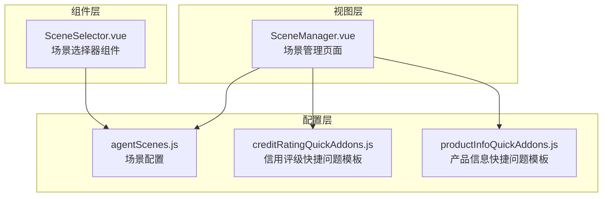
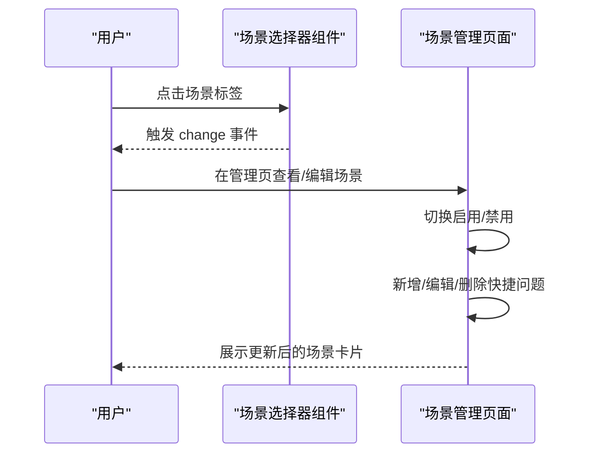
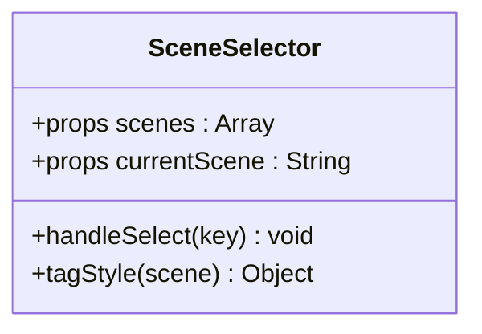
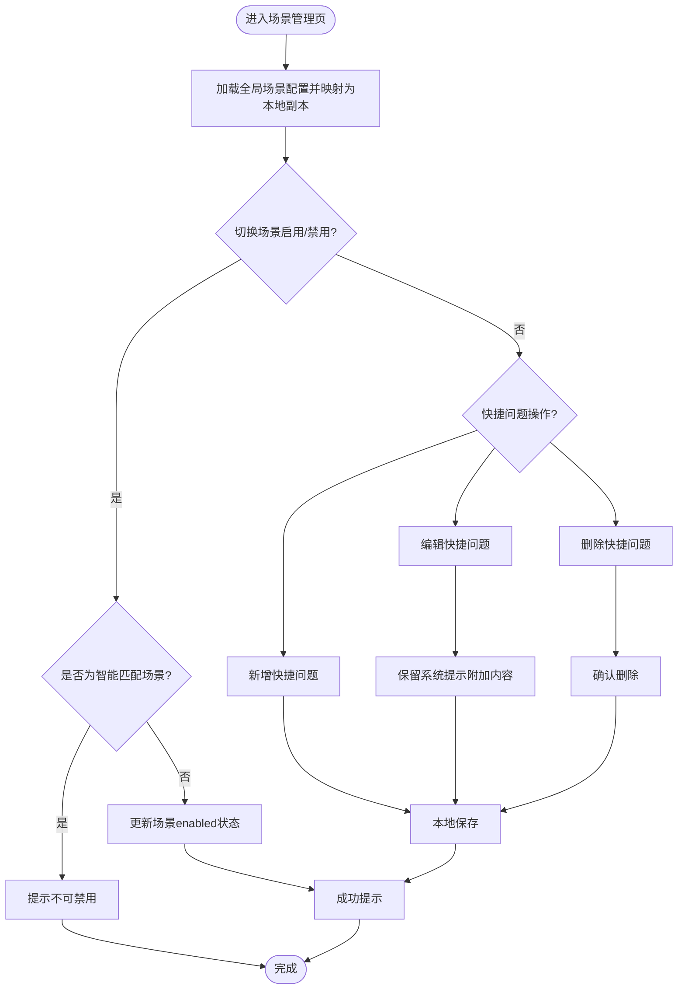
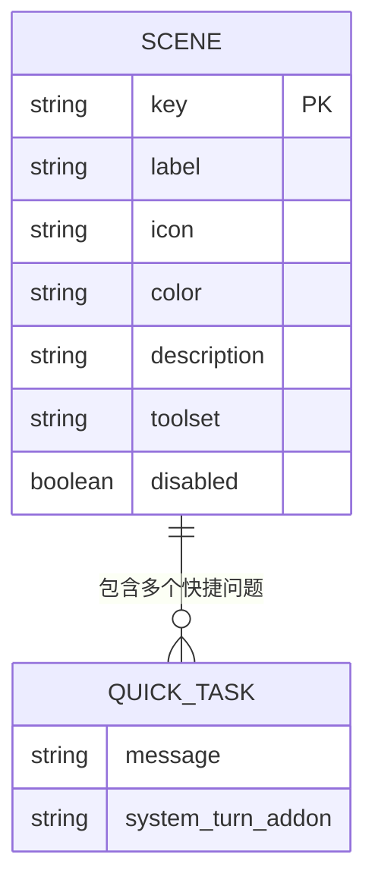
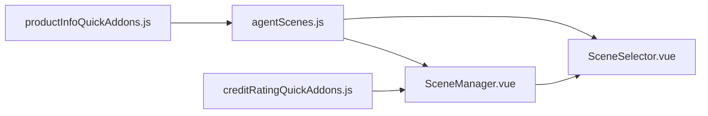

# 场景管理功能

<cite>
**本文档引用的文件**
- [SceneSelector.vue](file://src/components/SceneSelector.vue)
- [SceneManager.vue](file://src/views/agent/SceneManager.vue)
- [agentScenes.js](file://src/config/agentScenes.js)
- [creditRatingQuickAddons.js](file://src/config/creditRatingQuickAddons.js)
- [productInfoQuickAddons.js](file://src/config/productInfoQuickAddons.js)
</cite>

## 目录
1. [简介](#简介)
2. [项目结构](#项目结构)
3. [核心组件](#核心组件)
4. [架构总览](#架构总览)
5. [详细组件分析](#详细组件分析)
6. [依赖关系分析](#依赖关系分析)
7. [性能考量](#性能考量)
8. [故障排查指南](#故障排查指南)
9. [结论](#结论)
10. [附录](#附录)

## 简介
本功能围绕“场景”概念展开，面向数智平台AI助手的业务场景配置与运行管理，覆盖场景的分类与定义、创建与配置、切换与执行、管理与维护、以及扩展与定制。当前实现聚焦于Agent侧的场景卡片管理与场景选择器组件，提供场景启用/禁用、快捷问题编辑、以及场景元信息展示。

## 项目结构
与场景管理相关的核心文件组织如下：
- 组件层：场景选择器组件，用于在界面中横向展示与切换场景
- 视图层：场景管理页面，管理员可查看、启用/禁用场景，并编辑快捷问题
- 配置层：场景配置与快捷问题模板，定义场景的元信息、工具集与快捷指令

图表来源
- [SceneSelector.vue:1-127](file://src/components/SceneSelector.vue#L1-L127)
- [SceneManager.vue:1-360](file://src/views/agent/SceneManager.vue#L1-L360)
- [agentScenes.js:1-98](file://src/config/agentScenes.js#L1-L98)
- [creditRatingQuickAddons.js:1-113](file://src/config/creditRatingQuickAddons.js#L1-L113)
- [productInfoQuickAddons.js:1-37](file://src/config/productInfoQuickAddons.js#L1-L37)

章节来源
- [SceneSelector.vue:1-127](file://src/components/SceneSelector.vue#L1-L127)
- [SceneManager.vue:1-360](file://src/views/agent/SceneManager.vue#L1-L360)
- [agentScenes.js:1-98](file://src/config/agentScenes.js#L1-L98)
- [creditRatingQuickAddons.js:1-113](file://src/config/creditRatingQuickAddons.js#L1-L113)
- [productInfoQuickAddons.js:1-37](file://src/config/productInfoQuickAddons.js#L1-L37)

## 核心组件
- 场景选择器组件：提供横向标签式场景切换UI，支持禁用态与激活态样式、徽标提示
- 场景管理页面：提供场景卡片网格展示，支持启用/禁用切换、快捷问题增删改查

章节来源
- [SceneSelector.vue:17-51](file://src/components/SceneSelector.vue#L17-L51)
- [SceneManager.vue:115-215](file://src/views/agent/SceneManager.vue#L115-L215)

## 架构总览
场景管理采用“配置驱动 + 组件渲染 + 页面管理”的分层架构：
- 配置驱动：通过场景配置文件集中定义场景元信息、工具集与快捷问题
- 组件渲染：选择器组件负责UI交互与事件发射
- 页面管理：管理页面负责本地编辑态与持久化（当前为前端本地态，预留后端持久化）

图表来源
- [SceneSelector.vue:35-40](file://src/components/SceneSelector.vue#L35-L40)
- [SceneManager.vue:139-213](file://src/views/agent/SceneManager.vue#L139-L213)

## 详细组件分析

### 场景选择器组件
- 功能职责
  - 渲染场景标签，支持禁用态与激活态视觉差异
  - 当点击非当前场景标签时，向外发射 change 事件
- 关键点
  - 支持禁用态徽标显示
  - 样式通过CSS变量与激活态联动
  - 事件仅在场景变化时触发，避免重复处理

图表来源
- [SceneSelector.vue:23-51](file://src/components/SceneSelector.vue#L23-L51)

章节来源
- [SceneSelector.vue:17-51](file://src/components/SceneSelector.vue#L17-L51)

### 场景管理页面
- 功能职责
  - 展示场景卡片，包含图标、名称、Key、工具集、描述、快捷问题
  - 支持切换场景启用/禁用（智能匹配场景不可禁用）
  - 支持快捷问题的新增、编辑、删除
- 关键点
  - 本地编辑态：基于全局场景配置映射生成本地副本，便于前端编辑
  - 快捷问题编辑：支持系统提示附加内容的保留与更新
  - 持久化：当前为前端本地态，预留后端持久化（注释标记）

图表来源
- [SceneManager.vue:117-213](file://src/views/agent/SceneManager.vue#L117-L213)

章节来源
- [SceneManager.vue:115-215](file://src/views/agent/SceneManager.vue#L115-L215)

### 场景配置与模板
- 场景配置
  - 定义场景的key、标签、图标、颜色、描述、工具集、快捷问题
  - 提供按key快速查找场景的方法
- 快捷问题模板
  - 信用评级场景：提供三类典型任务的系统提示附加内容
  - 产品信息场景：提供智能匹配场景下的快捷任务模板
  - 快捷项展示文案：支持纯文本与带系统提示附加内容的对象

图表来源
- [agentScenes.js:8-88](file://src/config/agentScenes.js#L8-L88)
- [creditRatingQuickAddons.js:17-106](file://src/config/creditRatingQuickAddons.js#L17-L106)
- [productInfoQuickAddons.js:30-33](file://src/config/productInfoQuickAddons.js#L30-L33)

章节来源
- [agentScenes.js:1-98](file://src/config/agentScenes.js#L1-L98)
- [creditRatingQuickAddons.js:1-113](file://src/config/creditRatingQuickAddons.js#L1-L113)
- [productInfoQuickAddons.js:1-37](file://src/config/productInfoQuickAddons.js#L1-L37)

## 依赖关系分析
- 组件依赖
  - 场景选择器依赖场景配置数据结构
  - 场景管理页面依赖场景配置与快捷问题模板
- 数据流
  - 配置文件提供场景元信息与快捷问题
  - 页面将配置映射为本地编辑态
  - 组件接收本地数据并渲染UI与交互

图表来源
- [agentScenes.js:1-98](file://src/config/agentScenes.js#L1-L98)
- [creditRatingQuickAddons.js:1-113](file://src/config/creditRatingQuickAddons.js#L1-L113)
- [productInfoQuickAddons.js:1-37](file://src/config/productInfoQuickAddons.js#L1-L37)
- [SceneSelector.vue:1-127](file://src/components/SceneSelector.vue#L1-L127)
- [SceneManager.vue:1-360](file://src/views/agent/SceneManager.vue#L1-L360)

章节来源
- [agentScenes.js:1-98](file://src/config/agentScenes.js#L1-L98)
- [SceneManager.vue:112-134](file://src/views/agent/SceneManager.vue#L112-L134)

## 性能考量
- 渲染优化
  - 场景选择器采用虚拟滚动与最小化DOM更新策略，适合横向密集标签展示
- 交互优化
  - 仅在场景变化时触发事件，避免重复处理
- 数据访问
  - 快捷问题编辑采用本地数组操作，减少网络请求
- 扩展建议
  - 场景数量增长时，考虑分页或懒加载卡片
  - 快捷问题列表增加搜索与分组，提升编辑效率

## 故障排查指南
- 场景切换无效
  - 检查当前场景是否与目标场景相同，组件仅在变化时触发事件
  - 确认禁用态标签不会触发切换
- 启用/禁用异常
  - 智能匹配场景不可禁用，检查提示逻辑
  - 确认本地enabled状态更新成功
- 快捷问题编辑异常
  - 确认系统提示附加内容在编辑时被正确保留
  - 检查空内容校验与确认删除流程

章节来源
- [SceneSelector.vue:35-40](file://src/components/SceneSelector.vue#L35-L40)
- [SceneManager.vue:140-148](file://src/views/agent/SceneManager.vue#L140-L148)
- [SceneManager.vue:173-200](file://src/views/agent/SceneManager.vue#L173-L200)
- [SceneManager.vue:202-213](file://src/views/agent/SceneManager.vue#L202-L213)

## 结论
场景管理功能以配置驱动为核心，结合组件与页面实现，提供了场景的可视化管理与便捷编辑能力。当前实现侧重于Agent侧场景的启用/禁用与快捷问题编辑，后续可扩展至后端持久化、权限控制、模板版本管理与批量操作等功能，以满足更复杂的业务场景管理需求。

## 附录

### 场景类型与用途
- 智能匹配：自动识别用户需求，匹配最佳业务场景
- 数据分析：数据资产管理、查询、统计分析与可视化
- 报告写作：报告模板生成与合规审查（预留）
- 大类资产研究：资产配置策略、回测分析、组合构建
- 企业数据问答：主体风险、舆情、处罚等业务库数据检索与答疑
- 信用评级：基于已入库数据的信用与主体风险辅助分析

章节来源
- [agentScenes.js:8-88](file://src/config/agentScenes.js#L8-L88)

### 快捷问题模板结构
- 系统提示附加内容：用于引导工具调用与报告结构
- 快捷项展示文案：支持纯文本与带系统提示附加内容的对象

章节来源
- [creditRatingQuickAddons.js:17-106](file://src/config/creditRatingQuickAddons.js#L17-L106)
- [productInfoQuickAddons.js:30-33](file://src/config/productInfoQuickAddons.js#L30-L33)