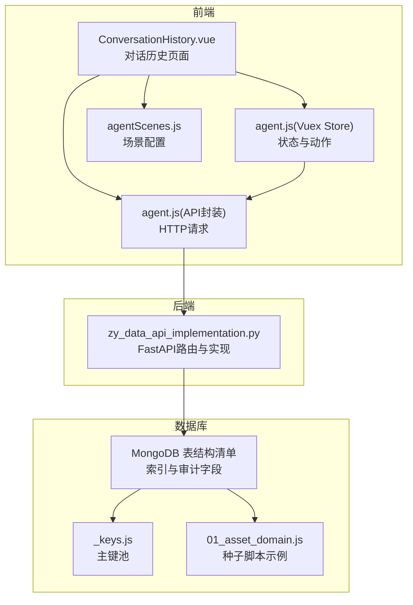
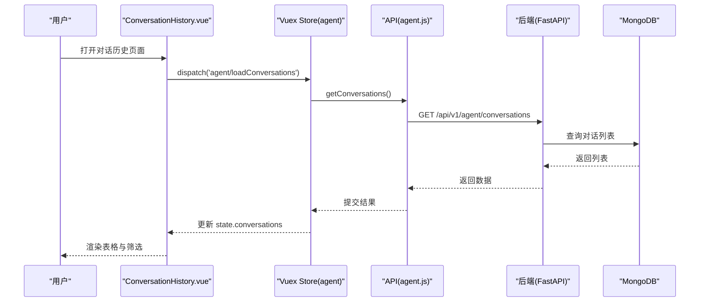
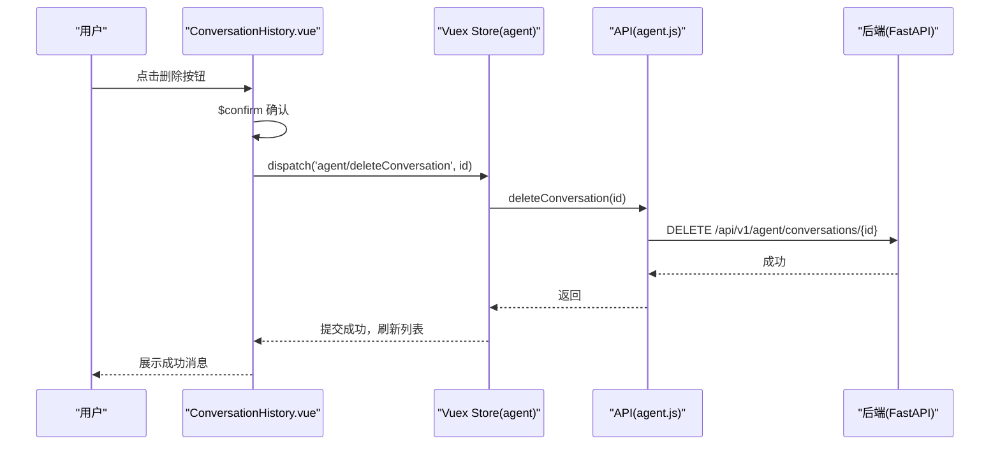
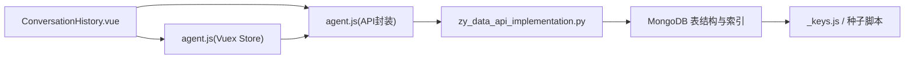

# 对话历史管理

<cite>
**本文引用的文件**
- [ConversationHistory.vue](file://src/views/agent/ConversationHistory.vue)
- [agent.js（API）](file://src/api/agent.js)
- [agent.js（Vuex Store）](file://src/store/modules/agent.js)
- [agentScenes.js](file://src/config/agentScenes.js)
- [MongoDB_ZY数据域表结构清单.md](file://docs/MongoDB_ZY数据域表结构清单.md)
- [ZY_DATA_API_INTEGRATION_GUIDE.md](file://docs/ZY_DATA_API_INTEGRATION_GUIDE.md)
- [_keys.js（种子键池）](file://mongo-seed/_keys.js)
- [01_asset_domain.js（种子脚本）](file://mongo-seed/01_asset_domain.js)
- [import_mongo_seeds.py（导入脚本）](file://scripts/import_mongo_seeds.py)
- [zy_data_api_implementation.py（后端实现）](file://scripts/zy_data_api_implementation.py)
</cite>

## 目录
1. [简介](#简介)
2. [项目结构](#项目结构)
3. [核心组件](#核心组件)
4. [架构总览](#架构总览)
5. [详细组件分析](#详细组件分析)
6. [依赖关系分析](#依赖关系分析)
7. [性能考虑](#性能考虑)
8. [故障排查指南](#故障排查指南)
9. [结论](#结论)
10. [附录](#附录)

## 简介
本文件围绕“对话历史管理”功能进行系统化技术文档编写，覆盖前端展示与交互、后端数据模型与接口、以及数据库设计与索引策略。重点包括：
- 对话历史的存储与数据模型
- 列表获取、分页、排序与筛选
- 对话的创建、更新、删除流程
- 搜索与筛选（关键词、时间范围、场景标签）
- 导出与备份（概念性说明）
- 性能优化（缓存、懒加载、虚拟滚动）
- API 接口说明与使用示例

## 项目结构
对话历史管理涉及前端 Vue 组件、Vuex Store、API 封装、以及后端 FastAPI 接口与 MongoDB 数据库。下图展示了与对话历史相关的关键模块与文件：

图表来源
- [ConversationHistory.vue:117-284](file://src/views/agent/ConversationHistory.vue#L117-L284)
- [agent.js（API）:1-63](file://src/api/agent.js#L1-L63)
- [agent.js（Vuex Store）:1-229](file://src/store/modules/agent.js#L1-L229)
- [agentScenes.js:1-98](file://src/config/agentScenes.js#L1-L98)
- [zy_data_api_implementation.py:129-333](file://scripts/zy_data_api_implementation.py#L129-L333)
- [MongoDB_ZY数据域表结构清单.md:1-379](file://docs/MongoDB_ZY数据域表结构清单.md#L1-L379)
- [_keys.js:1-161](file://mongo-seed/_keys.js#L1-L161)
- [01_asset_domain.js:1-200](file://mongo-seed/01_asset_domain.js#L1-L200)

章节来源
- [ConversationHistory.vue:117-284](file://src/views/agent/ConversationHistory.vue#L117-L284)
- [agent.js（API）:1-63](file://src/api/agent.js#L1-L63)
- [agent.js（Vuex Store）:1-229](file://src/store/modules/agent.js#L1-L229)
- [agentScenes.js:1-98](file://src/config/agentScenes.js#L1-L98)
- [MongoDB_ZY数据域表结构清单.md:1-379](file://docs/MongoDB_ZY数据域表结构清单.md#L1-L379)
- [ZY_DATA_API_INTEGRATION_GUIDE.md:409-480](file://docs/ZY_DATA_API_INTEGRATION_GUIDE.md#L409-L480)
- [_keys.js:1-161](file://mongo-seed/_keys.js#L1-L161)
- [01_asset_domain.js:1-200](file://mongo-seed/01_asset_domain.js#L1-L200)
- [import_mongo_seeds.py:239-270](file://scripts/import_mongo_seeds.py#L239-L270)
- [zy_data_api_implementation.py:129-333](file://scripts/zy_data_api_implementation.py#L129-L333)

## 核心组件
- 对话历史页面组件：负责筛选、表格展示、分页、批量删除、跳转对话等交互。
- Vuex Store：维护对话列表、当前对话、消息列表、加载状态、流式状态等。
- API 封装：提供获取对话列表、获取对话详情（含分页）、删除、重命名等方法。
- 场景配置：提供场景标签、颜色、描述等，用于对话历史表格中的场景展示。

章节来源
- [ConversationHistory.vue:117-284](file://src/views/agent/ConversationHistory.vue#L117-L284)
- [agent.js（Vuex Store）:1-229](file://src/store/modules/agent.js#L1-L229)
- [agent.js（API）:1-63](file://src/api/agent.js#L1-L63)
- [agentScenes.js:1-98](file://src/config/agentScenes.js#L1-L98)

## 架构总览
前端通过 API 封装调用后端接口，后端对接 MongoDB 数据库。对话历史页面负责用户交互与本地筛选，Store 负责状态管理与分页加载。

图表来源
- [ConversationHistory.vue:173-185](file://src/views/agent/ConversationHistory.vue#L173-L185)
- [agent.js（API）:13-20](file://src/api/agent.js#L13-L20)
- [agent.js（Vuex Store）:84-109](file://src/store/modules/agent.js#L84-L109)
- [zy_data_api_implementation.py:129-160](file://scripts/zy_data_api_implementation.py#L129-L160)

## 详细组件分析

### 对话历史页面（ConversationHistory.vue）
- 功能点
  - 场景筛选、日期范围筛选、关键词搜索
  - 表格展示对话标题、场景、消息数、更新时间
  - 分页组件（当前仅前端分页）
  - 批量删除与单条删除
  - 跳转到对话并加载消息（分页）

- 关键逻辑
  - 前端二次筛选：根据场景、时间范围、关键词进行本地过滤。
  - 分页：当前仅前端分页，后端接口返回全量列表。
  - 批量删除：逐条删除并统计失败数量。

- 交互流程（单条删除）

图表来源
- [ConversationHistory.vue:215-229](file://src/views/agent/ConversationHistory.vue#L215-L229)
- [agent.js（API）:35-41](file://src/api/agent.js#L35-L41)
- [agent.js（Vuex Store）:180-193](file://src/store/modules/agent.js#L180-L193)

章节来源
- [ConversationHistory.vue:117-284](file://src/views/agent/ConversationHistory.vue#L117-L284)

### Vuex Store（agent.js）
- 状态
  - conversations：对话列表
  - currentConversationId：当前对话ID
  - messages：当前对话消息列表
  - messageTotal/messageHasMore/messagePage：消息分页状态
  - isStreaming/streamingContent：流式输出状态
  - loading：加载状态
  - currentScene/conversationScenes：场景状态

- 动作
  - loadConversations：拉取对话列表
  - loadConversation：按页拉取消息（支持 prepend 前追加）
  - loadMoreMessages：加载更多历史消息
  - createConversation：新建对话
  - deleteConversation：删除对话
  - renameConversation：重命名对话
  - appendStreamContent/finishStreaming：流式内容处理

- 排序
  - getter.sortedConversations：按 updated_at 或 created_at 降序排序

章节来源
- [agent.js（Vuex Store）:1-229](file://src/store/modules/agent.js#L1-L229)

### API 封装（agent.js）
- 接口
  - sendMessage：发送消息（非流式）
  - getConversations：获取对话列表
  - getConversation：获取对话详情（含分页）
  - deleteConversation：删除对话
  - updateConversationTitle：更新对话标题
  - getMemories/deleteMemory：记忆相关（扩展能力）

- 分页参数
  - page/page_size：默认 page_size=20

章节来源
- [agent.js（API）:1-63](file://src/api/agent.js#L1-L63)

### 场景配置（agentScenes.js）
- 提供场景列表、场景标签、颜色、描述等
- 用于对话历史表格中的场景展示与筛选

章节来源
- [agentScenes.js:1-98](file://src/config/agentScenes.js#L1-L98)

### 数据库设计与索引（MongoDB）
- 表结构与审计字段
  - 所有表包含 etl_dt、src_sys、created_at、updated_at 等审计字段
  - 业务日期 BIZ_DT 作为常用过滤字段

- 索引策略（示例）
  - 资产域：AST_CD 唯一索引；AST_CD+BIZ_DT 复合索引
  - 产品域：PORT_ID 唯一索引；PORT_ID+BIZ_DT 复合索引
  - 通用：BIZ_DT、etl_dt 索引

- 主键池（跨表关联）
  - 提供 AST_CD、PORT_ID、ISR_ID 等主键池，确保跨表一致性

- 种子脚本
  - 通过 mongo-seed 脚本批量导入示例数据，便于开发与演示

章节来源
- [MongoDB_ZY数据域表结构清单.md:1-379](file://docs/MongoDB_ZY数据域表结构清单.md#L1-L379)
- [_keys.js:1-161](file://mongo-seed/_keys.js#L1-L161)
- [01_asset_domain.js:1-200](file://mongo-seed/01_asset_domain.js#L1-L200)
- [import_mongo_seeds.py:239-270](file://scripts/import_mongo_seeds.py#L239-L270)

### 后端实现（FastAPI）
- 路由与实现
  - 列表查询：支持分页、总数统计
  - 记录增删改查：统一处理 _id 转字符串
  - 健康检查：ping 数据库并返回集合数量

- 分页优化建议
  - 文档建议使用游标分页替代 skip/limit，提升大数据量场景性能

章节来源
- [zy_data_api_implementation.py:129-333](file://scripts/zy_data_api_implementation.py#L129-L333)
- [ZY_DATA_API_INTEGRATION_GUIDE.md:409-480](file://docs/ZY_DATA_API_INTEGRATION_GUIDE.md#L409-L480)

## 依赖关系分析
- 前端依赖
  - ConversationHistory.vue 依赖 Vuex Store 与 API 封装
  - Store 依赖 API 封装与后端接口
  - 场景配置用于渲染与筛选

- 后端依赖
  - FastAPI 路由依赖 MongoDB 连接与集合
  - 种子脚本与主键池确保数据一致性

图表来源
- [ConversationHistory.vue:117-284](file://src/views/agent/ConversationHistory.vue#L117-L284)
- [agent.js（Vuex Store）:1-229](file://src/store/modules/agent.js#L1-L229)
- [agent.js（API）:1-63](file://src/api/agent.js#L1-L63)
- [zy_data_api_implementation.py:129-333](file://scripts/zy_data_api_implementation.py#L129-L333)
- [MongoDB_ZY数据域表结构清单.md:1-379](file://docs/MongoDB_ZY数据域表结构清单.md#L1-L379)
- [_keys.js:1-161](file://mongo-seed/_keys.js#L1-L161)

## 性能考虑
- 前端
  - 懒加载：仅在进入页面或切换对话时加载数据
  - 虚拟滚动：对长列表采用虚拟滚动组件（如 Element Plus 的虚拟列表）减少 DOM 渲染
  - 缓存：Store 中缓存对话列表与消息，避免重复请求
  - 分页：当前为前端分页，建议改为后端分页以降低前端压力

- 后端
  - 游标分页：使用基于游标的分页替代 skip/limit，提升大数据量查询性能
  - 索引优化：为高频查询字段建立合适索引（如 BIZ_DT、etl_dt、业务主键）
  - 连接池与超时：合理设置连接池大小与请求超时，避免阻塞

- 数据库
  - 审计字段与索引：利用 etl_dt、BIZ_DT 等字段建立索引，加速筛选
  - 主键池：通过主键池保证跨表一致性，减少查询 join

章节来源
- [ZY_DATA_API_INTEGRATION_GUIDE.md:409-480](file://docs/ZY_DATA_API_INTEGRATION_GUIDE.md#L409-L480)
- [MongoDB_ZY数据域表结构清单.md:257-280](file://docs/MongoDB_ZY数据域表结构清单.md#L257-L280)

## 故障排查指南
- 前端
  - 对话列表加载失败：检查 API 请求是否成功，确认后端接口可达
  - 删除失败：捕获异常并提示用户，必要时重试或回滚
  - 分页异常：确认 page/page_size 参数传递正确

- 后端
  - MongoDB 连接失败：检查连接字符串与网络连通性
  - 集合不存在：确认集合已导入，使用验证查询检查集合是否存在
  - CORS 错误：在后端添加允许跨域的中间件配置

- 数据库
  - 索引缺失：根据查询模式补充索引
  - 数据不一致：检查主键池与种子脚本，确保导入顺序与数据一致性

章节来源
- [ZY_DATA_API_INTEGRATION_GUIDE.md:420-480](file://docs/ZY_DATA_API_INTEGRATION_GUIDE.md#L420-L480)
- [MongoDB_ZY数据域表结构清单.md:354-370](file://docs/MongoDB_ZY数据域表结构清单.md#L354-L370)

## 结论
对话历史管理功能在前端通过页面组件与 Store 实现完整的交互与状态管理，在后端通过 FastAPI 提供稳定的接口与 MongoDB 数据支撑。当前实现具备良好的扩展性，后续可在后端引入游标分页、索引优化与缓存策略，进一步提升性能与用户体验。

## 附录

### API 接口说明
- 获取对话列表
  - 方法：GET
  - 路径：/api/v1/agent/conversations
  - 参数：无（或可扩展分页/筛选参数）
  - 返回：对话列表（items 或 conversations）

- 获取对话详情（含分页）
  - 方法：GET
  - 路径：/api/v1/agent/conversations/{id}
  - 参数：page（默认1）、page_size（默认20）
  - 返回：messages、total、has_more、page

- 删除对话
  - 方法：DELETE
  - 路径：/api/v1/agent/conversations/{id}
  - 返回：成功状态

- 更新对话标题
  - 方法：PUT
  - 路径：/api/v1/agent/conversations/{id}/title
  - 参数：title
  - 返回：成功状态

- 获取记忆列表
  - 方法：GET
  - 路径：/api/v1/agent/memories
  - 参数：无（或可扩展分页/筛选参数）
  - 返回：记忆列表

- 删除记忆
  - 方法：DELETE
  - 路径：/api/v1/agent/memories/{id}
  - 返回：成功状态

章节来源
- [agent.js（API）:1-63](file://src/api/agent.js#L1-L63)

### 使用示例（路径）
- 加载对话列表
  - 路径：[ConversationHistory.vue:173-185](file://src/views/agent/ConversationHistory.vue#L173-L185)
- 加载对话消息（分页）
  - 路径：[agent.js（Vuex Store）:111-159](file://src/store/modules/agent.js#L111-L159)
- 删除对话
  - 路径：[ConversationHistory.vue:215-229](file://src/views/agent/ConversationHistory.vue#L215-L229)，[agent.js（Vuex Store）:180-193](file://src/store/modules/agent.js#L180-L193)
- 更新对话标题
  - 路径：[agent.js（Vuex Store）:195-198](file://src/store/modules/agent.js#L195-L198)

### 数据模型与索引（概览）
- 审计字段
  - etl_dt：ETL 日期
  - src_sys：数据来源系统
  - created_at/updated_at：创建与更新时间

- 常用索引（示例）
  - 资产域：AST_CD 唯一索引；AST_CD+BIZ_DT 复合索引
  - 产品域：PORT_ID 唯一索引；PORT_ID+BIZ_DT 复合索引
  - 通用：BIZ_DT、etl_dt 索引

章节来源
- [MongoDB_ZY数据域表结构清单.md:312-323](file://docs/MongoDB_ZY数据域表结构清单.md#L312-L323)
- [MongoDB_ZY数据域表结构清单.md:257-280](file://docs/MongoDB_ZY数据域表结构清单.md#L257-L280)