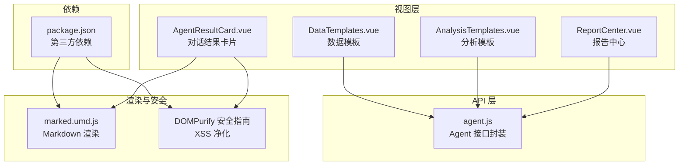
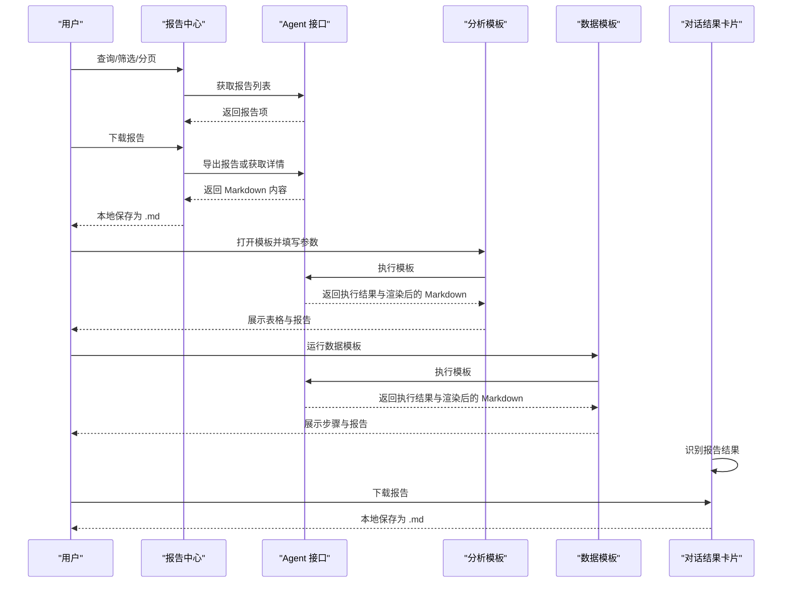
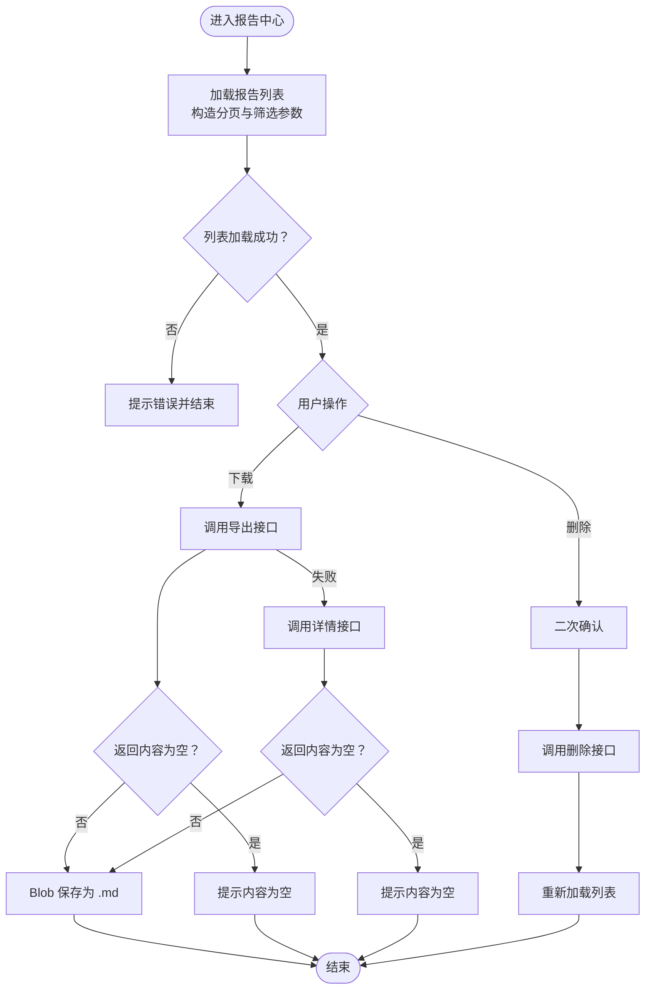
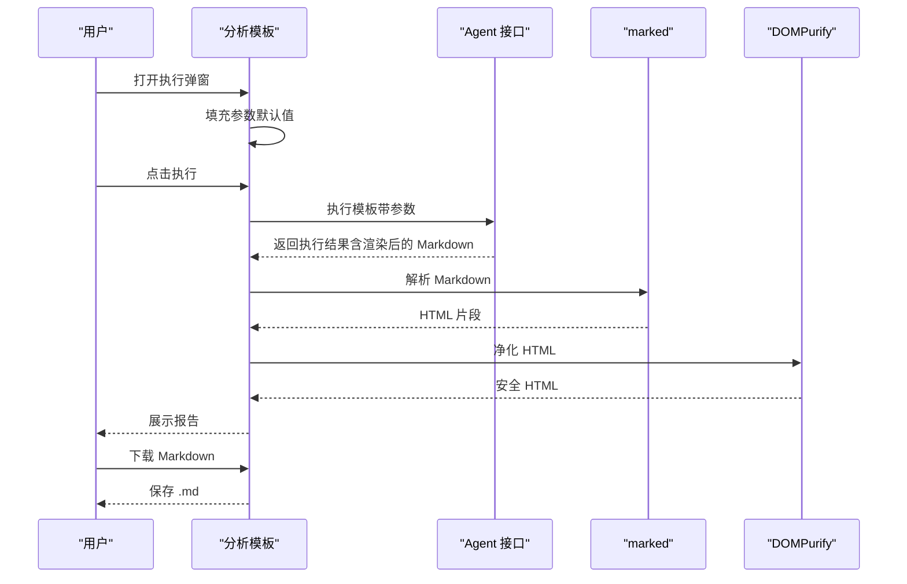
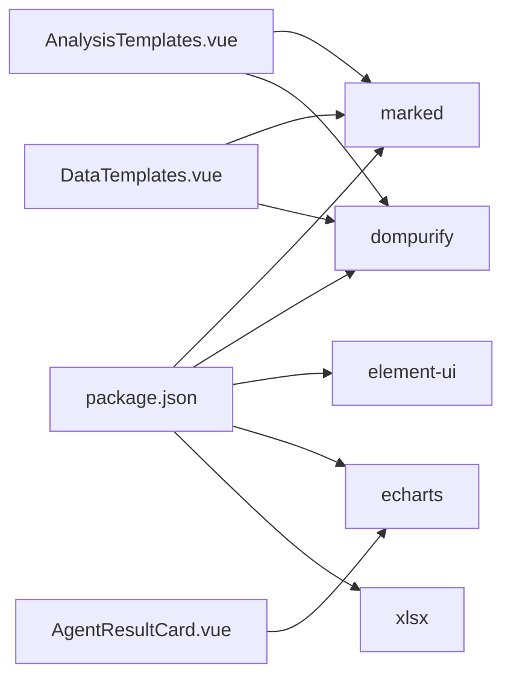

# 报告生成功能

<cite>
**本文引用的文件**
- [ReportCenter.vue](file://src/views/agent/ReportCenter.vue)
- [agent.js](file://src/api/agent.js)
- [AnalysisTemplates.vue](file://src/views/agent/AnalysisTemplates.vue)
- [DataTemplates.vue](file://src/views/agent/DataTemplates.vue)
- [AgentResultCard.vue](file://src/components/AgentResultCard.vue)
- [marked.umd.js](file://offline-npm-bundles/prebuilt-node_modules/marked/lib/marked.umd.js)
- [dompurify 安全指南](file://offline-npm-bundles/prebuilt-node_modules/dompurify/README.md)
- [package.json](file://package.json)
</cite>

## 目录
1. [简介](#简介)
2. [项目结构](#项目结构)
3. [核心组件](#核心组件)
4. [架构总览](#架构总览)
5. [详细组件分析](#详细组件分析)
6. [依赖关系分析](#依赖关系分析)
7. [性能考量](#性能考量)
8. [故障排查指南](#故障排查指南)
9. [结论](#结论)
10. [附录](#附录)

## 简介
本文件围绕“报告生成功能”进行系统化文档整理，覆盖报告模板系统设计、生成流程、报告类型分类、自定义能力、分享与导出、质量控制机制以及实际案例与最佳实践。当前前端实现以 Markdown 为核心载体，结合模板化工具链与安全渲染，提供从数据到报告的完整闭环。

## 项目结构
与报告生成功能直接相关的前端模块主要分布在以下位置：
- 视图层：报告中心、分析模板、数据模板、对话结果卡片
- API 层：Agent 相关接口封装
- 渲染与安全：marked Markdown 渲染、DOMPurify 内容净化
- 依赖声明：package.json 中对渲染与安全库的引入

**图表来源**
- [ReportCenter.vue:1-260](file://src/views/agent/ReportCenter.vue#L1-L260)
- [AnalysisTemplates.vue:1-509](file://src/views/agent/AnalysisTemplates.vue#L1-L509)
- [DataTemplates.vue:1-309](file://src/views/agent/DataTemplates.vue#L1-L309)
- [AgentResultCard.vue:1-513](file://src/components/AgentResultCard.vue#L1-L513)
- [agent.js:1-168](file://src/api/agent.js#L1-L168)
- [marked.umd.js:1809-2285](file://offline-npm-bundles/prebuilt-node_modules/marked/lib/marked.umd.js#L1809-L2285)
- [dompurify 安全指南:19-21](file://offline-npm-bundles/prebuilt-node_modules/dompurify/README.md#L19-L21)
- [package.json:11-28](file://package.json#L11-L28)

**章节来源**
- [ReportCenter.vue:1-260](file://src/views/agent/ReportCenter.vue#L1-L260)
- [AnalysisTemplates.vue:1-509](file://src/views/agent/AnalysisTemplates.vue#L1-L509)
- [DataTemplates.vue:1-309](file://src/views/agent/DataTemplates.vue#L1-L309)
- [AgentResultCard.vue:1-513](file://src/components/AgentResultCard.vue#L1-L513)
- [agent.js:1-168](file://src/api/agent.js#L1-L168)
- [package.json:11-28](file://package.json#L11-L28)

## 核心组件
- 报告中心（ReportCenter.vue）
  - 负责报告列表展示、筛选、分页、下载与删除
  - 支持按报告类型与状态过滤
  - 提供 Markdown 下载能力
- 分析模板（AnalysisTemplates.vue）
  - 模板的创建、编辑、执行、删除
  - 执行结果可视化与 Markdown 报告展示
  - 输出模板采用 Jinja2 风格插值与 Markdown
- 数据模板（DataTemplates.vue）
  - 面向数据加工的模板运行界面
  - 步骤执行状态、表格数据与 Markdown 报告展示
- 对话结果卡片（AgentResultCard.vue）
  - 识别报告类工具调用结果并生成报告卡片
  - 提供 Markdown 下载与图表渲染
- Agent 接口封装（agent.js）
  - 报告管理：查询、详情、删除、导出
  - 分析模板管理：CRUD 与执行
  - 其他 Agent 能力（对话、记忆、附件上传）

**章节来源**
- [ReportCenter.vue:86-223](file://src/views/agent/ReportCenter.vue#L86-L223)
- [AnalysisTemplates.vue:165-389](file://src/views/agent/AnalysisTemplates.vue#L165-L389)
- [DataTemplates.vue:129-239](file://src/views/agent/DataTemplates.vue#L129-L239)
- [AgentResultCard.vue:101-393](file://src/components/AgentResultCard.vue#L101-L393)
- [agent.js:114-168](file://src/api/agent.js#L114-L168)

## 架构总览
报告生成功能的前端架构由“视图层-接口层-渲染与安全层”构成，核心流程如下：

**图表来源**
- [ReportCenter.vue:121-178](file://src/views/agent/ReportCenter.vue#L121-L178)
- [AnalysisTemplates.vue:249-276](file://src/views/agent/AnalysisTemplates.vue#L249-L276)
- [DataTemplates.vue:206-216](file://src/views/agent/DataTemplates.vue#L206-L216)
- [AgentResultCard.vue:206-220](file://src/components/AgentResultCard.vue#L206-L220)
- [agent.js:115-130](file://src/api/agent.js#L115-L130)

## 详细组件分析

### 报告中心（ReportCenter.vue）
- 功能要点
  - 列表展示：标题、类型、状态、内容长度、创建时间
  - 筛选与分页：按模板类型与状态筛选，支持重置
  - 操作：下载（优先导出接口，失败回退详情接口）、删除
  - 样式：基于 Element UI 的表格与分页组件
- 关键流程
  - 加载报告列表：构造分页与筛选参数，调用接口
  - 下载报告：优先调用导出接口；若不可用则回退详情接口；最终以 Blob 形式保存为 .md
  - 删除报告：二次确认后调用删除接口

**图表来源**
- [ReportCenter.vue:121-178](file://src/views/agent/ReportCenter.vue#L121-L178)

**章节来源**
- [ReportCenter.vue:86-223](file://src/views/agent/ReportCenter.vue#L86-L223)

### 分析模板（AnalysisTemplates.vue）
- 功能要点
  - 模板管理：创建、编辑、删除、执行
  - 参数定义：支持字符串、数字、枚举、必填与默认值
  - 步骤定义：工具名、工具参数（JSON）、可选执行条件
  - 输出模板：Jinja2 风格插值与 Markdown
  - 执行结果：步骤状态、表格数据、渲染后的 Markdown 报告
  - Markdown 渲染：marked + DOMPurify 安全净化
- 关键流程
  - 打开执行弹窗：根据模板参数生成表单，默认值填充
  - 执行模板：调用执行接口，接收渲染后的 Markdown
  - 下载 Markdown：将内容保存为 .md 文件

**图表来源**
- [AnalysisTemplates.vue:238-276](file://src/views/agent/AnalysisTemplates.vue#L238-L276)
- [AnalysisTemplates.vue:384-387](file://src/views/agent/AnalysisTemplates.vue#L384-L387)
- [agent.js:152-154](file://src/api/agent.js#L152-L154)
- [marked.umd.js:1809-2285](file://offline-npm-bundles/prebuilt-node_modules/marked/lib/marked.umd.js#L1809-L2285)
- [dompurify 安全指南:19-21](file://offline-npm-bundles/prebuilt-node_modules/dompurify/README.md#L19-L21)

**章节来源**
- [AnalysisTemplates.vue:165-389](file://src/views/agent/AnalysisTemplates.vue#L165-L389)

### 数据模板（DataTemplates.vue）
- 功能要点
  - 仅展示“数据分析”类模板
  - 运行弹窗：参数表单、步骤状态、表格数据、Markdown 报告
  - 渲染：marked + DOMPurify
- 关键流程
  - 加载模板：按类别筛选
  - 运行模板：调用执行接口，展示步骤与报告
  - 删除模板：二次确认后调用删除接口

**章节来源**
- [DataTemplates.vue:129-239](file://src/views/agent/DataTemplates.vue#L129-L239)

### 对话结果卡片（AgentResultCard.vue）
- 功能要点
  - 识别报告类工具调用（report_builder、report_review）
  - 生成报告卡片：标题、类型、内容长度、摘要
  - 下载 Markdown：将内容保存为 .md
  - 图表渲染：基于 ECharts，自动展开含图表的面板并处理 resize
- 关键流程
  - 识别报告结果：解析工具调用结果，判断工具名与字段
  - 下载：构造 Blob 并触发浏览器下载
  - 图表：初始化实例、设置 option、监听窗口 resize

**章节来源**
- [AgentResultCard.vue:101-393](file://src/components/AgentResultCard.vue#L101-L393)

### Agent 接口封装（agent.js）
- 报告管理
  - 查询报告列表、获取报告详情、删除报告、导出报告
- 分析模板管理
  - 查询模板、创建模板、获取模板详情、更新模板、删除模板、执行模板
- 其他能力
  - 对话、记忆、附件上传等（与报告生成相关）

**章节来源**
- [agent.js:114-168](file://src/api/agent.js#L114-L168)

## 依赖关系分析
- 渲染与安全
  - marked：将 Markdown 文本解析为 HTML
  - DOMPurify：净化 HTML，防止 XSS
- 第三方库
  - Element UI：表格、分页、对话框等 UI 组件
  - ECharts：图表渲染
  - xlsx：Excel 导出（在当前仓库未见直接使用，但作为潜在导出格式存在）

**图表来源**
- [package.json:11-28](file://package.json#L11-L28)
- [AnalysisTemplates.vue:166-168](file://src/views/agent/AnalysisTemplates.vue#L166-L168)
- [DataTemplates.vue:136-137](file://src/views/agent/DataTemplates.vue#L136-L137)
- [AgentResultCard.vue:102-102](file://src/components/AgentResultCard.vue#L102-L102)

**章节来源**
- [package.json:11-28](file://package.json#L11-L28)

## 性能考量
- 渲染性能
  - marked 渲染：在执行模板与数据模板中，将 Markdown 转换为 HTML，建议控制内容长度与复杂度，避免过长的 Markdown 导致渲染卡顿
  - DOMPurify 净化：对 HTML 进行白名单过滤，建议限制允许标签与属性，减少不必要的开销
- 图表性能
  - ECharts 初始化与 resize：在对话结果卡片中，自动展开含图表的面板并处理窗口 resize，注意销毁实例以避免内存泄漏
- 网络与 IO
  - 报告导出与下载：优先使用导出接口，失败回退详情接口，避免重复请求
  - Blob 下载：使用浏览器本地存储与下载，避免服务端压力

[本节为通用性能建议，不直接分析具体文件，故无“章节来源”]

## 故障排查指南
- 报告下载失败
  - 现象：点击下载提示内容为空或下载失败
  - 排查：确认导出接口可用；若不可用，检查详情接口是否返回内容；确保前端对空内容进行提示
  - 参考路径：[ReportCenter.vue:151-178](file://src/views/agent/ReportCenter.vue#L151-L178)
- Markdown 渲染异常
  - 现象：渲染后出现不期望的标签或样式错乱
  - 排查：确认 DOMPurify 白名单配置；检查 marked 的渲染选项；避免在模板中注入不受信任的 HTML
  - 参考路径：[AnalysisTemplates.vue:384-387](file://src/views/agent/AnalysisTemplates.vue#L384-L387)，[marked.umd.js:1809-2285](file://offline-npm-bundles/prebuilt-node_modules/marked/lib/marked.umd.js#L1809-L2285)，[dompurify 安全指南:19-21](file://offline-npm-bundles/prebuilt-node_modules/dompurify/README.md#L19-L21)
- 图表不显示或尺寸异常
  - 现象：图表空白或比例失真
  - 排查：确认面板展开后再渲染；监听窗口 resize 并触发图表 resize；销毁实例避免内存泄漏
  - 参考路径：[AgentResultCard.vue:281-331](file://src/components/AgentResultCard.vue#L281-L331)

**章节来源**
- [ReportCenter.vue:151-178](file://src/views/agent/ReportCenter.vue#L151-L178)
- [AnalysisTemplates.vue:384-387](file://src/views/agent/AnalysisTemplates.vue#L384-L387)
- [AgentResultCard.vue:281-331](file://src/components/AgentResultCard.vue#L281-L331)

## 结论
报告生成功能以“模板 + 工具调用 + Markdown 渲染 + 安全净化”的方式构建，具备良好的扩展性与安全性。通过报告中心统一管理、分析模板与数据模板灵活组合、对话结果卡片即时呈现，形成从数据到报告的高效闭环。后续可在模板参数校验、内容审核、导出格式多样化等方面进一步完善。

[本节为总结性内容，不直接分析具体文件，故无“章节来源”]

## 附录

### 报告类型分类
- 报告中心支持的类型（用于筛选与展示）
  - 定期报告、尽职调查、投资决策、产品运作、合规检查、策略研究
- 类型标签映射：用于界面展示与状态管理

**章节来源**
- [ReportCenter.vue:102-109](file://src/views/agent/ReportCenter.vue#L102-L109)

### 报告生成流程（代码级）
- 报告中心下载流程
  - 优先调用导出接口；失败回退详情接口；最终以 Blob 保存为 .md
- 分析模板执行流程
  - 填参 -> 执行 -> 渲染 Markdown -> 净化 HTML -> 展示/下载
- 数据模板运行流程
  - 选择模板 -> 填参 -> 执行 -> 展示步骤与报告
- 对话结果卡片下载流程
  - 识别报告结果 -> 下载 Markdown

**章节来源**
- [ReportCenter.vue:151-178](file://src/views/agent/ReportCenter.vue#L151-L178)
- [AnalysisTemplates.vue:249-276](file://src/views/agent/AnalysisTemplates.vue#L249-L276)
- [DataTemplates.vue:206-216](file://src/views/agent/DataTemplates.vue#L206-L216)
- [AgentResultCard.vue:206-220](file://src/components/AgentResultCard.vue#L206-L220)

### 质量控制机制
- 内容安全
  - DOMPurify 白名单过滤，限制标签与属性，防止 XSS
- 格式校验
  - 模板参数类型与必填项校验；工具参数 JSON 校验
- 性能优化
  - 渲染与净化分离；图表实例生命周期管理；网络请求降级策略

**章节来源**
- [AnalysisTemplates.vue:328-367](file://src/views/agent/AnalysisTemplates.vue#L328-L367)
- [AgentResultCard.vue:138-144](file://src/components/AgentResultCard.vue#L138-L144)

### 分享与导出（当前实现与扩展建议）
- 当前实现
  - Markdown 下载：Blob 保存为 .md
- 扩展建议
  - PDF：服务端渲染或浏览器打印（需引入 PDF 库）
  - Word：服务端生成 docx 或转换为 OpenXML
  - Excel：服务端生成 xlsx（当前依赖已包含 xlsx）
  - 图片截图：浏览器截屏或服务端渲染

**章节来源**
- [ReportCenter.vue:180-188](file://src/views/agent/ReportCenter.vue#L180-L188)
- [package.json:28-28](file://package.json#L28-L28)

### 最佳实践
- 模板设计
  - 明确参数类型与默认值；合理拆分步骤；输出模板采用清晰的 Markdown 结构
- 内容治理
  - 引入内容审核流程；对渲染后的 HTML 进行二次校验
- 用户体验
  - 提供预览与下载双通道；对大体量报告提供分段导出或压缩下载
- 安全基线
  - 固定 DOMPurify 白名单；限制允许标签与属性；避免内联脚本与危险协议

[本节为通用最佳实践建议，不直接分析具体文件，故无“章节来源”]