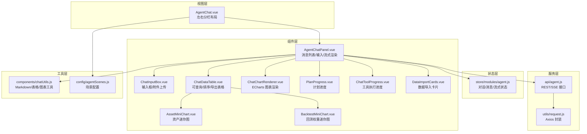
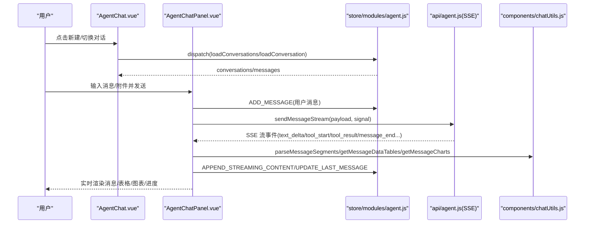
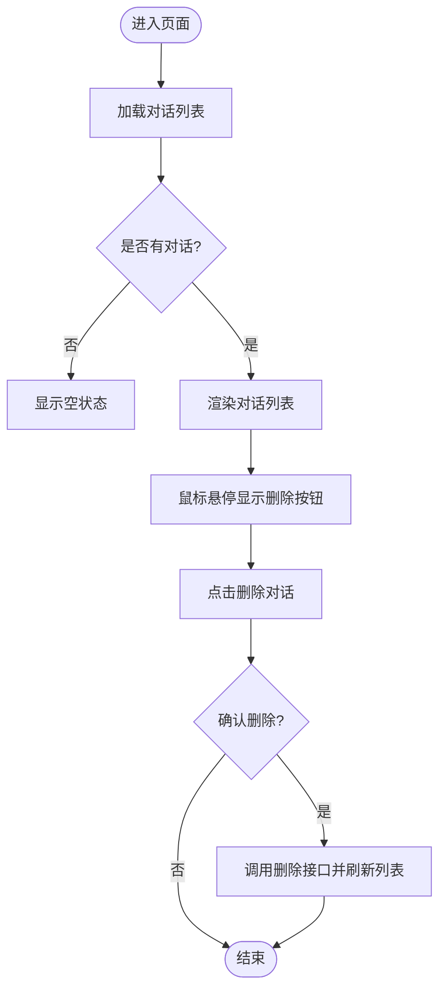
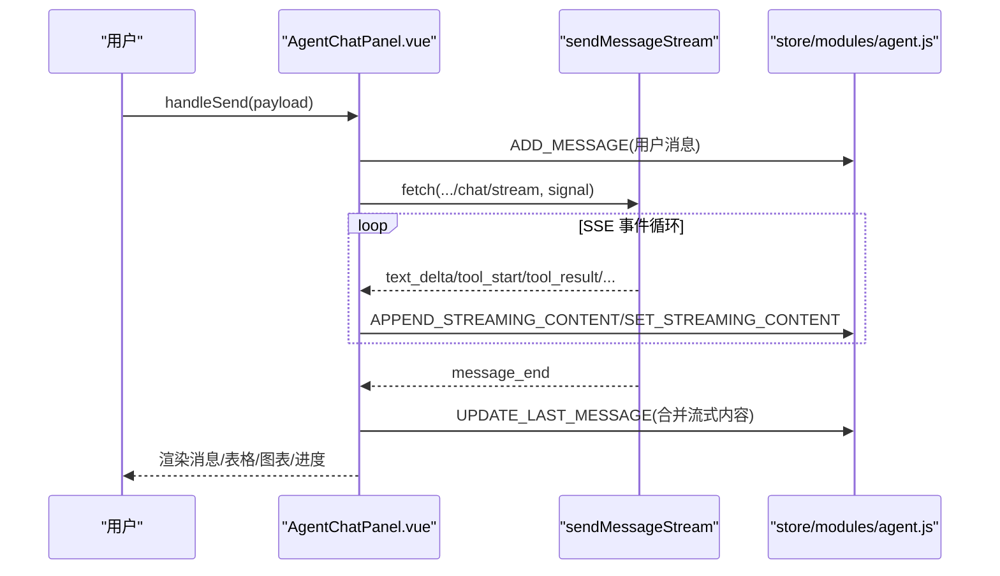
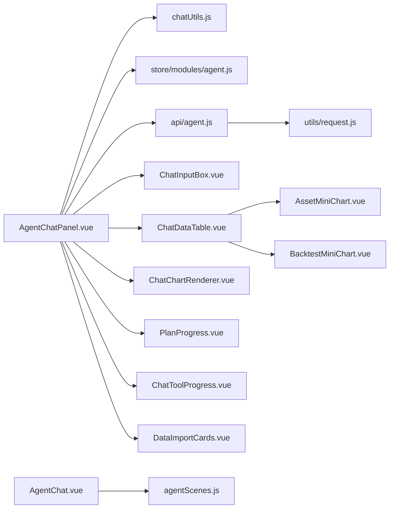

# 智能对话系统

<cite>
**本文档引用的文件**
- [AgentChat.vue](file://src/views/agent/AgentChat.vue)
- [AgentChatPanel.vue](file://src/components/AgentChatPanel.vue)
- [agent.js](file://src/store/modules/agent.js)
- [agent.js](file://src/api/agent.js)
- [chatUtils.js](file://src/components/chatUtils.js)
- [ChatInputBox.vue](file://src/components/ChatInputBox.vue)
- [ChatDataTable.vue](file://src/components/ChatDataTable.vue)
- [ChatChartRenderer.vue](file://src/components/ChatChartRenderer.vue)
- [AssetMiniChart.vue](file://src/components/AssetMiniChart.vue)
- [BacktestMiniChart.vue](file://src/components/BacktestMiniChart.vue)
- [PlanProgress.vue](file://src/components/PlanProgress.vue)
- [ChatToolProgress.vue](file://src/components/ChatToolProgress.vue)
- [DataImportCards.vue](file://src/components/DataImportCards.vue)
- [ConversationHistory.vue](file://src/views/agent/ConversationHistory.vue)
- [agentScenes.js](file://src/config/agentScenes.js)
- [request.js](file://src/utils/request.js)
</cite>

## 目录
1. [简介](#简介)
2. [项目结构](#项目结构)
3. [核心组件](#核心组件)
4. [架构总览](#架构总览)
5. [详细组件分析](#详细组件分析)
6. [依赖关系分析](#依赖关系分析)
7. [性能考量](#性能考量)
8. [故障排查指南](#故障排查指南)
9. [结论](#结论)
10. [附录](#附录)

## 简介
本项目是一个基于 Vue 的智能对话系统，采用左右分栏布局：左侧为对话历史列表，右侧为实时对话交互面板。系统支持多轮对话、SSE 实时通信、消息渲染（Markdown/表格/图表）、资产与回测数据联动、模板化输入与数据导入卡片等能力。本文档将从架构设计、组件实现、数据流与交互流程等方面进行全面说明。

## 项目结构
系统主要由以下层次构成：
- 视图层：左侧对话列表与右侧聊天面板
- 组件层：消息渲染、输入框、数据表格、图表渲染、资产/回测迷你图、计划与工具进度等
- 状态层：Vuex Store 管理对话列表、消息、流式状态与场景
- 服务层：API 封装与 SSE 流式对话
- 工具层：Markdown 解析、表格与图表渲染工具

**图表来源**
- [AgentChat.vue:1-249](file://src/views/agent/AgentChat.vue#L1-L249)
- [AgentChatPanel.vue:1-1199](file://src/components/AgentChatPanel.vue#L1-L1199)
- [agent.js:1-230](file://src/store/modules/agent.js#L1-L230)
- [agent.js:1-168](file://src/api/agent.js#L1-L168)
- [chatUtils.js:1-479](file://src/components/chatUtils.js#L1-L479)
- [ChatInputBox.vue:1-260](file://src/components/ChatInputBox.vue#L1-L260)
- [ChatDataTable.vue:1-1842](file://src/components/ChatDataTable.vue#L1-L1842)
- [ChatChartRenderer.vue:1-599](file://src/components/ChatChartRenderer.vue#L1-L599)
- [AssetMiniChart.vue:1-493](file://src/components/AssetMiniChart.vue#L1-L493)
- [BacktestMiniChart.vue:1-350](file://src/components/BacktestMiniChart.vue#L1-L350)
- [PlanProgress.vue:1-187](file://src/components/PlanProgress.vue#L1-L187)
- [ChatToolProgress.vue:1-61](file://src/components/ChatToolProgress.vue#L1-L61)
- [DataImportCards.vue:1-267](file://src/components/DataImportCards.vue#L1-L267)
- [agentScenes.js:1-98](file://src/config/agentScenes.js#L1-L98)
- [request.js:1-100](file://src/utils/request.js#L1-L100)

**章节来源**
- [AgentChat.vue:1-249](file://src/views/agent/AgentChat.vue#L1-L249)
- [AgentChatPanel.vue:1-1199](file://src/components/AgentChatPanel.vue#L1-L1199)
- [agent.js:1-230](file://src/store/modules/agent.js#L1-L230)
- [agent.js:1-168](file://src/api/agent.js#L1-L168)
- [chatUtils.js:1-479](file://src/components/chatUtils.js#L1-L479)
- [ChatInputBox.vue:1-260](file://src/components/ChatInputBox.vue#L1-L260)
- [ChatDataTable.vue:1-1842](file://src/components/ChatDataTable.vue#L1-L1842)
- [ChatChartRenderer.vue:1-599](file://src/components/ChatChartRenderer.vue#L1-L599)
- [AssetMiniChart.vue:1-493](file://src/components/AssetMiniChart.vue#L1-L493)
- [BacktestMiniChart.vue:1-350](file://src/components/BacktestMiniChart.vue#L1-L350)
- [PlanProgress.vue:1-187](file://src/components/PlanProgress.vue#L1-L187)
- [ChatToolProgress.vue:1-61](file://src/components/ChatToolProgress.vue#L1-L61)
- [DataImportCards.vue:1-267](file://src/components/DataImportCards.vue#L1-L267)
- [agentScenes.js:1-98](file://src/config/agentScenes.js#L1-L98)
- [request.js:1-100](file://src/utils/request.js#L1-L100)

## 核心组件
- AgentChat：负责左右分栏布局、对话列表展示与时间格式化、删除对话等交互。
- AgentChatPanel：负责消息渲染、输入框处理、SSE 流式接收、工具调用进度、计划进度、资产/回测联动、数据导入卡片、表格导出等。
- ChatInputBox：负责文本输入、附件上传、拖拽上传、快捷键发送等。
- ChatDataTable：负责表格渲染、查询/排序/分页、资产/回测芯片、导出 CSV 等。
- ChatChartRenderer：负责 ECharts 图表渲染、尺寸适配、骨架屏与错误回退。
- AssetMiniChart / BacktestMiniChart：负责资产/回测权重的迷你图弹窗展示。
- PlanProgress / ChatToolProgress：分别展示计划步骤与工具执行进度。
- DataImportCards：展示数据校验、预览、导入结果与模板列表。
- store/modules/agent：管理对话列表、消息、流式状态、场景映射等。
- api/agent：封装 REST 与 SSE 接口，支持中止信号。
- components/chatUtils：Markdown 解析、表格/图表提取、工具结果解析等。
- config/agentScenes：场景配置与快捷问题。
- utils/request：Axios 封装与错误处理。

**章节来源**
- [AgentChat.vue:1-249](file://src/views/agent/AgentChat.vue#L1-L249)
- [AgentChatPanel.vue:1-1199](file://src/components/AgentChatPanel.vue#L1-L1199)
- [agent.js:1-230](file://src/store/modules/agent.js#L1-L230)
- [agent.js:1-168](file://src/api/agent.js#L1-L168)
- [chatUtils.js:1-479](file://src/components/chatUtils.js#L1-L479)
- [ChatInputBox.vue:1-260](file://src/components/ChatInputBox.vue#L1-L260)
- [ChatDataTable.vue:1-1842](file://src/components/ChatDataTable.vue#L1-L1842)
- [ChatChartRenderer.vue:1-599](file://src/components/ChatChartRenderer.vue#L1-L599)
- [AssetMiniChart.vue:1-493](file://src/components/AssetMiniChart.vue#L1-L493)
- [BacktestMiniChart.vue:1-350](file://src/components/BacktestMiniChart.vue#L1-L350)
- [PlanProgress.vue:1-187](file://src/components/PlanProgress.vue#L1-L187)
- [ChatToolProgress.vue:1-61](file://src/components/ChatToolProgress.vue#L1-L61)
- [DataImportCards.vue:1-267](file://src/components/DataImportCards.vue#L1-L267)
- [agentScenes.js:1-98](file://src/config/agentScenes.js#L1-L98)
- [request.js:1-100](file://src/utils/request.js#L1-L100)

## 架构总览
系统采用“视图-组件-状态-服务-工具”的分层架构：
- 视图层负责布局与交互；
- 组件层负责具体功能渲染与事件处理；
- 状态层集中管理对话与消息；
- 服务层提供 REST 与 SSE；
- 工具层提供解析与渲染能力。

**图表来源**
- [AgentChat.vue:1-249](file://src/views/agent/AgentChat.vue#L1-L249)
- [AgentChatPanel.vue:784-1084](file://src/components/AgentChatPanel.vue#L784-L1084)
- [agent.js:84-213](file://src/store/modules/agent.js#L84-L213)
- [agent.js:78-112](file://src/api/agent.js#L78-L112)
- [chatUtils.js:167-479](file://src/components/chatUtils.js#L167-L479)

**章节来源**
- [AgentChat.vue:1-249](file://src/views/agent/AgentChat.vue#L1-L249)
- [AgentChatPanel.vue:784-1084](file://src/components/AgentChatPanel.vue#L784-L1084)
- [agent.js:84-213](file://src/store/modules/agent.js#L84-L213)
- [agent.js:78-112](file://src/api/agent.js#L78-L112)
- [chatUtils.js:167-479](file://src/components/chatUtils.js#L167-L479)

## 详细组件分析

### AgentChat 组件（左侧对话列表）
- 功能要点
  - 新建对话、切换对话、删除对话
  - 对话列表按更新时间倒序展示
  - 时间格式化：刚刚/分钟前/小时前/日期格式
  - 支持空状态与加载状态
- 关键实现
  - 列表项 hover 显示删除按钮
  - 删除对话使用确认对话框
  - 格式化时间函数按时间差输出人性化文案

**图表来源**
- [AgentChat.vue:60-134](file://src/views/agent/AgentChat.vue#L60-L134)

**章节来源**
- [AgentChat.vue:1-249](file://src/views/agent/AgentChat.vue#L1-L249)

### AgentChatPanel 组件（右侧对话面板）
- 功能要点
  - 消息列表：虚拟滚动、加载更早消息
  - 实时流式渲染：文本增量、工具阶段、计划进度
  - 资产/回测联动：点击资产/策略弹窗
  - 表格导出：事件委托统一处理导出按钮
  - 模板与快捷问题：DataUpdateTemplates
  - 输入框：ChatInputBox
- 关键实现
  - SSE 事件解析：text_delta、tool_start、tool_result、message_start、message_end、plan_update、error、heartbeat
  - 中止流式：AbortController，防止切换会话时串话
  - 工具调用去重与图表/表格提取
  - Markdown 渲染与 XSS 消毒

**图表来源**
- [AgentChatPanel.vue:784-1084](file://src/components/AgentChatPanel.vue#L784-L1084)
- [agent.js:78-112](file://src/api/agent.js#L78-L112)
- [agent.js:200-213](file://src/store/modules/agent.js#L200-L213)

**章节来源**
- [AgentChatPanel.vue:1-1199](file://src/components/AgentChatPanel.vue#L1-L1199)
- [agent.js:78-112](file://src/api/agent.js#L78-L112)
- [agent.js:200-213](file://src/store/modules/agent.js#L200-L213)

### ChatInputBox 组件（输入框）
- 功能要点
  - 文本输入与快捷键 Enter 发送
  - 附件上传：文件选择与拖拽上传
  - 上传状态管理：成功/失败/上传中
  - 发送前校验：文本或附件至少其一
- 关键实现
  - 文件类型限制：.xlsx/.xls/.csv
  - 上传中不可发送的保护
  - 上传成功后清空输入与附件列表

**章节来源**
- [ChatInputBox.vue:1-260](file://src/components/ChatInputBox.vue#L1-L260)

### ChatDataTable 组件（表格渲染）
- 功能要点
  - 表格渲染：查询/排序/分页
  - 资产/回测芯片：悬停迷你图与点击查看详情
  - 导出 CSV：事件委托统一处理
  - 预览模式：前 N 行展示
  - 全量数据补拉：在可推断资产与日期区间时一键拉取
- 关键实现
  - 列类型自动检测与百分比字段识别
  - 行内 Markdown 渲染缓存
  - 展开/折叠状态持久化
  - 资产列高亮与点击跳转

**章节来源**
- [ChatDataTable.vue:1-1842](file://src/components/ChatDataTable.vue#L1-L1842)

### ChatChartRenderer 组件（图表渲染）
- 功能要点
  - ECharts 图表渲染增强：tooltip、legend、grid、xAxis 优化
  - 骨架屏与错误回退
  - 响应式高度与尺寸适配
- 关键实现
  - 统一调色板与主题优化
  - 自动旋转 xAxis 标签与 grid 底部预留
  - dataZoom 在大数据量时启用

**章节来源**
- [ChatChartRenderer.vue:1-599](file://src/components/ChatChartRenderer.vue#L1-L599)

### AssetMiniChart 与 BacktestMiniChart 组件
- 功能要点
  - AssetMiniChart：资产 K 线迷你图，支持覆盖数据与预取缓存
  - BacktestMiniChart：回测权重堆叠面积图，展示指标摘要
- 关键实现
  - 模块级缓存与并发去重
  - 预取队列与空闲回调调度
  - 弹窗懒加载与实例复用

**章节来源**
- [AssetMiniChart.vue:1-493](file://src/components/AssetMiniChart.vue#L1-L493)
- [BacktestMiniChart.vue:1-350](file://src/components/BacktestMiniChart.vue#L1-L350)

### PlanProgress 与 ChatToolProgress 组件
- 功能要点
  - PlanProgress：展示计划目标与步骤进度
  - ChatToolProgress：展示工具执行步骤与当前任务
- 关键实现
  - 步骤状态：待执行/进行中/已完成/失败
  - 动画与徽章计数

**章节来源**
- [PlanProgress.vue:1-187](file://src/components/PlanProgress.vue#L1-L187)
- [ChatToolProgress.vue:1-61](file://src/components/ChatToolProgress.vue#L1-L61)

### DataImportCards 组件（数据导入卡片）
- 功能要点
  - 校验结果：通过/未通过、错误与警告列表
  - 数据预览：前 N 行表格
  - 导入结果：新增/更新/跳过/错误统计
  - 模板列表：可用的数据更新模板
- 关键实现
  - 多卡片类型区分与渲染
  - 统一样式与颜色辅助

**章节来源**
- [DataImportCards.vue:1-267](file://src/components/DataImportCards.vue#L1-L267)

### 对话历史管理（ConversationHistory）
- 功能要点
  - 场景筛选、日期范围、关键词搜索
  - 批量删除与单条删除
  - 跳转到对话并设置场景
  - 分页与加载状态
- 关键实现
  - 前端二次筛选与本地分页
  - 场景标签与颜色映射

**章节来源**
- [ConversationHistory.vue:1-349](file://src/views/agent/ConversationHistory.vue#L1-L349)

### 场景配置（agentScenes）
- 功能要点
  - 多场景定义：智能匹配、数据分析、大类资产研究、企业数据问答、信用评级等
  - 快捷问题与工具集映射
- 关键实现
  - getSceneByKey 快速查找场景

**章节来源**
- [agentScenes.js:1-98](file://src/config/agentScenes.js#L1-L98)

## 依赖关系分析
- 组件耦合
  - AgentChatPanel 依赖 chatUtils 进行 Markdown/表格/图表解析
  - ChatDataTable 依赖 AssetMiniChart 与 BacktestMiniChart 进行资产/回测展示
  - AgentChatPanel 依赖 store 与 api 进行消息与 SSE 管理
- 外部依赖
  - Axios 封装与错误处理
  - ECharts 图表渲染
  - Element UI 组件库

**图表来源**
- [AgentChatPanel.vue:1-1199](file://src/components/AgentChatPanel.vue#L1-L1199)
- [chatUtils.js:1-479](file://src/components/chatUtils.js#L1-L479)
- [agent.js:1-230](file://src/store/modules/agent.js#L1-L230)
- [agent.js:1-168](file://src/api/agent.js#L1-L168)
- [ChatInputBox.vue:1-260](file://src/components/ChatInputBox.vue#L1-L260)
- [ChatDataTable.vue:1-1842](file://src/components/ChatDataTable.vue#L1-L1842)
- [ChatChartRenderer.vue:1-599](file://src/components/ChatChartRenderer.vue#L1-L599)
- [AssetMiniChart.vue:1-493](file://src/components/AssetMiniChart.vue#L1-L493)
- [BacktestMiniChart.vue:1-350](file://src/components/BacktestMiniChart.vue#L1-L350)
- [PlanProgress.vue:1-187](file://src/components/PlanProgress.vue#L1-L187)
- [ChatToolProgress.vue:1-61](file://src/components/ChatToolProgress.vue#L1-L61)
- [DataImportCards.vue:1-267](file://src/components/DataImportCards.vue#L1-L267)
- [AgentChat.vue:1-249](file://src/views/agent/AgentChat.vue#L1-L249)
- [agentScenes.js:1-98](file://src/config/agentScenes.js#L1-L98)
- [request.js:1-100](file://src/utils/request.js#L1-L100)

**章节来源**
- [AgentChatPanel.vue:1-1199](file://src/components/AgentChatPanel.vue#L1-L1199)
- [chatUtils.js:1-479](file://src/components/chatUtils.js#L1-L479)
- [agent.js:1-230](file://src/store/modules/agent.js#L1-L230)
- [agent.js:1-168](file://src/api/agent.js#L1-L168)
- [ChatInputBox.vue:1-260](file://src/components/ChatInputBox.vue#L1-L260)
- [ChatDataTable.vue:1-1842](file://src/components/ChatDataTable.vue#L1-L1842)
- [ChatChartRenderer.vue:1-599](file://src/components/ChatChartRenderer.vue#L1-L599)
- [AssetMiniChart.vue:1-493](file://src/components/AssetMiniChart.vue#L1-L493)
- [BacktestMiniChart.vue:1-350](file://src/components/BacktestMiniChart.vue#L1-L350)
- [PlanProgress.vue:1-187](file://src/components/PlanProgress.vue#L1-L187)
- [ChatToolProgress.vue:1-61](file://src/components/ChatToolProgress.vue#L1-L61)
- [DataImportCards.vue:1-267](file://src/components/DataImportCards.vue#L1-L267)
- [AgentChat.vue:1-249](file://src/views/agent/AgentChat.vue#L1-L249)
- [agentScenes.js:1-98](file://src/config/agentScenes.js#L1-L98)
- [request.js:1-100](file://src/utils/request.js#L1-L100)

## 性能考量
- 虚拟滚动：消息列表使用虚拟滚动组件，减少 DOM 节点数量，提升滚动性能。
- 流式渲染：SSE 事件增量更新，避免整页重绘。
- 缓存与去重：资产 K 线与回测权重迷你图采用模块级缓存与并发去重，降低请求压力。
- 防抖与节流：搜索与滚动采用防抖与节流，避免高频操作导致的性能问题。
- 图表优化：ECharts 选项增强与骨架屏，提升首屏体验与稳定性。
- 表格导出：事件委托与一次性包装导出按钮，避免 v-html 重渲染闪烁。

[本节为通用指导，无需特定文件引用]

## 故障排查指南
- SSE 连接失败
  - 检查后端服务是否启动、网络是否正常
  - 查看前端错误提示与后端日志
- 流式中止
  - 切换会话或组件销毁时会中止流，避免串话
  - 检查 AbortController 与 _streamAborted 标记
- 表格导出无效
  - 确认导出按钮通过事件委托绑定
  - 检查表格是否已渲染完成
- 图表渲染失败
  - 检查 ECharts 是否全局注册
  - 查看错误回退提示
- 附件上传失败
  - 检查文件类型与大小限制
  - 查看上传接口返回与错误提示

**章节来源**
- [AgentChatPanel.vue:468-487](file://src/components/AgentChatPanel.vue#L468-L487)
- [AgentChatPanel.vue:909-936](file://src/components/AgentChatPanel.vue#L909-L936)
- [ChatDataTable.vue:760-794](file://src/components/ChatDataTable.vue#L760-L794)
- [ChatChartRenderer.vue:428-432](file://src/components/ChatChartRenderer.vue#L428-L432)
- [ChatInputBox.vue:166-183](file://src/components/ChatInputBox.vue#L166-L183)

## 结论
本智能对话系统通过清晰的分层架构与组件化设计，实现了高效、可扩展的实时对话体验。SSE 流式通信、Markdown/表格/图表渲染、资产与回测联动、计划与工具进度展示等特性，共同构成了完整的对话交互生态。通过缓存、去重与虚拟滚动等性能优化手段，系统在大数据量场景下仍能保持流畅体验。

[本节为总结性内容，无需特定文件引用]

## 附录
- 实际对话示例与交互流程
  - 新建对话：点击“新建对话”，清空当前状态并创建新会话
  - 发送消息：输入文本或选择附件，按 Enter 发送
  - 流式响应：AI 逐步返回文本、工具调用与图表
  - 资产/回测联动：点击资产/策略芯片弹出详情
  - 表格导出：在表格上点击“导出”按钮下载 CSV
  - 删除对话：在左侧列表中悬停显示删除按钮，确认删除

**章节来源**
- [AgentChat.vue:77-103](file://src/views/agent/AgentChat.vue#L77-L103)
- [AgentChatPanel.vue:784-1084](file://src/components/AgentChatPanel.vue#L784-L1084)
- [ChatInputBox.vue:104-129](file://src/components/ChatInputBox.vue#L104-L129)
- [ChatDataTable.vue:717-757](file://src/components/ChatDataTable.vue#L717-L757)
- [AssetMiniChart.vue:249-339](file://src/components/AssetMiniChart.vue#L249-L339)
- [BacktestMiniChart.vue:147-244](file://src/components/BacktestMiniChart.vue#L147-L244)