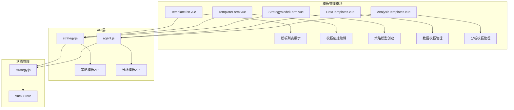
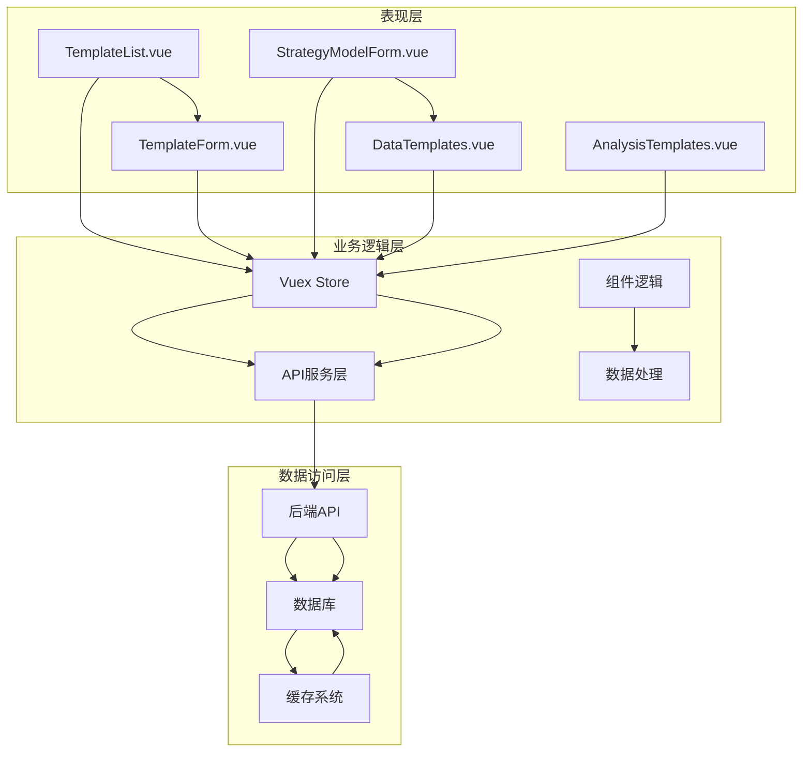
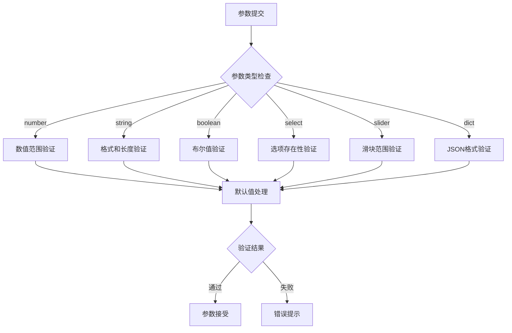
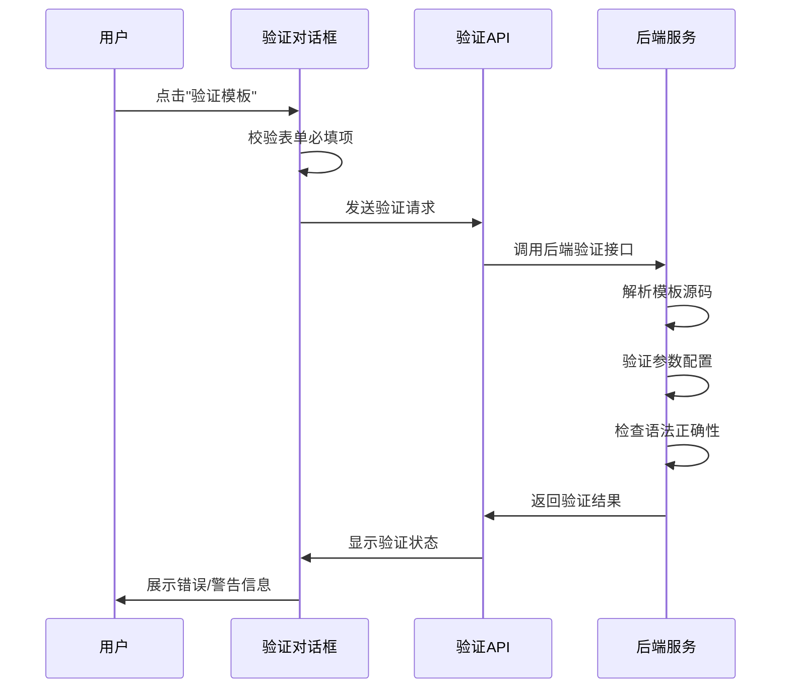
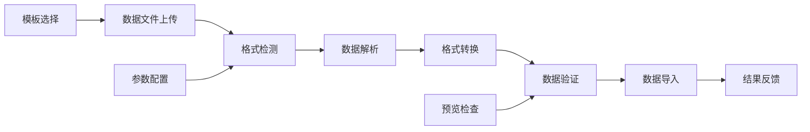
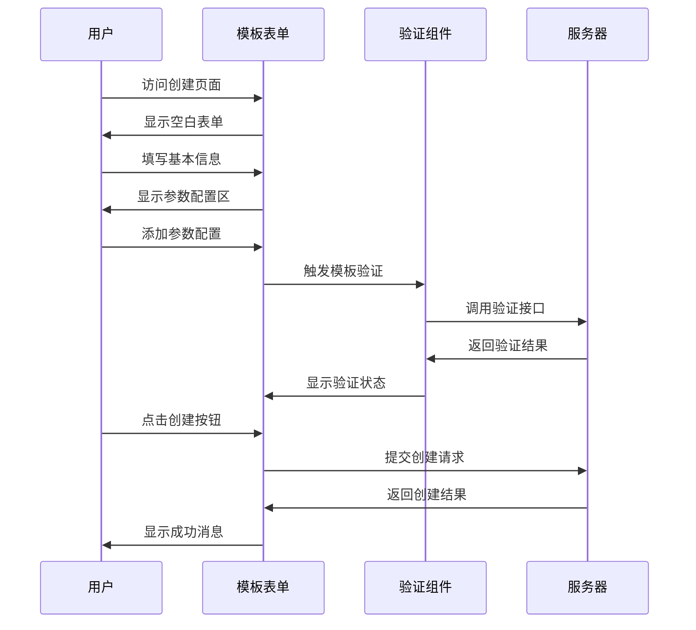
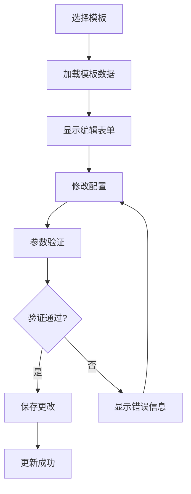
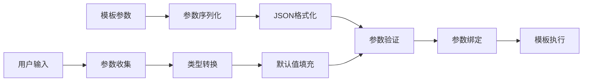
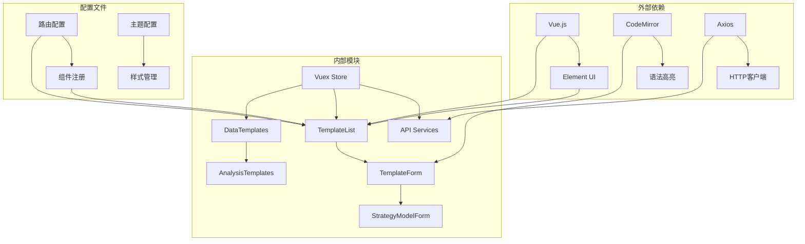

# 模板管理功能

<cite>
**本文档引用的文件**
- [TemplateList.vue](file://src/views/strategy/TemplateList.vue)
- [TemplateForm.vue](file://src/views/strategy/TemplateForm.vue)
- [StrategyModelForm.vue](file://src/views/strategy/StrategyModelForm.vue)
- [strategy.js](file://src/api/strategy.js)
- [agent.js](file://src/api/agent.js)
- [strategy.js](file://src/store/modules/strategy.js)
- [DataTemplates.vue](file://src/views/agent/DataTemplates.vue)
- [AnalysisTemplates.vue](file://src/views/agent/AnalysisTemplates.vue)
- [DataUpdateTemplates.vue](file://src/components/DataUpdateTemplates.vue)
- [index.js](file://src/config/zyDataDomain/index.js)
</cite>

## 目录
1. [简介](#简介)
2. [项目结构](#项目结构)
3. [核心组件](#核心组件)
4. [架构概览](#架构概览)
5. [详细组件分析](#详细组件分析)
6. [依赖关系分析](#依赖关系分析)
7. [性能考虑](#性能考虑)
8. [故障排除指南](#故障排除指南)
9. [结论](#结论)
10. [附录](#附录)

## 简介

模板管理功能是本项目的核心组成部分，提供了完整的模板生命周期管理能力。该功能涵盖了策略模板的创建、编辑、验证、发布以及使用等多个方面，为用户提供了灵活的模板定制和管理解决方案。

模板管理功能主要分为两大类：

1. **策略模板管理**：针对算法策略模板的管理，支持Python源码编写、参数配置、验证机制等
2. **分析模板管理**：针对数据分析和处理流程的模板管理，支持步骤定义、参数配置、标签系统等

该功能采用现代化的前端技术栈，使用Vue.js框架构建，配合Element UI组件库，提供了直观易用的用户界面和强大的后台API支持。

## 项目结构

模板管理功能在项目中的组织结构如下：

**图表来源**
- [TemplateList.vue:1-553](file://src/views/strategy/TemplateList.vue#L1-L553)
- [TemplateForm.vue:1-615](file://src/views/strategy/TemplateForm.vue#L1-L615)
- [strategy.js:1-295](file://src/api/strategy.js#L1-L295)

**章节来源**
- [TemplateList.vue:1-553](file://src/views/strategy/TemplateList.vue#L1-L553)
- [TemplateForm.vue:1-615](file://src/views/strategy/TemplateForm.vue#L1-L615)
- [strategy.js:1-295](file://src/api/strategy.js#L1-L295)

## 核心组件

### 模板列表组件

模板列表组件提供了模板的浏览、搜索、查看详情等功能。主要特性包括：

- **网格布局展示**：采用CSS Grid实现响应式布局，支持不同屏幕尺寸的自适应
- **搜索过滤**：支持按模板名称和代码进行搜索
- **状态管理**：显示模板的启用/禁用状态
- **参数预览**：展示模板的参数定义概览
- **操作功能**：支持查看详情、编辑、使用、删除等操作

### 模板表单组件

模板表单组件是模板管理的核心，提供了完整的模板创建和编辑功能：

- **基本信息配置**：模板名称、代码、描述等基础信息
- **源码编辑**：集成CodeMirror编辑器，支持Python语法高亮
- **参数配置**：支持多种参数类型，包括数字、文本、布尔值、选择框、滑块、字典等
- **验证机制**：内置模板验证功能，确保模板的有效性
- **实时预览**：支持模板验证结果的实时显示

### 策略模型表单组件

策略模型表单组件负责将模板应用到具体的策略创建过程中：

- **模板选择**：从可用模板中选择合适的算法模板
- **参数绑定**：将模板参数与具体策略配置相结合
- **资产选择**：支持多资产选择和权重配置
- **高级配置**：支持动量选择、波动率重置等高级功能
- **数据验证**：确保策略配置的合理性和有效性

**章节来源**
- [TemplateList.vue:222-375](file://src/views/strategy/TemplateList.vue#L222-L375)
- [TemplateForm.vue:212-560](file://src/views/strategy/TemplateForm.vue#L212-L560)
- [StrategyModelForm.vue:455-1165](file://src/views/strategy/StrategyModelForm.vue#L455-L1165)

## 架构概览

模板管理功能采用了分层架构设计，确保了系统的可维护性和扩展性：

**图表来源**
- [strategy.js:1-468](file://src/store/modules/strategy.js#L1-L468)
- [strategy.js:1-295](file://src/api/strategy.js#L1-L295)

### 数据流架构

模板管理的数据流遵循标准的MVVM模式：

1. **视图层**：Vue组件负责用户交互和界面展示
2. **状态管理层**：Vuex Store管理全局状态和数据流
3. **业务逻辑层**：API服务封装后端接口调用
4. **数据持久层**：后端服务处理数据存储和查询

**章节来源**
- [strategy.js:71-136](file://src/store/modules/strategy.js#L71-L136)
- [strategy.js:1-295](file://src/api/strategy.js#L1-L295)

## 详细组件分析

### 模板类型与参数配置

模板系统支持多种参数类型，每种类型都有其特定的配置方式和使用场景：

#### 参数类型详解

| 参数类型 | 描述 | 默认值 | 配置选项 |
|---------|------|--------|----------|
| number | 数字类型 | 0 | 最小值、最大值、步长 |
| string | 文本类型 | "" | 最大长度、格式验证 |
| boolean | 布尔类型 | false | 开关状态 |
| select | 选择类型 | 第一个选项 | 选项列表、多选支持 |
| slider | 滑块类型 | 0 | 范围、步长、显示标签 |
| dict | 字典类型 | {} | JSON格式、嵌套结构 |

#### 参数验证机制

模板参数验证采用多层次设计：

**图表来源**
- [TemplateForm.vue:430-514](file://src/views/strategy/TemplateForm.vue#L430-L514)
- [StrategyModelForm.vue:986-1156](file://src/views/strategy/StrategyModelForm.vue#L986-L1156)

### 模板验证流程

模板验证是确保模板质量和可用性的关键环节：

**图表来源**
- [TemplateForm.vue:429-514](file://src/views/strategy/TemplateForm.vue#L429-L514)
- [strategy.js:42-48](file://src/api/strategy.js#L42-L48)

### 数据模板实现原理

数据模板系统提供了灵活的数据处理和分析能力：

#### 数据模板类型

| 模板类型 | 功能描述 | 适用场景 |
|---------|----------|----------|
| price_import | 行情数据导入 | 价格数据批量导入 |
| fx_import | 汇率数据导入 | 外汇汇率数据处理 |
| asset_info_import | 资产信息导入 | 资产基础信息管理 |
| multi_asset_price | 多资产宽表 | 组合数据处理 |
| trade_dates_import | 交易日历更新 | 交易日历维护 |
| api_sync | API数据同步 | 外部数据对接 |
| data_clean | 数据清洗修复 | 数据质量治理 |

#### 数据处理流程

**图表来源**
- [DataUpdateTemplates.vue:26-76](file://src/components/DataUpdateTemplates.vue#L26-L76)
- [DataTemplates.vue:168-183](file://src/views/agent/DataTemplates.vue#L168-L183)

### 模板创建和编辑流程

模板的创建和编辑流程遵循标准化的操作步骤：

#### 创建流程

#### 编辑流程

**图表来源**
- [TemplateForm.vue:336-421](file://src/views/strategy/TemplateForm.vue#L336-L421)
- [TemplateList.vue:275-341](file://src/views/strategy/TemplateList.vue#L275-L341)

### 模板分类和组织

模板系统提供了完善的分类和组织机制：

#### 分类体系

| 分类类型 | 描述 | 示例 |
|---------|------|------|
| 策略模板 | 算法策略模板 | 动量策略、风险平价策略 |
| 数据模板 | 数据处理模板 | 行情导入、汇率处理 |
| 分析模板 | 数据分析模板 | 相关性分析、回归分析 |
| 工作流模板 | 复杂工作流模板 | 多步骤数据分析 |

#### 标签系统

模板支持多级标签管理：
- **主题标签**：数据分析、风险管理、资产配置
- **技术标签**：Python、机器学习、统计分析
- **业务标签**：投资组合、风险评估、绩效分析

#### 版本管理

模板版本管理支持：
- **版本历史**：记录每次修改的详细信息
- **版本比较**：支持版本间的差异对比
- **版本回滚**：快速恢复到历史版本
- **版本锁定**：防止重要版本被意外修改

### 模板使用和调用

模板的使用和调用过程涉及多个组件的协作：

#### 参数传递机制

#### 结果处理流程

模板执行结果的处理包括：
- **数据提取**：从执行结果中提取所需数据
- **格式转换**：将结果转换为适当的显示格式
- **可视化展示**：通过图表等方式展示结果
- **报告生成**：生成详细的分析报告

#### 错误处理机制

模板执行过程中的错误处理：
- **语法错误**：捕获并显示Python源码语法问题
- **运行时错误**：处理模板执行过程中的异常
- **参数错误**：验证参数的有效性和完整性
- **资源错误**：处理内存不足、超时等资源问题

### 性能优化策略

模板管理系统采用了多项性能优化措施：

#### 前端性能优化

- **懒加载**：模板表单组件采用动态导入，减少初始加载时间
- **虚拟滚动**：模板列表使用虚拟滚动技术，提升大数据量下的渲染性能
- **缓存机制**：利用浏览器缓存和Vuex状态缓存，减少重复请求
- **防抖处理**：对频繁的用户操作进行防抖处理，避免过度请求

#### 后端性能优化

- **异步处理**：模板验证和执行采用异步处理，避免阻塞主线程
- **并发控制**：限制同时进行的模板操作数量，防止系统过载
- **资源池管理**：合理管理数据库连接和计算资源
- **结果缓存**：对常用查询结果进行缓存，提升响应速度

**章节来源**
- [TemplateList.vue:242-255](file://src/views/strategy/TemplateList.vue#L242-L255)
- [TemplateForm.vue:515-559](file://src/views/strategy/TemplateForm.vue#L515-L559)
- [strategy.js:71-84](file://src/store/modules/strategy.js#L71-L84)

## 依赖关系分析

模板管理功能的依赖关系体现了清晰的分层架构：

**图表来源**
- [TemplateList.vue:224-227](file://src/views/strategy/TemplateList.vue#L224-L227)
- [TemplateForm.vue:206-210](file://src/views/strategy/TemplateForm.vue#L206-L210)

### 组件耦合度分析

模板管理系统的组件耦合度控制良好：

- **低耦合设计**：各组件间通过props和events通信，减少直接依赖
- **接口抽象**：通过统一的API接口抽象，隐藏底层实现细节
- **事件驱动**：使用Vue的事件系统实现组件间的松散耦合
- **状态共享**：通过Vuex集中管理共享状态，避免状态同步问题

### 外部依赖管理

系统对外部依赖的管理策略：
- **版本锁定**：使用package.json锁定依赖版本，确保构建稳定性
- **安全更新**：定期检查和更新依赖包的安全补丁
- **性能监控**：监控关键依赖包的性能影响，及时优化
- **替代方案**：为关键依赖准备备用方案，降低单点故障风险

**章节来源**
- [strategy.js:1-468](file://src/store/modules/strategy.js#L1-L468)
- [agent.js:1-168](file://src/api/agent.js#L1-L168)

## 性能考虑

模板管理系统在性能方面采取了多项优化措施：

### 前端性能优化

#### 渲染性能优化

- **组件懒加载**：模板表单组件采用动态导入，减少初始包体积
- **虚拟列表**：模板列表使用虚拟滚动，提升大数据量下的渲染效率
- **计算属性缓存**：合理使用Vue的计算属性缓存，避免重复计算
- **事件节流**：对高频事件进行节流处理，减少不必要的重新渲染

#### 内存管理

- **组件销毁**：确保组件正确销毁，释放DOM和事件监听器
- **定时器清理**：及时清理定时器和轮询任务
- **大对象处理**：对大对象进行分块处理，避免内存峰值
- **垃圾回收**：合理管理对象引用，促进垃圾回收

### 后端性能优化

#### API性能优化

- **批量请求**：支持批量获取模板列表，减少HTTP请求次数
- **分页加载**：模板列表采用分页加载，避免一次性传输大量数据
- **缓存策略**：对常用数据进行缓存，提升响应速度
- **压缩传输**：启用Gzip压缩，减少网络传输数据量

#### 数据库优化

- **索引优化**：为常用查询字段建立数据库索引
- **查询优化**：优化复杂查询语句，避免全表扫描
- **连接池**：使用数据库连接池，提升并发处理能力
- **事务管理**：合理使用事务，确保数据一致性

## 故障排除指南

### 常见问题及解决方案

#### 模板验证失败

**问题现象**：模板验证结果显示错误信息

**可能原因**：
- Python源码语法错误
- 参数配置不符合要求
- 模板逻辑存在缺陷

**解决步骤**：
1. 检查Python源码语法
2. 验证参数类型和范围
3. 使用简单的测试用例验证模板逻辑
4. 查看详细的错误日志

#### 模板加载失败

**问题现象**：模板列表无法加载或显示空白

**可能原因**：
- 网络连接问题
- 后端服务不可用
- 权限不足

**解决步骤**：
1. 检查网络连接状态
2. 验证后端服务运行状态
3. 确认用户权限
4. 清除浏览器缓存

#### 参数验证错误

**问题现象**：保存模板时出现参数验证错误

**可能原因**：
- 参数类型不匹配
- 数值超出范围
- 必填参数缺失

**解决步骤**：
1. 检查参数类型配置
2. 验证数值范围设置
3. 确认必填参数已填写
4. 查看具体的错误提示信息

### 调试技巧

#### 前端调试

- **Vue DevTools**：使用Vue官方开发者工具检查组件状态
- **浏览器控制台**：查看JavaScript错误和警告信息
- **网络面板**：监控API请求和响应
- **性能面板**：分析页面性能瓶颈

#### 后端调试

- **日志分析**：查看后端服务日志，定位问题根因
- **API测试**：使用Postman等工具直接测试API接口
- **数据库查询**：检查数据库中的模板数据状态
- **错误追踪**：启用详细的错误追踪信息

**章节来源**
- [TemplateForm.vue:405-418](file://src/views/strategy/TemplateForm.vue#L405-L418)
- [TemplateList.vue:332-340](file://src/views/strategy/TemplateList.vue#L332-L340)

## 结论

模板管理功能是一个功能完整、架构清晰的系统，具有以下特点：

### 技术优势

- **模块化设计**：采用组件化的架构设计，便于维护和扩展
- **用户体验优秀**：提供直观易用的界面和流畅的操作体验
- **性能优化到位**：在前后端都采用了多项性能优化措施
- **错误处理完善**：建立了完善的错误处理和故障排除机制

### 功能特色

- **多样化的模板类型**：支持策略模板、数据模板、分析模板等多种类型
- **灵活的参数配置**：提供丰富的参数类型和配置选项
- **完善的验证机制**：确保模板的质量和可用性
- **强大的扩展能力**：为未来的功能扩展预留了良好的接口

### 应用价值

模板管理功能为企业提供了标准化的模板管理和使用能力，有助于：
- 提高模板开发和管理效率
- 降低模板使用的门槛
- 确保模板的一致性和可靠性
- 支持复杂的业务场景需求

## 附录

### 最佳实践指南

#### 模板设计原则

1. **单一职责原则**：每个模板应该专注于解决特定的问题
2. **可重用性设计**：尽量设计通用性强的模板，提高复用率
3. **文档完整性**：为每个模板编写详细的使用说明和参数文档
4. **版本管理**：建立完善的版本管理机制，跟踪模板的演进

#### 编码规范

1. **命名规范**：使用清晰、有意义的变量和函数命名
2. **注释规范**：为复杂的逻辑添加详细的注释说明
3. **错误处理**：在关键位置添加适当的错误处理代码
4. **性能考虑**：在编写代码时考虑性能影响，避免不必要的开销

#### 测试方法

1. **单元测试**：为关键的模板逻辑编写单元测试
2. **集成测试**：测试模板与其他系统的集成效果
3. **用户验收测试**：邀请最终用户参与测试，确保满足需求
4. **性能测试**：测试模板在大数据量下的性能表现

### 实际案例和配置示例

#### 案例一：策略模板创建

**场景描述**：创建一个基于动量因子的投资组合策略模板

**配置步骤**：
1. 在模板表单中填写基本信息
2. 配置动量参数（窗口期、阈值等）
3. 设置资产选择规则
4. 定义权重分配逻辑
5. 进行模板验证和保存

#### 案例二：数据模板配置

**场景描述**：配置行情数据导入模板

**配置步骤**：
1. 选择数据模板类型（price_import）
2. 配置文件格式和字段映射
3. 设置数据验证规则
4. 定义数据清洗逻辑
5. 测试模板执行效果

#### 案例三：分析模板开发

**场景描述**：开发数据分析模板用于相关性分析

**配置步骤**：
1. 定义分析步骤和顺序
2. 配置参数和输入输出
3. 设置标签和分类信息
4. 编写步骤执行逻辑
5. 测试模板的分析结果

**章节来源**
- [TemplateForm.vue:10-154](file://src/views/strategy/TemplateForm.vue#L10-L154)
- [DataUpdateTemplates.vue:26-76](file://src/components/DataUpdateTemplates.vue#L26-L76)
- [AnalysisTemplates.vue:115-162](file://src/views/agent/AnalysisTemplates.vue#L115-L162)