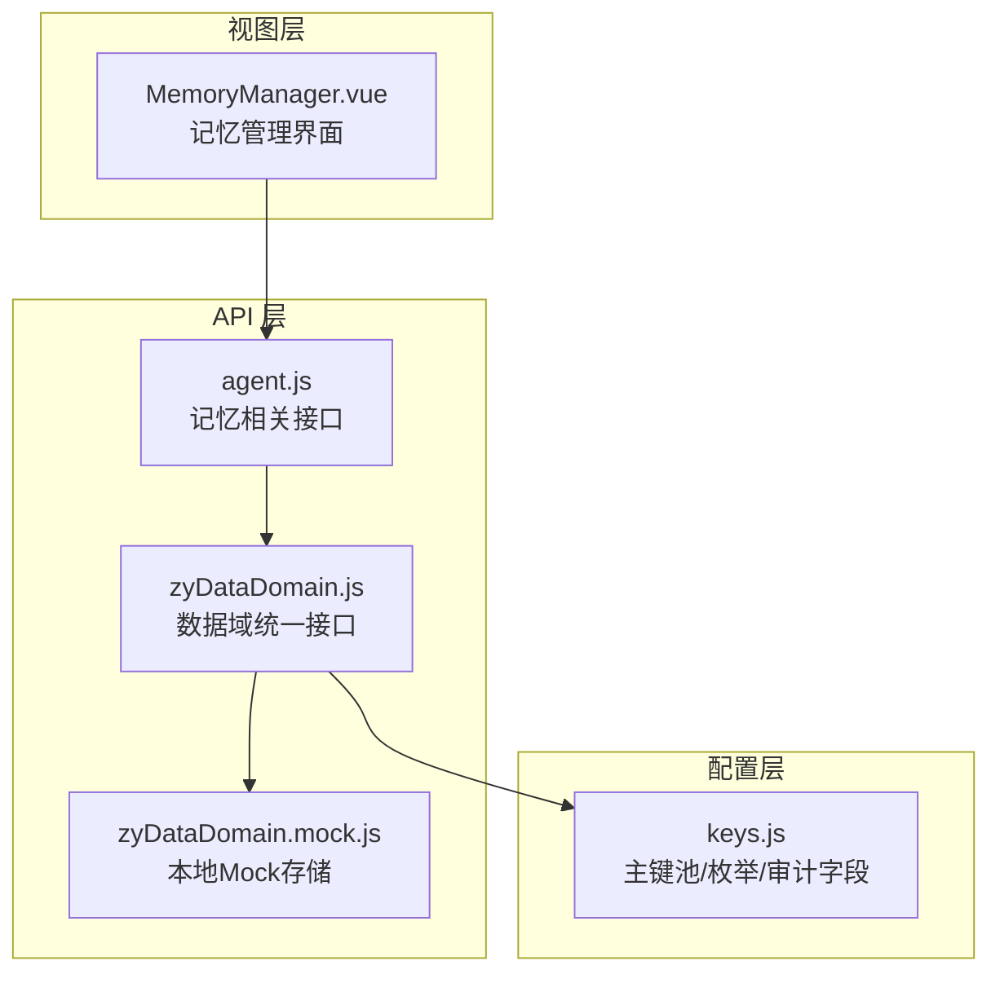
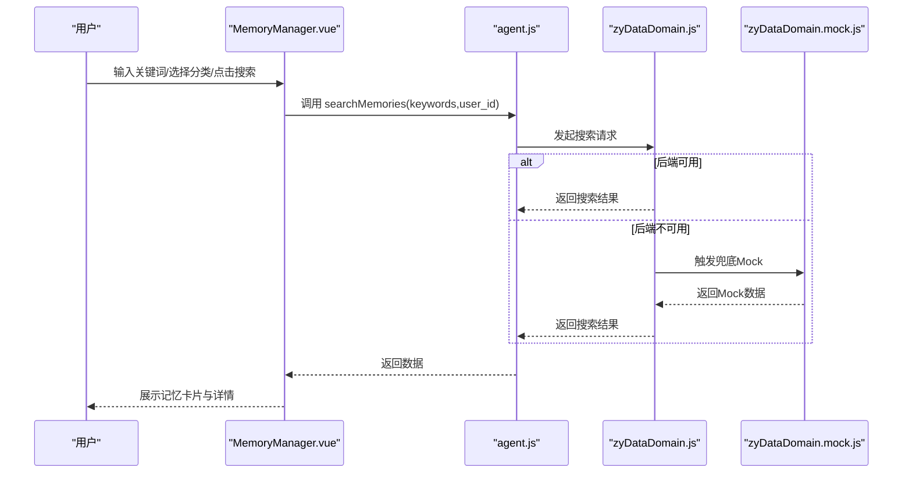
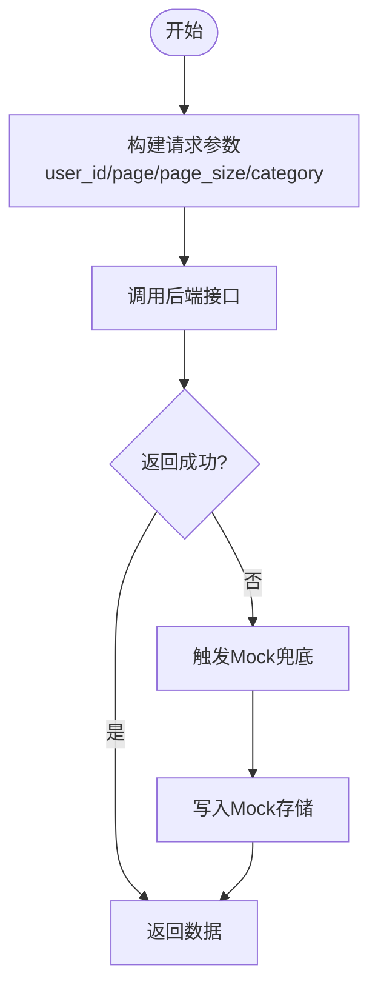
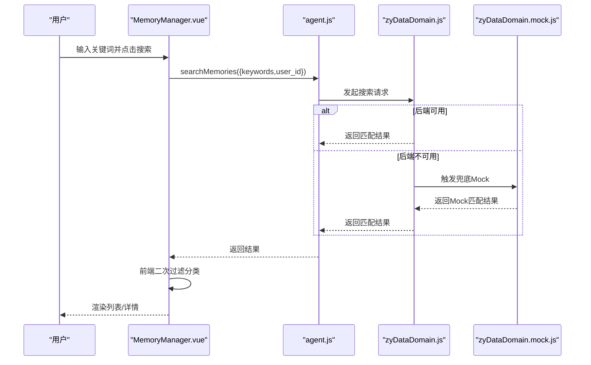
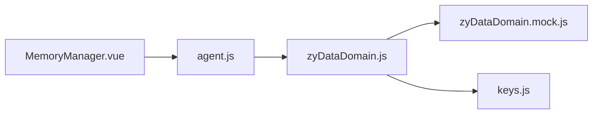

# 知识记忆管理

<cite>
**本文引用的文件**
- [MemoryManager.vue](file://src/views/agent/MemoryManager.vue)
- [agent.js](file://src/api/agent.js)
- [zyDataDomain.js](file://src/api/zyDataDomain.js)
- [zyDataDomain.mock.js](file://src/api/zyDataDomain.mock.js)
- [keys.js](file://src/config/zyDataDomain/keys.js)
</cite>

## 目录
1. [简介](#简介)
2. [项目结构](#项目结构)
3. [核心组件](#核心组件)
4. [架构总览](#架构总览)
5. [详细组件分析](#详细组件分析)
6. [依赖关系分析](#依赖关系分析)
7. [性能考量](#性能考量)
8. [故障排查指南](#故障排查指南)
9. [结论](#结论)
10. [附录](#附录)

## 简介
本文件围绕“知识记忆管理”功能进行系统化技术文档梳理，聚焦于记忆单元的定义与分类、存储与检索流程、组织与管理能力、导入导出与迁移、质量控制机制以及最佳实践。当前仓库中已实现的记忆管理界面与接口位于 Agent 子模块，提供记忆列表、关键词搜索、分类筛选、详情查看与删除等基础能力，并通过统一的 API 层对接后端服务或本地 Mock 存储。

## 项目结构
与“知识记忆管理”直接相关的前端模块分布如下：
- 视图层：记忆管理界面组件负责用户交互与数据展示
- API 层：封装与后端/本地存储的通信接口
- 配置层：提供数据域主键池与枚举，支撑数据一致性与校验

图表来源
- [MemoryManager.vue:1-470](file://src/views/agent/MemoryManager.vue#L1-L470)
- [agent.js:52-76](file://src/api/agent.js#L52-L76)
- [zyDataDomain.js:120-168](file://src/api/zyDataDomain.js#L120-L168)
- [zyDataDomain.mock.js:939-1011](file://src/api/zyDataDomain.mock.js#L939-L1011)
- [keys.js:1-73](file://src/config/zyDataDomain/keys.js#L1-L73)

章节来源
- [MemoryManager.vue:1-470](file://src/views/agent/MemoryManager.vue#L1-L470)
- [agent.js:52-76](file://src/api/agent.js#L52-L76)
- [zyDataDomain.js:120-168](file://src/api/zyDataDomain.js#L120-L168)
- [zyDataDomain.mock.js:939-1011](file://src/api/zyDataDomain.mock.js#L939-L1011)
- [keys.js:1-73](file://src/config/zyDataDomain/keys.js#L1-L73)

## 核心组件
- 记忆管理界面（MemoryManager.vue）
  - 功能：关键词搜索、分类筛选、分页加载、详情弹窗、删除确认
  - 关键交互：搜索关键词拆分、前端二次过滤、分页参数传递
- 记忆接口（agent.js）
  - 提供：获取记忆列表、删除记忆、搜索记忆
  - 特点：统一的请求封装、超时控制、SSE 流式对话接口（扩展用途）
- 数据域统一接口（zyDataDomain.js）
  - 提供：CRUD 统一封装，具备兜底 Mock 能力
- 本地 Mock 存储（zyDataDomain.mock.js）
  - 提供：内存存储、分页、过滤、CRUD、计数
- 配置与枚举（keys.js）
  - 提供：业务日期、主键池、枚举、审计字段等

章节来源
- [MemoryManager.vue:149-315](file://src/views/agent/MemoryManager.vue#L149-L315)
- [agent.js:52-76](file://src/api/agent.js#L52-L76)
- [zyDataDomain.js:120-168](file://src/api/zyDataDomain.js#L120-L168)
- [zyDataDomain.mock.js:939-1011](file://src/api/zyDataDomain.mock.js#L939-L1011)
- [keys.js:1-73](file://src/config/zyDataDomain/keys.js#L1-L73)

## 架构总览
记忆管理的前端架构采用“视图组件 + API 层 + 配置层”的分层设计，视图组件通过 API 层发起请求，API 层根据环境与后端可用性选择真实接口或本地 Mock，配置层提供数据域约束与枚举。

图表来源
- [MemoryManager.vue:214-241](file://src/views/agent/MemoryManager.vue#L214-L241)
- [agent.js:69-76](file://src/api/agent.js#L69-L76)
- [zyDataDomain.js:120-168](file://src/api/zyDataDomain.js#L120-L168)
- [zyDataDomain.mock.js:939-1011](file://src/api/zyDataDomain.mock.js#L939-L1011)

## 详细组件分析

### 记忆单元定义与分类体系
- 记忆单元字段
  - 标题、内容、分类、关键词、创建/更新时间等
  - 分类枚举：研究结论、用户偏好、资产别名、策略洞察
- 分类映射与展示
  - 通过映射表将分类值转换为中文标签与样式类型
- 关键词
  - 支持多关键词，前端以标签形式展示

章节来源
- [MemoryManager.vue:153-183](file://src/views/agent/MemoryManager.vue#L153-L183)
- [MemoryManager.vue:41-60](file://src/views/agent/MemoryManager.vue#L41-L60)
- [MemoryManager.vue:305-313](file://src/views/agent/MemoryManager.vue#L305-L313)

### 存储结构与数据模型
- 存储位置
  - 后端接口：通过 agent.js 的记忆接口访问
  - 兜底方案：zyDataDomain.mock.js 提供内存存储与分页/过滤
- 数据模型要点
  - 列表项包含：id、title、content、category、keywords、created_at、updated_at
  - 分页参数：page、page_size
  - 过滤参数：category
- 配置与约束
  - keys.js 提供主键池、枚举与审计字段，确保数据一致性

章节来源
- [agent.js:52-76](file://src/api/agent.js#L52-L76)
- [zyDataDomain.mock.js:939-1011](file://src/api/zyDataDomain.mock.js#L939-L1011)
- [keys.js:1-73](file://src/config/zyDataDomain/keys.js#L1-L73)

### 记忆创建与更新流程
- 创建/更新路径
  - 通过统一的 CRUD 接口（zyDataDomain.js）进行
  - 当后端不可用时，自动切换至本地 Mock 存储（zyDataDomain.mock.js）
- 关键流程
  - 参数构建：包含 user_id、分页与过滤条件
  - 错误兜底：捕获异常并触发 Mock 回退
  - 数据落盘：Mock 写入 localStorage，具备种子数据与版本控制

图表来源
- [MemoryManager.vue:191-212](file://src/views/agent/MemoryManager.vue#L191-L212)
- [zyDataDomain.js:120-168](file://src/api/zyDataDomain.js#L120-L168)
- [zyDataDomain.mock.js:939-1011](file://src/api/zyDataDomain.mock.js#L939-L1011)

章节来源
- [MemoryManager.vue:191-212](file://src/views/agent/MemoryManager.vue#L191-L212)
- [zyDataDomain.js:120-168](file://src/api/zyDataDomain.js#L120-L168)
- [zyDataDomain.mock.js:939-1011](file://src/api/zyDataDomain.mock.js#L939-L1011)

### 记忆检索算法与相关性排序
- 检索方式
  - 语义搜索：通过搜索接口提交关键词数组，后端执行语义匹配
  - 关键词匹配：前端对结果进行二次分类过滤
- 相关性与排序
  - 当前实现未暴露后端相关性评分与排序细节，前端展示顺序由后端返回决定
- 结果展示
  - 列表卡片包含标题、内容截断、关键词标签、更新时间
  - 详情弹窗展示完整内容与元数据

图表来源
- [MemoryManager.vue:214-241](file://src/views/agent/MemoryManager.vue#L214-L241)
- [agent.js:69-76](file://src/api/agent.js#L69-L76)
- [zyDataDomain.js:120-168](file://src/api/zyDataDomain.js#L120-L168)
- [zyDataDomain.mock.js:939-1011](file://src/api/zyDataDomain.mock.js#L939-L1011)

章节来源
- [MemoryManager.vue:214-241](file://src/views/agent/MemoryManager.vue#L214-L241)
- [agent.js:69-76](file://src/api/agent.js#L69-L76)

### 记忆组织与管理
- 标签系统
  - 分类标签：研究结论、用户偏好、资产别名、策略洞察
  - 关键词标签：多关键词以标签形式展示
- 分类整理
  - 通过分类下拉选择进行筛选
- 批量操作
  - 当前界面提供删除单条记忆的交互
  - 可结合后端接口扩展批量删除/导出
- 版本控制
  - Mock 存储具备版本号常量，便于数据迁移与回滚

章节来源
- [MemoryManager.vue:153-183](file://src/views/agent/MemoryManager.vue#L153-L183)
- [MemoryManager.vue:268-291](file://src/views/agent/MemoryManager.vue#L268-L291)
- [zyDataDomain.mock.js:8-10](file://src/api/zyDataDomain.mock.js#L8-L10)

### 导入导出与数据迁移
- 导入
  - 本地 Mock 存储支持批量写入与分集合导入（脚本示例）
  - 可通过统一 CRUD 接口进行后端导入
- 导出
  - 当前界面未提供导出按钮；可结合后端导出接口扩展
- 数据迁移
  - Mock 存储具备版本号与种子数据机制，便于迁移与恢复

章节来源
- [zyDataDomain.mock.js:26-33](file://src/api/zyDataDomain.mock.js#L26-L33)
- [zyDataDomain.mock.js:939-1011](file://src/api/zyDataDomain.mock.js#L939-L1011)

### 质量控制机制
- 准确性验证
  - 通过 Mock 存储的种子数据与枚举值保障字段完整性
- 时效性检查
  - 审计字段 etl_dt 与业务日期 BIZ_DT 提供时间维度约束
- 噪声过滤
  - 前端对关键词进行空格拆分与二次过滤，减少无关结果

章节来源
- [keys.js:6-63](file://src/config/zyDataDomain/keys.js#L6-L63)
- [MemoryManager.vue:223-235](file://src/views/agent/MemoryManager.vue#L223-L235)

## 依赖关系分析
- 组件耦合
  - MemoryManager.vue 依赖 agent.js 的记忆接口
  - agent.js 依赖 zyDataDomain.js 的统一接口封装
  - zyDataDomain.js 在后端不可用时回退至 zyDataDomain.mock.js
- 外部依赖
  - dayjs 用于时间格式化
  - Element UI 用于表单、卡片、分页与对话框

图表来源
- [MemoryManager.vue:149-151](file://src/views/agent/MemoryManager.vue#L149-L151)
- [agent.js:1-11](file://src/api/agent.js#L1-L11)
- [zyDataDomain.js:120-168](file://src/api/zyDataDomain.js#L120-L168)
- [zyDataDomain.mock.js:939-1011](file://src/api/zyDataDomain.mock.js#L939-L1011)
- [keys.js:1-73](file://src/config/zyDataDomain/keys.js#L1-L73)

章节来源
- [MemoryManager.vue:149-151](file://src/views/agent/MemoryManager.vue#L149-L151)
- [agent.js:1-11](file://src/api/agent.js#L1-L11)
- [zyDataDomain.js:120-168](file://src/api/zyDataDomain.js#L120-L168)
- [zyDataDomain.mock.js:939-1011](file://src/api/zyDataDomain.mock.js#L939-L1011)
- [keys.js:1-73](file://src/config/zyDataDomain/keys.js#L1-L73)

## 性能考量
- 前端性能
  - 列表分页与内容截断降低渲染压力
  - 搜索结果二次过滤在前端完成，建议后端实现更高效过滤
- 网络性能
  - 搜索接口超时设置合理，避免长时间等待
- 存储性能
  - Mock 存储基于内存与 localStorage，适合小规模数据；大规模数据建议后端分页与索引优化

## 故障排查指南
- 获取记忆列表失败
  - 检查网络连通与后端可用性
  - 若后端不可用，确认是否触发了 Mock 回退
- 搜索记忆失败
  - 校验关键词拆分与空值处理
  - 确认分类过滤是否导致结果为空
- 删除失败
  - 检查权限与资源是否存在
  - 查看控制台错误信息与后端返回码

章节来源
- [MemoryManager.vue:207-209](file://src/views/agent/MemoryManager.vue#L207-L209)
- [MemoryManager.vue:236-238](file://src/views/agent/MemoryManager.vue#L236-L238)
- [MemoryManager.vue:287-289](file://src/views/agent/MemoryManager.vue#L287-L289)

## 结论
当前“知识记忆管理”功能已实现基本的列表展示、关键词搜索、分类筛选与删除能力，并通过统一 API 层实现后端可用性与 Mock 兜底。后续可在以下方面增强：后端语义搜索与相关性排序、批量操作与导出、版本控制与迁移工具、以及更完善的质量控制与去重机制。

## 附录
- 最佳实践
  - 使用分类与关键词双维组织记忆，提升检索效率
  - 对长内容进行摘要化处理，避免前端过度渲染
  - 在后端实现索引与缓存，优化搜索性能
  - 建立记忆生命周期管理，定期清理过期与重复内容
- 使用指南
  - 新增记忆：通过统一 CRUD 接口创建
  - 搜索记忆：输入关键词并选择分类进行过滤
  - 管理记忆：查看详情、删除不需要的记忆
  - 导入导出：结合后端接口扩展批量导入与导出能力