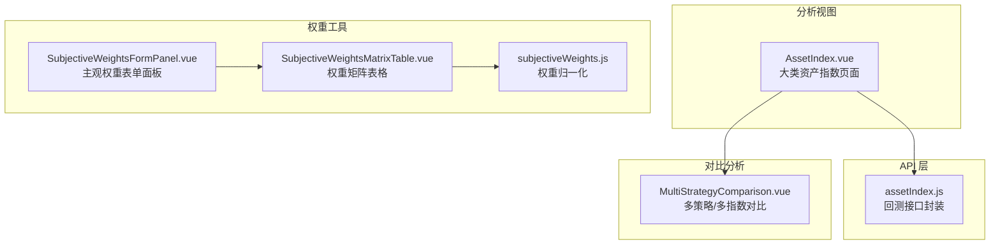
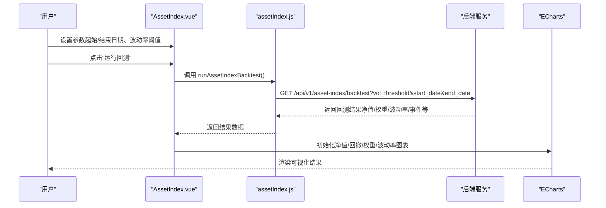
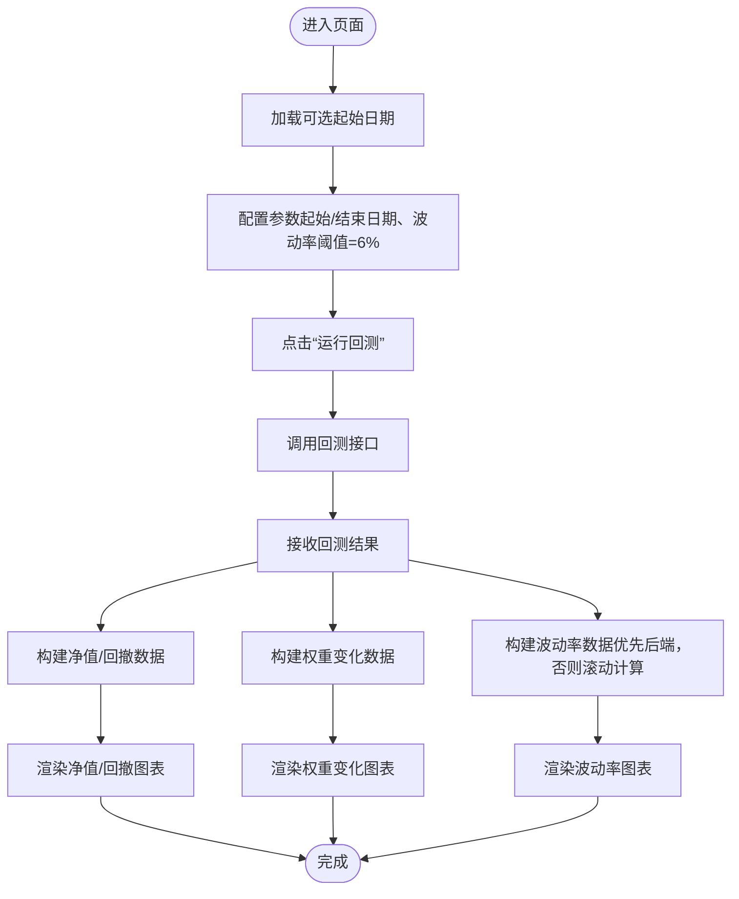
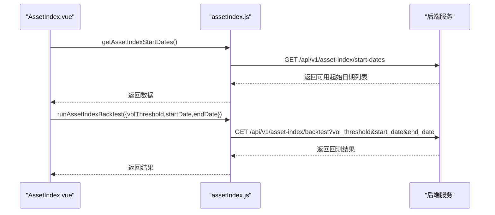
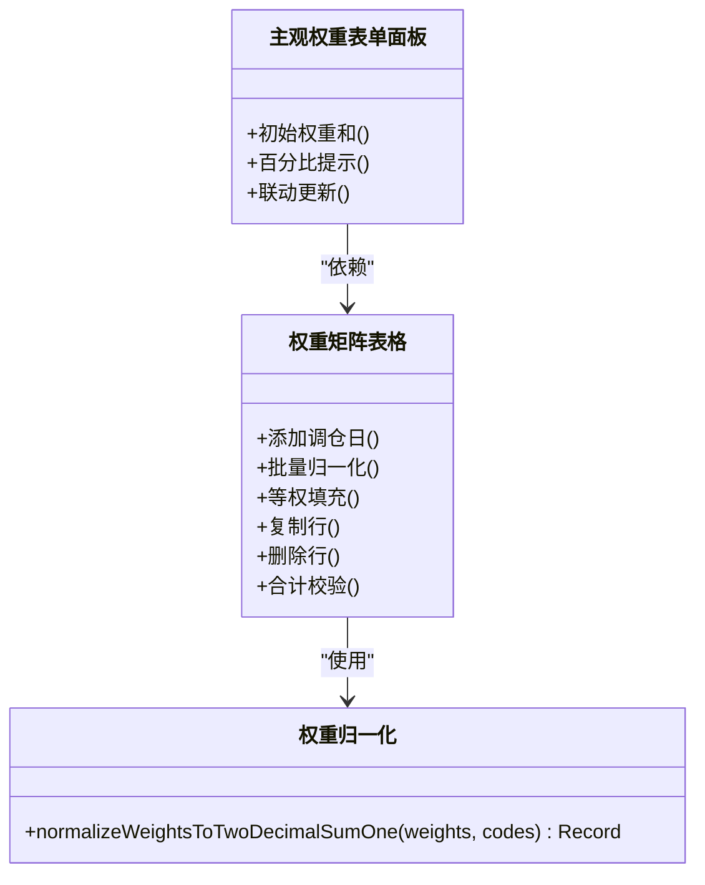
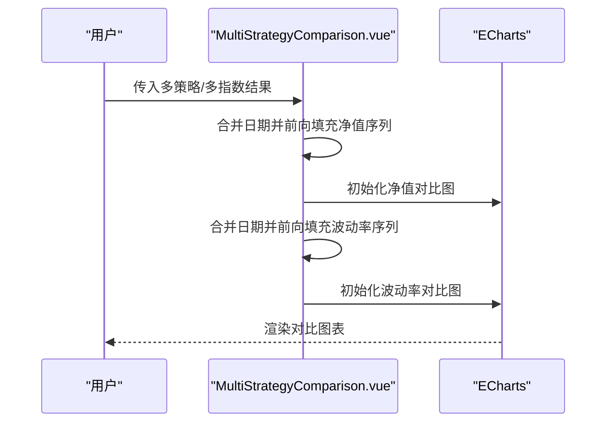
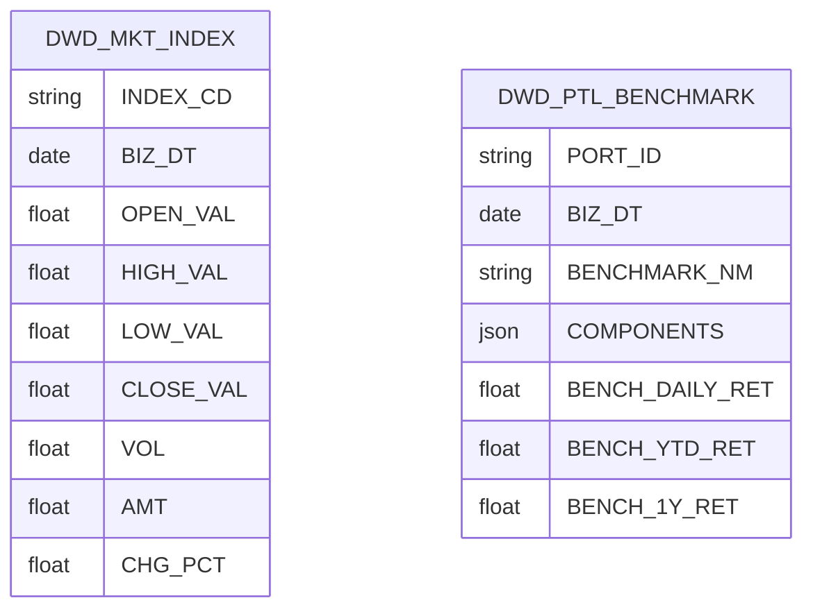
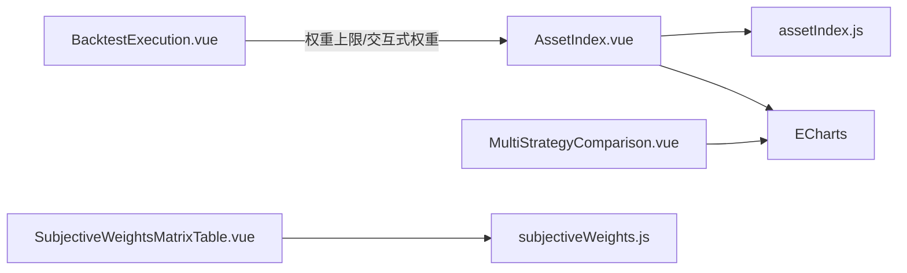

# 大类资产指数

<cite>
**本文引用的文件**
- [AssetIndex.vue](file://src/views/analysis/AssetIndex.vue)
- [assetIndex.js](file://src/api/assetIndex.js)
- [subjectiveWeights.js](file://src/utils/subjectiveWeights.js)
- [SubjectiveWeightsMatrixTable.vue](file://src/components/SubjectiveWeightsMatrixTable.vue)
- [SubjectiveWeightsFormPanel.vue](file://src/components/SubjectiveWeightsFormPanel.vue)
- [MultiStrategyComparison.vue](file://src/views/strategy/backtest/MultiStrategyComparison.vue)
- [BacktestExecution.vue](file://update_package/src/views/strategy/BacktestExecution.vue)
- [09_market_domain.js](file://mongo-seed/09_market_domain.js)
- [03_product_domain.js](file://mongo-seed/03_product_domain.js)
</cite>

## 目录
1. [简介](#简介)
2. [项目结构](#项目结构)
3. [核心组件](#核心组件)
4. [架构总览](#架构总览)
5. [详细组件分析](#详细组件分析)
6. [依赖关系分析](#依赖关系分析)
7. [性能考量](#性能考量)
8. [故障排查指南](#故障排查指南)
9. [结论](#结论)
10. [附录](#附录)

## 简介
本文件系统化梳理“大类资产指数”功能，覆盖从数据接入、策略回测、权重配置、净值与波动率计算、图表可视化到多指数对比分析的完整链路。重点说明以下方面：
- 计算原理与实现机制：风险平价波动率控制 + 混合动量资产选择策略
- 权重配置：支持手动权重配置与自动权重计算两种模式
- 基期设置与收益计算：净值与回撤序列、滚动年化波动率
- 历史数据与版本管理：回测结果的存储与查询、回溯分析
- 指数对比分析：多指数并行比较与差异分析
- 数学公式、业务规则与性能优化策略
- 实际应用场景与最佳实践

## 项目结构
围绕“大类资产指数”的前端页面与接口主要分布在以下模块：
- 视图层：分析视图中的“大类资产指数”页面负责参数配置、回测运行与结果可视化
- API 层：封装回测接口请求，统一参数传递与超时控制
- 权重工具与表格：提供主观权重归一化、矩阵表格编辑与批量操作
- 对比分析：多策略/多指数对比分析页面，支持净值与波动率对比

**图表来源**
- [AssetIndex.vue:1-744](file://src/views/analysis/AssetIndex.vue#L1-L744)
- [assetIndex.js:1-29](file://src/api/assetIndex.js#L1-L29)
- [subjectiveWeights.js:1-50](file://src/utils/subjectiveWeights.js#L1-L50)
- [SubjectiveWeightsMatrixTable.vue:1-619](file://src/components/SubjectiveWeightsMatrixTable.vue#L1-L619)
- [SubjectiveWeightsFormPanel.vue:58-110](file://src/components/SubjectiveWeightsFormPanel.vue#L58-L110)
- [MultiStrategyComparison.vue:1-474](file://src/views/strategy/backtest/MultiStrategyComparison.vue#L1-L474)

**章节来源**
- [AssetIndex.vue:1-744](file://src/views/analysis/AssetIndex.vue#L1-L744)
- [assetIndex.js:1-29](file://src/api/assetIndex.js#L1-L29)

## 核心组件
- 大类资产指数页面（AssetIndex.vue）
  - 参数配置：开始/结束日期、波动率阈值（固定 6%）
  - 回测执行：调用后端接口，等待结果并渲染净值、回撤、权重变化、波动率监控等图表
  - 性能指标：总收益、年化收益、夏普比率、最大回撤、年化波动率、Calmar 比率、收益回撤比
- 回测接口封装（assetIndex.js）
  - 提供获取可选起始日期列表与运行回测的函数，统一参数命名与超时控制
- 权重工具与表格
  - 权重归一化：将合计权重缩放至 1（百分比精确到万分之一）
  - 权重矩阵表格：支持逐行日期、逐资产权重编辑、合计校验、批量归一化、等权填充、复制行、删除行
  - 主观权重表单面板：汇总权重和、提示与校验、联动更新
- 多指数/多策略对比（MultiStrategyComparison.vue）
  - 净值曲线对比：按日期并集合并、前向填充、多策略曲线叠加
  - 波动率对比：支持后端波动率或滚动年化波动率计算

**章节来源**
- [AssetIndex.vue:186-661](file://src/views/analysis/AssetIndex.vue#L186-L661)
- [assetIndex.js:8-28](file://src/api/assetIndex.js#L8-L28)
- [subjectiveWeights.js:10-37](file://src/utils/subjectiveWeights.js#L10-L37)
- [SubjectiveWeightsMatrixTable.vue:132-423](file://src/components/SubjectiveWeightsMatrixTable.vue#L132-L423)
- [SubjectiveWeightsFormPanel.vue:72-110](file://src/components/SubjectiveWeightsFormPanel.vue#L72-L110)
- [MultiStrategyComparison.vue:104-441](file://src/views/strategy/backtest/MultiStrategyComparison.vue#L104-L441)

## 架构总览
下图展示从前端页面到后端接口、再到数据与图表渲染的整体流程。

**图表来源**
- [AssetIndex.vue:387-418](file://src/views/analysis/AssetIndex.vue#L387-L418)
- [assetIndex.js:17-27](file://src/api/assetIndex.js#L17-L27)

## 详细组件分析

### 组件A：大类资产指数页面（AssetIndex.vue）
- 参数与约束
  - 波动率阈值固定为 6%
  - 结束日期不得早于或等于开始日期，最大截止日期限制
- 数据处理
  - 净值与回撤：按日期映射为图表数据
  - 权重变化：堆叠面积图展示各资产权重随时间变化
  - 组合波动率：优先使用后端提供的波动率；若缺失，则按净值序列滚动计算年化波动率（21 日窗口）
  - 波动率重置事件：展示信号日期、执行日期、触发阈值与缩放因子等
- 图表渲染
  - 净值与回撤：折线图，支持基准线与区域填充
  - 权重变化：堆叠面积图，标注调仓类型（权重初始化、人工干预、波动率重置、周期性）
  - 组合波动率：折线图，标注目标波动率与重置/人工干预标记点
- 性能指标
  - 总收益、年化收益、夏普比率、最大回撤、年化波动率、Calmar 比率、收益回撤比

**图表来源**
- [AssetIndex.vue:324-440](file://src/views/analysis/AssetIndex.vue#L324-L440)
- [AssetIndex.vue:441-659](file://src/views/analysis/AssetIndex.vue#L441-L659)

**章节来源**
- [AssetIndex.vue:186-661](file://src/views/analysis/AssetIndex.vue#L186-L661)

### 组件B：回测接口封装（assetIndex.js）
- 提供两个关键函数
  - 获取可选起始日期列表：用于前端日期选择器
  - 运行回测：GET 请求，携带波动率阈值、起止日期，设置较长超时时间以适应回测耗时

**图表来源**
- [assetIndex.js:9-27](file://src/api/assetIndex.js#L9-L27)

**章节来源**
- [assetIndex.js:8-28](file://src/api/assetIndex.js#L8-L28)

### 组件C：权重配置与归一化（subjectiveWeights.js、SubjectiveWeightsMatrixTable.vue、SubjectiveWeightsFormPanel.vue）
- 权重归一化
  - 将输入权重按比例缩放至 1，采用“最大余数法”保证精度（百分比精确到万分之一）
- 权重矩阵表格
  - 支持逐行日期与逐资产权重编辑，合计校验与颜色提示
  - 提供批量归一化、等权填充、复制行、删除行等便捷操作
  - 支持自动归一化开关，便于交互式调仓
- 主观权重表单面板
  - 展示初始权重和、百分比提示、杠杆上限提示与联动更新

**图表来源**
- [subjectiveWeights.js:10-37](file://src/utils/subjectiveWeights.js#L10-L37)
- [SubjectiveWeightsMatrixTable.vue:132-423](file://src/components/SubjectiveWeightsMatrixTable.vue#L132-L423)
- [SubjectiveWeightsFormPanel.vue:72-110](file://src/components/SubjectiveWeightsFormPanel.vue#L72-L110)

**章节来源**
- [subjectiveWeights.js:10-37](file://src/utils/subjectiveWeights.js#L10-L37)
- [SubjectiveWeightsMatrixTable.vue:132-423](file://src/components/SubjectiveWeightsMatrixTable.vue#L132-L423)
- [SubjectiveWeightsFormPanel.vue:72-110](file://src/components/SubjectiveWeightsFormPanel.vue#L72-L110)

### 组件D：多指数/多策略对比（MultiStrategyComparison.vue）
- 净值曲线对比
  - 合并所有策略的日期（取并集并排序），对缺失日期进行前向填充，确保曲线完整
  - 多策略曲线叠加，支持响应式调整
- 波动率对比
  - 优先使用后端波动率；若缺失，则按滚动窗口计算年化波动率
- 交互细节
  - 折叠面板展开时延迟初始化子图表，避免图表容器尺寸问题

**图表来源**
- [MultiStrategyComparison.vue:245-441](file://src/views/strategy/backtest/MultiStrategyComparison.vue#L245-L441)

**章节来源**
- [MultiStrategyComparison.vue:104-441](file://src/views/strategy/backtest/MultiStrategyComparison.vue#L104-L441)

### 组件E：指数历史数据与版本管理（MongoDB 种子数据）
- 指数行情种子数据
  - dwd_mkt_index：包含指数代码、交易日、开盘/最高/最低/收盘、成交量/成交额、涨跌幅等字段
- 基准指数种子数据
  - dwd_ptl_benchmark：包含组合代码、业务日期、基准名称、成分及权重、收益等字段
- 用途
  - 为指数回测提供基础行情与基准数据，支撑净值与收益计算

**图表来源**
- [09_market_domain.js:97-124](file://mongo-seed/09_market_domain.js#L97-L124)
- [03_product_domain.js:297-338](file://mongo-seed/03_product_domain.js#L297-L338)

**章节来源**
- [09_market_domain.js:97-124](file://mongo-seed/09_market_domain.js#L97-L124)
- [03_product_domain.js:297-338](file://mongo-seed/03_product_domain.js#L297-L338)

## 依赖关系分析
- 页面依赖
  - AssetIndex.vue 依赖 assetIndex.js 发起回测请求，并依赖 ECharts 进行可视化
  - MultiStrategyComparison.vue 依赖 ECharts 进行净值与波动率对比
- 工具依赖
  - SubjectiveWeightsMatrixTable.vue 依赖 subjectiveWeights.js 进行权重归一化
  - BacktestExecution.vue 中也存在权重上限与交互式权重配置逻辑，便于理解指数编制规则与权重约束

**图表来源**
- [AssetIndex.vue:187-188](file://src/views/analysis/AssetIndex.vue#L187-L188)
- [assetIndex.js:17-27](file://src/api/assetIndex.js#L17-L27)
- [subjectiveWeights.js:10-37](file://src/utils/subjectiveWeights.js#L10-L37)
- [BacktestExecution.vue:442-468](file://update_package/src/views/strategy/BacktestExecution.vue#L442-L468)

**章节来源**
- [AssetIndex.vue:186-661](file://src/views/analysis/AssetIndex.vue#L186-L661)
- [assetIndex.js:8-28](file://src/api/assetIndex.js#L8-L28)
- [subjectiveWeights.js:10-37](file://src/utils/subjectiveWeights.js#L10-L37)
- [BacktestExecution.vue:442-468](file://update_package/src/views/strategy/BacktestExecution.vue#L442-L468)

## 性能考量
- 回测超时与并发
  - 回测接口设置较长超时时间，避免因数据量大导致请求中断
- 图表渲染优化
  - 使用 ECharts 的 resize 监听与延迟初始化，确保容器尺寸正确
  - 对多策略对比采用日期并集与前向填充，避免仅用单一策略日期导致曲线截断
- 计算复杂度
  - 滚动年化波动率计算窗口固定为 21 日，时间复杂度 O(N×W)，其中 N 为交易日数，W 为窗口大小
- 权重归一化
  - 采用最大余数法，时间复杂度 O(K)，K 为资产数，保证精度与稳定性

[本节为通用性能建议，无需特定文件引用]

## 故障排查指南
- 回测失败
  - 检查参数合法性：结束日期不得早于或等于开始日期；最大截止日期限制
  - 查看接口超时：确认后端回测任务是否完成
- 图表空白或尺寸异常
  - 确认容器尺寸已就绪后再初始化图表；多策略对比需等待折叠面板展开
- 权重不合法
  - 确保合计权重在允许范围内；必要时使用批量归一化或等权填充
- 波动率缺失
  - 若后端未提供波动率，页面将自动按净值序列滚动计算；检查数据完整性与窗口设置

**章节来源**
- [AssetIndex.vue:387-418](file://src/views/analysis/AssetIndex.vue#L387-L418)
- [AssetIndex.vue:588-659](file://src/views/analysis/AssetIndex.vue#L588-L659)
- [MultiStrategyComparison.vue:225-227](file://src/views/strategy/backtest/MultiStrategyComparison.vue#L225-L227)

## 结论
“大类资产指数”功能通过明确的策略回测与可视化链路，实现了从参数配置、权重管理、净值与波动率计算到多指数对比分析的闭环。其核心优势在于：
- 明确的业务规则（波动率阈值固定、权重归一化）
- 灵活的权重配置（手动与自动结合）
- 完善的历史数据与回溯能力（种子数据与滚动计算）
- 强大的对比分析能力（多指数/多策略并行比较）

[本节为总结性内容，无需特定文件引用]

## 附录

### 数学公式与业务规则
- 波动率重置触发条件
  - 组合波动率达到或超过设定阈值（默认 6%）
- 年化波动率（滚动）
  - 使用 21 日滚动窗口，基于净值序列计算日收益，再计算方差并乘以年化系数
- 权重归一化
  - 将输入权重按比例缩放至 1，采用最大余数法保证精度（百分比精确到万分之一）

**章节来源**
- [AssetIndex.vue:256-274](file://src/views/analysis/AssetIndex.vue#L256-L274)
- [subjectiveWeights.js:10-37](file://src/utils/subjectiveWeights.js#L10-L37)

### 实际应用场景与最佳实践
- 场景
  - 资产配置策略验证：通过波动率控制与动量筛选，评估策略在不同市场阶段的表现
  - 基准对比：将策略净值与基准指数进行对比，观察超额收益与风险贡献
  - 权重回溯：通过权重矩阵表格记录每次调仓，支持交互式权重调整与归档
- 最佳实践
  - 固定波动率阈值以控制整体风险，避免过度波动
  - 在回测期间定期检查波动率重置事件，评估再平衡频率与幅度
  - 使用多指数对比功能，横向评估不同权重配置与策略参数的效果

[本节为概念性内容，无需特定文件引用]