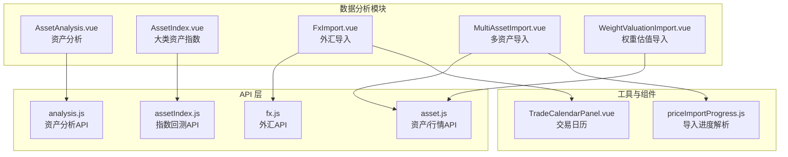
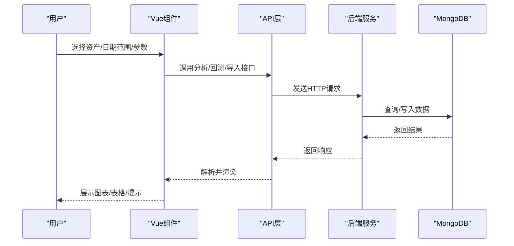
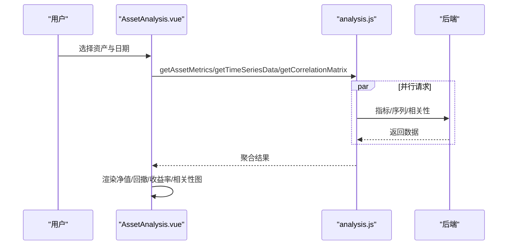
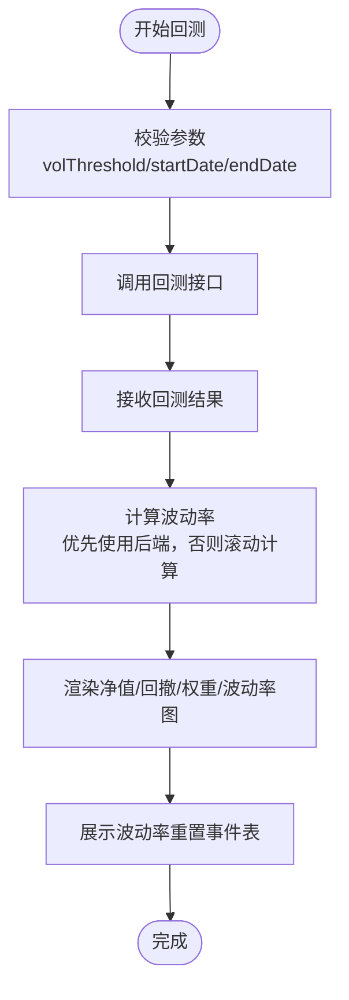
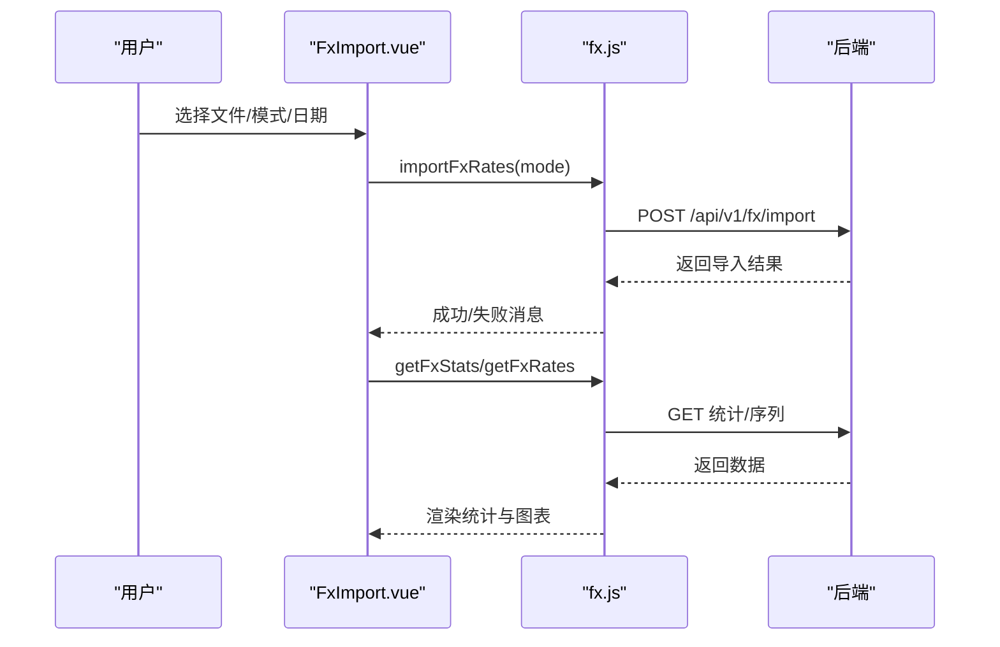
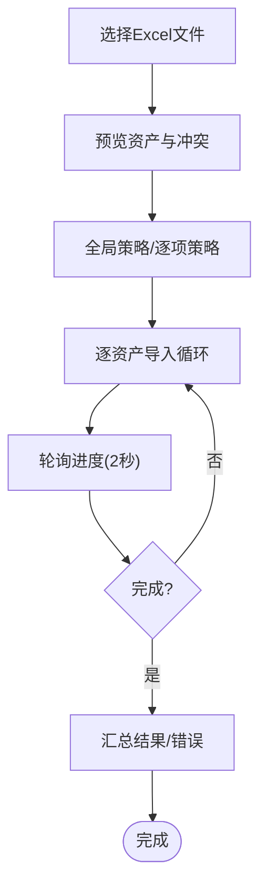
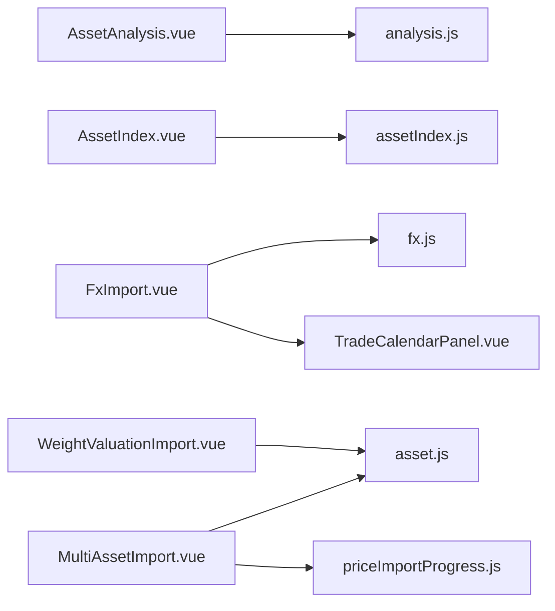

# 数据分析模块

<cite>
**本文引用的文件**
- [AssetAnalysis.vue](file://src/views/analysis/AssetAnalysis.vue)
- [AssetIndex.vue](file://src/views/analysis/AssetIndex.vue)
- [FxImport.vue](file://src/views/analysis/FxImport.vue)
- [MultiAssetImport.vue](file://src/views/analysis/MultiAssetImport.vue)
- [WeightValuationImport.vue](file://src/views/analysis/WeightValuationImport.vue)
- [analysis.js](file://src/api/analysis.js)
- [assetIndex.js](file://src/api/assetIndex.js)
- [fx.js](file://src/api/fx.js)
- [asset.js](file://src/api/asset.js)
- [priceImportProgress.js](file://src/utils/priceImportProgress.js)
- [TradeCalendarPanel.vue](file://src/components/TradeCalendarPanel.vue)
- [ZY_DATA_API_INTEGRATION_GUIDE.md](file://docs/ZY_DATA_API_INTEGRATION_GUIDE.md)
- [MongoDB_ZY数据域表结构清单.md](file://docs/MongoDB_ZY数据域表结构清单.md)
</cite>

## 目录
1. [简介](#简介)
2. [项目结构](#项目结构)
3. [核心组件](#核心组件)
4. [架构总览](#架构总览)
5. [详细组件分析](#详细组件分析)
6. [依赖关系分析](#依赖关系分析)
7. [性能考虑](#性能考虑)
8. [故障排查指南](#故障排查指南)
9. [结论](#结论)
10. [附录](#附录)

## 简介
本文件面向数据分析模块，系统性梳理“资产分析”“大类资产指数”“外汇数据导入”“多资产数据导入”“权重估值数据导入”等核心能力，覆盖数据接入中心设计、数据格式转换、质量控制、查询面板、可视化配置与最佳实践。文档同时结合后端 API 契约与 MongoDB 数据域结构，帮助读者快速理解前后端协作流程与数据处理要点。

## 项目结构
数据分析模块位于前端 src/views/analysis 目录，围绕“资产分析”“大类资产指数”“数据导入”三大主线展开：
- 资产分析：多资产指标、时间序列、相关性矩阵与可视化
- 大类资产指数：回测参数、净值/回撤/权重/波动率监控
- 数据导入：外汇、多资产、权重估值三类特殊场景
- 查询与可视化：ECharts 图表、表格、筛选与排序

图表来源
- [AssetAnalysis.vue:1-594](file://src/views/analysis/AssetAnalysis.vue#L1-L594)
- [AssetIndex.vue:1-744](file://src/views/analysis/AssetIndex.vue#L1-L744)
- [FxImport.vue:1-446](file://src/views/analysis/FxImport.vue#L1-L446)
- [MultiAssetImport.vue:1-383](file://src/views/analysis/MultiAssetImport.vue#L1-L383)
- [WeightValuationImport.vue:1-547](file://src/views/analysis/WeightValuationImport.vue#L1-L547)
- [analysis.js:1-43](file://src/api/analysis.js#L1-L43)
- [assetIndex.js:1-29](file://src/api/assetIndex.js#L1-L29)
- [fx.js:1-57](file://src/api/fx.js#L1-L57)
- [asset.js:1-284](file://src/api/asset.js#L1-L284)
- [priceImportProgress.js:1-61](file://src/utils/priceImportProgress.js#L1-L61)
- [TradeCalendarPanel.vue:1-1164](file://src/components/TradeCalendarPanel.vue#L1-L1164)

章节来源
- [AssetAnalysis.vue:1-594](file://src/views/analysis/AssetAnalysis.vue#L1-L594)
- [AssetIndex.vue:1-744](file://src/views/analysis/AssetIndex.vue#L1-L744)
- [FxImport.vue:1-446](file://src/views/analysis/FxImport.vue#L1-L446)
- [MultiAssetImport.vue:1-383](file://src/views/analysis/MultiAssetImport.vue#L1-L383)
- [WeightValuationImport.vue:1-547](file://src/views/analysis/WeightValuationImport.vue#L1-L547)

## 核心组件
- 资产分析（AssetAnalysis.vue）：提供资产筛选、时间范围选择、并行获取指标/序列/相关性矩阵，并以 ECharts 展示净值、回撤、收益率序列与相关性热力图。
- 大类资产指数（AssetIndex.vue）：回测参数配置（开始/结束日期、波动率阈值）、回测结果展示（净值/回撤/权重/波动率监控）、波动率重置事件表。
- 外汇导入（FxImport.vue）：Excel 汇率导入（覆盖/增量）、手动录入、统计与走势可视化、交易日历面板集成。
- 多资产导入（MultiAssetImport.vue）：多工作表资产行情导入预览、逐资产导入、进度轮询与错误聚合。
- 权重估值导入（WeightValuationImport.vue）：通用 Excel 解析（日期列识别、数值列识别）、净值/回撤曲线与权重堆积图、明细表格。

章节来源
- [AssetAnalysis.vue:147-572](file://src/views/analysis/AssetAnalysis.vue#L147-L572)
- [AssetIndex.vue:186-661](file://src/views/analysis/AssetIndex.vue#L186-L661)
- [FxImport.vue:138-378](file://src/views/analysis/FxImport.vue#L138-L378)
- [MultiAssetImport.vue:155-370](file://src/views/analysis/MultiAssetImport.vue#L155-L370)
- [WeightValuationImport.vue:135-534](file://src/views/analysis/WeightValuationImport.vue#L135-L534)

## 架构总览
前端通过统一的请求封装调用后端 API，部分场景涉及进度轮询与本地解析。后端提供数据分析、指数回测、外汇导入、资产/行情导入等接口契约，配合 MongoDB 数据域表结构支撑复杂金融数据的存储与查询。

图表来源
- [analysis.js:7-42](file://src/api/analysis.js#L7-L42)
- [assetIndex.js:8-28](file://src/api/assetIndex.js#L8-L28)
- [fx.js:10-56](file://src/api/fx.js#L10-L56)
- [asset.js:214-283](file://src/api/asset.js#L214-L283)

## 详细组件分析

### 资产分析（AssetAnalysis.vue）
- 功能要点
  - 筛选条件：多选资产、日期范围
  - 并行请求：资产指标、时间序列、相关性矩阵
  - 可视化：净值曲线、回撤曲线、收益率序列、相关性热力图
  - 格式化：百分比、颜色区分正负
- 数据处理
  - 时间序列：按资产聚合净值/回撤/收益率
  - 相关性：支持皮尔逊/斯皮尔曼/肯德尔三种方法
- 性能与体验
  - 并行请求减少等待
  - 图表销毁与窗口尺寸监听避免内存泄漏

图表来源
- [AssetAnalysis.vue:223-268](file://src/views/analysis/AssetAnalysis.vue#L223-L268)
- [analysis.js:7-33](file://src/api/analysis.js#L7-L33)

章节来源
- [AssetAnalysis.vue:147-572](file://src/views/analysis/AssetAnalysis.vue#L147-L572)
- [analysis.js:7-42](file://src/api/analysis.js#L7-L42)

### 大类资产指数（AssetIndex.vue）
- 功能要点
  - 回测参数：开始日期（可选列表）、结束日期、波动率阈值（固定6%）
  - 结果展示：总收益、年化收益、夏普比率、最大回撤、年化波动率、卡玛比率、收益回撤比
  - 图表：净值与回撤、持仓权重变化、组合波动率监控、波动率重置事件表
- 数据处理
  - 无后端波动率时，按净值序列滚动计算年化波动率（21日窗口）
  - 权重堆积图按资产列聚合，自动标注调仓类型（权重初始化/人工干预/波动率重置/周期性）
- 性能与体验
  - 图表实例管理与窗口 resize 适配
  - 最短回测时间保护（5秒）

图表来源
- [AssetIndex.vue:387-418](file://src/views/analysis/AssetIndex.vue#L387-L418)
- [AssetIndex.vue:246-283](file://src/views/analysis/AssetIndex.vue#L246-L283)

章节来源
- [AssetIndex.vue:186-661](file://src/views/analysis/AssetIndex.vue#L186-L661)
- [assetIndex.js:8-28](file://src/api/assetIndex.js#L8-L28)

### 外汇数据导入（FxImport.vue）
- 功能要点
  - Excel 导入：覆盖/增量两种模式
  - 手动录入：对人民币报价，仅更新填写列
  - 统计与可视化：数据条数、起止日期、汇率走势（ECharts）
  - 交易日历：内置交易日历面板组件
- 数据处理
  - Excel 解析：自动识别日期列与数值列
  - 图表：支持缩放/滑块/还原
- 质量控制
  - 导入前二次确认
  - 手动录入校验（至少一个大于0的汇率）

图表来源
- [FxImport.vue:200-237](file://src/views/analysis/FxImport.vue#L200-L237)
- [FxImport.vue:278-318](file://src/views/analysis/FxImport.vue#L278-L318)
- [fx.js:10-56](file://src/api/fx.js#L10-L56)

章节来源
- [FxImport.vue:138-378](file://src/views/analysis/FxImport.vue#L138-L378)
- [fx.js:10-56](file://src/api/fx.js#L10-L56)
- [TradeCalendarPanel.vue:1-1164](file://src/components/TradeCalendarPanel.vue#L1-L1164)

### 多资产数据导入（MultiAssetImport.vue）
- 功能要点
  - 预览：解析冲突（名称不一致/已有行情）、全局策略与逐项策略
  - 导入：逐资产导入，支持“仅新增/全覆盖”
  - 进度：轮询导入进度，格式化展示
  - 错误聚合：错误数量与前5条摘要
- 数据处理
  - Excel 解析：逐工作表解析资产与价格
  - 进度轮询：基于 progress_id，防过期响应
- 质量控制
  - 逐资产校验（无有效行情则记录错误）
  - 选择性覆盖名称与替换既有行情

图表来源
- [MultiAssetImport.vue:242-368](file://src/views/analysis/MultiAssetImport.vue#L242-L368)
- [priceImportProgress.js:14-60](file://src/utils/priceImportProgress.js#L14-L60)

章节来源
- [MultiAssetImport.vue:155-370](file://src/views/analysis/MultiAssetImport.vue#L155-L370)
- [asset.js:214-283](file://src/api/asset.js#L214-L283)
- [priceImportProgress.js:1-61](file://src/utils/priceImportProgress.js#L1-L61)

### 权重估值数据导入（WeightValuationImport.vue）
- 功能要点
  - 通用 Excel 解析：日期列识别、数值列识别
  - 可视化类型：净值/估值曲线（净值/回撤）、权重堆积图
  - 明细表格：列宽自适应、数值格式化
- 数据处理
  - 日期列：支持多种格式（ISO、8位数字、Excel serial）
  - 数值列：样本多数为数值则视为有效
  - 回撤计算：基于首列净值计算回撤序列
  - 权重堆积：排除“杠杆/波动率/系数”等干扰列
- 质量控制
  - 无有效数值列时提示
  - 图表尺寸监听与销毁

章节来源
- [WeightValuationImport.vue:135-534](file://src/views/analysis/WeightValuationImport.vue#L135-L534)
- [asset.js:214-283](file://src/api/asset.js#L214-L283)

## 依赖关系分析
- 组件与 API
  - 资产分析依赖 analysis.js
  - 大类资产指数依赖 assetIndex.js
  - 外汇导入依赖 fx.js
  - 多资产/权重估值导入依赖 asset.js
- 进度与工具
  - 多资产导入使用 priceImportProgress.js 解析与格式化进度
- 组件复用
  - 外汇导入复用交易日历面板组件

图表来源
- [AssetAnalysis.vue:147-150](file://src/views/analysis/AssetAnalysis.vue#L147-L150)
- [AssetIndex.vue:187-188](file://src/views/analysis/AssetIndex.vue#L187-L188)
- [FxImport.vue:140-141](file://src/views/analysis/FxImport.vue#L140-L141)
- [MultiAssetImport.vue:156-166](file://src/views/analysis/MultiAssetImport.vue#L156-L166)
- [WeightValuationImport.vue:136-137](file://src/views/analysis/WeightValuationImport.vue#L136-L137)
- [priceImportProgress.js:1-61](file://src/utils/priceImportProgress.js#L1-L61)
- [TradeCalendarPanel.vue:1-1164](file://src/components/TradeCalendarPanel.vue#L1-L1164)

章节来源
- [analysis.js:1-43](file://src/api/analysis.js#L1-L43)
- [assetIndex.js:1-29](file://src/api/assetIndex.js#L1-L29)
- [fx.js:1-57](file://src/api/fx.js#L1-L57)
- [asset.js:1-284](file://src/api/asset.js#L1-L284)

## 性能考虑
- 并行请求
  - 资产分析中对指标、序列、相关性矩阵采用 Promise.all 并行获取，缩短等待时间。
- 图表实例管理
  - 组件销毁时释放 ECharts 实例，避免内存泄漏；窗口 resize 时统一触发图表 resize。
- 导入进度轮询
  - 多资产导入采用固定轮询间隔（2秒），避免频繁请求造成服务端压力。
- 数据质量与格式
  - Excel 解析时对日期列与数值列进行启发式识别，减少无效列带来的渲染负担。
- 回测超时与保护
  - 指数回测接口设置较长超时，同时前端设置最短等待时间，保证用户体验。

章节来源
- [AssetAnalysis.vue:235-240](file://src/views/analysis/AssetAnalysis.vue#L235-L240)
- [AssetIndex.vue:399-408](file://src/views/analysis/AssetIndex.vue#L399-L408)
- [priceImportProgress.js:60-60](file://src/utils/priceImportProgress.js#L60-L60)
- [WeightValuationImport.vue:525-531](file://src/views/analysis/WeightValuationImport.vue#L525-L531)

## 故障排查指南
- 外汇导入
  - 文件格式：仅支持 .xlsx/.xls；确认覆盖/增量模式符合预期。
  - 手动录入：至少填写一个大于0的汇率列。
- 多资产导入
  - 预览冲突：名称不一致/已有行情时选择策略；无有效行情将记录错误。
  - 进度异常：检查网络与登录态；轮询响应可能延迟。
- 权重估值导入
  - Excel 解析：确保第一列为日期列，其余列为数值列；日期格式支持 ISO、8位数字、Excel serial。
  - 图表空白：确认数据列有效且存在数值。
- 交易日历
  - 导入模式：覆盖会清空原有交易日历；增量保留已有数据。
  - 删除交易日：仅能删除已存在的交易日。

章节来源
- [FxImport.vue:200-237](file://src/views/analysis/FxImport.vue#L200-L237)
- [MultiAssetImport.vue:242-368](file://src/views/analysis/MultiAssetImport.vue#L242-L368)
- [WeightValuationImport.vue:197-220](file://src/views/analysis/WeightValuationImport.vue#L197-L220)
- [TradeCalendarPanel.vue:484-527](file://src/components/TradeCalendarPanel.vue#L484-L527)

## 结论
数据分析模块以“资产分析”“大类资产指数”“数据导入”为核心，结合 ECharts 可视化与后端 API 契约，形成完整的数据接入与分析闭环。通过并行请求、进度轮询、图表实例管理与 Excel 解析策略，既保证了性能也提升了用户体验。结合 MongoDB 数据域表结构，模块可扩展至更广泛的金融数据场景。

## 附录
- 后端 API 集成与 MongoDB 数据域
  - 参考文档：[ZY_DATA_API_INTEGRATION_GUIDE.md:1-495](file://docs/ZY_DATA_API_INTEGRATION_GUIDE.md#L1-L495)
  - 数据域表结构：[MongoDB_ZY数据域表结构清单.md:1-379](file://docs/MongoDB_ZY数据域表结构清单.md#L1-L379)