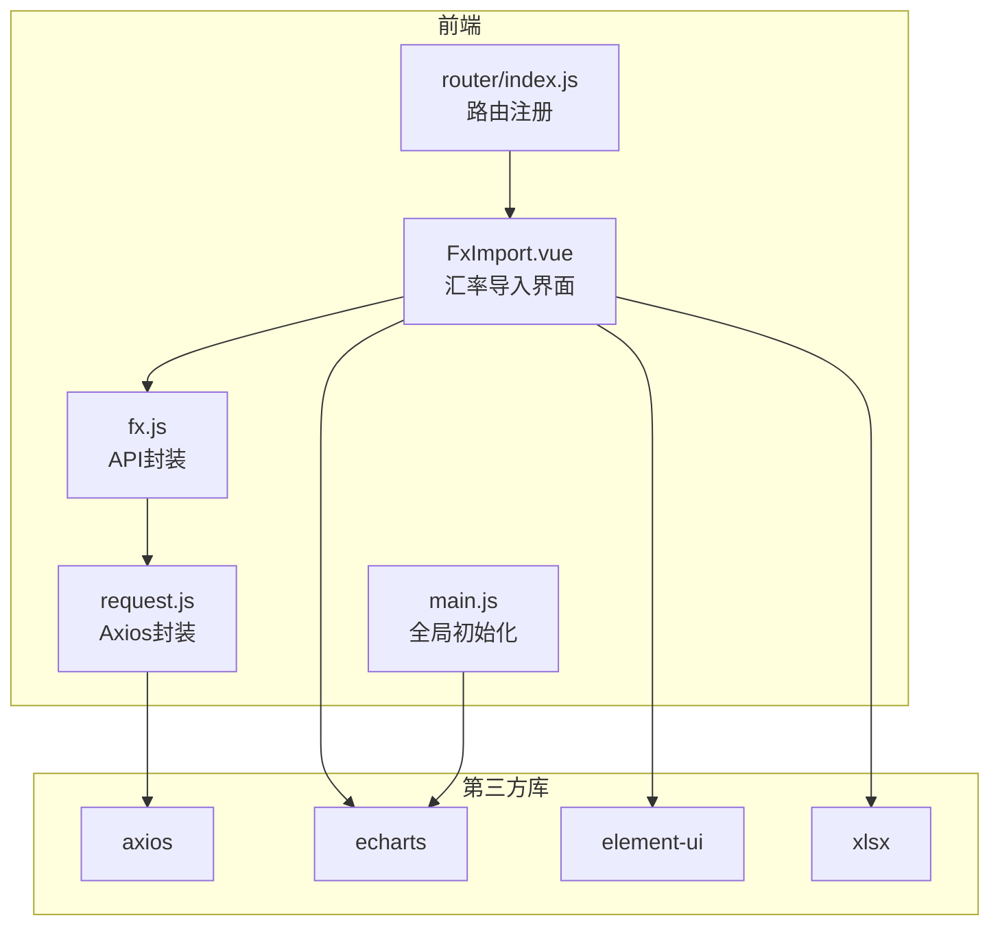
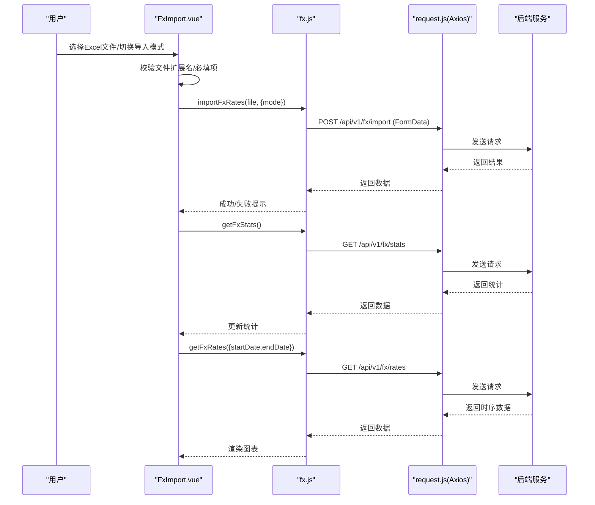
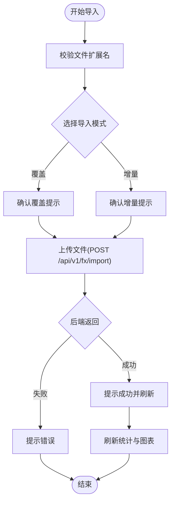
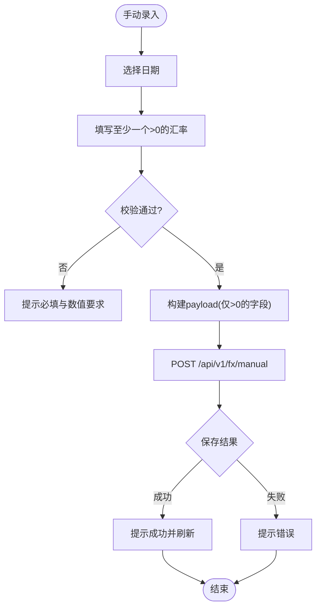
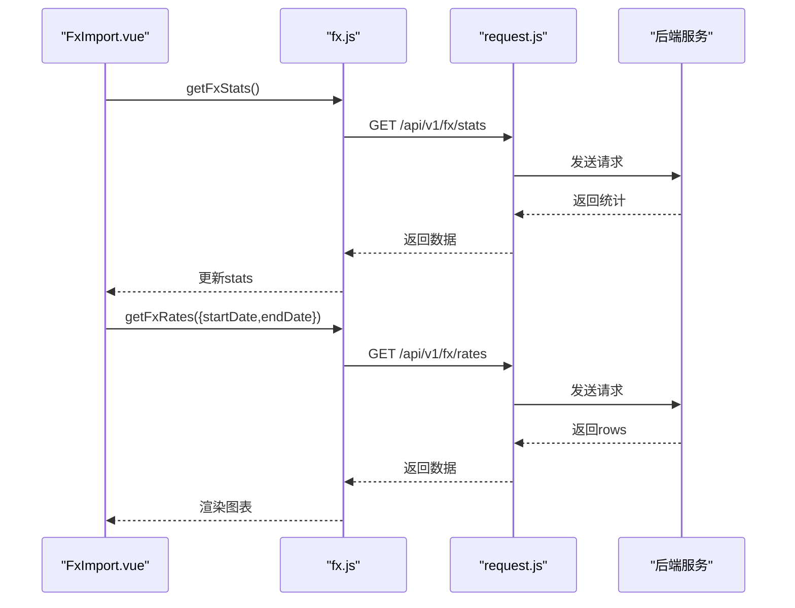
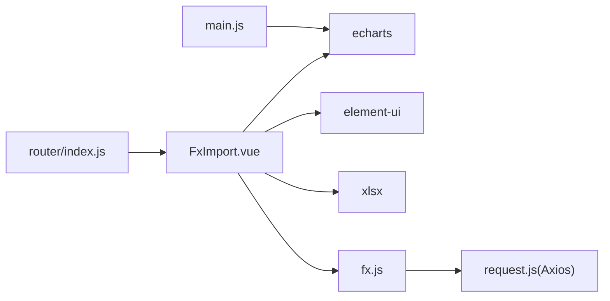

# 外汇数据导入

<cite>
**本文引用的文件**
- [src/views/analysis/FxImport.vue](file://src/views/analysis/FxImport.vue)
- [src/api/fx.js](file://src/api/fx.js)
- [src/utils/request.js](file://src/utils/request.js)
- [src/router/index.js](file://src/router/index.js)
- [src/main.js](file://src/main.js)
- [package.json](file://package.json)
</cite>

## 目录
1. [简介](#简介)
2. [项目结构](#项目结构)
3. [核心组件](#核心组件)
4. [架构总览](#架构总览)
5. [详细组件分析](#详细组件分析)
6. [依赖关系分析](#依赖关系分析)
7. [性能考量](#性能考量)
8. [故障排查指南](#故障排查指南)
9. [结论](#结论)
10. [附录](#附录)

## 简介
本文件面向“外汇数据导入”功能，提供从数据结构、导入流程、手动录入、统计与可视化到API接口的完整说明。重点涵盖：
- Excel文件格式与数据结构规范
- 导入模式（覆盖 vs 增量）
- 手动录入汇率的数据校验与保存机制
- 汇率统计信息与ECharts图表展示
- 完整API接口定义与错误处理
- 最佳实践、常见问题与性能优化建议

## 项目结构
外汇数据导入位于数据分析模块下，前端通过Vue组件负责界面与交互，通过API模块封装HTTP请求，底层基于Axios统一处理请求/响应拦截与错误提示。

**图表来源**
- [src/views/analysis/FxImport.vue:138-378](file://src/views/analysis/FxImport.vue#L138-L378)
- [src/api/fx.js:1-56](file://src/api/fx.js#L1-L56)
- [src/utils/request.js:1-100](file://src/utils/request.js#L1-L100)
- [src/router/index.js:208-212](file://src/router/index.js#L208-L212)
- [src/main.js:1-30](file://src/main.js#L1-L30)
- [package.json:11-28](file://package.json#L11-L28)

**章节来源**
- [src/router/index.js:208-212](file://src/router/index.js#L208-L212)
- [src/views/analysis/FxImport.vue:1-136](file://src/views/analysis/FxImport.vue#L1-L136)
- [package.json:11-28](file://package.json#L11-L28)

## 核心组件
- FxImport.vue：负责Excel导入、手动录入、统计查询、ECharts图表渲染与交互。
- fx.js：封装对外HTTP接口，包括导入、手动保存、统计、时序数据获取。
- request.js：Axios实例封装，统一处理鉴权、超时、错误提示。
- main.js：全局注入ECharts，供组件使用。
- router/index.js：注册“汇率与日历管理”路由，挂载FxImport组件。

**章节来源**
- [src/views/analysis/FxImport.vue:138-378](file://src/views/analysis/FxImport.vue#L138-L378)
- [src/api/fx.js:1-56](file://src/api/fx.js#L1-L56)
- [src/utils/request.js:1-100](file://src/utils/request.js#L1-L100)
- [src/main.js:1-30](file://src/main.js#L1-L30)
- [src/router/index.js:208-212](file://src/router/index.js#L208-L212)

## 架构总览
前端采用“视图组件 + API封装 + Axios拦截”的分层设计。Excel导入通过FormData提交，手动录入通过POST请求，统计与时序数据通过GET请求。ECharts在组件内初始化并配置缩放、图例、工具箱等交互。

**图表来源**
- [src/views/analysis/FxImport.vue:200-237](file://src/views/analysis/FxImport.vue#L200-L237)
- [src/views/analysis/FxImport.vue:278-318](file://src/views/analysis/FxImport.vue#L278-L318)
- [src/views/analysis/FxImport.vue:319-371](file://src/views/analysis/FxImport.vue#L319-L371)
- [src/api/fx.js:10-20](file://src/api/fx.js#L10-L20)
- [src/api/fx.js:38-43](file://src/api/fx.js#L38-L43)
- [src/api/fx.js:50-56](file://src/api/fx.js#L50-L56)

## 详细组件分析

### Excel导入流程与数据结构
- 文件格式：支持 .xlsx/.xls，文件需包含“日期”列与“EUR/USD/HKD/CNH”列，单元格为对人民币的汇率。
- 导入模式：
  - 覆盖（replace）：清空库内全部汇率后再写入文件数据。
  - 增量（incremental）：仅填补缺失日期与已有日期中为空的币种列，不覆盖已有数值。
- 用户交互：选择文件后弹出确认框，确认后上传并等待后端处理，完成后刷新统计与图表。

**图表来源**
- [src/views/analysis/FxImport.vue:200-237](file://src/views/analysis/FxImport.vue#L200-L237)
- [src/api/fx.js:10-20](file://src/api/fx.js#L10-L20)

**章节来源**
- [src/views/analysis/FxImport.vue:9-21](file://src/views/analysis/FxImport.vue#L9-L21)
- [src/views/analysis/FxImport.vue:200-237](file://src/views/analysis/FxImport.vue#L200-L237)
- [src/api/fx.js:3-9](file://src/api/fx.js#L3-L9)

### 手动录入汇率
- 输入项：日期必填；EUR/USD/HKD/CNH任选其一且需大于0才生效。
- 保存逻辑：仅更新填写的币种列，未填写的列保持库中原值；无该日记录时新建。
- 交互：提交按钮带加载态，成功后提示并刷新统计与图表。

**图表来源**
- [src/views/analysis/FxImport.vue:247-277](file://src/views/analysis/FxImport.vue#L247-L277)
- [src/api/fx.js:26-32](file://src/api/fx.js#L26-L32)

**章节来源**
- [src/views/analysis/FxImport.vue:66-94](file://src/views/analysis/FxImport.vue#L66-L94)
- [src/views/analysis/FxImport.vue:247-277](file://src/views/analysis/FxImport.vue#L247-L277)
- [src/api/fx.js:22-32](file://src/api/fx.js#L22-L32)

### 统计信息与图表可视化
- 统计接口：GET /api/v1/fx/stats，返回数据条数、起始日期、结束日期。
- 时序接口：GET /api/v1/fx/rates，支持传入startDate与endDate筛选。
- 图表特性：ECharts折线图，支持内部缩放、滑动缩放、工具箱还原、图例滚动、自适应布局与尺寸。

**图表来源**
- [src/views/analysis/FxImport.vue:278-318](file://src/views/analysis/FxImport.vue#L278-L318)
- [src/views/analysis/FxImport.vue:319-371](file://src/views/analysis/FxImport.vue#L319-L371)
- [src/api/fx.js:38-56](file://src/api/fx.js#L38-L56)

**章节来源**
- [src/views/analysis/FxImport.vue:97-129](file://src/views/analysis/FxImport.vue#L97-L129)
- [src/views/analysis/FxImport.vue:278-318](file://src/views/analysis/FxImport.vue#L278-L318)
- [src/views/analysis/FxImport.vue:319-371](file://src/views/analysis/FxImport.vue#L319-L371)
- [src/api/fx.js:34-56](file://src/api/fx.js#L34-L56)

### API接口说明
- importFxRates(file, options)
  - 功能：导入Excel汇率数据
  - 参数：file（File对象）、options.mode（'replace' | 'incremental'）
  - 返回：Promise（后端返回消息与处理数量）
  - 错误：422/403/404/500等由统一拦截器处理，组件内捕获并提示
  - 超时：120秒
- saveFxManualRates(data)
  - 功能：手动保存单日汇率（对人民币）
  - 参数：{ date: 'YYYY-MM-DD', EUR?: number, USD?: number, HKD?: number, CNH?: number }
  - 返回：Promise（后端返回消息）
  - 错误：同上
- getFxStats()
  - 功能：获取汇率统计
  - 返回：{ count, start_date, end_date }
- getFxRates(params)
  - 功能：获取汇率时序数据
  - 参数：{ startDate?, endDate? }
  - 返回：{ rows: [{ date, EUR, USD, HKD, CNH }] }

**章节来源**
- [src/api/fx.js:3-56](file://src/api/fx.js#L3-L56)
- [src/utils/request.js:36-96](file://src/utils/request.js#L36-L96)

## 依赖关系分析
- 组件依赖：FxImport.vue依赖ECharts进行图表渲染，依赖Element UI进行表单与提示，依赖xlsx进行文件读取（组件内声明使用）。
- 请求依赖：fx.js依赖request.js（Axios封装），request.js统一处理鉴权头、超时、错误提示。
- 路由依赖：router/index.js注册“汇率与日历管理”路由，指向FxImport组件。
- 全局依赖：main.js全局注入ECharts，便于组件直接使用。

**图表来源**
- [src/views/analysis/FxImport.vue:138-141](file://src/views/analysis/FxImport.vue#L138-L141)
- [src/api/fx.js:1](file://src/api/fx.js#L1)
- [src/utils/request.js:1-100](file://src/utils/request.js#L1-L100)
- [src/router/index.js:208-212](file://src/router/index.js#L208-L212)
- [src/main.js:1-30](file://src/main.js#L1-L30)
- [package.json:11-28](file://package.json#L11-L28)

**章节来源**
- [src/views/analysis/FxImport.vue:138-141](file://src/views/analysis/FxImport.vue#L138-L141)
- [src/api/fx.js:1](file://src/api/fx.js#L1)
- [src/utils/request.js:1-100](file://src/utils/request.js#L1-L100)
- [src/router/index.js:208-212](file://src/router/index.js#L208-L212)
- [src/main.js:1-30](file://src/main.js#L1-L30)
- [package.json:11-28](file://package.json#L11-L28)

## 性能考量
- 大数据量导入
  - 使用“增量模式”减少覆盖写入带来的数据库压力。
  - 控制单次导入文件大小，避免一次性写入过多记录导致超时。
  - 合理设置超时时间（组件已设置120秒），必要时分批导入。
- 图表渲染
  - ECharts按需初始化与销毁，避免重复实例造成内存占用。
  - 使用dataZoom的内部缩放与滑动缩放，减少全量渲染压力。
  - 监听窗口resize事件，及时调整图表尺寸，避免重绘开销。
- 网络与错误处理
  - 统一的Axios拦截器处理超时与网络异常，提升用户体验。
  - 对422/403/404等状态码进行明确提示，便于快速定位问题。

[本节为通用性能建议，无需特定文件引用]

## 故障排查指南
- 导入失败
  - 检查文件扩展名是否为 .xlsx 或 .xls。
  - 确认Excel列结构符合要求（日期列为首列，后续为EUR/USD/HKD/CNH）。
  - 查看后端返回的错误详情（统一拦截器会将422/403/404等错误消息提示给用户）。
- 手动保存失败
  - 确保选择了日期且至少填写一个大于0的汇率。
  - 检查网络连接与后端服务状态。
- 图表无数据
  - 确认统计接口返回count>0，再拉取时序数据。
  - 检查时间范围参数(startDate/endDate)是否合理。
- 超时或网络异常
  - 检查VUE_APP_BASE_URL是否正确指向后端地址。
  - 确认MongoDB可连通性与后端服务运行状态。

**章节来源**
- [src/views/analysis/FxImport.vue:200-237](file://src/views/analysis/FxImport.vue#L200-L237)
- [src/views/analysis/FxImport.vue:247-277](file://src/views/analysis/FxImport.vue#L247-L277)
- [src/utils/request.js:36-96](file://src/utils/request.js#L36-L96)

## 结论
外汇数据导入功能通过清晰的Excel格式规范、灵活的导入模式、严谨的手动录入校验与完善的统计/可视化能力，实现了高效、可靠的汇率数据管理。结合统一的API封装与Axios拦截器，前端具备良好的错误处理与用户体验。建议在生产环境中优先采用增量导入，并配合合理的分批策略与图表缩放功能，确保性能与稳定性。

[本节为总结性内容，无需特定文件引用]

## 附录

### Excel文件格式与数据结构规范
- 第一列：日期（作为行索引）
- 后续列：EUR、USD、HKD、CNH，单元格为该货币对人民币的汇率
- 导入模式说明：覆盖会清空库内全部汇率后写入；增量仅填补缺失日期与空列，不覆盖已有数值

**章节来源**
- [src/views/analysis/FxImport.vue:9-21](file://src/views/analysis/FxImport.vue#L9-L21)

### 手动录入汇率输入规则
- 日期：必填
- 汇率：至少填写一个大于0的币种；仅更新填写的列，未填写列保持库中原值；无该日记录时新建

**章节来源**
- [src/views/analysis/FxImport.vue:66-94](file://src/views/analysis/FxImport.vue#L66-L94)
- [src/views/analysis/FxImport.vue:247-277](file://src/views/analysis/FxImport.vue#L247-L277)

### ECharts集成与交互
- 折线图：对EUR/USD/HKD/CNH四条序列进行渲染
- 交互：内部缩放、滑动缩放、工具箱还原、图例滚动、自适应布局
- 初始化与销毁：组件mounted时初始化，beforeDestroy时销毁，避免内存泄漏

**章节来源**
- [src/views/analysis/FxImport.vue:319-371](file://src/views/analysis/FxImport.vue#L319-L371)
- [src/main.js:22](file://src/main.js#L22)

### API接口一览
- importFxRates(file, options)
  - 方法：POST
  - 路径：/api/v1/fx/import
  - 超时：120秒
- saveFxManualRates(data)
  - 方法：POST
  - 路径：/api/v1/fx/manual
- getFxStats()
  - 方法：GET
  - 路径：/api/v1/fx/stats
- getFxRates(params)
  - 方法：GET
  - 路径：/api/v1/fx/rates
  - 参数：start_date, end_date

**章节来源**
- [src/api/fx.js:3-56](file://src/api/fx.js#L3-L56)