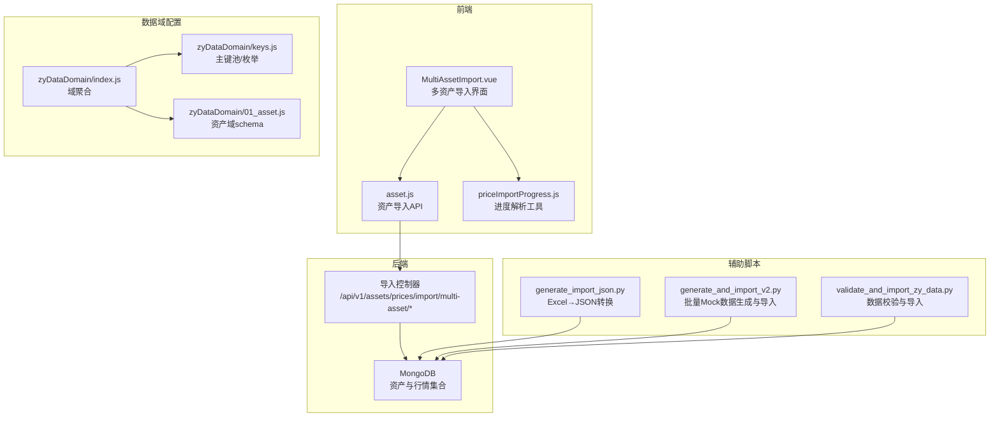
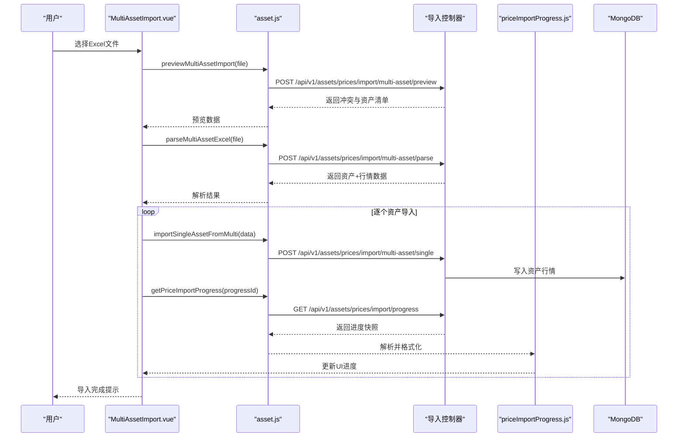
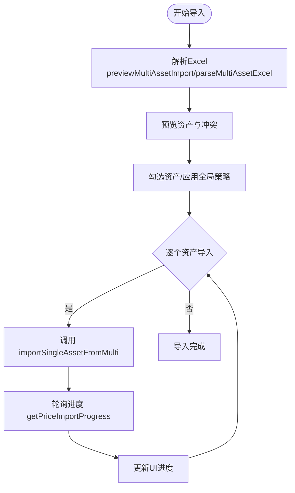
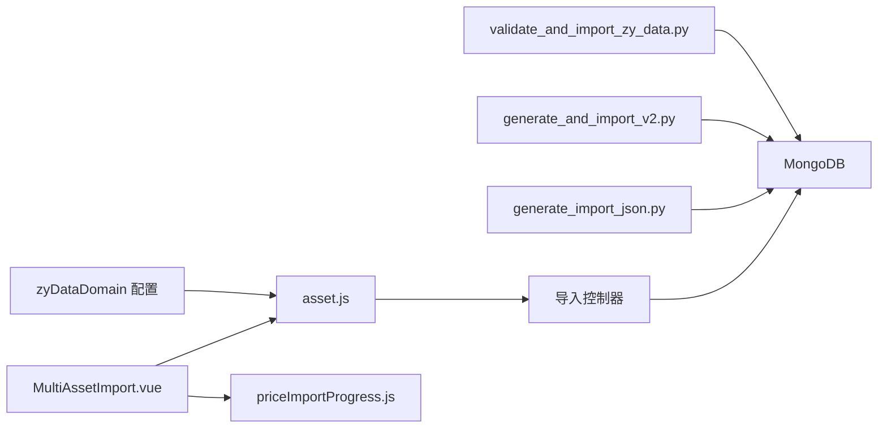

# 多资产数据导入

<cite>
**本文引用的文件**
- [MultiAssetImport.vue](file://src/views/analysis/MultiAssetImport.vue)
- [asset.js](file://src/api/asset.js)
- [priceImportProgress.js](file://src/utils/priceImportProgress.js)
- [zyDataDomain.mock.js](file://src/api/zyDataDomain.mock.js)
- [generate_import_json.py](file://scripts/generate_import_json.py)
- [generate_and_import_v2.py](file://scripts/generate_and_import_v2.py)
- [validate_and_import_zy_data.py](file://scripts/validate_and_import_zy_data.py)
- [index.js](file://src/config/zyDataDomain/index.js)
- [keys.js](file://src/config/zyDataDomain/keys.js)
- [01_asset.js](file://src/config/zyDataDomain/01_asset.js)
</cite>

## 目录
1. [简介](#简介)
2. [项目结构](#项目结构)
3. [核心组件](#核心组件)
4. [架构概览](#架构概览)
5. [详细组件分析](#详细组件分析)
6. [依赖分析](#依赖分析)
7. [性能考虑](#性能考虑)
8. [故障排查指南](#故障排查指南)
9. [结论](#结论)
10. [附录](#附录)

## 简介
本文件面向“多资产数据导入”功能，系统性阐述批量资产数据导入的实现原理与使用方法，涵盖以下要点：
- 批量资产数据导入的前端交互与后端接口设计
- 资产信息统一处理、数据格式标准化、批量写入机制
- 多资产导入的数据结构设计：资产类型识别、字段映射、数据验证规则
- 导入过程中的错误处理策略：部分失败处理、数据冲突解决、重复数据过滤
- 完整使用指南：文件准备要求、导入流程说明、进度监控机制
- API 接口文档与实际使用示例

## 项目结构
多资产导入功能涉及前端 Vue 组件、API 层、进度监控工具以及后端脚本与数据域配置。下图展示了与导入功能直接相关的模块关系：

**图表来源**
- [MultiAssetImport.vue](file://src/views/analysis/MultiAssetImport.vue)
- [asset.js](file://src/api/asset.js)
- [priceImportProgress.js](file://src/utils/priceImportProgress.js)
- [index.js](file://src/config/zyDataDomain/index.js)
- [keys.js](file://src/config/zyDataDomain/keys.js)
- [01_asset.js](file://src/config/zyDataDomain/01_asset.js)
- [generate_import_json.py](file://scripts/generate_import_json.py)
- [generate_and_import_v2.py](file://scripts/generate_and_import_v2.py)
- [validate_and_import_zy_data.py](file://scripts/validate_and_import_zy_data.py)

**章节来源**
- [MultiAssetImport.vue](file://src/views/analysis/MultiAssetImport.vue)
- [asset.js](file://src/api/asset.js)
- [priceImportProgress.js](file://src/utils/priceImportProgress.js)
- [index.js](file://src/config/zyDataDomain/index.js)
- [keys.js](file://src/config/zyDataDomain/keys.js)
- [01_asset.js](file://src/config/zyDataDomain/01_asset.js)
- [generate_import_json.py](file://scripts/generate_import_json.py)
- [generate_and_import_v2.py](file://scripts/generate_and_import_v2.py)
- [validate_and_import_zy_data.py](file://scripts/validate_and_import_zy_data.py)

## 核心组件
- 前端导入界面：负责文件选择、预览、冲突提示、逐条导入与进度展示
- API 层：提供多资产导入的预览、解析、逐条导入与进度查询接口
- 进度监控工具：解析后端进度快照，格式化展示导入阶段与写入进度
- 数据域配置：定义资产域 schema、主键池与枚举，支撑字段映射与校验
- 辅助脚本：提供 Excel→JSON 转换、批量 Mock 数据生成与导入、数据校验与导入

**章节来源**
- [MultiAssetImport.vue](file://src/views/analysis/MultiAssetImport.vue)
- [asset.js](file://src/api/asset.js)
- [priceImportProgress.js](file://src/utils/priceImportProgress.js)
- [index.js](file://src/config/zyDataDomain/index.js)
- [keys.js](file://src/config/zyDataDomain/keys.js)
- [01_asset.js](file://src/config/zyDataDomain/01_asset.js)
- [generate_import_json.py](file://scripts/generate_import_json.py)
- [generate_and_import_v2.py](file://scripts/generate_and_import_v2.py)
- [validate_and_import_zy_data.py](file://scripts/validate_and_import_zy_data.py)

## 架构概览
多资产导入采用“前端预览→后端解析→逐条导入→进度轮询”的流水线式架构。前端通过 API 触发后端解析与导入，后端以同步方式写入 MongoDB，并通过进度接口返回阶段性快照。

**图表来源**
- [MultiAssetImport.vue](file://src/views/analysis/MultiAssetImport.vue)
- [asset.js](file://src/api/asset.js)
- [priceImportProgress.js](file://src/utils/priceImportProgress.js)

**章节来源**
- [MultiAssetImport.vue](file://src/views/analysis/MultiAssetImport.vue)
- [asset.js](file://src/api/asset.js)
- [priceImportProgress.js](file://src/utils/priceImportProgress.js)

## 详细组件分析

### 前端组件：MultiAssetImport.vue
- 功能职责
  - 支持 xlsx/xls 文件上传，限制单文件
  - 预览多资产导入：展示资产代码、名称、行情条数、冲突状态
  - 冲突处理：名称冲突时可选择覆盖；已有行情时可选择“仅新增/全覆盖”
  - 逐条导入：遍历选中资产，调用后端接口进行导入
  - 进度监控：轮询进度接口，实时展示导入阶段与写入进度
- 关键交互
  - 预览与解析：调用 previewMultiAssetImport 与 parseMultiAssetExcel
  - 导入控制：startImport 控制导入流程，逐条调用 importSingleAssetFromMulti
  - 进度轮询：newPriceImportProgressId 生成唯一进度ID，定时轮询 getPriceImportProgress
- 错误处理
  - 解析失败、导入失败均弹出消息提示
  - 进度轮询失败时提示“无法拉取进度（请检查网络或登录态）”

**图表来源**
- [MultiAssetImport.vue](file://src/views/analysis/MultiAssetImport.vue)

**章节来源**
- [MultiAssetImport.vue](file://src/views/analysis/MultiAssetImport.vue)

### API 层：asset.js
- 多资产导入相关接口
  - 预览：POST /api/v1/assets/prices/import/multi-asset/preview
  - 解析：POST /api/v1/assets/prices/import/multi-asset/parse
  - 分析：POST /api/v1/assets/prices/import/multi-asset/analyze
  - 单资产导入：POST /api/v1/assets/prices/import/multi-asset/single
  - 进度查询：GET /api/v1/assets/prices/import/progress
- 参数与行为
  - 预览/解析/分析均支持 metric 参数（如 close/open/high/low/amount/volume/scale）
  - 单资产导入支持 replace_existing、overwrite_name、progress_id 等控制项
  - 进度查询以 progress_id 为标识，返回阶段与写入进度快照

**章节来源**
- [asset.js](file://src/api/asset.js)

### 进度监控工具：priceImportProgress.js
- 职责
  - 解析后端进度响应，判断快照字段是否存在
  - 格式化进度行文本，优先使用 write_done/write_total，其次 message
  - 提供轮询间隔常量（2000ms）
- 使用方式
  - 前端组件在导入开始时生成 progressId，轮询进度接口并调用该工具解析与格式化

**章节来源**
- [priceImportProgress.js](file://src/utils/priceImportProgress.js)

### 数据域配置：zyDataDomain
- 域聚合与查询
  - index.js 聚合资产域、主体域、产品域等 9 个域，提供 findDomain/findTable 等工具
- 主键池与枚举
  - keys.js 定义业务日期、主键池（AST_CD、PORT_ID、ISR_ID 等）与各类枚举（资产类型、市场、币种等）
- 资产域 schema
  - 01_asset.js 定义资产基础信息、估值、收益率、现金流、质押、五级分类等表的字段与约束

**章节来源**
- [index.js](file://src/config/zyDataDomain/index.js)
- [keys.js](file://src/config/zyDataDomain/keys.js)
- [01_asset.js](file://src/config/zyDataDomain/01_asset.js)

### 辅助脚本
- Excel→JSON 转换：generate_import_json.py
  - 读取“大类资产底层数据”Excel，生成 assets.json 与 asset_prices.json
  - 输出 mongoimport 命令，便于直接导入 MongoDB
- 批量 Mock 数据生成与导入：generate_and_import_v2.py
  - 生成 v2 增强版 Mock 数据（覆盖 20+ 集合、300+ 条记录）
  - 连接 MongoDB，清理并导入各集合，输出统计与样例查询
- 数据校验与导入：validate_and_import_zy_data.py
  - 校验字段完整性、数据类型与业务逻辑
  - 导入 MongoDB 并创建常用索引，最后验证导入结果

**章节来源**
- [generate_import_json.py](file://scripts/generate_import_json.py)
- [generate_and_import_v2.py](file://scripts/generate_and_import_v2.py)
- [validate_and_import_zy_data.py](file://scripts/validate_and_import_zy_data.py)

## 依赖分析
- 前端组件依赖
  - asset.js：调用多资产导入 API
  - priceImportProgress.js：解析与格式化进度
  - 数据域配置：用于理解字段映射与校验规则
- 后端依赖
  - MongoDB：存储资产与行情数据
  - 进度快照：后端在导入过程中维护阶段与写入进度
- 脚本依赖
  - MongoDB：用于批量导入与校验
  - openpyxl：Excel 读取与解析

**图表来源**
- [MultiAssetImport.vue](file://src/views/analysis/MultiAssetImport.vue)
- [asset.js](file://src/api/asset.js)
- [priceImportProgress.js](file://src/utils/priceImportProgress.js)
- [generate_import_json.py](file://scripts/generate_import_json.py)
- [generate_and_import_v2.py](file://scripts/generate_and_import_v2.py)
- [validate_and_import_zy_data.py](file://scripts/validate_and_import_zy_data.py)
- [index.js](file://src/config/zyDataDomain/index.js)

**章节来源**
- [MultiAssetImport.vue](file://src/views/analysis/MultiAssetImport.vue)
- [asset.js](file://src/api/asset.js)
- [priceImportProgress.js](file://src/utils/priceImportProgress.js)
- [generate_import_json.py](file://scripts/generate_import_json.py)
- [generate_and_import_v2.py](file://scripts/generate_and_import_v2.py)
- [validate_and_import_zy_data.py](file://scripts/validate_and_import_zy_data.py)
- [index.js](file://src/config/zyDataDomain/index.js)

## 性能考虑
- 前端轮询频率：进度轮询间隔为 2000ms，避免过于频繁导致服务端压力
- 导入超时：多资产导入接口统一设置较长超时（600000ms），适配大量行情数据
- 批量写入：后端逐条导入并返回进度，前端在导入完成后再做最终进度拉取，减少不必要的轮询
- 数据体积：建议单次导入的资产数量不宜过大，避免 UI 卡顿与内存占用过高

[本节为通用指导，无需具体文件引用]

## 故障排查指南
- 文件格式与大小
  - 仅支持 .xlsx/.xls，且限制单文件导入
  - 若解析失败，检查 Excel 结构是否符合“大类资产底层数据-含插件.xlsx”格式
- 网络与登录态
  - 进度轮询失败时，请检查网络连通性与登录态
- 冲突与覆盖
  - 名称冲突：根据预览提示选择“不覆盖/覆盖名称”
  - 已有行情：根据预览提示选择“仅新增/全覆盖”
- 导入失败
  - 查看错误列表，定位具体资产与错误信息
  - 检查后端日志与 MongoDB 写入情况
- 数据质量
  - 使用 validate_and_import_zy_data.py 校验字段完整性与数据类型
  - 通过样例查询确认导入结果

**章节来源**
- [MultiAssetImport.vue](file://src/views/analysis/MultiAssetImport.vue)
- [priceImportProgress.js](file://src/utils/priceImportProgress.js)
- [validate_and_import_zy_data.py](file://scripts/validate_and_import_zy_data.py)

## 结论
多资产数据导入功能通过“前端预览—后端解析—逐条导入—进度轮询”的架构，实现了对批量资产行情数据的高效、可控导入。前端提供直观的冲突提示与进度展示，后端保证导入过程的可观测性与稳定性。配合数据域配置与校验脚本，可进一步提升数据质量与一致性。

[本节为总结性内容，无需具体文件引用]

## 附录

### 使用指南
- 文件准备
  - 使用“大类资产底层数据-含插件.xlsx”格式，确保每张工作表第 3 行为资产名称、第 4 行为资产代码、第 5 行起为日期与价格
- 导入流程
  - 选择文件→预览→勾选资产→应用全局策略→开始导入→查看进度与错误
- 进度监控
  - 导入过程中实时显示当前资产、导入总数与进度百分比
  - 进度行文本优先展示写入进度，其次为后端消息

**章节来源**
- [MultiAssetImport.vue](file://src/views/analysis/MultiAssetImport.vue)

### API 接口文档
- 预览多资产导入
  - 方法：POST
  - 路径：/api/v1/assets/prices/import/multi-asset/preview
  - 参数：file（二进制）、metric（可选，默认 close）
  - 返回：冲突与资产清单
- 解析多资产 Excel
  - 方法：POST
  - 路径：/api/v1/assets/prices/import/multi-asset/parse
  - 参数：file（二进制）、metric（可选）
  - 返回：资产+行情完整数据
- 分析多资产导入
  - 方法：POST
  - 路径：/api/v1/assets/prices/import/multi-asset/analyze
  - 参数：file（二进制）、metric（可选）
  - 返回：分析结果（推荐用于向导式导入）
- 单资产导入（多资产逐条调用）
  - 方法：POST
  - 路径：/api/v1/assets/prices/import/multi-asset/single
  - 参数：asset_code、replace_existing、overwrite_name、prices、progress_id、import_metric
  - 返回：导入结果
- 进度查询
  - 方法：GET
  - 路径：/api/v1/assets/prices/import/progress
  - 参数：progress_id
  - 返回：阶段与写入进度快照

**章节来源**
- [asset.js](file://src/api/asset.js)

### 实际使用示例
- Excel→JSON 转换
  - 运行 generate_import_json.py，生成 assets.json 与 asset_prices.json，并输出 mongoimport 命令
- 批量 Mock 数据导入
  - 运行 generate_and_import_v2.py，一键生成并导入 v2 增强版 Mock 数据
- 数据校验与导入
  - 运行 validate_and_import_zy_data.py，自动校验字段与数据质量，导入 MongoDB 并创建索引

**章节来源**
- [generate_import_json.py](file://scripts/generate_import_json.py)
- [generate_and_import_v2.py](file://scripts/generate_and_import_v2.py)
- [validate_and_import_zy_data.py](file://scripts/validate_and_import_zy_data.py)