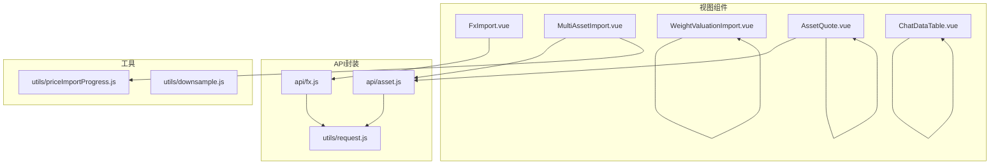
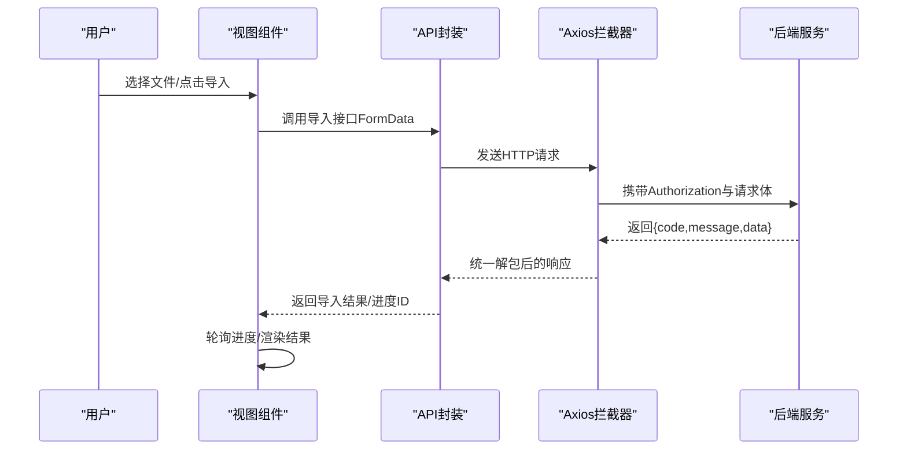
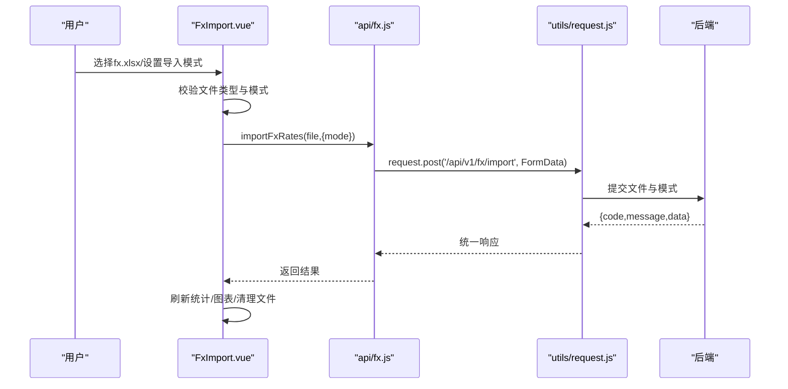
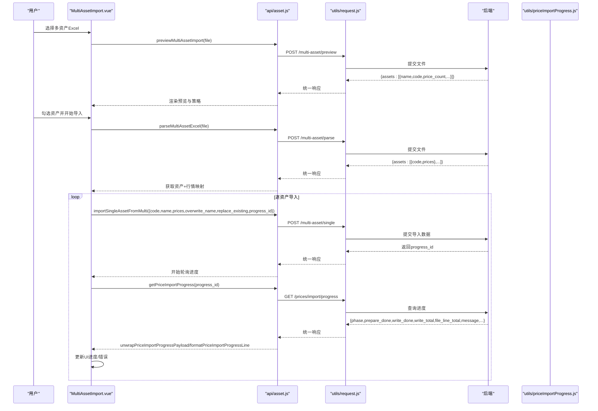
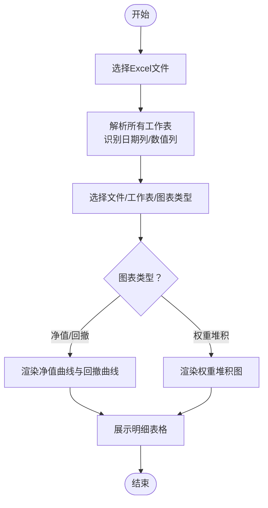
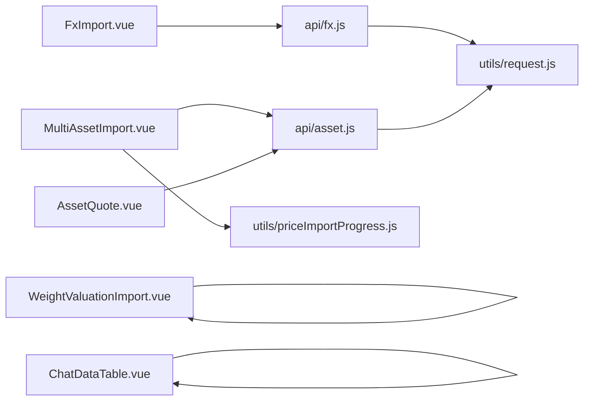

# 数据导入导出

<cite>
**本文引用的文件**
- [src/views/analysis/FxImport.vue](file://src/views/analysis/FxImport.vue)
- [src/views/analysis/MultiAssetImport.vue](file://src/views/analysis/MultiAssetImport.vue)
- [src/views/analysis/WeightValuationImport.vue](file://src/views/analysis/WeightValuationImport.vue)
- [src/api/fx.js](file://src/api/fx.js)
- [src/api/asset.js](file://src/api/asset.js)
- [src/utils/priceImportProgress.js](file://src/utils/priceImportProgress.js)
- [src/utils/downsample.js](file://src/utils/downsample.js)
- [src/utils/request.js](file://src/utils/request.js)
- [src/components/DataImportCards.vue](file://src/components/DataImportCards.vue)
- [src/views/asset/AssetQuote.vue](file://src/views/asset/AssetQuote.vue)
- [src/components/ChatDataTable.vue](file://src/components/ChatDataTable.vue)
- [scripts/IMPORT_GUIDE.md](file://scripts/IMPORT_GUIDE.md)
- [scripts/README_v2.md](file://scripts/README_v2.md)
</cite>

## 目录
1. [简介](#简介)
2. [项目结构](#项目结构)
3. [核心组件](#核心组件)
4. [架构总览](#架构总览)
5. [详细组件分析](#详细组件分析)
6. [依赖分析](#依赖分析)
7. [性能考虑](#性能考虑)
8. [故障排查指南](#故障排查指南)
9. [结论](#结论)
10. [附录](#附录)

## 简介
本文件系统性梳理并说明前端侧“数据导入导出”能力，重点覆盖以下功能：
- 外汇数据导入（FxImport）：支持覆盖与增量两种模式，提供手动录入与图表展示。
- 多资产数据导入（MultiAssetImport）：支持从「大类资产底层数据」Excel解析、冲突预览、逐资产导入与进度监控。
- 权重与估值数据导入（WeightValuationImport）：通用Excel解析与可视化，支持净值/回撤曲线与权重堆积图。
- 数据导入通用流程：文件上传、格式识别、数据预处理、批量写入与进度轮询。
- 数据导出：表格导出为CSV，兼容Excel中文显示。
- 错误处理、进度监控与断点续传思路。

## 项目结构
围绕数据导入导出的相关前端文件组织如下：
- 视图组件：负责用户交互与流程编排
  - src/views/analysis/FxImport.vue
  - src/views/analysis/MultiAssetImport.vue
  - src/views/analysis/WeightValuationImport.vue
  - src/views/asset/AssetQuote.vue（单资产行情导入）
  - src/components/ChatDataTable.vue（表格导出CSV）
- API封装：统一请求与错误处理
  - src/api/fx.js
  - src/api/asset.js
  - src/utils/request.js
- 进度与工具
  - src/utils/priceImportProgress.js
  - src/utils/downsample.js
- 导入辅助文档
  - scripts/IMPORT_GUIDE.md
  - scripts/README_v2.md

**图表来源**
- [src/views/analysis/FxImport.vue](file://src/views/analysis/FxImport.vue)
- [src/views/analysis/MultiAssetImport.vue](file://src/views/analysis/MultiAssetImport.vue)
- [src/views/analysis/WeightValuationImport.vue](file://src/views/analysis/WeightValuationImport.vue)
- [src/views/asset/AssetQuote.vue](file://src/views/asset/AssetQuote.vue)
- [src/components/ChatDataTable.vue](file://src/components/ChatDataTable.vue)
- [src/api/fx.js](file://src/api/fx.js)
- [src/api/asset.js](file://src/api/asset.js)
- [src/utils/request.js](file://src/utils/request.js)
- [src/utils/priceImportProgress.js](file://src/utils/priceImportProgress.js)
- [src/utils/downsample.js](file://src/utils/downsample.js)

**章节来源**
- [src/views/analysis/FxImport.vue](file://src/views/analysis/FxImport.vue)
- [src/views/analysis/MultiAssetImport.vue](file://src/views/analysis/MultiAssetImport.vue)
- [src/views/analysis/WeightValuationImport.vue](file://src/views/analysis/WeightValuationImport.vue)
- [src/views/asset/AssetQuote.vue](file://src/views/asset/AssetQuote.vue)
- [src/components/ChatDataTable.vue](file://src/components/ChatDataTable.vue)
- [src/api/fx.js](file://src/api/fx.js)
- [src/api/asset.js](file://src/api/asset.js)
- [src/utils/request.js](file://src/utils/request.js)
- [src/utils/priceImportProgress.js](file://src/utils/priceImportProgress.js)
- [src/utils/downsample.js](file://src/utils/downsample.js)

## 核心组件
- 外汇数据导入（FxImport）
  - 支持Excel（.xlsx/.xls）上传，覆盖/增量两种模式
  - 手动录入单日汇率（对人民币报价）
  - 图表展示与统计信息
- 多资产数据导入（MultiAssetImport）
  - 预览资产冲突、名称覆盖策略、已有行情策略
  - 逐资产导入与进度轮询，支持错误聚合展示
- 权重与估值数据导入（WeightValuationImport）
  - 通用Excel解析：自动识别日期列与数值列，支持多种工作表
  - 可视化：净值/回撤曲线、权重堆积图
- 单资产行情导入（AssetQuote）
  - Excel导入、替换/仅缺失日期策略、错误提示
- 表格导出（ChatDataTable）
  - CSV导出，自动转义与BOM处理，适配Excel中文

**章节来源**
- [src/views/analysis/FxImport.vue](file://src/views/analysis/FxImport.vue)
- [src/views/analysis/MultiAssetImport.vue](file://src/views/analysis/MultiAssetImport.vue)
- [src/views/analysis/WeightValuationImport.vue](file://src/views/analysis/WeightValuationImport.vue)
- [src/views/asset/AssetQuote.vue](file://src/views/asset/AssetQuote.vue)
- [src/components/ChatDataTable.vue](file://src/components/ChatDataTable.vue)

## 架构总览
前端通过API封装统一发起请求，Axios拦截器处理全局错误与认证；导入流程采用FormData传输，后端解析Excel并执行批量写入；进度通过轮询接口返回快照，前端格式化展示。

**图表来源**
- [src/api/fx.js](file://src/api/fx.js)
- [src/api/asset.js](file://src/api/asset.js)
- [src/utils/request.js](file://src/utils/request.js)
- [src/utils/priceImportProgress.js](file://src/utils/priceImportProgress.js)

## 详细组件分析

### 外汇数据导入（FxImport）
- 功能要点
  - 文件上传：限制xlsx/xls，覆盖/增量模式
  - 手动录入：对人民币报价，至少填写一个>0的币种
  - 统计与图表：展示数据条数、起止日期，折线图展示汇率走势
- 关键流程
  - 选择文件与模式 -> 确认导入 -> 上传FormData -> 成功提示/失败错误 -> 刷新统计与图表
- 错误处理
  - 组件内统一捕获并提示，支持数组/对象/字符串多种形态

**图表来源**
- [src/views/analysis/FxImport.vue](file://src/views/analysis/FxImport.vue)
- [src/api/fx.js](file://src/api/fx.js)
- [src/utils/request.js](file://src/utils/request.js)

**章节来源**
- [src/views/analysis/FxImport.vue](file://src/views/analysis/FxImport.vue)
- [src/api/fx.js](file://src/api/fx.js)

### 多资产数据导入（MultiAssetImport）
- 功能要点
  - 预览：解析冲突（名称不一致/已有行情），支持全局策略应用
  - 导入：逐资产导入，携带progress_id进行进度轮询
  - 进度：轮询/get接口，格式化展示“准备/写入/完成”
- 关键流程
  - 选择文件 -> 预览资产 -> 勾选目标 -> 解析Excel -> 逐资产导入 -> 轮询进度 -> 错误聚合
- 断点续传思路
  - 后端按行写入，前端以write_done/write_total为准，避免message滞后导致UI卡死

**图表来源**
- [src/views/analysis/MultiAssetImport.vue](file://src/views/analysis/MultiAssetImport.vue)
- [src/api/asset.js](file://src/api/asset.js)
- [src/utils/request.js](file://src/utils/request.js)
- [src/utils/priceImportProgress.js](file://src/utils/priceImportProgress.js)

**章节来源**
- [src/views/analysis/MultiAssetImport.vue](file://src/views/analysis/MultiAssetImport.vue)
- [src/api/asset.js](file://src/api/asset.js)
- [src/utils/priceImportProgress.js](file://src/utils/priceImportProgress.js)

### 权重与估值数据导入（WeightValuationImport）
- 功能要点
  - 通用Excel解析：自动识别日期列与数值列，支持多工作表
  - 可视化：净值/回撤曲线（首列净值）、权重堆积图（过滤“杠杆/波动率/系数”列）
  - 数据明细：表格展示，列宽自适应
- 关键流程
  - 选择文件 -> 解析工作表 -> 选择文件/工作表/图表类型 -> 渲染图表与明细

**图表来源**
- [src/views/analysis/WeightValuationImport.vue](file://src/views/analysis/WeightValuationImport.vue)

**章节来源**
- [src/views/analysis/WeightValuationImport.vue](file://src/views/analysis/WeightValuationImport.vue)

### 单资产行情导入（AssetQuote）
- 功能要点
  - Excel导入：支持替换/仅缺失日期策略
  - 错误提示：对跳过非交易日等进行友好提示
- 关键流程
  - 选择文件 -> 调用importPricesFromExcel -> 展示新增/更新/跳过/失败统计

**章节来源**
- [src/views/asset/AssetQuote.vue](file://src/views/asset/AssetQuote.vue)
- [src/api/asset.js](file://src/api/asset.js)

### 表格导出（ChatDataTable）
- 功能要点
  - 将当前表格导出为CSV，自动转义与添加BOM，适配Excel中文
- 关键流程
  - 用户点击导出 -> 生成表头与行 -> Blob下载

**章节来源**
- [src/components/ChatDataTable.vue](file://src/components/ChatDataTable.vue)

## 依赖分析
- 组件与API
  - FxImport依赖api/fx.js的汇率导入、统计与手动录入接口
  - MultiAssetImport依赖api/asset.js的多资产预览/解析/逐资产导入与进度轮询
  - WeightValuationImport为纯前端解析与可视化
  - AssetQuote依赖api/asset.js的单资产行情导入
  - ChatDataTable提供CSV导出能力
- 工具与拦截器
  - utils/request.js统一处理认证与错误提示
  - utils/priceImportProgress.js统一解析与格式化进度快照
  - utils/downsample.js提供降采样算法（与导入导出流程解耦）

**图表来源**
- [src/views/analysis/FxImport.vue](file://src/views/analysis/FxImport.vue)
- [src/views/analysis/MultiAssetImport.vue](file://src/views/analysis/MultiAssetImport.vue)
- [src/views/analysis/WeightValuationImport.vue](file://src/views/analysis/WeightValuationImport.vue)
- [src/views/asset/AssetQuote.vue](file://src/views/asset/AssetQuote.vue)
- [src/components/ChatDataTable.vue](file://src/components/ChatDataTable.vue)
- [src/api/fx.js](file://src/api/fx.js)
- [src/api/asset.js](file://src/api/asset.js)
- [src/utils/request.js](file://src/utils/request.js)
- [src/utils/priceImportProgress.js](file://src/utils/priceImportProgress.js)

**章节来源**
- [src/api/fx.js](file://src/api/fx.js)
- [src/api/asset.js](file://src/api/asset.js)
- [src/utils/request.js](file://src/utils/request.js)
- [src/utils/priceImportProgress.js](file://src/utils/priceImportProgress.js)

## 性能考虑
- 多资产导入
  - 后端按行写入，前端以write_done/write_total为准展示进度，避免message滞后导致UI卡顿
  - 轮询间隔固定，避免过于频繁导致服务端压力
- 图表渲染
  - 大数据量时可结合降采样算法（LTTB/均匀采样）减少点数，提升渲染性能
- 导出
  - CSV导出采用BOM与转义，避免Excel中文乱码；对超大数据量建议分页或分批导出

**章节来源**
- [src/utils/priceImportProgress.js](file://src/utils/priceImportProgress.js)
- [src/utils/downsample.js](file://src/utils/downsample.js)
- [src/components/ChatDataTable.vue](file://src/components/ChatDataTable.vue)

## 故障排查指南
- 常见错误与提示
  - 401未授权：检查登录状态与Token
  - 422校验错误：查看后端返回的detail
  - 403拒绝访问：检查权限
  - 404资源不存在：检查接口URL
  - 超时：检查后端服务是否启动、网络是否正常
- 导入失败定位
  - FxImport：确认文件类型与模式，查看后端错误信息
  - MultiAssetImport：查看错误聚合列表，确认progress_id是否有效
  - AssetQuote：关注跳过非交易日等提示
- 导入辅助
  - 参考导入指南与v2增强版说明，确保数据结构与模板一致

**章节来源**
- [src/utils/request.js](file://src/utils/request.js)
- [src/views/analysis/FxImport.vue](file://src/views/analysis/FxImport.vue)
- [src/views/analysis/MultiAssetImport.vue](file://src/views/analysis/MultiAssetImport.vue)
- [src/views/asset/AssetQuote.vue](file://src/views/asset/AssetQuote.vue)
- [scripts/IMPORT_GUIDE.md](file://scripts/IMPORT_GUIDE.md)
- [scripts/README_v2.md](file://scripts/README_v2.md)

## 结论
本方案在前端侧提供了完整的数据导入导出能力：覆盖外汇、多资产、权重/估值等多场景，配合统一的API封装与进度轮询，能够稳定支撑大规模数据的批量导入；同时提供CSV导出与图表可视化，满足日常分析与审计需求。建议在生产环境中结合后端bulk写入策略与合理的轮询间隔，进一步优化导入性能与用户体验。

## 附录

### API接口文档（摘要）
- 外汇导入
  - POST /api/v1/fx/import
    - 参数：file（二进制），mode（replace/incremental）
    - 超时：120000ms
- 手动录入汇率
  - POST /api/v1/fx/manual
    - 参数：{ date, EUR?, USD?, HKD?, CNH? }
- 汇率统计与序列
  - GET /api/v1/fx/stats
  - GET /api/v1/fx/rates?start_date&end_date
- 多资产导入
  - POST /api/v1/assets/prices/import/multi-asset/preview
  - POST /api/v1/assets/prices/import/multi-asset/parse
  - POST /api/v1/assets/prices/import/multi-asset/single
  - GET /api/v1/assets/prices/import/progress?progress_id
- 单资产行情导入
  - POST /api/v1/assets/prices/import/excel
    - 参数：asset_code, replace_existing, only_date?, only_missing_dates?
  - POST /api/v1/assets/prices/import（JSON）
- 表格导出
  - GET /api/v1/assets/prices/template/download/multi-asset?metric
  - GET /api/v1/assets/prices/template/download?kind

**章节来源**
- [src/api/fx.js](file://src/api/fx.js)
- [src/api/asset.js](file://src/api/asset.js)

### 使用示例（路径指引）
- 外汇导入
  - 选择文件与模式 -> 点击导入 -> 查看统计与图表
  - 路径参考：[src/views/analysis/FxImport.vue](file://src/views/analysis/FxImport.vue)
- 多资产导入
  - 选择Excel -> 预览冲突 -> 勾选资产 -> 开始导入 -> 查看进度与错误
  - 路径参考：[src/views/analysis/MultiAssetImport.vue](file://src/views/analysis/MultiAssetImport.vue)
- 权重与估值导入
  - 选择Excel -> 选择工作表与图表类型 -> 查看净值/回撤或权重堆积图
  - 路径参考：[src/views/analysis/WeightValuationImport.vue](file://src/views/analysis/WeightValuationImport.vue)
- 单资产行情导入
  - 选择Excel -> 设置策略 -> 导入并查看统计
  - 路径参考：[src/views/asset/AssetQuote.vue](file://src/views/asset/AssetQuote.vue)
- 表格导出
  - 在表格组件中点击导出 -> 下载CSV
  - 路径参考：[src/components/ChatDataTable.vue](file://src/components/ChatDataTable.vue)