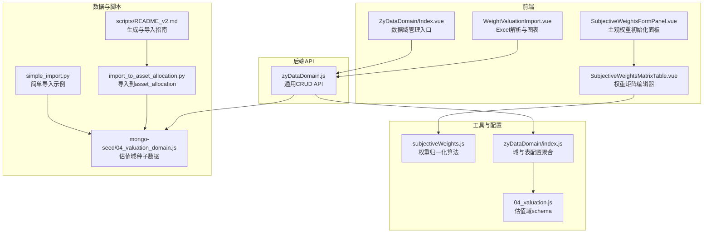
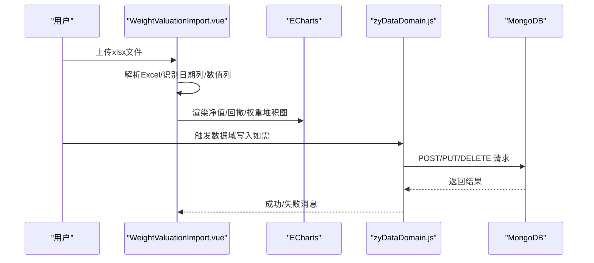
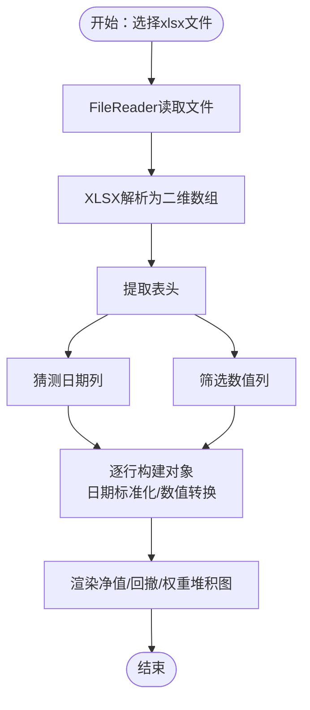
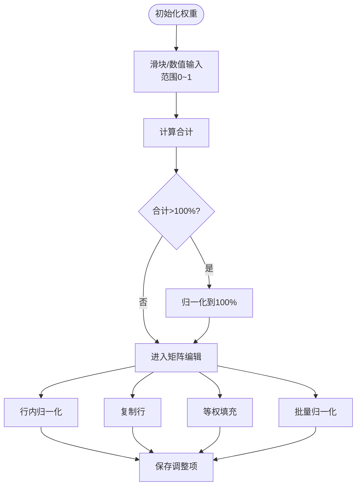
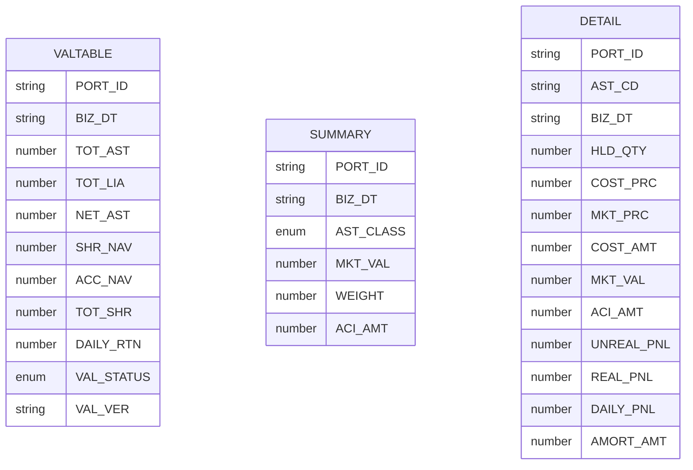
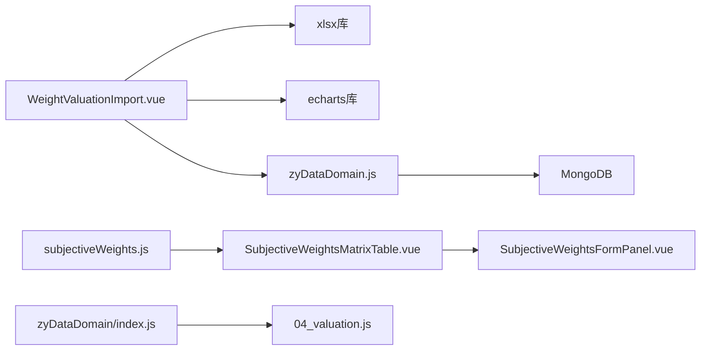

# 权重估值数据导入

<cite>
**本文引用的文件**
- [WeightValuationImport.vue](file://src/views/analysis/WeightValuationImport.vue)
- [subjectiveWeights.js](file://src/utils/subjectiveWeights.js)
- [SubjectiveWeightsFormPanel.vue](file://src/components/SubjectiveWeightsFormPanel.vue)
- [SubjectiveWeightsMatrixTable.vue](file://src/components/SubjectiveWeightsMatrixTable.vue)
- [04_valuation.js](file://src/config/zyDataDomain/04_valuation.js)
- [index.js](file://src/config/zyDataDomain/index.js)
- [zyDataDomain.js](file://src/api/zyDataDomain.js)
- [Index.vue](file://src/views/analysis/ZyDataDomain/Index.vue)
- [04_valuation_domain.js](file://mongo-seed/04_valuation_domain.js)
- [README_v2.md](file://scripts/README_v2.md)
- [import_to_asset_allocation.py](file://scripts/import_to_asset_allocation.py)
- [simple_import.py](file://scripts/simple_import.py)
</cite>

## 目录
1. [简介](#简介)
2. [项目结构](#项目结构)
3. [核心组件](#核心组件)
4. [架构总览](#架构总览)
5. [详细组件分析](#详细组件分析)
6. [依赖分析](#依赖分析)
7. [性能考虑](#性能考虑)
8. [故障排查指南](#故障排查指南)
9. [结论](#结论)
10. [附录](#附录)

## 简介
本文件面向“权重估值数据导入”功能，系统化阐述权重数据的解析与验证、估值数据的导入机制与更新策略、业务规则与一致性保障，并提供完整操作指南与API说明，帮助用户准确理解与使用该功能。

## 项目结构
围绕权重估值导入，前端由“Excel解析与可视化”页面与“主观权重编辑器”组成；后端通过数据域API对接MongoDB；估值域schema定义了净值/权重等关键字段；配套脚本负责Mock数据生成与导入。

**图示来源**
- [WeightValuationImport.vue:1-547](file://src/views/analysis/WeightValuationImport.vue#L1-L547)
- [SubjectiveWeightsFormPanel.vue:1-315](file://src/components/SubjectiveWeightsFormPanel.vue#L1-L315)
- [SubjectiveWeightsMatrixTable.vue:1-619](file://src/components/SubjectiveWeightsMatrixTable.vue#L1-L619)
- [subjectiveWeights.js:1-50](file://src/utils/subjectiveWeights.js#L1-L50)
- [index.js:1-80](file://src/config/zyDataDomain/index.js#L1-L80)
- [04_valuation.js:1-137](file://src/config/zyDataDomain/04_valuation.js#L1-L137)
- [zyDataDomain.js:1-190](file://src/api/zyDataDomain.js#L1-L190)
- [Index.vue:1-290](file://src/views/analysis/ZyDataDomain/Index.vue#L1-L290)
- [04_valuation_domain.js:40-77](file://mongo-seed/04_valuation_domain.js#L40-L77)
- [README_v2.md:1-380](file://scripts/README_v2.md#L1-L380)
- [import_to_asset_allocation.py:1-172](file://scripts/import_to_asset_allocation.py#L1-L172)
- [simple_import.py:1-46](file://scripts/simple_import.py#L1-L46)

**章节来源**
- [WeightValuationImport.vue:1-547](file://src/views/analysis/WeightValuationImport.vue#L1-L547)
- [zyDataDomain.js:1-190](file://src/api/zyDataDomain.js#L1-L190)
- [04_valuation.js:1-137](file://src/config/zyDataDomain/04_valuation.js#L1-L137)
- [README_v2.md:1-380](file://scripts/README_v2.md#L1-L380)

## 核心组件
- Excel权重/净值/汇率/交易日历解析与可视化
  - 自动识别日期列与数值列，转换为统一日期格式与数值精度，支持净值曲线与回撤、权重堆积图。
- 主观权重编辑器
  - 初始化权重（0~100%，合计建议100%）、批量归一化、矩阵式预设调仓权重编辑（含合计校验、等权填充、复制行、批量归一化）。
- 估值域schema与数据域API
  - 定义净值、累计净值、份额、日收益、权重等字段；提供通用CRUD接口与本地Mock兜底。

**章节来源**
- [WeightValuationImport.vue:196-532](file://src/views/analysis/WeightValuationImport.vue#L196-L532)
- [SubjectiveWeightsFormPanel.vue:1-315](file://src/components/SubjectiveWeightsFormPanel.vue#L1-L315)
- [SubjectiveWeightsMatrixTable.vue:132-423](file://src/components/SubjectiveWeightsMatrixTable.vue#L132-L423)
- [subjectiveWeights.js:1-50](file://src/utils/subjectiveWeights.js#L1-L50)
- [04_valuation.js:17-29](file://src/config/zyDataDomain/04_valuation.js#L17-L29)

## 架构总览
前端通过Excel解析组件与估值域schema交互，后端通过数据域API进行CRUD操作；当后端不可用时自动降级到本地Mock，确保开发与演示可用性。

**图示来源**
- [WeightValuationImport.vue:196-532](file://src/views/analysis/WeightValuationImport.vue#L196-L532)
- [zyDataDomain.js:69-158](file://src/api/zyDataDomain.js#L69-L158)

## 详细组件分析

### Excel解析与可视化（权重/净值/汇率/交易日历）
- 解析流程
  - FileReader读取二进制，XLSX解析为二维数组，逐表提取头部、识别日期列、筛选数值列，转换日期与数值，生成标准数据结构。
- 日期识别与数值识别
  - 日期识别：基于样本判断、常见日期格式正则、Excel序列号等；数值识别：采样多数为数字则视为数值列。
- 图表渲染
  - 净值/回撤：首列净值计算回撤，支持基准线与面积填充。
  - 权重堆积：排除“杠杆/波动率/系数”等非权重列，百分比堆叠，动态Y轴上限。
- 交互与校验
  - 文件/工作表切换、可视化类型切换、窗口resize处理、空值与异常值格式化。

**图示来源**
- [WeightValuationImport.vue:196-322](file://src/views/analysis/WeightValuationImport.vue#L196-L322)
- [WeightValuationImport.vue:221-254](file://src/views/analysis/WeightValuationImport.vue#L221-L254)
- [WeightValuationImport.vue:255-298](file://src/views/analysis/WeightValuationImport.vue#L255-L298)
- [WeightValuationImport.vue:343-510](file://src/views/analysis/WeightValuationImport.vue#L343-L510)

**章节来源**
- [WeightValuationImport.vue:196-532](file://src/views/analysis/WeightValuationImport.vue#L196-L532)

### 主观权重编辑器（初始化与矩阵）
- 初始化权重
  - 滑块与数值输入联动，范围0~1，合计建议100%；提供“归一化到100%”。
- 矩阵编辑
  - 按调仓日维护目标权重矩阵，支持行内归一化、复制行、等权填充、批量归一化；合计列实时校验（<100%、=100%、>100%）。
- 权重归一化算法
  - 精度到万分之一（百分比的两位小数），合计缩放到100%；采用最大余数法分配。

**图示来源**
- [SubjectiveWeightsFormPanel.vue:115-148](file://src/components/SubjectiveWeightsFormPanel.vue#L115-L148)
- [SubjectiveWeightsMatrixTable.vue:312-380](file://src/components/SubjectiveWeightsMatrixTable.vue#L312-L380)
- [subjectiveWeights.js:10-37](file://src/utils/subjectiveWeights.js#L10-L37)

**章节来源**
- [SubjectiveWeightsFormPanel.vue:1-315](file://src/components/SubjectiveWeightsFormPanel.vue#L1-L315)
- [SubjectiveWeightsMatrixTable.vue:132-423](file://src/components/SubjectiveWeightsMatrixTable.vue#L132-L423)
- [subjectiveWeights.js:1-50](file://src/utils/subjectiveWeights.js#L1-L50)

### 估值域schema与导入要点
- 关键字段
  - 净值相关：份额净值、累计净值、日收益；资产/负债/净资产；权重（在汇总/明细表体现）。
- 导入策略
  - Excel解析得到的净值/权重序列，结合业务日期（BIZ_DT）与组合标识（PORT_ID）写入对应集合。
  - 后端API提供统一CRUD，失败时自动Mock兜底，便于离线开发与演示。

**图示来源**
- [04_valuation.js:17-65](file://src/config/zyDataDomain/04_valuation.js#L17-L65)

**章节来源**
- [04_valuation.js:1-137](file://src/config/zyDataDomain/04_valuation.js#L1-L137)
- [zyDataDomain.js:69-158](file://src/api/zyDataDomain.js#L69-L158)

## 依赖分析
- 组件耦合
  - WeightValuationImport.vue独立负责Excel解析与图表，不直接依赖后端；主观权重组件通过工具函数与API协同。
- 外部依赖
  - XLSX用于Excel解析；ECharts用于可视化；MongoDB作为数据存储；后端zyDataDomain.js提供统一接口与Mock兜底。
- 循环依赖
  - 未见循环依赖迹象；模块职责清晰。

**图示来源**
- [WeightValuationImport.vue:136-138](file://src/views/analysis/WeightValuationImport.vue#L136-L138)
- [zyDataDomain.js:1-190](file://src/api/zyDataDomain.js#L1-L190)
- [index.js:1-80](file://src/config/zyDataDomain/index.js#L1-L80)
- [04_valuation.js:1-137](file://src/config/zyDataDomain/04_valuation.js#L1-L137)

**章节来源**
- [WeightValuationImport.vue:136-138](file://src/views/analysis/WeightValuationImport.vue#L136-L138)
- [zyDataDomain.js:1-190](file://src/api/zyDataDomain.js#L1-L190)
- [index.js:1-80](file://src/config/zyDataDomain/index.js#L1-L80)

## 性能考虑
- Excel解析
  - 采样阈值与列过滤减少无效计算；日期/数值识别采用快速启发式，避免全表扫描。
- 图表渲染
  - 按需初始化与销毁实例，resize事件节流；堆积图按需计算Y轴上限，避免过度放大。
- 数据域API
  - 列表/计数/增删改采用分页与过滤参数，失败时自动Mock，避免阻塞UI。

[本节为通用指导，无需具体文件来源]

## 故障排查指南
- Excel解析失败
  - 检查文件格式与列头；确认存在日期列与数值列；查看解析报错提示。
- 图表空白或异常
  - 确认数据非空且日期/数值列识别正确；检查浏览器控制台是否有渲染错误。
- 权重合计异常
  - 使用“归一化到100%”或“批量归一化”；检查是否存在非权重列被误计入。
- 后端不可用
  - 查看是否触发Mock兜底；确认本地Mock数据是否已生成与导入。

**章节来源**
- [WeightValuationImport.vue:304-322](file://src/views/analysis/WeightValuationImport.vue#L304-L322)
- [SubjectiveWeightsFormPanel.vue:127-136](file://src/components/SubjectiveWeightsFormPanel.vue#L127-L136)
- [SubjectiveWeightsMatrixTable.vue:376-380](file://src/components/SubjectiveWeightsMatrixTable.vue#L376-L380)
- [zyDataDomain.js:26-46](file://src/api/zyDataDomain.js#L26-L46)

## 结论
权重估值数据导入功能通过“Excel解析+可视化+主观权重编辑+数据域API”的组合，实现了从数据采集、校验、展示到落库的闭环。前端具备良好的容错与可视化体验，后端提供统一接口与Mock兜底，满足开发与演示需求。业务规则上，权重精度与合计约束、估值字段的完整性与一致性是关键。

[本节为总结，无需具体文件来源]

## 附录

### 操作指南（数据导入与验证）
- 数据格式要求
  - 支持xlsx/xls；推荐包含：价格/净值、汇率、权重、交易日历等类型。
- 导入前准备
  - 确保Excel列头规范，日期列可被自动识别；权重列不含“杠杆/波动率/系数”等干扰项。
- 导入流程
  - 在“权重与持仓估值数据导入”页面上传文件，选择工作表与可视化类型，核对数据明细与图表。
- 导入后验证
  - 在“ZY 数据域管理”中查看目标集合（如估值表、汇总表）记录；使用脚本验证集合数量与记录数。

**章节来源**
- [WeightValuationImport.vue:7-20](file://src/views/analysis/WeightValuationImport.vue#L7-L20)
- [Index.vue:102-155](file://src/views/analysis/ZyDataDomain/Index.vue#L102-L155)
- [README_v2.md:299-324](file://scripts/README_v2.md#L299-L324)

### API接口说明（数据域通用CRUD）
- 接口契约（建议后端实现）
  - GET /api/v1/zy-data/collections：列出所有可访问集合
  - GET /api/v1/zy-data/{collection}：列表（支持分页与filters_json）
  - GET /api/v1/zy-data/{collection}/count：计数
  - POST /api/v1/zy-data/{collection}：新增
  - PUT /api/v1/zy-data/{collection}/{id}：全量更新
  - DELETE /api/v1/zy-data/{collection}/{id}：删除
- 行为特性
  - 后端404/网络错误时自动切换到本地Mock；首次404可能触发全局Mock。
  - 提供isMockMode/enableMock/resetMockData辅助调试与演示。

**章节来源**
- [zyDataDomain.js:9-16](file://src/api/zyDataDomain.js#L9-L16)
- [zyDataDomain.js:69-158](file://src/api/zyDataDomain.js#L69-L158)

### 业务规则与一致性保障
- 权重范围与精度
  - 初始化与矩阵编辑范围0~100%；合计建议100%；归一化算法精度到万分之一（百分比两位小数）。
- 估值精度与字段
  - 净值/累计净值/份额/日收益等字段按schema定义；权重在汇总/明细表体现。
- 数据一致性
  - 通过合计校验与归一化保证权重一致性；后端统一CRUD与Mock兜底，避免脏数据。

**章节来源**
- [SubjectiveWeightsFormPanel.vue:104-114](file://src/components/SubjectiveWeightsFormPanel.vue#L104-L114)
- [SubjectiveWeightsMatrixTable.vue:289-304](file://src/components/SubjectiveWeightsMatrixTable.vue#L289-L304)
- [subjectiveWeights.js:10-37](file://src/utils/subjectiveWeights.js#L10-L37)
- [04_valuation.js:17-29](file://src/config/zyDataDomain/04_valuation.js#L17-L29)

### 脚本与种子数据
- 一键生成与导入
  - 使用generate_and_import_v2.py生成Mock数据并导入到asset_allocation数据库。
- 简单导入示例
  - simple_import.py演示如何连接MongoDB并插入示例数据。
- 估值域种子
  - mongo-seed/04_valuation_domain.js提供估值表与明细表的种子数据与索引。

**章节来源**
- [README_v2.md:19-36](file://scripts/README_v2.md#L19-L36)
- [import_to_asset_allocation.py:23-96](file://scripts/import_to_asset_allocation.py#L23-L96)
- [simple_import.py:10-42](file://scripts/simple_import.py#L10-L42)
- [04_valuation_domain.js:40-77](file://mongo-seed/04_valuation_domain.js#L40-L77)