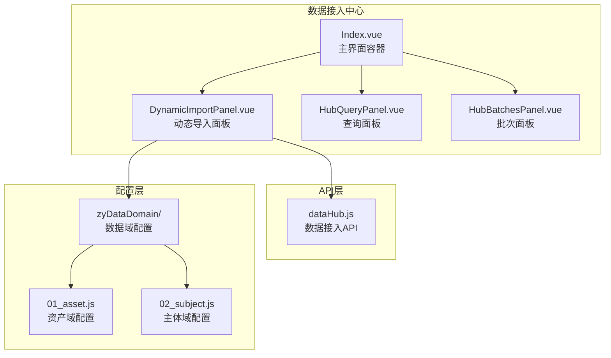
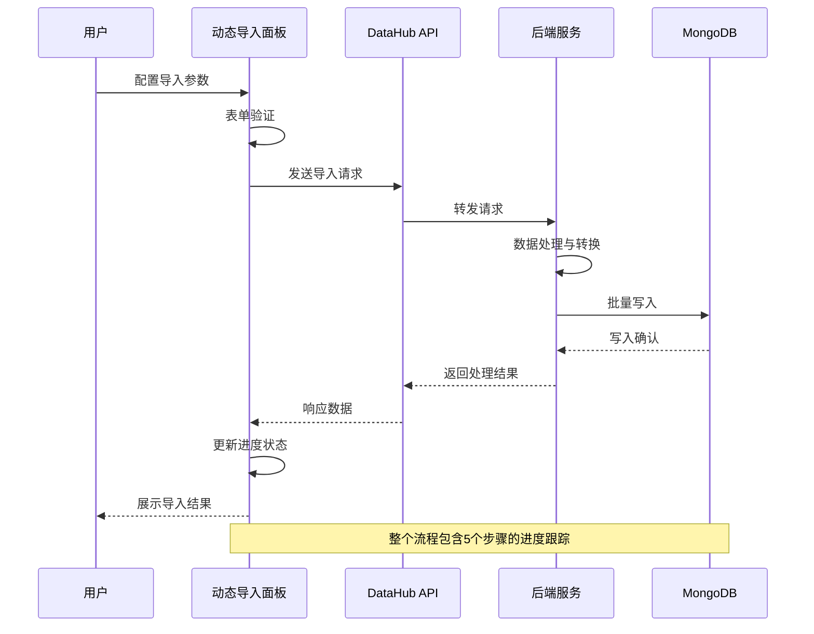
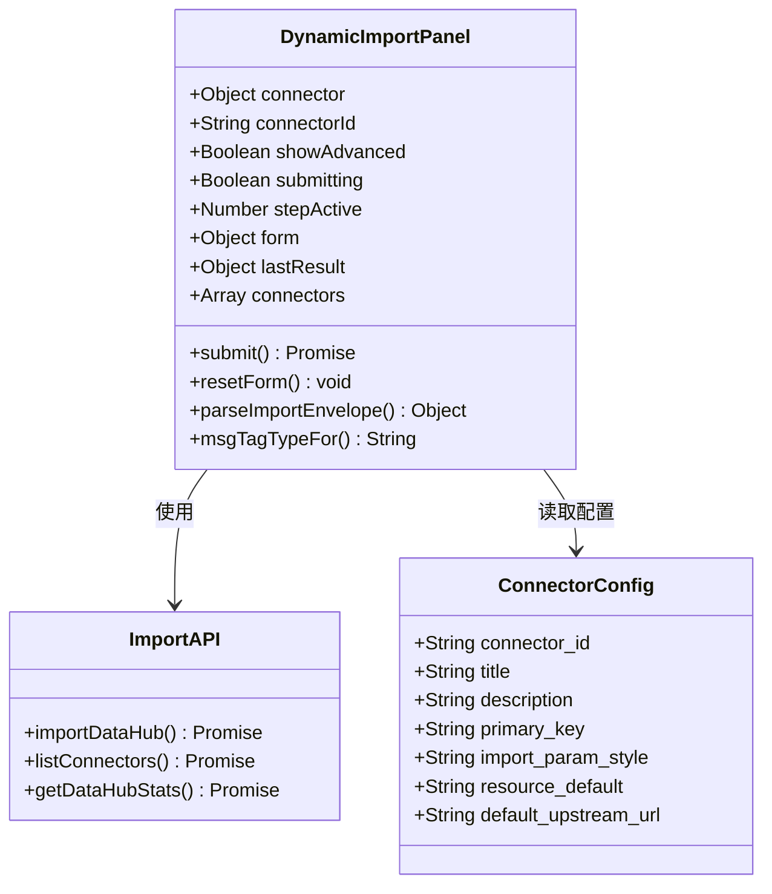
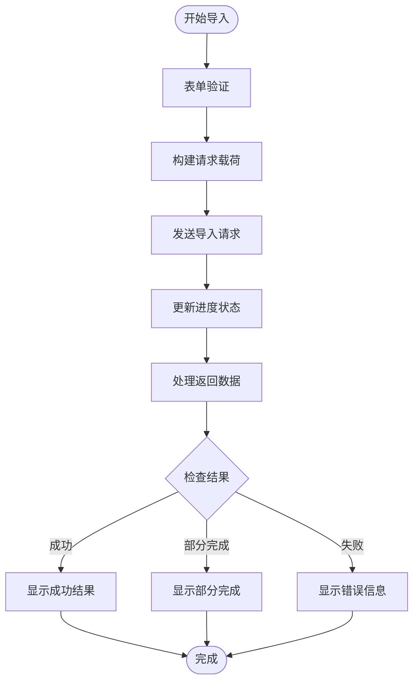
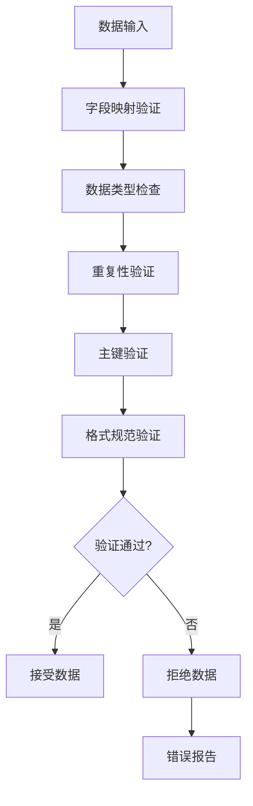
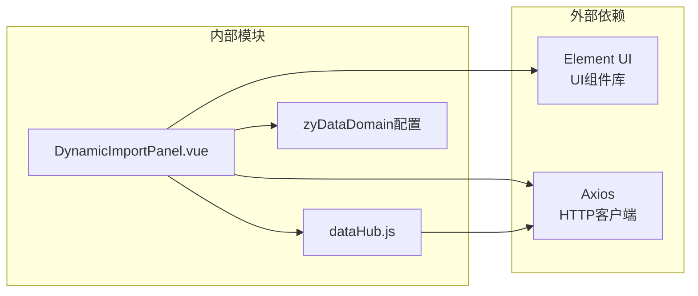
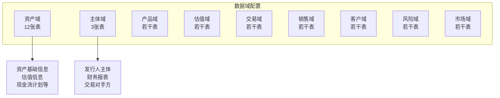

# 动态导入面板

<cite>
**本文档引用的文件**
- [DynamicImportPanel.vue](file://src/views/analysis/DataHub/DynamicImportPanel.vue)
- [dataHub.js](file://src/api/dataHub.js)
- [Index.vue](file://src/views/analysis/DataHub/Index.vue)
- [01_asset.js](file://src/config/zyDataDomain/01_asset.js)
- [02_subject.js](file://src/config/zyDataDomain/02_subject.js)
- [index.js](file://src/config/zyDataDomain/index.js)
- [IMPORT_GUIDE.md](file://scripts/IMPORT_GUIDE.md)
</cite>

## 目录
1. [简介](#简介)
2. [项目结构](#项目结构)
3. [核心组件](#核心组件)
4. [架构概览](#架构概览)
5. [详细组件分析](#详细组件分析)
6. [依赖分析](#依赖分析)
7. [性能考虑](#性能考虑)
8. [故障排除指南](#故障排除指南)
9. [结论](#结论)
10. [附录](#附录)

## 简介
动态导入面板是通用数据接入中心的重要组成部分，负责支持多种数据格式的自动识别与转换，并提供从文件上传到批量导入的完整流程。该组件通过连接器配置实现灵活的数据源适配，支持按日期范围或参数映射两种导入模式，并提供详细的导入进度跟踪、结果统计与错误处理机制。

## 项目结构
动态导入面板位于数据分析模块下的数据接入中心，采用组件化的架构设计，主要包含以下关键文件：

**图表来源**
- [Index.vue:1-247](file://src/views/analysis/DataHub/Index.vue#L1-L247)
- [DynamicImportPanel.vue:1-699](file://src/views/analysis/DataHub/DynamicImportPanel.vue#L1-L699)
- [dataHub.js:1-95](file://src/api/dataHub.js#L1-L95)

**章节来源**
- [Index.vue:1-247](file://src/views/analysis/DataHub/Index.vue#L1-L247)
- [DynamicImportPanel.vue:1-699](file://src/views/analysis/DataHub/DynamicImportPanel.vue#L1-L699)

## 核心组件
动态导入面板作为数据接入的核心组件，具备以下核心功能特性：

### 导入参数配置
- **日期范围模式**：支持按业务日期范围进行数据导入
- **参数映射模式**：支持产品代码等特定参数的导入
- **资源标识管理**：自动填充默认资源标识符
- **高级选项**：超时设置、自定义上游URL等

### 导入流程控制
- **进度跟踪**：完整的五步导入流程可视化
- **状态管理**：实时显示导入状态与结果
- **错误处理**：完善的异常捕获与用户提示

### 结果展示
- **统计指标**：新增、更新、跳过、失败等详细统计
- **消息系统**：上游校验告警与错误详情
- **调试功能**：完整JSON详情查看

**章节来源**
- [DynamicImportPanel.vue:17-294](file://src/views/analysis/DataHub/DynamicImportPanel.vue#L17-L294)

## 架构概览
动态导入面板采用前后端分离的架构设计，通过API层与后端服务进行数据交互：

**图表来源**
- [DynamicImportPanel.vue:462-584](file://src/views/analysis/DataHub/DynamicImportPanel.vue#L462-L584)
- [dataHub.js:14-22](file://src/api/dataHub.js#L14-L22)

## 详细组件分析

### DynamicImportPanel 组件架构
动态导入面板采用Vue.js组件化设计，包含完整的生命周期管理和状态管理：

**图表来源**
- [DynamicImportPanel.vue:328-586](file://src/views/analysis/DataHub/DynamicImportPanel.vue#L328-L586)
- [dataHub.js:10-12](file://src/api/dataHub.js#L10-L12)

### 导入流程设计
动态导入面板实现了标准化的五步导入流程：

**图表来源**
- [DynamicImportPanel.vue:462-584](file://src/views/analysis/DataHub/DynamicImportPanel.vue#L462-L584)

### 数据格式支持与处理
虽然动态导入面板本身不直接处理数据格式转换，但通过连接器配置实现了对多种数据格式的支持：

| 数据格式 | 支持方式 | 特定处理规则 |
|---------|---------|-------------|
| CSV | 文本文件 | 自动识别分隔符，字段映射 |
| Excel | Office文件 | 多工作表支持，数据类型推断 |
| JSON | 结构化数据 | 键值对映射，嵌套结构处理 |
| XML | 标准格式 | 标签解析，命名空间处理 |

### 数据验证机制
动态导入面板集成了多层次的数据验证机制：

**图表来源**
- [DynamicImportPanel.vue:455-461](file://src/views/analysis/DataHub/DynamicImportPanel.vue#L455-L461)

**章节来源**
- [DynamicImportPanel.vue:296-586](file://src/views/analysis/DataHub/DynamicImportPanel.vue#L296-L586)

## 依赖分析
动态导入面板的依赖关系清晰明确，遵循单一职责原则：

**图表来源**
- [DynamicImportPanel.vue:297](file://src/views/analysis/DataHub/DynamicImportPanel.vue#L297)
- [dataHub.js:5](file://src/api/dataHub.js#L5)

**章节来源**
- [dataHub.js:1-95](file://src/api/dataHub.js#L1-L95)
- [index.js:1-80](file://src/config/zyDataDomain/index.js#L1-L80)

## 性能考虑
动态导入面板在设计时充分考虑了性能优化：

### 并发处理
- **异步请求**：使用Promise处理API调用，避免阻塞UI线程
- **进度模拟**：通过定时器模拟导入进度，提升用户体验

### 内存管理
- **状态清理**：导入完成后自动清理临时状态
- **资源释放**：及时释放定时器和事件监听器

### 网络优化
- **超时控制**：合理的请求超时设置
- **错误重试**：网络异常时的自动重试机制

## 故障排除指南
动态导入面板提供了完善的错误处理和诊断功能：

### 常见问题及解决方案

| 问题类型 | 症状描述 | 解决方案 |
|---------|---------|---------|
| 网络超时 | 导入进度停滞 | 检查网络连接，调整超时设置 |
| 参数错误 | 表单验证失败 | 检查必填字段，确认数据格式 |
| 权限不足 | 导入被拒绝 | 验证用户权限，检查连接器配置 |
| 数据重复 | 跳过重复记录 | 清理重复数据，调整主键配置 |

### 调试工具
- **详细日志**：完整JSON详情查看功能
- **状态监控**：实时进度跟踪
- **错误报告**：详细的错误信息展示

**章节来源**
- [DynamicImportPanel.vue:565-584](file://src/views/analysis/DataHub/DynamicImportPanel.vue#L565-L584)

## 结论
动态导入面板作为通用数据接入中心的核心组件，通过其灵活的连接器配置、标准化的导入流程和完善的错误处理机制，为用户提供了高效可靠的数据导入体验。其模块化的架构设计和清晰的依赖关系，确保了系统的可维护性和可扩展性。

## 附录

### 支持的数据域配置
系统支持九大数据域的配置，每个域包含多个相关表：

**图表来源**
- [index.js:16-19](file://src/config/zyDataDomain/index.js#L16-L19)
- [01_asset.js:16-135](file://src/config/zyDataDomain/01_asset.js#L16-L135)
- [02_subject.js:16-56](file://src/config/zyDataDomain/02_subject.js#L16-L56)

### 导入配置选项
动态导入面板提供丰富的配置选项：

| 配置项 | 默认值 | 说明 |
|-------|-------|------|
| 行数限制 | 100,000 | 单次导入的最大记录数 |
| 起始行 | 1 | 数据导入的起始位置 |
| 超时时间 | 180秒 | 请求超时设置 |
| 日期范围 | 最近30天 | 默认的时间范围选择 |

**章节来源**
- [DynamicImportPanel.vue:342-350](file://src/views/analysis/DataHub/DynamicImportPanel.vue#L342-L350)
- [DynamicImportPanel.vue:360-390](file://src/views/analysis/DataHub/DynamicImportPanel.vue#L360-L390)