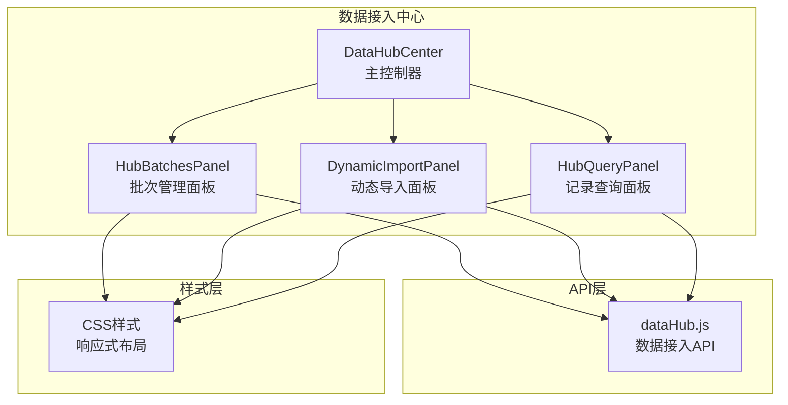
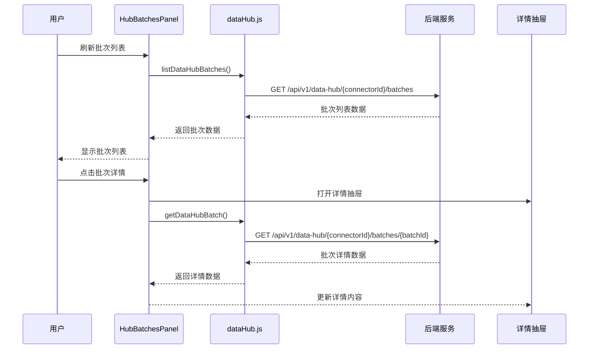
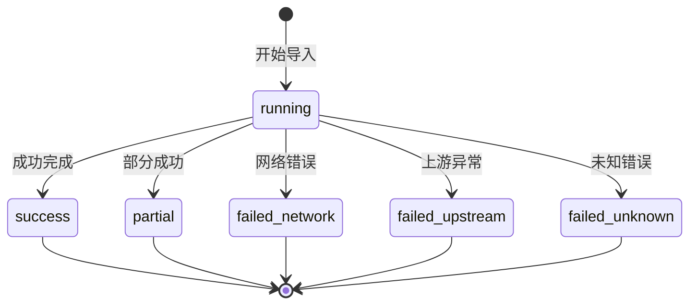
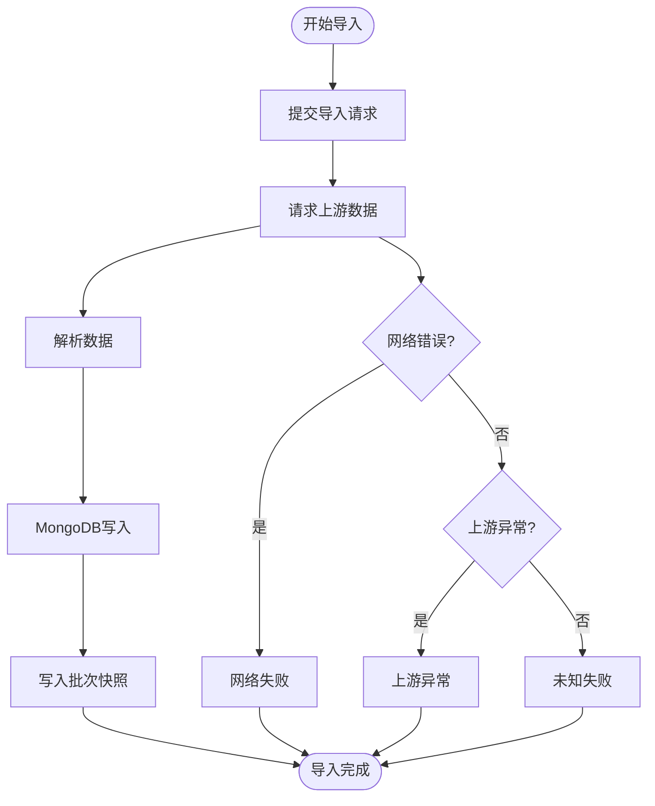
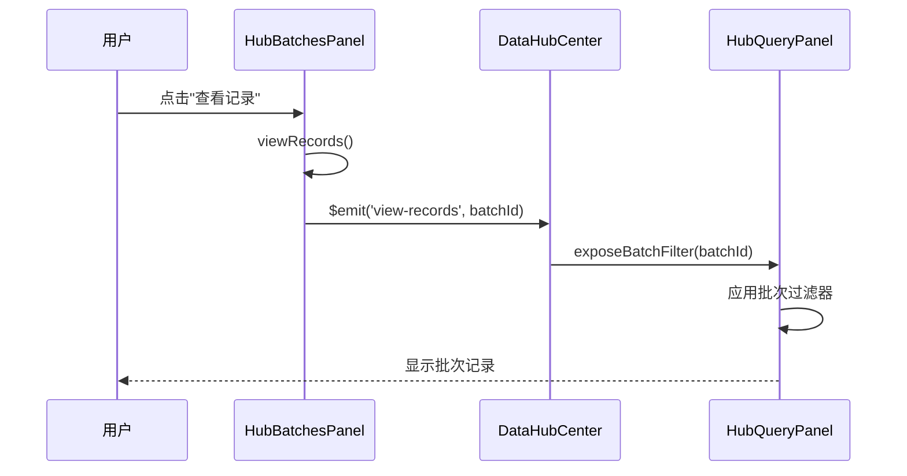
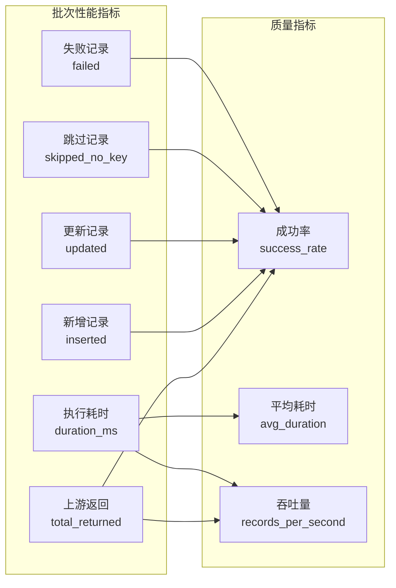
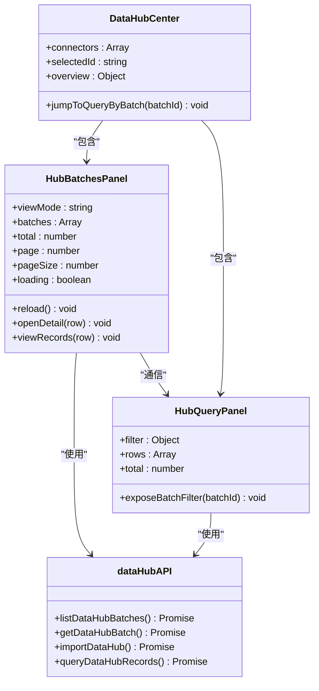

# 批次管理面板

<cite>
**本文档引用的文件**
- [HubBatchesPanel.vue](file://src/views/analysis/DataHub/HubBatchesPanel.vue)
- [dataHub.js](file://src/api/dataHub.js)
- [Index.vue](file://src/views/analysis/DataHub/Index.vue)
- [DynamicImportPanel.vue](file://src/views/analysis/DataHub/DynamicImportPanel.vue)
- [HubQueryPanel.vue](file://src/views/analysis/DataHub/HubQueryPanel.vue)
</cite>

## 目录
1. [简介](#简介)
2. [项目结构](#项目结构)
3. [核心组件](#核心组件)
4. [架构概览](#架构概览)
5. [详细组件分析](#详细组件分析)
6. [依赖关系分析](#依赖关系分析)
7. [性能考虑](#性能考虑)
8. [故障排除指南](#故障排除指南)
9. [结论](#结论)

## 简介

批次管理面板是数据导入系统中的核心组件，负责展示和管理数据导入批次的完整生命周期。该面板提供了直观的界面来监控数据导入状态、查看批次详情、回溯历史记录以及进行统计分析。

本文档将深入介绍HubBatchesPanel组件的功能设计，包括数据导入批次的创建、调度、监控等完整生命周期管理。详细说明批次状态的含义和转换规则，解释批次详情的查看功能，阐述批次回溯和重试机制，并提供批次统计分析功能。

## 项目结构

批次管理面板位于数据分析模块的数据接入中心中，采用Vue.js单文件组件架构：

**图表来源**
- [Index.vue:56-91](file://src/views/analysis/DataHub/Index.vue#L56-L91)
- [HubBatchesPanel.vue:1-345](file://src/views/analysis/DataHub/HubBatchesPanel.vue#L1-L345)

**章节来源**
- [Index.vue:1-247](file://src/views/analysis/DataHub/Index.vue#L1-L247)
- [HubBatchesPanel.vue:1-345](file://src/views/analysis/DataHub/HubBatchesPanel.vue#L1-L345)

## 核心组件

### HubBatchesPanel组件

HubBatchesPanel是批次管理的核心组件，提供了以下主要功能：

#### 主要特性
- **双视图模式**：时间线视图和表格视图，支持灵活的数据展示
- **实时监控**：显示批次状态、执行时间和性能指标
- **详情查看**：提供批次详细信息的抽屉式弹窗
- **记录关联**：支持从批次详情直接跳转到记录查询
- **分页导航**：支持大量批次数据的高效浏览

#### 数据结构
组件接收以下props：
- `connectorId`: String - 连接器标识符（必需）
- `connector`: Object - 连接器配置对象（可选）

内部状态包括：
- `viewMode`: 'timeline' | 'table' - 视图模式
- `batches`: Array - 批次列表数据
- `total`: Number - 总批次数量
- `page`: Number - 当前页码
- `pageSize`: Number - 每页大小
- `loading`: Boolean - 加载状态

**章节来源**
- [HubBatchesPanel.vue:157-269](file://src/views/analysis/DataHub/HubBatchesPanel.vue#L157-L269)

## 架构概览

批次管理面板采用分层架构设计，确保了良好的可维护性和扩展性：

**图表来源**
- [HubBatchesPanel.vue:231-266](file://src/views/analysis/DataHub/HubBatchesPanel.vue#L231-L266)
- [dataHub.js:43-62](file://src/api/dataHub.js#L43-L62)

**章节来源**
- [HubBatchesPanel.vue:145-269](file://src/views/analysis/DataHub/HubBatchesPanel.vue#L145-L269)
- [dataHub.js:1-95](file://src/api/dataHub.js#L1-L95)

## 详细组件分析

### 批次状态管理系统

批次状态是理解数据导入过程的关键指标。系统定义了以下状态类型：

**图表来源**
- [HubBatchesPanel.vue:148-155](file://src/views/analysis/DataHub/HubBatchesPanel.vue#L148-L155)

#### 状态含义详解

| 状态 | 标签 | 类型 | 时间线颜色 | 说明 |
|------|------|------|------------|------|
| `success` | 成功 | success | success | 批次完全成功处理 |
| `partial` | 部分完成 | warning | warning | 部分数据处理成功 |
| `failed_network` | 网络失败 | danger | danger | 网络连接问题导致失败 |
| `failed_upstream` | 上游异常 | danger | danger | 上游服务异常 |
| `failed_unknown` | 未知失败 | danger | danger | 未明确分类的失败 |
| `running` | 进行中 | info | primary | 正在处理中的批次 |

**章节来源**
- [HubBatchesPanel.vue:148-155](file://src/views/analysis/DataHub/HubBatchesPanel.vue#L148-L155)

### 数据导入批次生命周期

批次生命周期涵盖了从创建到完成的完整过程：

**图表来源**
- [DynamicImportPanel.vue:179-185](file://src/views/analysis/DataHub/DynamicImportPanel.vue#L179-L185)

### 批次详情查看功能

批次详情抽屉提供了全面的批次信息展示：

#### 关键指标展示

| 指标类别 | 字段名 | 描述 | 显示格式 |
|----------|--------|------|----------|
| 基本信息 | `batch_id` | 批次唯一标识 | 完整ID |
| 时间信息 | `started_at` | 开始时间 | yyyy-MM-dd HH:mm:ss |
| 时间信息 | `finished_at` | 结束时间 | yyyy-MM-dd HH:mm:ss |
| 时间信息 | `duration_ms` | 执行耗时 | mm:ss.ms |
| 上游信息 | `upstream_code` | 上游返回码 | 数字或文本 |
| 上游信息 | `upstream_url` | 上游请求URL | 完整URL |
| 数据统计 | `total_returned` | 上游返回记录数 | 数字 |
| 数据统计 | `inserted` | 新增记录数 | 数字（绿色） |
| 数据统计 | `updated` | 更新记录数 | 数字（蓝色） |
| 数据统计 | `skipped_no_key` | 跳过记录数 | 数字（橙色） |
| 数据统计 | `failed` | 失败记录数 | 数字（红色） |
| 消息信息 | `msg_list` | 告警消息列表 | 多条消息 |
| 错误信息 | `error` | 批次级错误 | 文本 |

**章节来源**
- [HubBatchesPanel.vue:88-141](file://src/views/analysis/DataHub/HubBatchesPanel.vue#L88-L141)

### 批次回溯和重试机制

#### 回溯功能实现

批次回溯允许用户查看特定批次的所有导入记录：

**图表来源**
- [HubBatchesPanel.vue:261-266](file://src/views/analysis/DataHub/HubBatchesPanel.vue#L261-L266)
- [Index.vue:189-195](file://src/views/analysis/DataHub/Index.vue#L189-L195)

#### 重试机制设计

虽然当前版本未实现自动重试功能，但系统提供了完整的重试基础设施：

1. **批次状态保留**：失败批次的状态信息完整保存
2. **参数保留**：导入参数和条件完整保留
3. **记录关联**：失败记录与批次的关联关系保持
4. **UI支持**：提供清晰的错误信息和重试提示

**章节来源**
- [HubBatchesPanel.vue:261-266](file://src/views/analysis/DataHub/HubBatchesPanel.vue#L261-L266)
- [Index.vue:189-195](file://src/views/analysis/DataHub/Index.vue#L189-L195)

### 批次统计分析功能

#### 总体统计概览

数据接入中心提供了全局的批次统计信息：

| 统计指标 | 字段名 | 描述 |
|----------|--------|------|
| 记录总数 | `total_records` | 当前连接器的总记录数 |
| 批次总数 | `total_batches` | 当前连接器的总批次数 |
| 最近批次 | `latest_batch` | 最新批次的详细信息 |
| 最近批次状态 | `latest_batch.status` | 最新批次的状态标签 |
| 最近批次时间 | `latest_batch.started_at` | 最新批次的开始时间 |

#### 批次性能指标

系统提供了多维度的性能监控指标：

**图表来源**
- [HubBatchesPanel.vue:35-42](file://src/views/analysis/DataHub/HubBatchesPanel.vue#L35-L42)
- [Index.vue:31-53](file://src/views/analysis/DataHub/Index.vue#L31-L53)

**章节来源**
- [Index.vue:31-53](file://src/views/analysis/DataHub/Index.vue#L31-L53)
- [HubBatchesPanel.vue:35-42](file://src/views/analysis/DataHub/HubBatchesPanel.vue#L35-L42)

## 依赖关系分析

### 组件间依赖关系

**图表来源**
- [HubBatchesPanel.vue:157-269](file://src/views/analysis/DataHub/HubBatchesPanel.vue#L157-L269)
- [Index.vue:96-197](file://src/views/analysis/DataHub/Index.vue#L96-L197)
- [dataHub.js:1-95](file://src/api/dataHub.js#L1-L95)

### API接口依赖

批次管理面板依赖以下核心API接口：

| 接口名称 | 方法 | URL | 功能描述 |
|----------|------|-----|----------|
| `listDataHubBatches` | GET | `/api/v1/data-hub/{connectorId}/batches` | 获取批次列表 |
| `getDataHubBatch` | GET | `/api/v1/data-hub/{connectorId}/batches/{batchId}` | 获取批次详情 |
| `importDataHub` | POST | `/api/v1/data-hub/{connectorId}/import` | 触发数据导入 |
| `queryDataHubRecords` | POST | `/api/v1/data-hub/{connectorId}/records` | 查询批次记录 |

**章节来源**
- [dataHub.js:43-62](file://src/api/dataHub.js#L43-L62)
- [HubBatchesPanel.vue:146](file://src/views/analysis/DataHub/HubBatchesPanel.vue#L146)

## 性能考虑

### 分页加载优化

系统采用了分页加载策略来处理大量批次数据：

- **默认每页20条记录**
- **支持10/20/50条记录切换**
- **懒加载避免一次性渲染大量DOM元素**

### 缓存策略

- **批次详情缓存**：打开详情后缓存数据，避免重复请求
- **视图状态保持**：切换视图模式时不重新加载数据
- **连接器配置缓存**：连接器列表数据缓存减少API调用

### 响应式设计

- **自适应布局**：支持不同屏幕尺寸的设备
- **虚拟滚动**：表格组件支持大数据集的虚拟滚动
- **异步加载**：所有数据请求都是异步处理

## 故障排除指南

### 常见问题及解决方案

#### 批次列表为空

**症状**：批次列表显示"暂无导入批次"

**可能原因**：
1. 连接器尚未创建任何批次
2. 网络请求失败
3. 权限不足

**解决方法**：
1. 确认连接器配置正确
2. 检查网络连接状态
3. 验证用户权限设置

#### 批次详情加载失败

**症状**：点击批次详情后无法显示详细信息

**可能原因**：
1. 批次ID无效
2. 后端服务异常
3. 网络超时

**解决方法**：
1. 刷新页面重试
2. 检查后端服务状态
3. 增加请求超时时间

#### 状态显示异常

**症状**：批次状态显示不正确或颜色异常

**可能原因**：
1. 后端状态值异常
2. 前端状态映射配置错误
3. 数据同步延迟

**解决方法**：
1. 检查后端状态值格式
2. 验证前端状态映射表
3. 等待数据同步完成

**章节来源**
- [HubBatchesPanel.vue:231-266](file://src/views/analysis/DataHub/HubBatchesPanel.vue#L231-L266)

### 调试工具

#### 开发者工具

1. **浏览器开发者工具**：检查网络请求和响应
2. **Vue DevTools**：调试Vue组件状态
3. **Console日志**：查看错误信息和警告

#### 日志监控

- **API请求日志**：记录所有HTTP请求
- **组件状态日志**：跟踪组件状态变化
- **错误捕获**：统一处理和记录异常

## 结论

批次管理面板作为数据导入系统的核心组件，提供了完整的批次生命周期管理功能。通过直观的界面设计和强大的功能特性，用户可以有效地监控数据导入状态、分析导入性能并进行故障排查。

系统的主要优势包括：

1. **完整的生命周期管理**：从创建到完成的全流程监控
2. **灵活的视图模式**：支持时间线和表格两种展示方式
3. **丰富的统计分析**：提供多维度的性能指标
4. **完善的错误处理**：清晰的状态指示和错误信息
5. **良好的用户体验**：响应式设计和流畅的交互体验

未来可以考虑的功能增强包括：
- 自动重试机制
- 批量操作功能
- 更详细的性能分析报告
- 批次模板和预设配置