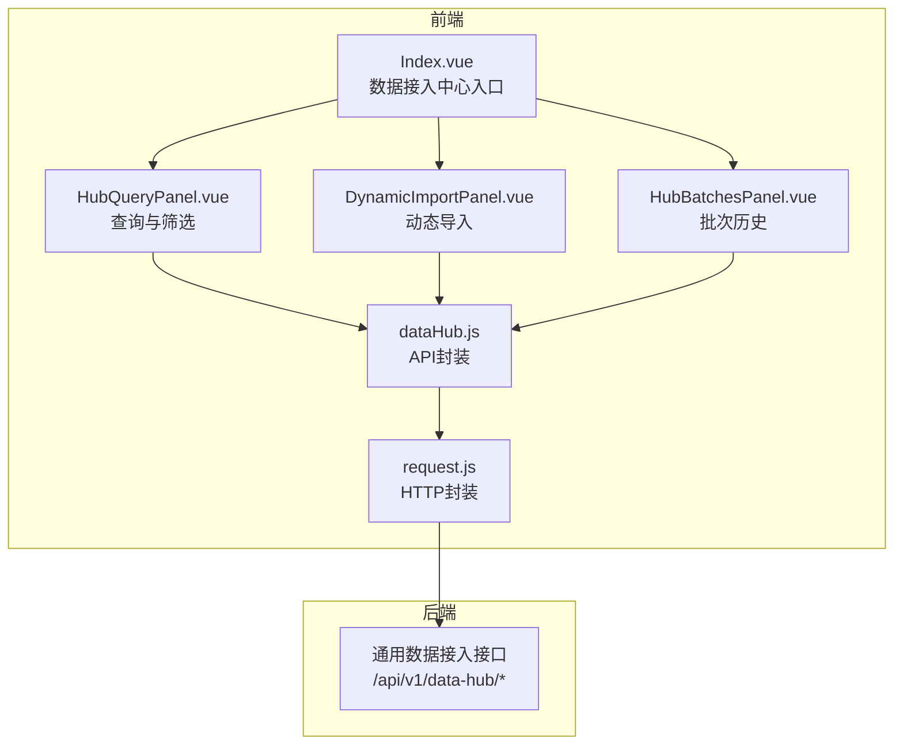
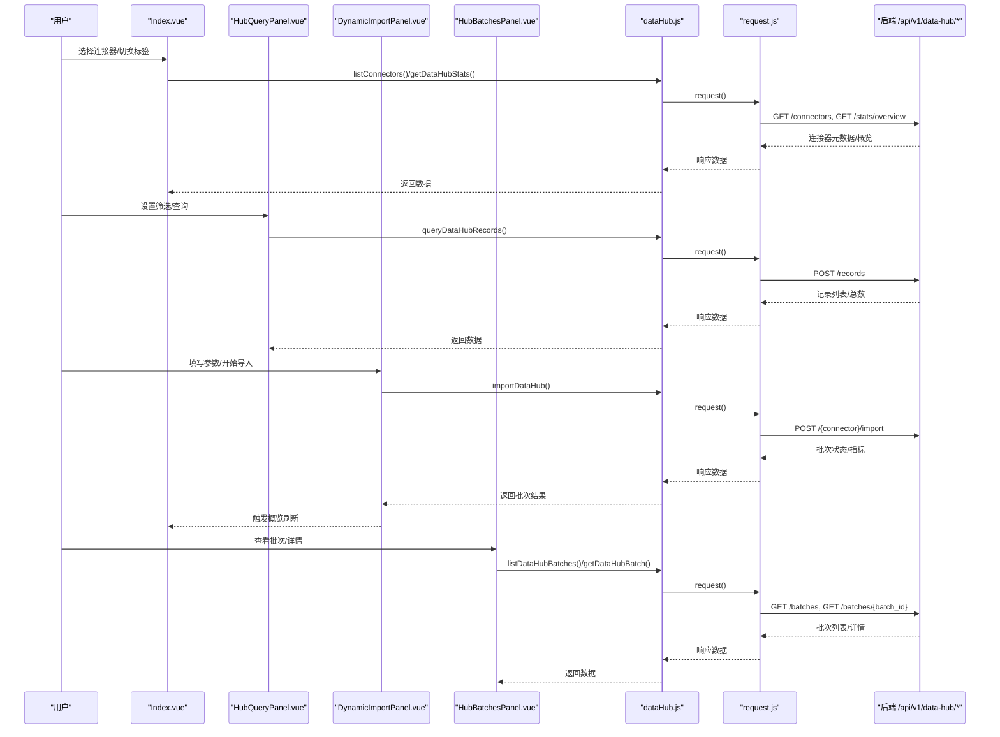
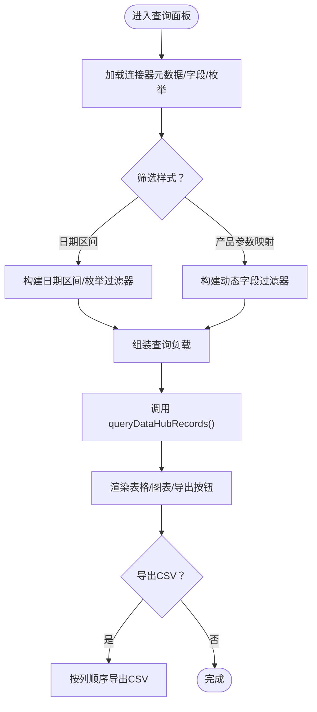
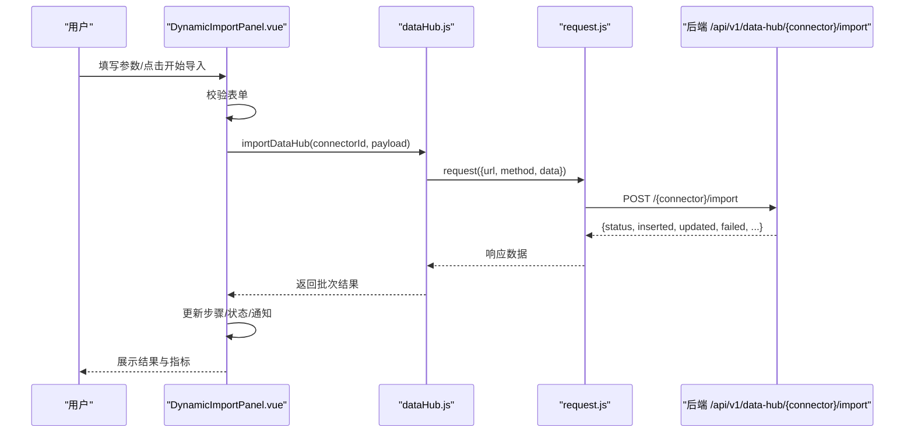
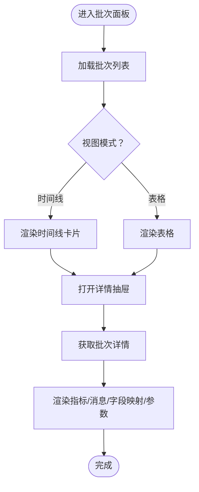
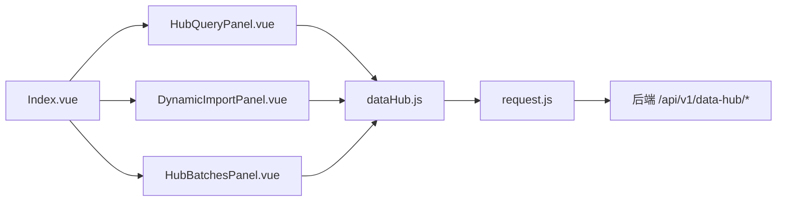

# 数据接入中心

<cite>
**本文引用的文件**
- [Index.vue](file://src/views/analysis/DataHub/Index.vue)
- [HubQueryPanel.vue](file://src/views/analysis/DataHub/HubQueryPanel.vue)
- [DynamicImportPanel.vue](file://src/views/analysis/DataHub/DynamicImportPanel.vue)
- [HubBatchesPanel.vue](file://src/views/analysis/DataHub/HubBatchesPanel.vue)
- [dataHub.js](file://src/api/dataHub.js)
- [request.js](file://src/utils/request.js)
- [index.js](file://src/config/zyDataDomain/index.js)
- [01_asset.js](file://src/config/zyDataDomain/01_asset.js)
- [02_subject.js](file://src/config/zyDataDomain/02_subject.js)
- [03_product.js](file://src/config/zyDataDomain/03_product.js)
- [ZY_DATA_API_INTEGRATION_GUIDE.md](file://docs/ZY_DATA_API_INTEGRATION_GUIDE.md)
- [ZY_DATA_DOMAIN_MOCK_IMPORT_GUIDE.md](file://docs/ZY_DATA_DOMAIN_MOCK_IMPORT_GUIDE.md)
- [README.md](file://README.md)
</cite>

## 目录
1. [简介](#简介)
2. [项目结构](#项目结构)
3. [核心组件](#核心组件)
4. [架构总览](#架构总览)
5. [详细组件分析](#详细组件分析)
6. [依赖关系分析](#依赖关系分析)
7. [性能考量](#性能考量)
8. [故障排查指南](#故障排查指南)
9. [结论](#结论)
10. [附录](#附录)

## 简介
数据接入中心是前端分析模块中的统一数据接入与管理入口，围绕“连接器”概念组织数据源，提供三大能力：
- 数据源管理：枚举与切换后端注册的连接器，动态加载其元数据与 UI 配置
- 批量数据处理：发起导入任务，跟踪批次状态，支持参数化导入（日期区间/产品参数）
- 动态导入面板：根据连接器样式自动渲染参数表单，支持日期区间或产品参数两类导入模式
- 记录查询与可视化：支持关键字、枚举、日期范围等多维筛选，分页与导出，图表概览
- 批次历史与监控：时间线/表格双视图，查看批次详情、上游消息与指标

此外，系统通过 API 层对接后端通用数据接入接口，支持连接器元数据、记录查询、批次列表与详情、字段与去重枚举等能力。

## 项目结构
数据接入中心位于分析模块的 DataHub 目录，核心文件如下：
- 入口页：Index.vue
- 查询面板：HubQueryPanel.vue
- 动态导入面板：DynamicImportPanel.vue
- 批次管理：HubBatchesPanel.vue
- API 封装：dataHub.js
- HTTP 请求封装：request.js
- 数据域配置：config/zyDataDomain/*（用于理解数据域与字段）

图表来源
- [Index.vue:1-247](file://src/views/analysis/DataHub/Index.vue#L1-L247)
- [HubQueryPanel.vue:1-697](file://src/views/analysis/DataHub/HubQueryPanel.vue#L1-L697)
- [DynamicImportPanel.vue:1-699](file://src/views/analysis/DataHub/DynamicImportPanel.vue#L1-L699)
- [HubBatchesPanel.vue:1-345](file://src/views/analysis/DataHub/HubBatchesPanel.vue#L1-L345)
- [dataHub.js:1-95](file://src/api/dataHub.js#L1-L95)
- [request.js:1-100](file://src/utils/request.js#L1-L100)

章节来源
- [Index.vue:1-247](file://src/views/analysis/DataHub/Index.vue#L1-L247)
- [README.md:1-317](file://README.md#L1-L317)

## 核心组件
- 数据接入中心入口（Index.vue）
  - 加载连接器列表，支持按路由参数预选连接器
  - 顶部概览统计：记录数、导入批次、最近批次状态
  - 三个标签页：数据导入、记录查询、批次历史
- 查询面板（HubQueryPanel.vue）
  - 两套筛选样式：日期区间（默认）、产品参数映射（ptl_param_maps）
  - 关键字、枚举、日期范围、动态字段等多维筛选
  - 记录列表、分页、导出 CSV、图表概览、详情抽屉
- 动态导入面板（DynamicImportPanel.vue）
  - 根据连接器样式渲染参数表单（日期区间或产品参数）
  - 高级选项：超时、自定义上游 URL
  - 步骤化进度：提交请求→请求上游→解析数据→写入 Mongo→完成
  - 结果展示：状态标签、指标、上游消息、告警与样例失败
- 批次管理（HubBatchesPanel.vue）
  - 时间线/表格双视图
  - 批次状态、参数、指标、耗时、错误与上游消息
  - 打开详情抽屉查看参数、字段映射、样例失败等

章节来源
- [Index.vue:1-247](file://src/views/analysis/DataHub/Index.vue#L1-L247)
- [HubQueryPanel.vue:1-697](file://src/views/analysis/DataHub/HubQueryPanel.vue#L1-L697)
- [DynamicImportPanel.vue:1-699](file://src/views/analysis/DataHub/DynamicImportPanel.vue#L1-L699)
- [HubBatchesPanel.vue:1-345](file://src/views/analysis/DataHub/HubBatchesPanel.vue#L1-L345)

## 架构总览
数据接入中心通过 API 层与后端交互，后端提供统一的“连接器”抽象，前端据此动态渲染导入与查询界面，并支持字段元数据、图表提示、去重枚举等能力。

图表来源
- [dataHub.js:1-95](file://src/api/dataHub.js#L1-L95)
- [request.js:1-100](file://src/utils/request.js#L1-L100)
- [Index.vue:1-247](file://src/views/analysis/DataHub/Index.vue#L1-L247)
- [HubQueryPanel.vue:1-697](file://src/views/analysis/DataHub/HubQueryPanel.vue#L1-L697)
- [DynamicImportPanel.vue:1-699](file://src/views/analysis/DataHub/DynamicImportPanel.vue#L1-L699)
- [HubBatchesPanel.vue:1-345](file://src/views/analysis/DataHub/HubBatchesPanel.vue#L1-L345)

## 详细组件分析

### 数据接入中心入口（Index.vue）
- 负责加载连接器列表，支持路由参数预选连接器
- 顶部概览统计：记录数、导入批次、最近批次状态（带时间）
- 三个标签页：
  - 数据导入：动态导入面板
  - 记录查询：查询面板
  - 批次历史：批次面板
- 切换连接器时刷新概览；导入完成后刷新概览；从批次跳转到查询时自动应用批次筛选

章节来源
- [Index.vue:1-247](file://src/views/analysis/DataHub/Index.vue#L1-L247)

### 查询面板（HubQueryPanel.vue）
- 两大筛选样式：
  - 日期区间（默认）：关键字、风险等级、省份、企业性质、统一信用代码、业务日期范围
  - 产品参数映射（ptl_param_maps）：根据连接器 ui_filter_fields 动态渲染多字段筛选（文本/枚举/枚举多选/日期范围）
- 关键功能：
  - 构建查询负载：分页、排序（默认按导入时间倒序）、关键字、过滤器数组
  - 动态列展示：根据连接器 column_display_priority 或内置优先级决定列顺序
  - 导出当前页 CSV：按约定列顺序导出
  - 图表概览：根据 overview.charts 渲染
  - 详情抽屉：展示完整记录 JSON
  - 批次筛选：支持通过外部传入 batch_id 并提供清除按钮

图表来源
- [HubQueryPanel.vue:1-697](file://src/views/analysis/DataHub/HubQueryPanel.vue#L1-L697)
- [dataHub.js:24-32](file://src/api/dataHub.js#L24-L32)

章节来源
- [HubQueryPanel.vue:1-697](file://src/views/analysis/DataHub/HubQueryPanel.vue#L1-L697)
- [dataHub.js:24-32](file://src/api/dataHub.js#L24-L32)

### 动态导入面板（DynamicImportPanel.vue）
- 两大导入样式：
  - 日期区间：起始/结束日期、最大行数、起始行
  - 产品参数映射：产品代码（PROD_CDS）、最大行数、起始行
- 高级选项：超时、自定义上游 URL
- 步骤化进度：提交请求→请求上游→解析数据→写入 Mongo→完成
- 结果展示：状态标签、新增/更新/跳过/失败/告警数、上游 pageMsg、错误与样例失败
- 行为：
  - 表单校验：按样式选择规则
  - 构造 payload：根据样式拼装参数
  - 调用 importDataHub()，解析响应 envelope
  - 根据状态更新步骤与通知，触发父组件概览刷新

图表来源
- [DynamicImportPanel.vue:1-699](file://src/views/analysis/DataHub/DynamicImportPanel.vue#L1-L699)
- [dataHub.js:14-22](file://src/api/dataHub.js#L14-L22)
- [request.js:1-100](file://src/utils/request.js#L1-L100)

章节来源
- [DynamicImportPanel.vue:1-699](file://src/views/analysis/DataHub/DynamicImportPanel.vue#L1-L699)
- [dataHub.js:14-22](file://src/api/dataHub.js#L14-L22)

### 批次管理（HubBatchesPanel.vue）
- 视图：时间线/表格双视图
- 列表：状态、日期区间/参数、返回/新增/更新/跳过/失败、耗时、批次 ID
- 详情：连接器、状态、批次 ID、开始/结束时间、耗时、上游 code、参数、上游 URL、指标、上游 message、msg_list、样例失败、字段映射、请求参数、错误
- 行为：分页加载、打开详情抽屉、查看该批次记录

图表来源
- [HubBatchesPanel.vue:1-345](file://src/views/analysis/DataHub/HubBatchesPanel.vue#L1-L345)
- [dataHub.js:43-62](file://src/api/dataHub.js#L43-L62)

章节来源
- [HubBatchesPanel.vue:1-345](file://src/views/analysis/DataHub/HubBatchesPanel.vue#L1-L345)
- [dataHub.js:43-62](file://src/api/dataHub.js#L43-L62)

### 数据域配置（用于理解字段与主键）
- 数据域聚合入口：index.js
- 资产域、主体域、产品域等 schema 定义，包含表名、主键、字段定义与枚举选项
- 用于理解查询字段、主键、以及连接器样式（如产品域常见字段）

章节来源
- [index.js:1-80](file://src/config/zyDataDomain/index.js#L1-L80)
- [01_asset.js:1-137](file://src/config/zyDataDomain/01_asset.js#L1-L137)
- [02_subject.js:1-59](file://src/config/zyDataDomain/02_subject.js#L1-L59)
- [03_product.js:1-136](file://src/config/zyDataDomain/03_product.js#L1-L136)

## 依赖关系分析
- 组件耦合
  - Index.vue 作为中枢，依赖三个子面板组件，并与 API 层交互
  - Query/Import/Batch 三个面板各自独立，通过 API 封装与后端通信
- 外部依赖
  - request.js 提供统一的 HTTP 封装与错误处理
  - 后端接口契约：/api/v1/data-hub/connectors、/connectors/{id}/import、/connectors/{id}/records、/connectors/{id}/batches、/connectors/{id}/stats/overview、/connectors/{id}/fields、/connectors/{id}/distinct
- 数据流向
  - 连接器元数据 → 动态渲染导入/查询表单
  - 查询/导入请求 → 后端执行 → 返回批次/记录/统计
  - 批次详情 → 字段映射/消息/样例失败

图表来源
- [Index.vue:1-247](file://src/views/analysis/DataHub/Index.vue#L1-L247)
- [dataHub.js:1-95](file://src/api/dataHub.js#L1-L95)
- [request.js:1-100](file://src/utils/request.js#L1-L100)

章节来源
- [dataHub.js:1-95](file://src/api/dataHub.js#L1-L95)
- [request.js:1-100](file://src/utils/request.js#L1-L100)

## 性能考量
- 分页与排序
  - 查询默认按导入时间倒序，避免全量扫描
  - 分页大小可选 20/50/100/200，建议在大数据集场景下优先使用较小页
- 导入超时与并发
  - 导入请求默认超时较长（300 秒），可根据数据量调整
  - 导入步骤动画每 700ms 推进一步，避免阻塞 UI
- 前端渲染
  - 动态列与字段枚举异步加载，避免首屏阻塞
  - 表格高度固定，配合分页减少 DOM 体量
- 后端优化建议（来自文档）
  - 为常用查询字段建立索引
  - 使用游标分页替代 skip/limit
  - 对热点集合添加缓存

章节来源
- [HubQueryPanel.vue:515-526](file://src/views/analysis/DataHub/HubQueryPanel.vue#L515-L526)
- [DynamicImportPanel.vue:508-510](file://src/views/analysis/DataHub/DynamicImportPanel.vue#L508-L510)
- [ZY_DATA_API_INTEGRATION_GUIDE.md:374-418](file://docs/ZY_DATA_API_INTEGRATION_GUIDE.md#L374-L418)

## 故障排查指南
- 导入失败
  - 状态为 failed_network/failed_upstream/failed_unknown：检查网络与上游服务
  - 查看“本次结果”中的错误详情与样例失败
  - 若存在上游 pageMsg，结合提示定位问题
- 查询无数据
  - 确认连接器样式与筛选条件匹配（日期区间 vs 产品参数映射）
  - 检查关键字与枚举值是否正确
  - 使用“导出当前页 CSV”验证查询结果
- 批次异常
  - 查看批次详情中的上游 message、msg_list、样例失败
  - 检查参数映射与字段映射（ind_name_list）
- 网络与超时
  - request.js 已对超时/网络错误给出明确提示
  - 建议缩小日期范围或降低行数，避免长时间请求

章节来源
- [DynamicImportPanel.vue:554-562](file://src/views/analysis/DataHub/DynamicImportPanel.vue#L554-L562)
- [HubBatchesPanel.vue:246-259](file://src/views/analysis/DataHub/HubBatchesPanel.vue#L246-L259)
- [request.js:65-96](file://src/utils/request.js#L65-L96)

## 结论
数据接入中心通过“连接器”抽象，将后端数据源能力以统一接口暴露给前端，实现了：
- 动态导入：按连接器样式自动渲染参数表单，支持日期区间与产品参数两类导入
- 记录查询：多维筛选、分页、导出、图表概览
- 批次管理：时间线/表格双视图，详情透传上游消息与字段映射
- 与后端 API 契约清晰，便于扩展新的连接器与数据域

建议在生产环境中：
- 为高频查询字段建立索引
- 使用游标分页与缓存优化
- 严格区分日期区间与产品参数两类导入的参数校验与默认值
- 建立完善的错误监控与告警机制

## 附录

### API 接口说明与使用示例
- 列出连接器
  - 方法：GET
  - 路径：/api/v1/data-hub/connectors
  - 用途：加载连接器列表，动态渲染导入/查询界面
- 导入数据
  - 方法：POST
  - 路径：/api/v1/data-hub/{connectorId}/import
  - 负载：日期区间样式（startDate, endDate, rownum, startrow, resource, timeout[, upstream_url]）或产品参数样式（PROD_CDS, rownum, startrow, resource, timeout[, upstream_url]）
  - 返回：批次状态与指标
- 查询记录
  - 方法：POST
  - 路径：/api/v1/data-hub/{connectorId}/records
  - 负载：page, page_size, sort_by, sort_desc, keyword, filters
  - 返回：items, total
- 获取记录详情
  - 方法：GET
  - 路径：/api/v1/data-hub/{connectorId}/records/{pk}
- 列出批次
  - 方法：GET
  - 路径：/api/v1/data-hub/{connectorId}/batches
  - 参数：page, page_size
- 获取批次详情
  - 方法：GET
  - 路径：/api/v1/data-hub/{connectorId}/batches/{batchId}
- 获取概览统计
  - 方法：GET
  - 路径：/api/v1/data-hub/{connectorId}/stats/overview
- 获取字段元数据
  - 方法：GET
  - 路径：/api/v1/data-hub/{connectorId}/fields
- 获取去重枚举
  - 方法：GET
  - 路径：/api/v1/data-hub/{connectorId}/distinct?field={field}&limit={limit}

章节来源
- [dataHub.js:9-95](file://src/api/dataHub.js#L9-L95)

### 使用示例（路径参考）
- 导入数据（日期区间样式）
  - 路径：[DynamicImportPanel.vue:471-498](file://src/views/analysis/DataHub/DynamicImportPanel.vue#L471-L498)
  - API：[dataHub.js:14-22](file://src/api/dataHub.js#L14-L22)
- 导入数据（产品参数样式）
  - 路径：[DynamicImportPanel.vue:471-481](file://src/views/analysis/DataHub/DynamicImportPanel.vue#L471-L481)
  - API：[dataHub.js:14-22](file://src/api/dataHub.js#L14-L22)
- 查询记录
  - 路径：[HubQueryPanel.vue:515-532](file://src/views/analysis/DataHub/HubQueryPanel.vue#L515-L532)
  - API：[dataHub.js:24-32](file://src/api/dataHub.js#L24-L32)
- 列出批次
  - 路径：[HubBatchesPanel.vue:235-238](file://src/views/analysis/DataHub/HubBatchesPanel.vue#L235-L238)
  - API：[dataHub.js:43-52](file://src/api/dataHub.js#L43-L52)
- 获取批次详情
  - 路径：[HubBatchesPanel.vue:252-254](file://src/views/analysis/DataHub/HubBatchesPanel.vue#L252-L254)
  - API：[dataHub.js:55-61](file://src/api/dataHub.js#L55-L61)

### 最佳实践
- 数据质量控制
  - 导入前校验必填字段与主键（连接器 primary_key）
  - 关注上游 pageMsg 与 msg_list，及时处理告警
  - 使用“样例失败”定位具体记录
- 错误处理
  - 失败状态分类明确：网络失败、上游异常、未知失败
  - 通过详情抽屉查看错误与字段映射
- 性能优化
  - 合理设置 rownum 与 startrow，避免一次性导入过多
  - 使用日期区间缩小数据范围
  - 后端建立索引与缓存，前端使用分页与固定高度表格

章节来源
- [ZY_DATA_API_INTEGRATION_GUIDE.md:374-418](file://docs/ZY_DATA_API_INTEGRATION_GUIDE.md#L374-L418)
- [ZY_DATA_DOMAIN_MOCK_IMPORT_GUIDE.md:307-334](file://docs/ZY_DATA_DOMAIN_MOCK_IMPORT_GUIDE.md#L307-L334)