# 查询面板

<cite>
**本文档引用的文件**
- [HubQueryPanel.vue](file://src/views/analysis/DataHub/HubQueryPanel.vue)
- [dataHub.js](file://src/api/dataHub.js)
- [Index.vue](file://src/views/analysis/DataHub/Index.vue)
- [ChartGrid.vue](file://src/views/analysis/DataHub/ChartGrid.vue)
- [HubBatchesPanel.vue](file://src/views/analysis/DataHub/HubBatchesPanel.vue)
- [DynamicImportPanel.vue](file://src/views/analysis/DataHub/DynamicImportPanel.vue)
- [request.js](file://src/utils/request.js)
- [router/index.js](file://src/router/index.js)
- [MainLayout.vue](file://src/layout/MainLayout.vue)
- [store/index.js](file://src/store/index.js)
</cite>

## 目录
1. [简介](#简介)
2. [项目结构](#项目结构)
3. [核心组件](#核心组件)
4. [架构概览](#架构概览)
5. [详细组件分析](#详细组件分析)
6. [查询功能详解](#查询功能详解)
7. [界面布局与交互](#界面布局与交互)
8. [查询条件构建](#查询条件构建)
9. [结果集展示](#结果集展示)
10. [性能考虑](#性能考虑)
11. [故障排除指南](#故障排除指南)
12. [结论](#结论)

## 简介

查询面板是智能投研系统中数据接入中心的核心组件，用于对各类数据源进行高级查询、筛选和分析。该组件提供了强大的数据检索能力，支持多种查询模式、动态过滤器、分页浏览和结果导出功能。

查询面板主要服务于以下场景：
- 数据记录的条件筛选和高级查询
- 批次数据的回溯和管理
- 实时统计图表的展示
- 数据导出和分析
- 多维度的数据探索

## 项目结构

查询面板位于数据分析模块的DataHub子系统中，采用模块化设计，包含多个相互协作的组件：

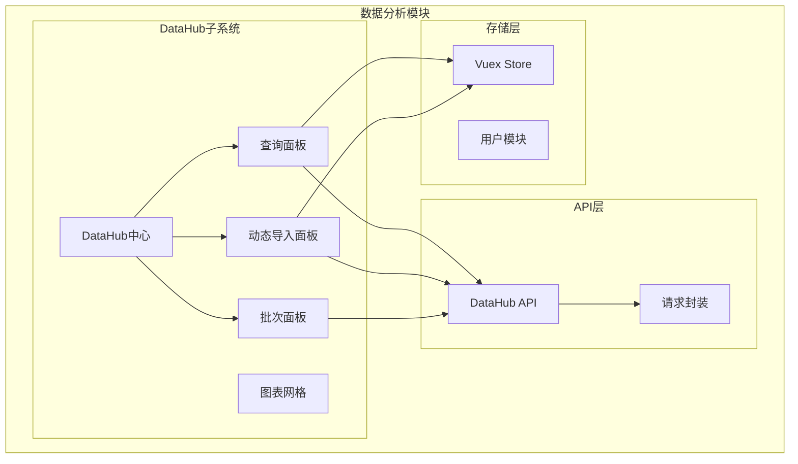

**图表来源**
- [Index.vue:1-247](file://src/views/analysis/DataHub/Index.vue#L1-L247)
- [HubQueryPanel.vue:199-654](file://src/views/analysis/DataHub/HubQueryPanel.vue#L199-L654)
- [dataHub.js:1-95](file://src/api/dataHub.js#L1-L95)

**章节来源**
- [Index.vue:1-247](file://src/views/analysis/DataHub/Index.vue#L1-L247)
- [router/index.js:220-224](file://src/router/index.js#L220-L224)

## 核心组件

查询面板系统由多个核心组件构成，每个组件都有特定的功能职责：

### 主要组件架构

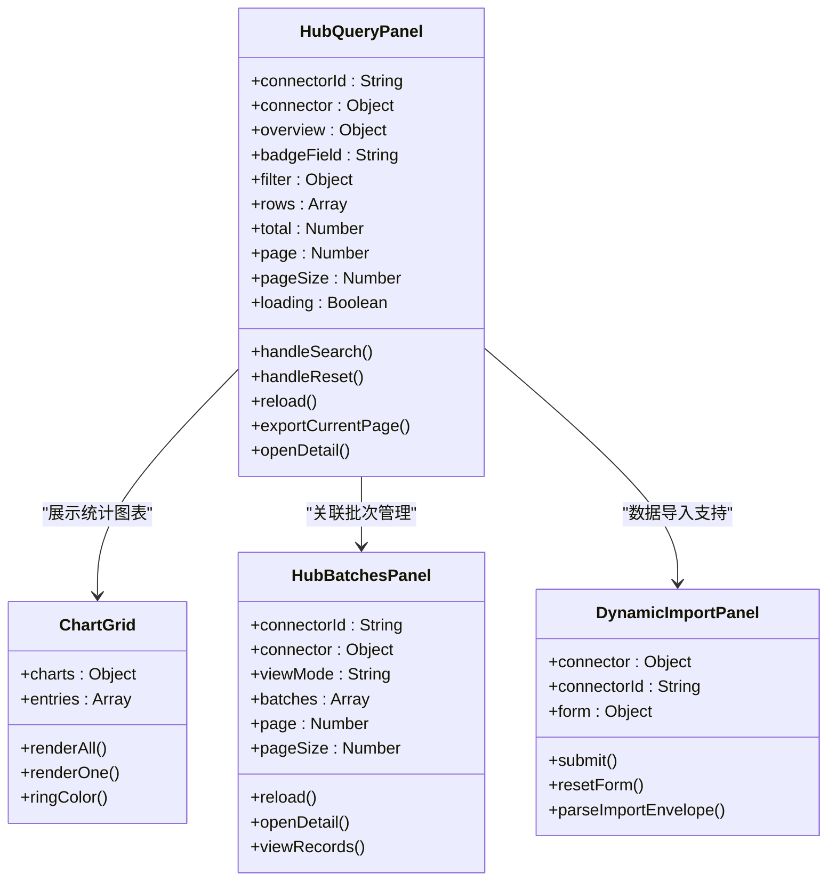

**图表来源**
- [HubQueryPanel.vue:212-654](file://src/views/analysis/DataHub/HubQueryPanel.vue#L212-L654)
- [ChartGrid.vue:21-161](file://src/views/analysis/DataHub/ChartGrid.vue#L21-L161)
- [HubBatchesPanel.vue:157-268](file://src/views/analysis/DataHub/HubBatchesPanel.vue#L157-L268)
- [DynamicImportPanel.vue:328-587](file://src/views/analysis/DataHub/DynamicImportPanel.vue#L328-L587)

### 组件间关系

查询面板通过事件机制与其他组件进行通信，实现了松耦合的设计：

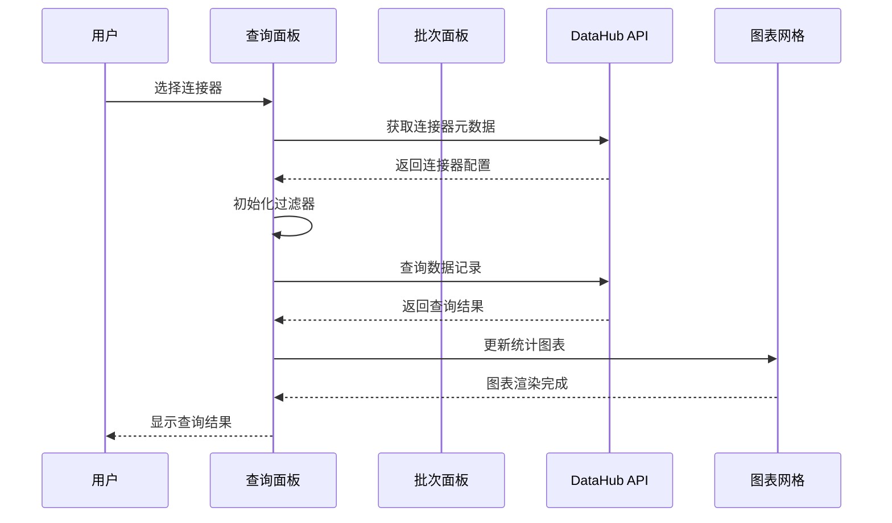

**图表来源**
- [HubQueryPanel.vue:340-346](file://src/views/analysis/DataHub/HubQueryPanel.vue#L340-L346)
- [dataHub.js:24-32](file://src/api/dataHub.js#L24-L32)

**章节来源**
- [HubQueryPanel.vue:212-654](file://src/views/analysis/DataHub/HubQueryPanel.vue#L212-L654)
- [ChartGrid.vue:21-161](file://src/views/analysis/DataHub/ChartGrid.vue#L21-L161)
- [HubBatchesPanel.vue:157-268](file://src/views/analysis/DataHub/HubBatchesPanel.vue#L157-L268)
- [DynamicImportPanel.vue:328-587](file://src/views/analysis/DataHub/DynamicImportPanel.vue#L328-L587)

## 架构概览

查询面板采用前后端分离的架构设计，前端通过API接口与后端数据源进行交互：

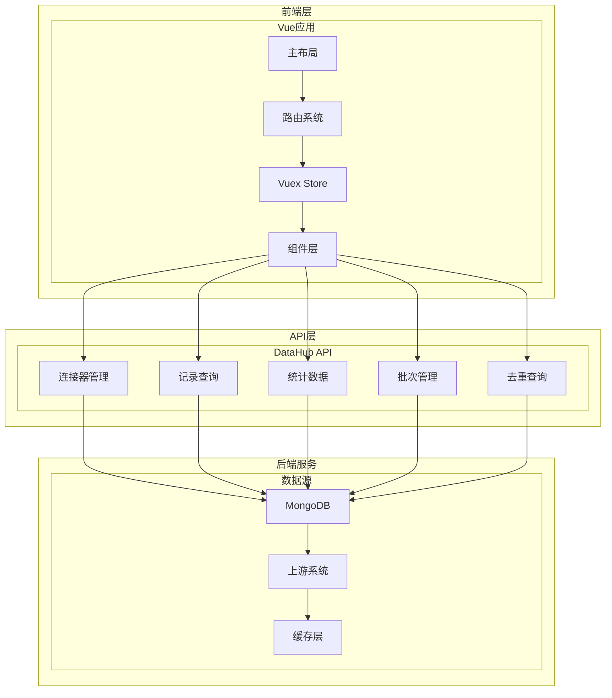

**图表来源**
- [request.js:1-100](file://src/utils/request.js#L1-L100)
- [dataHub.js:9-95](file://src/api/dataHub.js#L9-L95)

### 数据流处理

查询面板的数据流遵循标准的CRUD模式：

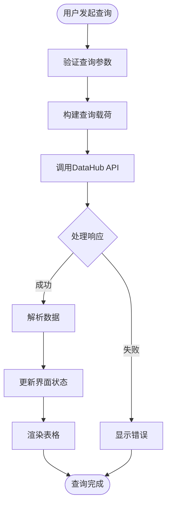

**图表来源**
- [HubQueryPanel.vue:515-565](file://src/views/analysis/DataHub/HubQueryPanel.vue#L515-L565)
- [dataHub.js:24-32](file://src/api/dataHub.js#L24-L32)

**章节来源**
- [request.js:1-100](file://src/utils/request.js#L1-L100)
- [dataHub.js:9-95](file://src/api/dataHub.js#L9-L95)

## 详细组件分析

### HubQueryPanel组件

HubQueryPanel是查询面板的核心组件，负责处理所有查询逻辑和用户交互。

#### 组件属性与配置

组件接收以下关键属性：

| 属性名 | 类型 | 默认值 | 描述 |
|--------|------|--------|------|
| connectorId | String | required | 连接器标识符 |
| connector | Object | {} | 连接器配置对象 |
| overview | Object | {} | 数据概览信息 |
| badgeField | String | '' | 风险等级字段 |

#### 动态过滤器系统

查询面板支持两种过滤器模式：

1. **日期范围模式** (`date_range`)
2. **产品参数映射模式** (`ptl_param_maps`)

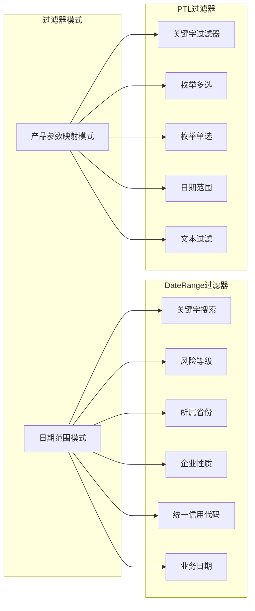

**图表来源**
- [HubQueryPanel.vue:50-102](file://src/views/analysis/DataHub/HubQueryPanel.vue#L50-L102)
- [HubQueryPanel.vue:348-366](file://src/views/analysis/DataHub/HubQueryPanel.vue#L348-L366)

#### 数据导出功能

查询面板支持CSV格式的数据导出，包含以下字段：

- **批次ID** (`_batch_id`)
- **风险等级** (`risk_signal_level`)
- **主体名称** (`subject_name`)
- **风险ID** (`risk_id`)
- **业务日期** (`biz_date`)

**章节来源**
- [HubQueryPanel.vue:607-648](file://src/views/analysis/DataHub/HubQueryPanel.vue#L607-L648)

### ChartGrid组件

ChartGrid组件负责展示数据的统计图表，提供可视化分析功能。

#### 图表类型支持

组件支持两种图表类型：

1. **饼图** (`pie`) - 用于展示分类数据分布
2. **柱状图** (`bar`) - 用于展示数值数据对比

#### 颜色映射系统

根据风险等级自动映射颜色：

| 风险等级 | 颜色 |
|----------|------|
| 红色 | #F56C6C |
| 橙色 | #E6A23C |
| 黄色 | #F7D257 |
| 蓝色 | #409EFF |
| 绿色 | #67C23A |
| 其他 | #909399 |

**章节来源**
- [ChartGrid.vue:74-82](file://src/views/analysis/DataHub/ChartGrid.vue#L74-L82)
- [ChartGrid.vue:92-157](file://src/views/analysis/DataHub/ChartGrid.vue#L92-L157)

### HubBatchesPanel组件

批次面板用于管理数据导入的历史批次，提供批次级别的数据回溯功能。

#### 视图模式

组件支持两种视图模式：

1. **时间线模式** (`timeline`) - 以时间轴形式展示批次
2. **表格模式** (`table`) - 以表格形式展示批次详情

#### 批次状态管理

支持的批次状态包括：

| 状态 | 描述 | 标签类型 |
|------|------|----------|
| success | 成功 | success |
| partial | 部分完成 | warning |
| failed_network | 网络失败 | danger |
| failed_upstream | 上游异常 | danger |
| failed_unknown | 未知失败 | danger |
| running | 进行中 | info |

**章节来源**
- [HubBatchesPanel.vue:148-155](file://src/views/analysis/DataHub/HubBatchesPanel.vue#L148-L155)
- [HubBatchesPanel.vue:157-268](file://src/views/analysis/DataHub/HubBatchesPanel.vue#L157-L268)

## 查询功能详解

### 查询条件构建

查询面板支持多种查询条件的组合，形成灵活的查询表达式。

#### 基础查询条件

| 条件类型 | 字段名 | 操作符 | 描述 |
|----------|--------|--------|------|
| 关键字搜索 | keyword | 包含 | 支持多字段模糊匹配 |
| 风险等级 | risk_signal_level | in | 多选风险等级过滤 |
| 统一信用代码 | unified_social_credit_code | eq | 精确匹配 |
| 所属省份 | affiliated_province | eq | 精确匹配 |
| 企业性质 | enterprise_nature | eq | 精确匹配 |
| 业务日期 | biz_date | gte/lte | 日期范围过滤 |

#### 动态查询条件

对于产品参数映射模式，查询条件根据连接器配置动态生成：

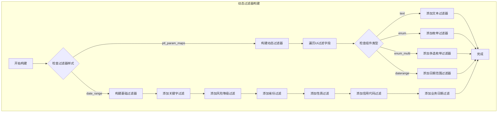

**图表来源**
- [HubQueryPanel.vue:485-514](file://src/views/analysis/DataHub/HubQueryPanel.vue#L485-L514)
- [HubQueryPanel.vue:455-484](file://src/views/analysis/DataHub/HubQueryPanel.vue#L455-L484)

#### 查询操作符

查询面板支持的操作符包括：

| 操作符 | 用途 | 示例 |
|--------|------|------|
| eq | 等于 | `{ field: 'name', op: 'eq', value: '张三' }` |
| in | 在集合中 | `{ field: 'status', op: 'in', value: ['active', 'pending'] }` |
| gte | 大于等于 | `{ field: 'age', op: 'gte', value: 18 }` |
| lte | 小于等于 | `{ field: 'score', op: 'lte', value: 100 }` |

**章节来源**
- [HubQueryPanel.vue:455-514](file://src/views/analysis/DataHub/HubQueryPanel.vue#L455-L514)

### 排序和分组

#### 排序机制

查询面板默认按照 `_imported_at` 字段降序排列，确保最新的数据优先显示。

#### 分组功能

虽然查询面板本身不直接提供分组功能，但可以通过以下方式实现类似效果：

1. **使用聚合查询** - 通过后端API实现数据聚合
2. **客户端分组** - 在前端对查询结果进行分组处理
3. **自定义查询** - 通过连接器配置实现特定的分组逻辑

### 高级查询功能

#### 批次过滤

查询面板支持按批次ID进行精确过滤，便于数据回溯和审计：

```javascript
// 批次过滤示例
{
  field: 'batch_id',
  op: 'eq',
  value: 'batch_20240101_001'
}
```

#### 多字段模糊搜索

关键字搜索支持在多个字段中进行模糊匹配，提升查询灵活性：

```javascript
// 多字段模糊搜索示例
{
  field: 'keyword',
  op: 'contains',
  value: '风险'
}
```

**章节来源**
- [HubQueryPanel.vue:574-606](file://src/views/analysis/DataHub/HubQueryPanel.vue#L574-L606)

## 界面布局与交互

### 整体布局设计

查询面板采用卡片式布局，提供清晰的信息层次结构：

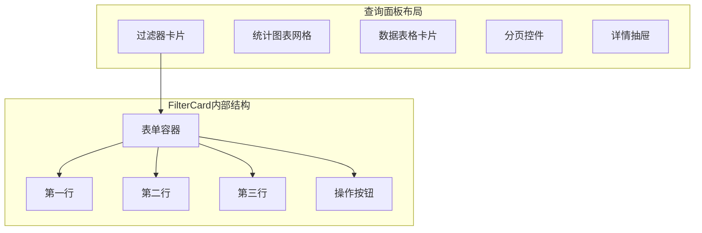

**图表来源**
- [HubQueryPanel.vue:3-197](file://src/views/analysis/DataHub/HubQueryPanel.vue#L3-L197)

### 组件交互流程

#### 查询交互流程

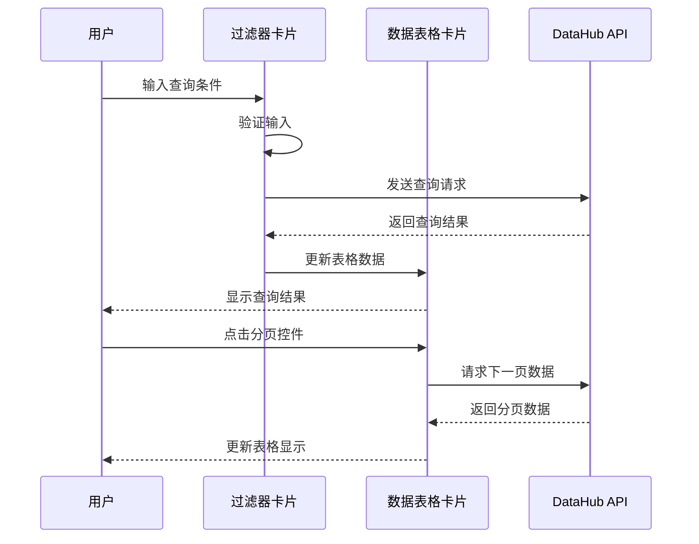

**图表来源**
- [HubQueryPanel.vue:574-578](file://src/views/analysis/DataHub/HubQueryPanel.vue#L574-L578)
- [HubQueryPanel.vue:184-188](file://src/views/analysis/DataHub/HubQueryPanel.vue#L184-L188)

#### 数据导出交互

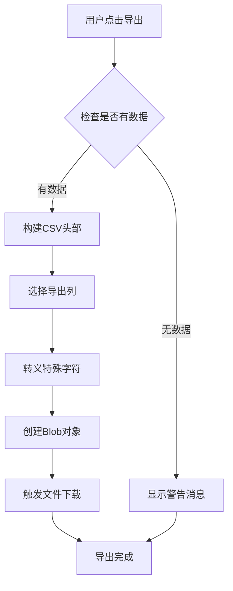

**图表来源**
- [HubQueryPanel.vue:607-648](file://src/views/analysis/DataHub/HubQueryPanel.vue#L607-L648)

### 响应式设计

查询面板采用响应式设计，适配不同屏幕尺寸：

- **桌面端**：完整的两列布局，支持丰富的过滤器
- **平板端**：优化的单列布局，确保移动端可用性
- **移动端**：简化版界面，突出核心查询功能

**章节来源**
- [HubQueryPanel.vue:656-697](file://src/views/analysis/DataHub/HubQueryPanel.vue#L656-L697)

## 查询条件构建

### 过滤器配置系统

查询面板通过连接器配置动态生成过滤器，支持复杂的查询需求。

#### 过滤器类型

| 组件类型 | 用途 | 输入方式 |
|----------|------|----------|
| keyword | 关键字过滤 | 文本输入 |
| enum | 单选枚举 | 下拉选择 |
| enum_multi | 多选枚举 | 多选下拉 |
| daterange | 日期范围 | 日期选择器 |
| text | 文本过滤 | 文本输入 |

#### 动态字段映射

查询面板支持动态字段映射，根据连接器配置自动调整过滤器：

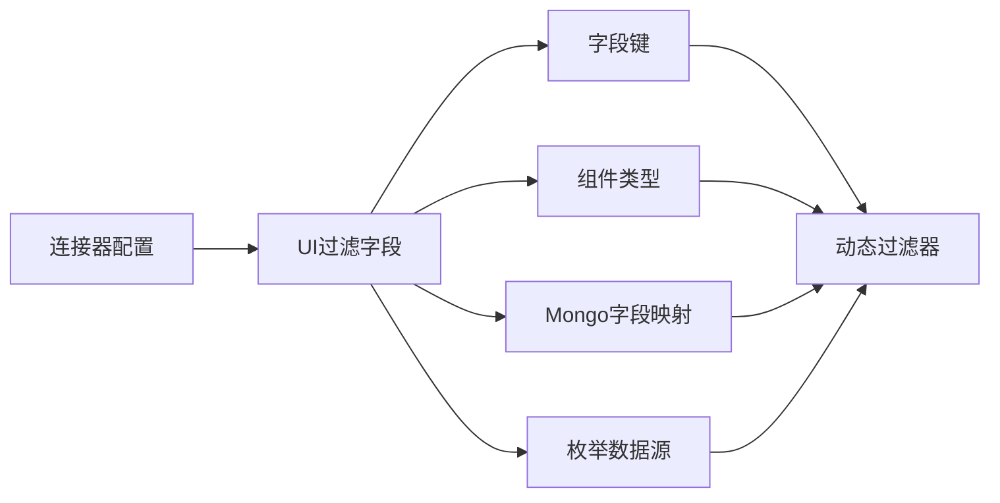

**图表来源**
- [HubQueryPanel.vue:348-366](file://src/views/analysis/DataHub/HubQueryPanel.vue#L348-L366)

### 查询载荷构建

查询面板将用户输入转换为标准化的查询载荷：

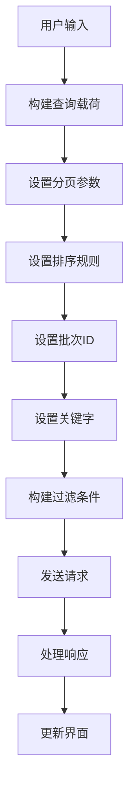

**图表来源**
- [HubQueryPanel.vue:515-526](file://src/views/analysis/DataHub/HubQueryPanel.vue#L515-L526)

**章节来源**
- [HubQueryPanel.vue:348-425](file://src/views/analysis/DataHub/HubQueryPanel.vue#L348-L425)

## 结果集展示

### 表格显示系统

查询面板使用Element UI的表格组件展示查询结果，支持丰富的交互功能。

#### 表格列配置

| 列类型 | 字段名 | 显示名称 | 特性 |
|--------|--------|----------|------|
| 固定列 | 标记 | 标记 | 固定左侧，显示风险等级 |
| 固定列 | 主体名称 | 主体名称 | 固定左侧，支持溢出提示 |
| 固定列 | 产品代码 | 产品代码 | 固定左侧，特定连接器显示 |
| 固定列 | 产品简称 | 产品简称 | 固定左侧，特定连接器显示 |
| 动态列 | 其他字段 | 字段名 | 自动识别，支持溢出提示 |
| 固定列 | 操作 | 操作 | 固定右侧，显示详情按钮 |

#### 行样式系统

查询面板根据风险等级自动应用不同的行样式：

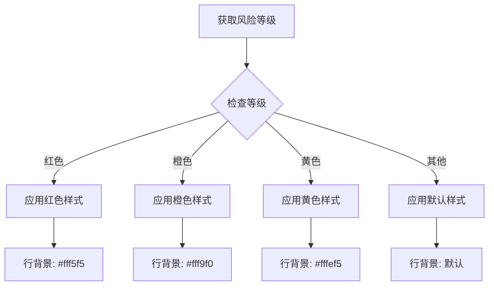

**图表来源**
- [HubQueryPanel.vue:446-454](file://src/views/analysis/DataHub/HubQueryPanel.vue#L446-L454)
- [HubQueryPanel.vue:692-697](file://src/views/analysis/DataHub/HubQueryPanel.vue#L692-L697)

### 分页控制

查询面板提供完整的分页控制功能：

#### 分页参数

| 参数名 | 类型 | 默认值 | 描述 |
|--------|------|--------|------|
| page | Number | 1 | 当前页码 |
| page_size | Number | 20 | 每页记录数 |
| total | Number | 0 | 总记录数 |

#### 分页选项

支持的每页记录数选项：20、50、100、200

#### 分页事件

- `size-change`：当每页记录数改变时触发
- `current-change`：当当前页码改变时触发

**章节来源**
- [HubQueryPanel.vue:184-188](file://src/views/analysis/DataHub/HubQueryPanel.vue#L184-L188)
- [HubQueryPanel.vue:527-565](file://src/views/analysis/DataHub/HubQueryPanel.vue#L527-L565)

### 详情查看功能

查询面板提供详细的记录查看功能：

#### 详情抽屉

- **宽度**：46%的屏幕宽度
- **方向**：从右侧滑出
- **内容**：完整的JSON格式记录详情

#### 动态标题

详情标题根据连接器类型和记录内容动态生成：

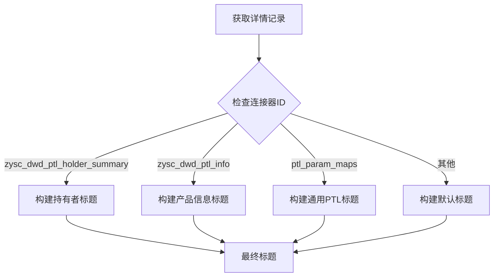

**图表来源**
- [HubQueryPanel.vue:257-275](file://src/views/analysis/DataHub/HubQueryPanel.vue#L257-L275)

**章节来源**
- [HubQueryPanel.vue:191-196](file://src/views/analysis/DataHub/HubQueryPanel.vue#L191-L196)
- [HubQueryPanel.vue:257-275](file://src/views/analysis/DataHub/HubQueryPanel.vue#L257-L275)

## 性能考虑

### 查询优化策略

查询面板采用了多项性能优化措施：

#### 缓存机制

- **枚举值缓存**：动态枚举选项缓存，避免重复查询
- **字段元数据缓存**：字段名称映射缓存
- **图表数据缓存**：统计图表数据缓存

#### 异步加载

- **懒加载**：标签页切换时才加载对应组件
- **延迟初始化**：组件挂载后延迟执行复杂初始化逻辑
- **批量请求**：多个API请求并行执行

#### 内存管理

- **组件销毁清理**：组件销毁时清理定时器和事件监听器
- **大数据处理**：表格组件支持虚拟滚动，处理大量数据
- **内存泄漏防护**：及时清理DOM引用和闭包

### 性能监控

查询面板内置了基本的性能监控功能：

#### 加载状态管理

- **全局加载指示器**：显示整体应用加载状态
- **局部加载指示器**：显示组件特定加载状态
- **超时处理**：网络请求超时自动处理

#### 错误恢复

- **自动重试**：网络错误时自动重试
- **降级策略**：功能不可用时提供降级方案
- **错误上报**：捕获并上报运行时错误

**章节来源**
- [HubQueryPanel.vue:318-339](file://src/views/analysis/DataHub/HubQueryPanel.vue#L318-L339)
- [request.js:27-97](file://src/utils/request.js#L27-L97)

## 故障排除指南

### 常见问题诊断

#### 查询无结果

**可能原因**：
1. 查询条件过于严格
2. 数据尚未导入
3. 批次ID不匹配

**解决步骤**：
1. 检查过滤器设置
2. 验证数据导入状态
3. 清除批次过滤器

#### 性能问题

**症状**：页面加载缓慢、查询响应慢

**解决方案**：
1. 减少查询范围
2. 使用更精确的过滤条件
3. 调整分页大小

#### 图表显示异常

**症状**：图表不显示或显示错误

**解决步骤**：
1. 检查网络连接
2. 刷新页面
3. 清除浏览器缓存

### 错误处理机制

查询面板采用多层次的错误处理机制：

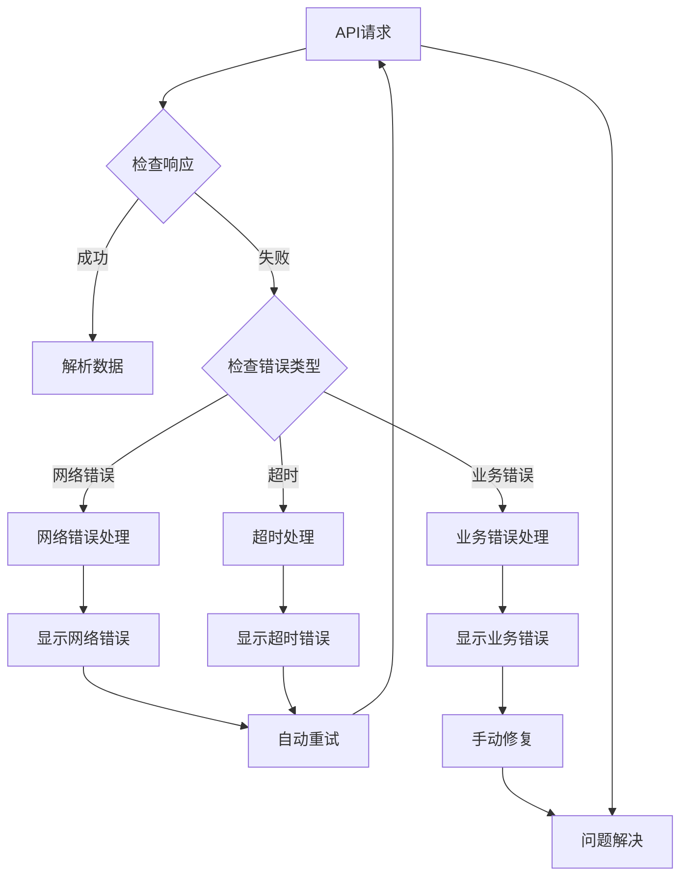

**图表来源**
- [request.js:34-97](file://src/utils/request.js#L34-L97)

### 调试工具

查询面板提供了多种调试工具：

#### 控制台日志

- **查询载荷**：显示发送给API的完整查询参数
- **响应数据**：显示API返回的原始数据
- **错误信息**：显示详细的错误堆栈

#### 状态监控

- **组件状态**：显示各组件的当前状态
- **API调用**：跟踪API调用历史
- **性能指标**：监控查询性能指标

**章节来源**
- [request.js:34-97](file://src/utils/request.js#L34-L97)

## 结论

查询面板作为智能投研系统的核心组件，提供了强大而灵活的数据查询和分析功能。通过模块化的架构设计、动态的过滤器系统和丰富的交互体验，查询面板能够满足各种复杂的数据检索需求。

### 主要优势

1. **高度可配置**：通过连接器配置实现灵活的数据源适配
2. **强大的查询能力**：支持多种查询条件和过滤器组合
3. **优秀的用户体验**：直观的界面设计和流畅的交互体验
4. **性能优化**：采用多种优化策略确保系统性能
5. **完善的错误处理**：多层次的错误处理和恢复机制

### 应用场景

查询面板适用于以下应用场景：

- **数据探索**：快速浏览和探索数据集
- **业务分析**：基于业务需求进行数据筛选和分析
- **数据质量监控**：监控数据质量和完整性
- **审计追踪**：通过批次ID进行数据回溯
- **报表生成**：导出数据生成报表

### 未来发展

查询面板将继续演进，计划增加的功能包括：

- **高级分析功能**：集成更多数据分析工具
- **实时数据流**：支持实时数据查询和监控
- **机器学习集成**：提供智能数据洞察
- **多租户支持**：支持多用户和多组织环境
- **移动端优化**：进一步优化移动端用户体验

通过持续的改进和优化，查询面板将成为智能投研系统中不可或缺的重要工具，为用户提供高效、准确、可靠的数据查询和分析服务。