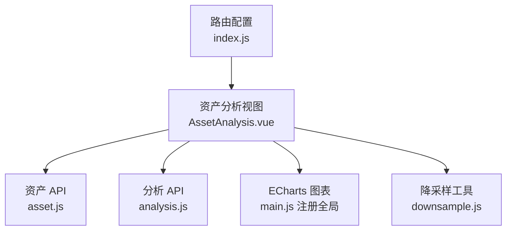
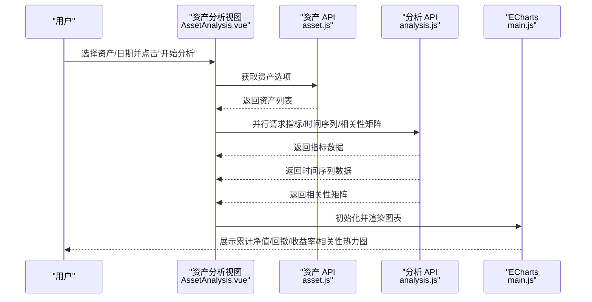
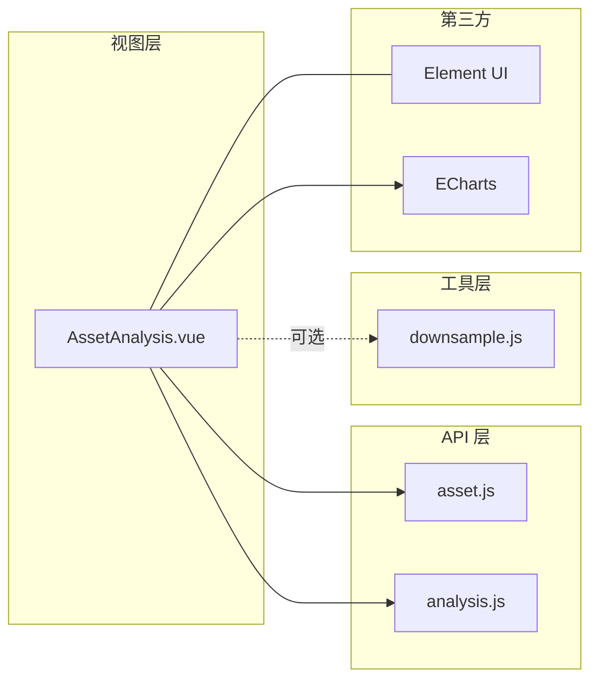

# 资产分析

<cite>
**本文引用的文件**
- [AssetAnalysis.vue](file://src/views/analysis/AssetAnalysis.vue)
- [analysis.js](file://src/api/analysis.js)
- [asset.js](file://src/api/asset.js)
- [downsample.js](file://src/utils/downsample.js)
- [index.js](file://src/router/index.js)
- [main.js](file://src/main.js)
</cite>

## 目录
1. [简介](#简介)
2. [项目结构](#项目结构)
3. [核心组件](#核心组件)
4. [架构总览](#架构总览)
5. [详细组件分析](#详细组件分析)
6. [依赖关系分析](#依赖关系分析)
7. [性能考量](#性能考量)
8. [故障排查指南](#故障排查指南)
9. [结论](#结论)
10. [附录](#附录)

## 简介
本文件围绕“资产分析”功能进行全面的技术文档说明，涵盖界面设计与实现、核心组件（资产选择器、日期范围选择器、分析按钮）、指标计算逻辑（年化收益率、年化波动率、夏普比率、最大回撤、卡玛比率、累计收益率）、时间序列数据处理与可视化（累计净值曲线、回撤曲线、收益率序列）、相关性矩阵分析（皮尔逊、斯皮尔曼、肯德尔），以及 ECharts 图表配置与交互细节，并提供实际使用案例与性能优化建议。

## 项目结构
资产分析功能位于前端工程的分析视图模块中，采用 Vue 单文件组件形式组织，配合 Element UI 表单与表格组件完成筛选与结果展示，通过 ECharts 实现多维度图表渲染。路由层将“资产分析”挂载到统一导航菜单下，便于用户访问。

**图表来源**
- [index.js:180-186](file://src/router/index.js#L180-L186)
- [AssetAnalysis.vue:148-150](file://src/views/analysis/AssetAnalysis.vue#L148-L150)
- [asset.js:24](file://src/api/asset.js#L24)
- [analysis.js:8-33](file://src/api/analysis.js#L8-L33)
- [main.js:22](file://src/main.js#L22)
- [downsample.js:9-127](file://src/utils/downsample.js#L9-L127)

**章节来源**
- [index.js:180-186](file://src/router/index.js#L180-L186)
- [AssetAnalysis.vue:148-150](file://src/views/analysis/AssetAnalysis.vue#L148-L150)

## 核心组件
- 资产选择器：基于 Element UI 的多选下拉框，支持过滤与联动，用于选择参与分析的资产集合。
- 日期范围选择器：基于 Element UI 的日期范围选择器，格式化为 YYYYMMDD 字符串传递给后端。
- 分析按钮：触发并行请求获取指标、时间序列与相关性矩阵，并渲染图表。
- 指标表格：展示各资产的年化收益、波动率、夏普比率、最大回撤、卡玛比率与累计收益。
- 图表区域：包含累计净值曲线、回撤曲线、收益率序列三张折线图。
- 相关性矩阵：热力图展示资产间的相关系数，支持三种计算方法切换。

**章节来源**
- [AssetAnalysis.vue:9-49](file://src/views/analysis/AssetAnalysis.vue#L9-L49)
- [AssetAnalysis.vue:52-97](file://src/views/analysis/AssetAnalysis.vue#L52-L97)
- [AssetAnalysis.vue:99-130](file://src/views/analysis/AssetAnalysis.vue#L99-L130)
- [AssetAnalysis.vue:132-143](file://src/views/analysis/AssetAnalysis.vue#L132-L143)

## 架构总览
资产分析的前端架构遵循“视图组件 + API 层 + 图表渲染”的分层设计。视图组件负责用户交互与状态管理；API 层封装对后端接口的调用；ECharts 负责数据可视化；可选的降采样工具用于大数据量场景下的性能优化。

**图表来源**
- [AssetAnalysis.vue:195-203](file://src/views/analysis/AssetAnalysis.vue#L195-L203)
- [AssetAnalysis.vue:236-260](file://src/views/analysis/AssetAnalysis.vue#L236-L260)
- [analysis.js:8-33](file://src/api/analysis.js#L8-L33)
- [asset.js:24](file://src/api/asset.js#L24)
- [main.js:22](file://src/main.js#L22)

## 详细组件分析

### 视图组件与生命周期
- 生命周期钩子：组件挂载时加载资产选项并设置默认日期范围（近一年）。
- 资源清理：组件销毁时释放所有 ECharts 实例，避免内存泄漏。
- 状态管理：维护筛选表单、日期范围、加载状态、指标数据、时间序列数据与相关性矩阵等。

**章节来源**
- [AssetAnalysis.vue:174-192](file://src/views/analysis/AssetAnalysis.vue#L174-L192)

### 资产选择器与日期范围
- 资产选择器：多选、可过滤，选择变化时可扩展联动逻辑（如联动可用日期范围）。
- 日期范围：使用日期范围选择器，格式化为 YYYYMMDD 传给后端；默认设置近一年。

**章节来源**
- [AssetAnalysis.vue:10-41](file://src/views/analysis/AssetAnalysis.vue#L10-L41)
- [AssetAnalysis.vue:176-184](file://src/views/analysis/AssetAnalysis.vue#L176-L184)

### 分析流程与并行请求
- 输入校验：至少选择一个资产且日期范围有效。
- 并行请求：同时获取资产指标、时间序列与相关性矩阵，提升响应速度。
- 结果处理：分别赋值到对应状态字段；使用 $nextTick 确保 DOM 就绪后再渲染图表。

**章节来源**
- [AssetAnalysis.vue:223-268](file://src/views/analysis/AssetAnalysis.vue#L223-L268)

### 指标表格与颜色语义
- 指标列：年化收益率、年化波动率、夏普比率、最大回撤、卡玛比率、累计收益率。
- 颜色语义：正收益使用绿色，负收益使用红色，增强可读性。

**章节来源**
- [AssetAnalysis.vue:57-96](file://src/views/analysis/AssetAnalysis.vue#L57-L96)

### 时间序列可视化
- 累计净值曲线：展示各资产净值随时间变化，平滑折线，无数据点符号。
- 回撤曲线：展示回撤百分比，填充浅色背景，坐标轴上限为 0。
- 收益率序列：展示日度或交易日收益率，坐标轴单位为百分比。

图表配置要点
- 坐标轴：时间型 X 轴、数值型 Y 轴。
- 提示框：交叉轴指示器，自定义格式化函数。
- 图例：底部图例，显示资产名称。
- 布局：紧凑网格布局，底部留出足够空间放置图例。

**章节来源**
- [AssetAnalysis.vue:299-352](file://src/views/analysis/AssetAnalysis.vue#L299-L352)
- [AssetAnalysis.vue:353-417](file://src/views/analysis/AssetAnalysis.vue#L353-L417)
- [AssetAnalysis.vue:418-478](file://src/views/analysis/AssetAnalysis.vue#L418-L478)

### 相关性矩阵热力图
- 数据结构：包含资产信息与相关系数矩阵，支持三种计算方法（皮尔逊、斯皮尔曼、肯德尔）。
- 可视化：热力图，颜色映射 [-1, 1]，标签显示两位小数，强调态带阴影。
- 交互：鼠标悬浮显示资产对与相关系数。

**章节来源**
- [AssetAnalysis.vue:479-570](file://src/views/analysis/AssetAnalysis.vue#L479-L570)
- [AssetAnalysis.vue:136-140](file://src/views/analysis/AssetAnalysis.vue#L136-L140)

### API 接口与数据契约
- 资产指标：POST /api/v1/analysis/asset-metrics
- 时间序列：POST /api/v1/analysis/timeseries
- 相关性矩阵：POST /api/v1/analysis/correlation-matrix（支持 method 参数）
- 资产选项：GET /api/v1/assets/options

注意
- 相关性矩阵接口通过 params 传递 method，支持 'pearson' | 'spearman' | 'kendall'。
- 时间序列数据包含各资产的净值、回撤与收益率序列，每个序列元素为 [date, value] 形式。

**章节来源**
- [analysis.js:8-33](file://src/api/analysis.js#L8-L33)
- [asset.js:24](file://src/api/asset.js#L24)

### ECharts 配置与交互
- 初始化：通过 echarts.init 获取实例，首次渲染时 dispose 旧实例，避免重复绑定。
- 数据绑定：将时间序列数据转换为二维数组 [date, value]，并按资产生成 series。
- 交互事件：提示框启用交叉轴指示器，自定义 formatter 输出更易读的百分比/数值。
- 热力图：xAxis/yAxis 为分类轴，visualMap 控制颜色映射，series.label 显示数值。

**章节来源**
- [AssetAnalysis.vue:300-352](file://src/views/analysis/AssetAnalysis.vue#L300-L352)
- [AssetAnalysis.vue:354-417](file://src/views/analysis/AssetAnalysis.vue#L354-L417)
- [AssetAnalysis.vue:419-478](file://src/views/analysis/AssetAnalysis.vue#L419-L478)
- [AssetAnalysis.vue:480-570](file://src/views/analysis/AssetAnalysis.vue#L480-L570)
- [main.js:22](file://src/main.js#L22)

### 降采样工具与大数据优化
- LTTB 降采样：在保持趋势的前提下显著减少数据点数量，适合长序列净值/回撤/收益率曲线。
- 并行数组降采样：对 dates[] 与 values[] 同步降采样，保留首尾点。
- 多系列降采样：共享 x 轴索引时采用均匀采样，确保多条曲线同步采样。

使用建议
- 当时间序列长度超过阈值（如 500）时，优先考虑降采样以提升渲染性能。
- 降采样参数可根据屏幕宽度与设备性能动态调整。

**章节来源**
- [downsample.js:9-127](file://src/utils/downsample.js#L9-L127)

## 依赖关系分析

**图表来源**
- [AssetAnalysis.vue:148-150](file://src/views/analysis/AssetAnalysis.vue#L148-L150)
- [asset.js:24](file://src/api/asset.js#L24)
- [analysis.js:8-33](file://src/api/analysis.js#L8-L33)
- [downsample.js:9-127](file://src/utils/downsample.js#L9-L127)
- [main.js:22](file://src/main.js#L22)

**章节来源**
- [AssetAnalysis.vue:148-150](file://src/views/analysis/AssetAnalysis.vue#L148-L150)
- [analysis.js:8-33](file://src/api/analysis.js#L8-L33)
- [asset.js:24](file://src/api/asset.js#L24)
- [downsample.js:9-127](file://src/utils/downsample.js#L9-L127)
- [main.js:22](file://src/main.js#L22)

## 性能考量
- 并行请求：在“开始分析”时并行获取指标、时间序列与相关性矩阵，缩短整体等待时间。
- 图表实例复用：每次渲染前 dispose 旧实例，避免重复绑定导致的内存占用。
- 数据降采样：对长序列使用 LTTB 或均匀采样，降低渲染开销，提升交互流畅度。
- 事件处理：提示框 formatter 仅在 hover 时触发，避免频繁计算。
- 图例与布局：合理设置图例位置与网格边距，避免重叠与溢出。

[本节为通用性能建议，不直接分析具体文件，故无“章节来源”]

## 故障排查指南
- 加载资产失败：检查资产选项接口是否可达，确认网络与鉴权状态。
- 分析请求报错：确认筛选条件（资产、日期）是否满足后端要求；查看控制台错误堆栈。
- 图表空白：确认容器节点存在且高度已设置；确保在 $nextTick 后渲染。
- 相关性矩阵异常：确认 method 参数合法（'pearson' | 'spearman' | 'kendall'）；检查后端返回矩阵结构。
- 内存泄漏：确认组件销毁时已 dispose 所有 ECharts 实例。

**章节来源**
- [AssetAnalysis.vue:195-203](file://src/views/analysis/AssetAnalysis.vue#L195-L203)
- [AssetAnalysis.vue:223-268](file://src/views/analysis/AssetAnalysis.vue#L223-L268)
- [AssetAnalysis.vue:186-192](file://src/views/analysis/AssetAnalysis.vue#L186-L192)
- [AssetAnalysis.vue:285-298](file://src/views/analysis/AssetAnalysis.vue#L285-L298)

## 结论
资产分析功能通过清晰的界面组件、稳健的 API 调用与丰富的 ECharts 可视化，实现了从数据筛选到指标展示与多维图表呈现的完整闭环。结合降采样与并行请求等优化手段，可在保证用户体验的同时应对大规模时间序列数据的挑战。后续可进一步扩展为多组合对比、因子暴露分析等高级能力。

[本节为总结性内容，不直接分析具体文件，故无“章节来源”]

## 附录

### 指标计算与业务含义（概念说明）
- 年化收益率：衡量投资收益的时间价值，反映持有期的复合增长率。
- 年化波动率：衡量收益的离散程度，数值越大风险越高。
- 夏普比率：单位风险所获得的风险溢价，用于评估风险调整后收益。
- 最大回撤：在选定时期内从最高点回调的最大幅度，体现下行风险。
- 卡玛比率：以最大回撤为分母的风险调整指标，关注绝对损失控制。
- 累计收益率：期末净值相对于初始净值的增长倍数，直观反映总体回报。

[本节为概念性说明，不直接分析具体文件，故无“章节来源”]

### 使用案例
- 案例一：选择 3 个股票与 1 个指数，设置近一年日期范围，点击“开始分析”，查看指标表格与三条曲线。
- 案例二：在相关性矩阵中切换不同方法（皮尔逊/斯皮尔曼/肯德尔），观察资产间关联强度的变化。
- 案例三：对极长序列（如 10 年以上）进行降采样，确保图表渲染流畅。

[本节为使用指导，不直接分析具体文件，故无“章节来源”]