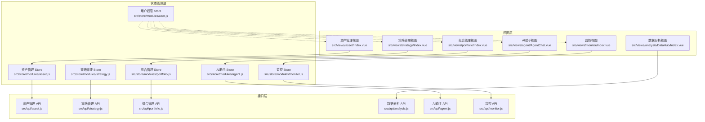
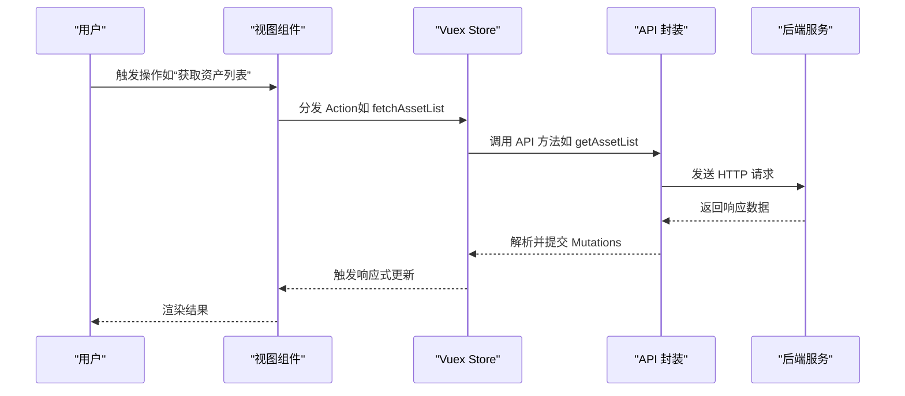
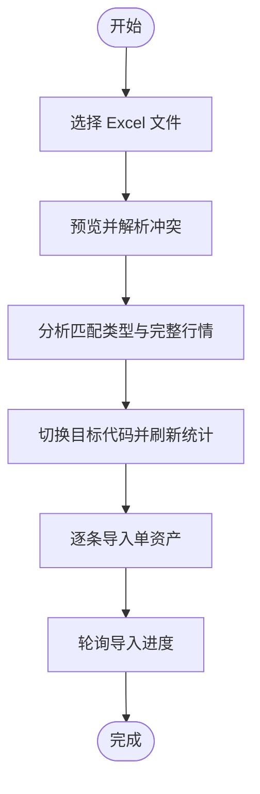
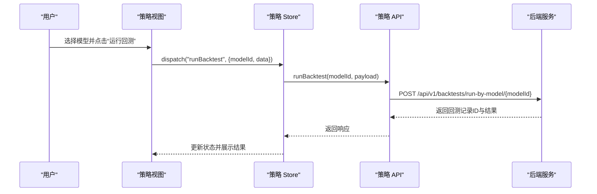
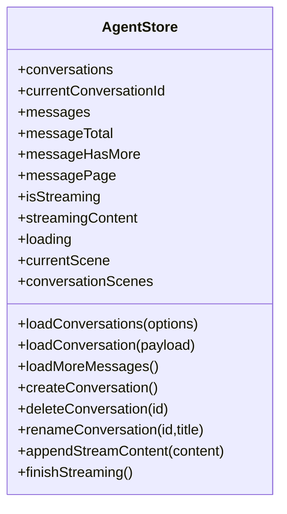
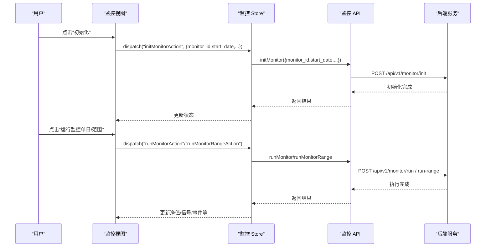
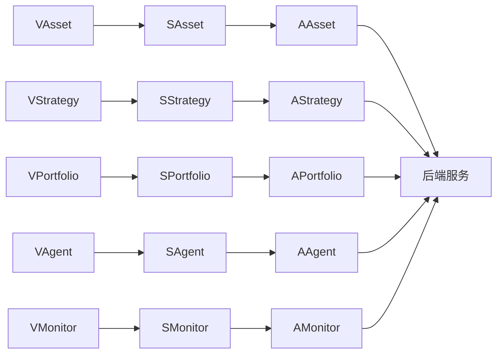

# 核心模块

<cite>
**本文引用的文件**
- [src/api/asset.js](file://src/api/asset.js)
- [src/store/modules/asset.js](file://src/store/modules/asset.js)
- [src/views/asset/Index.vue](file://src/views/asset/Index.vue)
- [src/api/strategy.js](file://src/api/strategy.js)
- [src/store/modules/strategy.js](file://src/store/modules/strategy.js)
- [src/views/strategy/Index.vue](file://src/views/strategy/Index.vue)
- [src/api/portfolio.js](file://src/api/portfolio.js)
- [src/store/modules/portfolio.js](file://src/store/modules/portfolio.js)
- [src/views/portfolio/Index.vue](file://src/views/portfolio/Index.vue)
- [src/api/analysis.js](file://src/api/analysis.js)
- [src/views/analysis/DataHub/Index.vue](file://src/views/analysis/DataHub/Index.vue)
- [src/api/agent.js](file://src/api/agent.js)
- [src/views/agent/AgentChat.vue](file://src/views/agent/AgentChat.vue)
- [src/store/modules/agent.js](file://src/store/modules/agent.js)
- [src/api/monitor.js](file://src/api/monitor.js)
- [src/views/monitor/Index.vue](file://src/views/monitor/Index.vue)
- [src/store/modules/monitor.js](file://src/store/modules/monitor.js)
- [src/store/modules/user.js](file://src/store/modules/user.js)
</cite>

## 目录
1. [引言](#引言)
2. [项目结构](#项目结构)
3. [核心组件](#核心组件)
4. [架构总览](#架构总览)
5. [详细组件分析](#详细组件分析)
6. [依赖分析](#依赖分析)
7. [性能考虑](#性能考虑)
8. [故障排查指南](#故障排查指南)
9. [结论](#结论)
10. [附录](#附录)

## 引言
本文件面向投资组合管理系统的“核心模块”，系统性梳理资产管理、策略管理、组合管理、数据分析、AI智能助手、监控与系统管理六大模块。内容涵盖：功能概览、核心组件、API接口、使用示例、数据流与处理逻辑、错误处理与性能优化建议，并辅以可视化图示帮助读者快速理解模块职责与交互关系。

## 项目结构
前端采用 Vue + Vuex 架构，模块化组织如下：
- API 层：封装各模块对外 HTTP 接口，统一请求与响应格式
- Store 层：集中管理状态、异步动作与派生状态
- View 层：路由级入口组件与页面视图，负责渲染与用户交互
- 组件层：复用的对话、图表、表格、导入面板等通用组件

图表来源
- [src/views/asset/Index.vue](file://src/views/asset/Index.vue)
- [src/views/strategy/Index.vue](file://src/views/strategy/Index.vue)
- [src/views/portfolio/Index.vue](file://src/views/portfolio/Index.vue)
- [src/views/analysis/DataHub/Index.vue](file://src/views/analysis/DataHub/Index.vue)
- [src/views/agent/AgentChat.vue](file://src/views/agent/AgentChat.vue)
- [src/views/monitor/Index.vue](file://src/views/monitor/Index.vue)
- [src/store/modules/asset.js](file://src/store/modules/asset.js)
- [src/store/modules/strategy.js](file://src/store/modules/strategy.js)
- [src/store/modules/portfolio.js](file://src/store/modules/portfolio.js)
- [src/store/modules/agent.js](file://src/store/modules/agent.js)
- [src/store/modules/monitor.js](file://src/store/modules/monitor.js)
- [src/store/modules/user.js](file://src/store/modules/user.js)
- [src/api/asset.js](file://src/api/asset.js)
- [src/api/strategy.js](file://src/api/strategy.js)
- [src/api/portfolio.js](file://src/api/portfolio.js)
- [src/api/analysis.js](file://src/api/analysis.js)
- [src/api/agent.js](file://src/api/agent.js)
- [src/api/monitor.js](file://src/api/monitor.js)

章节来源
- [src/views/asset/Index.vue](file://src/views/asset/Index.vue)
- [src/views/strategy/Index.vue](file://src/views/strategy/Index.vue)
- [src/views/portfolio/Index.vue](file://src/views/portfolio/Index.vue)
- [src/views/analysis/DataHub/Index.vue](file://src/views/analysis/DataHub/Index.vue)
- [src/views/agent/AgentChat.vue](file://src/views/agent/AgentChat.vue)
- [src/views/monitor/Index.vue](file://src/views/monitor/Index.vue)

## 核心组件
- 资产管理模块：资产增删改查、行情导入（Excel/JSON）、K线获取、覆盖率缺口分析、多资产导入与预览
- 策略管理模块：模板管理、策略模型生命周期、回测执行、实盘发布与监控、参数配置与变更日志
- 组合管理模块：组合创建、调仓记录、组合分析与详情
- 数据分析模块：资产指标、相关性矩阵、时间序列与仪表盘数据
- AI智能助手模块：对话管理（非流式/流式）、记忆检索、报告与分析模板
- 监控模块：状态/净值/信号/事件/持仓/绩效/主观调仓/日报/资产分析
- 系统管理模块：用户登录/登出、权限校验（基于角色）

章节来源
- [src/api/asset.js](file://src/api/asset.js)
- [src/store/modules/asset.js](file://src/store/modules/asset.js)
- [src/api/strategy.js](file://src/api/strategy.js)
- [src/store/modules/strategy.js](file://src/store/modules/strategy.js)
- [src/api/portfolio.js](file://src/api/portfolio.js)
- [src/store/modules/portfolio.js](file://src/store/modules/portfolio.js)
- [src/api/analysis.js](file://src/api/analysis.js)
- [src/api/agent.js](file://src/api/agent.js)
- [src/store/modules/agent.js](file://src/store/modules/agent.js)
- [src/api/monitor.js](file://src/api/monitor.js)
- [src/store/modules/monitor.js](file://src/store/modules/monitor.js)
- [src/store/modules/user.js](file://src/store/modules/user.js)

## 架构总览
系统采用“视图-状态-接口”三层解耦设计：
- 视图层通过路由组件承载业务页面
- 状态层通过 Vuex 模块管理本地状态与异步数据
- 接口层通过统一请求封装与后端交互，提供稳定 API

图表来源
- [src/store/modules/asset.js](file://src/store/modules/asset.js)
- [src/api/asset.js](file://src/api/asset.js)
- [src/views/asset/Index.vue](file://src/views/asset/Index.vue)

## 详细组件分析

### 资产管理模块
- 功能概览
  - 资产基础管理：列表、详情、创建、更新、删除
  - 行情导入：Excel/JSON 多种方式；支持替换/仅缺失/单日补录
  - K线图表：按交易日裁剪或完整日历序列
  - 多资产导入：预览、解析、分析、逐条导入与进度轮询
  - 覆盖率缺口：区间内缺失日期分析
- 核心组件
  - API 封装：资产 CRUD、K线、模板下载、行情导入、覆盖率缺口
  - Store：资产列表、选项、选中集合、加载状态与总条数
  - 视图：路由入口组件承载子路由（资产列表/表单/详情/K线）
- API 接口要点
  - 列表/选项/详情/创建/更新/删除
  - K线查询参数：起止日期、是否包含节假日
  - 行情导入：Excel/JSON；支持 replace_existing/only_missing_dates/only_date
  - 多资产：预览/解析/分析/逐条导入/进度轮询
- 使用示例（路径指引）
  - 获取资产列表：[src/api/asset.js](file://src/api/asset.js)
  - 获取资产K线：[src/api/asset.js](file://src/api/asset.js)
  - 导入单资产行情（Excel）：[src/api/asset.js](file://src/api/asset.js)
  - 多资产导入预览：[src/api/asset.js](file://src/api/asset.js)
  - 获取覆盖率缺口：[src/api/asset.js](file://src/api/asset.js)
- 关键流程图（多资产导入）

图表来源
- [src/api/asset.js](file://src/api/asset.js)

章节来源
- [src/api/asset.js](file://src/api/asset.js)
- [src/store/modules/asset.js](file://src/store/modules/asset.js)
- [src/views/asset/Index.vue](file://src/views/asset/Index.vue)

### 策略管理模块
- 功能概览
  - 模板管理：模板列表、详情、创建、更新、验证
  - 策略模型：模型列表、详情、创建、更新、删除
  - 回测执行：按模型运行回测，支持备注更新
  - 实盘发布：发布/取消发布；配置参数；变更日志
  - 绩效计算：基于快照计算指标；权重上限查询
  - 算法计算：临时模型计算并返回结果
- 核心组件
  - API 封装：模板/模型/回测/实盘/基准/算法
  - Store：模板/模型列表、当前模板/模型、加载状态；提供计算/保存/发布等动作
- API 接口要点
  - 模板：列表/详情/创建/更新/验证
  - 模型：列表/详情/创建/更新/删除；回测运行；备注更新
  - 实盘：发布/取消发布；配置读取/更新；监控数据；变更日志
  - 基准：列表/详情/创建/更新/删除
  - 算法：calculateStrategy
- 使用示例（路径指引）
  - 获取模板列表：[src/api/strategy.js](file://src/api/strategy.js)
  - 运行回测：[src/api/strategy.js](file://src/api/strategy.js)
  - 实盘发布：[src/api/strategy.js](file://src/api/strategy.js)
  - 获取实盘配置：[src/api/strategy.js](file://src/api/strategy.js)
  - 计算策略（算法优化）：[src/api/strategy.js](file://src/api/strategy.js)
- 序列图（回测执行）

图表来源
- [src/store/modules/strategy.js](file://src/store/modules/strategy.js)
- [src/api/strategy.js](file://src/api/strategy.js)

章节来源
- [src/api/strategy.js](file://src/api/strategy.js)
- [src/store/modules/strategy.js](file://src/store/modules/strategy.js)
- [src/views/strategy/Index.vue](file://src/views/strategy/Index.vue)

### 组合管理模块
- 功能概览
  - 组合列表与详情、创建、删除
  - 调仓记录管理：记录与查询
  - 组合分析：性能与持仓分析
- 核心组件
  - API 封装：组合 CRUD、调仓、分析、详情
  - Store：组合列表、当前组合、基准集合、加载状态
- 使用示例（路径指引）
  - 获取组合列表：[src/api/portfolio.js](file://src/api/portfolio.js)
  - 创建组合：[src/api/portfolio.js](file://src/api/portfolio.js)
  - 记录调仓：[src/api/portfolio.js](file://src/api/portfolio.js)
  - 获取组合分析：[src/api/portfolio.js](file://src/api/portfolio.js)

章节来源
- [src/api/portfolio.js](file://src/api/portfolio.js)
- [src/store/modules/portfolio.js](file://src/store/modules/portfolio.js)
- [src/views/portfolio/Index.vue](file://src/views/portfolio/Index.vue)

### 数据分析模块
- 功能概览
  - 资产指标：多维指标计算
  - 相关性矩阵：支持多种方法
  - 时间序列：多资产时间序列数据
  - 仪表盘：聚合指标与可视化数据
  - 数据接入中心：连接器列表、导入、查询、批次历史
- 核心组件
  - API 封装：资产指标/相关性/时间序列/仪表盘
  - 视图：数据接入中心（连接器选择、导入、查询、批次）
- 使用示例（路径指引）
  - 获取资产指标：[src/api/analysis.js](file://src/api/analysis.js)
  - 获取相关性矩阵：[src/api/analysis.js](file://src/api/analysis.js)
  - 获取时间序列数据：[src/api/analysis.js](file://src/api/analysis.js)
  - 获取仪表盘数据：[src/api/analysis.js](file://src/api/analysis.js)
  - 数据接入中心：[src/views/analysis/DataHub/Index.vue](file://src/views/analysis/DataHub/Index.vue)

章节来源
- [src/api/analysis.js](file://src/api/analysis.js)
- [src/views/analysis/DataHub/Index.vue](file://src/views/analysis/DataHub/Index.vue)

### AI智能助手模块
- 功能概览
  - 对话管理：列表、详情、删除、重命名
  - 流式对话：SSE 接收，支持中止
  - 记忆管理：记忆列表、删除、搜索
  - 报告与模板：报告列表、详情、导出、模板 CRUD 与执行
  - 附件上传：对话附件上传
- 核心组件
  - API 封装：聊天、对话、记忆、报告、模板、附件
  - Store：对话列表、当前对话、消息列表、流式状态、加载状态
  - 视图：AgentChat（左右分栏：对话列表 + 聊天面板）
- 使用示例（路径指引）
  - 非流式对话：[src/api/agent.js](file://src/api/agent.js)
  - 流式对话（SSE）：[src/api/agent.js](file://src/api/agent.js)
  - 获取对话列表：[src/api/agent.js](file://src/api/agent.js)
  - 获取记忆列表：[src/api/agent.js](file://src/api/agent.js)
  - 报告管理：[src/api/agent.js](file://src/api/agent.js)
  - 分析模板管理：[src/api/agent.js](file://src/api/agent.js)
- 类图（AI助手 Store 关键对象）

图表来源
- [src/store/modules/agent.js](file://src/store/modules/agent.js)

章节来源
- [src/api/agent.js](file://src/api/agent.js)
- [src/store/modules/agent.js](file://src/store/modules/agent.js)
- [src/views/agent/AgentChat.vue](file://src/views/agent/AgentChat.vue)

### 监控模块
- 功能概览
  - 状态查询：监控状态、净值历史、事件日志、持仓、绩效、信号
  - 运行控制：初始化、单日运行、范围运行
  - 日报：日报列表与详情
  - 主观调仓：指令列表、新增、取消
  - 资产分析：相关性矩阵、波动率指标
- 核心组件
  - API 封装：状态/净值/事件/持仓/绩效/信号/运行/日报/主观调仓/资产分析
  - Store：活动监控ID、状态/净值/事件/持仓/绩效/信号/报表/主观指令/指标/相关性/加载状态
  - 视图：监控仪表板（指标卡、当日表现、参数快照说明）
- 使用示例（路径指引）
  - 获取监控状态：[src/api/monitor.js](file://src/api/monitor.js)
  - 获取净值历史：[src/api/monitor.js](file://src/api/monitor.js)
  - 获取事件日志：[src/api/monitor.js](file://src/api/monitor.js)
  - 获取持仓明细：[src/api/monitor.js](file://src/api/monitor.js)
  - 获取绩效指标：[src/api/monitor.js](file://src/api/monitor.js)
  - 获取信号状态：[src/api/monitor.js](file://src/api/monitor.js)
  - 初始化监控：[src/api/monitor.js](file://src/api/monitor.js)
  - 运行监控（单日/范围）：[src/api/monitor.js](file://src/api/monitor.js)
  - 获取日报列表/详情：[src/api/monitor.js](file://src/api/monitor.js)
  - 主观调仓指令：[src/api/monitor.js](file://src/api/monitor.js)
  - 资产分析（相关性/指标）：[src/api/monitor.js](file://src/api/monitor.js)
- 序列图（监控初始化与运行）

图表来源
- [src/store/modules/monitor.js](file://src/store/modules/monitor.js)
- [src/api/monitor.js](file://src/api/monitor.js)
- [src/views/monitor/Index.vue](file://src/views/monitor/Index.vue)

章节来源
- [src/api/monitor.js](file://src/api/monitor.js)
- [src/store/modules/monitor.js](file://src/store/modules/monitor.js)
- [src/views/monitor/Index.vue](file://src/views/monitor/Index.vue)

### 系统管理模块（用户与权限）
- 功能概览
  - 登录/登出：本地存储 token 与用户信息
  - 权限校验：基于角色的权限判断
- 核心组件
  - Store：token、用户信息、权限集合；提供登录、登出、获取用户信息
- 使用示例（路径指引）
  - 登录：[src/store/modules/user.js](file://src/store/modules/user.js)
  - 登出：[src/store/modules/user.js](file://src/store/modules/user.js)
  - 权限判断：[src/store/modules/user.js](file://src/store/modules/user.js)

章节来源
- [src/store/modules/user.js](file://src/store/modules/user.js)

## 依赖分析
- 模块内聚与耦合
  - 各模块通过 API 层与 Store 解耦，视图层仅负责渲染与交互
  - Store 之间无直接依赖，通过 API 间接协作
- 外部依赖
  - Axios 请求封装、Element UI 组件库、日期工具库等
- 循环依赖
  - 未发现模块间循环依赖；API 与 Store 均为单向依赖

图表来源
- [src/store/modules/asset.js](file://src/store/modules/asset.js)
- [src/store/modules/strategy.js](file://src/store/modules/strategy.js)
- [src/store/modules/portfolio.js](file://src/store/modules/portfolio.js)
- [src/store/modules/agent.js](file://src/store/modules/agent.js)
- [src/store/modules/monitor.js](file://src/store/modules/monitor.js)
- [src/api/asset.js](file://src/api/asset.js)
- [src/api/strategy.js](file://src/api/strategy.js)
- [src/api/portfolio.js](file://src/api/portfolio.js)
- [src/api/agent.js](file://src/api/agent.js)
- [src/api/monitor.js](file://src/api/monitor.js)

## 性能考虑
- 请求超时与并发
  - 大批量导入/初始化/范围运行等操作设置了较高超时，避免误判失败
  - 并发请求使用 Promise.all 或分别加载，减少等待时间
- 数据缓存与分页
  - Store 内维护分页与总数，避免重复请求
  - 对话消息支持分页加载与历史消息前置去重
- 图表与渲染
  - K线与净值历史按需加载，避免一次性渲染大量数据
  - 仪表板指标卡按需计算，避免重复计算

## 故障排查指南
- 常见问题
  - 获取资产列表失败：检查网络与后端状态，确认过滤参数
  - 行情导入失败：确认文件格式、字段映射与 replace/only 缺失参数
  - 回测/初始化超时：适当增大超时或分批执行
  - 实盘发布未生效：确认模型状态与后端返回结果
  - 流式对话异常：检查 SSE 连接与中止信号
- 定位方法
  - 查看 Store 中 loading 状态与错误日志
  - 使用 API 封装中的错误处理与全局提示
  - 在监控视图中核对净值/信号/事件日志

章节来源
- [src/store/modules/asset.js](file://src/store/modules/asset.js)
- [src/store/modules/strategy.js](file://src/store/modules/strategy.js)
- [src/store/modules/monitor.js](file://src/store/modules/monitor.js)
- [src/store/modules/agent.js](file://src/store/modules/agent.js)

## 结论
本系统围绕六大核心模块构建，采用清晰的分层架构与模块化设计，具备良好的可扩展性与可维护性。资产管理与策略管理是系统的基础能力，组合管理与监控提供闭环运营支撑，数据分析与AI助手提升决策效率，系统管理保障安全与合规。建议后续持续完善接口文档、埋点与告警机制，进一步提升用户体验与稳定性。

## 附录
- API 使用示例（路径指引）
  - 资产管理：[src/api/asset.js](file://src/api/asset.js)
  - 策略管理：[src/api/strategy.js](file://src/api/strategy.js)
  - 组合管理：[src/api/portfolio.js](file://src/api/portfolio.js)
  - 数据分析：[src/api/analysis.js](file://src/api/analysis.js)
  - AI助手：[src/api/agent.js](file://src/api/agent.js)
  - 监控：[src/api/monitor.js](file://src/api/monitor.js)
  - 用户权限：[src/store/modules/user.js](file://src/store/modules/user.js)