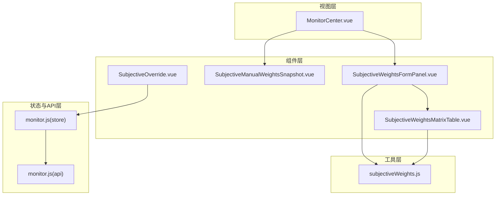
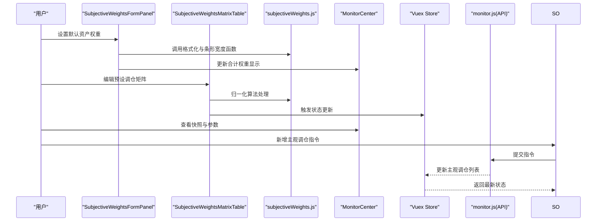
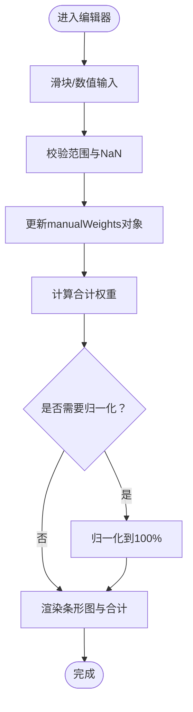
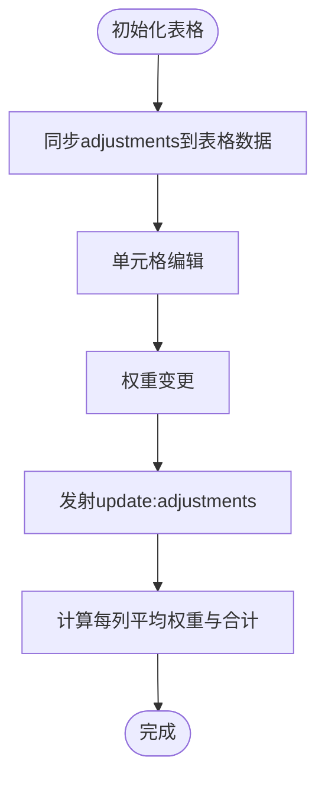
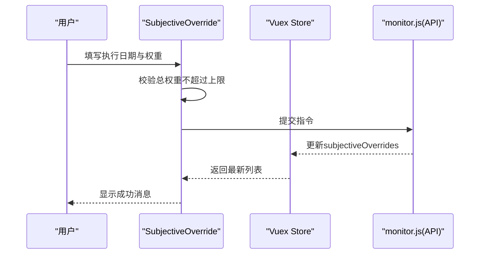
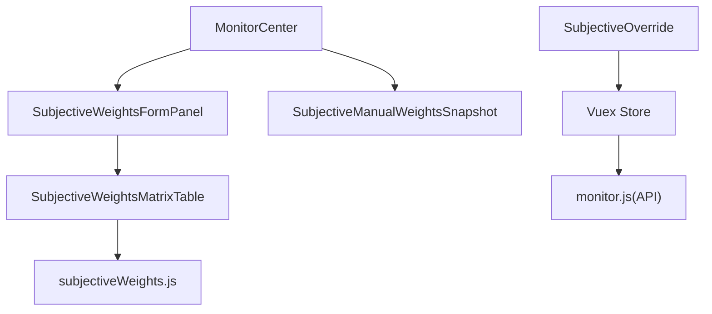

# 主观权重管理

<cite>
**本文档引用的文件**
- [SubjectiveWeightsFormPanel.vue](file://src/components/SubjectiveWeightsFormPanel.vue)
- [SubjectiveWeightsMatrixTable.vue](file://src/components/SubjectiveWeightsMatrixTable.vue)
- [SubjectiveOverride.vue](file://src/views/monitor/SubjectiveOverride.vue)
- [SubjectiveManualWeightsSnapshot.vue](file://src/views/monitor/SubjectiveManualWeightsSnapshot.vue)
- [MonitorCenter.vue](file://src/views/monitor/MonitorCenter.vue)
- [subjectiveWeights.js](file://src/utils/subjectiveWeights.js)
- [monitor.js](file://src/store/modules/monitor.js)
- [monitor.js](file://src/api/monitor.js)
</cite>

## 目录
1. [简介](#简介)
2. [项目结构](#项目结构)
3. [核心组件](#核心组件)
4. [架构概览](#架构概览)
5. [详细组件分析](#详细组件分析)
6. [依赖关系分析](#依赖关系分析)
7. [性能考虑](#性能考虑)
8. [故障排查指南](#故障排查指南)
9. [结论](#结论)
10. [附录](#附录)

## 简介
主观权重管理是投资组合管理中的关键环节，涉及对底层资产的初始权重设定、预设调仓计划以及实时主观调仓指令的全流程管控。该功能通过可视化界面支持用户直观地配置权重、进行批量归一化、查看历史记录，并与后端监控系统集成，确保权重变更的合规性与可追溯性。

## 项目结构
主观权重管理相关的核心文件分布如下：
- 组件层：负责用户交互与数据展示
  - SubjectiveWeightsFormPanel.vue：默认资产权重与预设调仓矩阵的编辑入口
  - SubjectiveWeightsMatrixTable.vue：矩阵表格，支持逐行权重编辑、归一化、复制与等权填充
  - SubjectiveManualWeightsSnapshot.vue：初始化权重与预设调仓的快照视图
  - SubjectiveOverride.vue：主观调仓指令的新增、取消与历史记录管理
- 工具层：提供权重归一化与格式化工具函数
  - subjectiveWeights.js：权重归一化算法与UI辅助函数
- 视图层：监控中心集成主观权重管理功能
  - MonitorCenter.vue：监控页面集成主观权重快照与参数展示
- 状态与API层：Vuex模块与后端接口
  - monitor.js（store）：状态管理与动作分发
  - monitor.js（api）：主观调仓相关API封装

**图表来源**
- [SubjectiveWeightsFormPanel.vue:1-315](file://src/components/SubjectiveWeightsFormPanel.vue#L1-L315)
- [SubjectiveWeightsMatrixTable.vue:1-619](file://src/components/SubjectiveWeightsMatrixTable.vue#L1-L619)
- [SubjectiveManualWeightsSnapshot.vue:1-366](file://src/views/monitor/SubjectiveManualWeightsSnapshot.vue#L1-L366)
- [SubjectiveOverride.vue:1-756](file://src/views/monitor/SubjectiveOverride.vue#L1-L756)
- [MonitorCenter.vue:1-200](file://src/views/monitor/MonitorCenter.vue#L1-L200)
- [subjectiveWeights.js:1-50](file://src/utils/subjectiveWeights.js#L1-L50)
- [monitor.js:1-416](file://src/store/modules/monitor.js#L1-L416)
- [monitor.js:128-186](file://src/api/monitor.js#L128-L186)

**章节来源**
- [SubjectiveWeightsFormPanel.vue:1-315](file://src/components/SubjectiveWeightsFormPanel.vue#L1-L315)
- [SubjectiveWeightsMatrixTable.vue:1-619](file://src/components/SubjectiveWeightsMatrixTable.vue#L1-L619)
- [SubjectiveManualWeightsSnapshot.vue:1-366](file://src/views/monitor/SubjectiveManualWeightsSnapshot.vue#L1-L366)
- [SubjectiveOverride.vue:1-756](file://src/views/monitor/SubjectiveOverride.vue#L1-L756)
- [MonitorCenter.vue:1-200](file://src/views/monitor/MonitorCenter.vue#L1-L200)
- [subjectiveWeights.js:1-50](file://src/utils/subjectiveWeights.js#L1-L50)
- [monitor.js:1-416](file://src/store/modules/monitor.js#L1-L416)
- [monitor.js:128-186](file://src/api/monitor.js#L128-L186)

## 核心组件
- 默认资产权重编辑器（SubjectiveWeightsFormPanel）
  - 支持滑块与数值输入两种方式设置权重
  - 实时计算权重合计并提供一键归一化功能
  - 条形图直观展示各资产占比
- 预设调仓矩阵（SubjectiveWeightsMatrixTable）
  - 动态列展示资产权重，支持行内编辑与批量操作
  - 单行归一化、复制行、等权填充、删除行、批量归一化
  - 行合计显示与视觉提示（100%为绿色，其他为警示色）
- 主观调仓指令管理（SubjectiveOverride）
  - 新增主观调仓指令，支持执行日期、权重合计统计与等效杠杆计算
  - 权重上限校验与表单规则验证
  - 待执行与历史记录列表，支持取消与查看详情
- 主观权重快照（SubjectiveManualWeightsSnapshot）
  - 展示初始化权重与预设调仓的快照视图
  - 支持交互模式下的点击编辑触发
- 权重工具函数（subjectiveWeights.js）
  - 权重归一化：使用最大余数法将合计缩放到1，精度为百分比的两位小数
  - 滑条提示格式化与条形宽度计算

**章节来源**
- [SubjectiveWeightsFormPanel.vue:1-315](file://src/components/SubjectiveWeightsFormPanel.vue#L1-L315)
- [SubjectiveWeightsMatrixTable.vue:1-619](file://src/components/SubjectiveWeightsMatrixTable.vue#L1-L619)
- [SubjectiveOverride.vue:1-756](file://src/views/monitor/SubjectiveOverride.vue#L1-L756)
- [SubjectiveManualWeightsSnapshot.vue:1-366](file://src/views/monitor/SubjectiveManualWeightsSnapshot.vue#L1-L366)
- [subjectiveWeights.js:1-50](file://src/utils/subjectiveWeights.js#L1-L50)

## 架构概览
主观权重管理采用组件化架构，前端通过Vuex与后端API交互，实现权重配置、校验、持久化与历史追踪。

**图表来源**
- [SubjectiveWeightsFormPanel.vue:1-315](file://src/components/SubjectiveWeightsFormPanel.vue#L1-L315)
- [SubjectiveWeightsMatrixTable.vue:1-619](file://src/components/SubjectiveWeightsMatrixTable.vue#L1-L619)
- [SubjectiveOverride.vue:1-756](file://src/views/monitor/SubjectiveOverride.vue#L1-L756)
- [MonitorCenter.vue:1-200](file://src/views/monitor/MonitorCenter.vue#L1-L200)
- [subjectiveWeights.js:1-50](file://src/utils/subjectiveWeights.js#L1-L50)
- [monitor.js:304-359](file://src/store/modules/monitor.js#L304-L359)
- [monitor.js:154-186](file://src/api/monitor.js#L154-L186)

## 详细组件分析

### 默认资产权重编辑器（SubjectiveWeightsFormPanel）
- 功能要点
  - 滑块与数值输入联动，范围0-100%，步进0.01
  - 实时合计权重计算与警告样式（超过100%）
  - 一键归一化至100%，避免保存失败
  - 条形图可视化占比，支持自定义最大杠杆
- 数据流
  - 输入变更 → 校验与边界处理 → 更新本地状态 → 触发父组件回调
- 性能特性
  - 使用计算属性减少重复计算
  - 条形宽度通过工具函数统一计算

**图表来源**
- [SubjectiveWeightsFormPanel.vue:104-158](file://src/components/SubjectiveWeightsFormPanel.vue#L104-L158)
- [subjectiveWeights.js:45-49](file://src/utils/subjectiveWeights.js#L45-L49)

**章节来源**
- [SubjectiveWeightsFormPanel.vue:1-315](file://src/components/SubjectiveWeightsFormPanel.vue#L1-L315)

### 预设调仓矩阵（SubjectiveWeightsMatrixTable）
- 功能要点
  - 动态生成资产列，支持单元格内编辑
  - 行级操作：归一化、复制、等权填充、删除
  - 批量操作：全表归一化
  - 行合计显示与颜色提示（100%绿色，其他警示色）
- 数据流
  - 表格数据 → 同步到adjustments格式 → 发射update:adjustments事件
- 算法实现
  - 归一化使用最大余数法，确保合计为1且精度为百分比两位小数

**图表来源**
- [SubjectiveWeightsMatrixTable.vue:199-231](file://src/components/SubjectiveWeightsMatrixTable.vue#L199-L231)
- [SubjectiveWeightsMatrixTable.vue:312-350](file://src/components/SubjectiveWeightsMatrixTable.vue#L312-L350)
- [subjectiveWeights.js:10-37](file://src/utils/subjectiveWeights.js#L10-L37)

**章节来源**
- [SubjectiveWeightsMatrixTable.vue:1-619](file://src/components/SubjectiveWeightsMatrixTable.vue#L1-L619)

### 主观调仓指令管理（SubjectiveOverride）
- 功能要点
  - 新增指令：执行日期、权重网格、说明
  - 权重合计统计与等效杠杆计算
  - 权重上限校验（基于策略参数或默认值）
  - 待执行与历史记录管理，支持取消与详情查看
- 数据流
  - 表单校验 → 转换为小数权重 → 提交API → 更新Vuex状态 → 刷新列表

**图表来源**
- [SubjectiveOverride.vue:518-547](file://src/views/monitor/SubjectiveOverride.vue#L518-L547)
- [monitor.js:324-359](file://src/store/modules/monitor.js#L324-L359)
- [monitor.js:167-186](file://src/api/monitor.js#L167-L186)

**章节来源**
- [SubjectiveOverride.vue:1-756](file://src/views/monitor/SubjectiveOverride.vue#L1-L756)
- [monitor.js:304-359](file://src/store/modules/monitor.js#L304-L359)
- [monitor.js:154-186](file://src/api/monitor.js#L154-L186)

### 主观权重快照（SubjectiveManualWeightsSnapshot）
- 功能要点
  - 展示初始化权重与预设调仓快照
  - 支持交互模式下的点击编辑触发
  - 条形图直观展示权重占比
- 数据流
  - 接收manualWeights与manualAdjustments → 解析与排序 → 渲染快照块

**章节来源**
- [SubjectiveManualWeightsSnapshot.vue:1-366](file://src/views/monitor/SubjectiveManualWeightsSnapshot.vue#L1-L366)

### 权重工具函数（subjectiveWeights.js）
- 归一化算法
  - 使用最大余数法，将合计缩放到1，精度为百分比两位小数
  - 示例：三等分结果为[0.3333, 0.3333, 0.3334]
- 辅助函数
  - 滑条提示格式化：将小数转换为百分比字符串
  - 条形宽度计算：限制0-100%范围

**章节来源**
- [subjectiveWeights.js:1-50](file://src/utils/subjectiveWeights.js#L1-L50)

## 依赖关系分析
- 组件间依赖
  - SubjectiveWeightsFormPanel依赖SubjectiveWeightsMatrixTable进行预设调仓编辑
  - SubjectiveWeightsMatrixTable依赖subjectiveWeights.js进行归一化
  - MonitorCenter集成SubjectiveManualWeightsSnapshot与FormPanel
  - SubjectiveOverride通过Vuex与API进行数据交互
- 外部依赖
  - Vuex模块管理监控状态与主观调仓列表
  - API封装主观调仓的查询、新增与取消操作

**图表来源**
- [SubjectiveWeightsFormPanel.vue:72-77](file://src/components/SubjectiveWeightsFormPanel.vue#L72-L77)
- [SubjectiveWeightsMatrixTable.vue](file://src/components/SubjectiveWeightsMatrixTable.vue#L133)
- [MonitorCenter.vue:174-181](file://src/views/monitor/MonitorCenter.vue#L174-L181)
- [SubjectiveManualWeightsSnapshot.vue:1-366](file://src/views/monitor/SubjectiveManualWeightsSnapshot.vue#L1-L366)
- [SubjectiveOverride.vue:1-756](file://src/views/monitor/SubjectiveOverride.vue#L1-L756)
- [monitor.js:304-359](file://src/store/modules/monitor.js#L304-L359)
- [monitor.js:154-186](file://src/api/monitor.js#L154-L186)

**章节来源**
- [SubjectiveWeightsFormPanel.vue:72-77](file://src/components/SubjectiveWeightsFormPanel.vue#L72-L77)
- [SubjectiveWeightsMatrixTable.vue](file://src/components/SubjectiveWeightsMatrixTable.vue#L133)
- [MonitorCenter.vue:174-181](file://src/views/monitor/MonitorCenter.vue#L174-L181)
- [SubjectivityOverride.vue:1-756](file://src/views/monitor/SubjectiveOverride.vue#L1-L756)
- [monitor.js:304-359](file://src/store/modules/monitor.js#L304-L359)
- [monitor.js:154-186](file://src/api/monitor.js#L154-L186)

## 性能考虑
- 归一化算法优化
  - 最大余数法确保合计为1且精度为百分比两位小数，避免浮点误差累积
- UI渲染优化
  - 条形图宽度通过工具函数统一计算，减少重复逻辑
  - 表格采用虚拟滚动与行高固定，提升大数据量下的渲染性能
- 状态管理
  - Vuex集中管理监控状态与主观调仓列表，避免多处重复请求

## 故障排查指南
- 权重合计超过100%
  - 现象：保存按钮禁用或出现警告样式
  - 处理：使用“归一化到100%”功能或手动调整权重
- 表格行合计不为100%
  - 现象：行合计列显示警示色
  - 处理：使用“归一化”按钮或启用“保存时归一化”
- 主观调仓指令提交失败
  - 现象：表单校验错误或API返回错误
  - 处理：检查总权重是否超过上限、执行日期是否正确、网络连接是否正常
- 快照无数据显示
  - 现象：初始化权重或预设调仓为空
  - 处理：先完成权重配置再查看快照

**章节来源**
- [SubjectiveWeightsFormPanel.vue:127-136](file://src/components/SubjectiveWeightsFormPanel.vue#L127-L136)
- [SubjectiveWeightsMatrixTable.vue:312-325](file://src/components/SubjectiveWeightsMatrixTable.vue#L312-L325)
- [SubjectiveOverride.vue:347-367](file://src/views/monitor/SubjectiveOverride.vue#L347-L367)

## 结论
主观权重管理通过组件化设计实现了从权重配置、批量归一化到历史追踪的完整闭环。配合严格的权重校验与可视化展示，有效提升了权重管理的准确性与效率。建议在实际使用中遵循最佳实践，定期审查权重配置，确保符合策略参数与风控要求。

## 附录
- 配置选项
  - 最大杠杆：通过策略参数或默认值控制权重上限
  - 保存时归一化：预设调仓行的自动归一化开关
- 批量操作
  - 批量归一化：一键将所有行权重合计归一化
  - 等权填充：将当前行权重等分为各资产
- 报表导出
  - 预设调仓矩阵支持导出当前页数据（CSV格式）

**章节来源**
- [SubjectiveWeightsMatrixTable.vue:125-128](file://src/components/SubjectiveWeightsMatrixTable.vue#L125-L128)
- [SubjectiveWeightsMatrixTable.vue:340-350](file://src/components/SubjectiveWeightsMatrixTable.vue#L340-L350)