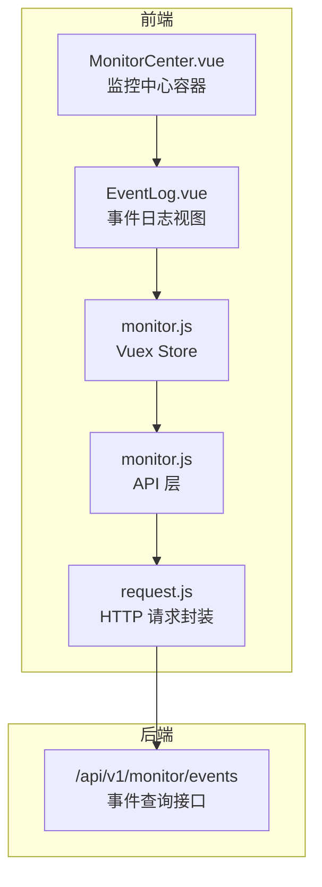
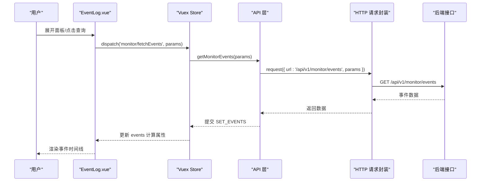
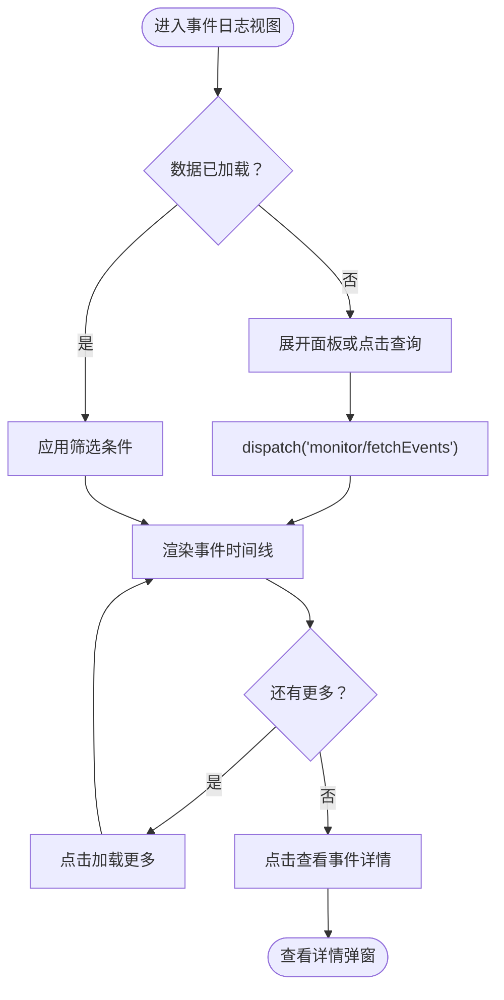
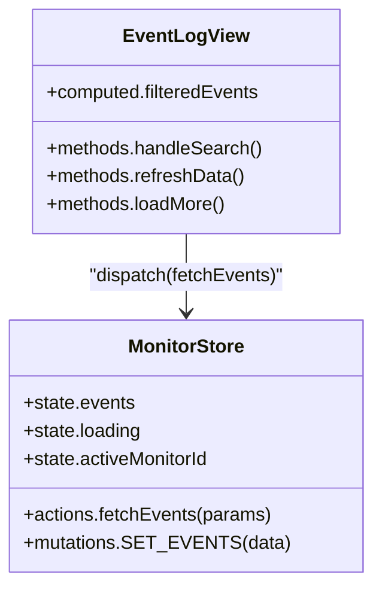
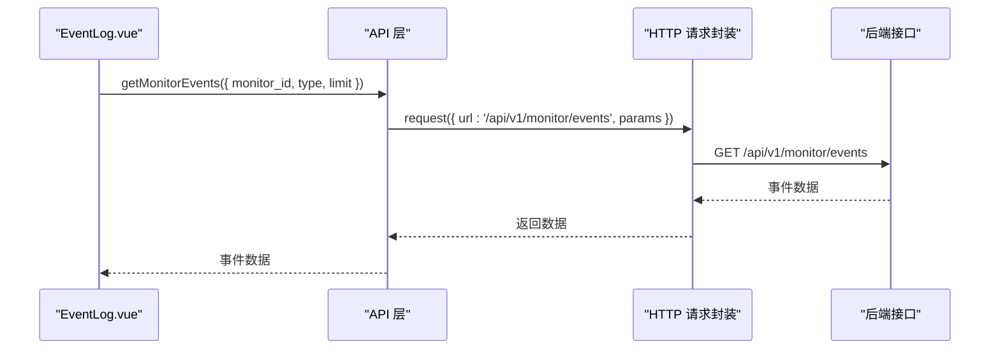
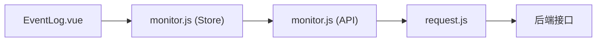

# 事件日志管理

<cite>
**本文引用的文件**
- [EventLog.vue](file://src/views/monitor/EventLog.vue)
- [monitor.js](file://src/store/modules/monitor.js)
- [monitor.js](file://src/api/monitor.js)
- [MonitorCenter.vue](file://src/views/monitor/MonitorCenter.vue)
- [request.js](file://src/utils/request.js)
- [SubjectiveOverride.vue](file://src/views/monitor/SubjectiveOverride.vue)
</cite>

## 目录
1. [简介](#简介)
2. [项目结构](#项目结构)
3. [核心组件](#核心组件)
4. [架构概览](#架构概览)
5. [详细组件分析](#详细组件分析)
6. [依赖关系分析](#依赖关系分析)
7. [性能考量](#性能考量)
8. [故障排查指南](#故障排查指南)
9. [结论](#结论)
10. [附录](#附录)

## 简介
本文件面向事件日志管理功能，系统性梳理事件日志的分类体系、过滤条件、搜索功能与导出机制，深入解释事件类型定义、事件级别划分、事件时间戳处理、事件详情展示等核心功能，并说明事件日志的数据结构设计、存储策略、查询优化方案。同时提供事件日志的配置选项、批量操作功能、自定义筛选规则的使用方法，并包含性能考虑、大数据量处理策略和故障排查指南。

## 项目结构
事件日志管理位于监控模块中，采用“视图组件 + Vuex Store + API 层”的三层架构：
- 视图组件负责用户交互与展示（事件类型筛选、日期范围筛选、分页加载、详情弹窗等）
- Vuex Store 负责状态管理与数据缓存（事件列表、加载状态、监控上下文）
- API 层封装后端接口（事件查询、运行控制、报告等）

图表来源
- [EventLog.vue:1-535](file://src/views/monitor/EventLog.vue#L1-L535)
- [monitor.js:1-416](file://src/store/modules/monitor.js#L1-L416)
- [monitor.js:1-227](file://src/api/monitor.js#L1-L227)
- [MonitorCenter.vue:585-591](file://src/views/monitor/MonitorCenter.vue#L585-L591)

章节来源
- [EventLog.vue:1-535](file://src/views/monitor/EventLog.vue#L1-L535)
- [monitor.js:1-416](file://src/store/modules/monitor.js#L1-L416)
- [monitor.js:1-227](file://src/api/monitor.js#L1-L227)
- [MonitorCenter.vue:585-591](file://src/views/monitor/MonitorCenter.vue#L585-L591)

## 核心组件
- 事件日志视图组件：提供事件类型筛选、日期范围筛选、分页加载、事件详情弹窗、加载更多等能力
- Vuex Store：维护事件列表、加载状态、监控上下文，封装事件查询动作
- API 层：封装事件查询接口，支持按监控实例、事件类型、数量限制等参数查询
- 监控中心容器：作为事件日志的承载区域，集成在监控中心页面中

章节来源
- [EventLog.vue:233-428](file://src/views/monitor/EventLog.vue#L233-L428)
- [monitor.js:192-211](file://src/store/modules/monitor.js#L192-L211)
- [monitor.js:33-44](file://src/api/monitor.js#L33-L44)
- [MonitorCenter.vue:585-591](file://src/views/monitor/MonitorCenter.vue#L585-L591)

## 架构概览
事件日志的前端架构遵循“视图组件 -> Store 动作 -> API 层 -> 后端接口”的调用链路。事件查询通过 Store 的 fetchEvents 动作发起，API 层封装 GET /api/v1/monitor/events 接口，支持 monitor_id、type、limit 等参数。视图组件根据返回数据渲染时间线、筛选条件与详情弹窗。

图表来源
- [EventLog.vue:312-326](file://src/views/monitor/EventLog.vue#L312-L326)
- [monitor.js:192-211](file://src/store/modules/monitor.js#L192-L211)
- [monitor.js:33-44](file://src/api/monitor.js#L33-L44)
- [request.js:1-100](file://src/utils/request.js#L1-L100)

## 详细组件分析

### 事件日志视图组件（EventLog.vue）
- 筛选条件
  - 事件类型：支持“全部”“初始化”“月度调仓”“波动率重置”“主观调仓”
  - 日期范围：支持起止日期选择
- 查询与刷新
  - 展开面板或点击查询时触发加载
  - 支持刷新按钮重新加载
- 分页与加载更多
  - 使用 currentPage 与 pageSize 控制分页
  - 支持“加载更多”按钮，模拟延迟后追加数据
- 事件详情
  - 点击事件卡片打开详情弹窗
  - 根据事件类型展示不同字段（如波动率重置的触发波动率、缩放系数；主观调仓的指令ID、操作人；初始化的初始净值、基准日期、初始权重等）
  - 提供“原始数据”折叠查看
- 事件类型与样式映射
  - 类型到颜色、图标、标签类型的映射，便于快速识别事件类型

图表来源
- [EventLog.vue:304-353](file://src/views/monitor/EventLog.vue#L304-L353)
- [EventLog.vue:355-358](file://src/views/monitor/EventLog.vue#L355-L358)
- [EventLog.vue:360-398](file://src/views/monitor/EventLog.vue#L360-L398)

章节来源
- [EventLog.vue:29-104](file://src/views/monitor/EventLog.vue#L29-L104)
- [EventLog.vue:253-298](file://src/views/monitor/EventLog.vue#L253-L298)
- [EventLog.vue:312-353](file://src/views/monitor/EventLog.vue#L312-L353)
- [EventLog.vue:355-427](file://src/views/monitor/EventLog.vue#L355-L427)

### Vuex Store（monitor.js）
- 状态管理
  - events：事件列表
  - loading：全局加载状态
  - activeMonitorId：当前监控实例标识
- 动作
  - fetchEvents：封装事件查询，支持 monitor_id、type、limit 参数
  - SET_EVENTS：提交事件数据到状态
- 计算属性
  - 通过 mapState 计算 filteredEvents，结合本地筛选逻辑进行过滤

图表来源
- [monitor.js:10-24](file://src/store/modules/monitor.js#L10-L24)
- [monitor.js:192-211](file://src/store/modules/monitor.js#L192-L211)
- [monitor.js:58-60](file://src/store/modules/monitor.js#L58-L60)

章节来源
- [monitor.js:10-24](file://src/store/modules/monitor.js#L10-L24)
- [monitor.js:192-211](file://src/store/modules/monitor.js#L192-L211)

### API 层（monitor.js）
- 事件查询接口
  - GET /api/v1/monitor/events
  - 支持参数：monitor_id、type、limit
- 其他监控接口（与事件日志协同）
  - GET /api/v1/monitor/state、/api/v1/monitor/nav-history、/api/v1/monitor/performance、/api/v1/monitor/signals
  - POST /api/v1/monitor/init、/api/v1/monitor/run、/api/v1/monitor/run-range
  - GET/POST /api/v1/monitor/reports、/api/v1/monitor/subjective

图表来源
- [monitor.js:33-44](file://src/api/monitor.js#L33-L44)
- [request.js:1-100](file://src/utils/request.js#L1-L100)

章节来源
- [monitor.js:33-44](file://src/api/monitor.js#L33-L44)
- [monitor.js:9-17](file://src/api/monitor.js#L9-L17)
- [monitor.js:77-126](file://src/api/monitor.js#L77-L126)

### 监控中心容器（MonitorCenter.vue）
- 事件日志区域
  - 在监控中心页面中嵌入 EventLog 组件
  - 作为监控中心的一个区域，与其他监控模块（净值走势、持仓明细、信号监测、主观调仓等）并列

章节来源
- [MonitorCenter.vue:585-591](file://src/views/monitor/MonitorCenter.vue#L585-L591)

### 事件类型定义与详情展示
- 事件类型
  - init：初始化
  - monthly：月度调仓
  - vol_reset：波动率重置
  - subjective：主观调仓
- 事件详情字段
  - 基本信息：事件类型、事件日期、事件ID、描述
  - 调仓事件：调仓前后权重对比（资产、调仓前、调仓后、变化）
  - 波动率重置：触发波动率、波动率阈值、缩放系数、执行日期
  - 主观调仓：指令ID、操作人、调仓说明
  - 初始化：初始净值、基准日期、初始权重
  - 原始数据：JSON 格式，可折叠查看

章节来源
- [EventLog.vue:360-427](file://src/views/monitor/EventLog.vue#L360-L427)
- [EventLog.vue:108-226](file://src/views/monitor/EventLog.vue#L108-L226)

### 数据结构设计与存储策略
- 前端数据结构
  - 事件对象包含：type、date、time、description、event_id、initial_nav、base_date、initial_weights、weights_before、weights_after、trigger_volatility、threshold、scale_factor、execute_date、override_id、operator、override_description 等字段
  - 通过本地计算属性 filteredEvents 实现筛选与分页
- 存储策略
  - 前端缓存：Vuex Store 中的 events 列表
  - 后端存储：事件数据由后端接口提供，前端按需加载
- 查询优化
  - 通过 limit 参数限制每次加载数量
  - 通过 type、dateRange 本地过滤减少渲染负担
  - 采用分页加载，避免一次性渲染大量事件

章节来源
- [monitor.js:192-211](file://src/store/modules/monitor.js#L192-L211)
- [EventLog.vue:253-268](file://src/views/monitor/EventLog.vue#L253-L268)

### 搜索与过滤功能
- 事件类型筛选：通过 el-select 选择类型，支持“全部”“初始化”“月度调仓”“波动率重置”“主观调仓”
- 日期范围筛选：通过 el-date-picker 选择起止日期，按日期范围过滤
- 重置与查询：支持重置筛选条件并重新查询
- 本地过滤：filteredEvents 计算属性对 events 进行类型与日期范围过滤

章节来源
- [EventLog.vue:29-58](file://src/views/monitor/EventLog.vue#L29-L58)
- [EventLog.vue:253-268](file://src/views/monitor/EventLog.vue#L253-L268)
- [EventLog.vue:334-344](file://src/views/monitor/EventLog.vue#L334-L344)

### 导出机制
- 当前实现：事件日志视图组件未提供直接导出功能
- 建议方案：
  - 在事件详情弹窗中增加“导出原始数据”按钮，将 JSON 数据下载为文件
  - 在筛选条件下增加“导出当前筛选结果”按钮，将当前 filteredEvents 导出为 CSV/JSON
  - 在监控中心层面提供批量导出入口，结合后端接口支持分页导出

章节来源
- [EventLog.vue:108-226](file://src/views/monitor/EventLog.vue#L108-L226)

### 批量操作与自定义筛选规则
- 批量操作
  - 事件详情弹窗中可查看原始数据，便于复制粘贴或二次处理
  - 与主观调仓模块配合，可在主观调仓中批量提交指令（参考 SubjectiveOverride.vue）
- 自定义筛选规则
  - 本地筛选：基于 type、dateRange 的组合筛选
  - 建议扩展：支持更多字段的筛选（如事件ID、描述关键词、权重变化幅度等）

章节来源
- [EventLog.vue:355-358](file://src/views/monitor/EventLog.vue#L355-L358)
- [SubjectiveOverride.vue:1-200](file://src/views/monitor/SubjectiveOverride.vue#L1-L200)

## 依赖关系分析
- 组件耦合
  - EventLog.vue 依赖 Vuex Store 的 events 与 fetchEvents 动作
  - MonitorCenter.vue 作为容器，依赖 EventLog.vue
- 外部依赖
  - API 层依赖 HTTP 请求封装（request.js），统一处理错误与超时
  - API 层与后端接口耦合，参数包括 monitor_id、type、limit 等

图表来源
- [EventLog.vue:233-428](file://src/views/monitor/EventLog.vue#L233-L428)
- [monitor.js:192-211](file://src/store/modules/monitor.js#L192-L211)
- [monitor.js:33-44](file://src/api/monitor.js#L33-L44)
- [request.js:1-100](file://src/utils/request.js#L1-L100)

章节来源
- [EventLog.vue:233-428](file://src/views/monitor/EventLog.vue#L233-L428)
- [monitor.js:192-211](file://src/store/modules/monitor.js#L192-L211)
- [monitor.js:33-44](file://src/api/monitor.js#L33-L44)
- [request.js:1-100](file://src/utils/request.js#L1-L100)

## 性能考量
- 前端渲染优化
  - 使用分页加载（currentPage × pageSize）减少一次性渲染
  - 本地过滤（filteredEvents）避免频繁请求
- 请求优化
  - 通过 limit 参数限制每次返回事件数量
  - 展开面板或点击查询时才加载数据，避免不必要的请求
- 错误处理与超时
  - request.js 统一处理 401、403、404、超时等错误，提示用户并引导排查
  - 监控初始化与范围运行接口设置了较长超时，避免误判

章节来源
- [EventLog.vue:243-248](file://src/views/monitor/EventLog.vue#L243-L248)
- [EventLog.vue:312-326](file://src/views/monitor/EventLog.vue#L312-L326)
- [request.js:36-96](file://src/utils/request.js#L36-L96)
- [monitor.js:94-108](file://src/api/monitor.js#L94-L108)
- [monitor.js:111-126](file://src/api/monitor.js#L111-L126)

## 故障排查指南
- 事件日志加载失败
  - 检查后端服务是否启动、网络是否正常
  - 确认 monitor_id 是否有效
  - 查看浏览器控制台与消息提示
- 401 未授权
  - 检查用户登录状态与权限
- 404 资源不存在
  - 检查接口路径与参数是否正确
- 超时问题
  - 初始化与范围运行接口超时较长，避免误判
  - 缩小日期范围或减少请求量
- 数据为空
  - 确认监控实例是否已初始化
  - 检查筛选条件是否过于严格

章节来源
- [request.js:36-96](file://src/utils/request.js#L36-L96)
- [monitor.js:192-211](file://src/store/modules/monitor.js#L192-L211)

## 结论
事件日志管理功能以清晰的三层架构实现：视图组件负责交互与展示，Vuex Store 负责状态与缓存，API 层封装后端接口。当前实现提供了事件类型与日期范围筛选、分页加载与详情弹窗等核心能力。建议后续增强导出机制与更多自定义筛选规则，以满足复杂场景下的数据处理需求。

## 附录
- 相关组件
  - SubjectiveOverride.vue：与事件日志联动的主观调仓模块，支持指令提交、取消与历史记录查看
- 接口参考
  - GET /api/v1/monitor/events：事件查询
  - POST /api/v1/monitor/init：初始化监控
  - POST /api/v1/monitor/run-range：范围运行监控

章节来源
- [SubjectiveOverride.vue:1-200](file://src/views/monitor/SubjectiveOverride.vue#L1-L200)
- [monitor.js:33-44](file://src/api/monitor.js#L33-L44)
- [monitor.js:94-126](file://src/api/monitor.js#L94-L126)