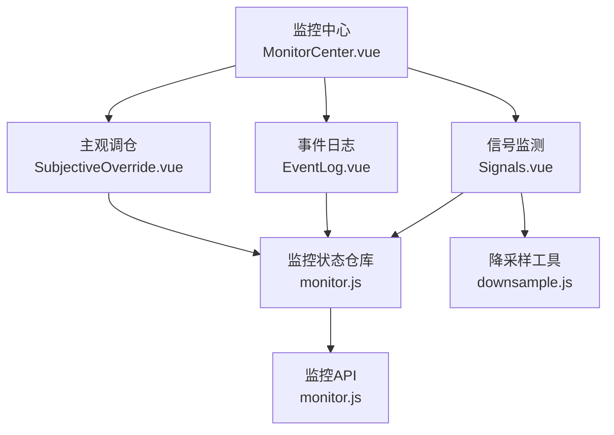
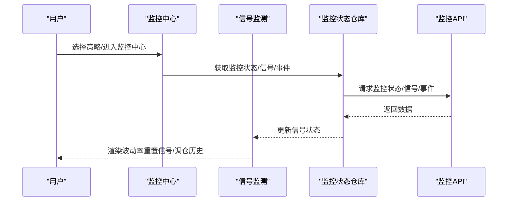
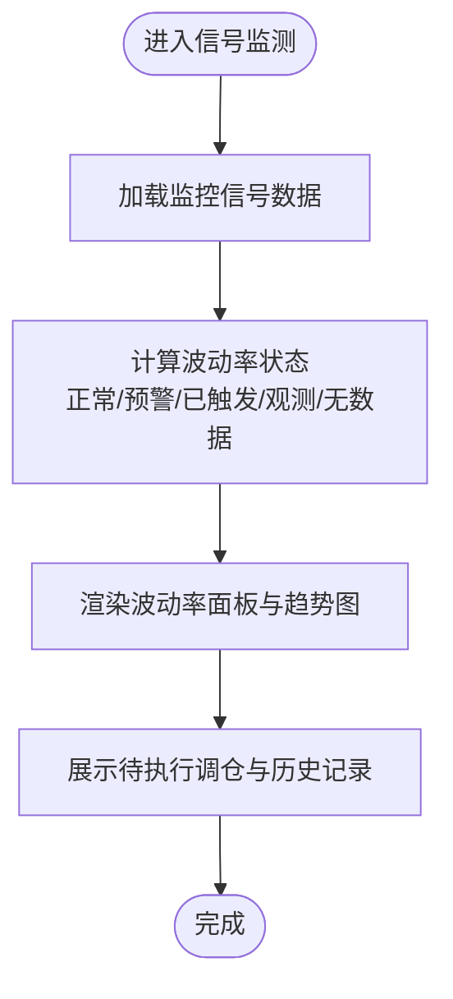
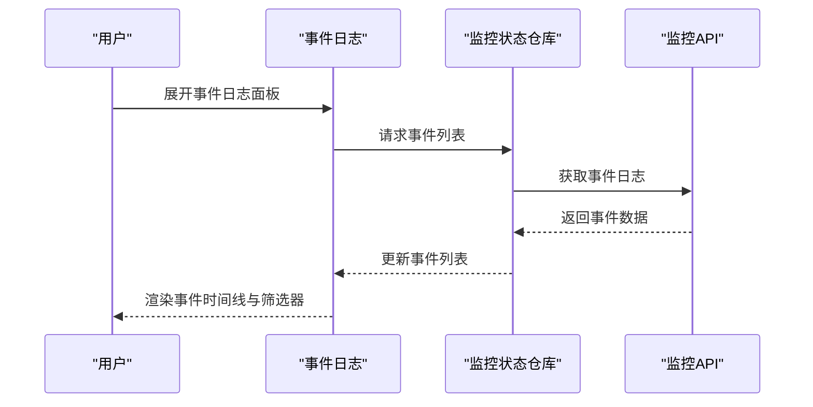
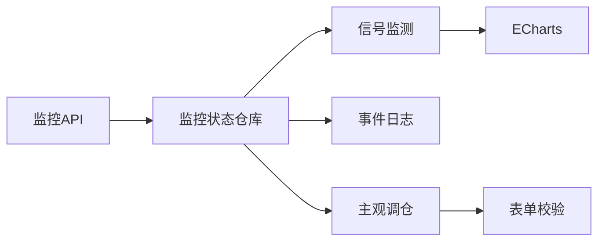

# 信号预警系统

<cite>
**本文引用的文件**
- [src/views/monitor/Signals.vue](file://src/views/monitor/Signals.vue)
- [src/store/modules/monitor.js](file://src/store/modules/monitor.js)
- [src/api/monitor.js](file://src/api/monitor.js)
- [src/views/monitor/MonitorCenter.vue](file://src/views/monitor/MonitorCenter.vue)
- [src/views/monitor/EventLog.vue](file://src/views/monitor/EventLog.vue)
- [src/views/monitor/SubjectiveOverride.vue](file://src/views/monitor/SubjectiveOverride.vue)
- [src/views/portfolio/Rebalance.vue](file://src/views/portfolio/Rebalance.vue)
- [src/utils/downsample.js](file://src/utils/downsample.js)
</cite>

## 目录
1. [简介](#简介)
2. [项目结构](#项目结构)
3. [核心组件](#核心组件)
4. [架构总览](#架构总览)
5. [详细组件分析](#详细组件分析)
6. [依赖关系分析](#依赖关系分析)
7. [性能考虑](#性能考虑)
8. [故障排查指南](#故障排查指南)
9. [结论](#结论)

## 简介
本文件为“信号预警系统”的综合技术文档，面向前端工程师与业务人员，系统阐述信号预警的设计原理、信号类型与阈值机制、通知方式配置、处理流程与可视化呈现，并提供配置管理、自定义规则与通知渠道设置的使用指南。系统覆盖波动率重置信号、调仓信号、风险预警信号等关键能力，支持实时与每日收盘后两种检查频率，提供去重、优先级排序与批量处理的前端辅助能力。

## 项目结构
信号预警系统主要由以下模块组成：
- 视图层：监控中心页面聚合多个子组件，包括信号监测、事件日志、主观调仓等
- 状态管理层：Vuex 模块集中管理监控状态、信号、事件、主观指令等
- API 层：封装监控相关接口，包括信号、事件、主观指令等
- 工具层：提供降采样等性能优化工具

图表来源
- [src/views/monitor/MonitorCenter.vue:544-583](file://src/views/monitor/MonitorCenter.vue#L544-L583)
- [src/views/monitor/Signals.vue:1-100](file://src/views/monitor/Signals.vue#L1-L100)
- [src/views/monitor/EventLog.vue:1-120](file://src/views/monitor/EventLog.vue#L1-L120)
- [src/views/monitor/SubjectiveOverride.vue:1-120](file://src/views/monitor/SubjectiveOverride.vue#L1-L120)
- [src/store/modules/monitor.js:1-80](file://src/store/modules/monitor.js#L1-L80)
- [src/api/monitor.js:1-75](file://src/api/monitor.js#L1-L75)
- [src/utils/downsample.js:1-85](file://src/utils/downsample.js#L1-L85)

章节来源
- [src/views/monitor/MonitorCenter.vue:544-583](file://src/views/monitor/MonitorCenter.vue#L544-L583)
- [src/store/modules/monitor.js:1-80](file://src/store/modules/monitor.js#L1-L80)
- [src/api/monitor.js:1-75](file://src/api/monitor.js#L1-L75)

## 核心组件
- 信号监测（Signals.vue）：负责波动率重置信号的可视化、调仓历史与待执行调仓的展示与交互
- 监控中心（MonitorCenter.vue）：聚合监控总览、净值走势、持仓明细、信号监测、主观调仓、事件日志等
- 事件日志（EventLog.vue）：事件筛选、分页加载、详情弹窗与权重对比
- 主观调仓（SubjectiveOverride.vue）：主观指令新增、取消、历史记录与权重对比
- 监控状态仓库（monitor.js）：统一管理监控状态、信号、事件、主观指令等数据
- 监控API（monitor.js）：封装信号、事件、主观指令等接口
- 降采样工具（downsample.js）：波动率趋势图的数据降采样，提升渲染性能

章节来源
- [src/views/monitor/Signals.vue:1-120](file://src/views/monitor/Signals.vue#L1-L120)
- [src/views/monitor/MonitorCenter.vue:544-583](file://src/views/monitor/MonitorCenter.vue#L544-L583)
- [src/views/monitor/EventLog.vue:1-120](file://src/views/monitor/EventLog.vue#L1-L120)
- [src/views/monitor/SubjectiveOverride.vue:1-120](file://src/views/monitor/SubjectiveOverride.vue#L1-L120)
- [src/store/modules/monitor.js:1-80](file://src/store/modules/monitor.js#L1-L80)
- [src/api/monitor.js:1-75](file://src/api/monitor.js#L1-L75)
- [src/utils/downsample.js:1-85](file://src/utils/downsample.js#L1-L85)

## 架构总览
信号预警系统采用“视图-状态-接口”三层架构：
- 视图层：通过组件化拆分，分别承担信号展示、事件记录、主观调仓等职责
- 状态层：Vuex 模块集中管理监控状态与信号数据，提供统一的数据访问入口
- 接口层：封装监控相关 API，支持信号、事件、主观指令等数据的获取与操作

图表来源
- [src/views/monitor/MonitorCenter.vue:544-583](file://src/views/monitor/MonitorCenter.vue#L544-L583)
- [src/views/monitor/Signals.vue:537-552](file://src/views/monitor/Signals.vue#L537-L552)
- [src/store/modules/monitor.js:171-190](file://src/store/modules/monitor.js#L171-L190)
- [src/api/monitor.js:66-73](file://src/api/monitor.js#L66-L73)

## 详细组件分析

### 信号监测（Signals.vue）
- 功能要点
  - 波动率重置信号：根据当前波动率与阈值计算状态（正常/预警/已触发/观测/无数据），并以进度条与颜色标识
  - 调仓历史与待执行调仓：支持展开查看详情、权重变化对比、调仓类型标签
  - 波动率趋势图：基于 ECharts 展示近30日波动率趋势，支持阈值线标注
- 关键逻辑
  - 波动率状态计算：通过当前波动率与阈值比值映射状态，支持“仅观测”主观策略模式
  - 距离阈值：计算当前波动率距离触发阈值的差额，用于提示接近阈值的风险
  - 历史数据处理：将后端返回的波动率数据转换为百分比并进行降采样，保证图表性能
- 交互细节
  - 支持刷新数据、弹窗查看待执行调仓详情、展开调仓历史的扩展行

图表来源
- [src/views/monitor/Signals.vue:366-428](file://src/views/monitor/Signals.vue#L366-L428)
- [src/views/monitor/Signals.vue:563-628](file://src/views/monitor/Signals.vue#L563-L628)

章节来源
- [src/views/monitor/Signals.vue:1-200](file://src/views/monitor/Signals.vue#L1-L200)
- [src/views/monitor/Signals.vue:366-428](file://src/views/monitor/Signals.vue#L366-L428)
- [src/views/monitor/Signals.vue:563-628](file://src/views/monitor/Signals.vue#L563-L628)

### 监控中心（MonitorCenter.vue）
- 功能要点
  - 聚合多个监控子面板：监控总览、净值走势、持仓明细、信号监测、主观调仓、事件日志、实盘发布记录
  - 策略上下文：支持切换监控策略，展示实盘生效参数与底层资产
  - 主观策略特殊处理：对主观策略隐藏波动率监测，仅展示实际波动率
- 交互细节
  - 初始化与运行监控：支持初始化监控实例与运行监控
  - 参数快速编辑：支持目标波动、波动重置阈值、窗口等参数的快速修改与实盘发布

章节来源
- [src/views/monitor/MonitorCenter.vue:544-583](file://src/views/monitor/MonitorCenter.vue#L544-L583)
- [src/views/monitor/MonitorCenter.vue:755-764](file://src/views/monitor/MonitorCenter.vue#L755-L764)

### 事件日志（EventLog.vue）
- 功能要点
  - 事件筛选：支持按事件类型（初始化、月度调仓、波动率重置、主观调仓）与日期范围筛选
  - 分页加载：支持“加载更多”，提升大数据量下的交互体验
  - 详情弹窗：展示事件基本信息、权重对比、波动率重置信息、主观调仓信息等
- 处理流程
  - 折叠面板展开时自动加载事件数据
  - 支持查询与重置筛选条件

图表来源
- [src/views/monitor/EventLog.vue:300-337](file://src/views/monitor/EventLog.vue#L300-L337)
- [src/store/modules/monitor.js:192-211](file://src/store/modules/monitor.js#L192-L211)
- [src/api/monitor.js:33-44](file://src/api/monitor.js#L33-L44)

章节来源
- [src/views/monitor/EventLog.vue:1-120](file://src/views/monitor/EventLog.vue#L1-L120)
- [src/views/monitor/EventLog.vue:300-337](file://src/views/monitor/EventLog.vue#L300-L337)
- [src/store/modules/monitor.js:192-211](file://src/store/modules/monitor.js#L192-L211)

### 主观调仓（SubjectiveOverride.vue）
- 功能要点
  - 新增主观调仓指令：设置执行日期、目标权重、说明，支持权重上限校验与总权重/等效杠杆统计
  - 待执行与历史指令：支持取消待执行指令、查看历史指令详情与权重对比
- 交互细节
  - 表单校验：总权重不超过最大杠杆乘以100%
  - 权重对比：展示当前权重与目标权重的差异与变化方向

章节来源
- [src/views/monitor/SubjectiveOverride.vue:1-120](file://src/views/monitor/SubjectiveOverride.vue#L1-L120)
- [src/views/monitor/SubjectiveOverride.vue:448-595](file://src/views/monitor/SubjectiveOverride.vue#L448-L595)

### 监控状态仓库（monitor.js）
- 功能要点
  - 状态管理：集中管理监控状态、信号、事件、主观指令、资产指标等
  - 异步动作：封装获取监控状态、信号、事件、主观指令等异步操作
  - Getter：提供活跃监控实例与是否有待执行信号等便捷属性
- 性能与错误处理
  - 统一 loading 状态管理
  - 失败时记录警告并返回空数据，避免阻塞界面

章节来源
- [src/store/modules/monitor.js:1-80](file://src/store/modules/monitor.js#L1-L80)
- [src/store/modules/monitor.js:171-190](file://src/store/modules/monitor.js#L171-L190)
- [src/store/modules/monitor.js:192-211](file://src/store/modules/monitor.js#L192-L211)

### 监控API（monitor.js）
- 功能要点
  - 信号状态：获取信号状态（波动率、待执行调仓、历史调仓等）
  - 事件日志：按类型与日期范围查询事件日志
  - 主观调仓：获取指令列表、新增指令、取消指令
- 超时设置
  - 初始化与范围运行监控设置较长超时，适配大数据量场景

章节来源
- [src/api/monitor.js:66-73](file://src/api/monitor.js#L66-L73)
- [src/api/monitor.js:33-44](file://src/api/monitor.js#L33-L44)
- [src/api/monitor.js:154-186](file://src/api/monitor.js#L154-L186)

### 降采样工具（downsample.js）
- 功能要点
  - LTTB 降采样：在保持趋势的前提下减少数据点数量，提升图表渲染性能
  - 并行数组降采样：对日期与数值数组进行联合降采样
- 使用场景
  - 波动率趋势图：在大量历史数据下进行降采样，避免渲染卡顿

章节来源
- [src/utils/downsample.js:1-85](file://src/utils/downsample.js#L1-L85)

## 依赖关系分析
- 组件耦合
  - MonitorCenter 作为容器组件，聚合 Signals、EventLog、SubjectiveOverride 等子组件
  - 子组件通过 Vuex 读取与更新监控状态，降低跨组件通信复杂度
- 外部依赖
  - ECharts：用于波动率趋势图渲染
  - Element UI：提供表格、卡片、对话框、时间线等 UI 组件
- 数据流
  - 从 API 获取数据，经 Vuex 仓库分发到各视图组件，形成单向数据流

图表来源
- [src/api/monitor.js:1-75](file://src/api/monitor.js#L1-L75)
- [src/store/modules/monitor.js:1-80](file://src/store/modules/monitor.js#L1-L80)
- [src/views/monitor/Signals.vue:553-562](file://src/views/monitor/Signals.vue#L553-L562)
- [src/views/monitor/SubjectiveOverride.vue:518-547](file://src/views/monitor/SubjectiveOverride.vue#L518-L547)

章节来源
- [src/views/monitor/MonitorCenter.vue:544-583](file://src/views/monitor/MonitorCenter.vue#L544-L583)
- [src/views/monitor/Signals.vue:553-562](file://src/views/monitor/Signals.vue#L553-L562)
- [src/views/monitor/SubjectiveOverride.vue:518-547](file://src/views/monitor/SubjectiveOverride.vue#L518-L547)

## 性能考虑
- 图表降采样：对波动率趋势图进行 LTTB 降采样，减少渲染节点数量，提升响应速度
- 分页加载：事件日志支持“加载更多”，避免一次性渲染大量数据
- 状态缓存：Vuex 集中管理状态，减少重复请求与重复渲染
- 超时设置：针对初始化与范围运行监控设置较长超时，避免频繁中断

章节来源
- [src/utils/downsample.js:1-85](file://src/utils/downsample.js#L1-L85)
- [src/views/monitor/EventLog.vue:346-353](file://src/views/monitor/EventLog.vue#L346-L353)
- [src/api/monitor.js:93-126](file://src/api/monitor.js#L93-L126)

## 故障排查指南
- 信号数据未加载
  - 检查监控实例是否已初始化，确认“监控未初始化”提示是否出现
  - 确认已选择正确的监控策略实例
- 波动率状态显示异常
  - 检查阈值配置是否正确，确认“仅观测”主观策略模式下的显示逻辑
  - 核对后端返回的波动率与阈值数据格式
- 事件日志为空
  - 确认筛选条件是否过严（如日期范围或事件类型）
  - 尝试“重置筛选”或扩大日期范围
- 主观调仓提交失败
  - 检查总权重是否超过最大杠杆限制
  - 确认执行日期与资产列表是否正确

章节来源
- [src/views/monitor/MonitorCenter.vue:280-287](file://src/views/monitor/MonitorCenter.vue#L280-L287)
- [src/views/monitor/Signals.vue:382-400](file://src/views/monitor/Signals.vue#L382-L400)
- [src/views/monitor/EventLog.vue:334-344](file://src/views/monitor/EventLog.vue#L334-L344)
- [src/views/monitor/SubjectiveOverride.vue:347-367](file://src/views/monitor/SubjectiveOverride.vue#L347-L367)

## 结论
信号预警系统通过清晰的组件划分与状态管理，实现了波动率重置信号、调仓信号与风险预警的可视化呈现，并提供了主观调仓、事件日志与参数配置等配套能力。系统在性能方面采用降采样与分页加载等策略，确保在大数据量场景下的流畅体验。建议在实际部署中结合业务需求完善阈值与通知配置，持续优化用户体验与预警准确性。