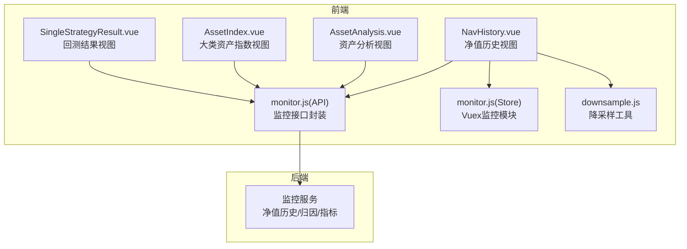
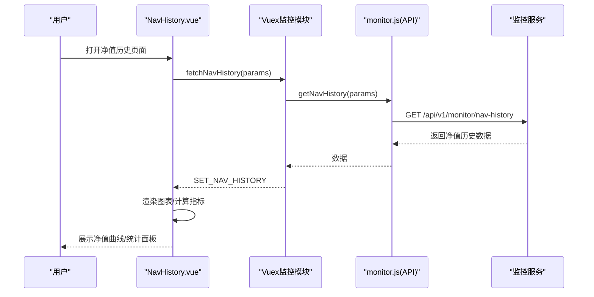
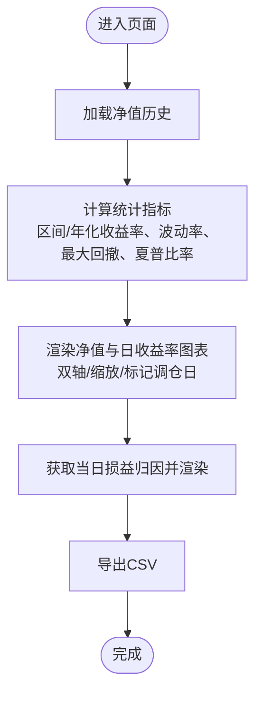
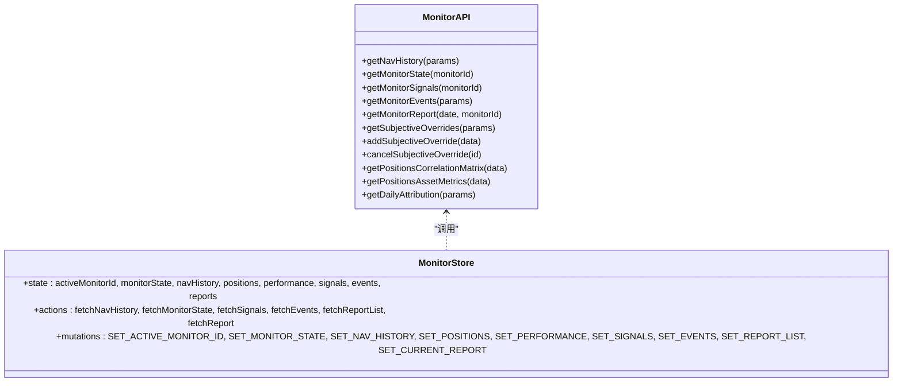
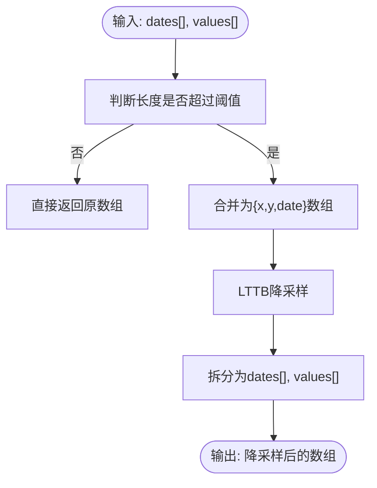
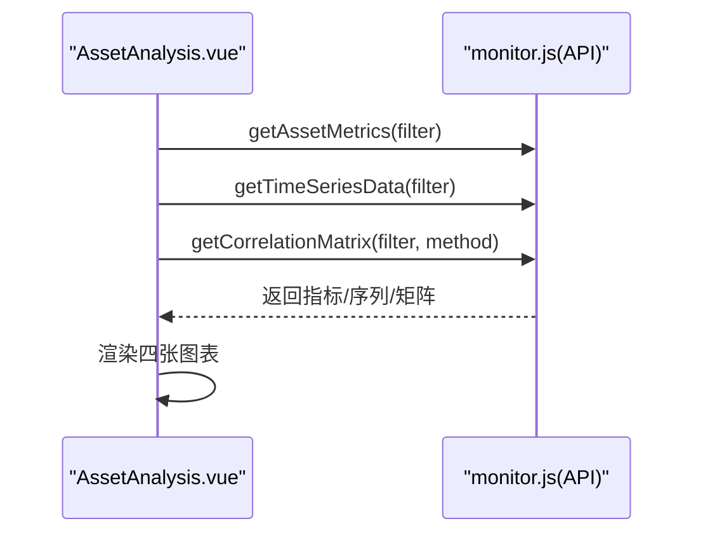
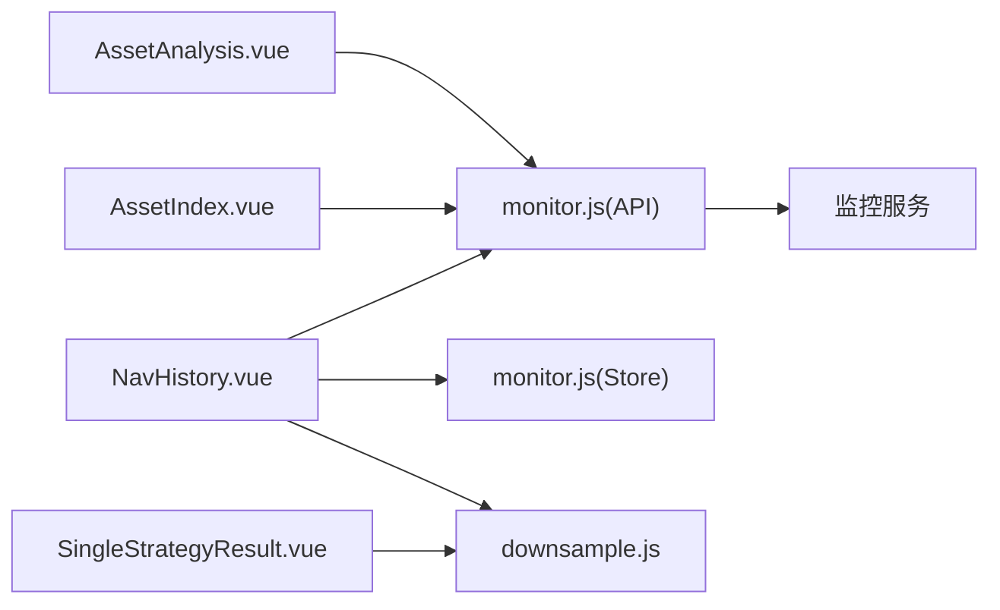

# 净值历史分析

<cite>
**本文引用的文件**
- [NavHistory.vue](file://src/views/monitor/NavHistory.vue)
- [monitor.js](file://src/api/monitor.js)
- [monitor.js](file://src/store/modules/monitor.js)
- [downsample.js](file://src/utils/downsample.js)
- [AssetAnalysis.vue](file://src/views/analysis/AssetAnalysis.vue)
- [AssetIndex.vue](file://src/views/analysis/AssetIndex.vue)
- [SingleStrategyResult.vue](file://src/views/strategy/backtest/SingleStrategyResult.vue)
- [04_valuation_domain.js](file://mongo-seed/04_valuation_domain.js)
- [index.js](file://src/router/index.js)
</cite>

## 目录
1. [简介](#简介)
2. [项目结构](#项目结构)
3. [核心组件](#核心组件)
4. [架构总览](#架构总览)
5. [详细组件分析](#详细组件分析)
6. [依赖关系分析](#依赖关系分析)
7. [性能考虑](#性能考虑)
8. [故障排查指南](#故障排查指南)
9. [结论](#结论)
10. [附录](#附录)

## 简介
本文件围绕“净值历史分析”能力，系统梳理前端数据结构、查询接口、可视化展示、统计分析与风险度量、波动率与回撤计算、以及大数据量下的降采样与性能优化策略。同时结合估值域数据种子，说明净值数据来源与字段含义，帮助读者快速理解从数据到可视化的完整链路。

## 项目结构
与净值历史分析直接相关的前端模块包括：
- 监控视图：净值历史、当日损益归因、统计指标展示
- API 层：监控相关接口封装
- 状态层：Vuex 监控模块，负责拉取与缓存净值历史
- 工具层：降采样算法，用于大数据量图表渲染优化
- 分析视图：资产分析、大类资产指数等扩展分析能力
- 路由：导航入口与页面跳转

**图表来源**
- [NavHistory.vue:162-363](file://src/views/monitor/NavHistory.vue#L162-L363)
- [monitor.js:1-227](file://src/api/monitor.js#L1-L227)
- [monitor.js:108-127](file://src/store/modules/monitor.js#L108-L127)
- [downsample.js:1-127](file://src/utils/downsample.js#L1-L127)
- [AssetAnalysis.vue:147-572](file://src/views/analysis/AssetAnalysis.vue#L147-L572)
- [AssetIndex.vue:230-294](file://src/views/analysis/AssetIndex.vue#L230-L294)
- [SingleStrategyResult.vue:596-656](file://src/views/strategy/backtest/SingleStrategyResult.vue#L596-L656)

**章节来源**
- [index.js:242-246](file://src/router/index.js#L242-L246)

## 核心组件
- 净值历史视图：负责加载净值序列、计算统计指标、绘制净值与日收益率曲线、展示当日损益归因、支持导出与缩放。
- 监控 API：封装净值历史、信号、事件、日报、主观调仓、资产分析等接口。
- Vuex 监控模块：集中管理监控上下文、净值历史、指标与加载状态。
- 降采样工具：针对大数据量进行 LTTB 或均匀采样降采样，保障 ECharts 渲染性能。
- 资产分析视图：并行请求资产指标、时间序列与相关性矩阵，渲染多图表。
- 大类资产指数视图：支持滚动波动率计算与回撤曲线展示。
- 回测视图：展示回测期间的净值与回撤曲线。

**章节来源**
- [NavHistory.vue:162-363](file://src/views/monitor/NavHistory.vue#L162-L363)
- [monitor.js:1-227](file://src/api/monitor.js#L1-L227)
- [monitor.js:108-127](file://src/store/modules/monitor.js#L108-L127)
- [downsample.js:1-127](file://src/utils/downsample.js#L1-L127)
- [AssetAnalysis.vue:147-572](file://src/views/analysis/AssetAnalysis.vue#L147-L572)
- [AssetIndex.vue:230-294](file://src/views/analysis/AssetIndex.vue#L230-L294)
- [SingleStrategyResult.vue:596-656](file://src/views/strategy/backtest/SingleStrategyResult.vue#L596-L656)

## 架构总览
净值历史分析从前端视图发起请求，经由 API 封装调用后端监控服务，返回净值序列与相关数据，随后在视图中渲染图表与统计面板，并通过降采样工具优化大数据量渲染体验。

**图表来源**
- [NavHistory.vue:286-324](file://src/views/monitor/NavHistory.vue#L286-L324)
- [monitor.js:108-127](file://src/store/modules/monitor.js#L108-L127)
- [monitor.js:19-31](file://src/api/monitor.js#L19-L31)

## 详细组件分析

### 净值历史视图（NavHistory.vue）
- 数据来源：通过 Vuex 监控模块的 fetchNavHistory 拉取净值历史，支持按日期范围过滤。
- 统计指标：区间收益率、年化收益率、年化波动率、最大回撤、夏普比率等。
- 可视化：净值曲线与日收益率柱状图双轴展示，支持数据缩放与调仓日标记。
- 损益归因：按最新日期获取当日损益归因，展示各资产对组合损益的贡献。
- 导出：支持将净值、日收益、累计收益、回撤、调仓日等导出为 CSV。

**图表来源**
- [NavHistory.vue:209-271](file://src/views/monitor/NavHistory.vue#L209-L271)
- [NavHistory.vue:343-483](file://src/views/monitor/NavHistory.vue#L343-L483)
- [NavHistory.vue:492-569](file://src/views/monitor/NavHistory.vue#L492-L569)
- [NavHistory.vue:574-599](file://src/views/monitor/NavHistory.vue#L574-L599)

**章节来源**
- [NavHistory.vue:162-363](file://src/views/monitor/NavHistory.vue#L162-L363)
- [NavHistory.vue:209-271](file://src/views/monitor/NavHistory.vue#L209-L271)
- [NavHistory.vue:343-483](file://src/views/monitor/NavHistory.vue#L343-L483)
- [NavHistory.vue:492-569](file://src/views/monitor/NavHistory.vue#L492-L569)
- [NavHistory.vue:574-599](file://src/views/monitor/NavHistory.vue#L574-L599)

### 监控 API 与状态管理
- API 封装：提供净值历史、信号、事件、日报、主观调仓、资产分析等接口。
- 状态管理：集中维护 activeMonitorId、navHistory、performance、signals 等，支持并行请求与错误兜底。

**图表来源**
- [monitor.js:1-227](file://src/api/monitor.js#L1-L227)
- [monitor.js:108-127](file://src/store/modules/monitor.js#L108-L127)
- [monitor.js:361-395](file://src/store/modules/monitor.js#L361-L395)

**章节来源**
- [monitor.js:1-227](file://src/api/monitor.js#L1-L227)
- [monitor.js:108-127](file://src/store/modules/monitor.js#L108-L127)
- [monitor.js:361-395](file://src/store/modules/monitor.js#L361-L395)

### 降采样与大数据优化（downsample.js）
- LTTB 降采样：在保持趋势的前提下显著减少数据点数量，适合单系列曲线。
- 并行数组降采样：对 dates[] 与 values[] 同步降采样，适用于多系列共享 X 轴场景。
- 均匀采样：当 LTTB 不适用时采用均匀采样，确保首尾点保留。

**图表来源**
- [downsample.js:76-89](file://src/utils/downsample.js#L76-L89)
- [downsample.js:99-118](file://src/utils/downsample.js#L99-L118)

**章节来源**
- [downsample.js:1-127](file://src/utils/downsample.js#L1-L127)

### 资产分析视图（AssetAnalysis.vue）
- 功能：并行请求资产指标、时间序列与相关性矩阵，渲染净值曲线、回撤曲线、收益率序列与相关性热力图。
- 性能：使用 Promise.all 并行拉取，提升响应速度。

**图表来源**
- [AssetAnalysis.vue:235-260](file://src/views/analysis/AssetAnalysis.vue#L235-L260)
- [AssetAnalysis.vue:480-570](file://src/views/analysis/AssetAnalysis.vue#L480-L570)

**章节来源**
- [AssetAnalysis.vue:147-572](file://src/views/analysis/AssetAnalysis.vue#L147-L572)

### 大类资产指数视图（AssetIndex.vue）
- 功能：展示净值与回撤曲线，支持滚动年化波动率计算（21 日窗口）。
- 逻辑：若后端提供波动率则优先使用，否则本地计算滚动波动率并标注波动率重置与手动调整等事件。

**章节来源**
- [AssetIndex.vue:230-294](file://src/views/analysis/AssetIndex.vue#L230-L294)

### 回测视图（SingleStrategyResult.vue）
- 功能：展示回测期间净值曲线与回撤曲线，支持降采样以优化渲染性能。
- 逻辑：对净值与回撤序列进行降采样，限制最大数据点数量。

**章节来源**
- [SingleStrategyResult.vue:596-656](file://src/views/strategy/backtest/SingleStrategyResult.vue#L596-L656)
- [SingleStrategyResult.vue:683-743](file://src/views/strategy/backtest/SingleStrategyResult.vue#L683-L743)

### 净值数据来源与字段说明（估值域种子）
- 表 dwd_val_valtable：包含净值历史关键字段，如总资产、总负债、净资产、份额、日收益、净值（单位净值/累计净值）、状态与版本等。
- 索引：PORT_ID + BIZ_DT 组合唯一索引，确保按组合与交易日检索高效。
- 种子数据：提供若干交易日的净值与日收益，便于演示与测试。

**章节来源**
- [04_valuation_domain.js:41-77](file://mongo-seed/04_valuation_domain.js#L41-L77)
- [04_valuation_domain.js:30-36](file://mongo-seed/04_valuation_domain.js#L30-L36)

## 依赖关系分析
- 视图层依赖 API 层与状态层，API 层封装 HTTP 请求，状态层负责数据缓存与并发控制。
- 降采样工具独立于业务逻辑，可被多个视图复用。
- 资产分析视图与大类资产指数视图均依赖监控 API 提供的指标与序列数据。

**图表来源**
- [NavHistory.vue:286-324](file://src/views/monitor/NavHistory.vue#L286-L324)
- [monitor.js:1-227](file://src/api/monitor.js#L1-L227)
- [monitor.js:108-127](file://src/store/modules/monitor.js#L108-L127)
- [downsample.js:1-127](file://src/utils/downsample.js#L1-L127)
- [AssetAnalysis.vue:147-572](file://src/views/analysis/AssetAnalysis.vue#L147-L572)
- [AssetIndex.vue:230-294](file://src/views/analysis/AssetIndex.vue#L230-L294)
- [SingleStrategyResult.vue:596-656](file://src/views/strategy/backtest/SingleStrategyResult.vue#L596-L656)

**章节来源**
- [index.js:242-246](file://src/router/index.js#L242-L246)

## 性能考虑
- 降采样策略
  - 单系列曲线：使用 LTTB 降采样，减少数据点数量，保持趋势一致性。
  - 多系列共享 X 轴：采用均匀采样，确保首尾点保留且跨系列对齐。
  - 回测视图：限制最大数据点数量，避免 ECharts 卡顿。
- 并行请求：资产分析视图使用 Promise.all 并行拉取指标、序列与相关性矩阵，缩短等待时间。
- 缓存与状态：Vuex 监控模块集中管理数据，避免重复请求与重复渲染。
- 图表缩放：内置 dataZoom 支持滑块与内部缩放，提升大数据浏览体验。

**章节来源**
- [downsample.js:1-127](file://src/utils/downsample.js#L1-L127)
- [AssetAnalysis.vue:235-260](file://src/views/analysis/AssetAnalysis.vue#L235-L260)
- [SingleStrategyResult.vue:596-656](file://src/views/strategy/backtest/SingleStrategyResult.vue#L596-L656)
- [NavHistory.vue:394-406](file://src/views/monitor/NavHistory.vue#L394-L406)

## 故障排查指南
- 无净值数据
  - 检查监控初始化状态与监控 ID 是否正确。
  - 确认后端监控服务是否返回净值历史数据。
- 图表空白或渲染异常
  - 检查数据格式与字段是否存在（净值、日收益、回撤等）。
  - 确认 ECharts 实例是否正确初始化与销毁。
- 性能问题
  - 对大数据量启用降采样。
  - 合理设置 dataZoom 范围，避免一次性渲染过多数据点。
- 导出失败
  - 确认存在可导出数据，检查 CSV 内容编码与下载链接。

**章节来源**
- [NavHistory.vue:286-324](file://src/views/monitor/NavHistory.vue#L286-L324)
- [NavHistory.vue:574-599](file://src/views/monitor/NavHistory.vue#L574-L599)
- [monitor.js:108-127](file://src/store/modules/monitor.js#L108-L127)

## 结论
净值历史分析在前端通过视图、API、状态与工具层协同，实现了从数据拉取、指标计算、可视化渲染到性能优化的完整闭环。结合估值域种子数据，系统具备清晰的数据来源与字段语义，能够支撑日常监控、资产分析与回测展示等多种场景。

## 附录

### 净值历史统计指标与计算要点
- 区间收益率：(末日净值/首日净值) - 1
- 年化收益率：(末日净值/首日净值)^(252/交易日数) - 1
- 年化波动率：日收益序列方差的平方根 × sqrt(252)
- 最大回撤：净值序列相对于前高点的最大跌幅
- 夏普比率：年化收益率 / 年化波动率（波动率为 0 时按 0 处理）

**章节来源**
- [NavHistory.vue:209-271](file://src/views/monitor/NavHistory.vue#L209-L271)
- [AssetIndex.vue:246-294](file://src/views/analysis/AssetIndex.vue#L246-L294)