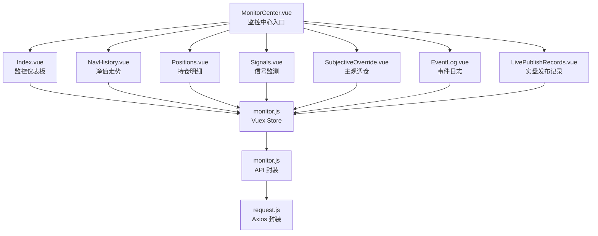
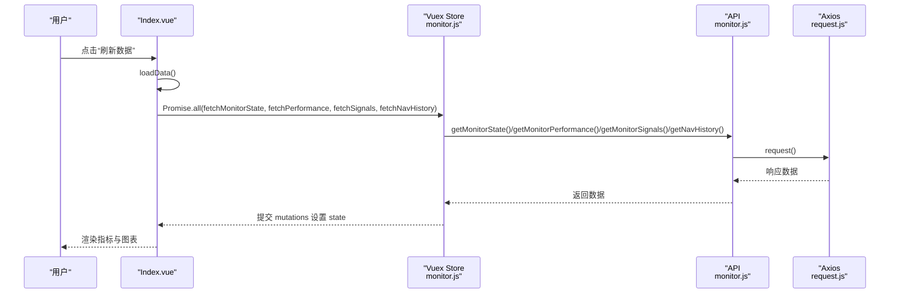
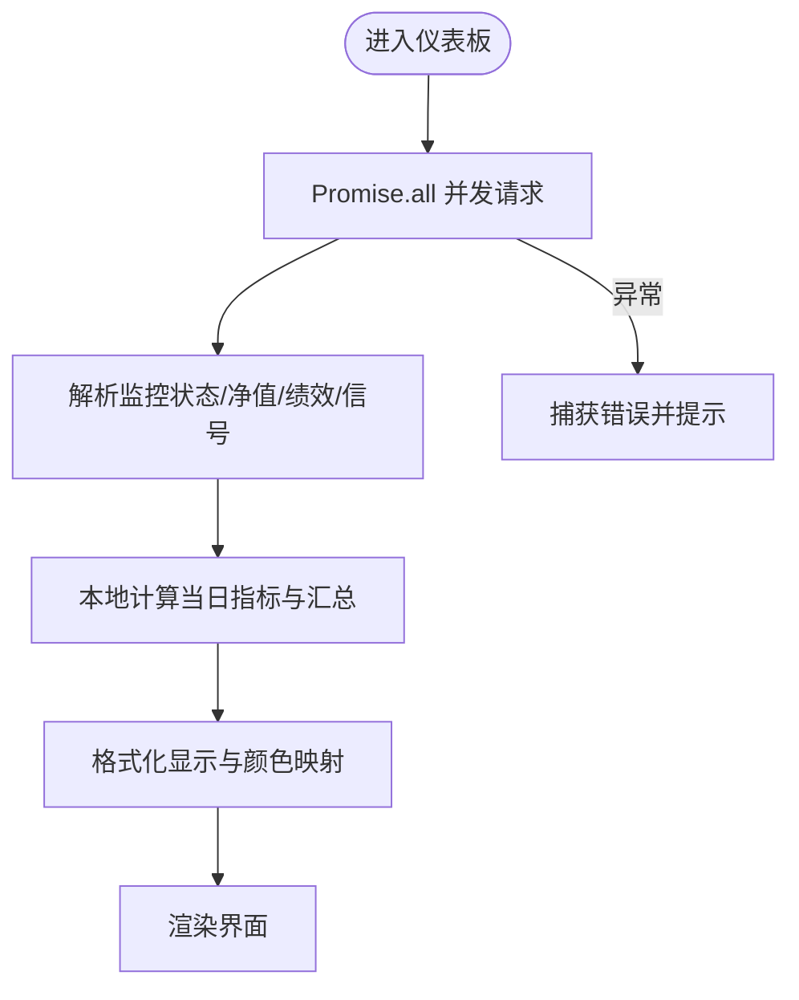
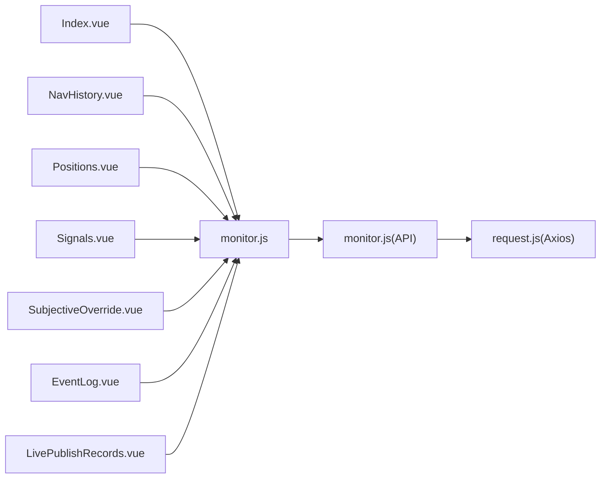

# 实时监控仪表板

<cite>
**本文档引用的文件**
- [Index.vue](file://src/views/monitor/Index.vue)
- [MonitorCenter.vue](file://src/views/monitor/MonitorCenter.vue)
- [monitor.js](file://src/store/modules/monitor.js)
- [monitor.js](file://src/api/monitor.js)
- [request.js](file://src/utils/request.js)
- [Positions.vue](file://src/views/monitor/Positions.vue)
- [Signals.vue](file://src/views/monitor/Signals.vue)
- [SubjectiveOverride.vue](file://src/views/monitor/SubjectiveOverride.vue)
- [NavHistory.vue](file://src/views/monitor/NavHistory.vue)
- [EventLog.vue](file://src/views/monitor/EventLog.vue)
- [LivePublishRecords.vue](file://src/views/monitor/LivePublishRecords.vue)
</cite>

## 目录
1. [简介](#简介)
2. [项目结构](#项目结构)
3. [核心组件](#核心组件)
4. [架构总览](#架构总览)
5. [详细组件分析](#详细组件分析)
6. [依赖关系分析](#依赖关系分析)
7. [性能考虑](#性能考虑)
8. [故障排除指南](#故障排除指南)
9. [结论](#结论)
10. [附录](#附录)

## 简介
本项目为实时监控仪表板，围绕策略的日常监控与运行状态进行可视化展示与交互。仪表板涵盖策略表现指标（当前净值、总杠杆、年化收益率、年化波动率、夏普比率、最大回撤）、当日表现指标（当日收益额、当日收益率、当前回撤、持仓资产数、距下次调仓、监测波动率）、性能基准参数展示、实时数据刷新与错误处理、以及与后端监控 API 的完整对接。

## 项目结构
监控模块采用“视图组件 + Vuex Store + API 层”的分层设计：
- 视图层：MonitorCenter 作为入口容器，内部包含多个子视图组件（仪表板、净值走势、持仓明细、信号监测、主观调仓、事件日志、实盘发布记录）。
- 状态管理层：Vuex 模块 monitor 负责集中管理监控状态（监控状态、净值历史、绩效指标、信号状态、事件日志、主观调仓指令等）。
- API 层：monitor.js 封装监控相关接口，统一通过 request.js 发起 HTTP 请求并处理全局错误。

图表来源
- [MonitorCenter.vue:1-800](file://src/views/monitor/MonitorCenter.vue#L1-L800)
- [Index.vue:1-755](file://src/views/monitor/Index.vue#L1-L755)
- [monitor.js:1-416](file://src/store/modules/monitor.js#L1-L416)
- [monitor.js:1-227](file://src/api/monitor.js#L1-L227)
- [request.js:1-100](file://src/utils/request.js#L1-L100)

章节来源
- [MonitorCenter.vue:1-800](file://src/views/monitor/MonitorCenter.vue#L1-L800)
- [Index.vue:1-755](file://src/views/monitor/Index.vue#L1-L755)
- [monitor.js:1-416](file://src/store/modules/monitor.js#L1-L416)
- [monitor.js:1-227](file://src/api/monitor.js#L1-L227)
- [request.js:1-100](file://src/utils/request.js#L1-L100)

## 核心组件
- 监控仪表板（Index.vue）：展示策略表现与当日表现指标，负责并发获取监控状态、净值历史、绩效指标、信号状态，并进行本地计算与格式化。
- 监控中心（MonitorCenter.vue）：策略上下文选择、初始化与运行控制、参数快照展示、各子视图容器。
- Vuex Store（monitor.js）：集中管理监控状态、提供异步动作（fetchMonitorState、fetchNavHistory、fetchPerformance、fetchSignals、fetchEvents、fetchSubjectiveOverrides 等）。
- API 层（monitor.js）：封装监控相关接口（状态、净值、事件、信号、运行、报告、主观调仓、资产分析等）。
- 工具层（request.js）：Axios 实例封装，统一处理鉴权、超时、404/403/422 等错误提示。

章节来源
- [Index.vue:1-755](file://src/views/monitor/Index.vue#L1-L755)
- [MonitorCenter.vue:1-800](file://src/views/monitor/MonitorCenter.vue#L1-L800)
- [monitor.js:1-416](file://src/store/modules/monitor.js#L1-L416)
- [monitor.js:1-227](file://src/api/monitor.js#L1-L227)
- [request.js:1-100](file://src/utils/request.js#L1-L100)

## 架构总览
监控仪表板的数据流自顶向下分为三层：
- 视图层：负责渲染与用户交互，触发加载动作。
- 状态层：Vuex Store 统一管理监控状态与异步动作。
- API 层：封装 HTTP 请求，统一错误处理与超时控制。

图表来源
- [Index.vue:462-476](file://src/views/monitor/Index.vue#L462-L476)
- [monitor.js:81-190](file://src/store/modules/monitor.js#L81-L190)
- [monitor.js:10-126](file://src/api/monitor.js#L10-L126)
- [request.js:1-100](file://src/utils/request.js#L1-L100)

## 详细组件分析

### 监控仪表板（Index.vue）
- 功能职责
  - 展示策略表现指标：当前净值、总杠杆、年化收益率、年化波动率、夏普比率、最大回撤。
  - 展示当日表现指标：当日收益额、当日收益率、当前回撤、持仓资产数、距下次调仓、监测波动率。
  - 展示“本页绩效对应的实盘参数”快照，支持主观配置与量化配置两种模式。
- 数据来源与处理
  - 并发请求：Promise.all 同时获取监控状态、净值历史、绩效指标、信号状态。
  - 指标计算：当日收益额与当日收益率基于净值历史相邻两日差值与比率；当前回撤基于净值历史的滚动高点；总杠杆为目标权重绝对值之和；监测波动率与阈值进行百分点标准化。
  - 格式化：统一使用百分比与数字格式化工具函数，颜色根据正负值区分。
- 错误处理与加载状态
  - 全局 try/catch 捕获 Promise.all 异常，统一提示错误消息。
  - loading 状态在请求开始与结束时切换，避免重复请求。
- 性能与可用性
  - 首屏空态提示：当监控状态为空时显示“尚未建立本策略的日常监控数据”。
  - 参数不一致警告：当“本页绩效对应的实盘参数”与当前策略实例不一致时给出警告提示。

图表来源
- [Index.vue:462-476](file://src/views/monitor/Index.vue#L462-L476)
- [Index.vue:358-443](file://src/views/monitor/Index.vue#L358-L443)

章节来源
- [Index.vue:1-755](file://src/views/monitor/Index.vue#L1-L755)

### 监控中心（MonitorCenter.vue）
- 功能职责
  - 策略上下文选择与切换，展示当前监控策略与实盘生效参数。
  - 初始化与运行监控：支持初始化（从指定日期开始逐日推演）、运行监控（单日/范围）、主观策略步进执行。
  - 参数快照展示：目标波动、波动重置阈值、总杠杆上限、资产类别、动量与反转窗口等。
  - 子视图容器：仪表板、净值走势、持仓明细、信号监测、主观调仓、事件日志、实盘发布记录。
- 关键逻辑
  - 策略筛选与上下文：根据策略模板类型（量化/主观）决定展示与交互行为。
  - 实盘参数可视化：支持交互式编辑与发布（仅非系统基准策略）。
  - 主观策略步进：在每次调仓日完成后暂停，等待人工确认后再继续。

章节来源
- [MonitorCenter.vue:1-800](file://src/views/monitor/MonitorCenter.vue#L1-L800)

### Vuex Store（monitor.js）
- 状态管理
  - activeMonitorId：当前监控实例标识。
  - monitorState：监控状态（净值、目标权重、日期等）。
  - navHistory：净值历史。
  - positions：持仓明细。
  - performance：绩效指标。
  - signals：信号状态（波动率、待执行调仓、调仓历史等）。
  - events：事件日志。
  - subjectiveOverrides：主观调仓指令列表。
  - assetMetrics、correlationMatrix：资产分析数据。
  - loading：全局加载状态。
- 异步动作
  - fetchMonitorState/fetchNavHistory/fetchPerformance/fetchSignals/fetchEvents/fetchPositions：分别获取监控状态、净值历史、绩效、信号、事件、持仓。
  - fetchSubjectiveOverrides/addSubjectiveOverrideAction/cancelSubjectiveOverrideAction：主观调仓指令的查询与操作。
  - fetchAssetAnalysis：资产相关性矩阵与波动率指标。
  - runMonitorAction/initMonitorAction/runMonitorRangeAction：运行监控、初始化、范围运行。
- 错误处理
  - 每个异步动作在失败时打印警告或抛出错误，确保不影响其他请求。
  - loading 状态在请求开始与结束时切换，避免重复请求。

章节来源
- [monitor.js:1-416](file://src/store/modules/monitor.js#L1-L416)

### API 层（monitor.js）
- 接口定义
  - 状态查询：getMonitorState、getNavHistory、getMonitorEvents、getMonitorPositions、getMonitorPerformance、getMonitorSignals。
  - 运行控制：runMonitor、initMonitor、runMonitorRange（带超时配置）。
  - 日报：getMonitorReport、getMonitorReportList。
  - 主观调仓：getSubjectiveOverrides、addSubjectiveOverride、cancelSubjectiveOverride。
  - 资产分析：getPositionsCorrelationMatrix、getPositionsAssetMetrics。
  - 当日损益归因：getDailyAttribution。
- 超时与参数
  - 初始化与范围运行设置较长超时，适配大数据量场景。
  - 多数接口支持 monitor_id 与日期范围参数。

章节来源
- [monitor.js:1-227](file://src/api/monitor.js#L1-L227)

### 工具层（request.js）
- 功能
  - Axios 实例封装，默认超时 60 秒。
  - 请求拦截：自动附加 Authorization 头。
  - 响应拦截：统一处理 401、403、404、422 等错误，提供友好提示。
  - 超时与网络错误：区分策略轻量接口与重数据接口，给出针对性提示。
- 作用
  - 保证所有 API 请求的一致性与健壮性。

章节来源
- [request.js:1-100](file://src/utils/request.js#L1-L100)

### 净值走势（NavHistory.vue）
- 功能
  - 净值与日收益率双轴图，支持数据钻取与调仓日标记。
  - 统计信息：区间收益率、年化收益率、年化波动率、最大回撤、夏普比率、数据天数。
  - 当日损益归因：按资产贡献金额绘制柱状图。
  - 每日收益统计表：支持近 10/20/30/60 日滚动视图。
- 数据来源与处理
  - 并发获取净值历史与当日损益归因，渲染图表与统计。
  - 支持日期范围筛选，动态更新图表与统计。

章节来源
- [NavHistory.vue:1-691](file://src/views/monitor/NavHistory.vue#L1-L691)

### 持仓明细（Positions.vue）
- 功能
  - 持仓汇总：总资产、总杠杆、持仓资产数、最大/最小持仓权重。
  - 权重分布饼图：按权重占比展示。
  - 资产分析：相关性热力图与年化波动率柱状图，支持窗口切换（60/120/250 天）。
- 数据来源与处理
  - 并发获取持仓明细与监控状态，随后按日期窗口计算相关性矩阵与波动率指标。
  - 图表自适应窗口大小，支持 resize。

章节来源
- [Positions.vue:1-787](file://src/views/monitor/Positions.vue#L1-L787)

### 信号监测（Signals.vue）
- 功能
  - 风险预警：待执行调仓、波动率超阈值/接近阈值、无数据/观测状态。
  - 波动率监控：当前组合波动率、阈值进度条、距触发阈值、各窗口波动率。
  - 调仓规划：上次调仓日期、待执行调仓、调仓历史记录（含权重对比与调仓后观察指标）。
- 数据来源与处理
  - 从信号状态中提取波动率、阈值、待执行调仓与历史记录。
  - 波动率趋势图按 30 日窗口展示，支持阈值线标注。

章节来源
- [Signals.vue:1-800](file://src/views/monitor/Signals.vue#L1-L800)

### 主观调仓（SubjectiveOverride.vue）
- 功能
  - 新增主观调仓指令：设置执行日期、目标权重、说明；实时校验总权重与等效杠杆。
  - 待执行指令列表：支持取消与查看详情。
  - 历史指令记录：按状态筛选查看。
- 数据来源与处理
  - 从监控状态与策略上下文获取底层资产与当前权重，初始化表单。
  - 提交时将百分比权重转换为小数权重，调用后端接口并刷新列表。

章节来源
- [SubjectiveOverride.vue:1-756](file://src/views/monitor/SubjectiveOverride.vue#L1-L756)

### 事件日志（EventLog.vue）
- 功能
  - 事件时间线：支持按类型与日期范围筛选，分页加载更多。
  - 事件详情：调仓前后权重对比、波动率重置信息、主观调仓信息、初始化配置等。
- 数据来源与处理
  - 通过 fetchEvents 获取事件列表，支持折叠面板懒加载。

章节来源
- [EventLog.vue:1-535](file://src/views/monitor/EventLog.vue#L1-L535)

### 实盘发布记录（LivePublishRecords.vue）
- 功能
  - 展示策略实盘发布、取消实盘、实盘配置更新的变更记录。
  - 结构化差异对比：底层资产（标签流）、初始化权重/权重上限（条形对比）、预设调仓（卡片对比）。
- 数据来源与处理
  - 并发获取变更日志、策略模型与资产选项，合并资产名称映射，渲染富文本差异。

章节来源
- [LivePublishRecords.vue:1-809](file://src/views/monitor/LivePublishRecords.vue#L1-L809)

## 依赖关系分析
- 组件耦合
  - MonitorCenter 作为容器，聚合多个子视图，子视图之间通过 Vuex 共享状态解耦。
  - Index.vue 与 NavHistory.vue/Positions.vue/Signals.vue/SubjectiveOverride.vue/EventLog.vue/LivePublishRecords.vue 通过 Store 与 API 间接耦合。
- 外部依赖
  - Axios：统一请求与错误处理。
  - ECharts：图表渲染（净值走势、波动率趋势、权重分布、相关性热力图、年化波动率柱状图）。
  - Element UI：UI 组件与消息提示。

图表来源
- [Index.vue:1-755](file://src/views/monitor/Index.vue#L1-L755)
- [NavHistory.vue:1-691](file://src/views/monitor/NavHistory.vue#L1-L691)
- [Positions.vue:1-787](file://src/views/monitor/Positions.vue#L1-L787)
- [Signals.vue:1-800](file://src/views/monitor/Signals.vue#L1-L800)
- [SubjectiveOverride.vue:1-756](file://src/views/monitor/SubjectiveOverride.vue#L1-L756)
- [EventLog.vue:1-535](file://src/views/monitor/EventLog.vue#L1-L535)
- [LivePublishRecords.vue:1-809](file://src/views/monitor/LivePublishRecords.vue#L1-L809)
- [monitor.js:1-416](file://src/store/modules/monitor.js#L1-L416)
- [monitor.js:1-227](file://src/api/monitor.js#L1-L227)
- [request.js:1-100](file://src/utils/request.js#L1-L100)

## 性能考虑
- 并发请求
  - 仪表板与净值走势等关键页面使用 Promise.all 并发获取多个接口，显著降低首屏等待时间。
- 图表渲染
  - 图表组件在数据就绪后延迟渲染，避免不必要的重绘；支持 resize 自适应。
- 数据缓存与去抖
  - Store 内部已缓存状态，避免重复请求；建议在高频刷新场景下增加节流/防抖。
- 超时与降级
  - 初始化与范围运行设置较长超时；普通请求默认 60 秒超时，网络异常时给出明确提示。
- 大数据量优化
  - 事件日志与净值走势支持分页/筛选；资产分析按窗口动态计算，避免一次性加载全量数据。

## 故障排除指南
- 404 资源不存在
  - 部分监控接口在未初始化时返回 404，前端已静默处理并设置空状态，无需用户干预。
- 403 拒绝访问
  - 检查登录状态与权限，必要时重新登录。
- 422 校验错误
  - 表单提交或主观调仓时出现字段校验问题，查看后端返回的 detail 信息并修正。
- 超时与网络错误
  - 策略轻量接口通常几秒内完成，若持续超时请检查后端服务、环境变量与数据库连通性。
- 数据为空或不一致
  - 未初始化策略实例会导致监控数据为空；若“本页绩效对应的实盘参数”与当前策略不一致，需重新初始化或发布。

章节来源
- [request.js:34-96](file://src/utils/request.js#L34-L96)

## 结论
实时监控仪表板通过清晰的分层架构与完善的错误处理机制，实现了策略表现与运行状态的可视化监控。其并发请求与图表渲染优化提升了用户体验，而参数快照与事件日志增强了可追溯性与可审计性。建议在生产环境中结合节流/防抖与缓存策略进一步提升性能，并持续完善错误提示与日志追踪能力。

## 附录
- 配置选项
  - 监控中心：支持策略上下文切换、初始化与运行控制、主观策略步进开关。
  - 净值走势：日期范围选择、导出 CSV、每日收益统计天数切换。
  - 持仓明细：分析窗口（60/120/250 天）、相关性与波动率图表。
  - 信号监测：波动率阈值、调仓历史查看、权重对比。
  - 主观调仓：执行日期、目标权重、说明、取消与查看详情。
- 最佳实践
  - 首次使用需先“初始化”，再“运行监控”滚动至最新交易日。
  - 主观策略建议开启“预设调仓日步进”，便于在调仓日查看绩效后再继续。
  - 高频刷新建议配合节流/防抖，避免频繁请求。
  - 大数据量场景优先使用“日期范围筛选”与“窗口切换”。