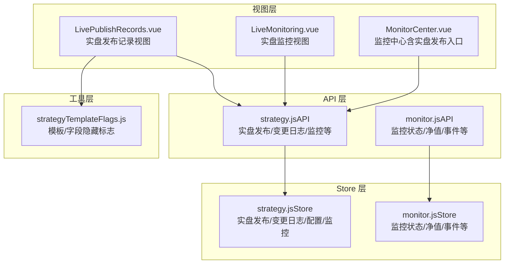
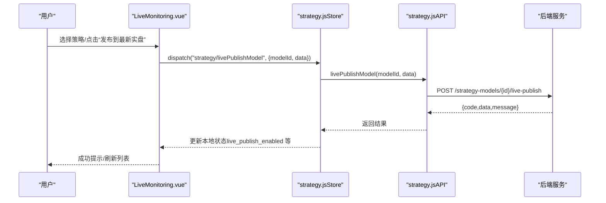
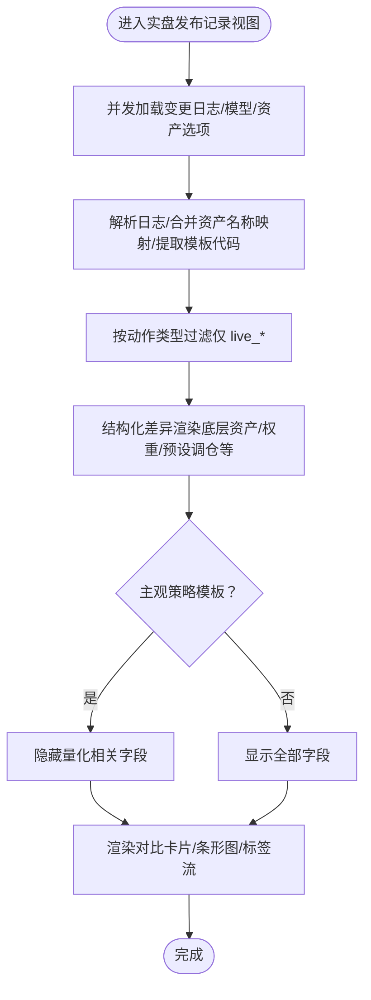
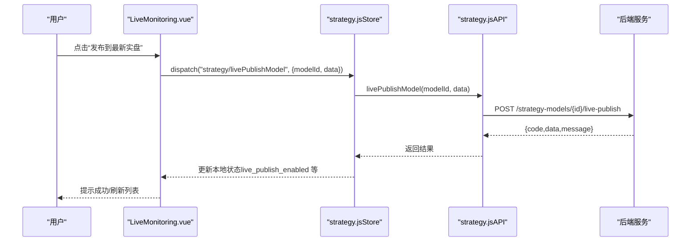
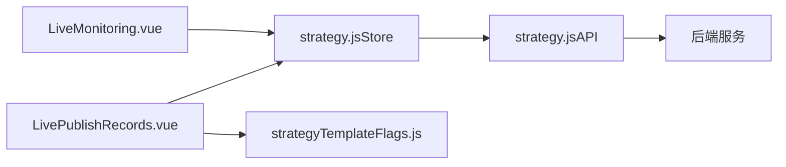

# 实盘发布记录

<cite>
**本文引用的文件**
- [LivePublishRecords.vue](file://src/views/monitor/LivePublishRecords.vue)
- [LiveMonitoring.vue](file://src/views/strategy/LiveMonitoring.vue)
- [strategy.js（API）](file://src/api/strategy.js)
- [strategy.js（Store）](file://src/store/modules/strategy.js)
- [strategyTemplateFlags.js](file://src/utils/strategyTemplateFlags.js)
- [monitor.js（API）](file://src/api/monitor.js)
- [monitor.js（Store）](file://src/store/modules/monitor.js)
- [MonitorCenter.vue](file://src/views/monitor/MonitorCenter.vue)
</cite>

## 目录
1. [简介](#简介)
2. [项目结构](#项目结构)
3. [核心组件](#核心组件)
4. [架构总览](#架构总览)
5. [详细组件分析](#详细组件分析)
6. [依赖关系分析](#依赖关系分析)
7. [性能考量](#性能考量)
8. [故障排查指南](#故障排查指南)
9. [结论](#结论)
10. [附录](#附录)

## 简介
本文件围绕“实盘发布记录”功能进行系统化说明，覆盖流程管理、记录追踪、状态监控、数据结构与状态标识、时间轴展示、版本控制、关键节点与异常处理、重试与回滚策略、查询筛选与批量操作、导出能力、优化建议与性能监控、故障诊断等内容。目标是帮助使用者与开发者全面理解实盘发布记录的全链路行为，并提供可操作的使用与运维指导。

## 项目结构
实盘发布记录涉及以下关键模块与文件：
- 视图层：实盘发布记录视图组件、实盘监控视图组件
- API 层：策略模型相关 API（含实盘发布、变更日志、监控数据等）
- Store 层：策略模块（实盘发布、变更日志、配置、监控数据等）
- 工具层：策略模板标志位（用于隐藏主观策略无关字段）

**图表来源**
- [LivePublishRecords.vue:1-809](file://src/views/monitor/LivePublishRecords.vue#L1-L809)
- [LiveMonitoring.vue:1-766](file://src/views/strategy/LiveMonitoring.vue#L1-L766)
- [strategy.js（API）:1-295](file://src/api/strategy.js#L1-L295)
- [monitor.js（API）:1-227](file://src/api/monitor.js#L1-L227)
- [strategy.js（Store）:1-468](file://src/store/modules/strategy.js#L1-L468)
- [monitor.js（Store）:1-416](file://src/store/modules/monitor.js#L1-L416)
- [strategyTemplateFlags.js:1-100](file://src/utils/strategyTemplateFlags.js#L1-L100)

**章节来源**
- [LivePublishRecords.vue:1-809](file://src/views/monitor/LivePublishRecords.vue#L1-L809)
- [LiveMonitoring.vue:1-766](file://src/views/strategy/LiveMonitoring.vue#L1-L766)
- [strategy.js（API）:1-295](file://src/api/strategy.js#L1-L295)
- [monitor.js（API）:1-227](file://src/api/monitor.js#L1-L227)
- [strategy.js（Store）:1-468](file://src/store/modules/strategy.js#L1-L468)
- [monitor.js（Store）:1-416](file://src/store/modules/monitor.js#L1-L416)
- [strategyTemplateFlags.js:1-100](file://src/utils/strategyTemplateFlags.js#L1-L100)

## 核心组件
- 实盘发布记录视图（LivePublishRecords.vue）
  - 功能：按策略实例展示实盘发布、取消实盘、实盘配置变更等记录；支持展开查看结构化变更差异（底层资产、初始化权重、预设调仓、权重上限等）。
  - 关键点：过滤动作类型、字段标签映射、富文本/条形图对比、模板类型区分（主观策略隐藏特定字段）。
- 实盘监控视图（LiveMonitoring.vue）
  - 功能：展示已实盘发布策略列表、监控详情、当日净值/权重/计划调仓、手动调仓确认/跳过、实盘变更记录折叠面板。
  - 关键点：实时刷新、配置保存、重新发布（T+1 生效）、异常提示。
- 策略 Store（strategy.js）
  - 功能：封装实盘发布/取消、变更日志、配置、监控数据、策略模型更新等异步动作。
  - 关键点：统一错误处理、状态更新、并发请求（Promise.allSettled/Promise.all）。
- 策略 API（strategy.js）
  - 功能：提供 live-publish、live-unpublish、live-change-logs、live-monitoring 等接口封装。
  - 关键点：针对实盘场景放宽超时、统一响应格式处理。
- 模板标志（strategyTemplateFlags.js）
  - 功能：定义主观策略模板与字段隐藏规则，影响记录视图的差异展示。
  - 关键点：隐藏与量化/混合动量相关的波动、窗口、历史长度等字段。

**章节来源**
- [LivePublishRecords.vue:192-535](file://src/views/monitor/LivePublishRecords.vue#L192-L535)
- [LiveMonitoring.vue:288-587](file://src/views/strategy/LiveMonitoring.vue#L288-L587)
- [strategy.js（Store）:230-351](file://src/store/modules/strategy.js#L230-L351)
- [strategy.js（API）:136-215](file://src/api/strategy.js#L136-L215)
- [strategyTemplateFlags.js:29-91](file://src/utils/strategyTemplateFlags.js#L29-L91)

## 架构总览
实盘发布记录的前后端交互与组件职责如下：

**图表来源**
- [LiveMonitoring.vue:366-392](file://src/views/strategy/LiveMonitoring.vue#L366-L392)
- [strategy.js（Store）:230-256](file://src/store/modules/strategy.js#L230-L256)
- [strategy.js（API）:136-144](file://src/api/strategy.js#L136-L144)

## 详细组件分析

### 组件一：实盘发布记录视图（LivePublishRecords.vue）
- 数据来源
  - 实盘变更日志：通过 getLiveChangeLogs 获取策略实例的变更记录。
  - 策略模型：通过 getStrategyModel 获取模板代码，用于判断是否为主观策略，决定字段对比显示。
  - 资产选项：通过 getAssetOptions 合并资产名称映射，提升字段展示可读性。
- 数据结构与字段
  - 记录字段：action（动作类型）、live_version（实盘版本）、operator（操作人）、created_at（创建时间）、change_summary（摘要）、monitor_scoped_changes（结构化变更）。
  - 动作类型：仅展示 live_publish、live_unpublish、live_config_update，排除策略保存类变更（strategy_update）。
  - 字段标签：对底层资产、初始化权重、预设调仓、权重上限等关键字段提供中文标签映射。
- 时间轴与版本控制
  - 按 created_at 排序展示，支持按 live_version 聚合查看不同版本的变更。
  - 对主观策略模板，隐藏与量化/混合动量相关的字段，避免干扰。
- 可视化与对比
  - 底层资产：支持文本对比与标签流对比（增删改），突出变更差异。
  - 初始化权重/权重上限：以条形图对比方式直观展示百分比变化。
  - 预设调仓：按日期分块展示新增/移除/权重/选项变更，支持“保存时归一化”开关变化对比。
- 查询与筛选
  - 支持按 limit/skip 分页拉取（默认 limit=80）。
  - 支持根据模板类型动态隐藏不相关字段，聚焦关键差异。
- 异常处理
  - 加载失败时清空数据并提示“加载实盘发布记录失败”。

**图表来源**
- [LivePublishRecords.vue:503-533](file://src/views/monitor/LivePublishRecords.vue#L503-L533)
- [LivePublishRecords.vue:264-278](file://src/views/monitor/LivePublishRecords.vue#L264-L278)
- [LivePublishRecords.vue:287-302](file://src/views/monitor/LivePublishRecords.vue#L287-L302)
- [strategyTemplateFlags.js:29-91](file://src/utils/strategyTemplateFlags.js#L29-L91)

**章节来源**
- [LivePublishRecords.vue:192-535](file://src/views/monitor/LivePublishRecords.vue#L192-L535)
- [strategy.js（API）:208-215](file://src/api/strategy.js#L208-L215)
- [strategyTemplateFlags.js:29-91](file://src/utils/strategyTemplateFlags.js#L29-L91)

### 组件二：实盘监控视图（LiveMonitoring.vue）
- 列表与详情
  - 已实盘发布策略列表：展示名称、实盘状态、版本、生效日。
  - 详情区域：当日净值、权重、计划调仓、手动调仓确认/跳过、实盘变更记录折叠面板。
- 实盘发布与配置
  - 发布到最新实盘：触发 livePublishModel，次交易日生效。
  - 实盘配置：保存 rebalance_mode、volatility_threshold 等参数。
  - 取消实盘发布：触发 liveUnpublishModel。
- 变更记录展示
  - 折叠面板展示变更日志，支持摘要与明细对比，按 created_at 排序。
- 并发加载与容错
  - 使用 Promise.allSettled 并发加载监控结果、变更日志、配置，任一失败不影响其他数据展示。

**图表来源**
- [LiveMonitoring.vue:366-392](file://src/views/strategy/LiveMonitoring.vue#L366-L392)
- [strategy.js（Store）:230-256](file://src/store/modules/strategy.js#L230-L256)
- [strategy.js（API）:136-144](file://src/api/strategy.js#L136-L144)

**章节来源**
- [LiveMonitoring.vue:288-587](file://src/views/strategy/LiveMonitoring.vue#L288-L587)
- [strategy.js（Store）:230-351](file://src/store/modules/strategy.js#L230-L351)
- [strategy.js（API）:136-154](file://src/api/strategy.js#L136-L154)

### 组件三：监控中心（MonitorCenter.vue）中的实盘发布入口
- 在监控中心中，当策略或资产列表存在时，支持“保存并提交实盘发布（次交易日生效）”，便于快速落地变更。
- 流程：先更新策略模型（可携带 source/operator），再调用 livePublishModel 完成发布。

**章节来源**
- [MonitorCenter.vue:938-969](file://src/views/monitor/MonitorCenter.vue#L938-L969)

## 依赖关系分析
- 组件与 Store 的依赖
  - LivePublishRecords.vue 依赖 strategy.js（Store）中的 fetchLiveChangeLogs、getStrategyModel、getAssetOptions。
  - LiveMonitoring.vue 依赖 strategy.js（Store）中的 fetchLivePublishedModelList、fetchLiveMonitoring、fetchLiveChangeLogs、updateLiveConfig、livePublishModel、liveUnpublishModel。
- Store 与 API 的依赖
  - strategy.js（Store）封装了 live-publish、live-unpublish、live-change-logs、live-monitoring、live-config 等 API。
- 模板标志的影响
  - strategyTemplateFlags.js 决定主观策略模板下字段对比的可见性，从而影响 LivePublishRecords.vue 的展示逻辑。

**图表来源**
- [LivePublishRecords.vue:192-535](file://src/views/monitor/LivePublishRecords.vue#L192-L535)
- [LiveMonitoring.vue:288-587](file://src/views/strategy/LiveMonitoring.vue#L288-L587)
- [strategy.js（Store）:230-351](file://src/store/modules/strategy.js#L230-L351)
- [strategy.js（API）:136-215](file://src/api/strategy.js#L136-L215)
- [strategyTemplateFlags.js:29-91](file://src/utils/strategyTemplateFlags.js#L29-L91)

**章节来源**
- [LivePublishRecords.vue:192-535](file://src/views/monitor/LivePublishRecords.vue#L192-L535)
- [LiveMonitoring.vue:288-587](file://src/views/strategy/LiveMonitoring.vue#L288-L587)
- [strategy.js（Store）:230-351](file://src/store/modules/strategy.js#L230-L351)
- [strategy.js（API）:136-215](file://src/api/strategy.js#L136-L215)
- [strategyTemplateFlags.js:29-91](file://src/utils/strategyTemplateFlags.js#L29-L91)

## 性能考量
- 并发加载
  - LivePublishRecords.vue 使用 Promise.all 并发拉取变更日志、模型与资产选项，减少等待时间。
  - LiveMonitoring.vue 使用 Promise.allSettled 并发加载监控结果、变更日志、配置，避免单点失败阻塞。
- 超时设置
  - 实盘发布/取消/变更日志等接口针对实盘场景放宽超时，降低偶发慢查询导致的失败概率。
- 渲染优化
  - 结构化差异采用分块渲染（底层资产/权重/预设调仓），避免一次性渲染大量 DOM。
  - 条形图对比按需计算宽度，避免重复计算。

**章节来源**
- [LivePublishRecords.vue:512-516](file://src/views/monitor/LivePublishRecords.vue#L512-L516)
- [LiveMonitoring.vue:316-320](file://src/views/strategy/LiveMonitoring.vue#L316-L320)
- [strategy.js（API）:136-154](file://src/api/strategy.js#L136-L154)

## 故障排查指南
- 常见问题与定位
  - 实盘发布失败：检查返回码与消息，确认模型是否存在、状态是否允许发布；必要时重试或联系后端。
  - 取消实盘发布未生效：确认数据库更新结果，若返回 false，需检查模型状态。
  - 实盘变更记录为空：确认策略实例 ID 是否正确、是否有 live_* 类型记录、是否被模板标志隐藏。
  - 监控数据缺失：确认策略是否已实盘发布且监控已初始化。
- 重试与回滚
  - 重试：在 UI 层提供加载状态与错误提示，必要时重新触发发布/取消/刷新。
  - 回滚：取消实盘发布（live-unpublish）可将策略恢复至未实盘状态，但不保证业务层面的完全回滚，需结合业务规则评估。
- 日志与调试
  - Store 层统一捕获错误并打印日志，便于定位具体接口与参数。
  - 建议在浏览器控制台查看网络请求与响应，核对 created_at、live_version、action 等关键字段。

**章节来源**
- [strategy.js（Store）:230-280](file://src/store/modules/strategy.js#L230-L280)
- [strategy.js（API）:136-154](file://src/api/strategy.js#L136-L154)

## 结论
实盘发布记录功能通过“视图层 + Store + API + 工具层”的协同，实现了对策略实盘发布全流程的可视化追踪与对比展示。其核心优势在于：
- 明确的动作类型过滤与字段标签映射，提升可读性；
- 面向主观策略的字段隐藏机制，确保对比聚焦；
- 并发加载与宽松超时策略，提升用户体验；
- 与监控中心联动，支持“保存并提交实盘发布”的快捷路径。

建议在生产环境中配合完善的告警与审计机制，持续优化渲染与请求策略，保障大规模策略实例下的稳定性与性能。

## 附录

### 数据模型与状态标识
- 记录字段
  - action：动作类型（live_publish/live_unpublish/live_config_update）
  - live_version：实盘版本号
  - operator：操作人
  - created_at：变更时间
  - change_summary：摘要
  - monitor_scoped_changes：结构化变更（底层资产/权重/预设调仓等）
- 状态标识
  - live_publish_enabled：是否已实盘发布
  - live_snapshot_outdated：快照是否过期（用于提示重新发布）
  - live_rebalance_mode：调仓模式（auto/manual）
  - live_volatility_threshold：波动率阈值

**章节来源**
- [LivePublishRecords.vue:201-242](file://src/views/monitor/LivePublishRecords.vue#L201-L242)
- [LiveMonitoring.vue:458-586](file://src/views/strategy/LiveMonitoring.vue#L458-L586)

### 查询筛选与批量操作
- 查询筛选
  - 分页：limit/skip 参数用于分页拉取变更日志。
  - 过滤：仅展示 live_* 类型记录，排除策略保存类变更。
- 批量操作
  - 当前视图未提供批量导出功能；可通过后端接口或外部工具对接变更日志数据进行批量处理。

**章节来源**
- [LivePublishRecords.vue:264-266](file://src/views/monitor/LivePublishRecords.vue#L264-L266)
- [strategy.js（API）:208-215](file://src/api/strategy.js#L208-L215)

### 导出能力
- 当前组件未内置导出按钮；建议通过后端变更日志接口或报表系统对接，实现 CSV/Excel 导出。

**章节来源**
- [strategy.js（API）:208-215](file://src/api/strategy.js#L208-L215)