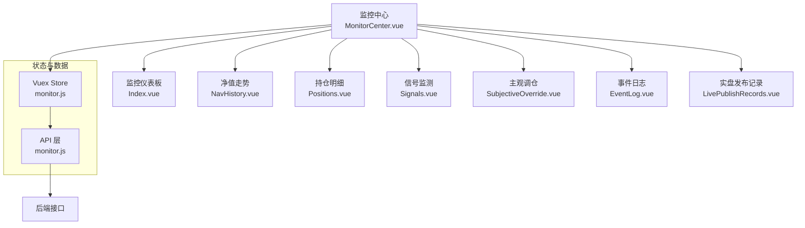
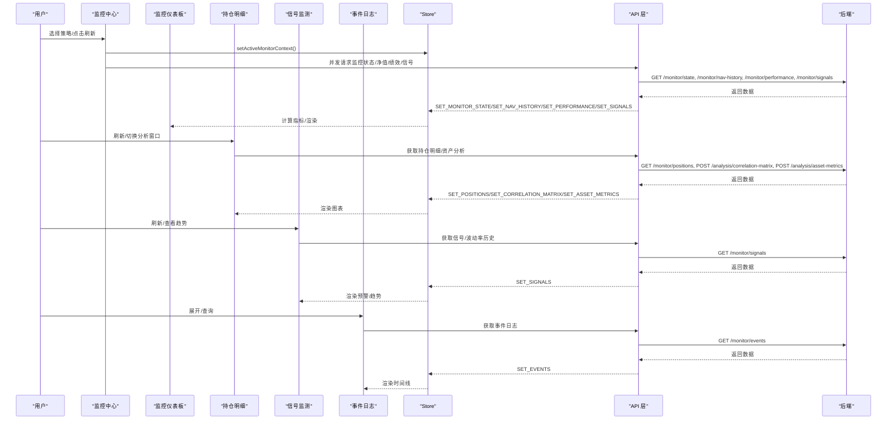
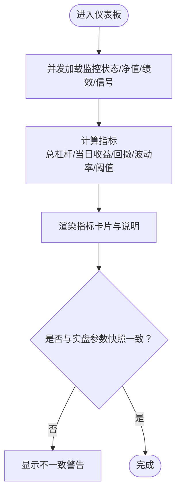
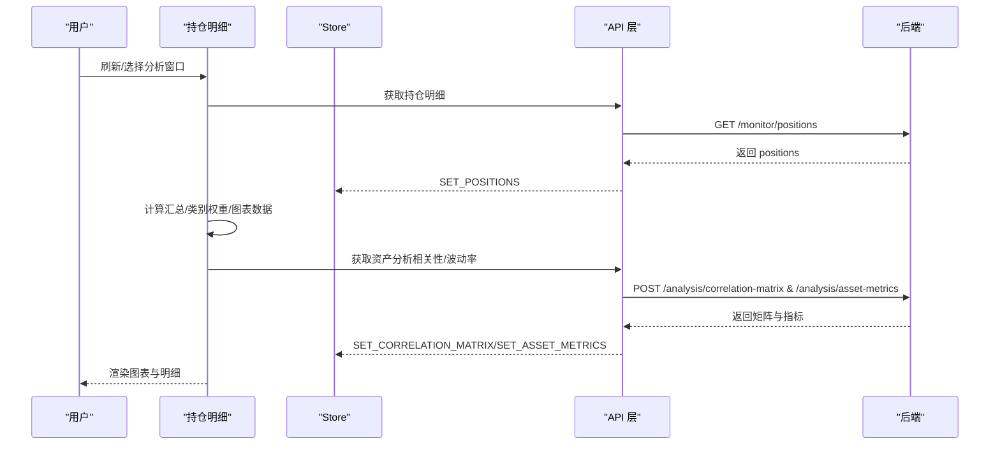
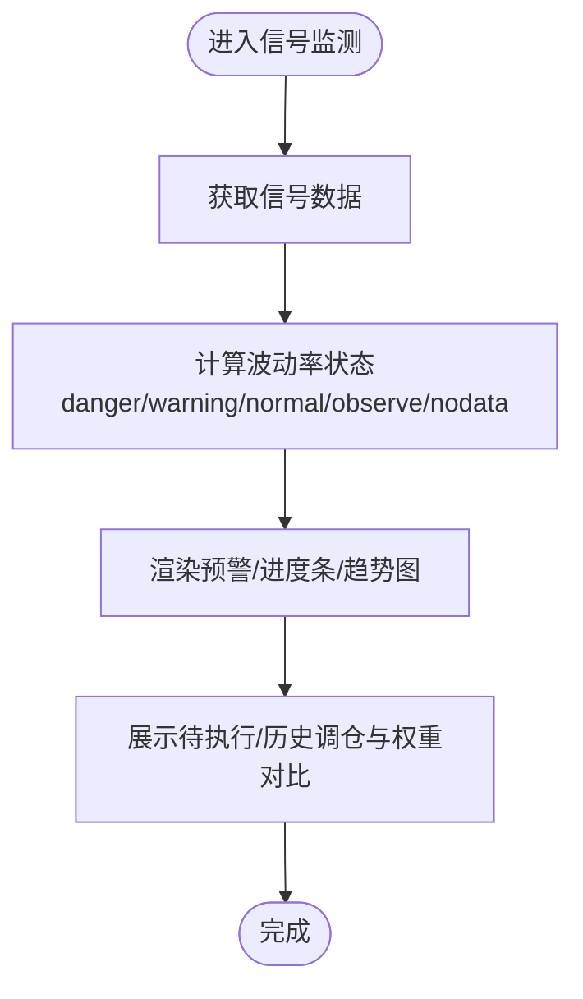
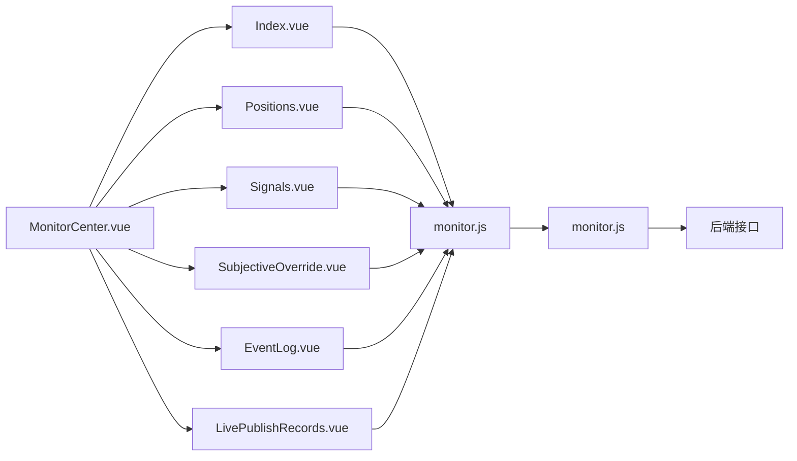

# 持仓监控

<cite>
**本文引用的文件**
- [src/views/monitor/Index.vue](file://src/views/monitor/Index.vue)
- [src/views/monitor/Positions.vue](file://src/views/monitor/Positions.vue)
- [src/views/monitor/Signals.vue](file://src/views/monitor/Signals.vue)
- [src/views/monitor/EventLog.vue](file://src/views/monitor/EventLog.vue)
- [src/views/monitor/MonitorCenter.vue](file://src/views/monitor/MonitorCenter.vue)
- [src/views/monitor/SubjectiveOverride.vue](file://src/views/monitor/SubjectiveOverride.vue)
- [src/store/modules/monitor.js](file://src/store/modules/monitor.js)
- [src/api/monitor.js](file://src/api/monitor.js)
- [src/views/monitor/LivePublishRecords.vue](file://src/views/monitor/LivePublishRecords.vue)
- [src/views/monitor/SubjectiveManualWeightsSnapshot.vue](file://src/views/monitor/SubjectiveManualWeightsSnapshot.vue)
</cite>

## 目录
1. [简介](#简介)
2. [项目结构](#项目结构)
3. [核心组件](#核心组件)
4. [架构总览](#架构总览)
5. [详细组件分析](#详细组件分析)
6. [依赖关系分析](#依赖关系分析)
7. [性能考虑](#性能考虑)
8. [故障排查指南](#故障排查指南)
9. [结论](#结论)
10. [附录](#附录)

## 简介
本文件面向“持仓监控”功能，系统化阐述其实时持仓跟踪、持仓变化检测、风险指标监控、资产分布分析等核心能力，以及数据来源、更新频率、异常检测与预警机制、配置与自定义规则、报表与报告生成、性能优化与大数据处理、故障排查等实践要点。文档同时提供可视化图表帮助理解组件交互与数据流。

## 项目结构
监控模块由“监控中心”作为入口，聚合“仪表板”“净值走势”“持仓明细”“信号监测”“主观调仓”“事件日志”“实盘发布记录”等子视图，并通过 Vuex Store 与 API 层进行数据交互。

图表来源
- [src/views/monitor/MonitorCenter.vue](file://src/views/monitor/MonitorCenter.vue)
- [src/views/monitor/Index.vue](file://src/views/monitor/Index.vue)
- [src/views/monitor/Positions.vue](file://src/views/monitor/Positions.vue)
- [src/views/monitor/Signals.vue](file://src/views/monitor/Signals.vue)
- [src/views/monitor/SubjectiveOverride.vue](file://src/views/monitor/SubjectiveOverride.vue)
- [src/views/monitor/EventLog.vue](file://src/views/monitor/EventLog.vue)
- [src/views/monitor/LivePublishRecords.vue](file://src/views/monitor/LivePublishRecords.vue)
- [src/store/modules/monitor.js](file://src/store/modules/monitor.js)
- [src/api/monitor.js](file://src/api/monitor.js)

章节来源
- [src/views/monitor/MonitorCenter.vue](file://src/views/monitor/MonitorCenter.vue)
- [src/store/modules/monitor.js](file://src/store/modules/monitor.js)
- [src/api/monitor.js](file://src/api/monitor.js)

## 核心组件
- 监控中心：策略选择、初始化、运行监控、参数快照与变更记录展示。
- 监控仪表板：净值、总杠杆、年化收益/波动率、夏普比率、最大回撤、当日收益/回撤、持仓资产数、距下次调仓、监测波动率与阈值等关键指标。
- 持仓明细：总资产/CNH、总杠杆、持仓资产数、最大/最小持仓权重、资产类别权重小计、持仓明细表、权重分布饼图、相关性矩阵与波动率分析。
- 信号监测：波动率状态与预警、波动率趋势图、待执行调仓与历史调仓记录、权重变化对比。
- 事件日志：事件类型筛选、时间线视图、事件详情与权重对比。
- 主观调仓：新增主观调仓指令、待执行与历史指令、权重对比与统计。
- 实盘发布记录：参数/资产/窗口变更的结构化差异展示。

章节来源
- [src/views/monitor/Index.vue](file://src/views/monitor/Index.vue)
- [src/views/monitor/Positions.vue](file://src/views/monitor/Positions.vue)
- [src/views/monitor/Signals.vue](file://src/views/monitor/Signals.vue)
- [src/views/monitor/EventLog.vue](file://src/views/monitor/EventLog.vue)
- [src/views/monitor/SubjectiveOverride.vue](file://src/views/monitor/SubjectiveOverride.vue)
- [src/views/monitor/LivePublishRecords.vue](file://src/views/monitor/LivePublishRecords.vue)

## 架构总览
前端通过 API 层调用后端接口，Store 统一管理监控状态、净值历史、绩效、信号、事件、主观调仓指令、资产分析等数据。组件按需加载并渲染，支持批量并发请求以提升响应速度。

图表来源
- [src/views/monitor/MonitorCenter.vue](file://src/views/monitor/MonitorCenter.vue)
- [src/views/monitor/Index.vue](file://src/views/monitor/Index.vue)
- [src/views/monitor/Positions.vue](file://src/views/monitor/Positions.vue)
- [src/views/monitor/Signals.vue](file://src/views/monitor/Signals.vue)
- [src/views/monitor/EventLog.vue](file://src/views/monitor/EventLog.vue)
- [src/store/modules/monitor.js](file://src/store/modules/monitor.js)
- [src/api/monitor.js](file://src/api/monitor.js)

## 详细组件分析

### 监控仪表板（Index.vue）
- 功能要点
  - 实时净值、总杠杆、年化收益/波动率、夏普比率、最大回撤等指标展示。
  - 当日收益额/收益率、当前回撤、持仓资产数、距下次调仓、监测波动率与阈值。
  - “本页绩效对应的实盘参数”展示与快照一致性校验。
- 关键计算
  - 总杠杆：target_weights 绝对值之和（小数权重）。
  - 当日收益额/收益率：基于净值历史相邻两日差值与环比。
  - 当前回撤：净值序列相对高点的最大回撤百分比。
  - 持仓资产数：按权重绝对值过滤的有效持仓数量。
  - 监测波动率与阈值：标准化百分点数值，按主观/量化策略区分展示。
- 异常与提示
  - 绩效与顶部“实盘生效参数”不一致时给出警告。
  - 未初始化时提示“尚未建立本策略的日常监控数据”。

图表来源
- [src/views/monitor/Index.vue](file://src/views/monitor/Index.vue)

章节来源
- [src/views/monitor/Index.vue](file://src/views/monitor/Index.vue)

### 持仓明细（Positions.vue）
- 功能要点
  - 汇总：总资产（CNH）、总杠杆、持仓资产数、最大/最小持仓权重。
  - 资产类别权重小计：按权益/固收/商品等分类统计。
  - 明细表：资产名称、类别、当前权重、当日涨跌、计价货币。
  - 图表：权重分布饼图、相关性热力图、波动率柱状图（75分位阈值）。
  - 分析窗口：60/120/250交易日可选，动态计算相关性矩阵与波动率指标。
- 数据来源与精度
  - 持仓明细来自后端接口，兼容旧格式字段（current_weight/actual_weight、daily_change/daily_return）。
  - 权重分布与波动率阈值计算严格基于后端返回的数值口径。
- 异常与提示
  - 无持仓时显示空态与默认12类资产回退逻辑。
  - 分析窗口切换时重新拉取相关性与波动率数据。

图表来源
- [src/views/monitor/Positions.vue](file://src/views/monitor/Positions.vue)
- [src/store/modules/monitor.js](file://src/store/modules/monitor.js)
- [src/api/monitor.js](file://src/api/monitor.js)

章节来源
- [src/views/monitor/Positions.vue](file://src/views/monitor/Positions.vue)
- [src/store/modules/monitor.js](file://src/store/modules/monitor.js)
- [src/api/monitor.js](file://src/api/monitor.js)

### 信号监测（Signals.vue）
- 功能要点
  - 风险预警：待执行调仓、波动率超阈值/接近阈值、无待处理事项等状态提示。
  - 波动率监控：当前波动率、阈值进度条、距触发阈值、多窗口波动率展示、30日趋势图。
  - 调仓规划：上次调仓日期/类型、待执行调仓（含目标权重）、历史调仓记录与权重变化对比。
- 预警规则
  - 量化策略：波动率占比阈值（如≥100%危险、≥85%预警、<85%正常）。
  - 主观策略：仅观测波动率，不参与阈值触发类调仓。
- 自动提醒机制
  - 基于后端 signals 返回的状态字段与阈值计算，前端即时渲染预警与进度条。

图表来源
- [src/views/monitor/Signals.vue](file://src/views/monitor/Signals.vue)

章节来源
- [src/views/monitor/Signals.vue](file://src/views/monitor/Signals.vue)

### 事件日志（EventLog.vue）
- 功能要点
  - 事件类型筛选（初始化/月度调仓/波动率重置/主观调仓）。
  - 时间线视图：事件时间戳、类型标签、摘要与查看详情。
  - 权重对比：调仓前后权重对比与变化方向。
  - 加载更多：分页加载，支持日期范围筛选。
- 数据来源
  - 通过后端 events 接口获取，支持按类型与日期范围过滤。

章节来源
- [src/views/monitor/EventLog.vue](file://src/views/monitor/EventLog.vue)
- [src/api/monitor.js](file://src/api/monitor.js)

### 主观调仓（SubjectiveOverride.vue）
- 功能要点
  - 新增主观调仓：执行日期、目标权重网格（按底层资产）、权重合计与等效杠杆、权重上限提示、当前权重对比。
  - 待执行与历史指令：状态筛选、详情弹窗、权重对比。
  - 表单校验：总权重不超过最大杠杆×100%。
- 交互细节
  - 与策略上下文联动，确保表单项键与后端资产列表一致。
  - 支持取消待执行指令。

章节来源
- [src/views/monitor/SubjectiveOverride.vue](file://src/views/monitor/SubjectiveOverride.vue)

### 实盘发布记录（LivePublishRecords.vue）
- 功能要点
  - 展示“实盘发布/取消实盘/日常监控侧实盘配置”变更。
  - 结构化差异：底层资产增删改、初始化权重、预设调仓（日期、权重、是否归一化）、参数窗口等。
  - 丰富展示：资产标签流、权重条形图、调仓日卡片等。
- 适用场景
  - 对比监控运行时参数/资产/窗口变更，定位影响因素。

章节来源
- [src/views/monitor/LivePublishRecords.vue](file://src/views/monitor/LivePublishRecords.vue)

### 监控中心（MonitorCenter.vue）
- 功能要点
  - 策略选择与上下文：支持混合动量与主观配置策略实例隔离。
  - 初始化与运行：支持指定启动日期初始化，支持单日/范围运行监控。
  - 参数快照：展示“实盘生效参数”，支持快捷编辑并实盘发布。
  - 组件聚合：仪表板、净值、持仓、信号、主观调仓、事件、发布记录。
- 交互细节
  - 主观策略支持“预设调仓日步进”，便于在每档调仓日查看绩效后再继续。
  - 禁止在步进暂停期间再次初始化，避免清空已推演状态。

章节来源
- [src/views/monitor/MonitorCenter.vue](file://src/views/monitor/MonitorCenter.vue)

## 依赖关系分析
- 组件耦合
  - MonitorCenter 作为入口，聚合多个子视图，通过 Store 与 API 层解耦。
  - 各子视图按需调用 Store 的 actions 与 getters，避免跨组件直接通信。
- 外部依赖
  - API 层封装后端接口，统一错误处理与超时设置。
  - ECharts 用于图表渲染，组件在生命周期内初始化/销毁实例，避免内存泄漏。
- 数据一致性
  - Store 提供统一状态入口，组件通过 mapState/mapActions 解耦数据读写。
  - 对于主观策略与量化策略，波动率阈值与展示存在差异化处理。

图表来源
- [src/views/monitor/MonitorCenter.vue](file://src/views/monitor/MonitorCenter.vue)
- [src/views/monitor/Index.vue](file://src/views/monitor/Index.vue)
- [src/views/monitor/Positions.vue](file://src/views/monitor/Positions.vue)
- [src/views/monitor/Signals.vue](file://src/views/monitor/Signals.vue)
- [src/views/monitor/SubjectiveOverride.vue](file://src/views/monitor/SubjectiveOverride.vue)
- [src/views/monitor/EventLog.vue](file://src/views/monitor/EventLog.vue)
- [src/views/monitor/LivePublishRecords.vue](file://src/views/monitor/LivePublishRecords.vue)
- [src/store/modules/monitor.js](file://src/store/modules/monitor.js)
- [src/api/monitor.js](file://src/api/monitor.js)

章节来源
- [src/store/modules/monitor.js](file://src/store/modules/monitor.js)
- [src/api/monitor.js](file://src/api/monitor.js)

## 性能考虑
- 并发请求
  - 仪表板与持仓明细均采用 Promise.all 并发拉取多个接口，减少总等待时间。
- 图表渲染
  - ECharts 实例在组件销毁时释放，resize 事件在组件销毁时移除监听。
- 数据缓存与回退
  - 持仓为空时回退到默认12类资产，避免空数据导致的渲染异常。
- 大数据处理
  - 资产分析窗口按60/120/250交易日切换，避免一次性加载过多历史数据。
  - 事件日志支持分页加载与日期范围筛选，降低前端渲染压力。
- 错误处理
  - API 层统一捕获错误并设置空状态，组件层显示友好提示。

章节来源
- [src/views/monitor/Index.vue](file://src/views/monitor/Index.vue)
- [src/views/monitor/Positions.vue](file://src/views/monitor/Positions.vue)
- [src/views/monitor/Signals.vue](file://src/views/monitor/Signals.vue)
- [src/views/monitor/EventLog.vue](file://src/views/monitor/EventLog.vue)
- [src/store/modules/monitor.js](file://src/store/modules/monitor.js)
- [src/api/monitor.js](file://src/api/monitor.js)

## 故障排查指南
- 初始化与数据为空
  - 现象：监控仪表板提示“尚未建立本策略的日常监控数据”。
  - 排查：确认已点击“初始化”，并完成从启动日期到最新交易日的推演。
  - 参考：监控中心初始化对话框与说明。
- 波动率阈值不生效
  - 现象：主观策略不显示波动率阈值触发预警。
  - 排查：确认策略模板为主观配置，前端会隐藏阈值对比。
- 图表空白或异常
  - 现象：相关性/波动率图表无数据。
  - 排查：检查分析窗口与日期范围，确认已成功获取资产分析数据。
- 主观调仓提交失败
  - 现象：表单校验或提交报错。
  - 排查：检查总权重是否超过最大杠杆×100%，确认资产键与后端一致。
- 事件日志为空
  - 现象：事件日志面板无记录。
  - 排查：确认已展开面板或执行查询，检查筛选条件（类型/日期范围）。

章节来源
- [src/views/monitor/MonitorCenter.vue](file://src/views/monitor/MonitorCenter.vue)
- [src/views/monitor/Signals.vue](file://src/views/monitor/Signals.vue)
- [src/views/monitor/Positions.vue](file://src/views/monitor/Positions.vue)
- [src/views/monitor/SubjectiveOverride.vue](file://src/views/monitor/SubjectiveOverride.vue)
- [src/views/monitor/EventLog.vue](file://src/views/monitor/EventLog.vue)

## 结论
持仓监控通过“监控中心”统一入口，结合“仪表板、持仓明细、信号监测、事件日志、主观调仓、发布记录”六大模块，形成完整的实时跟踪与风险预警体系。前端采用并发请求、图表实例生命周期管理与数据回退策略，保障在大数据量下的稳定与性能。建议在生产环境中配合严格的初始化流程、参数快照与事件审计，确保监控数据的准确性与可追溯性。

## 附录
- 配置与自定义规则
  - 监控中心支持“实盘生效参数”的快捷编辑与发布，涵盖目标波动、波动重置阈值、总杠杆上限、资产类别、动量/反转窗口等。
  - 主观策略支持初始化权重与预设调仓日编辑，具备步进暂停与继续执行能力。
- 报表与报告
  - 支持按日期查询日报与日报列表，便于生成与归档。
- 数据准确性保证机制
  - 参数快照与“本页绩效对应的实盘参数”保持一致，不一致时给出警告。
  - 资产分析采用标准化百分点数值，前端统一换算与展示。

章节来源
- [src/views/monitor/MonitorCenter.vue](file://src/views/monitor/MonitorCenter.vue)
- [src/views/monitor/SubjectiveManualWeightsSnapshot.vue](file://src/views/monitor/SubjectiveManualWeightsSnapshot.vue)
- [src/api/monitor.js](file://src/api/monitor.js)