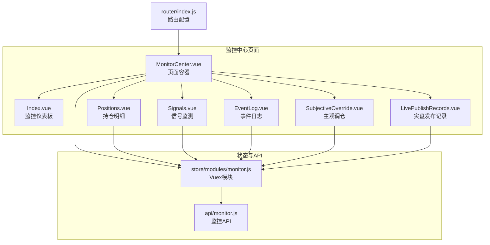
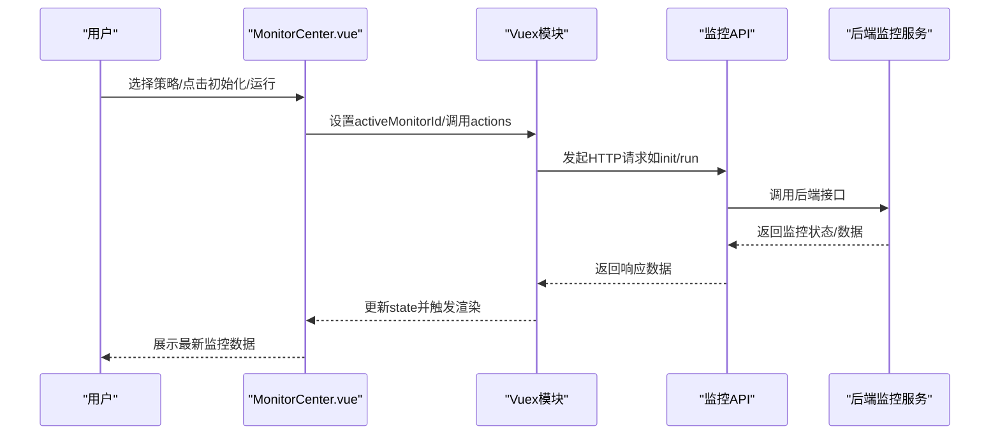
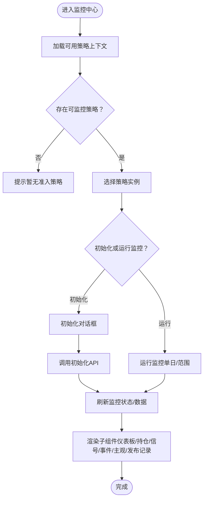
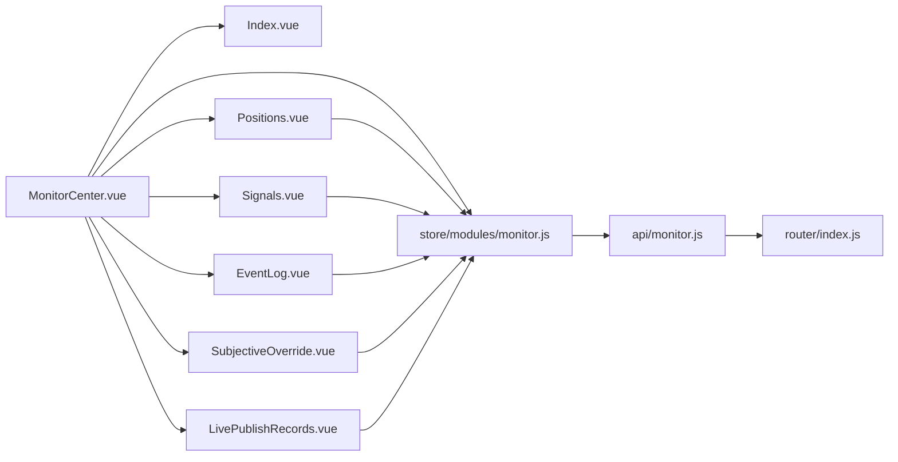

# 监控中心

<cite>
**本文引用的文件**
- [MonitorCenter.vue](file://src/views/monitor/MonitorCenter.vue)
- [monitor.js](file://src/store/modules/monitor.js)
- [monitor.js](file://src/api/monitor.js)
- [Index.vue](file://src/views/monitor/Index.vue)
- [Positions.vue](file://src/views/monitor/Positions.vue)
- [Signals.vue](file://src/views/monitor/Signals.vue)
- [EventLog.vue](file://src/views/monitor/EventLog.vue)
- [LivePublishRecords.vue](file://src/views/monitor/LivePublishRecords.vue)
- [SubjectiveOverride.vue](file://src/views/monitor/SubjectiveOverride.vue)
- [index.js](file://src/router/index.js)
</cite>

## 目录
1. [简介](#简介)
2. [项目结构](#项目结构)
3. [核心组件](#核心组件)
4. [架构总览](#架构总览)
5. [详细组件分析](#详细组件分析)
6. [依赖分析](#依赖分析)
7. [性能考虑](#性能考虑)
8. [故障排查指南](#故障排查指南)
9. [结论](#结论)
10. [附录](#附录)

## 简介
监控中心是智能投研系统中的关键运营与风控中枢，面向已实盘发布的策略实例提供“日常监控”能力。其核心职责包括：
- 策略实例状态与数据的可视化呈现（净值、波动率、调仓计划、事件日志等）
- 支持初始化与运行监控，实现从指定日期逐日推演至最新交易日
- 提供主观调仓指令的录入、审批与执行追踪
- 展示底层资产分析（相关性、波动率）与实盘发布记录的结构化对比
- 与策略管理、资产库、回测等模块协同，形成“策略开发—实盘发布—日常监控”的闭环

## 项目结构
监控中心位于前端工程的 monitor 视图目录，采用“页面容器 + 功能区块组件”的分层组织方式：
- 页面容器：MonitorCenter.vue 负责策略选择、初始化与运行控制、全局状态展示与子组件编排
- 功能区块：Index.vue（监控仪表板）、Positions.vue（持仓明细）、Signals.vue（信号监测）、EventLog.vue（事件日志）、SubjectiveOverride.vue（主观调仓）、LivePublishRecords.vue（实盘发布记录）
- 状态管理：store/modules/monitor.js 统一管理监控相关数据与动作
- API 层：api/monitor.js 封装监控相关的后端接口
- 路由：router/index.js 将监控中心挂载到“数据分析/monitor”路径

图表来源
- [MonitorCenter.vue:1-606](file://src/views/monitor/MonitorCenter.vue#L1-L606)
- [Index.vue:1-256](file://src/views/monitor/Index.vue#L1-L256)
- [Positions.vue:1-179](file://src/views/monitor/Positions.vue#L1-L179)
- [Signals.vue:1-338](file://src/views/monitor/Signals.vue#L1-L338)
- [EventLog.vue:1-107](file://src/views/monitor/EventLog.vue#L1-L107)
- [LivePublishRecords.vue:1-190](file://src/views/monitor/LivePublishRecords.vue#L1-L190)
- [SubjectiveOverride.vue:1-230](file://src/views/monitor/SubjectiveOverride.vue#L1-L230)
- [monitor.js:1-416](file://src/store/modules/monitor.js#L1-L416)
- [monitor.js:1-227](file://src/api/monitor.js#L1-L227)
- [index.js:242-246](file://src/router/index.js#L242-L246)

章节来源
- [MonitorCenter.vue:1-606](file://src/views/monitor/MonitorCenter.vue#L1-L606)
- [Index.vue:1-256](file://src/views/monitor/Index.vue#L1-L256)
- [Positions.vue:1-179](file://src/views/monitor/Positions.vue#L1-L179)
- [Signals.vue:1-338](file://src/views/monitor/Signals.vue#L1-L338)
- [EventLog.vue:1-107](file://src/views/monitor/EventLog.vue#L1-L107)
- [LivePublishRecords.vue:1-190](file://src/views/monitor/LivePublishRecords.vue#L1-L190)
- [SubjectiveOverride.vue:1-230](file://src/views/monitor/SubjectiveOverride.vue#L1-L230)
- [monitor.js:1-416](file://src/store/modules/monitor.js#L1-L416)
- [monitor.js:1-227](file://src/api/monitor.js#L1-L227)
- [index.js:242-246](file://src/router/index.js#L242-L246)

## 核心组件
- MonitorCenter.vue：监控中心主页面，负责策略实例选择、初始化与运行控制、实时状态展示、子组件编排与交互（参数快速编辑、主观权重编辑、实盘发布记录等）
- Index.vue：监控仪表板，展示当前净值、杠杆、年化收益、波动率、最大回撤、当日收益等关键指标，并标注“本页绩效对应的实盘参数”
- Positions.vue：持仓明细与资产分析，支持权重分布饼图、相关性热力图、波动率柱状图，以及类别权重统计
- Signals.vue：信号监测，展示波动率状态、阈值预警、待执行调仓、调仓历史与权重变化对比
- EventLog.vue：事件日志，以时间线形式展示初始化、月度调仓、波动率重置、主观调仓等事件，并支持筛选与详情查看
- SubjectiveOverride.vue：主观调仓，支持新增指令、权重校验（总权重/杠杆上限）、取消与历史记录查看
- LivePublishRecords.vue：实盘发布记录，结构化展示“实盘发布/取消/配置更新”带来的参数、资产、权重等变更差异

章节来源
- [MonitorCenter.vue:608-800](file://src/views/monitor/MonitorCenter.vue#L608-L800)
- [Index.vue:258-538](file://src/views/monitor/Index.vue#L258-L538)
- [Positions.vue:181-662](file://src/views/monitor/Positions.vue#L181-L662)
- [Signals.vue:340-760](file://src/views/monitor/Signals.vue#L340-L760)
- [EventLog.vue:230-428](file://src/views/monitor/EventLog.vue#L230-L428)
- [SubjectiveOverride.vue:278-596](file://src/views/monitor/SubjectiveOverride.vue#L278-L596)
- [LivePublishRecords.vue:192-536](file://src/views/monitor/LivePublishRecords.vue#L192-L536)

## 架构总览
监控中心采用“页面容器 + 功能区块 + Vuex 状态 + API 调用”的分层架构：
- 页面容器通过 Vuex 获取/设置 activeMonitorId 与监控状态，驱动子组件渲染
- 子组件通过统一的 API 层访问后端监控服务，实现数据拉取与操作提交
- 路由层将监控中心挂载到“数据分析/monitor”，并与策略管理、资产库等模块协同

图表来源
- [MonitorCenter.vue:795-800](file://src/views/monitor/MonitorCenter.vue#L795-L800)
- [monitor.js:81-396](file://src/store/modules/monitor.js#L81-L396)
- [monitor.js:9-227](file://src/api/monitor.js#L9-L227)

章节来源
- [MonitorCenter.vue:795-800](file://src/views/monitor/MonitorCenter.vue#L795-L800)
- [monitor.js:81-396](file://src/store/modules/monitor.js#L81-L396)
- [monitor.js:9-227](file://src/api/monitor.js#L9-L227)

## 详细组件分析

### MonitorCenter.vue（监控中心页面）
- 功能要点
  - 策略实例选择与切换，支持“系统基准(default)”与实盘发布策略
  - 初始化与运行控制：支持从指定日期逐日推演，支持主观策略步进暂停
  - 实盘生效参数展示与快速编辑：目标波动、波动重置阈值、总杠杆上限、窗口参数、资产列表等
  - 主观策略专属编辑：初始化权重与预设调仓日权重的可视化编辑
  - 子组件编排：监控仪表板、净值走势、持仓明细、信号监测、主观调仓、事件日志、实盘发布记录
- 关键交互
  - 初始化对话框：选择启动日期，执行初始化
  - 快速编辑对话框：单参数编辑并实盘发布
  - 主观编辑器：初始化权重与预设调仓日权重的可视化编辑
  - 实盘发布记录：结构化对比参数/资产/窗口变更

图表来源
- [MonitorCenter.vue:290-361](file://src/views/monitor/MonitorCenter.vue#L290-L361)
- [MonitorCenter.vue:362-542](file://src/views/monitor/MonitorCenter.vue#L362-L542)
- [MonitorCenter.vue:544-604](file://src/views/monitor/MonitorCenter.vue#L544-L604)

章节来源
- [MonitorCenter.vue:1-606](file://src/views/monitor/MonitorCenter.vue#L1-L606)
- [MonitorCenter.vue:608-800](file://src/views/monitor/MonitorCenter.vue#L608-L800)

### Index.vue（监控仪表板）
- 功能要点
  - 展示当前净值、总杠杆、年化收益、年化波动率、夏普比率、最大回撤等指标
  - 展示当日收益额、当日收益率、当前回撤、持仓资产数、距下次调仓、监测波动率与阈值
  - “本页绩效对应的实盘参数”说明，支持主观策略权重快照展示
- 数据来源
  - 监控状态、净值历史、绩效指标、信号状态通过 Vuex actions 并行加载

章节来源
- [Index.vue:258-538](file://src/views/monitor/Index.vue#L258-L538)

### Positions.vue（持仓明细与资产分析）
- 功能要点
  - 持仓汇总：总资产、总杠杆、持仓资产数、最大/最小持仓权重
  - 权重分布饼图：按资产权重展示
  - 底层资产分析：相关性矩阵热力图、波动率柱状图（支持60/120/250日窗口）
- 数据来源
  - 持仓明细、监控状态、资产分析（相关性矩阵、波动率指标）通过 Vuex actions 获取

章节来源
- [Positions.vue:181-662](file://src/views/monitor/Positions.vue#L181-L662)

### Signals.vue（信号监测）
- 功能要点
  - 风险预警：待执行调仓、波动率超阈值、接近阈值、无待处理事项
  - 波动率监控：当前波动率、阈值进度条、距触发阈值、各窗口波动率趋势
  - 调仓规划：上次调仓日期、待执行调仓、调仓历史与权重变化对比
- 数据来源
  - 信号状态、波动率历史通过 Vuex actions 获取

章节来源
- [Signals.vue:340-760](file://src/views/monitor/Signals.vue#L340-L760)

### EventLog.vue（事件日志）
- 功能要点
  - 事件时间线：初始化、月度调仓、波动率重置、主观调仓
  - 筛选与分页：按事件类型、日期范围筛选，支持加载更多
  - 事件详情：调仓前后权重对比、波动率重置信息、主观调仓说明、初始化配置
- 数据来源
  - 事件日志通过 Vuex actions 获取

章节来源
- [EventLog.vue:230-428](file://src/views/monitor/EventLog.vue#L230-L428)

### SubjectiveOverride.vue（主观调仓）
- 功能要点
  - 新增主观调仓：选择执行日期、输入目标权重、说明，提交后生成待执行指令
  - 权重校验：总权重不超过最大杠杆（百分比形式），并提示等效杠杆
  - 指令管理：待执行列表、历史记录、取消指令、查看详情
- 数据来源
  - 主观调仓指令列表、监控状态通过 Vuex actions 获取

章节来源
- [SubjectiveOverride.vue:278-596](file://src/views/monitor/SubjectiveOverride.vue#L278-L596)

### LivePublishRecords.vue（实盘发布记录）
- 功能要点
  - 结构化展示“实盘发布/取消/配置更新”带来的变更：底层资产、初始化权重、预设调仓、窗口参数、权重上限等
  - 丰富对比：资产列表（文本/标签流）、权重条形对比、预设调仓日增删改对比
- 数据来源
  - 实盘变更日志、策略模型、资产选项通过 API 获取并合并

章节来源
- [LivePublishRecords.vue:192-536](file://src/views/monitor/LivePublishRecords.vue#L192-L536)

## 依赖分析
- 组件耦合
  - MonitorCenter.vue 作为页面容器，聚合多个子组件，承担策略上下文与全局控制逻辑
  - 子组件之间低耦合，通过 Vuex 共享状态与 API 交互
- 外部依赖
  - 路由：router/index.js 将监控中心挂载到“数据分析/monitor”
  - API：api/monitor.js 提供监控状态、净值历史、事件日志、信号、主观调仓、资产分析等接口
  - 状态：store/modules/monitor.js 统一管理监控数据、加载状态与动作

图表来源
- [MonitorCenter.vue:608-640](file://src/views/monitor/MonitorCenter.vue#L608-L640)
- [monitor.js:1-416](file://src/store/modules/monitor.js#L1-L416)
- [monitor.js:1-227](file://src/api/monitor.js#L1-L227)
- [index.js:242-246](file://src/router/index.js#L242-L246)

章节来源
- [MonitorCenter.vue:608-640](file://src/views/monitor/MonitorCenter.vue#L608-L640)
- [monitor.js:1-416](file://src/store/modules/monitor.js#L1-L416)
- [monitor.js:1-227](file://src/api/monitor.js#L1-L227)
- [index.js:242-246](file://src/router/index.js#L242-L246)

## 性能考虑
- 批量数据加载
  - 仪表板与持仓明细等页面通过 Promise.all 并行拉取多个接口，减少首屏等待
- 图表渲染优化
  - ECharts 图表在组件销毁时进行 dispose，避免内存泄漏；窗口大小变化时及时 resize
- 请求超时与重试
  - 初始化与范围运行监控设置较长超时，避免长耗时任务被中断
- 数据缓存与去抖
  - Vuex mutations 明确区分不同数据域（净值、信号、事件、资产分析），避免不必要的重渲染
- 建议
  - 对高频查询（如事件日志）增加本地分页与增量加载
  - 对大图（相关性矩阵）增加懒加载与缩略预览

## 故障排查指南
- 初始化失败
  - 现象：点击初始化后无数据或报错
  - 排查：确认已选择策略实例；检查后端初始化接口超时设置；查看控制台错误信息
- 运行监控失败
  - 现象：运行监控报错或无响应
  - 排查：确认 monitor_id 正确；检查网络请求与后端日志；尝试范围运行并缩短日期跨度
- 信号数据为空
  - 现象：波动率监控与调仓规划为空
  - 排查：确认已完成初始化；检查信号接口返回；核对策略模板类型（主观策略不展示波动率重置阈值）
- 图表空白或渲染异常
  - 现象：ECharts 图表不显示或尺寸异常
  - 排查：确保容器元素可见；监听窗口 resize；在组件销毁时 dispose 图表实例
- 主观调仓提交失败
  - 现象：提交后无指令或报错
  - 排查：检查表单校验（总权重/杠杆上限）；确认权重单位为小数；查看后端返回的错误详情

章节来源
- [monitor.js:87-106](file://src/store/modules/monitor.js#L87-L106)
- [monitor.js:253-268](file://src/store/modules/monitor.js#L253-L268)
- [monitor.js:324-341](file://src/store/modules/monitor.js#L324-L341)
- [Signals.vue:537-548](file://src/views/monitor/Signals.vue#L537-L548)
- [Positions.vue:262-277](file://src/views/monitor/Positions.vue#L262-L277)
- [SubjectiveOverride.vue:518-547](file://src/views/monitor/SubjectiveOverride.vue#L518-L547)

## 结论
监控中心通过清晰的页面容器与功能区块划分、完善的 Vuex 状态管理与 API 封装，实现了对策略实例的全生命周期监控：从初始化、运行到日常观测与事件追踪。其模块化设计便于扩展与维护，同时提供了丰富的可视化与交互能力，满足运营与风控人员的日常需求。

## 附录
- 配置管理
  - 系统基准（monitor_id=default）与实盘发布策略并存，页面提供明确标识与说明
  - 实盘发布记录仅展示“实盘发布/取消/配置更新”带来的变更，不含策略保存类记录
- 个性化定制
  - 支持主观策略的初始化权重与预设调仓日权重可视化编辑
  - 快速编辑对话框支持单参数修改并实盘发布
- 权限控制
  - 路由层对受保护页面进行鉴权；策略详情编辑入口受策略实例类型与发布状态限制
- 扩展性与插件机制
  - 组件间通过 Vuex 解耦，新增监控维度（如损益归因）可通过新增子组件与 API 接口实现
  - 第三方集成：通过统一的 API 层对接外部监控服务或数据源

章节来源
- [MonitorCenter.vue:694-709](file://src/views/monitor/MonitorCenter.vue#L694-L709)
- [MonitorCenter.vue:702-708](file://src/views/monitor/MonitorCenter.vue#L702-L708)
- [monitor.js:192-211](file://src/store/modules/monitor.js#L192-L211)
- [index.js:352-375](file://src/router/index.js#L352-L375)