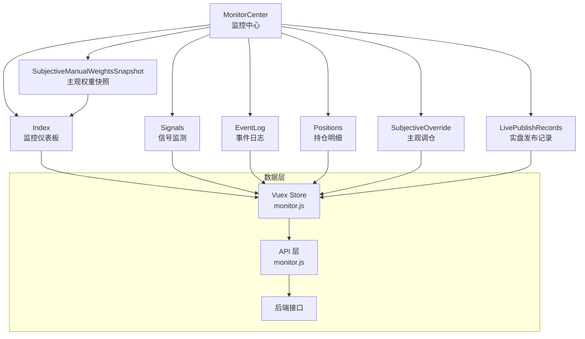
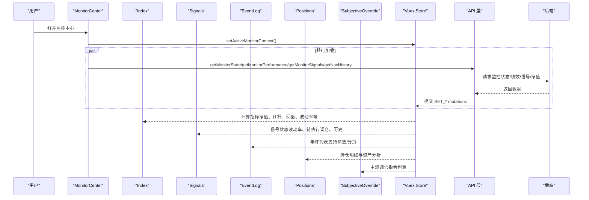
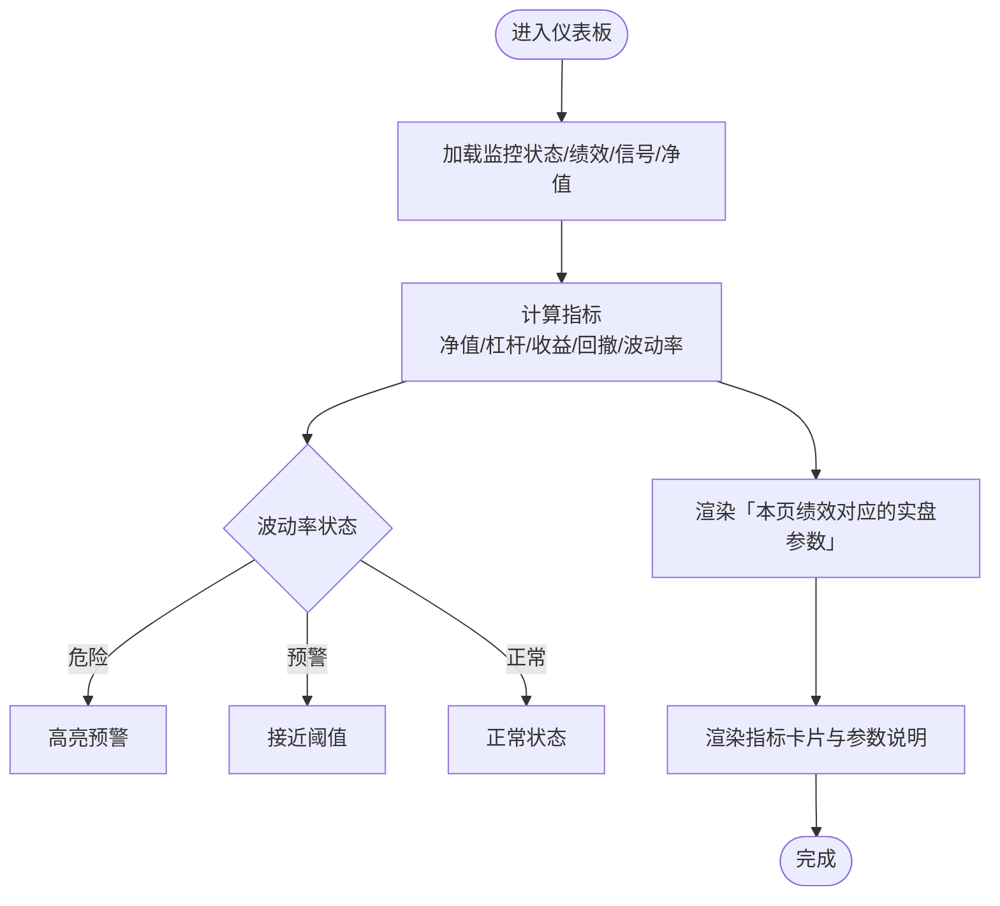
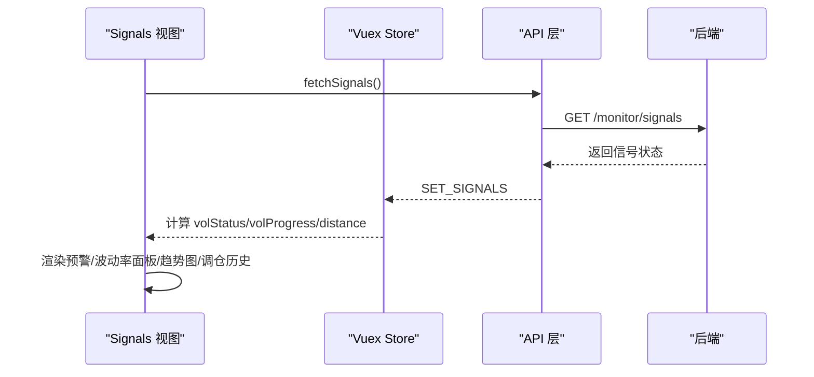
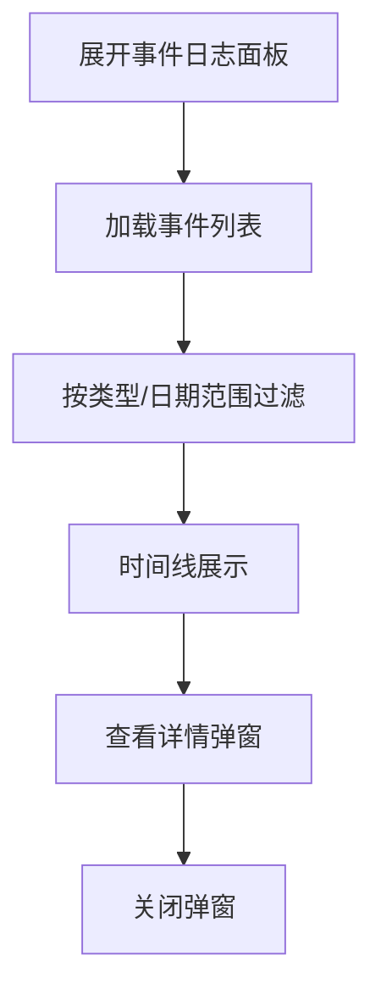
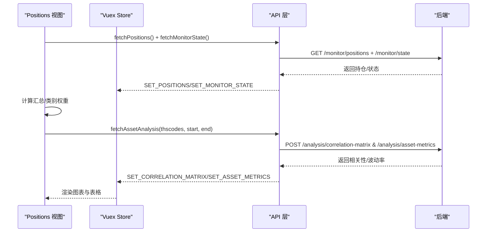
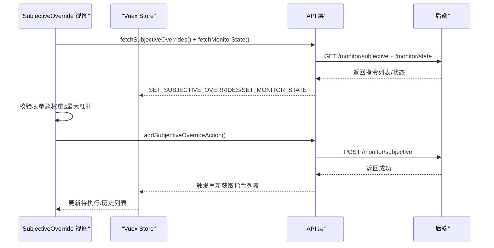
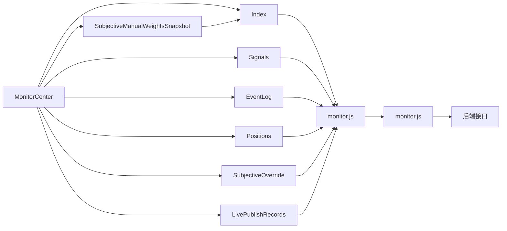

# 监控系统模块

<cite>
**本文档引用的文件**
- [src/views/monitor/Index.vue](file://src/views/monitor/Index.vue)
- [src/views/monitor/MonitorCenter.vue](file://src/views/monitor/MonitorCenter.vue)
- [src/views/monitor/Signals.vue](file://src/views/monitor/Signals.vue)
- [src/views/monitor/EventLog.vue](file://src/views/monitor/EventLog.vue)
- [src/views/monitor/Positions.vue](file://src/views/monitor/Positions.vue)
- [src/views/monitor/SubjectiveOverride.vue](file://src/views/monitor/SubjectiveOverride.vue)
- [src/views/monitor/SubjectiveManualWeightsSnapshot.vue](file://src/views/monitor/SubjectiveManualWeightsSnapshot.vue)
- [src/views/monitor/LivePublishRecords.vue](file://src/views/monitor/LivePublishRecords.vue)
- [src/store/modules/monitor.js](file://src/store/modules/monitor.js)
- [src/api/monitor.js](file://src/api/monitor.js)
</cite>

## 目录
1. [简介](#简介)
2. [项目结构](#项目结构)
3. [核心组件](#核心组件)
4. [架构总览](#架构总览)
5. [详细组件分析](#详细组件分析)
6. [依赖关系分析](#依赖关系分析)
7. [性能考虑](#性能考虑)
8. [故障排查指南](#故障排查指南)
9. [结论](#结论)
10. [附录](#附录)

## 简介
本文件为监控系统模块的综合技术文档，覆盖实时监控面板、事件日志管理、信号预警系统、持仓监控、主观权重管理、净值历史查询与分析、配置选项与性能优化、最佳实践与故障排查等内容。文档面向开发与运维人员，既提供代码级细节，也提供面向非技术用户的可理解说明。

## 项目结构
监控系统模块位于前端 src/views/monitor 目录下，采用按功能拆分的组件化架构：
- MonitorCenter：监控中心主入口，聚合所有子面板
- Index：监控仪表板，展示关键指标与参数快照
- Signals：信号监测与预警
- EventLog：事件日志管理（分类、过滤、搜索、展开详情）
- Positions：持仓明细与资产分析（相关性、波动率）
- SubjectiveOverride：主观调仓指令管理
- SubjectiveManualWeightsSnapshot：主观权重快照展示
- LivePublishRecords：实盘发布记录与变更对比

**图表来源**
- [src/views/monitor/MonitorCenter.vue:544-604](file://src/views/monitor/MonitorCenter.vue#L544-L604)
- [src/store/modules/monitor.js:1-416](file://src/store/modules/monitor.js#L1-L416)
- [src/api/monitor.js:1-227](file://src/api/monitor.js#L1-L227)

**章节来源**
- [src/views/monitor/MonitorCenter.vue:1-800](file://src/views/monitor/MonitorCenter.vue#L1-L800)

## 核心组件
- 监控仪表板（Index）：展示净值、杠杆、收益、回撤、持仓数量、距下次调仓、波动率与阈值等关键指标，并提供“本页绩效对应的实盘参数”说明与主观权重快照。
- 信号监测（Signals）：提供风险预警（波动率超阈值、待执行调仓）、波动率监控（当前值、阈值进度、趋势图）、调仓历史记录与权重对比。
- 事件日志（EventLog）：支持按类型与日期范围筛选，时间线视图，展开查看详情（包含权重对比、波动率重置信息、主观调仓信息、初始化权重等）。
- 持仓明细（Positions）：汇总总资产、总杠杆、最大/最小持仓权重；资产类别权重小计；持仓表格与权重分布饼图；底层资产相关性热力图与年化波动率柱状图。
- 主观调仓（SubjectiveOverride）：新增主观调仓指令（执行日期、目标权重、说明），待执行与历史指令列表，权重对比与状态管理。
- 主观权重快照（SubjectiveManualWeightsSnapshot）：以可视化条形图展示初始化权重与预设调仓权重，支持交互（在监控中心中可跳转编辑）。
- 实盘发布记录（LivePublishRecords）：展示实盘发布、取消实盘、配置更新等记录，结构化对比底层资产、初始化权重、预设调仓、权重上限、窗口参数等。

**章节来源**
- [src/views/monitor/Index.vue:1-755](file://src/views/monitor/Index.vue#L1-L755)
- [src/views/monitor/Signals.vue:1-800](file://src/views/monitor/Signals.vue#L1-L800)
- [src/views/monitor/EventLog.vue:1-535](file://src/views/monitor/EventLog.vue#L1-L535)
- [src/views/monitor/Positions.vue:1-787](file://src/views/monitor/Positions.vue#L1-L787)
- [src/views/monitor/SubjectiveOverride.vue:1-756](file://src/views/monitor/SubjectiveOverride.vue#L1-L756)
- [src/views/monitor/SubjectiveManualWeightsSnapshot.vue:1-366](file://src/views/monitor/SubjectiveManualWeightsSnapshot.vue#L1-L366)
- [src/views/monitor/LivePublishRecords.vue:1-809](file://src/views/monitor/LivePublishRecords.vue#L1-L809)

## 架构总览
监控系统采用“视图组件 + Vuex Store + API 层”的三层架构：
- 视图组件负责用户交互与展示
- Vuex Store 管理监控状态、净值历史、绩效、信号、事件、主观指令、资产分析等数据
- API 层封装后端接口，提供统一的数据访问

**图表来源**
- [src/views/monitor/MonitorCenter.vue:796-797](file://src/views/monitor/MonitorCenter.vue#L796-L797)
- [src/store/modules/monitor.js:81-190](file://src/store/modules/monitor.js#L81-L190)
- [src/api/monitor.js:9-73](file://src/api/monitor.js#L9-L73)

**章节来源**
- [src/store/modules/monitor.js:1-416](file://src/store/modules/monitor.js#L1-L416)
- [src/api/monitor.js:1-227](file://src/api/monitor.js#L1-L227)

## 详细组件分析

### 监控仪表板（Index）
- 功能要点
  - 展示当前净值、总杠杆、年化收益/波动率、夏普比率、最大回撤
  - 当日收益额/收益率、当前回撤、持仓资产数、距下次调仓天数
  - 波动率状态与阈值对比（危险/预警/正常），主观策略隐藏阈值
  - “本页绩效对应的实盘参数”说明块，展示目标波动、阈值、杠杆上限、资产类别、动量/反转窗口等
  - 主观策略：展示初始化权重与预设调仓权重快照
- 关键计算
  - 总杠杆：目标权重绝对值之和
  - 当日收益额：最新两日净值差
  - 当日收益率：最新两日净值环比
  - 当前回撤：从历史峰值到当前的百分点回撤
  - 距下次调仓：优先 pending，其次月度调仓 days_until，最后手动计算
- 异常与边界
  - 未初始化时显示空态与引导
  - 绩效与顶部“实盘生效参数”不一致时给出警告

**图表来源**
- [src/views/monitor/Index.vue:340-443](file://src/views/monitor/Index.vue#L340-L443)

**章节来源**
- [src/views/monitor/Index.vue:1-755](file://src/views/monitor/Index.vue#L1-L755)

### 信号监测（Signals）
- 功能要点
  - 风险预警：待执行调仓、波动率超阈值、接近阈值
  - 波动率监控：当前值、阈值进度条、距离阈值、各窗口波动率
  - 趋势图：近30日波动率折线图，标注阈值线
  - 调仓规划：上次调仓日期、待执行调仓（月度/波动率重置/主观）、调仓历史（权重对比、观察指标）
- 关键逻辑
  - 波动率状态判定：根据 current_volatility 与 threshold 计算（主观策略仅观测）
  - 距离阈值：threshold - current_volatility
  - 趋势图：ECharts 渲染，支持自适应窗口大小
  - 历史记录展开：支持调仓后观察指标与权重变化对比

**图表来源**
- [src/views/monitor/Signals.vue:537-548](file://src/views/monitor/Signals.vue#L537-L548)
- [src/api/monitor.js:65-73](file://src/api/monitor.js#L65-L73)

**章节来源**
- [src/views/monitor/Signals.vue:1-800](file://src/views/monitor/Signals.vue#L1-L800)
- [src/api/monitor.js:65-73](file://src/api/monitor.js#L65-L73)

### 事件日志（EventLog）
- 功能要点
  - 折叠面板懒加载：展开或查询时才加载
  - 筛选：事件类型、日期范围
  - 时间线：按时间倒序展示，支持查看详情（权重对比、波动率重置信息、主观调仓信息、初始化权重等）
  - 加载更多：分页加载（模拟）
- 关键逻辑
  - 过滤：类型与日期范围双条件
  - 详情：根据事件类型动态渲染不同内容块
  - 格式化：百分比、正负号、颜色区分

**图表来源**
- [src/views/monitor/EventLog.vue:305-353](file://src/views/monitor/EventLog.vue#L305-L353)

**章节来源**
- [src/views/monitor/EventLog.vue:1-535](file://src/views/monitor/EventLog.vue#L1-L535)

### 持仓明细（Positions）
- 功能要点
  - 汇总：总资产、总杠杆、最大/最小持仓权重、持仓资产数
  - 资产类别权重小计
  - 持仓表格：名称、类别、当前权重、当日涨跌、币种
  - 权重分布饼图：ECharts
  - 底层资产分析：相关性热力图、年化波动率柱状图
- 关键逻辑
  - 资产分析：根据监控日期与窗口（60/120/250日）计算相关性矩阵与波动率
  - 图表自适应：监听窗口 resize，保持图表尺寸
  - 汇总统计：权重绝对值求和、最大/最小权重

**图表来源**
- [src/views/monitor/Positions.vue:279-306](file://src/views/monitor/Positions.vue#L279-L306)
- [src/store/modules/monitor.js:361-395](file://src/store/modules/monitor.js#L361-L395)
- [src/api/monitor.js:188-227](file://src/api/monitor.js#L188-L227)

**章节来源**
- [src/views/monitor/Positions.vue:1-787](file://src/views/monitor/Positions.vue#L1-L787)
- [src/store/modules/monitor.js:361-395](file://src/store/modules/monitor.js#L361-L395)
- [src/api/monitor.js:188-227](file://src/api/monitor.js#L188-L227)

### 主观调仓（SubjectiveOverride）
- 功能要点
  - 新增：执行日期、目标权重（百分比输入）、说明
  - 权重校验：总权重不超过最大杠杆（百分比形式），等效杠杆提示
  - 列表：待执行（可取消）、历史（按状态筛选）
  - 详情：权重对比（当前 vs 目标）、状态标签
- 关键逻辑
  - 表单项对齐：根据策略上下文的底层资产列表生成
  - 提交：将百分比转换为小数权重提交
  - 权重上限：优先使用策略参数 weight_caps/max_weight_dict，否则使用默认上限

**图表来源**
- [src/views/monitor/SubjectiveOverride.vue:449-461](file://src/views/monitor/SubjectiveOverride.vue#L449-L461)
- [src/store/modules/monitor.js:304-341](file://src/store/modules/monitor.js#L304-L341)
- [src/api/monitor.js:152-186](file://src/api/monitor.js#L152-L186)

**章节来源**
- [src/views/monitor/SubjectiveOverride.vue:1-756](file://src/views/monitor/SubjectiveOverride.vue#L1-L756)
- [src/store/modules/monitor.js:304-341](file://src/store/modules/monitor.js#L304-L341)
- [src/api/monitor.js:152-186](file://src/api/monitor.js#L152-L186)

### 主观权重快照（SubjectiveManualWeightsSnapshot）
- 功能要点
  - 展示初始化权重与预设调仓权重（条形图）
  - 支持交互：在监控中心中点击可跳转编辑
  - 紧凑模式：仪表板中更节省空间的展示
- 关键逻辑
  - 解析策略上下文的资产映射，生成标签
  - 条形宽度按百分比计算，支持点击回调

**章节来源**
- [src/views/monitor/SubjectiveManualWeightsSnapshot.vue:1-366](file://src/views/monitor/SubjectiveManualWeightsSnapshot.vue#L1-L366)
- [src/views/monitor/MonitorCenter.vue:174-182](file://src/views/monitor/MonitorCenter.vue#L174-L182)

### 实盘发布记录（LivePublishRecords）
- 功能要点
  - 展示实盘发布、取消实盘、配置更新记录
  - 结构化对比：底层资产（标签流）、初始化权重、预设调仓（日期、权重、是否归一化）、权重上限、窗口参数等
  - 支持展开查看变更明细
- 关键逻辑
  - 字段标签映射、资产名称合并、日期规范化
  - 预设调仓差异：按日期索引，识别新增/移除/修改（含权重变化与归一化选项）

**章节来源**
- [src/views/monitor/LivePublishRecords.vue:1-809](file://src/views/monitor/LivePublishRecords.vue#L1-L809)

## 依赖关系分析
- 组件耦合
  - MonitorCenter 作为聚合容器，协调多个子面板的数据加载与展示
  - SubjectiveManualWeightsSnapshot 与 Index/监控中心联动，用于展示主观权重快照
  - LivePublishRecords 依赖策略模型与资产选项，用于资产名称映射
- 外部依赖
  - ECharts：波动率趋势、权重分布、相关性热力图、波动率柱状图
  - Element UI：布局、卡片、表格、时间线、对话框、标签等
- 数据依赖
  - Store 中的 monitorState、navHistory、performance、signals、events、positions、subjectiveOverrides、assetMetrics、correlationMatrix
  - API 层封装了监控状态、净值历史、事件、信号、持仓、主观指令、资产分析等接口

**图表来源**
- [src/views/monitor/MonitorCenter.vue:544-604](file://src/views/monitor/MonitorCenter.vue#L544-L604)
- [src/store/modules/monitor.js:1-416](file://src/store/modules/monitor.js#L1-L416)
- [src/api/monitor.js:1-227](file://src/api/monitor.js#L1-L227)

**章节来源**
- [src/store/modules/monitor.js:1-416](file://src/store/modules/monitor.js#L1-L416)
- [src/api/monitor.js:1-227](file://src/api/monitor.js#L1-L227)

## 性能考虑
- 并行加载：监控中心在初始化时并行请求监控状态、净值历史、绩效、信号，减少首屏等待
- 懒加载：事件日志面板默认折叠，展开或查询时再加载数据，降低初始负载
- 图表自适应：监听窗口 resize，避免图表溢出与重绘开销
- 分页与节流：事件日志支持分页加载，主观调仓列表支持状态筛选，避免一次性渲染大量数据
- 缓存与复用：Store 中的状态复用，避免重复请求；图表实例在组件销毁时 dispose，防止内存泄漏

[本节为通用指导，无需特定文件引用]

## 故障排查指南
- 初始化与数据为空
  - 现象：监控仪表板显示“尚未建立本策略的日常监控数据”
  - 处理：先执行“初始化”，再“运行监控”滚动至最新交易日
  - 参考：[src/views/monitor/Index.vue:11-19](file://src/views/monitor/Index.vue#L11-L19)
- 加载失败
  - 现象：组件显示加载错误消息
  - 处理：检查网络与后端接口可用性；查看浏览器控制台错误；确认 monitor_id 正确
  - 参考：[src/store/modules/monitor.js:93-105](file://src/store/modules/monitor.js#L93-L105)
- 波动率阈值不生效（主观策略）
  - 现象：主观策略不显示波动率阈值触发预警
  - 处理：主观策略仅观测波动率，不参与阈值对比
  - 参考：[src/views/monitor/Signals.vue:382-389](file://src/views/monitor/Signals.vue#L382-L389)
- 主观调仓提交失败
  - 现象：添加主观调仓提示失败
  - 处理：检查表单校验（总权重不超过最大杠杆）、后端返回的详细错误信息
  - 参考：[src/views/monitor/SubjectiveOverride.vue:518-547](file://src/views/monitor/SubjectiveOverride.vue#L518-L547)
- 图表显示异常
  - 现象：图表空白或尺寸异常
  - 处理：确保容器存在且可见；监听 resize；在数据就绪后 setOption
  - 参考：[src/views/monitor/Positions.vue:382-392](file://src/views/monitor/Positions.vue#L382-L392)

**章节来源**
- [src/views/monitor/Index.vue:11-19](file://src/views/monitor/Index.vue#L11-L19)
- [src/store/modules/monitor.js:93-105](file://src/store/modules/monitor.js#L93-L105)
- [src/views/monitor/Signals.vue:382-389](file://src/views/monitor/Signals.vue#L382-L389)
- [src/views/monitor/SubjectiveOverride.vue:518-547](file://src/views/monitor/SubjectiveOverride.vue#L518-L547)
- [src/views/monitor/Positions.vue:382-392](file://src/views/monitor/Positions.vue#L382-L392)

## 结论
监控系统模块通过清晰的组件划分与完善的 Store/API 层设计，实现了从实时监控面板、信号预警、事件日志、持仓分析到主观权重管理的全链路监控能力。其并行加载、懒加载与图表自适应等优化提升了用户体验，同时提供了丰富的配置与扩展点，满足不同策略类型的监控需求。

[本节为总结性内容，无需特定文件引用]

## 附录

### 配置选项与最佳实践
- 监控初始化
  - 建议在策略实盘发布后立即执行初始化，确保监控数据完整
  - 可选择启动日期，逐步推进到最新交易日
- 波动率阈值
  - 量化策略建议合理设置阈值与重置窗口；主观策略仅观测波动率
- 主观调仓
  - 提交前核对总权重与最大杠杆限制；说明清晰，便于审计
- 事件日志
  - 使用类型与日期范围筛选快速定位问题；定期导出关键事件
- 持仓分析
  - 定期查看相关性与波动率，识别集中度过高或异常波动

[本节为通用指导，无需特定文件引用]