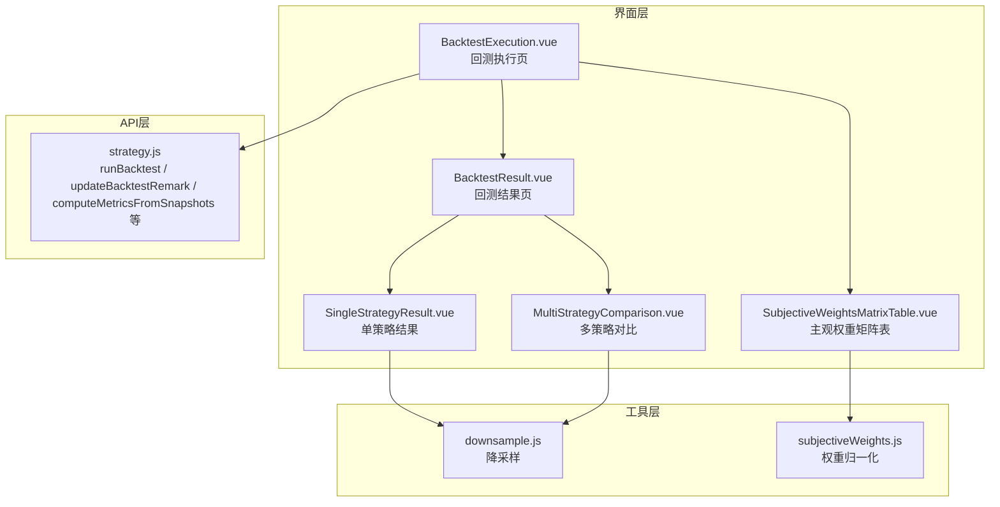
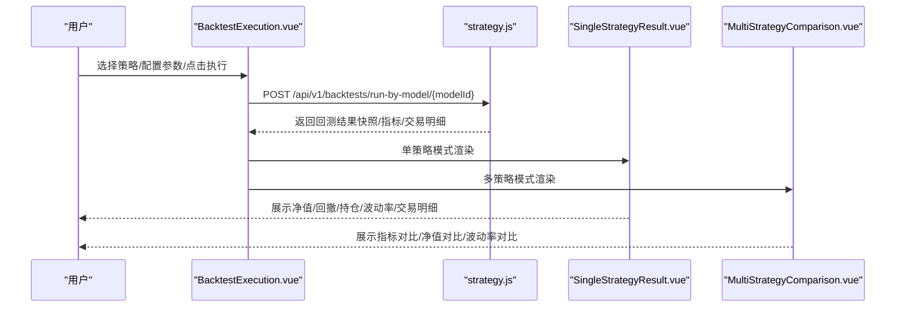
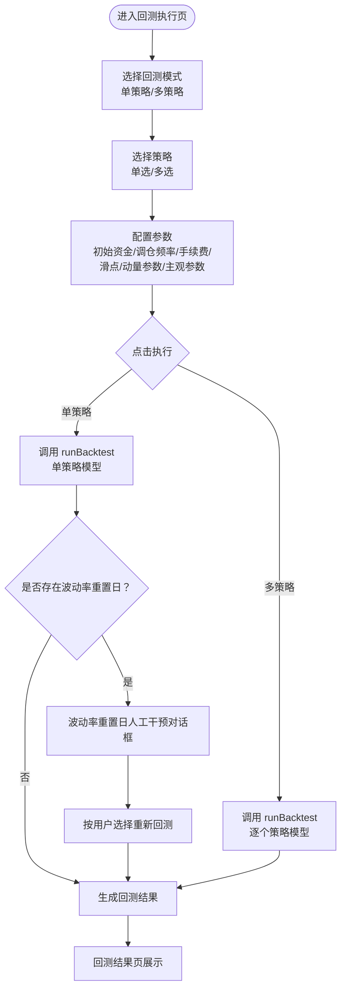
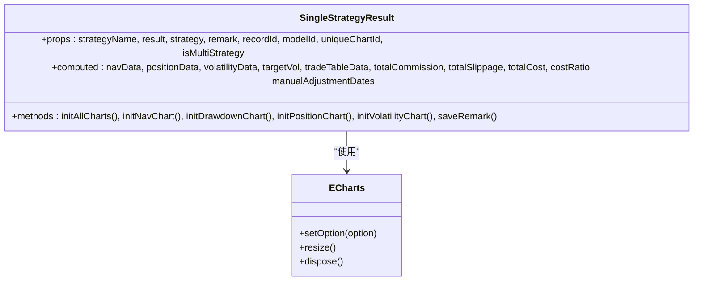
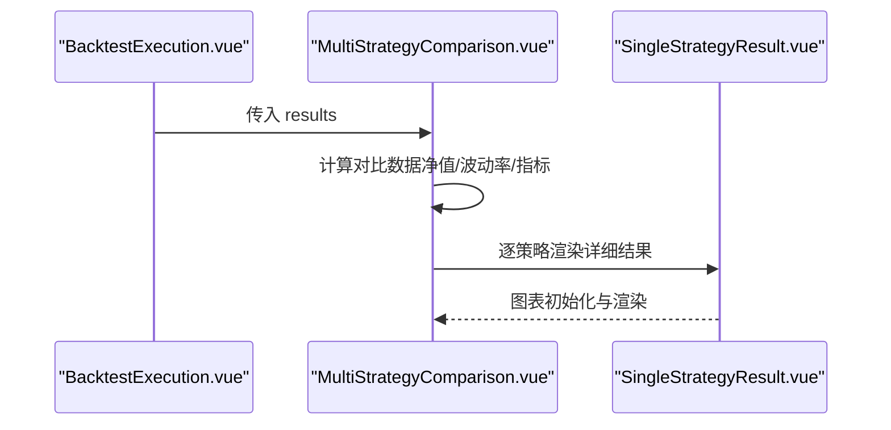
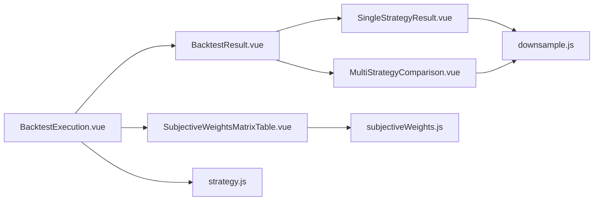

# 回测执行

<cite>
**本文引用的文件**
- [BacktestExecution.vue](file://src/views/strategy/BacktestExecution.vue)
- [BacktestResult.vue](file://src/views/strategy/BacktestResult.vue)
- [SingleStrategyResult.vue](file://src/views/strategy/backtest/SingleStrategyResult.vue)
- [MultiStrategyComparison.vue](file://src/views/strategy/backtest/MultiStrategyComparison.vue)
- [SubjectiveWeightsMatrixTable.vue](file://src/components/SubjectiveWeightsMatrixTable.vue)
- [strategy.js](file://src/api/strategy.js)
- [downsample.js](file://src/utils/downsample.js)
- [subjectiveWeights.js](file://src/utils/subjectiveWeights.js)
</cite>

## 目录
1. [简介](#简介)
2. [项目结构](#项目结构)
3. [核心组件](#核心组件)
4. [架构总览](#架构总览)
5. [详细组件分析](#详细组件分析)
6. [依赖关系分析](#依赖关系分析)
7. [性能考量](#性能考量)
8. [故障排查指南](#故障排查指南)
9. [结论](#结论)
10. [附录](#附录)

## 简介
本文件面向回测执行系统的使用者与维护者，系统性梳理回测引擎的架构与实现原理，涵盖数据准备、参数配置、执行流程、结果展示与性能优化等方面。重点区分“单策略回测”与“多策略对比回测”的功能差异与使用场景，并给出参数设置、结果可视化与故障排查的实用建议。

## 项目结构
回测功能主要由前端页面与组件构成，核心入口为“回测执行”页面，负责参数配置与调度；“回测结果”页面负责结果聚合与展示；“单策略结果”与“多策略对比”分别承载单策略与多策略的可视化细节；“主观权重矩阵表”提供主观策略的调仓日期与权重编辑能力；API 层封装后端回测服务；工具层提供降采样与权重归一化等通用能力。

**图表来源**
- [BacktestExecution.vue](file://src/views/strategy/BacktestExecution.vue)
- [BacktestResult.vue](file://src/views/strategy/BacktestResult.vue)
- [SingleStrategyResult.vue](file://src/views/strategy/backtest/SingleStrategyResult.vue)
- [MultiStrategyComparison.vue](file://src/views/strategy/backtest/MultiStrategyComparison.vue)
- [SubjectiveWeightsMatrixTable.vue](file://src/components/SubjectiveWeightsMatrixTable.vue)
- [strategy.js](file://src/api/strategy.js)
- [downsample.js](file://src/utils/downsample.js)
- [subjectiveWeights.js](file://src/utils/subjectiveWeights.js)

**章节来源**
- [BacktestExecution.vue:1-120](file://src/views/strategy/BacktestExecution.vue#L1-L120)
- [BacktestResult.vue:1-116](file://src/views/strategy/BacktestResult.vue#L1-L116)

## 核心组件
- 回测执行页（BacktestExecution.vue）
  - 负责回测模式选择（单策略/多策略）、策略选择、参数配置（初始资金、调仓频率、波动率阈值重置、手续费率、滑点、动量选择器参数、主观权重初始化与预设调仓等）、执行与交互（波动率重置步进、主观预设步进、同步回策略模型等）。
- 回测结果页（BacktestResult.vue）
  - 根据模式分发到单策略结果或多策略对比视图。
- 单策略结果（SingleStrategyResult.vue）
  - 展示核心指标、交易成本、净值与回撤、持仓权重变化、组合波动率监控、交易明细、备注编辑等。
- 多策略对比（MultiStrategyComparison.vue）
  - 对比各策略的指标、净值曲线与波动率曲线，并嵌套进入各策略的详细结果卡片。
- 主观权重矩阵表（SubjectiveWeightsMatrixTable.vue）
  - 提供主观策略的调仓日期与权重编辑、批量归一化、复制行、等权填充、合计校验等。
- API 封装（strategy.js）
  - 提供运行回测、更新备注、基于快照切片计算指标、获取指数编制权重上限等接口。
- 工具函数（downsample.js、subjectiveWeights.js）
  - 提供降采样、权重归一化等通用能力。

**章节来源**
- [BacktestExecution.vue:914-1014](file://src/views/strategy/BacktestExecution.vue#L914-L1014)
- [BacktestResult.vue:32-103](file://src/views/strategy/BacktestResult.vue#L32-L103)
- [SingleStrategyResult.vue:243-520](file://src/views/strategy/backtest/SingleStrategyResult.vue#L243-L520)
- [MultiStrategyComparison.vue:104-120](file://src/views/strategy/backtest/MultiStrategyComparison.vue#L104-L120)
- [SubjectiveWeightsMatrixTable.vue:132-424](file://src/components/SubjectiveWeightsMatrixTable.vue#L132-L424)
- [strategy.js:86-125](file://src/api/strategy.js#L86-L125)
- [downsample.js:76-89](file://src/utils/downsample.js#L76-L89)
- [subjectiveWeights.js:10-37](file://src/utils/subjectiveWeights.js#L10-L37)

## 架构总览
回测执行采用“前端配置 + 后端计算 + 前端可视化”的分层架构：
- 前端负责参数收集、交互控制、图表渲染与结果聚合；
- 后端负责回测计算、指标与快照产出；
- 工具层提供降采样与权重处理等支撑能力。

**图表来源**
- [BacktestExecution.vue:2953-3325](file://src/views/strategy/BacktestExecution.vue#L2953-L3325)
- [strategy.js:86-93](file://src/api/strategy.js#L86-L93)
- [BacktestResult.vue:8-27](file://src/views/strategy/BacktestResult.vue#L8-L27)

## 详细组件分析

### 回测执行页（BacktestExecution.vue）
- 回测模式与策略选择
  - 单策略/多策略两种模式，多策略限制 2-5 个；单策略隐藏“周期性调仓”与“波动率阈值重置”，主观策略隐藏“周期性调仓”。
- 参数配置
  - 初始资金、调仓频率、波动率阈值重置开关与阈值、手续费率、滑点、动量选择器参数（最小历史、并列决胜窗口、动量窗口、杠杆倍数）、主观策略参数（权重初始化、预设调仓日与权重、步进暂停）。
- 执行与交互
  - 执行回测、波动率重置日人工干预对话框、主观预设调仓日步进对话框、同步调仓配置到策略模型确认。
- 数据来源与联动
  - 从策略模型加载参数与资产池；指数编制规则权重上限通过接口获取；多策略模式下构建资产名称映射；主观策略权重矩阵表支持批量归一化与合计校验。

**图表来源**
- [BacktestExecution.vue:2953-3325](file://src/views/strategy/BacktestExecution.vue#L2953-L3325)
- [BacktestExecution.vue:1862-1966](file://src/views/strategy/BacktestExecution.vue#L1862-L1966)
- [BacktestExecution.vue:713-768](file://src/views/strategy/BacktestExecution.vue#L713-L768)
- [BacktestExecution.vue:770-888](file://src/views/strategy/BacktestExecution.vue#L770-L888)

**章节来源**
- [BacktestExecution.vue:13-711](file://src/views/strategy/BacktestExecution.vue#L13-L711)
- [BacktestExecution.vue:890-910](file://src/views/strategy/BacktestExecution.vue#L890-L910)
- [BacktestExecution.vue:1334-1353](file://src/views/strategy/BacktestExecution.vue#L1334-L1353)
- [BacktestExecution.vue:1716-1744](file://src/views/strategy/BacktestExecution.vue#L1716-L1744)
- [BacktestExecution.vue:1745-1813](file://src/views/strategy/BacktestExecution.vue#L1745-L1813)
- [BacktestExecution.vue:1814-1843](file://src/views/strategy/BacktestExecution.vue#L1814-L1843)
- [BacktestExecution.vue:1844-1856](file://src/views/strategy/BacktestExecution.vue#L1844-L1856)
- [BacktestExecution.vue:1862-1966](file://src/views/strategy/BacktestExecution.vue#L1862-L1966)
- [BacktestExecution.vue:2001-2375](file://src/views/strategy/BacktestExecution.vue#L2001-L2375)
- [BacktestExecution.vue:2376-2399](file://src/views/strategy/BacktestExecution.vue#L2376-L2399)

### 回测结果页（BacktestResult.vue）
- 单策略模式：将每个结果项渲染为单策略结果卡片。
- 多策略模式：渲染多策略对比视图，包含指标对比、净值对比、波动率对比与各策略详细结果。

**章节来源**
- [BacktestResult.vue:8-27](file://src/views/strategy/BacktestResult.vue#L8-L27)

### 单策略结果（SingleStrategyResult.vue）
- 核心指标：总收益、年化收益、夏普比率、最大回撤、年化波动率、卡玛比率、交易次数、收益回撤比。
- 交易成本：总手续费、总滑点成本、总交易成本、成本占比。
- 可视化：净值与回撤走势、持仓权重变化、组合波动率监控（含人工干预与波动率重置标注）。
- 交易明细：时间、调仓类型、资产代码、方向、数量、价格、手续费、滑点成本。
- 备注：支持编辑与保存到策略回测记录。

**图表来源**
- [SingleStrategyResult.vue:243-520](file://src/views/strategy/backtest/SingleStrategyResult.vue#L243-L520)
- [SingleStrategyResult.vue:556-751](file://src/views/strategy/backtest/SingleStrategyResult.vue#L556-L751)
- [SingleStrategyResult.vue:752-800](file://src/views/strategy/backtest/SingleStrategyResult.vue#L752-L800)

**章节来源**
- [SingleStrategyResult.vue:6-190](file://src/views/strategy/backtest/SingleStrategyResult.vue#L6-L190)
- [SingleStrategyResult.vue:556-800](file://src/views/strategy/backtest/SingleStrategyResult.vue#L556-L800)

### 多策略对比（MultiStrategyComparison.vue）
- 指标对比表：总收益、年化收益、年化波动率、最大回撤、夏普比率、卡玛比率、交易次数。
- 图表：净值曲线对比（日期并集、前向填充）、波动率曲线对比。
- 各策略详细结果：折叠面板逐个渲染单策略结果卡片。

**图表来源**
- [MultiStrategyComparison.vue:124-202](file://src/views/strategy/backtest/MultiStrategyComparison.vue#L124-L202)
- [MultiStrategyComparison.vue:251-340](file://src/views/strategy/backtest/MultiStrategyComparison.vue#L251-L340)
- [MultiStrategyComparison.vue:341-388](file://src/views/strategy/backtest/MultiStrategyComparison.vue#L341-L388)

**章节来源**
- [MultiStrategyComparison.vue:5-101](file://src/views/strategy/backtest/MultiStrategyComparison.vue#L5-L101)
- [MultiStrategyComparison.vue:124-202](file://src/views/strategy/backtest/MultiStrategyComparison.vue#L124-L202)
- [MultiStrategyComparison.vue:251-388](file://src/views/strategy/backtest/MultiStrategyComparison.vue#L251-L388)

### 主观权重矩阵表（SubjectiveWeightsMatrixTable.vue）
- 功能：日期列、动态资产列、合计列、操作列（归一化、复制行、等权填充、删除）。
- 交互：批量归一化、合计校验（<100%/=100%/>100%）、Tab 键流转、权重输入限制与提示。
- 与回测集成：作为主观策略预设调仓日权重输入组件，支持多策略模式下的多策略主观权重配置。

**章节来源**
- [SubjectiveWeightsMatrixTable.vue:132-424](file://src/components/SubjectiveWeightsMatrixTable.vue#L132-L424)

### API 封装（strategy.js）
- 运行回测：POST /api/v1/backtests/run-by-model/{modelId}
- 更新回测备注：PATCH /api/v1/strategy-models/{modelId}/backtests/{recordId}
- 基于快照切片计算指标：POST /api/v1/backtests/compute-metrics-from-snapshots
- 获取指数编制权重上限：GET /api/v1/backtests/max-weights
- 其他策略模型相关接口（模板、发布、实盘等）

**章节来源**
- [strategy.js:86-125](file://src/api/strategy.js#L86-L125)

### 工具函数（downsample.js、subjectiveWeights.js）
- 降采样：对时间序列进行 LTTB 或均匀采样，减少大数据量下的渲染压力。
- 权重归一化：将权重合计缩放到 1，使用最大余数法分配，保证精度与合计约束。

**章节来源**
- [downsample.js:76-89](file://src/utils/downsample.js#L76-L89)
- [subjectiveWeights.js:10-37](file://src/utils/subjectiveWeights.js#L10-L37)

## 依赖关系分析
- 组件耦合
  - BacktestExecution.vue 与 BacktestResult.vue 通过模式与结果数据解耦；BacktestResult.vue 再分发到 SingleStrategyResult.vue 与 MultiStrategyComparison.vue。
  - SubjectiveWeightsMatrixTable.vue 与 BacktestExecution.vue 通过事件与双向绑定耦合，实现主观策略权重的输入与校验。
- 外部依赖
  - ECharts 用于图表渲染；Axios 用于 API 请求；Vuex 用于策略模型列表与状态管理。
- 数据流
  - 用户配置 → BacktestExecution.vue → API → 后端回测引擎 → 返回快照/指标 → 前端渲染。

**图表来源**
- [BacktestExecution.vue:914-1014](file://src/views/strategy/BacktestExecution.vue#L914-L1014)
- [BacktestResult.vue:32-103](file://src/views/strategy/BacktestResult.vue#L32-L103)
- [SingleStrategyResult.vue:243-520](file://src/views/strategy/backtest/SingleStrategyResult.vue#L243-L520)
- [MultiStrategyComparison.vue:104-120](file://src/views/strategy/backtest/MultiStrategyComparison.vue#L104-L120)
- [SubjectiveWeightsMatrixTable.vue:132-424](file://src/components/SubjectiveWeightsMatrixTable.vue#L132-L424)
- [strategy.js:86-125](file://src/api/strategy.js#L86-L125)
- [downsample.js:76-89](file://src/utils/downsample.js#L76-L89)
- [subjectiveWeights.js:10-37](file://src/utils/subjectiveWeights.js#L10-L37)

**章节来源**
- [BacktestExecution.vue:914-1014](file://src/views/strategy/BacktestExecution.vue#L914-L1014)
- [BacktestResult.vue:32-103](file://src/views/strategy/BacktestResult.vue#L32-L103)

## 性能考量
- 图表渲染优化
  - 使用降采样（downsample.js）限制 ECharts 数据点数量，避免大数据量导致卡顿。
  - 分帧渲染（requestAnimationFrame）与延迟初始化，降低主线程阻塞。
  - 统一 resize 监听与图表实例销毁，避免内存泄漏。
- 数据处理优化
  - 主观权重矩阵表批量归一化，减少无效计算。
  - 多策略对比时合并日期集合并前向填充，保证对比一致性与性能。
- 网络与超时
  - 回测接口设置较长超时（毫秒级），适配混合动量等计算量较大的场景。
- 建议
  - 合理设置回测时间范围与数据粒度，避免不必要的长序列。
  - 在主观策略中尽量使用“批量归一化”与“等权填充”减少手工输入误差与重复计算。
  - 多策略对比时控制策略数量（建议不超过 5 个），提升对比效率。

**章节来源**
- [SingleStrategyResult.vue:556-582](file://src/views/strategy/backtest/SingleStrategyResult.vue#L556-L582)
- [SingleStrategyResult.vue:583-751](file://src/views/strategy/backtest/SingleStrategyResult.vue#L583-L751)
- [MultiStrategyComparison.vue:251-340](file://src/views/strategy/backtest/MultiStrategyComparison.vue#L251-L340)
- [strategy.js:86-93](file://src/api/strategy.js#L86-L93)
- [downsample.js:76-89](file://src/utils/downsample.js#L76-L89)

## 故障排查指南
- 执行按钮不可用或参数校验失败
  - 检查策略选择、初始资金、手续费率、滑点等必填字段是否满足校验规则。
- 回测长时间无响应
  - 确认时间范围合理、参数未设置过高（如杠杆倍数、动量窗口过大）；关注后端超时设置。
- 波动率重置日弹窗未出现
  - 确认已启用“波动率阈值重置”且存在触发重置的快照；若无触发，无需人工干预。
- 主观策略预设调仓日步进异常
  - 检查预设日期是否在回测时间范围内、权重合计是否为 0；必要时使用“批量归一化”。
- 多策略对比指标与净值不一致
  - 确认各策略快照是否完整；检查日期并集与前向填充逻辑是否生效。
- 备注保存失败
  - 确认已关联到可保存的记录（modelId 与 recordId 均存在）；检查网络与权限。

**章节来源**
- [BacktestExecution.vue:1049-1114](file://src/views/strategy/BacktestExecution.vue#L1049-L1114)
- [BacktestExecution.vue:1862-1966](file://src/views/strategy/BacktestExecution.vue#L1862-L1966)
- [BacktestExecution.vue:713-768](file://src/views/strategy/BacktestExecution.vue#L713-L768)
- [BacktestExecution.vue:770-888](file://src/views/strategy/BacktestExecution.vue#L770-L888)
- [strategy.js:95-102](file://src/api/strategy.js#L95-L102)

## 结论
回测执行系统通过清晰的页面分工与组件解耦，实现了从参数配置到结果可视化的完整闭环。单策略回测强调深度分析与主观干预，多策略对比强调横向对比与快速评估。配合降采样、批量归一化与合理的交互设计，系统在功能完整性与用户体验上达到良好平衡。建议在实际使用中结合业务目标选择合适的模式与参数，并遵循性能与故障排查建议以获得稳定高效的回测体验。

## 附录
- 回测参数设置要点
  - 时间范围：建议覆盖足够样本，避免极端市场阶段；注意节假日与交易日限制。
  - 交易成本：手续费率与滑点需结合市场流动性与交易规模设置。
  - 动量选择器：最小历史、并列决胜窗口、动量窗口与杠杆倍数需与策略特性匹配。
  - 主观策略：权重初始化与预设调仓日应明确业务意图，使用矩阵表的批量归一化与合计校验保障合规。
- 结果展示要点
  - 关注核心指标与风险指标的联动关系；结合净值与回撤走势识别回撤来源；通过交易明细核对关键交易。
  - 多策略对比时，注意各策略的调仓频率与参数差异对结果的影响。