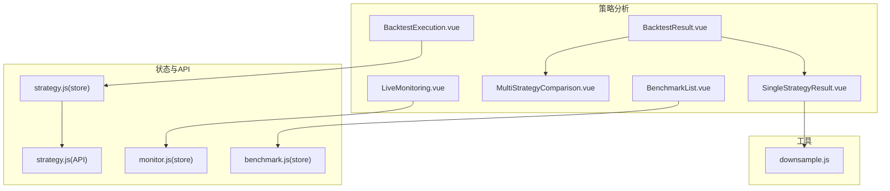
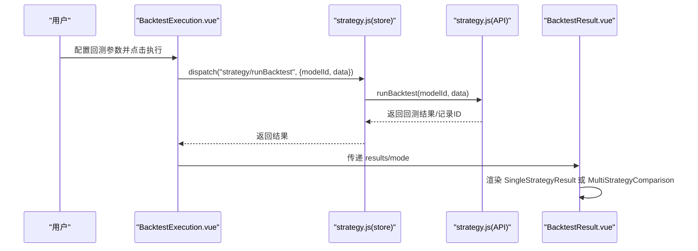
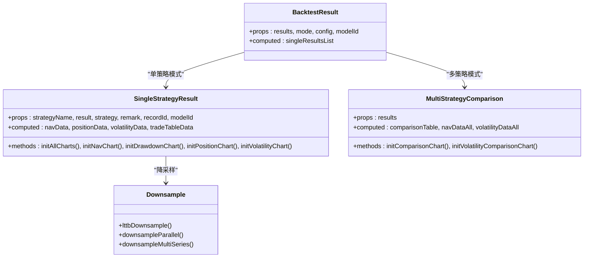
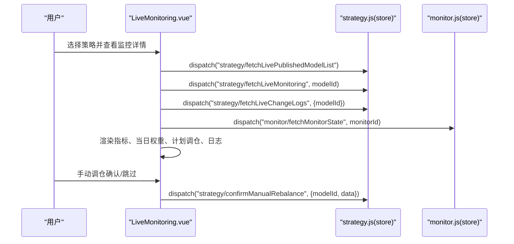
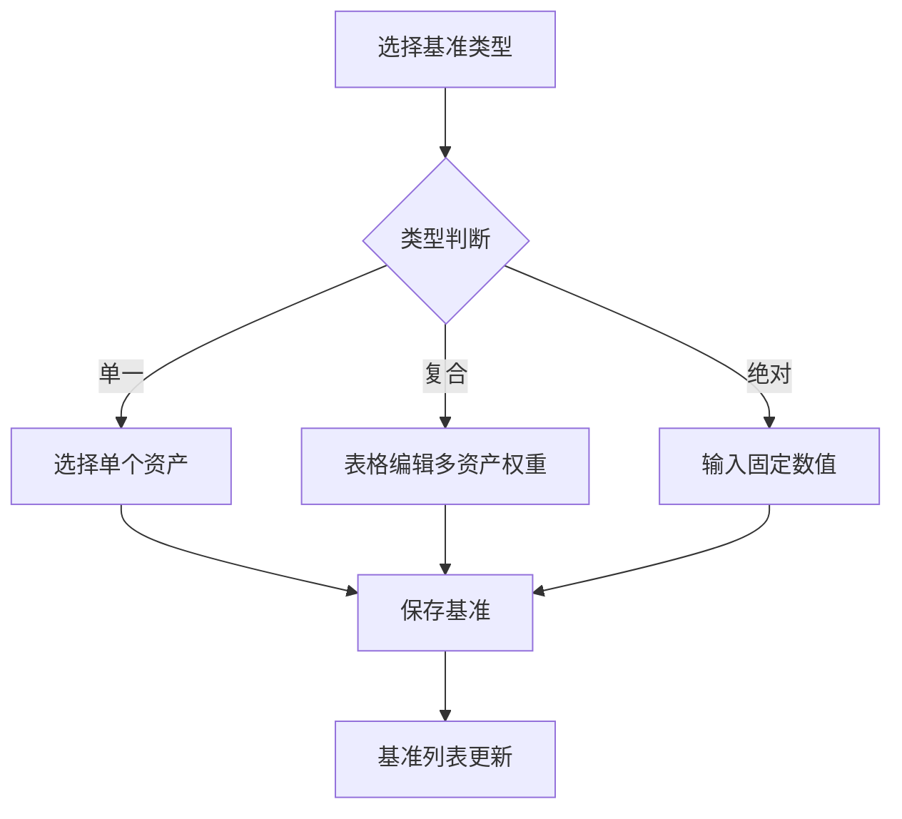
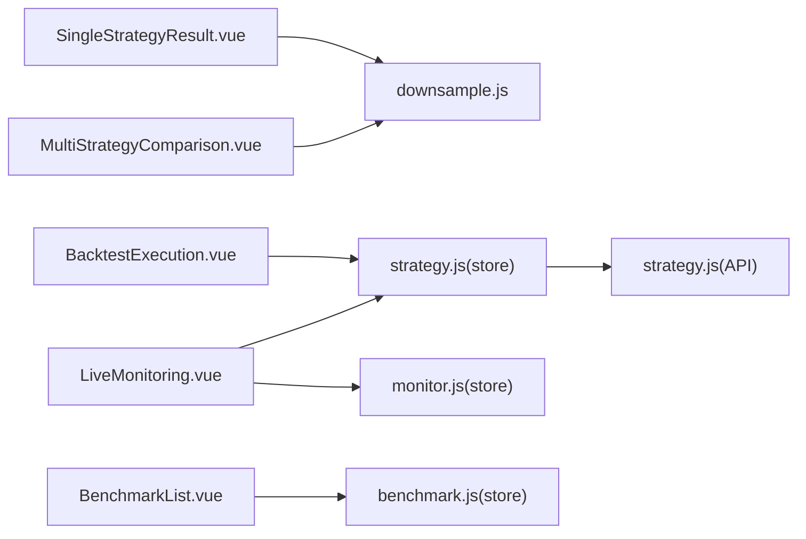

# 策略分析

<cite>
**本文引用的文件**
- [strategy.js](file://src/store/modules/strategy.js)
- [strategy.js](file://src/api/strategy.js)
- [MultiStrategyComparison.vue](file://src/views/strategy/backtest/MultiStrategyComparison.vue)
- [SingleStrategyResult.vue](file://src/views/strategy/backtest/SingleStrategyResult.vue)
- [BacktestResult.vue](file://src/views/strategy/BacktestResult.vue)
- [BacktestExecution.vue](file://src/views/strategy/BacktestExecution.vue)
- [LiveMonitoring.vue](file://src/views/strategy/LiveMonitoring.vue)
- [monitor.js](file://src/store/modules/monitor.js)
- [downsample.js](file://src/utils/downsample.js)
- [BenchmarkList.vue](file://src/views/strategy/BenchmarkList.vue)
- [benchmark.js](file://src/store/modules/benchmark.js)
</cite>

## 目录
1. [简介](#简介)
2. [项目结构](#项目结构)
3. [核心组件](#核心组件)
4. [架构总览](#架构总览)
5. [详细组件分析](#详细组件分析)
6. [依赖关系分析](#依赖关系分析)
7. [性能考量](#性能考量)
8. [故障排查指南](#故障排查指南)
9. [结论](#结论)
10. [附录](#附录)

## 简介
本文件面向策略分析功能，围绕“回测结果分析、实时监控、基准策略管理与对比、可视化展示与交互”四个方面，系统梳理前端实现与数据流，帮助读者快速理解并高效使用策略分析能力。内容涵盖收益分析、风险评估、夏普比率等关键指标的呈现与计算逻辑，实盘监控的执行状态跟踪与异常预警，基准策略的维护与相对表现评估，以及多维度可视化图表与交互式分析界面。

## 项目结构
策略分析相关模块主要分布在以下区域：
- 策略回测与结果展示：BacktestExecution、BacktestResult、SingleStrategyResult、MultiStrategyComparison
- 实时监控：LiveMonitoring、monitor store
- 基准管理：BenchmarkList、benchmark store
- 策略与回测 API：strategy store 与 strategy API
- 可视化辅助：downsample 工具

**图表来源**
- [BacktestExecution.vue:1-800](file://src/views/strategy/BacktestExecution.vue#L1-L800)
- [BacktestResult.vue:1-116](file://src/views/strategy/BacktestResult.vue#L1-L116)
- [SingleStrategyResult.vue:1-1198](file://src/views/strategy/backtest/SingleStrategyResult.vue#L1-L1198)
- [MultiStrategyComparison.vue:1-474](file://src/views/strategy/backtest/MultiStrategyComparison.vue#L1-L474)
- [LiveMonitoring.vue:1-766](file://src/views/strategy/LiveMonitoring.vue#L1-L766)
- [strategy.js:1-468](file://src/store/modules/strategy.js#L1-L468)
- [strategy.js:1-295](file://src/api/strategy.js#L1-L295)
- [monitor.js:1-416](file://src/store/modules/monitor.js#L1-L416)
- [benchmark.js:1-138](file://src/store/modules/benchmark.js#L1-L138)
- [downsample.js:1-127](file://src/utils/downsample.js#L1-L127)

**章节来源**
- [BacktestExecution.vue:1-800](file://src/views/strategy/BacktestExecution.vue#L1-L800)
- [strategy.js:1-468](file://src/store/modules/strategy.js#L1-L468)
- [strategy.js:1-295](file://src/api/strategy.js#L1-L295)

## 核心组件
- 策略回测执行与配置：BacktestExecution.vue
- 回测结果容器：BacktestResult.vue
- 单策略结果可视化：SingleStrategyResult.vue
- 多策略对比分析：MultiStrategyComparison.vue
- 实时监控面板：LiveMonitoring.vue
- 基准策略管理：BenchmarkList.vue
- 相关工具：downsample.js

**章节来源**
- [BacktestResult.vue:1-116](file://src/views/strategy/BacktestResult.vue#L1-L116)
- [SingleStrategyResult.vue:1-1198](file://src/views/strategy/backtest/SingleStrategyResult.vue#L1-L1198)
- [MultiStrategyComparison.vue:1-474](file://src/views/strategy/backtest/MultiStrategyComparison.vue#L1-L474)
- [LiveMonitoring.vue:1-766](file://src/views/strategy/LiveMonitoring.vue#L1-L766)
- [BenchmarkList.vue:1-682](file://src/views/strategy/BenchmarkList.vue#L1-L682)
- [downsample.js:1-127](file://src/utils/downsample.js#L1-L127)

## 架构总览
策略分析从前端到后端的关键流程如下：
- 回测执行：BacktestExecution.vue 构建参数，调用 strategy.store 的 runBacktest，后端返回回测记录 ID 与结果。
- 结果展示：BacktestResult.vue 根据模式选择 SingleStrategyResult 或 MultiStrategyComparison，分别渲染单策略详细指标与净值、波动率、持仓权重、交易明细等。
- 实时监控：LiveMonitoring.vue 通过 strategy.store 的 live 系列接口获取已发布策略、监控数据、变更日志，并支持手动调仓确认。
- 基准管理：BenchmarkList.vue 通过 benchmark.store 管理基准列表、创建/更新/删除基准，支持绝对、单一、复合三种类型。
- 数据可视化：SingleStrategyResult 与 MultiStrategyComparison 使用 ECharts 渲染净值曲线、回撤、波动率、持仓权重等；downsample.js 提供降采样以提升大数据量下的渲染性能。

**图表来源**
- [BacktestExecution.vue:1-800](file://src/views/strategy/BacktestExecution.vue#L1-L800)
- [strategy.js:176-185](file://src/store/modules/strategy.js#L176-L185)
- [strategy.js:85-93](file://src/api/strategy.js#L85-L93)
- [BacktestResult.vue:1-116](file://src/views/strategy/BacktestResult.vue#L1-L116)

## 详细组件分析

### 回测结果分析与可视化
- 单策略结果展示（SingleStrategyResult.vue）
  - 关键指标：总收益率、年化收益率、夏普比率、最大回撤、年化波动率、Calmar比率、交易次数、收益回撤比。
  - 图表能力：净值与回撤走势、组合波动率监控、持仓权重变化（含调仓类型标注）、交易明细。
  - 备注编辑：支持与历史回测卡片一致的备注编辑与保存。
  - 性能优化：使用 downsample.js 对大量数据进行降采样，避免 ECharts 卡顿。
- 多策略对比（MultiStrategyComparison.vue）
  - 指标对比表格：总收益率、年化收益率、年化波动率、最大回撤、夏普比率、Calmar比率、交易次数。
  - 净值曲线对比：按所有策略的日期并集构建序列，采用前向填充策略，确保对比一致性。
  - 波动率监控对比：优先使用后端提供的组合波动率，否则使用滚动年化波动率计算。
- 结果容器（BacktestResult.vue）
  - 根据 mode 决定渲染单策略或多策略对比，负责透传 modelId、recordId 以便备注保存。

**图表来源**
- [SingleStrategyResult.vue:1-1198](file://src/views/strategy/backtest/SingleStrategyResult.vue#L1-L1198)
- [MultiStrategyComparison.vue:1-474](file://src/views/strategy/backtest/MultiStrategyComparison.vue#L1-L474)
- [BacktestResult.vue:1-116](file://src/views/strategy/BacktestResult.vue#L1-L116)
- [downsample.js:1-127](file://src/utils/downsample.js#L1-L127)

**章节来源**
- [SingleStrategyResult.vue:1-1198](file://src/views/strategy/backtest/SingleStrategyResult.vue#L1-L1198)
- [MultiStrategyComparison.vue:1-474](file://src/views/strategy/backtest/MultiStrategyComparison.vue#L1-L474)
- [BacktestResult.vue:1-116](file://src/views/strategy/BacktestResult.vue#L1-L116)
- [downsample.js:1-127](file://src/utils/downsample.js#L1-L127)

### 实时监控系统
- 实时监控入口：LiveMonitoring.vue
- 核心能力：
  - 实时策略列表与详情：获取已实盘发布策略、监控指标、当日净值/权重/计划调仓。
  - 实盘配置：调仓模式（自动/手动）、波动率阈值，支持保存与“发布到最新实盘”。
  - 变更日志：展示策略配置变更、实盘发布/取消、手动确认/跳过调仓等记录。
  - 手动调仓：支持“确认本次调仓/跳过本次调仓”，并可附带说明。
- 数据来源：通过 strategy.store 的 live 系列接口与 monitor.store 的监控接口获取。

**图表来源**
- [LiveMonitoring.vue:1-766](file://src/views/strategy/LiveMonitoring.vue#L1-L766)
- [strategy.js:313-351](file://src/store/modules/strategy.js#L313-L351)
- [monitor.js:81-106](file://src/store/modules/monitor.js#L81-L106)

**章节来源**
- [LiveMonitoring.vue:1-766](file://src/views/strategy/LiveMonitoring.vue#L1-L766)
- [strategy.js:303-351](file://src/store/modules/strategy.js#L303-L351)
- [monitor.js:1-416](file://src/store/modules/monitor.js#L1-L416)

### 基准策略管理与对比
- 基准管理（BenchmarkList.vue）
  - 支持新增/编辑/删除基准，筛选与分页。
  - 基准类型：单一基准（单资产）、复合基准（多资产加权）、绝对基准（固定数值）。
  - 组件联动：根据类型动态渲染输入，复合基准支持表格编辑权重并校验总权重。
- 基准数据流：benchmark.store 提供列表、创建、更新、删除等动作，供页面使用。
- 相对表现评估：可将策略净值与基准曲线在同一图表中对比，结合超额收益分析（策略收益 - 基准收益）进行相对表现评估。

**图表来源**
- [BenchmarkList.vue:1-682](file://src/views/strategy/BenchmarkList.vue#L1-L682)
- [benchmark.js:1-138](file://src/store/modules/benchmark.js#L1-L138)

**章节来源**
- [BenchmarkList.vue:1-682](file://src/views/strategy/BenchmarkList.vue#L1-L682)
- [benchmark.js:1-138](file://src/store/modules/benchmark.js#L1-L138)

### 关键指标与计算逻辑
- 收益分析
  - 总收益率、年化收益率、累计净值、单位净值、当日净值。
- 风险评估
  - 年化波动率、最大回撤、收益回撤比、组合波动率监控。
- 夏普比率
  - 通过后端返回的指标直接展示；亦可基于收益与波动率自行计算（公式：(R_p - R_f)/σ_p）。
- Calmar比率
  - 年化收益/最大回撤，衡量风险调整后收益。
- 交易成本
  - 总手续费、总滑点成本、总交易成本、成本占比，用于评估策略净收益。

上述指标在 SingleStrategyResult.vue 与 MultiStrategyComparison.vue 中均有体现，具体数值来源于后端回测结果。

**章节来源**
- [SingleStrategyResult.vue:1-1198](file://src/views/strategy/backtest/SingleStrategyResult.vue#L1-L1198)
- [MultiStrategyComparison.vue:1-474](file://src/views/strategy/backtest/MultiStrategyComparison.vue#L1-L474)

## 依赖关系分析
- 组件耦合
  - BacktestResult.vue 作为容器，解耦单/多策略展示组件。
  - SingleStrategyResult.vue 与 MultiStrategyComparison.vue 依赖 ECharts 与 downsample.js。
  - LiveMonitoring.vue 依赖 strategy.store 与 monitor.store。
  - BenchmarkList.vue 依赖 benchmark.store。
- 外部依赖
  - ECharts：用于净值、回撤、波动率、持仓权重等图表渲染。
  - Axios：通过 request 封装调用后端 API。
  - LTTB 降采样：提升大数据量图表渲染性能。

**图表来源**
- [SingleStrategyResult.vue:1-1198](file://src/views/strategy/backtest/SingleStrategyResult.vue#L1-L1198)
- [MultiStrategyComparison.vue:1-474](file://src/views/strategy/backtest/MultiStrategyComparison.vue#L1-L474)
- [BacktestExecution.vue:1-800](file://src/views/strategy/BacktestExecution.vue#L1-L800)
- [strategy.js:1-468](file://src/store/modules/strategy.js#L1-L468)
- [strategy.js:1-295](file://src/api/strategy.js#L1-L295)
- [LiveMonitoring.vue:1-766](file://src/views/strategy/LiveMonitoring.vue#L1-L766)
- [monitor.js:1-416](file://src/store/modules/monitor.js#L1-L416)
- [BenchmarkList.vue:1-682](file://src/views/strategy/BenchmarkList.vue#L1-L682)
- [benchmark.js:1-138](file://src/store/modules/benchmark.js#L1-L138)
- [downsample.js:1-127](file://src/utils/downsample.js#L1-L127)

**章节来源**
- [strategy.js:1-468](file://src/store/modules/strategy.js#L1-L468)
- [strategy.js:1-295](file://src/api/strategy.js#L1-L295)
- [monitor.js:1-416](file://src/store/modules/monitor.js#L1-L416)
- [benchmark.js:1-138](file://src/store/modules/benchmark.js#L1-L138)
- [downsample.js:1-127](file://src/utils/downsample.js#L1-L127)

## 性能考量
- 降采样策略
  - 使用 LTTB（Largest Triangle Three Buckets）算法对净值、回撤、波动率等序列进行降采样，限制 ECharts 渲染点数，显著提升大数据量下的流畅度。
- 渲染优化
  - 分帧渲染：SingleStrategyResult 采用 requestAnimationFrame 分批初始化图表，避免主线程阻塞。
  - 懒渲染：组件在数据就绪后延迟初始化，确保 DOM 尺寸正确。
- 响应式适配
  - 统一监听窗口 resize，逐个图表执行 resize，保证图表自适应。

**章节来源**
- [downsample.js:1-127](file://src/utils/downsample.js#L1-L127)
- [SingleStrategyResult.vue:556-582](file://src/views/strategy/backtest/SingleStrategyResult.vue#L556-L582)
- [SingleStrategyResult.vue:477-510](file://src/views/strategy/backtest/SingleStrategyResult.vue#L477-L510)

## 故障排查指南
- 回测执行失败
  - 检查策略模型是否存在、资产池是否配置、参数是否合法。
  - 关注 runBacktest 的超时设置（5 分钟），避免大规模计算超时。
- 实盘监控无数据
  - 确认策略已“实盘发布”，检查 getLiveMonitoring 返回状态。
  - 若无监控数据，页面会提示暂无可用监控数据。
- 备注保存失败
  - 仅当回测已关联记录（modelId 与 recordId 均存在）时可保存备注。
  - 检查 updateBacktestRemark 接口返回错误信息。
- 基准保存失败
  - 复合基准需校验权重之和，单一/绝对基准需满足类型约束。
  - 检查后端返回的 detail 信息定位问题。

**章节来源**
- [strategy.js:85-93](file://src/api/strategy.js#L85-L93)
- [LiveMonitoring.vue:314-340](file://src/views/strategy/LiveMonitoring.vue#L314-L340)
- [SingleStrategyResult.vue:538-555](file://src/views/strategy/backtest/SingleStrategyResult.vue#L538-L555)
- [BenchmarkList.vue:507-566](file://src/views/strategy/BenchmarkList.vue#L507-L566)

## 结论
本策略分析体系以“回测-可视化-监控-基准”为主线，形成闭环的策略评估与决策支持能力。前端通过模块化组件与降采样优化，兼顾性能与体验；后端接口提供回测、实盘监控与基准管理能力，支撑策略开发、对比与上线后的持续观测。建议在实际使用中：
- 明确基准选择策略，结合超额收益与相对表现评估策略优劣；
- 利用多策略对比快速筛选稳健策略；
- 通过实时监控及时发现异常并进行人工干预；
- 基于关键指标（夏普比率、Calmar比率、最大回撤）制定风控与再平衡策略。

## 附录
- 夏普比率计算参考
  - 公式：(R_p - R_f)/σ_p，其中 R_p 为策略收益、R_f 为无风险利率、σ_p 为策略波动率。
  - 若无后端指标，可基于收益序列与波动率自行计算。
- Calmar比率计算参考
  - 公式：年化收益/最大回撤，用于衡量风险调整后收益。