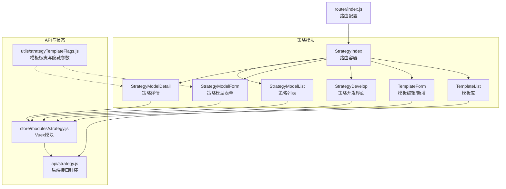
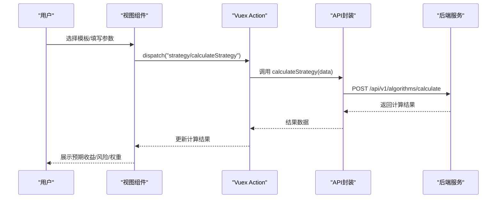
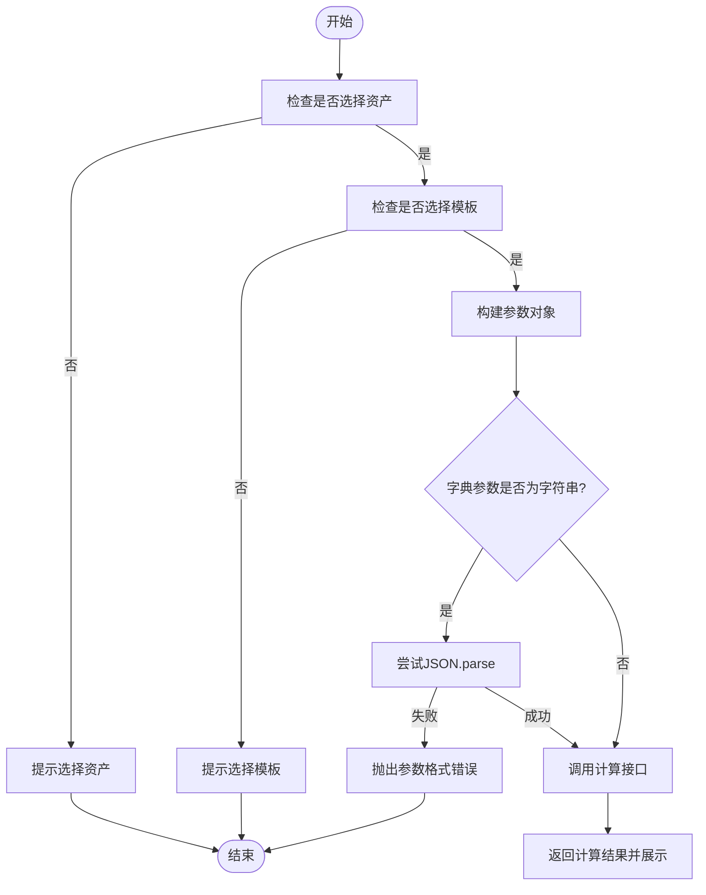
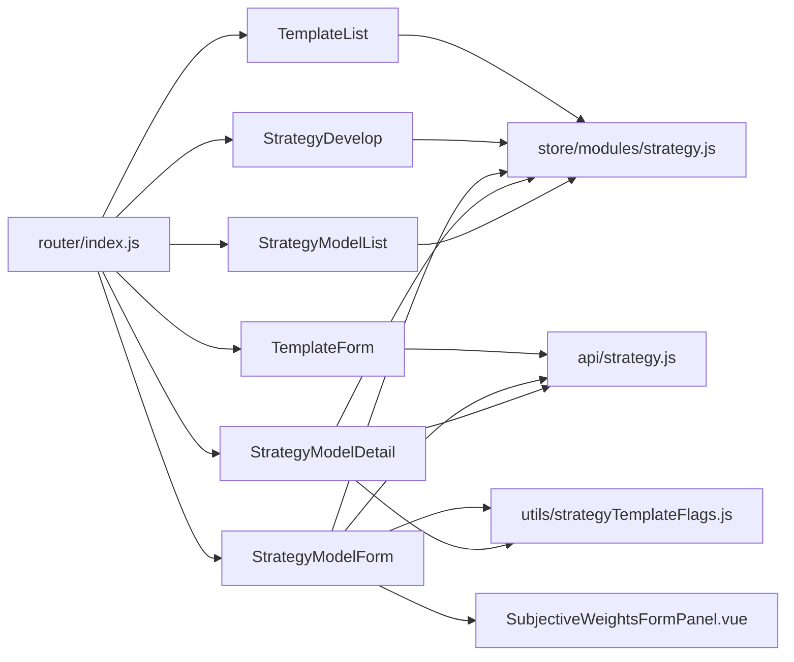

# 策略开发

<cite>
**本文引用的文件**
- [StrategyDevelop.vue](file://src/views/strategy/StrategyDevelop.vue)
- [TemplateList.vue](file://src/views/strategy/TemplateList.vue)
- [TemplateForm.vue](file://src/views/strategy/TemplateForm.vue)
- [StrategyModelForm.vue](file://src/views/strategy/StrategyModelForm.vue)
- [StrategyModelDetail.vue](file://src/views/strategy/StrategyModelDetail.vue)
- [StrategyModelList.vue](file://src/views/strategy/StrategyModelList.vue)
- [strategy.js](file://src/api/strategy.js)
- [strategy.js](file://src/store/modules/strategy.js)
- [strategyTemplateFlags.js](file://src/utils/strategyTemplateFlags.js)
- [SubjectiveWeightsFormPanel.vue](file://src/components/SubjectiveWeightsFormPanel.vue)
- [index.js](file://src/router/index.js)
</cite>

## 目录
1. [简介](#简介)
2. [项目结构](#项目结构)
3. [核心组件](#核心组件)
4. [架构总览](#架构总览)
5. [组件详解](#组件详解)
6. [依赖关系分析](#依赖关系分析)
7. [性能考量](#性能考量)
8. [故障排查指南](#故障排查指南)
9. [结论](#结论)
10. [附录](#附录)

## 简介
本文件面向策略开发功能，系统阐述策略开发界面的设计与实现，覆盖以下主题：
- 策略模板的选择与使用：模板库浏览、模板详情、模板参数定义与参数渲染。
- 自定义策略的编写方法：模板编辑器、参数配置、模板验证与保存。
- 策略开发工具能力：代码编辑器（Python 语法高亮）、参数配置控件（数字、滑块、下拉、布尔、字典）、实时计算与结果预览。
- 模板系统工作机制：模板分类、参数schema定义、参数类型与默认值、模板隐藏/固定参数策略。
- 最佳实践：代码规范、参数设计、性能优化、调试技巧。
- 示例与常见问题：如何基于模板创建策略、如何编写自定义模板、如何处理参数校验与错误。

## 项目结构
策略开发相关的核心文件位于 src/views/strategy 目录，配合 API 层与 Vuex Store 模块共同构成完整的策略开发闭环。路由层将策略子模块挂载至主布局，形成清晰的导航入口。

图示来源
- [index.js:60-122](file://src/router/index.js#L60-L122)
- [TemplateList.vue:1-553](file://src/views/strategy/TemplateList.vue#L1-L553)
- [TemplateForm.vue:1-615](file://src/views/strategy/TemplateForm.vue#L1-L615)
- [StrategyDevelop.vue:1-434](file://src/views/strategy/StrategyDevelop.vue#L1-L434)
- [StrategyModelForm.vue:1-800](file://src/views/strategy/StrategyModelForm.vue#L1-L800)
- [StrategyModelDetail.vue:1-800](file://src/views/strategy/StrategyModelDetail.vue#L1-L800)
- [StrategyModelList.vue:1-466](file://src/views/strategy/StrategyModelList.vue#L1-L466)
- [strategy.js:1-295](file://src/api/strategy.js#L1-L295)
- [strategy.js:1-468](file://src/store/modules/strategy.js#L1-L468)
- [strategyTemplateFlags.js:1-100](file://src/utils/strategyTemplateFlags.js#L1-L100)

章节来源
- [index.js:60-122](file://src/router/index.js#L60-L122)

## 核心组件
- 策略开发界面（StrategyDevelop）：资产选择树、参数配置表单、实时计算与结果预览。
- 模板库（TemplateList）：模板网格展示、搜索过滤、模板详情与源码查看、模板表单对话框。
- 模板编辑器（TemplateForm）：模板基本信息、源码编辑器（CodeMirror + Python 语法高亮）、参数schema配置、模板验证。
- 策略模型表单（StrategyModelForm）：策略基本信息、算法模板选择、资产选择、资产选择策略（动量/混合动量）、波动率阈值重置、模板参数渲染与隐藏/固定逻辑。
- 策略详情（StrategyModelDetail）：策略参数展示、回测历史与图表、回测详情、实盘发布/取消、创建模拟组合。
- 策略列表（StrategyModelList）：策略表格、搜索过滤、回测、发布、实盘发布/取消、编辑/删除。
- 工具组件：主观权重编辑面板（SubjectiveWeightsFormPanel）。
- API与状态：api/strategy.js 提供后端接口封装；store/modules/strategy.js 管理模板与策略模型的加载、保存、计算等动作。
- 模板标志工具：utils/strategyTemplateFlags.js 定义模板类型判断与隐藏/固定参数集合。

章节来源
- [StrategyDevelop.vue:1-434](file://src/views/strategy/StrategyDevelop.vue#L1-L434)
- [TemplateList.vue:1-553](file://src/views/strategy/TemplateList.vue#L1-L553)
- [TemplateForm.vue:1-615](file://src/views/strategy/TemplateForm.vue#L1-L615)
- [StrategyModelForm.vue:1-800](file://src/views/strategy/StrategyModelForm.vue#L1-L800)
- [StrategyModelDetail.vue:1-800](file://src/views/strategy/StrategyModelDetail.vue#L1-L800)
- [StrategyModelList.vue:1-466](file://src/views/strategy/StrategyModelList.vue#L1-L466)
- [SubjectiveWeightsFormPanel.vue:1-315](file://src/components/SubjectiveWeightsFormPanel.vue#L1-L315)
- [strategy.js:1-295](file://src/api/strategy.js#L1-L295)
- [strategy.js:1-468](file://src/store/modules/strategy.js#L1-L468)
- [strategyTemplateFlags.js:1-100](file://src/utils/strategyTemplateFlags.js#L1-L100)

## 架构总览
策略开发的前后端交互遵循“视图组件 -> Vuex Action -> API 封装 -> 后端”的链路。模板与策略模型的生命周期包括：加载、编辑、验证、保存、计算、回测、发布、实盘发布等。

图示来源
- [StrategyDevelop.vue:301-337](file://src/views/strategy/StrategyDevelop.vue#L301-L337)
- [strategy.js:365-400](file://src/store/modules/strategy.js#L365-L400)
- [strategy.js:235-242](file://src/api/strategy.js#L235-L242)

## 组件详解

### 策略开发界面（StrategyDevelop）
- 功能要点
  - 资产选择：左侧树形选择器，支持搜索与多选；右侧展示已选资产标签。
  - 参数配置：根据所选模板动态渲染参数控件（数字、滑块、下拉、布尔、字典、文本）。
  - 实时计算：点击“运行计算”，对参数进行类型校验（特别是字典参数的JSON解析），调用计算接口并展示结果。
  - 结果预览：展示预期收益、预期风险、夏普比率与各资产权重条形图与进度条。
  - 保存策略：将计算结果保存为策略模型，并跳转到策略列表或触发父级回调。

- 关键流程（计算与保存）

图示来源
- [StrategyDevelop.vue:301-337](file://src/views/strategy/StrategyDevelop.vue#L301-L337)

章节来源
- [StrategyDevelop.vue:1-434](file://src/views/strategy/StrategyDevelop.vue#L1-L434)

### 模板库（TemplateList）
- 功能要点
  - 模板网格展示：卡片式布局，展示模板名称、描述、状态、参数预览。
  - 搜索过滤：支持按名称/编码搜索。
  - 详情查看：弹窗展示模板参数定义与源码（只读 CodeMirror）。
  - 模板表单：弹窗打开 TemplateForm 进行新增/编辑。
  - 使用模板：基于模板创建策略，打开 StrategyModelForm 并预填模板代码。

- 代码编辑器（只读）
  - 使用 CodeMirror，Python 语法高亮，monokai 主题，行号与自动换行开启，光标隐藏，尺寸固定。

章节来源
- [TemplateList.vue:1-553](file://src/views/strategy/TemplateList.vue#L1-L553)

### 模板编辑器（TemplateForm）
- 功能要点
  - 基本信息：模板名称、代码、描述。
  - 源码编辑：CodeMirror，Python 语法高亮，支持 Tab/Shift-Tab 缩进，自动闭合括号，实时同步到表单。
  - 参数配置：动态增删参数，支持多种类型（number/slider/string/boolean/select/dict），默认值、范围、步长、选项列表等。
  - 模板验证：提交前可点击“验证模板”，调用后端 validate 接口，弹窗展示验证结果（通过/失败、错误/警告列表）。
  - 提交保存：创建或更新模板，成功后返回模板库或触发父级回调。

- 参数类型与默认值处理
  - number/slider：默认值为数值，支持 min/max/step。
  - select：默认值为字符串，options 支持逗号分隔字符串转数组。
  - boolean：默认值为布尔。
  - dict：默认值为对象或JSON字符串，提交时确保类型正确。
  - 其他：默认值为字符串。

章节来源
- [TemplateForm.vue:1-615](file://src/views/strategy/TemplateForm.vue#L1-L615)

### 策略模型表单（StrategyModelForm）
- 功能要点
  - 基本信息：名称、描述。
  - 算法模板：选择模板，动态渲染模板参数（排除隐藏/固定参数）。
  - 资产选择：多选资产，支持主观权重编辑面板（默认权重与预设调仓）。
  - 资产选择策略：动量/混合动量开关、选择器类型、选择数量、最小历史数据、多窗口参数、并列决胜窗口等。
  - 波动率阈值重置：通用开关与阈值，风险预算目标波动率模板固定阈值。
  - 保存策略：提交后创建策略模型，加入列表。

- 隐藏/固定参数策略
  - 风险预算目标波动率模板：固定 min_history_days、vol_reset_threshold、lookback_days、tie_break_window 等参数，界面不展示。
  - 主观策略：固定 max_leverage/auto_normalize/fill_missing/target_vol/vol_reset_threshold 等参数，界面不展示，保存时写入固定值。

章节来源
- [StrategyModelForm.vue:1-800](file://src/views/strategy/StrategyModelForm.vue#L1-L800)
- [strategyTemplateFlags.js:1-100](file://src/utils/strategyTemplateFlags.js#L1-L100)

### 策略详情（StrategyModelDetail）
- 功能要点
  - 基本信息与参数展示：按模板类型隐藏不相关的参数键。
  - 回测历史：分页加载、备注编辑、查看详情。
  - 回测图表：最新回测净值曲线可视化。
  - 操作：运行回测、发布策略、创建模拟组合、实盘发布/取消、同步到最新实盘。

章节来源
- [StrategyModelDetail.vue:1-800](file://src/views/strategy/StrategyModelDetail.vue#L1-L800)
- [strategyTemplateFlags.js:93-100](file://src/utils/strategyTemplateFlags.js#L93-L100)

### 策略列表（StrategyModelList）
- 功能要点
  - 查询过滤：按名称、状态、模板筛选。
  - 表格操作：查看、回测、发布、实盘发布/取消、编辑、删除。
  - 弹窗：回测配置、策略详情、策略表单。

章节来源
- [StrategyModelList.vue:1-466](file://src/views/strategy/StrategyModelList.vue#L1-L466)

### 主观权重编辑面板（SubjectiveWeightsFormPanel）
- 功能要点
  - 默认权重：滑块+数字输入+条形图占比，合计建议为100%，支持归一化。
  - 预设调仓：矩阵表格编辑各调仓日目标权重，支持行内归一化、复制、等权填充等。

章节来源
- [SubjectiveWeightsFormPanel.vue:1-315](file://src/components/SubjectiveWeightsFormPanel.vue#L1-L315)

## 依赖关系分析
- 视图组件依赖
  - TemplateList/TemplateForm/StrategyDevelop/StrategyModelForm/StrategyModelDetail/StrategyModelList 均依赖 Vuex 模块（strategy.js）提供的 actions 与 getters。
  - TemplateForm/StrategyModelForm/StrategyDevelop 依赖 api/strategy.js 的接口封装。
  - StrategyModelForm/StrategyModelDetail 依赖 utils/strategyTemplateFlags.js 的模板标志与隐藏参数逻辑。
  - StrategyModelForm 依赖 SubjectiveWeightsFormPanel 进行主观权重编辑。

- 路由依赖
  - 路由配置将策略子模块挂载到主布局，形成统一导航入口。

图示来源
- [TemplateList.vue:1-553](file://src/views/strategy/TemplateList.vue#L1-L553)
- [TemplateForm.vue:1-615](file://src/views/strategy/TemplateForm.vue#L1-L615)
- [StrategyDevelop.vue:1-434](file://src/views/strategy/StrategyDevelop.vue#L1-L434)
- [StrategyModelForm.vue:1-800](file://src/views/strategy/StrategyModelForm.vue#L1-L800)
- [StrategyModelDetail.vue:1-800](file://src/views/strategy/StrategyModelDetail.vue#L1-L800)
- [StrategyModelList.vue:1-466](file://src/views/strategy/StrategyModelList.vue#L1-L466)
- [strategy.js:1-468](file://src/store/modules/strategy.js#L1-L468)
- [strategy.js:1-295](file://src/api/strategy.js#L1-L295)
- [strategyTemplateFlags.js:1-100](file://src/utils/strategyTemplateFlags.js#L1-L100)
- [SubjectiveWeightsFormPanel.vue:1-315](file://src/components/SubjectiveWeightsFormPanel.vue#L1-L315)
- [index.js:60-122](file://src/router/index.js#L60-L122)

## 性能考量
- 列表加载优化
  - 模板列表在模板库页面加载时不含源码，减少传输体积，提升首屏性能。
- 参数渲染优化
  - 按模板动态渲染参数控件，避免不必要的 DOM 渲染。
  - 字典参数在提交前进行 JSON 解析，失败即时提示，避免无效请求。
- 图表与回测
  - 回测净值曲线按需渲染，详情页切换时释放图表实例，避免内存泄漏。
- 实盘发布
  - 部分接口放宽超时（如发布、实盘发布），以适配后端网络与数据库延迟。

## 故障排查指南
- 计算失败
  - 现象：点击“运行计算”后提示失败。
  - 排查：检查是否选择了资产与模板；确认字典参数为合法 JSON 字符串；查看控制台错误信息。
  - 参考路径：[StrategyDevelop.vue:301-337](file://src/views/strategy/StrategyDevelop.vue#L301-L337)
- 模板验证失败
  - 现象：点击“验证模板”后弹窗显示错误/警告。
  - 排查：核对参数类型与默认值；检查源码语法；确认参数范围与选项列表格式。
  - 参考路径：[TemplateForm.vue:429-514](file://src/views/strategy/TemplateForm.vue#L429-L514)
- 保存失败
  - 现象：提交模板或策略后提示失败。
  - 排查：查看后端返回的错误详情（如字段缺失、参数类型不符）；确认必填项与必填参数。
  - 参考路径：[TemplateForm.vue:336-421](file://src/views/strategy/TemplateForm.vue#L336-L421)，[StrategyModelForm.vue:626-700](file://src/views/strategy/StrategyModelForm.vue#L626-L700)
- 实盘发布异常
  - 现象：实盘发布/取消/同步失败。
  - 排查：确认策略已发布且未归档；检查操作员信息；查看后端返回的错误消息。
  - 参考路径：[StrategyModelList.vue:332-384](file://src/views/strategy/StrategyModelList.vue#L332-L384)，[StrategyModelDetail.vue:794-800](file://src/views/strategy/StrategyModelDetail.vue#L794-L800)

章节来源
- [StrategyDevelop.vue:301-337](file://src/views/strategy/StrategyDevelop.vue#L301-L337)
- [TemplateForm.vue:429-514](file://src/views/strategy/TemplateForm.vue#L429-L514)
- [StrategyModelList.vue:332-384](file://src/views/strategy/StrategyModelList.vue#L332-L384)
- [StrategyModelDetail.vue:794-800](file://src/views/strategy/StrategyModelDetail.vue#L794-L800)

## 结论
策略开发功能通过“模板库 + 模板编辑器 + 策略模型表单 + 详情/列表”的完整闭环，实现了从模板选择、参数配置、实时计算到策略保存与发布的全流程体验。借助 Vuex 与 API 封装，前端具备良好的可维护性与扩展性；通过模板标志工具，能够灵活控制参数的可见性与固定值，满足不同策略类型的差异化需求。

## 附录

### 策略开发最佳实践
- 代码规范
  - 模板源码采用 Python 语法高亮与自动缩进，保持一致的缩进风格与命名规范。
  - 参数命名语义化，避免使用后端保留字或特殊字符。
- 参数设计
  - 为关键参数提供合理的默认值与范围约束；对字典参数提供示例与校验。
  - 对主观策略与风险预算目标波动率策略分别应用隐藏/固定参数策略，减少误配置。
- 性能优化
  - 模板列表不携带源码；回测图表按需渲染与释放；必要接口放宽超时。
- 调试技巧
  - 使用模板验证功能提前发现参数与源码问题；利用详情页回测历史与图表定位策略表现异常。

### 常见问题与解决方案
- 如何基于模板创建策略？
  - 在模板库中选择模板，点击“使用模板”，打开策略表单并预填模板代码，完善基本信息与参数后保存。
  - 参考路径：[TemplateList.vue:203-210](file://src/views/strategy/TemplateList.vue#L203-L210)，[StrategyModelForm.vue:608-625](file://src/views/strategy/StrategyModelForm.vue#L608-L625)
- 如何编写自定义模板？
  - 在模板库中点击“新增模板”，填写基本信息与参数schema，粘贴源码，点击“验证模板”并通过后再保存。
  - 参考路径：[TemplateList.vue:275-287](file://src/views/strategy/TemplateList.vue#L275-L287)，[TemplateForm.vue:336-421](file://src/views/strategy/TemplateForm.vue#L336-L421)
- 如何处理参数校验与错误？
  - 对字典参数确保 JSON 格式正确；对滑块/数字参数确保在 min/max 范围内；对下拉参数确保选项列表有效。
  - 参考路径：[StrategyDevelop.vue:315-325](file://src/views/strategy/StrategyDevelop.vue#L315-L325)，[TemplateForm.vue:430-514](file://src/views/strategy/TemplateForm.vue#L430-L514)