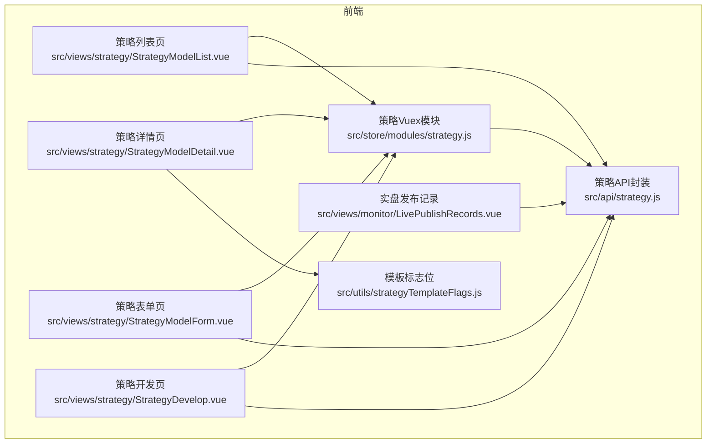
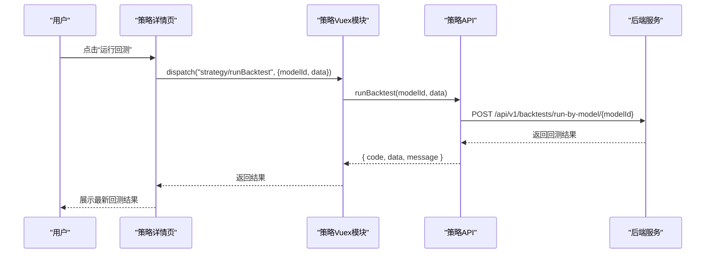
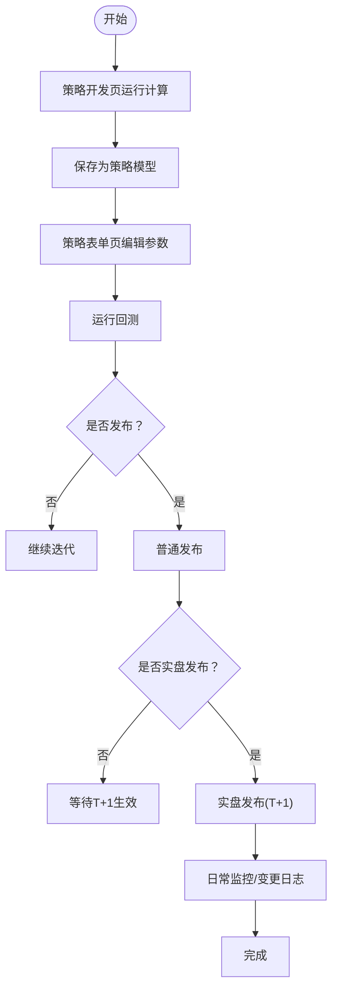
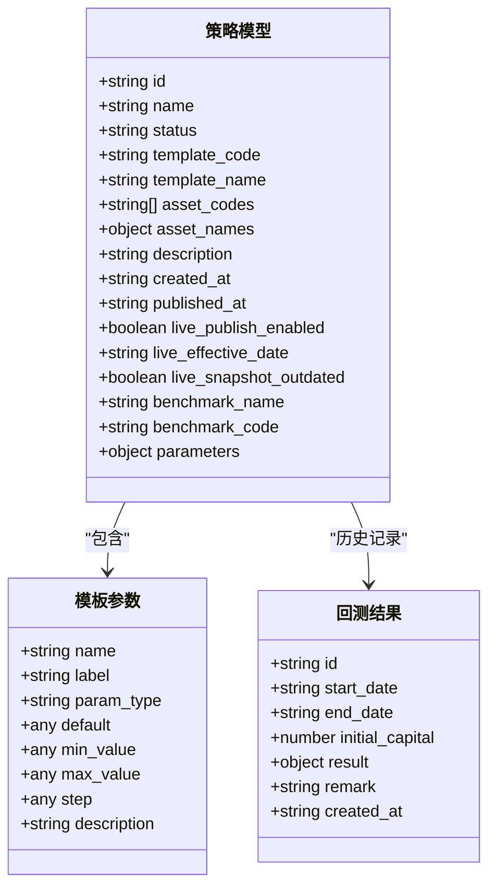
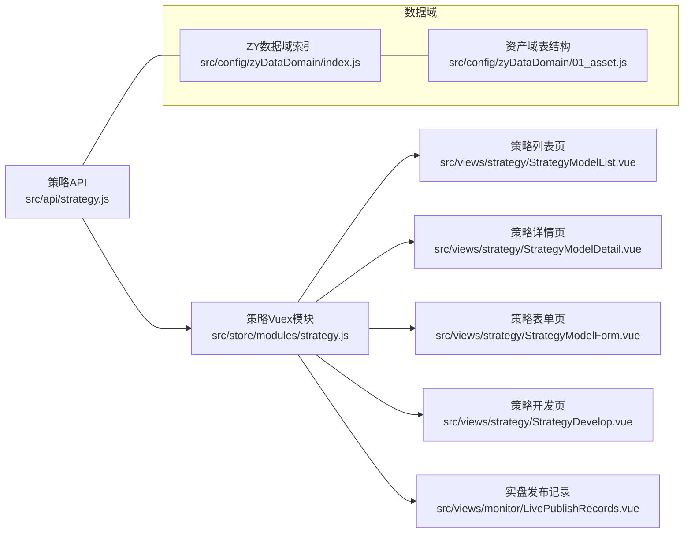
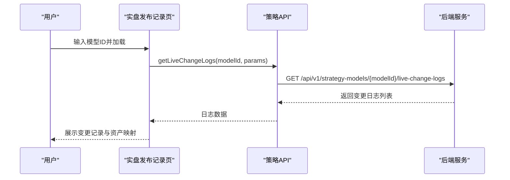
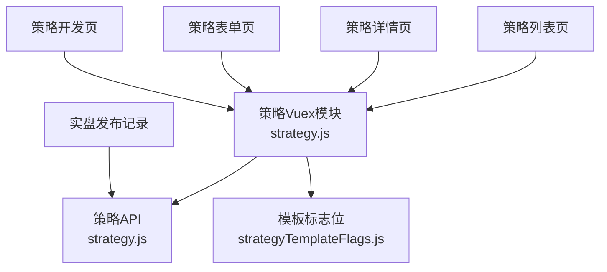

# 策略模型管理

<cite>
**本文引用的文件**
- [src/store/modules/strategy.js](file://src/store/modules/strategy.js)
- [src/views/strategy/StrategyModelList.vue](file://src/views/strategy/StrategyModelList.vue)
- [src/views/strategy/StrategyModelDetail.vue](file://src/views/strategy/StrategyModelDetail.vue)
- [src/views/strategy/StrategyModelForm.vue](file://src/views/strategy/StrategyModelForm.vue)
- [src/views/strategy/StrategyDevelop.vue](file://src/views/strategy/StrategyDevelop.vue)
- [src/api/strategy.js](file://src/api/strategy.js)
- [src/utils/strategyTemplateFlags.js](file://src/utils/strategyTemplateFlags.js)
- [src/views/monitor/LivePublishRecords.vue](file://src/views/monitor/LivePublishRecords.vue)
- [src/views/strategy/BacktestExecution.vue](file://src/views/strategy/BacktestExecution.vue)
- [src/config/zyDataDomain/index.js](file://src/config/zyDataDomain/index.js)
- [src/config/zyDataDomain/01_asset.js](file://src/config/zyDataDomain/01_asset.js)
- [docs/MongoDB_ZY数据域表结构清单.md](file://docs/MongoDB_ZY数据域表结构清单.md)
</cite>

## 目录
1. [简介](#简介)
2. [项目结构](#项目结构)
3. [核心组件](#核心组件)
4. [架构总览](#架构总览)
5. [详细组件分析](#详细组件分析)
6. [依赖关系分析](#依赖关系分析)
7. [性能考量](#性能考量)
8. [故障排查指南](#故障排查指南)
9. [结论](#结论)
10. [附录](#附录)

## 简介
本文件系统性梳理策略模型管理功能，覆盖策略模型的生命周期管理（创建、参数配置、回测、发布、实盘发布）、数据结构设计（元数据、参数、性能指标）、存储与检索机制（接口与领域模型）、版本与变更管理（实盘发布记录与快照）、以及开发与维护最佳实践。内容面向开发者与产品/运营人员，既提供代码级实现细节，也给出可视化图示帮助理解。

## 项目结构
策略模型管理由前端状态管理、视图组件、API 层与工具模块协同完成：
- 状态与业务逻辑：Vuex 模块集中于策略模块，封装模型 CRUD、回测、发布、实盘发布等动作，并维护当前模型与模板列表。
- 视图层：策略列表、详情、表单、开发页面分别承担浏览、编辑、计算与保存策略的工作流。
- API 层：统一封装策略模型、模板、回测、实盘发布、监控等后端接口。
- 工具模块：模板标志位与参数过滤逻辑，保障主观/目标波动率等特殊模板的参数一致性。

**图表来源**
- [src/store/modules/strategy.js:1-468](file://src/store/modules/strategy.js#L1-L468)
- [src/views/strategy/StrategyModelList.vue:1-466](file://src/views/strategy/StrategyModelList.vue#L1-L466)
- [src/views/strategy/StrategyModelDetail.vue:1-800](file://src/views/strategy/StrategyModelDetail.vue#L1-L800)
- [src/views/strategy/StrategyModelForm.vue:1-800](file://src/views/strategy/StrategyModelForm.vue#L1-L800)
- [src/views/strategy/StrategyDevelop.vue:1-434](file://src/views/strategy/StrategyDevelop.vue#L1-L434)
- [src/api/strategy.js:1-295](file://src/api/strategy.js#L1-L295)
- [src/utils/strategyTemplateFlags.js:1-43](file://src/utils/strategyTemplateFlags.js#L1-L43)
- [src/views/monitor/LivePublishRecords.vue:476-518](file://src/views/monitor/LivePublishRecords.vue#L476-L518)

**章节来源**
- [src/store/modules/strategy.js:1-468](file://src/store/modules/strategy.js#L1-L468)
- [src/views/strategy/StrategyModelList.vue:1-466](file://src/views/strategy/StrategyModelList.vue#L1-L466)
- [src/views/strategy/StrategyModelDetail.vue:1-800](file://src/views/strategy/StrategyModelDetail.vue#L1-L800)
- [src/views/strategy/StrategyModelForm.vue:1-800](file://src/views/strategy/StrategyModelForm.vue#L1-L800)
- [src/views/strategy/StrategyDevelop.vue:1-434](file://src/views/strategy/StrategyDevelop.vue#L1-L434)
- [src/api/strategy.js:1-295](file://src/api/strategy.js#L1-L295)
- [src/utils/strategyTemplateFlags.js:1-43](file://src/utils/strategyTemplateFlags.js#L1-L43)
- [src/views/monitor/LivePublishRecords.vue:476-518](file://src/views/monitor/LivePublishRecords.vue#L476-L518)

## 核心组件
- 策略Vuex模块：集中管理模板与模型列表、当前模型、加载状态；提供创建、更新、删除、发布、实盘发布、回测历史、实时监控、变更日志等动作。
- 策略列表页：支持按名称/状态/模板筛选，提供查看、回测、发布、实盘发布、取消实盘、编辑、删除等操作。
- 策略详情页：展示基本信息、参数、资产、回测结果与历史回测记录；支持运行回测、发布、创建模拟组合、实盘发布/取消、同步到最新实盘等。
- 策略表单页：基于模板动态渲染参数，支持资产选择、动量选择配置、波动率阈值重置等；保存为策略模型。
- 策略开发页：通过树形资产选择与模板参数配置，运行算法计算并保存为策略模型。
- API封装：统一暴露策略模型、模板、回测、发布、监控、基准等接口。
- 模板标志位：针对风险预算目标波动率与主观配置模板，屏蔽或强制写入特定参数。

**章节来源**
- [src/store/modules/strategy.js:24-448](file://src/store/modules/strategy.js#L24-L448)
- [src/views/strategy/StrategyModelList.vue:1-466](file://src/views/strategy/StrategyModelList.vue#L1-L466)
- [src/views/strategy/StrategyModelDetail.vue:1-800](file://src/views/strategy/StrategyModelDetail.vue#L1-L800)
- [src/views/strategy/StrategyModelForm.vue:1-800](file://src/views/strategy/StrategyModelForm.vue#L1-L800)
- [src/views/strategy/StrategyDevelop.vue:1-434](file://src/views/strategy/StrategyDevelop.vue#L1-L434)
- [src/api/strategy.js:1-295](file://src/api/strategy.js#L1-L295)
- [src/utils/strategyTemplateFlags.js:1-43](file://src/utils/strategyTemplateFlags.js#L1-L43)

## 架构总览
策略模型管理采用“视图-状态-接口”三层协作：
- 视图层负责用户交互与数据展示。
- 状态层通过Vuex集中管理模型与模板数据，提供统一的动作与getter。
- 接口层封装HTTP请求，统一处理超时、错误与响应格式。

**图表来源**
- [src/views/strategy/StrategyModelDetail.vue:761-772](file://src/views/strategy/StrategyModelDetail.vue#L761-L772)
- [src/store/modules/strategy.js:176-185](file://src/store/modules/strategy.js#L176-L185)
- [src/api/strategy.js:85-93](file://src/api/strategy.js#L85-L93)

**章节来源**
- [src/views/strategy/StrategyModelDetail.vue:761-772](file://src/views/strategy/StrategyModelDetail.vue#L761-L772)
- [src/store/modules/strategy.js:176-185](file://src/store/modules/strategy.js#L176-L185)
- [src/api/strategy.js:85-93](file://src/api/strategy.js#L85-L93)

## 详细组件分析

### 生命周期管理（创建、参数配置、回测、发布、实盘发布）
- 创建与保存：开发页运行计算后保存为策略模型；表单页直接创建策略模型。
- 参数配置：表单页根据模板动态渲染参数，支持数值、滑块、选择、布尔、文本、字典等类型；主观模板与目标波动率模板有参数隐藏/强制逻辑。
- 回测：详情页与批量执行页均可运行回测，支持按截止日/扩展区间等策略生成指标。
- 发布：普通发布更新模型状态为“已发布”，并记录发布时间。
- 实盘发布：T+1生效，写入实盘配置与快照，支持取消实盘发布与“同步到最新实盘”。

**图表来源**
- [src/views/strategy/StrategyDevelop.vue:301-338](file://src/views/strategy/StrategyDevelop.vue#L301-L338)
- [src/views/strategy/StrategyModelForm.vue:626-817](file://src/views/strategy/StrategyModelForm.vue#L626-L817)
- [src/views/strategy/StrategyModelDetail.vue:761-787](file://src/views/strategy/StrategyModelDetail.vue#L761-L787)
- [src/store/modules/strategy.js:207-228](file://src/store/modules/strategy.js#L207-L228)
- [src/store/modules/strategy.js:230-280](file://src/store/modules/strategy.js#L230-L280)
- [src/views/monitor/LivePublishRecords.vue:503-518](file://src/views/monitor/LivePublishRecords.vue#L503-L518)

**章节来源**
- [src/views/strategy/StrategyDevelop.vue:301-338](file://src/views/strategy/StrategyDevelop.vue#L301-L338)
- [src/views/strategy/StrategyModelForm.vue:626-817](file://src/views/strategy/StrategyModelForm.vue#L626-L817)
- [src/views/strategy/StrategyModelDetail.vue:761-787](file://src/views/strategy/StrategyModelDetail.vue#L761-L787)
- [src/store/modules/strategy.js:207-280](file://src/store/modules/strategy.js#L207-L280)
- [src/views/monitor/LivePublishRecords.vue:503-518](file://src/views/monitor/LivePublishRecords.vue#L503-L518)

### 数据结构设计（元数据、参数、性能指标）
- 模型元数据：名称、状态、模板代码/名称、调仓频率、业绩基准、创建时间、描述、资产代码与名称映射、实盘发布状态与生效日、快照过期标记等。
- 参数配置：模板参数集合，包含参数名、标签、类型、默认值、取值范围、步长、描述等；主观/目标波动率模板对部分参数进行隐藏或强制写入。
- 性能指标：总收益、年化收益、年化波动率、夏普比率、最大回撤、卡玛比率、回测区间、初始资金、业绩基准等；支持从快照切片计算指标。

**图表来源**
- [src/views/strategy/StrategyModelDetail.vue:575-588](file://src/views/strategy/StrategyModelDetail.vue#L575-L588)
- [src/views/strategy/StrategyModelForm.vue:527-530](file://src/views/strategy/StrategyModelForm.vue#L527-L530)
- [src/views/strategy/StrategyModelDetail.vue:603-610](file://src/views/strategy/StrategyModelDetail.vue#L603-L610)

**章节来源**
- [src/views/strategy/StrategyModelDetail.vue:575-588](file://src/views/strategy/StrategyModelDetail.vue#L575-L588)
- [src/views/strategy/StrategyModelForm.vue:527-530](file://src/views/strategy/StrategyModelForm.vue#L527-L530)
- [src/views/strategy/StrategyModelDetail.vue:603-610](file://src/views/strategy/StrategyModelDetail.vue#L603-L610)

### 存储与检索机制（接口与领域模型）
- 接口层：统一暴露模型列表/详情、模板列表/详情、回测、发布、实盘发布/配置/监控/变更日志、基准等REST接口。
- 领域模型：ZY数据域定义了资产、主体、产品、估值、交易、销售、客户、风险、行情等9个域的表结构与字段约束，策略模型与这些域存在间接关联（如资产选择、基准等）。

**图表来源**
- [src/api/strategy.js:1-295](file://src/api/strategy.js#L1-L295)
- [src/store/modules/strategy.js:1-468](file://src/store/modules/strategy.js#L1-L468)
- [src/views/strategy/StrategyModelList.vue:1-466](file://src/views/strategy/StrategyModelList.vue#L1-L466)
- [src/views/strategy/StrategyModelDetail.vue:1-800](file://src/views/strategy/StrategyModelDetail.vue#L1-L800)
- [src/views/strategy/StrategyModelForm.vue:1-800](file://src/views/strategy/StrategyModelForm.vue#L1-L800)
- [src/views/strategy/StrategyDevelop.vue:1-434](file://src/views/strategy/StrategyDevelop.vue#L1-L434)
- [src/views/monitor/LivePublishRecords.vue:476-518](file://src/views/monitor/LivePublishRecords.vue#L476-L518)
- [src/config/zyDataDomain/index.js:1-47](file://src/config/zyDataDomain/index.js#L1-L47)
- [src/config/zyDataDomain/01_asset.js:1-137](file://src/config/zyDataDomain/01_asset.js#L1-L137)

**章节来源**
- [src/api/strategy.js:1-295](file://src/api/strategy.js#L1-L295)
- [src/store/modules/strategy.js:1-468](file://src/store/modules/strategy.js#L1-L468)
- [src/config/zyDataDomain/index.js:1-47](file://src/config/zyDataDomain/index.js#L1-L47)
- [src/config/zyDataDomain/01_asset.js:1-137](file://src/config/zyDataDomain/01_asset.js#L1-L137)

### 版本与变更管理（实盘发布记录与快照）
- 实盘发布记录：提供变更日志查询，支持合并资产名称映射，便于追踪参数与权重变化。
- 快照同步：当实盘发布后策略参数变更，可通过“同步到最新实盘”刷新快照，避免监控与策略结果不一致。

**图表来源**
- [src/views/monitor/LivePublishRecords.vue:503-518](file://src/views/monitor/LivePublishRecords.vue#L503-L518)
- [src/api/strategy.js:208-215](file://src/api/strategy.js#L208-L215)

**章节来源**
- [src/views/monitor/LivePublishRecords.vue:476-518](file://src/views/monitor/LivePublishRecords.vue#L476-L518)
- [src/api/strategy.js:208-215](file://src/api/strategy.js#L208-L215)

### 最佳实践指南
- 参数一致性：主观模板与目标波动率模板需遵循参数隐藏/强制写入规则，避免前后端不一致。
- 回测策略：合理设置截止日与扩展区间，必要时使用快照切片计算指标，保证与净值曲线数据源一致。
- 发布流程：先回测再发布，发布后再实盘发布；参数变更后及时同步到最新实盘。
- 资产选择：动量选择器窗口与并列决胜窗口应结合业务需求与数据质量设置。
- 性能指标：关注夏普比率、最大回撤、卡玛比率等关键指标，结合回测区间与初始资金进行评估。

**章节来源**
- [src/utils/strategyTemplateFlags.js:1-43](file://src/utils/strategyTemplateFlags.js#L1-L43)
- [src/views/strategy/BacktestExecution.vue:2080-2364](file://src/views/strategy/BacktestExecution.vue#L2080-L2364)
- [src/views/strategy/StrategyModelDetail.vue:773-787](file://src/views/strategy/StrategyModelDetail.vue#L773-L787)

## 依赖关系分析
策略模块内部依赖清晰，耦合度低，主要通过API层与后端交互，模板标志位模块提供参数过滤能力。

**图表来源**
- [src/store/modules/strategy.js:1-468](file://src/store/modules/strategy.js#L1-L468)
- [src/api/strategy.js:1-295](file://src/api/strategy.js#L1-L295)
- [src/utils/strategyTemplateFlags.js:1-43](file://src/utils/strategyTemplateFlags.js#L1-L43)
- [src/views/strategy/StrategyModelList.vue:1-466](file://src/views/strategy/StrategyModelList.vue#L1-L466)
- [src/views/strategy/StrategyModelDetail.vue:1-800](file://src/views/strategy/StrategyModelDetail.vue#L1-L800)
- [src/views/strategy/StrategyModelForm.vue:1-800](file://src/views/strategy/StrategyModelForm.vue#L1-L800)
- [src/views/strategy/StrategyDevelop.vue:1-434](file://src/views/strategy/StrategyDevelop.vue#L1-L434)
- [src/views/monitor/LivePublishRecords.vue:476-518](file://src/views/monitor/LivePublishRecords.vue#L476-L518)

**章节来源**
- [src/store/modules/strategy.js:1-468](file://src/store/modules/strategy.js#L1-L468)
- [src/api/strategy.js:1-295](file://src/api/strategy.js#L1-L295)
- [src/utils/strategyTemplateFlags.js:1-43](file://src/utils/strategyTemplateFlags.js#L1-L43)
- [src/views/strategy/StrategyModelList.vue:1-466](file://src/views/strategy/StrategyModelList.vue#L1-L466)
- [src/views/strategy/StrategyModelDetail.vue:1-800](file://src/views/strategy/StrategyModelDetail.vue#L1-L800)
- [src/views/strategy/StrategyModelForm.vue:1-800](file://src/views/strategy/StrategyModelForm.vue#L1-L800)
- [src/views/strategy/StrategyDevelop.vue:1-434](file://src/views/strategy/StrategyDevelop.vue#L1-L434)
- [src/views/monitor/LivePublishRecords.vue:476-518](file://src/views/monitor/LivePublishRecords.vue#L476-L518)

## 性能考量
- 回测超时：针对混合动量等高计算量任务，接口层设置较长超时时间，避免前端误判。
- 实盘发布超时：T+1写库接口放宽超时，降低偶发慢查询影响。
- 列表查询：后端过滤空值参数，减少无效查询开销。
- 图表渲染：详情页回测结果图表按需渲染，避免不必要的重绘。

**章节来源**
- [src/api/strategy.js:85-93](file://src/api/strategy.js#L85-L93)
- [src/api/strategy.js:136-144](file://src/api/strategy.js#L136-L144)
- [src/api/strategy.js:60-75](file://src/api/strategy.js#L60-L75)
- [src/views/strategy/StrategyModelDetail.vue:698-705](file://src/views/strategy/StrategyModelDetail.vue#L698-L705)

## 故障排查指南
- 发布失败：检查模型状态与后端返回的错误信息，确认已具备回测结果且状态允许发布。
- 实盘发布失败：确认模型已“已发布”且未“已归档”，核对后端返回的错误码与消息。
- 回测异常：检查参数合法性与资产选择，确认截止日与扩展区间设置正确。
- 变更日志为空：确认模型ID有效，后端是否存在变更记录；必要时增加查询参数限制。

**章节来源**
- [src/views/strategy/StrategyModelList.vue:294-316](file://src/views/strategy/StrategyModelList.vue#L294-L316)
- [src/views/strategy/StrategyModelDetail.vue:773-787](file://src/views/strategy/StrategyModelDetail.vue#L773-L787)
- [src/views/monitor/LivePublishRecords.vue:503-518](file://src/views/monitor/LivePublishRecords.vue#L503-L518)

## 结论
策略模型管理功能通过清晰的生命周期流程、规范的数据结构与完善的接口封装，实现了从策略开发、参数配置、回测验证到发布与实盘发布的全链路管理。配合模板标志位与实盘发布记录机制，能够有效保障参数一致性与变更可追溯性。建议在实际使用中严格遵循参数配置规范、回测策略与发布流程，以提升策略质量与运维效率。

## 附录
- MongoDB索引策略参考：ZY数据域表结构与索引策略，有助于理解数据域与策略模型之间的潜在关联与查询优化方向。

**章节来源**
- [docs/MongoDB_ZY数据域表结构清单.md:257-282](file://docs/MongoDB_ZY数据域表结构清单.md#L257-L282)