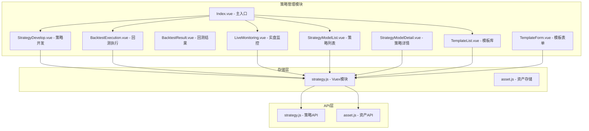
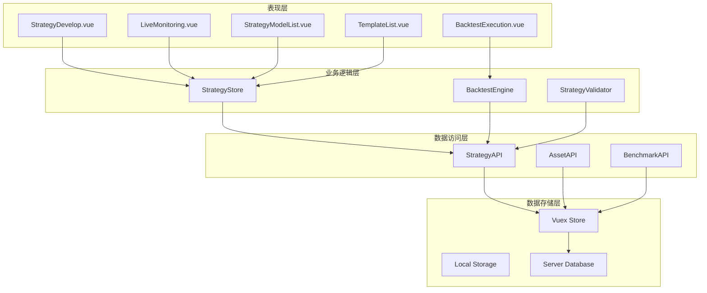
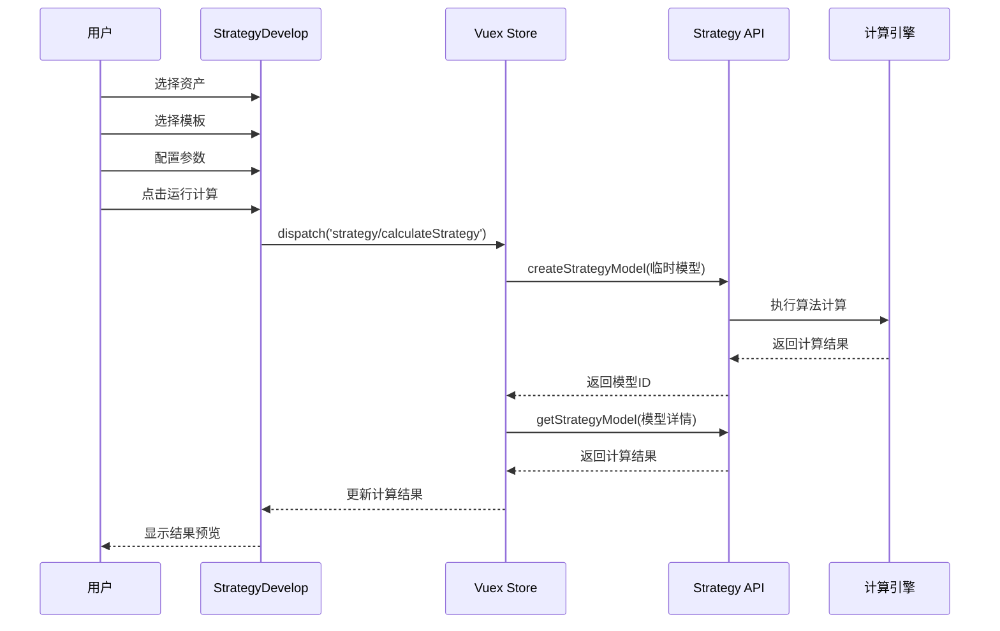
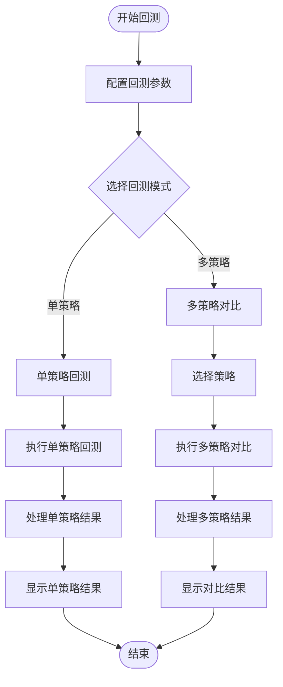
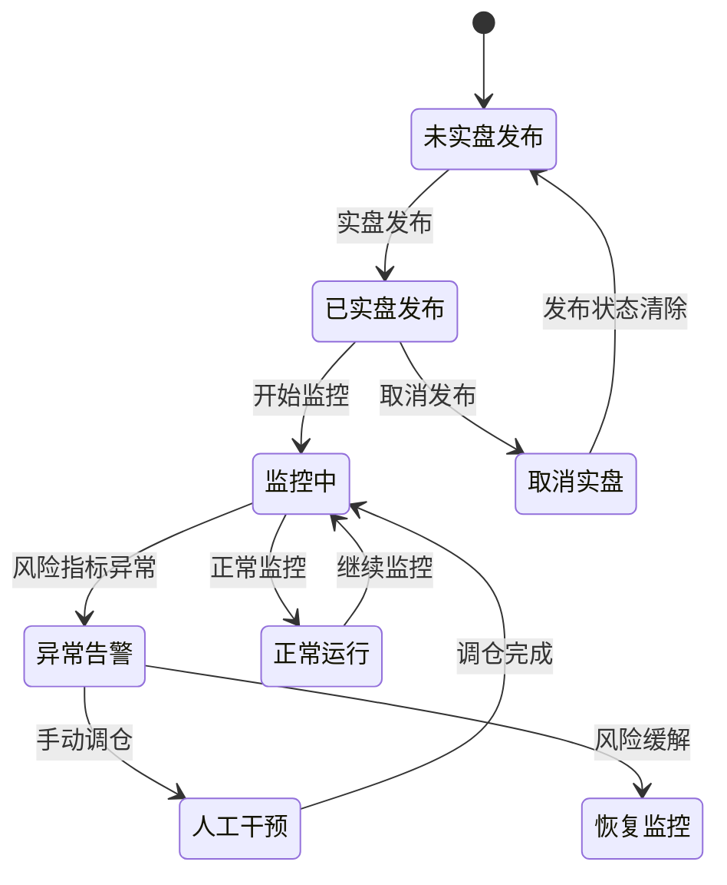
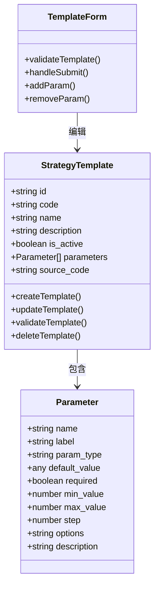
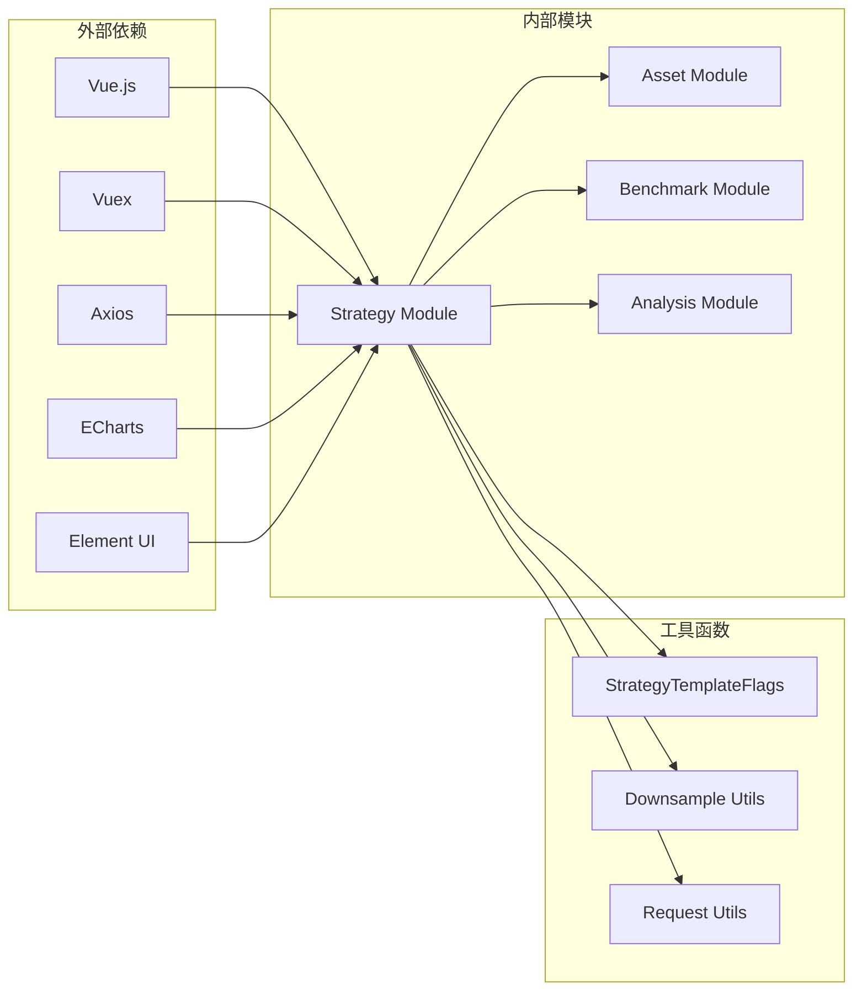

# 策略管理模块

<cite>
**本文档引用的文件**
- [src/views/strategy/Index.vue](file://src/views/strategy/Index.vue)
- [src/store/modules/strategy.js](file://src/store/modules/strategy.js)
- [src/api/strategy.js](file://src/api/strategy.js)
- [src/views/strategy/StrategyDevelop.vue](file://src/views/strategy/StrategyDevelop.vue)
- [src/views/strategy/BacktestExecution.vue](file://src/views/strategy/BacktestExecution.vue)
- [src/views/strategy/BacktestResult.vue](file://src/views/strategy/BacktestResult.vue)
- [src/views/strategy/LiveMonitoring.vue](file://src/views/strategy/LiveMonitoring.vue)
- [src/views/strategy/StrategyModelList.vue](file://src/views/strategy/StrategyModelList.vue)
- [src/views/strategy/StrategyModelDetail.vue](file://src/views/strategy/StrategyModelDetail.vue)
- [src/views/strategy/TemplateList.vue](file://src/views/strategy/TemplateList.vue)
- [src/views/strategy/TemplateForm.vue](file://src/views/strategy/TemplateForm.vue)
- [src/utils/strategyTemplateFlags.js](file://src/utils/strategyTemplateFlags.js)
- [src/components/BacktestDialog.vue](file://src/components/BacktestDialog.vue)
- [src/components/BacktestDetailDialog.vue](file://src/components/BacktestDetailDialog.vue)
- [src/views/strategy/backtest/SingleStrategyResult.vue](file://src/views/strategy/backtest/SingleStrategyResult.vue)
</cite>

## 目录
1. [简介](#简介)
2. [项目结构](#项目结构)
3. [核心组件](#核心组件)
4. [架构概览](#架构概览)
5. [详细组件分析](#详细组件分析)
6. [依赖关系分析](#依赖关系分析)
7. [性能考虑](#性能考虑)
8. [故障排除指南](#故障排除指南)
9. [结论](#结论)
10. [附录](#附录)

## 简介

策略管理模块是投资组合管理系统的核心功能模块，负责策略的全生命周期管理。该模块提供了从策略模板选择、自定义策略编写、策略回测到实盘监控的完整解决方案。

本模块支持多种策略类型，包括量化策略、主观配置策略和混合动量策略，并提供了强大的回测引擎和实时监控功能。用户可以通过直观的界面进行策略开发、参数配置、回测分析和实盘跟踪。

## 项目结构

策略管理模块采用Vue.js框架构建，主要包含以下核心组件：

**图表来源**
- [src/views/strategy/Index.vue:1-10](file://src/views/strategy/Index.vue#L1-L10)
- [src/store/modules/strategy.js:1-468](file://src/store/modules/strategy.js#L1-L468)

**章节来源**
- [src/views/strategy/Index.vue:1-10](file://src/views/strategy/Index.vue#L1-L10)
- [src/store/modules/strategy.js:1-468](file://src/store/modules/strategy.js#L1-L468)

## 核心组件

### 策略开发组件
策略开发组件提供了完整的策略创建和配置功能，支持多种参数类型和实时计算预览。

### 回测执行组件
回测执行组件支持单策略回测和多策略对比回测，提供丰富的回测参数配置和可视化结果展示。

### 实盘监控组件
实盘监控组件提供实时的策略表现跟踪，包括净值、权重、调仓日志等关键指标。

### 策略模型管理
策略模型管理组件负责策略的创建、编辑、发布和版本控制，支持策略的全生命周期管理。

**章节来源**
- [src/views/strategy/StrategyDevelop.vue:1-434](file://src/views/strategy/StrategyDevelop.vue#L1-L434)
- [src/views/strategy/BacktestExecution.vue:1-800](file://src/views/strategy/BacktestExecution.vue#L1-L800)
- [src/views/strategy/LiveMonitoring.vue:1-766](file://src/views/strategy/LiveMonitoring.vue#L1-L766)

## 架构概览

策略管理模块采用分层架构设计，实现了清晰的关注点分离：

**图表来源**
- [src/store/modules/strategy.js:1-468](file://src/store/modules/strategy.js#L1-L468)
- [src/api/strategy.js:1-295](file://src/api/strategy.js#L1-L295)

## 详细组件分析

### 策略开发流程

策略开发流程从模板选择开始，用户可以选择合适的算法模板，然后进行参数配置和实时计算。

**图表来源**
- [src/views/strategy/StrategyDevelop.vue:301-338](file://src/views/strategy/StrategyDevelop.vue#L301-L338)
- [src/store/modules/strategy.js:368-400](file://src/store/modules/strategy.js#L368-L400)

**章节来源**
- [src/views/strategy/StrategyDevelop.vue:1-434](file://src/views/strategy/StrategyDevelop.vue#L1-L434)
- [src/store/modules/strategy.js:368-400](file://src/store/modules/strategy.js#L368-L400)

### 回测系统实现

回测系统提供了灵活的配置选项和丰富的结果分析功能：

**图表来源**
- [src/views/strategy/BacktestExecution.vue:13-24](file://src/views/strategy/BacktestExecution.vue#L13-L24)
- [src/views/strategy/BacktestResult.vue:8-28](file://src/views/strategy/BacktestResult.vue#L8-L28)

**章节来源**
- [src/views/strategy/BacktestExecution.vue:1-800](file://src/views/strategy/BacktestExecution.vue#L1-L800)
- [src/views/strategy/BacktestResult.vue:1-116](file://src/views/strategy/BacktestResult.vue#L1-L116)

### 实盘监控机制

实盘监控提供了实时的策略表现跟踪和风险管理功能：

**图表来源**
- [src/views/strategy/LiveMonitoring.vue:286-389](file://src/views/strategy/LiveMonitoring.vue#L286-L389)

**章节来源**
- [src/views/strategy/LiveMonitoring.vue:1-766](file://src/views/strategy/LiveMonitoring.vue#L1-L766)

### 策略模板管理

策略模板管理提供了模板的创建、编辑、验证和使用的完整流程：

**图表来源**
- [src/views/strategy/TemplateForm.vue:206-560](file://src/views/strategy/TemplateForm.vue#L206-L560)
- [src/views/strategy/TemplateList.vue:214-375](file://src/views/strategy/TemplateList.vue#L214-L375)

**章节来源**
- [src/views/strategy/TemplateForm.vue:1-615](file://src/views/strategy/TemplateForm.vue#L1-L615)
- [src/views/strategy/TemplateList.vue:1-553](file://src/views/strategy/TemplateList.vue#L1-L553)

## 依赖关系分析

策略管理模块的依赖关系体现了清晰的分层架构：

**图表来源**
- [src/store/modules/strategy.js:1-22](file://src/store/modules/strategy.js#L1-L22)
- [src/utils/strategyTemplateFlags.js:1-100](file://src/utils/strategyTemplateFlags.js#L1-L100)

**章节来源**
- [src/store/modules/strategy.js:1-468](file://src/store/modules/strategy.js#L1-L468)
- [src/utils/strategyTemplateFlags.js:1-100](file://src/utils/strategyTemplateFlags.js#L1-L100)

## 性能考虑

策略管理模块在性能方面采用了多项优化措施：

### 数据处理优化
- **降采样算法**：对大量回测数据进行降采样，减少图表渲染压力
- **虚拟滚动**：对大型表格使用虚拟滚动技术
- **懒加载**：组件按需加载，减少初始加载时间

### 缓存策略
- **Vuex状态缓存**：重要数据在内存中缓存
- **API响应缓存**：常用接口结果缓存
- **图表实例复用**：避免重复创建ECharts实例

### 并发处理
- **Promise.allSettled**：并发执行多个异步操作
- **防抖机制**：对频繁触发的操作进行防抖
- **分帧渲染**：使用requestAnimationFrame进行分帧渲染

## 故障排除指南

### 常见问题及解决方案

**回测执行失败**
- 检查网络连接和API服务状态
- 验证策略参数配置的合法性
- 确认资产数据的完整性

**实时监控数据异常**
- 检查实盘发布状态
- 验证风险阈值配置
- 确认数据源的可用性

**模板验证失败**
- 检查Python语法正确性
- 验证参数定义的完整性
- 确认算法逻辑的正确性

**章节来源**
- [src/views/strategy/BacktestExecution.vue:714-768](file://src/views/strategy/BacktestExecution.vue#L714-L768)
- [src/views/strategy/LiveMonitoring.vue:285-389](file://src/views/strategy/LiveMonitoring.vue#L285-L389)

## 结论

策略管理模块提供了完整的策略生命周期管理解决方案，具有以下特点：

1. **功能完整性**：覆盖从策略开发到实盘监控的全流程
2. **用户体验**：提供直观易用的界面和丰富的可视化功能
3. **技术先进**：采用现代前端技术和最佳实践
4. **扩展性强**：模块化设计便于功能扩展和维护

该模块为投资组合管理提供了强大的策略管理能力，能够满足专业投资者和机构用户的复杂需求。

## 附录

### 策略开发最佳实践

1. **参数设计原则**
   - 参数类型选择要符合实际业务场景
   - 合理设置参数范围和默认值
   - 提供清晰的参数说明和示例

2. **代码规范**
   - 遵循ESLint和Prettier规范
   - 组件命名采用语义化命名
   - API调用使用统一的错误处理机制

3. **性能优化**
   - 合理使用computed和watch
   - 避免不必要的DOM操作
   - 使用防抖和节流优化高频操作

4. **安全考虑**
   - 输入参数进行严格验证
   - 敏感数据进行加密处理
   - 遵循CSP和XSS防护原则

### 策略回测配置指南

1. **回测参数设置**
   - 合理设置回测时间范围
   - 选择合适的初始资金规模
   - 配置适当的交易成本参数

2. **风险控制**
   - 设置合理的波动率阈值
   - 配置止损和止盈机制
   - 监控最大回撤和回撤时间

3. **结果分析**
   - 关注核心指标的变化趋势
   - 对比不同参数配置的效果
   - 分析交易频率和成本影响