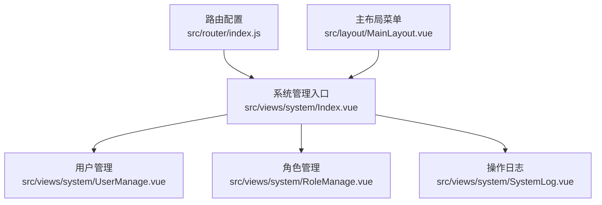
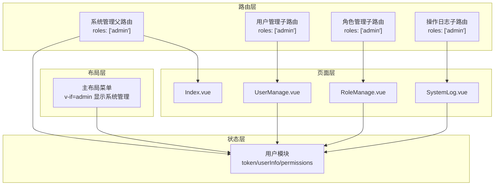
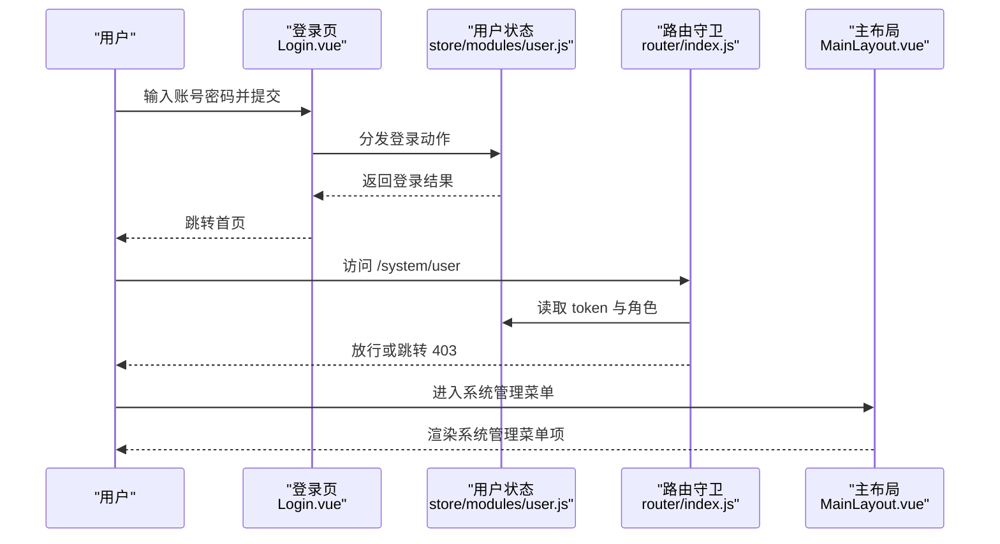
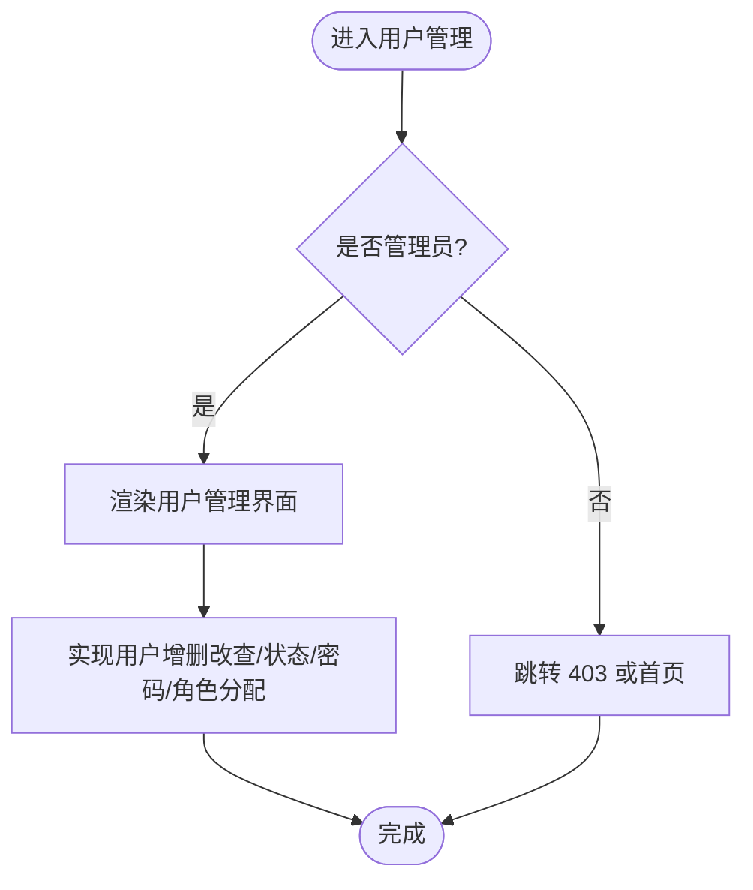
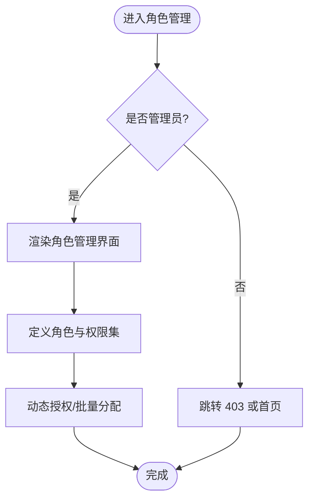
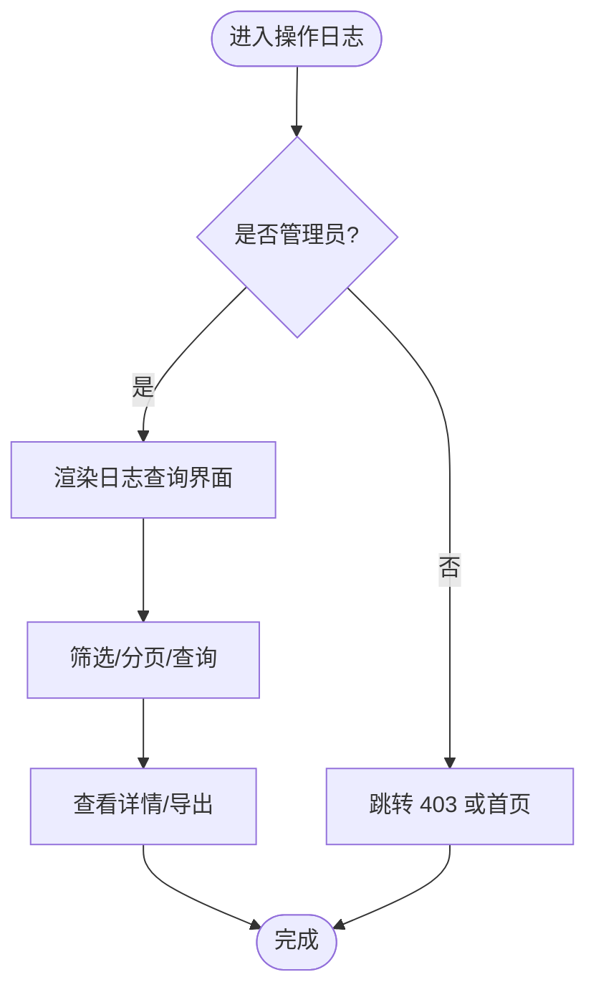
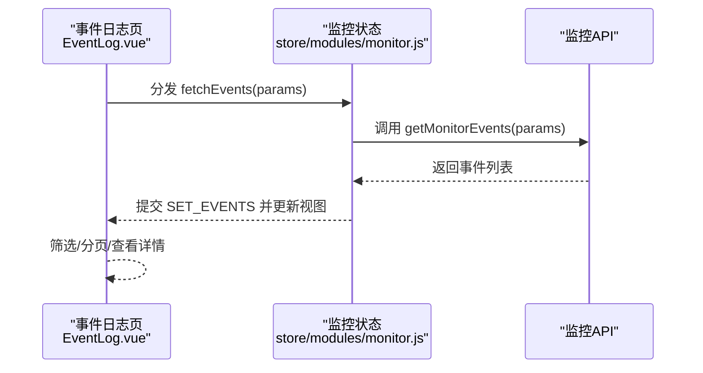
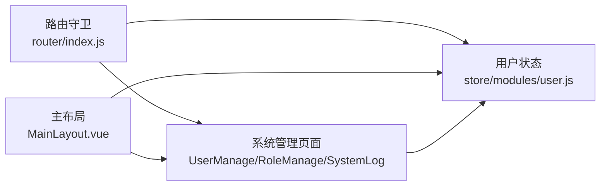

# 系统管理模块

<cite>
**本文引用的文件**
- [src/views/system/Index.vue](file://src/views/system/Index.vue)
- [src/views/system/UserManage.vue](file://src/views/system/UserManage.vue)
- [src/views/system/RoleManage.vue](file://src/views/system/RoleManage.vue)
- [src/views/system/SystemLog.vue](file://src/views/system/SystemLog.vue)
- [src/router/index.js](file://src/router/index.js)
- [src/layout/MainLayout.vue](file://src/layout/MainLayout.vue)
- [src/store/modules/user.js](file://src/store/modules/user.js)
- [src/views/Login.vue](file://src/views/Login.vue)
- [src/views/monitor/EventLog.vue](file://src/views/monitor/EventLog.vue)
- [src/store/modules/monitor.js](file://src/store/modules/monitor.js)
</cite>

## 目录
1. [简介](#简介)
2. [项目结构](#项目结构)
3. [核心组件](#核心组件)
4. [架构总览](#架构总览)
5. [详细组件分析](#详细组件分析)
6. [依赖关系分析](#依赖关系分析)
7. [性能考虑](#性能考虑)
8. [故障排查指南](#故障排查指南)
9. [结论](#结论)
10. [附录](#附录)

## 简介
本文件面向“系统管理模块”，围绕用户管理、角色权限体系、日志管理与权限控制进行系统化说明。当前仓库中的系统管理模块处于开发中状态，包含用户管理、角色管理、操作日志三个页面，均以占位提示形式呈现；同时，前端已具备基于角色的菜单权限控制能力，并在登录与路由守卫层面实现了基础的鉴权逻辑。本文将结合现有代码，给出可落地的实现建议、最佳实践与安全配置要点。

## 项目结构
系统管理模块位于 views/system 目录下，采用嵌套路由组织，父级路由为系统管理入口，子路由分别对应用户管理、角色管理、操作日志三个页面。路由配置中通过 meta.roles 字段对页面进行角色级访问控制，父级路由亦限制为管理员可见。

图表来源
- [src/views/system/Index.vue:1-10](file://src/views/system/Index.vue#L1-L10)
- [src/views/system/UserManage.vue:1-15](file://src/views/system/UserManage.vue#L1-L15)
- [src/views/system/RoleManage.vue:1-15](file://src/views/system/RoleManage.vue#L1-L15)
- [src/views/system/SystemLog.vue:1-15](file://src/views/system/SystemLog.vue#L1-L15)
- [src/router/index.js:247-273](file://src/router/index.js#L247-L273)
- [src/layout/MainLayout.vue:87-95](file://src/layout/MainLayout.vue#L87-L95)

章节来源
- [src/views/system/Index.vue:1-10](file://src/views/system/Index.vue#L1-L10)
- [src/router/index.js:247-273](file://src/router/index.js#L247-L273)
- [src/layout/MainLayout.vue:87-95](file://src/layout/MainLayout.vue#L87-L95)

## 核心组件
- 系统管理入口页：负责承载子路由，当前为空壳容器。
- 用户管理页：占位提示“用户管理功能开发中（仅管理员可见）”。
- 角色管理页：占位提示“角色管理功能开发中”。
- 操作日志页：占位提示“操作日志功能开发中”。

上述页面均通过路由 meta.roles 限定为管理员可见，并在主布局中根据用户角色动态渲染系统管理菜单项。

章节来源
- [src/views/system/Index.vue:1-10](file://src/views/system/Index.vue#L1-L10)
- [src/views/system/UserManage.vue:1-15](file://src/views/system/UserManage.vue#L1-L15)
- [src/views/system/RoleManage.vue:1-15](file://src/views/system/RoleManage.vue#L1-L15)
- [src/views/system/SystemLog.vue:1-15](file://src/views/system/SystemLog.vue#L1-L15)
- [src/router/index.js:252-270](file://src/router/index.js#L252-L270)
- [src/layout/MainLayout.vue:167-169](file://src/layout/MainLayout.vue#L167-L169)

## 架构总览
系统管理模块的前端架构遵循“路由+状态+布局”的分层设计：
- 路由层：定义系统管理的父子路由及角色访问控制。
- 状态层：用户模块提供登录态、角色与权限集合，供全局使用。
- 布局层：主布局根据用户角色决定菜单项展示与跳转目标。
- 页面层：系统管理子页面作为占位容器，后续扩展具体业务。

图表来源
- [src/router/index.js:247-273](file://src/router/index.js#L247-L273)
- [src/store/modules/user.js:1-119](file://src/store/modules/user.js#L1-L119)
- [src/layout/MainLayout.vue:87-95](file://src/layout/MainLayout.vue#L87-L95)
- [src/views/system/Index.vue:1-10](file://src/views/system/Index.vue#L1-L10)

## 详细组件分析

### 路由与权限控制
- 父级系统管理路由设置了 meta.roles: ['admin']，确保仅管理员可见。
- 子路由同样设置 roles，保证细粒度访问控制。
- 路由守卫中读取 store 中的 token 与用户角色，若目标路由要求特定角色则进行校验，否则放行。

图表来源
- [src/views/Login.vue:76-98](file://src/views/Login.vue#L76-L98)
- [src/store/modules/user.js:28-100](file://src/store/modules/user.js#L28-L100)
- [src/router/index.js:352-375](file://src/router/index.js#L352-L375)
- [src/layout/MainLayout.vue:167-169](file://src/layout/MainLayout.vue#L167-L169)

章节来源
- [src/router/index.js:247-273](file://src/router/index.js#L247-L273)
- [src/router/index.js:352-375](file://src/router/index.js#L352-L375)
- [src/store/modules/user.js:102-110](file://src/store/modules/user.js#L102-L110)
- [src/layout/MainLayout.vue:167-169](file://src/layout/MainLayout.vue#L167-L169)

### 用户管理页面
- 当前为占位页面，提示“用户管理功能开发中（仅管理员可见）”。
- 后续可在此页面集成用户增删改查、状态管理、密码重置、角色分配等能力。

图表来源
- [src/views/system/UserManage.vue:1-15](file://src/views/system/UserManage.vue#L1-L15)
- [src/router/index.js:252-258](file://src/router/index.js#L252-L258)

章节来源
- [src/views/system/UserManage.vue:1-15](file://src/views/system/UserManage.vue#L1-L15)
- [src/router/index.js:252-258](file://src/router/index.js#L252-L258)

### 角色管理页面
- 当前为占位页面，提示“角色管理功能开发中”。
- 后续可在此页面实现角色定义、权限配置、动态授权等功能。

图表来源
- [src/views/system/RoleManage.vue:1-15](file://src/views/system/RoleManage.vue#L1-L15)
- [src/router/index.js:261-265](file://src/router/index.js#L261-L265)

章节来源
- [src/views/system/RoleManage.vue:1-15](file://src/views/system/RoleManage.vue#L1-L15)
- [src/router/index.js:261-265](file://src/router/index.js#L261-L265)

### 操作日志页面
- 当前为占位页面，提示“操作日志功能开发中”。
- 可参考监控模块的事件日志页面，实现日志查询、筛选、分页与详情展示。

图表来源
- [src/views/system/SystemLog.vue:1-15](file://src/views/system/SystemLog.vue#L1-L15)
- [src/router/index.js:267-271](file://src/router/index.js#L267-L271)

章节来源
- [src/views/system/SystemLog.vue:1-15](file://src/views/system/SystemLog.vue#L1-L15)
- [src/router/index.js:267-271](file://src/router/index.js#L267-L271)

### 日志管理与审计（基于现有监控事件日志）
虽然系统管理模块的操作日志尚未实现，但监控模块已提供事件日志的查询与展示能力，可作为系统日志管理的参考实现：
- 支持按事件类型、日期范围筛选。
- 提供时间线视图与详情弹窗。
- 支持加载更多与刷新。

图表来源
- [src/views/monitor/EventLog.vue:312-332](file://src/views/monitor/EventLog.vue#L312-L332)
- [src/store/modules/monitor.js:192-211](file://src/store/modules/monitor.js#L192-L211)

章节来源
- [src/views/monitor/EventLog.vue:1-535](file://src/views/monitor/EventLog.vue#L1-L535)
- [src/store/modules/monitor.js:10-416](file://src/store/modules/monitor.js#L10-L416)

## 依赖关系分析
- 路由层依赖状态层提供的用户角色信息，用于页面级访问控制。
- 布局层依赖状态层判断管理员身份，动态渲染系统管理菜单。
- 页面层依赖路由守卫与状态层共同实现权限控制。

图表来源
- [src/router/index.js:352-375](file://src/router/index.js#L352-L375)
- [src/store/modules/user.js:102-110](file://src/store/modules/user.js#L102-L110)
- [src/layout/MainLayout.vue:167-169](file://src/layout/MainLayout.vue#L167-L169)
- [src/views/system/UserManage.vue:1-15](file://src/views/system/UserManage.vue#L1-L15)
- [src/views/system/RoleManage.vue:1-15](file://src/views/system/RoleManage.vue#L1-L15)
- [src/views/system/SystemLog.vue:1-15](file://src/views/system/SystemLog.vue#L1-L15)

章节来源
- [src/router/index.js:352-375](file://src/router/index.js#L352-L375)
- [src/store/modules/user.js:102-110](file://src/store/modules/user.js#L102-L110)
- [src/layout/MainLayout.vue:167-169](file://src/layout/MainLayout.vue#L167-L169)

## 性能考虑
- 路由守卫与权限判断应尽量轻量，避免在每次导航时进行重型计算。
- 日志查询建议采用分页与懒加载策略，减少一次性渲染的数据量。
- 使用本地存储缓存登录态与用户信息，降低重复请求成本。
- 对权限字符串匹配采用哈希集合提升查找效率。

## 故障排查指南
- 登录后无法进入系统管理页面
  - 检查登录返回的角色是否为管理员。
  - 确认路由守卫中对 meta.roles 的校验逻辑是否正确。
- 系统管理菜单不显示
  - 检查主布局中根据角色渲染菜单的条件。
- 操作日志页面空白
  - 确认监控状态模块中事件数据是否成功写入。
  - 检查筛选条件与日期范围是否合理。

章节来源
- [src/router/index.js:352-375](file://src/router/index.js#L352-L375)
- [src/layout/MainLayout.vue:167-169](file://src/layout/MainLayout.vue#L167-L169)
- [src/store/modules/monitor.js:192-211](file://src/store/modules/monitor.js#L192-L211)

## 结论
系统管理模块当前处于开发中阶段，前端已具备完善的菜单权限控制与路由级访问控制能力。建议后续优先完善用户管理、角色管理与操作日志三大核心功能，并在权限体系中引入更细粒度的资源级权限控制与审计日志能力，以满足生产环境下的合规与安全需求。

## 附录

### 权限控制机制（菜单/按钮/数据）
- 菜单权限：通过路由 meta.roles 与主布局的管理员判断实现。
- 按钮权限：可在组件内使用用户权限集合进行按钮级显隐控制。
- 数据权限：建议在接口层与状态层增加数据范围过滤逻辑，避免越权访问。

章节来源
- [src/router/index.js:364-370](file://src/router/index.js#L364-L370)
- [src/layout/MainLayout.vue:167-169](file://src/layout/MainLayout.vue#L167-L169)
- [src/store/modules/user.js:106-109](file://src/store/modules/user.js#L106-L109)

### 安全配置建议
- 会话管理：登录成功后将 token 写入本地存储，并在路由守卫中统一校验。
- 访问控制：严格区分管理员与其他角色，避免非管理员访问系统管理页面。
- 审计日志：建议在用户管理、角色管理与日志查询等关键操作处增加审计记录字段与查询接口。

章节来源
- [src/store/modules/user.js:1-26](file://src/store/modules/user.js#L1-L26)
- [src/router/index.js:352-375](file://src/router/index.js#L352-L375)