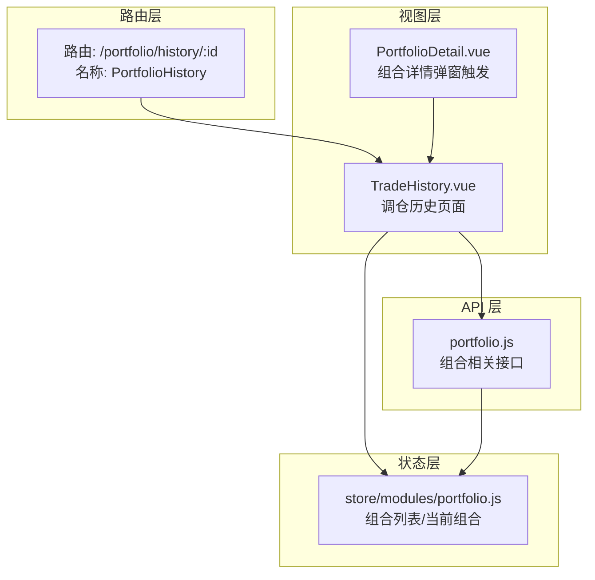
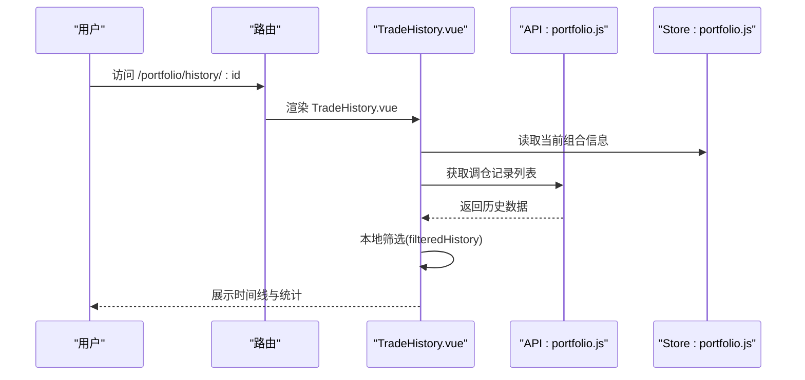
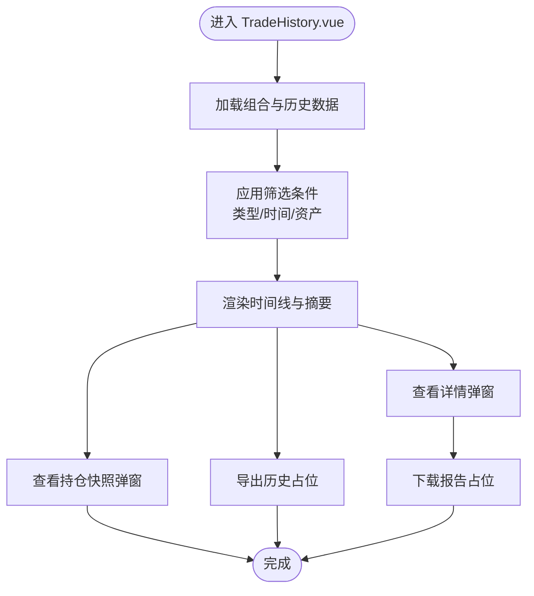
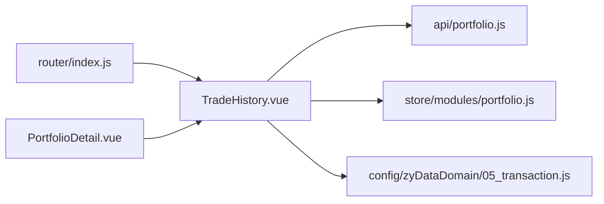

# 交易历史

<cite>
**本文引用的文件**
- [TradeHistory.vue](file://src/views/portfolio/TradeHistory.vue)
- [portfolio.js](file://src/api/portfolio.js)
- [portfolio.js](file://src/store/modules/portfolio.js)
- [index.js](file://src/router/index.js)
- [PortfolioDetail.vue](file://src/views/portfolio/PortfolioDetail.vue)
- [05_transaction.js](file://src/config/zyDataDomain/05_transaction.js)
- [request.js](file://src/utils/request.js)
- [NavHistory.vue](file://src/views/monitor/NavHistory.vue)
- [AssetIndex.vue](file://src/views/analysis/AssetIndex.vue)
- [SingleStrategyResult.vue](file://src/views/strategy/backtest/SingleStrategyResult.vue)
- [MultiStrategyComparison.vue](file://src/views/strategy/backtest/MultiStrategyComparison.vue)
- [04_valuation_domain.js](file://mongo-seed/04_valuation_domain.js)
- [03_product_domain.js](file://mongo-seed/03_product_domain.js)
</cite>

## 目录
1. [简介](#简介)
2. [项目结构](#项目结构)
3. [核心组件](#核心组件)
4. [架构总览](#架构总览)
5. [详细组件分析](#详细组件分析)
6. [依赖关系分析](#依赖关系分析)
7. [性能考量](#性能考量)
8. [故障排查指南](#故障排查指南)
9. [结论](#结论)
10. [附录](#附录)

## 简介
本文件围绕“交易历史”功能进行系统化说明，涵盖交易历史记录的查询与分析、数据过滤与搜索、统计分析、导出能力、与组合净值的关系及对投资决策的影响，并提供方法论与实用技巧。当前前端已实现调仓历史的时间线展示、筛选、详情与持仓快照弹窗，导出与下载提示为占位状态，后续可基于现有接口与数据结构扩展。

## 项目结构
交易历史功能位于“模拟组合”模块下，通过路由进入“调仓历史”页面，同时可在“组合详情”页快速打开历史对话框。交易历史数据来源于组合 API，前端通过本地状态与计算属性实现筛选与聚合。

**图表来源**
- [index.js:155-159](file://src/router/index.js#L155-L159)
- [TradeHistory.vue:1-615](file://src/views/portfolio/TradeHistory.vue#L1-L615)
- [PortfolioDetail.vue:223-225](file://src/views/portfolio/PortfolioDetail.vue#L223-L225)
- [portfolio.js:1-72](file://src/api/portfolio.js#L1-L72)
- [portfolio.js:1-106](file://src/store/modules/portfolio.js#L1-L106)

**章节来源**
- [index.js:155-159](file://src/router/index.js#L155-L159)
- [TradeHistory.vue:1-615](file://src/views/portfolio/TradeHistory.vue#L1-L615)
- [PortfolioDetail.vue:223-225](file://src/views/portfolio/PortfolioDetail.vue#L223-L225)
- [portfolio.js:1-72](file://src/api/portfolio.js#L1-L72)
- [portfolio.js:1-106](file://src/store/modules/portfolio.js#L1-L106)

## 核心组件
- TradeHistory.vue：调仓历史页面，提供筛选条件、时间线展示、详情弹窗、持仓快照弹窗、导出与下载占位提示。
- PortfolioDetail.vue：组合详情页，提供“调仓历史”快捷入口，支持在对话框中查看历史。
- portfolio.js（API）：封装组合相关接口，包括获取调仓记录列表、组合分析等。
- portfolio.js（Store）：维护组合列表与当前组合状态，供 TradeHistory.vue 使用。
- router/index.js：定义“调仓历史”路由，支持通过路径参数传入组合 ID。

**章节来源**
- [TradeHistory.vue:1-615](file://src/views/portfolio/TradeHistory.vue#L1-L615)
- [PortfolioDetail.vue:223-225](file://src/views/portfolio/PortfolioDetail.vue#L223-L225)
- [portfolio.js:1-72](file://src/api/portfolio.js#L1-L72)
- [portfolio.js:1-106](file://src/store/modules/portfolio.js#L1-L106)
- [index.js:155-159](file://src/router/index.js#L155-L159)

## 架构总览
交易历史功能采用“路由 → 视图 → API → Store”的分层设计。视图层负责渲染与交互，API 层负责与后端通信，Store 提供全局状态与组合数据。交易历史数据在前端通过计算属性实现本地筛选，详情与快照通过弹窗展示。

**图表来源**
- [index.js:155-159](file://src/router/index.js#L155-L159)
- [TradeHistory.vue:370-388](file://src/views/portfolio/TradeHistory.vue#L370-L388)
- [portfolio.js:42-47](file://src/api/portfolio.js#L42-L47)
- [portfolio.js:90-97](file://src/store/modules/portfolio.js#L90-L97)

## 详细组件分析

### TradeHistory.vue 组件
- 页面布局与信息卡片：展示组合基础信息、调仓次数、累计换手率等。
- 筛选区域：支持按调仓类型、时间范围、涉及资产三类条件筛选。
- 时间线展示：每条记录包含调仓类型标签、编号、关联模型、操作人员、换手率、交易成本、买入/卖出笔数与总额等摘要。
- 详情弹窗：展示调仓时间、类型、操作人员、换手率、调仓前后总资产、交易明细（资产代码/名称、买卖方向、数量、价格、金额、成本、权重变化）。
- 持仓快照弹窗：展示调仓前/后的持仓明细（资产代码/名称、数量、成本价、市值、权重）。
- 导出与下载：当前为占位提示，后续可对接后端导出接口。

**图表来源**
- [TradeHistory.vue:21-154](file://src/views/portfolio/TradeHistory.vue#L21-L154)
- [TradeHistory.vue:156-307](file://src/views/portfolio/TradeHistory.vue#L156-L307)
- [TradeHistory.vue:340-369](file://src/views/portfolio/TradeHistory.vue#L340-L369)

**章节来源**
- [TradeHistory.vue:1-615](file://src/views/portfolio/TradeHistory.vue#L1-L615)

### PortfolioDetail.vue 组件
- 在组合详情页提供“调仓历史”快捷入口，打开 TradeHistory.vue 对话框，便于从组合上下文直接查看历史。
- 通过 props 将组合 ID 传递给 TradeHistory.vue，实现对话框内历史查看。

**章节来源**
- [PortfolioDetail.vue:223-225](file://src/views/portfolio/PortfolioDetail.vue#L223-L225)

### API 与 Store
- API 层提供获取调仓记录列表、组合分析等接口，TradeHistory.vue 通过这些接口获取数据。
- Store 提供组合列表与当前组合的 getter，用于页面展示与筛选。

**章节来源**
- [portfolio.js:42-47](file://src/api/portfolio.js#L42-L47)
- [portfolio.js:90-97](file://src/store/modules/portfolio.js#L90-L97)

### 交易域数据模型（ZY 数据域）
- 交易域包含资产维度交易、组合维度交易、估值维度交易、中证登结算、交易所结算、交易指令等表，字段覆盖交易 ID、资产代码、买卖方向、数量、价格、金额、费用、结算状态等，为交易历史的数据来源与校验提供依据。

**章节来源**
- [05_transaction.js:1-103](file://src/config/zyDataDomain/05_transaction.js#L1-L103)

### 与组合净值的关系
- 组合净值与交易历史密切相关：每次调仓会改变组合的资产配置与成本，进而影响净值曲线与风险指标（如波动率、最大回撤）。前端在“业绩分析”“基准对比”“净值历史”等模块中体现净值计算与可视化，交易历史是净值变动的重要驱动因素之一。
- 实例参考：
  - 净值历史计算与标记调仓日：[NavHistory.vue:220-363](file://src/views/monitor/NavHistory.vue#L220-L363)
  - 资产指数模块中的净值与波动率序列：[AssetIndex.vue:230-263](file://src/views/analysis/AssetIndex.vue#L230-L263)
  - 回测结果中的交易表与手续费统计：[SingleStrategyResult.vue:401-414](file://src/views/strategy/backtest/SingleStrategyResult.vue#L401-L414)
  - 多策略比较中的滚动年化波动率计算：[MultiStrategyComparison.vue:173-196](file://src/views/strategy/backtest/MultiStrategyComparison.vue#L173-L196)
  - Mongo 种子数据中的净值序列与波动：[03_product_domain.js:178-210](file://mongo-seed/03_product_domain.js#L178-L210)，[04_valuation_domain.js:41-61](file://mongo-seed/04_valuation_domain.js#L41-L61)

**章节来源**
- [NavHistory.vue:220-363](file://src/views/monitor/NavHistory.vue#L220-L363)
- [AssetIndex.vue:230-263](file://src/views/analysis/AssetIndex.vue#L230-L263)
- [SingleStrategyResult.vue:401-414](file://src/views/strategy/backtest/SingleStrategyResult.vue#L401-L414)
- [MultiStrategyComparison.vue:173-196](file://src/views/strategy/backtest/MultiStrategyComparison.vue#L173-L196)
- [03_product_domain.js:178-210](file://mongo-seed/03_product_domain.js#L178-L210)
- [04_valuation_domain.js:41-61](file://mongo-seed/04_valuation_domain.js#L41-L61)

## 依赖关系分析
- 路由依赖：通过路由参数传递组合 ID，确保页面与 Store 中的组合状态一致。
- 视图依赖：TradeHistory.vue 依赖 API 接口与 Store 的组合数据；PortfolioDetail.vue 通过对话框复用 TradeHistory.vue。
- 数据模型依赖：交易域配置文件定义了交易相关字段，为历史数据结构提供约束与参考。

**图表来源**
- [index.js:155-159](file://src/router/index.js#L155-L159)
- [TradeHistory.vue:370-388](file://src/views/portfolio/TradeHistory.vue#L370-L388)
- [portfolio.js:42-47](file://src/api/portfolio.js#L42-L47)
- [portfolio.js:90-97](file://src/store/modules/portfolio.js#L90-L97)
- [05_transaction.js:1-103](file://src/config/zyDataDomain/05_transaction.js#L1-L103)
- [PortfolioDetail.vue:223-225](file://src/views/portfolio/PortfolioDetail.vue#L223-L225)

**章节来源**
- [index.js:155-159](file://src/router/index.js#L155-L159)
- [TradeHistory.vue:370-388](file://src/views/portfolio/TradeHistory.vue#L370-L388)
- [portfolio.js:42-47](file://src/api/portfolio.js#L42-L47)
- [portfolio.js:90-97](file://src/store/modules/portfolio.js#L90-L97)
- [05_transaction.js:1-103](file://src/config/zyDataDomain/05_transaction.js#L1-L103)
- [PortfolioDetail.vue:223-225](file://src/views/portfolio/PortfolioDetail.vue#L223-L225)

## 性能考量
- 本地筛选：通过计算属性对历史数据进行本地过滤，减少不必要的网络请求，提升交互响应速度。
- 图表与弹窗：详情与快照弹窗按需打开，避免一次性加载过多数据。
- 请求超时与错误处理：统一的请求拦截器与错误提示，有助于在弱网环境下稳定运行。

**章节来源**
- [TradeHistory.vue:340-369](file://src/views/portfolio/TradeHistory.vue#L340-L369)
- [request.js:1-100](file://src/utils/request.js#L1-L100)

## 故障排查指南
- 无法加载历史数据：检查路由参数与 Store 中的组合 ID 是否匹配；确认 API 接口返回格式与字段。
- 筛选无效：确认筛选条件绑定与计算属性逻辑；检查日期格式与资产关键字匹配规则。
- 导出/下载占位：确认后端导出接口可用性与前端调用路径；检查浏览器下载权限与跨域配置。
- 权限与网络：关注请求拦截器中的 401/403/404/超时提示，按提示检查登录状态、后端服务与网络连通性。

**章节来源**
- [TradeHistory.vue:468-473](file://src/views/portfolio/TradeHistory.vue#L468-L473)
- [request.js:36-96](file://src/utils/request.js#L36-L96)

## 结论
交易历史功能以简洁直观的方式呈现调仓过程与交易细节，结合筛选与弹窗展示，满足日常复盘与审计需求。当前导出与下载仍为占位状态，建议尽快对接后端接口并完善 CSV/Excel 导出能力。交易历史与组合净值紧密相关，建议在后续版本中增加“历史驱动的净值回放”“调仓对波动率/回撤的影响分析”等深度分析能力，以提升对投资决策的支持价值。

## 附录

### 数据过滤与搜索方法论
- 时间范围：基于记录时间字符串截取日期进行区间过滤。
- 资产筛选：遍历每条记录的交易明细，匹配资产代码或名称关键字。
- 类型筛选：按调仓类型枚举进行精确匹配。
- 统计聚合：对换手率、交易成本、买入/卖出笔数与总额进行汇总展示。

**章节来源**
- [TradeHistory.vue:340-369](file://src/views/portfolio/TradeHistory.vue#L340-L369)

### 统计分析与指标
- 交易频次：通过记录条数统计。
- 成本分析：按记录汇总交易成本与总金额。
- 收益统计：结合净值历史与交易明细，计算区间收益、年化收益、波动率、最大回撤、夏普比率等（可参考现有模块实现思路）。

**章节来源**
- [NavHistory.vue:220-363](file://src/views/monitor/NavHistory.vue#L220-L363)
- [AssetIndex.vue:230-263](file://src/views/analysis/AssetIndex.vue#L230-L263)
- [SingleStrategyResult.vue:401-414](file://src/views/strategy/backtest/SingleStrategyResult.vue#L401-L414)
- [MultiStrategyComparison.vue:173-196](file://src/views/strategy/backtest/MultiStrategyComparison.vue#L173-L196)

### 导出功能建议
- 接口对接：在现有 API 基础上扩展导出接口，支持 CSV/Excel 格式。
- 数据清洗：将历史记录与交易明细标准化，确保字段与标题一致。
- 分页与并发：对于大规模数据，建议分页导出或后台任务异步生成文件。

**章节来源**
- [TradeHistory.vue:468-473](file://src/views/portfolio/TradeHistory.vue#L468-L473)