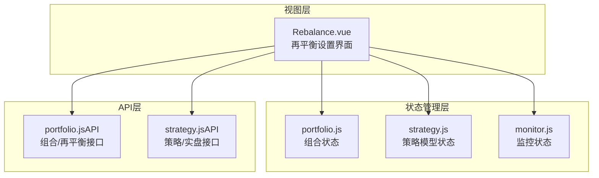
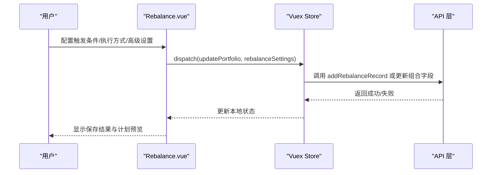
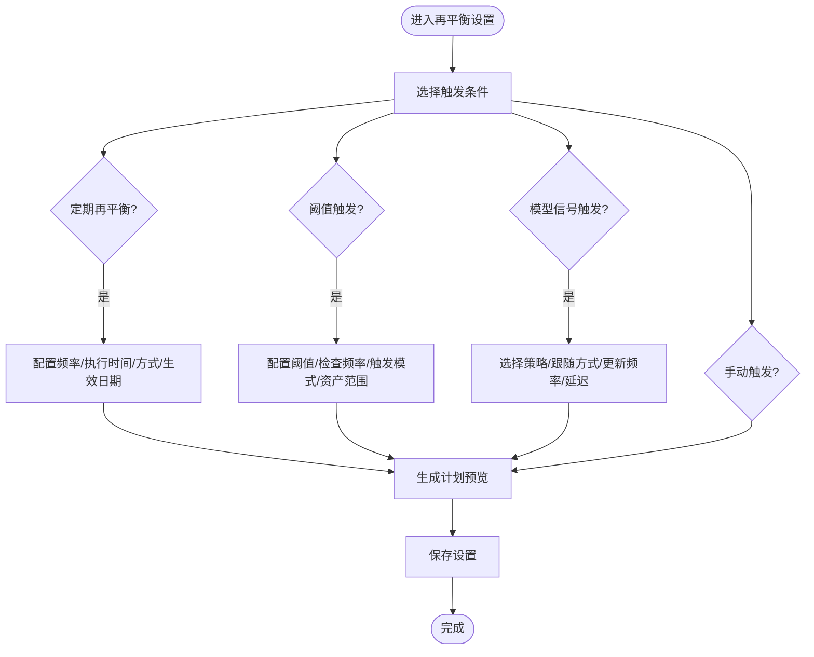
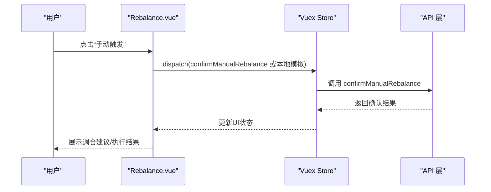
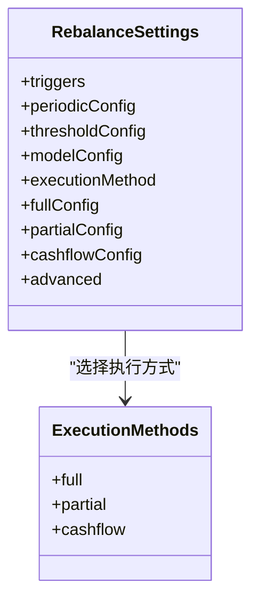
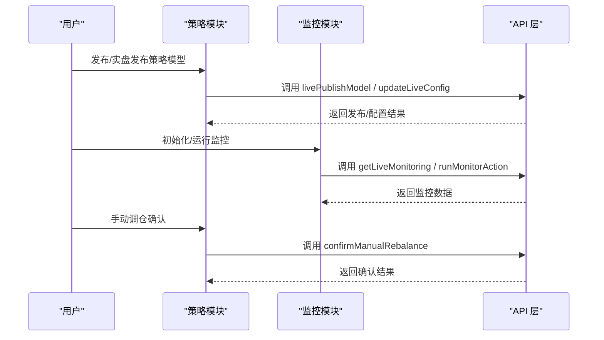
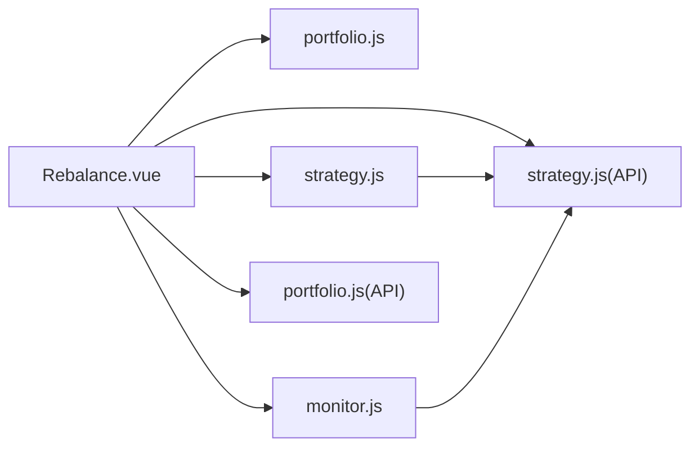

# 组合再平衡

<cite>
**本文引用的文件**
- [Rebalance.vue](file://src/views/portfolio/Rebalance.vue)
- [portfolio.js](file://src/store/modules/portfolio.js)
- [strategy.js](file://src/store/modules/strategy.js)
- [monitor.js](file://src/store/modules/monitor.js)
- [portfolio.js（API）](file://src/api/portfolio.js)
- [strategy.js（API）](file://src/api/strategy.js)
</cite>

## 目录
1. [简介](#简介)
2. [项目结构](#项目结构)
3. [核心组件](#核心组件)
4. [架构总览](#架构总览)
5. [详细组件分析](#详细组件分析)
6. [依赖关系分析](#依赖关系分析)
7. [性能考量](#性能考量)
8. [故障排查指南](#故障排查指南)
9. [结论](#结论)
10. [附录](#附录)

## 简介
本文件围绕“组合再平衡”功能进行系统化说明，覆盖自动再平衡的触发机制与配置项（周期、阈值、模型信号等）、手动再平衡操作流程（一键重置权重、批量调整）、执行算法与参数（完全再平衡、部分再平衡、现金流驱动），以及成本与影响评估（交易成本、税费、价格冲击）。同时提供策略制定与执行监控要点，以及不同市场环境下的最佳实践与风控建议。

## 项目结构
再平衡功能主要由前端视图层、状态管理层与API层构成：
- 视图层负责用户交互与配置展示，提供自动触发条件、执行方式、高级设置与计划预览。
- 状态管理层通过Vuex模块管理组合、策略模型与监控数据。
- API层封装后端接口，支持组合详情、再平衡记录、手动调仓确认等。

图表来源
- [Rebalance.vue:1-672](file://src/views/portfolio/Rebalance.vue#L1-L672)
- [portfolio.js:1-106](file://src/store/modules/portfolio.js#L1-L106)
- [strategy.js:1-468](file://src/store/modules/strategy.js#L1-L468)
- [monitor.js:1-416](file://src/store/modules/monitor.js#L1-L416)
- [portfolio.js（API）:1-72](file://src/api/portfolio.js#L1-L72)
- [strategy.js（API）:1-295](file://src/api/strategy.js#L1-L295)

章节来源
- [Rebalance.vue:1-672](file://src/views/portfolio/Rebalance.vue#L1-L672)
- [portfolio.js:1-106](file://src/store/modules/portfolio.js#L1-L106)
- [strategy.js:1-468](file://src/store/modules/strategy.js#L1-L468)
- [monitor.js:1-416](file://src/store/modules/monitor.js#L1-L416)
- [portfolio.js（API）:1-72](file://src/api/portfolio.js#L1-L72)
- [strategy.js（API）:1-295](file://src/api/strategy.js#L1-L295)

## 核心组件
- 再平衡设置界面（Rebalance.vue）
  - 提供触发条件配置（定期、阈值、模型信号、手动）
  - 执行方式配置（完全再平衡、部分再平衡、现金流驱动）
  - 高级设置（交易约束、审批流程、通知与异常报警）
  - 计划预览（基于当前配置生成的触发与执行计划）
- 组合状态模块（portfolio.js）
  - 维护组合列表、当前组合、增删改查与查询工具方法
- 策略模型状态模块（strategy.js）
  - 管理策略模板与模型、实盘发布与配置、手动调仓确认等
- 监控状态模块（monitor.js）
  - 提供监控状态、信号、事件、主观调仓指令等数据与操作
- API封装（portfolio.js（API）、strategy.js（API））
  - 组合相关接口：列表、详情、分析、再平衡记录、新增再平衡记录
  - 策略相关接口：模型生命周期、实盘发布/配置、手动调仓确认、变更日志等

章节来源
- [Rebalance.vue:1-672](file://src/views/portfolio/Rebalance.vue#L1-L672)
- [portfolio.js:1-106](file://src/store/modules/portfolio.js#L1-L106)
- [strategy.js:1-468](file://src/store/modules/strategy.js#L1-L468)
- [monitor.js:1-416](file://src/store/modules/monitor.js#L1-L416)
- [portfolio.js（API）:1-72](file://src/api/portfolio.js#L1-L72)
- [strategy.js（API）:1-295](file://src/api/strategy.js#L1-L295)

## 架构总览
再平衡功能的前端架构遵循“视图-状态-接口”三层：
- 视图层（Rebalance.vue）渲染配置表单与计划预览，调用Vuex动作与API。
- 状态管理层（Vuex Modules）集中管理组合、策略、监控数据，提供getter与actions。
- 接口层（API）封装HTTP请求，对接后端服务。

图表来源
- [Rebalance.vue:576-603](file://src/views/portfolio/Rebalance.vue#L576-L603)
- [portfolio.js（API）:32-39](file://src/api/portfolio.js#L32-L39)
- [portfolio.js:64-67](file://src/store/modules/portfolio.js#L64-L67)

章节来源
- [Rebalance.vue:576-603](file://src/views/portfolio/Rebalance.vue#L576-L603)
- [portfolio.js（API）:32-39](file://src/api/portfolio.js#L32-L39)
- [portfolio.js:64-67](file://src/store/modules/portfolio.js#L64-L67)

## 详细组件分析

### 自动再平衡触发机制与配置
- 触发条件（可多选）
  - 定期再平衡：支持每日、每周、每月、每季、每年；可配置执行时间（如每月第N个交易日）、执行方式（自动/手动确认）、生效日期。
  - 阈值触发再平衡：设置偏离阈值（百分比）、检查频率（每日/实时）、触发模式（任一资产/组合整体）、资产范围（全部/自定义）。
  - 模型信号触发：绑定策略模型，选择跟随方式（完全/部分）、更新频率（实时/每日/每周）、执行延迟（交易日）。
  - 手动触发：默认启用，无需额外配置。
- 计划预览：根据所选触发条件动态生成时间线，直观展示下次触发与执行方式。

图表来源
- [Rebalance.vue:46-222](file://src/views/portfolio/Rebalance.vue#L46-L222)
- [Rebalance.vue:517-553](file://src/views/portfolio/Rebalance.vue#L517-L553)

章节来源
- [Rebalance.vue:46-222](file://src/views/portfolio/Rebalance.vue#L46-L222)
- [Rebalance.vue:517-553](file://src/views/portfolio/Rebalance.vue#L517-L553)

### 手动再平衡操作流程
- 一键重置权重：在“手动触发”下随时可发起，无需额外配置。
- 批量调整：通过“部分再平衡”或“现金流驱动再平衡”实现，支持分批执行与调整上限控制。
- 手动调仓确认：结合策略模型的“手动调仓确认”接口，可在实盘场景中进行人工复核与执行。

图表来源
- [Rebalance.vue:214-221](file://src/views/portfolio/Rebalance.vue#L214-L221)
- [strategy.js（API）:199-206](file://src/api/strategy.js#L199-L206)
- [strategy.js:333-341](file://src/store/modules/strategy.js#L333-L341)

章节来源
- [Rebalance.vue:214-221](file://src/views/portfolio/Rebalance.vue#L214-L221)
- [strategy.js（API）:199-206](file://src/api/strategy.js#L199-L206)
- [strategy.js:333-341](file://src/store/modules/strategy.js#L333-L341)

### 执行方式与算法选择
- 完全再平衡
  - 将组合权重一次性调整至目标权重。
  - 支持考虑交易成本、最小交易金额、价格类型（市价/限价）。
- 部分再平衡
  - 平滑调整，按比例逐步接近目标权重，支持调整比例、调整上限、分批执行。
- 现金流驱动再平衡
  - 利用现金流入/流出进行再平衡，支持不足时暂停或部分调整。

图表来源
- [Rebalance.vue:465-511](file://src/views/portfolio/Rebalance.vue#L465-L511)

章节来源
- [Rebalance.vue:465-511](file://src/views/portfolio/Rebalance.vue#L465-L511)

### 成本计算与影响分析
- 交易成本
  - 在“完全再平衡”中可开启“考虑交易成本”，并设置“最小交易金额”以避免小额交易带来的成本侵蚀。
- 价格冲击
  - 高级设置中可开启“价格影响考虑”，用于在大额交易时评估对市场的潜在影响。
- 税费
  - 当前界面未提供税费参数配置入口；若业务需要，可在高级设置中扩展或通过后端配置实现。

章节来源
- [Rebalance.vue:240-263](file://src/views/portfolio/Rebalance.vue#L240-L263)
- [Rebalance.vue:373-376](file://src/views/portfolio/Rebalance.vue#L373-L376)

### 策略制定与执行监控
- 策略模型
  - 通过策略模块管理模型生命周期（创建、发布、实盘发布、配置更新）。
  - 结合“模型信号触发”实现基于策略信号的再平衡。
- 实盘监控
  - 监控模块提供信号、事件、主观调仓指令等数据，支持运行监控与初始化监控。
- 手动调仓确认
  - 在策略模块中提供手动调仓确认接口，确保关键决策的人工复核。

图表来源
- [strategy.js:230-301](file://src/store/modules/strategy.js#L230-L301)
- [monitor.js:87-106](file://src/store/modules/monitor.js#L87-L106)
- [strategy.js（API）:137-171](file://src/api/strategy.js#L137-L171)
- [strategy.js（API）:199-206](file://src/api/strategy.js#L199-L206)

章节来源
- [strategy.js:230-301](file://src/store/modules/strategy.js#L230-L301)
- [monitor.js:87-106](file://src/store/modules/monitor.js#L87-L106)
- [strategy.js（API）:137-171](file://src/api/strategy.js#L137-L171)
- [strategy.js（API）:199-206](file://src/api/strategy.js#L199-L206)

### 不同市场环境下的最佳实践与风控建议
- 低波动环境
  - 设置较高阈值与较长检查周期，降低频繁再平衡带来的成本。
  - 使用“部分再平衡”平滑调整，避免过度交易。
- 高波动环境
  - 采用“阈值触发+实时监控”，缩短检查周期，提高响应速度。
  - 控制单次调整幅度与分批执行次数，防止追涨杀跌。
- 流动性差的资产
  - 开启“价格影响考虑”，设置较大的最小交易金额，减少对市场的冲击。
  - 优先使用“现金流驱动再平衡”，利用自然现金流进行再平衡。
- 审批与通知
  - 对重要组合开启“需要审批”与“异常报警”，确保重大调仓受控。
  - 启用“再平衡前通知”和“执行结果通知”，提升透明度与可追溯性。

## 依赖关系分析
- 视图层依赖状态层与API层，通过Vuex actions与API函数完成数据读写与交互。
- 策略模块与监控模块相互配合，前者提供策略信号与配置，后者提供监控数据与事件。
- 组合状态模块为再平衡设置提供组合上下文与查询能力。

图表来源
- [Rebalance.vue:447-631](file://src/views/portfolio/Rebalance.vue#L447-L631)
- [portfolio.js:36-88](file://src/store/modules/portfolio.js#L36-L88)
- [strategy.js:1-468](file://src/store/modules/strategy.js#L1-L468)
- [monitor.js:1-416](file://src/store/modules/monitor.js#L1-L416)
- [portfolio.js（API）:1-72](file://src/api/portfolio.js#L1-L72)
- [strategy.js（API）:1-295](file://src/api/strategy.js#L1-L295)

章节来源
- [Rebalance.vue:447-631](file://src/views/portfolio/Rebalance.vue#L447-L631)
- [portfolio.js:36-88](file://src/store/modules/portfolio.js#L36-L88)
- [strategy.js:1-468](file://src/store/modules/strategy.js#L1-L468)
- [monitor.js:1-416](file://src/store/modules/monitor.js#L1-L416)
- [portfolio.js（API）:1-72](file://src/api/portfolio.js#L1-L72)
- [strategy.js（API）:1-295](file://src/api/strategy.js#L1-L295)

## 性能考量
- 实时监控会增加系统负载，建议在高并发场景下谨慎启用。
- 大额交易应考虑价格冲击与滑点，合理设置最小交易金额与调整上限。
- 分批执行与部分再平衡有助于降低冲击成本，但会延长回到目标权重的时间。

## 故障排查指南
- 保存失败
  - 检查是否选择了至少一种自动触发条件；若未选择，界面会提示警告。
  - 查看网络请求与后端返回状态，确认接口调用是否成功。
- 手动调仓确认失败
  - 确认策略模型处于可确认状态；检查参数与权限。
- 监控数据为空
  - 确认监控策略已初始化且有数据；检查时间范围与过滤条件。

章节来源
- [Rebalance.vue:576-603](file://src/views/portfolio/Rebalance.vue#L576-L603)
- [strategy.js:333-341](file://src/store/modules/strategy.js#L333-L341)
- [monitor.js:87-106](file://src/store/modules/monitor.js#L87-L106)

## 结论
本系统提供了完善的组合再平衡配置与执行框架：自动触发（定期、阈值、模型信号）与手动触发相结合，支持完全再平衡、部分再平衡与现金流驱动三种执行方式，并通过高级设置实现交易约束、审批与通知等企业级需求。结合策略模型与监控模块，可实现从策略生成到执行确认的闭环管理。建议在不同市场环境下灵活配置阈值、检查频率与执行方式，以在成本控制与跟踪误差之间取得平衡。

## 附录
- 关键接口路径参考
  - 新增再平衡记录：[addRebalanceRecord:32-39](file://src/api/portfolio.js#L32-L39)
  - 获取再平衡记录列表：[getRebalanceRecords:41-47](file://src/api/portfolio.js#L41-L47)
  - 手动调仓确认：[confirmManualRebalance:199-206](file://src/api/strategy.js#L199-L206)
  - 实盘发布/配置：[livePublishModel / updateLiveConfig:137-171](file://src/api/strategy.js#L137-L171)
  - 获取监控状态/信号：[getLiveMonitoring / getMonitorSignals:1-295](file://src/api/monitor.js#L1-L295)