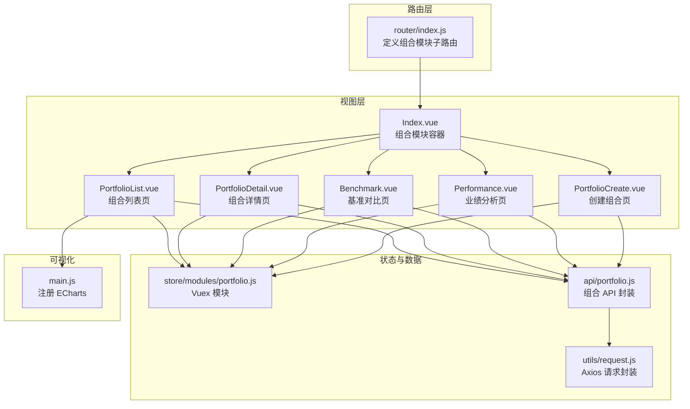
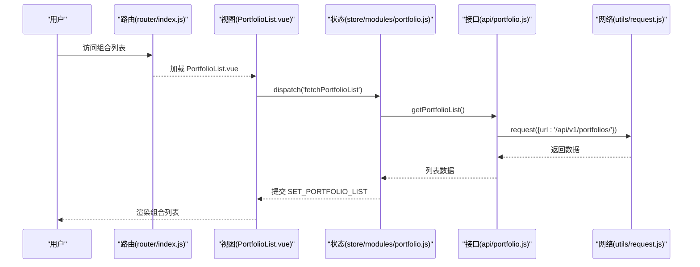
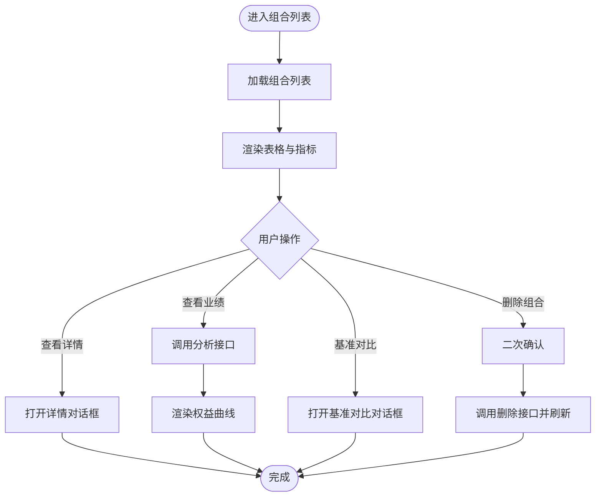
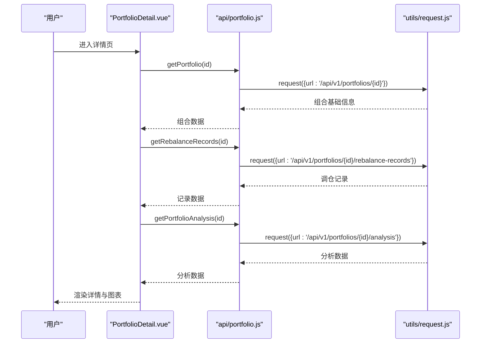
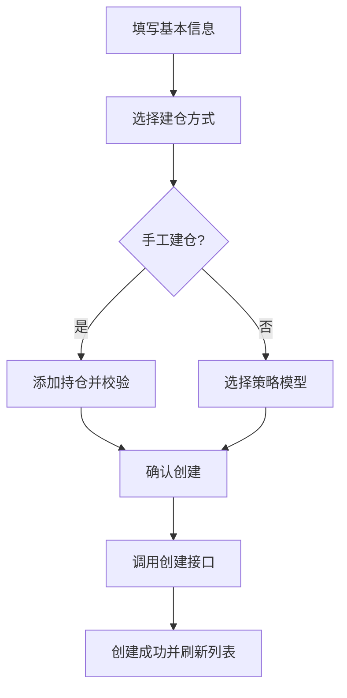
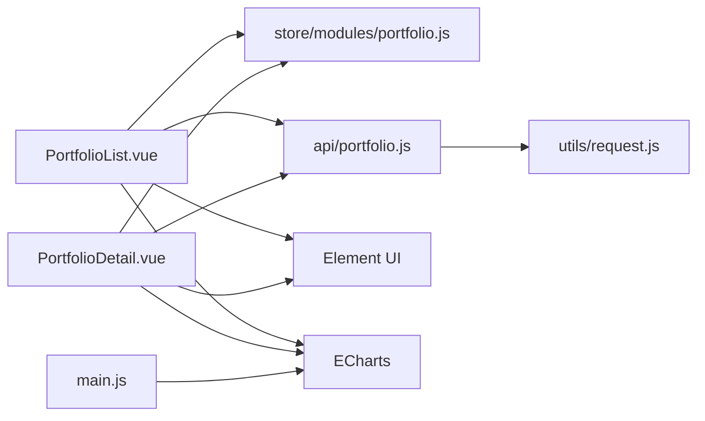

# 组合列表管理

<cite>
**本文引用的文件**
- [PortfolioList.vue](file://src/views/portfolio/PortfolioList.vue)
- [portfolio.js](file://src/store/modules/portfolio.js)
- [portfolio.js](file://src/api/portfolio.js)
- [Index.vue](file://src/views/portfolio/Index.vue)
- [PortfolioDetail.vue](file://src/views/portfolio/PortfolioDetail.vue)
- [Benchmark.vue](file://src/views/portfolio/Benchmark.vue)
- [Performance.vue](file://src/views/portfolio/Performance.vue)
- [router/index.js](file://src/router/index.js)
- [request.js](file://src/utils/request.js)
- [main.js](file://src/main.js)
- [PortfolioCreate.vue](file://src/views/portfolio/PortfolioCreate.vue)
</cite>

## 目录
1. [简介](#简介)
2. [项目结构](#项目结构)
3. [核心组件](#核心组件)
4. [架构总览](#架构总览)
5. [组件详解](#组件详解)
6. [依赖关系分析](#依赖关系分析)
7. [性能考量](#性能考量)
8. [故障排查指南](#故障排查指南)
9. [结论](#结论)
10. [附录](#附录)

## 简介
本文件围绕“组合列表管理”功能进行系统化说明，涵盖组合列表页面的设计与实现、组合基本信息与收益指标展示、状态标识、组合操作（查看详情、查看业绩、基准对比、删除）、数据格式与排序规则、响应式设计与用户体验优化，并提供最佳实践与使用建议。读者无需深入技术背景即可理解并高效使用该功能。

## 项目结构
组合列表功能位于“模拟组合”模块下，采用路由嵌套 + Vuex 状态管理 + Element UI 组件的典型前端架构：
- 页面入口：PortfolioList.vue 展示组合列表与操作
- 数据来源：Vuex 模块 portfolio.js 提供列表与增删改查动作
- 接口封装：api/portfolio.js 封装组合相关 API
- 路由配置：router/index.js 定义组合模块的子路由与导航
- 图表渲染：main.js 注册 ECharts，PortfolioList.vue 使用 ECharts 渲染权益曲线
- 辅助组件：PortfolioDetail.vue、Benchmark.vue、Performance.vue、PortfolioCreate.vue 提供详情、对比、分析与创建能力

**图表来源**
- [router/index.js:123-179](file://src/router/index.js#L123-L179)
- [PortfolioList.vue:154-357](file://src/views/portfolio/PortfolioList.vue#L154-L357)
- [portfolio.js:38-88](file://src/store/modules/portfolio.js#L38-L88)
- [portfolio.js:1-72](file://src/api/portfolio.js#L1-L72)
- [request.js:1-100](file://src/utils/request.js#L1-L100)
- [main.js:1-31](file://src/main.js#L1-L31)

**章节来源**
- [router/index.js:123-179](file://src/router/index.js#L123-L179)
- [Index.vue:1-10](file://src/views/portfolio/Index.vue#L1-L10)

## 核心组件
- 组合列表页（PortfolioList.vue）
  - 展示组合名称、类型、当前市值、最新净值、累计/年化收益率、最大回撤、夏普比率、建仓日期、创建时间
  - 支持“详情”“业绩”“基准”“删除”操作
  - 支持创建组合弹窗与业绩详情对话框
  - 使用 ECharts 渲染权益曲线
- 组合详情页（PortfolioDetail.vue）
  - 展示基本信息、当前持仓、业绩曲线（单位净值/累计收益率切换）、调仓记录、快捷操作
  - 支持再平衡、查看完整业绩、基准对比、查看历史等
- 组合 API（api/portfolio.js）
  - 提供获取列表、创建、删除、分析、详情等接口
- 组合 Store（store/modules/portfolio.js）
  - 管理组合列表、当前组合、基准集合，提供获取列表、创建、删除、更新、查询等动作
- 路由（router/index.js）
  - 定义组合模块的子路由，包含列表、详情、再平衡、历史、业绩、基准、对比等页面
- 请求封装（utils/request.js）
  - 统一处理请求/响应拦截、错误提示与超时策略
- 图表初始化（main.js）
  - 注册 ECharts，PortfolioList.vue 在需要时动态初始化并渲染图表

**章节来源**
- [PortfolioList.vue:1-372](file://src/views/portfolio/PortfolioList.vue#L1-L372)
- [PortfolioDetail.vue:1-599](file://src/views/portfolio/PortfolioDetail.vue#L1-L599)
- [portfolio.js:1-106](file://src/store/modules/portfolio.js#L1-L106)
- [portfolio.js:1-72](file://src/api/portfolio.js#L1-L72)
- [router/index.js:123-179](file://src/router/index.js#L123-L179)
- [request.js:1-100](file://src/utils/request.js#L1-L100)
- [main.js:1-31](file://src/main.js#L1-L31)

## 架构总览
组合列表管理遵循“路由 → 视图 → 状态/接口 → 可视化”的分层架构：
- 路由层负责导航与页面装载
- 视图层负责数据展示与交互
- 状态层负责数据持久化与派发
- 接口层负责与后端通信
- 可视化层负责图表渲染与交互体验

**图表来源**
- [router/index.js:130-135](file://src/router/index.js#L130-L135)
- [PortfolioList.vue:186-197](file://src/views/portfolio/PortfolioList.vue#L186-L197)
- [portfolio.js:38-49](file://src/store/modules/portfolio.js#L38-L49)
- [portfolio.js:8-13](file://src/api/portfolio.js#L8-L13)
- [request.js:11-32](file://src/utils/request.js#L11-L32)

## 组件详解

### 组合列表页（PortfolioList.vue）
- 数据展示
  - 字段：组合名称、组合类型、当前市值、最新净值、累计/年化收益率、最大回撤、夏普比率、建仓日期、创建时间
  - 格式化：数字采用千分位格式，百分比保留两位小数；日期支持完整与短日期两种格式
  - 状态标识：通过颜色区分正负收益，使用标签展示组合类型
- 操作功能
  - 详情：打开组合详情对话框
  - 业绩：拉取分析数据并渲染权益曲线
  - 基准：打开基准对比对话框（当前为占位提示）
  - 删除：二次确认后调用删除接口并刷新列表
- 对话框
  - 业绩详情：展示当前市值、初始资金、累计/年化收益率、年化波动率、夏普比率、最大回撤、卡玛比率，并渲染权益曲线
  - 创建组合：打开创建对话框，提交后刷新列表
  - 组合详情：打开详情对话框
  - 基准对比：打开对比对话框（当前为占位提示）

**图表来源**
- [PortfolioList.vue:186-270](file://src/views/portfolio/PortfolioList.vue#L186-L270)
- [portfolio.js:38-49](file://src/store/modules/portfolio.js#L38-L49)
- [portfolio.js:49-55](file://src/api/portfolio.js#L49-L55)

**章节来源**
- [PortfolioList.vue:1-372](file://src/views/portfolio/PortfolioList.vue#L1-L372)

### 组合详情页（PortfolioDetail.vue）
- 信息概览：基本信息卡片、当前持仓、业绩曲线、调仓记录
- 指标展示：当前市值、累计/年化收益率、年化波动率、夏普比率、最大回撤
- 交互：单位净值与累计收益率曲线切换、查看完整业绩、基准对比、调仓历史、资产行情、策略详情
- 图表：基于 ECharts 渲染，支持单位净值与累计收益率两种模式

**图表来源**
- [PortfolioDetail.vue:322-351](file://src/views/portfolio/PortfolioDetail.vue#L322-L351)
- [portfolio.js:15-21](file://src/api/portfolio.js#L15-L21)
- [portfolio.js:41-47](file://src/api/portfolio.js#L41-L47)
- [portfolio.js:49-55](file://src/api/portfolio.js#L49-L55)
- [request.js:11-32](file://src/utils/request.js#L11-L32)

**章节来源**
- [PortfolioDetail.vue:1-599](file://src/views/portfolio/PortfolioDetail.vue#L1-L599)

### 组合创建（PortfolioCreate.vue）
- 三步流程：基本信息 → 建仓方式 → 确认创建
- 建仓方式：手工建仓（选择资产、输入数量与成本价）或模型关联建仓（选择策略模型，自动生成目标权重与金额）
- 提交：构建后端期望的请求体，调用创建接口，成功后关闭对话框并刷新列表

**图表来源**
- [PortfolioCreate.vue:268-351](file://src/views/portfolio/PortfolioCreate.vue#L268-L351)
- [portfolio.js:51-62](file://src/store/modules/portfolio.js#L51-L62)

**章节来源**
- [PortfolioCreate.vue:1-421](file://src/views/portfolio/PortfolioCreate.vue#L1-L421)

### 组合状态管理
- 状态映射
  - active → 运行中（success）
  - paused → 已暂停（warning）
  - archived → 已归档（info）
- 状态过滤
  - 提供 activePortfolios getter 仅返回运行中的组合
- 状态标识
  - 列表页通过标签与颜色区分不同状态，提升可读性

**章节来源**
- [PortfolioList.vue:218-225](file://src/views/portfolio/PortfolioList.vue#L218-L225)
- [portfolio.js:94-96](file://src/store/modules/portfolio.js#L94-L96)

### 收益指标与计算展示
- 列表页指标
  - 当前市值、最新净值、累计/年化收益率、最大回撤、夏普比率、建仓日期、创建时间
  - 收益率统一格式化为百分比，正负收益以颜色区分
- 详情页指标
  - 当前市值、累计/年化收益率、年化波动率、夏普比率、最大回撤、卡玛比率
  - 支持单位净值与累计收益率两种曲线展示
- 图表渲染
  - 权益曲线/单位净值/累计收益率曲线均使用 ECharts 渲染，支持平滑曲线与面积填充

**章节来源**
- [PortfolioList.vue:20-55](file://src/views/portfolio/PortfolioList.vue#L20-L55)
- [PortfolioDetail.vue:143-193](file://src/views/portfolio/PortfolioDetail.vue#L143-L193)
- [PortfolioDetail.vue:402-535](file://src/views/portfolio/PortfolioDetail.vue#L402-L535)

### 数据格式、字段含义与排序规则
- 列表数据字段
  - name：组合名称
  - portfolio_type：组合类型（模型驱动/手工创建）
  - current_capital：当前市值
  - latest_unit_value：最新净值
  - total_return：累计收益率
  - annual_return：年化收益率
  - max_drawdown：最大回撤
  - sharpe_ratio：夏普比率
  - inception_date：建仓日期
  - created_at：创建时间
- 字段格式
  - 数字：千分位格式（两位小数）
  - 百分比：乘以100后两位小数
  - 日期：完整时间与短日期两种格式
- 排序规则
  - 列表未显式声明排序，按接口返回顺序展示；如需排序可在前端或后端扩展

**章节来源**
- [PortfolioList.vue:11-76](file://src/views/portfolio/PortfolioList.vue#L11-L76)

### 组合操作功能
- 查看详情：打开组合详情对话框，展示基本信息、持仓、业绩曲线与快捷操作
- 查看业绩：拉取分析数据并渲染权益曲线，支持查看完整业绩分析
- 基准对比：打开基准对比对话框（当前为占位提示）
- 删除组合：二次确认后调用删除接口并刷新列表
- 创建组合：打开创建对话框，支持手工建仓与模型关联建仓两种方式

**章节来源**
- [PortfolioList.vue:66-75](file://src/views/portfolio/PortfolioList.vue#L66-L75)
- [PortfolioList.vue:229-270](file://src/views/portfolio/PortfolioList.vue#L229-L270)
- [PortfolioDetail.vue:196-213](file://src/views/portfolio/PortfolioDetail.vue#L196-L213)

### 响应式设计与用户体验优化
- 响应式布局
  - 使用 Element UI 的栅格系统与卡片布局，适配不同屏幕尺寸
- 交互优化
  - 加载状态：列表与对话框均提供加载指示
  - 错误提示：统一通过消息组件提示错误信息
  - 对话框：详情、业绩、创建、对比等均以对话框形式呈现，避免页面跳转
  - 图表：延迟渲染与销毁，避免内存泄漏
- 可访问性
  - 标签与颜色结合传达状态与收益方向，提升可读性

**章节来源**
- [PortfolioList.vue:10-151](file://src/views/portfolio/PortfolioList.vue#L10-L151)
- [PortfolioDetail.vue:12-242](file://src/views/portfolio/PortfolioDetail.vue#L12-L242)
- [request.js:36-96](file://src/utils/request.js#L36-L96)

## 依赖关系分析
- 组件耦合
  - PortfolioList.vue 依赖 Vuex 状态与 API 封装，同时依赖 ECharts 进行图表渲染
  - PortfolioDetail.vue 依赖 PortfolioList.vue 的分析数据，同时依赖多个子组件（再平衡、历史、业绩、基准、资产行情、策略详情）
- 外部依赖
  - Element UI：提供表格、对话框、按钮、标签、描述列表等组件
  - ECharts：提供折线图与面积图渲染
  - Axios：提供网络请求封装与拦截器
- 循环依赖
  - 未发现循环依赖；各模块职责清晰，通过 API 与 Store 解耦

**图表来源**
- [PortfolioList.vue:154-357](file://src/views/portfolio/PortfolioList.vue#L154-L357)
- [PortfolioDetail.vue:245-538](file://src/views/portfolio/PortfolioDetail.vue#L245-L538)
- [portfolio.js:1-72](file://src/api/portfolio.js#L1-L72)
- [portfolio.js:1-106](file://src/store/modules/portfolio.js#L1-L106)
- [request.js:1-100](file://src/utils/request.js#L1-L100)
- [main.js:1-31](file://src/main.js#L1-L31)

**章节来源**
- [PortfolioList.vue:154-357](file://src/views/portfolio/PortfolioList.vue#L154-L357)
- [PortfolioDetail.vue:245-538](file://src/views/portfolio/PortfolioDetail.vue#L245-L538)
- [portfolio.js:1-106](file://src/store/modules/portfolio.js#L1-L106)
- [portfolio.js:1-72](file://src/api/portfolio.js#L1-L72)
- [request.js:1-100](file://src/utils/request.js#L1-L100)
- [main.js:1-31](file://src/main.js#L1-L31)

## 性能考量
- 列表加载
  - 使用加载指示器避免闪烁，减少不必要的重渲染
- 图表渲染
  - 采用延迟初始化与销毁，避免在组件卸载后仍持有图表实例
  - 图表选项按需配置，减少不必要的计算
- 网络请求
  - 统一超时时间与错误处理，避免长时间阻塞 UI
- 数据格式化
  - 数字与百分比格式化在组件内部完成，减少重复计算

**章节来源**
- [PortfolioList.vue:190-206](file://src/views/portfolio/PortfolioList.vue#L190-L206)
- [PortfolioList.vue:271-355](file://src/views/portfolio/PortfolioList.vue#L271-L355)
- [PortfolioDetail.vue:397-535](file://src/views/portfolio/PortfolioDetail.vue#L397-L535)
- [request.js:6-9](file://src/utils/request.js#L6-L9)

## 故障排查指南
- 无法加载组合列表
  - 检查路由是否正确加载 PortfolioList.vue
  - 检查 API 地址与鉴权头是否正确
  - 查看控制台是否有网络错误或 401/403/404 等错误提示
- 业绩数据为空
  - 确认组合是否存在分析数据
  - 检查分析接口返回结构是否符合预期
- 图表不显示
  - 确认 ECharts 已在 main.js 中注册
  - 检查图表容器是否存在且可见
- 删除失败
  - 查看错误提示与后端返回信息
  - 确认组合 ID 是否正确

**章节来源**
- [router/index.js:130-135](file://src/router/index.js#L130-L135)
- [portfolio.js:38-49](file://src/store/modules/portfolio.js#L38-L49)
- [portfolio.js:49-55](file://src/api/portfolio.js#L49-L55)
- [request.js:36-96](file://src/utils/request.js#L36-L96)
- [main.js:16-22](file://src/main.js#L16-L22)

## 结论
组合列表管理功能通过清晰的路由与视图分层、规范的 Vuex 状态管理与 API 封装，实现了组合信息的高效展示与操作。配合 Element UI 与 ECharts，提供了良好的用户体验与可视化效果。后续可在排序、筛选、基准对比完善等方面进一步增强。

## 附录
- 最佳实践
  - 在列表页提供空态提示与引导创建按钮
  - 对关键指标使用颜色与标签辅助识别
  - 对图表进行懒加载与销毁，避免内存泄漏
  - 统一错误处理与提示，提升可维护性
- 使用建议
  - 优先使用模型关联建仓以提高效率
  - 定期查看业绩曲线与最大回撤，评估组合风险
  - 使用基准对比功能进行横向评估（当前为占位，后续完善）