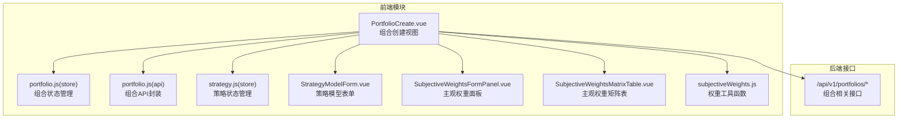
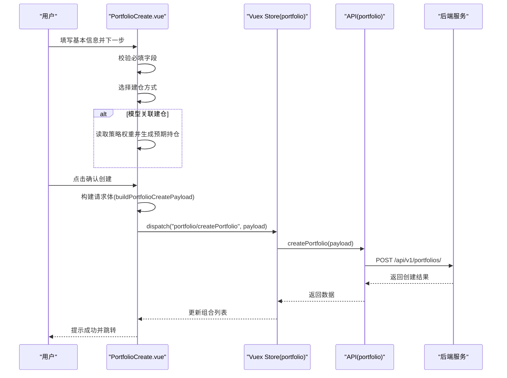
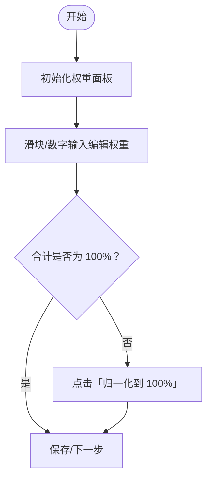
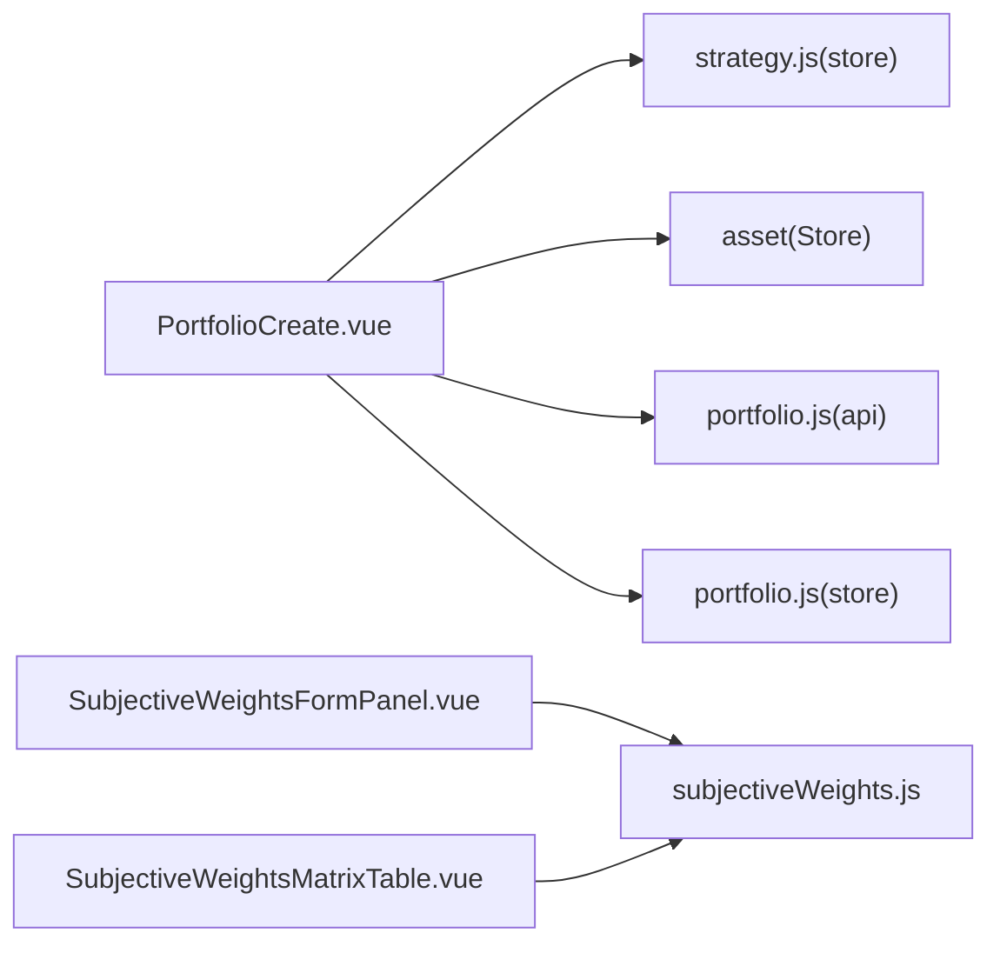

# 组合创建

<cite>
**本文引用的文件**
- [PortfolioCreate.vue](file://src/views/portfolio/PortfolioCreate.vue)
- [portfolio.js](file://src/store/modules/portfolio.js)
- [portfolio.js](file://src/api/portfolio.js)
- [strategy.js](file://src/store/modules/strategy.js)
- [StrategyModelForm.vue](file://src/views/strategy/StrategyModelForm.vue)
- [SubjectiveWeightsFormPanel.vue](file://src/components/SubjectiveWeightsFormPanel.vue)
- [SubjectiveWeightsMatrixTable.vue](file://src/components/SubjectiveWeightsMatrixTable.vue)
- [subjectiveWeights.js](file://src/utils/subjectiveWeights.js)
- [index.js](file://src/router/index.js)
</cite>

## 目录
1. [简介](#简介)
2. [项目结构](#项目结构)
3. [核心组件](#核心组件)
4. [架构概览](#架构概览)
5. [详细组件分析](#详细组件分析)
6. [依赖关系分析](#依赖关系分析)
7. [性能考虑](#性能考虑)
8. [故障排查指南](#故障排查指南)
9. [结论](#结论)
10. [附录](#附录)

## 简介
本文件面向“组合创建”功能，提供从用户视角到前端实现再到后端交互的全流程说明。内容涵盖：
- 组合创建流程（基本信息、建仓方式、确认创建）
- 组合类型定义与选择（模型驱动、手工创建）
- 创建表单设计（必填字段、验证规则、输入限制）
- 资产选择机制（手动添加、策略模型关联）
- 权重配置方式（等权、市值权、主观权重）
- 业务规则与约束条件
- 实际创建示例与常见问题解答

## 项目结构
组合创建功能位于前端模块“portfolio”中，采用“视图组件 + Vuex Store + API 封装”的分层设计：
- 视图层：负责用户交互与表单渲染
- 状态管理层：维护组合列表、当前组合、业绩基准等
- API 层：封装与后端交互的请求方法
- 关联模块：策略模块提供策略模型与权重结果，主观权重组件提供权重编辑能力

图表来源
- [PortfolioCreate.vue:1-421](file://src/views/portfolio/PortfolioCreate.vue#L1-L421)
- [portfolio.js:1-106](file://src/store/modules/portfolio.js#L1-L106)
- [portfolio.js:1-72](file://src/api/portfolio.js#L1-L72)
- [strategy.js:1-468](file://src/store/modules/strategy.js#L1-L468)
- [StrategyModelForm.vue:1-1215](file://src/views/strategy/StrategyModelForm.vue#L1-L1215)
- [SubjectiveWeightsFormPanel.vue:1-315](file://src/components/SubjectiveWeightsFormPanel.vue#L1-L315)
- [SubjectiveWeightsMatrixTable.vue:1-619](file://src/components/SubjectiveWeightsMatrixTable.vue#L1-L619)
- [subjectiveWeights.js:1-50](file://src/utils/subjectiveWeights.js#L1-L50)

章节来源
- [index.js:137-141](file://src/router/index.js#L137-L141)

## 核心组件
- 组合创建视图：负责三步式表单、建仓方式切换、权重计算与提交
- 组合状态管理：维护组合列表、基准、当前组合等
- 组合 API 封装：提供组合列表、详情、创建、删除等接口
- 策略状态管理：提供策略模型列表、计算、保存等能力
- 主观权重组件：提供权重滑块、条形图、矩阵表等编辑能力

章节来源
- [PortfolioCreate.vue:195-420](file://src/views/portfolio/PortfolioCreate.vue#L195-L420)
- [portfolio.js:1-106](file://src/store/modules/portfolio.js#L1-L106)
- [portfolio.js:1-72](file://src/api/portfolio.js#L1-L72)
- [strategy.js:1-468](file://src/store/modules/strategy.js#L1-L468)
- [SubjectiveWeightsFormPanel.vue:1-315](file://src/components/SubjectiveWeightsFormPanel.vue#L1-L315)
- [SubjectiveWeightsMatrixTable.vue:1-619](file://src/components/SubjectiveWeightsMatrixTable.vue#L1-L619)
- [subjectiveWeights.js:1-50](file://src/utils/subjectiveWeights.js#L1-L50)

## 架构概览
组合创建的端到端流程如下：
- 用户在“创建组合”页面填写基本信息
- 选择建仓方式：手工建仓或模型关联建仓
- 在模型关联建仓模式下，系统根据策略模型的目标权重生成预期持仓
- 用户确认后，前端构建请求体并调用后端创建接口
- 成功后刷新组合列表并跳转至组合列表页

图表来源
- [PortfolioCreate.vue:327-402](file://src/views/portfolio/PortfolioCreate.vue#L327-L402)
- [portfolio.js:51-62](file://src/store/modules/portfolio.js#L51-L62)
- [portfolio.js:24-30](file://src/api/portfolio.js#L24-L30)

## 详细组件分析

### 组合创建视图（PortfolioCreate.vue）
- 三步式流程：基本信息 -> 建仓方式 -> 确认创建
- 基本信息字段：组合名称、初始资金、业绩基准、组合描述
- 建仓方式：手工建仓（手动添加资产、数量、成本价）；模型关联建仓（选择策略模型，系统根据权重生成预期持仓）
- 权重与金额：手工建仓使用“数量”和“成本价”，模型关联建仓使用“目标权重”和“初始资金”计算金额
- 提交逻辑：构建 payload 并调用 store 的创建 action

章节来源
- [PortfolioCreate.vue:14-191](file://src/views/portfolio/PortfolioCreate.vue#L14-L191)
- [PortfolioCreate.vue:268-418](file://src/views/portfolio/PortfolioCreate.vue#L268-L418)

#### 表单字段与验证规则
- 必填字段
  - 组合名称：必填
  - 初始资金：必填，范围 10000-100000000，步长 10000
- 输入限制
  - 业绩基准：多选
  - 手工建仓：资产数量 ≥0，步长 1；成本价格 ≥0，步长 0.01
  - 模型关联建仓：交易成本率 0-0.1，步长 0.0001
- 业务约束
  - 手工建仓必须至少添加一个持仓
  - 模型关联建仓必须选择策略

章节来源
- [PortfolioCreate.vue:16-62](file://src/views/portfolio/PortfolioCreate.vue#L16-L62)
- [PortfolioCreate.vue:291-301](file://src/views/portfolio/PortfolioCreate.vue#L291-L301)

#### 建仓方式与权重配置
- 手工建仓
  - 支持逐条添加资产、数量、成本价
  - 生成 positions 时使用 shares 字段
- 模型关联建仓
  - 读取策略模型 result.weights
  - 若权重为空，按等权分配
  - 生成 positions 时使用 weight 字段
- 交易成本率
  - 默认 0.001（0.1%），用于后续交易费用估算

章节来源
- [PortfolioCreate.vue:65-169](file://src/views/portfolio/PortfolioCreate.vue#L65-L169)
- [PortfolioCreate.vue:316-326](file://src/views/portfolio/PortfolioCreate.vue#L316-L326)
- [PortfolioCreate.vue:352-402](file://src/views/portfolio/PortfolioCreate.vue#L352-L402)

#### 提交与错误处理
- 构建 payload：根据建仓方式选择不同的 positions 结构
- 调用 store 的 createPortfolio action
- 错误提示：解析后端返回的 detail 信息，拼接字段路径与消息

章节来源
- [PortfolioCreate.vue:327-351](file://src/views/portfolio/PortfolioCreate.vue#L327-L351)

### 组合状态管理（portfolio.js）
- 状态：组合列表、当前组合、基准列表
- 动作：
  - 创建组合：调用 API 创建后刷新列表
  - 获取组合列表：拉取后端数据并更新本地状态
  - 更新/删除/获取详情：提供相应动作与 getter

章节来源
- [portfolio.js:1-106](file://src/store/modules/portfolio.js#L1-L106)

### 组合 API 封装（portfolio.js）
- 接口：获取列表、获取详情、创建、删除、获取分析数据、记录调仓等
- 与后端约定的端点：/api/v1/portfolios/*

章节来源
- [portfolio.js:1-72](file://src/api/portfolio.js#L1-L72)

### 策略模块与主观权重（strategy.js、StrategyModelForm.vue、SubjectiveWeights*）
- 策略模块提供策略模型列表、计算、保存、发布等功能
- 主观权重面板与矩阵表支持：
  - 默认权重（0-100%，合计建议 100%）
  - 预设调仓日期与权重矩阵（百分比，合计 100%）
  - 归一化到 100%、等权填充、复制行等便捷操作
- 权重归一化工具：精确到万分之一（百分比两位小数），保证合计为 100%

章节来源
- [strategy.js:1-468](file://src/store/modules/strategy.js#L1-L468)
- [StrategyModelForm.vue:1-1215](file://src/views/strategy/StrategyModelForm.vue#L1-L1215)
- [SubjectiveWeightsFormPanel.vue:1-315](file://src/components/SubjectiveWeightsFormPanel.vue#L1-L315)
- [SubjectiveWeightsMatrixTable.vue:1-619](file://src/components/SubjectiveWeightsMatrixTable.vue#L1-L619)
- [subjectiveWeights.js:1-50](file://src/utils/subjectiveWeights.js#L1-L50)

### 权重配置流程（主观权重）

图表来源
- [SubjectiveWeightsFormPanel.vue:115-136](file://src/components/SubjectiveWeightsFormPanel.vue#L115-L136)
- [SubjectiveWeightsMatrixTable.vue:312-325](file://src/components/SubjectiveWeightsMatrixTable.vue#L312-L325)

## 依赖关系分析
- 组件耦合
  - PortfolioCreate.vue 依赖策略模块（读取策略列表）、资产模块（读取资产列表）、组合 API、组合 Store
  - 主观权重组件相互协作，形成权重编辑闭环
- 外部依赖
  - 后端接口：/api/v1/portfolios/*
  - 路由：/portfolio/create

图表来源
- [PortfolioCreate.vue:196-233](file://src/views/portfolio/PortfolioCreate.vue#L196-L233)
- [strategy.js:24-30](file://src/store/modules/strategy.js#L24-L30)
- [portfolio.js:1-72](file://src/api/portfolio.js#L1-L72)
- [portfolio.js:1-106](file://src/store/modules/portfolio.js#L1-L106)
- [SubjectiveWeightsFormPanel.vue:72-77](file://src/components/SubjectiveWeightsFormPanel.vue#L72-L77)
- [SubjectiveWeightsMatrixTable.vue](file://src/components/SubjectiveWeightsMatrixTable.vue#L133)

## 性能考虑
- 表单渲染优化
  - 使用 v-show 控制三步式步骤，减少不必要的 DOM 渲染
  - 表格与输入控件使用合理的精度与步长，避免高频重绘
- 数据流优化
  - 通过计算属性缓存 expectedHoldings，避免重复计算
  - 在模型关联建仓时，仅在策略变化时重建 holdings
- 交互体验
  - 提交按钮增加 loading 状态，防止重复提交
  - 错误提示聚合后端 detail 信息，提升可读性

## 故障排查指南
- 常见错误与提示
  - “请至少添加一个持仓”：手工建仓模式下未添加任何持仓
  - “请选择策略”：模型关联建仓模式下未选择策略
  - “创建失败：...”：后端返回校验错误，前端解析 detail 并拼接字段路径与消息
- 建议排查步骤
  - 确认必填字段已填写且符合范围
  - 检查建仓方式选择是否正确
  - 查看后端返回的 detail 信息定位具体字段
  - 如为模型关联建仓，确认策略权重是否有效

章节来源
- [PortfolioCreate.vue:291-301](file://src/views/portfolio/PortfolioCreate.vue#L291-L301)
- [PortfolioCreate.vue:340-347](file://src/views/portfolio/PortfolioCreate.vue#L340-L347)

## 结论
组合创建功能通过清晰的三步式流程、灵活的建仓方式与严谨的表单校验，实现了从“手工建仓”到“模型驱动”的无缝衔接。配合主观权重编辑能力与后端 API，用户可以快速完成组合的创建与配置。建议在实际使用中：
- 明确建仓方式与权重来源
- 严格遵守输入范围与合计约束
- 利用归一化与矩阵表提升权重配置效率

## 附录

### 组合类型定义与选择
- 手工创建：用户手动添加资产、数量、成本价，适合短期或定制化组合
- 模型驱动：基于策略模型的目标权重自动分配资金，适合标准化与自动化组合

章节来源
- [PortfolioCreate.vue:395-396](file://src/views/portfolio/PortfolioCreate.vue#L395-L396)

### 组合资产选择机制
- 手动添加：在手工建仓模式下，逐条添加资产、数量、成本价
- 批量导入：通过策略模型关联，系统根据权重批量生成预期持仓

章节来源
- [PortfolioCreate.vue:73-117](file://src/views/portfolio/PortfolioCreate.vue#L73-L117)
- [PortfolioCreate.vue:120-163](file://src/views/portfolio/PortfolioCreate.vue#L120-L163)

### 权重配置方式
- 等权：当策略权重为空时，按等权分配
- 市值权：手工建仓模式下使用“数量”和“成本价”计算市值
- 主观权重：通过主观权重面板与矩阵表进行编辑，支持归一化与等权填充

章节来源
- [PortfolioCreate.vue:371-378](file://src/views/portfolio/PortfolioCreate.vue#L371-L378)
- [SubjectiveWeightsFormPanel.vue:1-315](file://src/components/SubjectiveWeightsFormPanel.vue#L1-L315)
- [SubjectiveWeightsMatrixTable.vue:1-619](file://src/components/SubjectiveWeightsMatrixTable.vue#L1-L619)
- [subjectiveWeights.js:10-37](file://src/utils/subjectiveWeights.js#L10-L37)

### 业务规则与约束条件
- 必填字段：组合名称、初始资金
- 资金范围：10000-100000000，步长 10000
- 手工建仓：资产数量 ≥0，步长 1；成本价格 ≥0，步长 0.01
- 模型关联建仓：交易成本率 0-0.1，步长 0.0001
- 主观权重：合计建议为 100%，超过 100% 无法保存

章节来源
- [PortfolioCreate.vue:21-33](file://src/views/portfolio/PortfolioCreate.vue#L21-L33)
- [PortfolioCreate.vue:93-109](file://src/views/portfolio/PortfolioCreate.vue#L93-L109)
- [PortfolioCreate.vue:136-143](file://src/views/portfolio/PortfolioCreate.vue#L136-L143)
- [SubjectiveWeightsFormPanel.vue:8-10](file://src/components/SubjectiveWeightsFormPanel.vue#L8-L10)

### 实际创建示例
- 示例一：手工建仓
  - 步骤：填写基本信息 -> 选择“手工建仓” -> 添加资产与数量/成本价 -> 确认创建
  - 关键点：至少添加一个持仓；数量与成本价满足输入限制
- 示例二：模型关联建仓
  - 步骤：填写基本信息 -> 选择“模型关联建仓” -> 选择策略 -> 确认创建
  - 关键点：策略权重为空时按等权分配；交易成本率默认 0.1%

章节来源
- [PortfolioCreate.vue:65-169](file://src/views/portfolio/PortfolioCreate.vue#L65-L169)
- [PortfolioCreate.vue:352-402](file://src/views/portfolio/PortfolioCreate.vue#L352-L402)