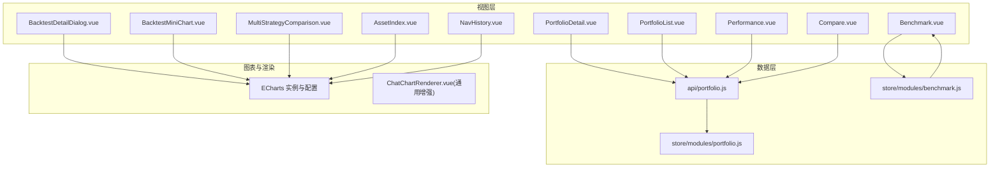
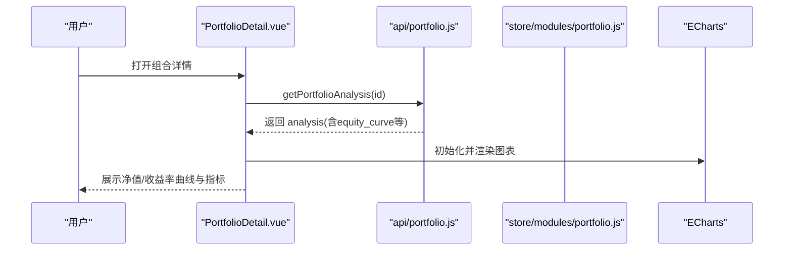
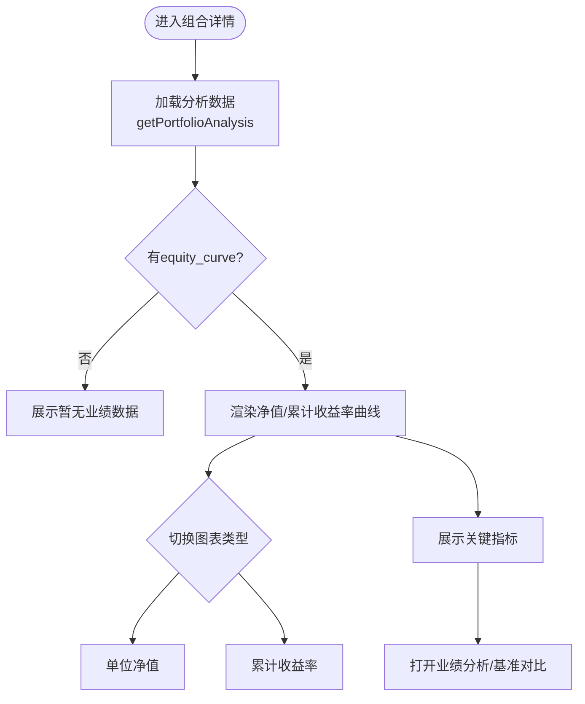
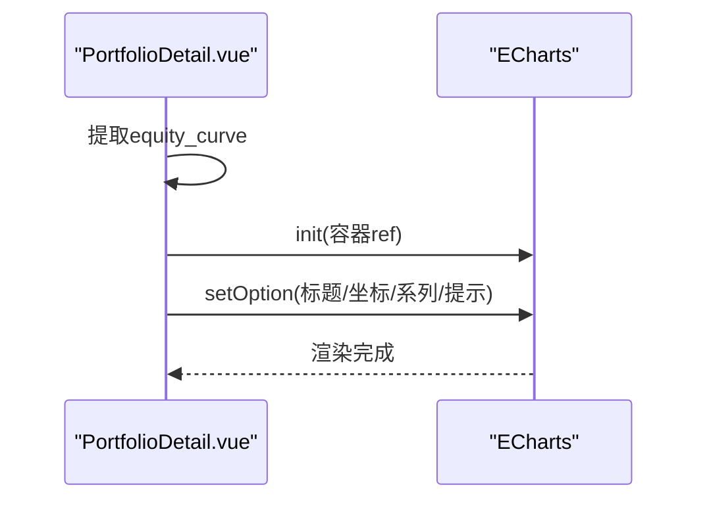
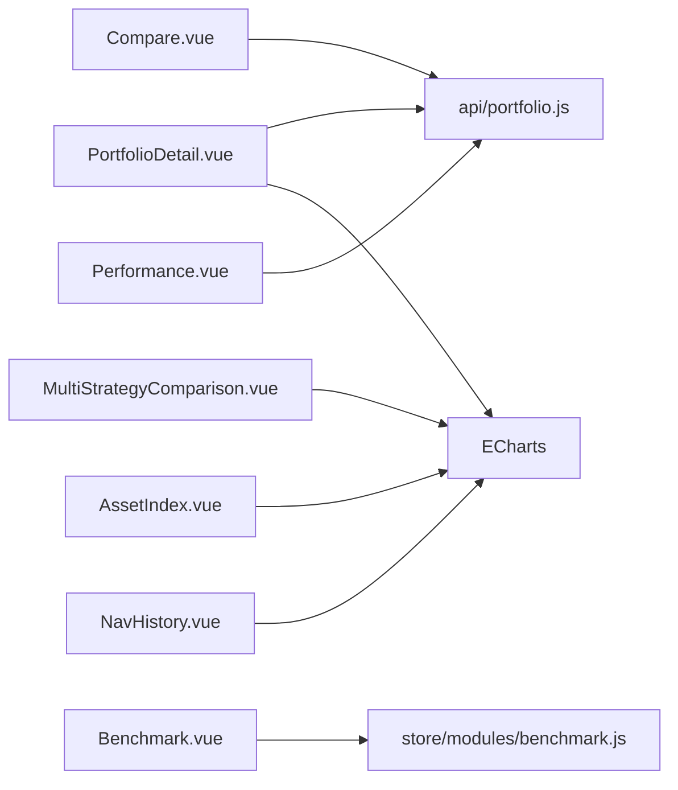

# 组合性能分析

<cite>
**本文引用的文件**   
- [Performance.vue](file://src/views/portfolio/Performance.vue)
- [Compare.vue](file://src/views/portfolio/Compare.vue)
- [Benchmark.vue](file://src/views/portfolio/Benchmark.vue)
- [PortfolioDetail.vue](file://src/views/portfolio/PortfolioDetail.vue)
- [PortfolioList.vue](file://src/views/portfolio/PortfolioList.vue)
- [portfolio.js](file://src/store/modules/portfolio.js)
- [benchmark.js](file://src/store/modules/benchmark.js)
- [portfolio.js(api)](file://src/api/portfolio.js)
- [BacktestDetailDialog.vue](file://src/components/BacktestDetailDialog.vue)
- [BacktestMiniChart.vue](file://src/components/BacktestMiniChart.vue)
- [MultiStrategyComparison.vue](file://src/views/strategy/backtest/MultiStrategyComparison.vue)
- [AssetIndex.vue](file://src/views/analysis/AssetIndex.vue)
- [NavHistory.vue](file://src/views/monitor/NavHistory.vue)
- [BacktestExecution.vue](file://src/views/strategy/BacktestExecution.vue)
- [03_product_domain.js](file://mongo-seed/03_product_domain.js)
</cite>

## 目录
1. [简介](#简介)
2. [项目结构](#项目结构)
3. [核心组件](#核心组件)
4. [架构总览](#架构总览)
5. [详细组件分析](#详细组件分析)
6. [依赖关系分析](#依赖关系分析)
7. [性能考量](#性能考量)
8. [故障排查指南](#故障排查指南)
9. [结论](#结论)
10. [附录](#附录)

## 简介
本文件系统性梳理并说明组合性能分析功能的设计与实现，覆盖如下主题：
- 组合业绩指标计算与展示：累计收益率、年化收益率、年化波动率、最大回撤、夏普比率、卡玛比率等
- 组合对比分析：多组合横向对比与性能归因思路
- 权益曲线图表：ECharts 集成、数据格式转换、交互与样式增强
- 组合基准对比：基准选择、相对表现分析
- 时间维度与数据频率：日频、周频、月频等
- 解读指南与投资决策参考价值

## 项目结构
围绕“组合性能分析”的前端模块主要分布在以下路径：
- 视图层：组合详情页、组合列表页、策略回测结果页、监控页等
- 数据层：组合 API、基准 Store
- 图表层：通用 ECharts 封装组件

**图表来源**
- [PortfolioDetail.vue:322-351](file://src/views/portfolio/PortfolioDetail.vue#L322-L351)
- [portfolio.js:49-71](file://src/api/portfolio.js#L49-L71)
- [benchmark.js:43-121](file://src/store/modules/benchmark.js#L43-L121)

**章节来源**
- [Performance.vue:1-27](file://src/views/portfolio/Performance.vue#L1-L27)
- [Compare.vue:1-15](file://src/views/portfolio/Compare.vue#L1-L15)
- [Benchmark.vue:1-27](file://src/views/portfolio/Benchmark.vue#L1-L27)
- [PortfolioDetail.vue:1-599](file://src/views/portfolio/PortfolioDetail.vue#L1-L599)
- [PortfolioList.vue:294-371](file://src/views/portfolio/PortfolioList.vue#L294-L371)
- [portfolio.js:1-106](file://src/store/modules/portfolio.js#L1-L106)
- [benchmark.js:1-138](file://src/store/modules/benchmark.js#L1-L138)
- [portfolio.js(api):1-72](file://src/api/portfolio.js#L1-L72)

## 核心组件
- 组合详情页：加载组合分析数据，渲染单位净值/累计收益率曲线，展示关键指标
- 组合列表页：展示组合权益曲线
- 性能分析页：当前为占位，后续扩展完整分析
- 多组合对比页：当前为占位，后续扩展对比与归因
- 基准对比页：当前为占位，后续扩展基准选择与相对表现
- 回测详情对话框：展示权益/回撤/波动率等多维图表
- 回测迷你图：悬停弹出权重演变与指标摘要
- 多策略对比：多组合波动率序列生成与展示
- 资产指数分析：滚动波动率计算与展示
- 净值历史监控：区间收益、年化收益、波动率、最大回撤、夏普比率计算
- 回测执行：指标收集与频率映射

**章节来源**
- [PortfolioDetail.vue:140-193](file://src/views/portfolio/PortfolioDetail.vue#L140-L193)
- [PortfolioList.vue:294-371](file://src/views/portfolio/PortfolioList.vue#L294-L371)
- [Performance.vue:1-27](file://src/views/portfolio/Performance.vue#L1-L27)
- [Compare.vue:1-15](file://src/views/portfolio/Compare.vue#L1-L15)
- [Benchmark.vue:1-27](file://src/views/portfolio/Benchmark.vue#L1-L27)
- [BacktestDetailDialog.vue:416-453](file://src/components/BacktestDetailDialog.vue#L416-L453)
- [BacktestMiniChart.vue:147-245](file://src/components/BacktestMiniChart.vue#L147-L245)
- [MultiStrategyComparison.vue:173-196](file://src/views/strategy/backtest/MultiStrategyComparison.vue#L173-L196)
- [AssetIndex.vue:246-282](file://src/views/analysis/AssetIndex.vue#L246-L282)
- [NavHistory.vue:220-262](file://src/views/monitor/NavHistory.vue#L220-L262)
- [BacktestExecution.vue:2219-2340](file://src/views/strategy/BacktestExecution.vue#L2219-L2340)

## 架构总览
组合性能分析采用“视图-数据-图表”三层架构：
- 视图层负责页面布局与交互，调用 API 获取分析数据
- 数据层通过 Store 管理基准与组合状态，API 层封装请求
- 图表层基于 ECharts 进行渲染，提供通用增强能力

**图表来源**
- [PortfolioDetail.vue:322-351](file://src/views/portfolio/PortfolioDetail.vue#L322-L351)
- [portfolio.js(api):49-71](file://src/api/portfolio.js#L49-L71)

## 详细组件分析

### 组合详情页（PortfolioDetail.vue）
- 数据加载：组合基础信息、调仓记录、分析数据
- 指标展示：当前市值、累计收益率、年化收益率、年化波动率、夏普比率、最大回撤
- 图表渲染：单位净值曲线与累计收益率曲线，支持切换与区域着色
- 交互：弹窗打开“业绩分析”“基准对比”，资产行情跳转

**图表来源**
- [PortfolioDetail.vue:322-351](file://src/views/portfolio/PortfolioDetail.vue#L322-L351)
- [PortfolioDetail.vue:402-535](file://src/views/portfolio/PortfolioDetail.vue#L402-L535)

**章节来源**
- [PortfolioDetail.vue:140-193](file://src/views/portfolio/PortfolioDetail.vue#L140-L193)
- [PortfolioDetail.vue:402-535](file://src/views/portfolio/PortfolioDetail.vue#L402-L535)

### 权益曲线图表（ECharts 集成）
- 初始化：在挂载时或首次渲染时初始化 ECharts 实例
- 数据准备：从 analysis.equity_curve 提取日期与序列
- 标题与坐标轴：标题、x/y 轴标签、日期格式化
- 样式与交互：平滑曲线、区域渐变、悬停提示、零基线标记（累计收益）

**图表来源**
- [PortfolioDetail.vue:402-535](file://src/views/portfolio/PortfolioDetail.vue#L402-L535)

**章节来源**
- [PortfolioDetail.vue:402-535](file://src/views/portfolio/PortfolioDetail.vue#L402-L535)

### 组合列表页（PortfolioList.vue）
- 展示组合权益曲线：折线图+面积填充，支持金额格式化与单位换算
- 交互：tooltip 格式化、网格布局适配

**章节来源**
- [PortfolioList.vue:294-371](file://src/views/portfolio/PortfolioList.vue#L294-L371)

### 回测详情对话框（BacktestDetailDialog.vue）
- 初始化多个图表实例：权益、回撤、波动率
- 数据转换：从 unit_value 计算累计收益率或直接使用后端 return_curve
- 交互：按需切换不同子图

**章节来源**
- [BacktestDetailDialog.vue:416-453](file://src/components/BacktestDetailDialog.vue#L416-L453)

### 回测迷你图（BacktestMiniChart.vue）
- 功能：悬停弹出权重演变堆叠面积图，展示指标摘要
- 降采样：最多 30 个点，优化渲染性能
- 格式化：百分比、颜色区分正负

**章节来源**
- [BacktestMiniChart.vue:147-245](file://src/components/BacktestMiniChart.vue#L147-L245)

### 多策略对比（MultiStrategyComparison.vue）
- 波动率序列生成：优先使用后端返回的组合波动率；否则按净值序列滚动计算年化波动率
- 时间窗口：滚动 21 个交易日

**章节来源**
- [MultiStrategyComparison.vue:173-196](file://src/views/strategy/backtest/MultiStrategyComparison.vue#L173-L196)

### 资产指数分析（AssetIndex.vue）
- 滚动波动率：基于净值序列的 21 日滚动年化波动率
- 标记点：波动率重置、调仓日、交互式调整等事件标注

**章节来源**
- [AssetIndex.vue:246-282](file://src/views/analysis/AssetIndex.vue#L246-L282)
- [AssetIndex.vue:261-273](file://src/views/analysis/AssetIndex.vue#L261-L273)

### 净值历史监控（NavHistory.vue）
- 指标计算：区间收益率、年化收益率、年化波动率、最大回撤、夏普比率
- 输入过滤：仅使用非空的日收益数据

**章节来源**
- [NavHistory.vue:220-262](file://src/views/monitor/NavHistory.vue#L220-L262)
- [NavHistory.vue:348-363](file://src/views/monitor/NavHistory.vue#L348-L363)

### 回测执行（BacktestExecution.vue）
- 指标收集：累计收益、年化收益、波动率、最大回撤、夏普、卡玛
- 频率映射：将“每日/每周/每月”等映射为后端可识别的频率

**章节来源**
- [BacktestExecution.vue:2219-2340](file://src/views/strategy/BacktestExecution.vue#L2219-L2340)
- [BacktestExecution.vue:2269-2295](file://src/views/strategy/BacktestExecution.vue#L2269-L2295)

### 基准管理（Store 与 API）
- Store：基准列表、当前基准、加载状态、增删改查
- API：基准 CRUD、按代码查询

**章节来源**
- [benchmark.js:43-121](file://src/store/modules/benchmark.js#L43-L121)
- [portfolio.js:1-106](file://src/store/modules/portfolio.js#L1-L106)

### 基准种子数据（mongo-seed）
- 基准定义：组合代码、基准名称、成分、基准收益等
- 归因示例：按因子贡献度与权重展示

**章节来源**
- [03_product_domain.js:297-505](file://mongo-seed/03_product_domain.js#L297-L505)

## 依赖关系分析
- 视图层依赖 API 层获取分析数据
- 组合详情页依赖 ECharts 进行渲染
- 基准对比页依赖 Store 管理基准状态
- 多策略对比与资产指数分析依赖滚动窗口计算波动率

**图表来源**
- [PortfolioDetail.vue:322-351](file://src/views/portfolio/PortfolioDetail.vue#L322-L351)
- [benchmark.js:43-121](file://src/store/modules/benchmark.js#L43-L121)

**章节来源**
- [PortfolioDetail.vue:322-351](file://src/views/portfolio/PortfolioDetail.vue#L322-L351)
- [benchmark.js:43-121](file://src/store/modules/benchmark.js#L43-L121)

## 性能考量
- 图表渲染优化
  - 回测迷你图对权重快照进行降采样（最多 30 个点），降低渲染压力
  - 使用平滑曲线与区域渐变，兼顾美观与性能
- 指标计算优化
  - 滚动窗口：21 日用于年化波动率计算，平衡稳定性与时效性
  - 空数据保护：当日收益为空时返回默认值，避免异常传播
- 数据加载
  - 组合详情页在获取分析数据后延迟渲染图表，减少首屏阻塞

**章节来源**
- [BacktestMiniChart.vue:102-112](file://src/components/BacktestMiniChart.vue#L102-L112)
- [MultiStrategyComparison.vue:181-196](file://src/views/strategy/backtest/MultiStrategyComparison.vue#L181-L196)
- [NavHistory.vue:232-241](file://src/views/monitor/NavHistory.vue#L232-L241)

## 故障排查指南
- 业绩数据为空
  - 检查分析接口是否成功返回 equity_curve
  - 确认图表容器是否存在且可初始化
- 图表不显示或空白
  - 确保 ECharts 已正确初始化并设置选项
  - 检查数据格式（日期、数值）是否符合预期
- 指标异常
  - 年化波动率为 0：检查日收益序列是否为空或全为 0
  - 夏普比率为 0：波动率为 0 或收益为空
- 基准对比不可用
  - 确认基准 Store 是否已加载基准列表
  - 检查基准 API 是否返回有效数据

**章节来源**
- [PortfolioDetail.vue:334-351](file://src/views/portfolio/PortfolioDetail.vue#L334-L351)
- [NavHistory.vue:232-241](file://src/views/monitor/NavHistory.vue#L232-L241)
- [benchmark.js:43-58](file://src/store/modules/benchmark.js#L43-L58)

## 结论
本项目已实现组合业绩指标的计算与展示、权益曲线图表的 ECharts 集成与交互、以及基准管理的基础能力。多组合对比与完整性能分析仍处于占位开发阶段，后续可在现有数据结构与图表基础上扩展，重点方向包括：
- 多组合横向对比与归因分解
- 基准选择与相对表现分析
- 时间维度与数据频率的灵活配置
- 指标解读与投资决策参考的可视化引导

## 附录

### 关键指标定义与计算要点
- 累计收益率：从期初到期末的总回报率
- 年化收益率：基于期初/期末净值与交易日天数推导
- 年化波动率：日收益序列的样本标准差×√252
- 最大回撤：净值相对于前高最大跌幅
- 夏普比率：年化收益/年化波动率（波动率为 0 时为 0）
- 卡玛比率：年化收益/最大回撤（回撤为 0 时无意义）

**章节来源**
- [NavHistory.vue:220-262](file://src/views/monitor/NavHistory.vue#L220-L262)
- [PortfolioDetail.vue:150-184](file://src/views/portfolio/PortfolioDetail.vue#L150-L184)

### 时间维度与数据频率
- 日频：默认交易日序列，滚动窗口 21 日
- 其他频率：策略回测执行中支持“每日/每周/每月/每季/每年”映射

**章节来源**
- [MultiStrategyComparison.vue:181-196](file://src/views/strategy/backtest/MultiStrategyComparison.vue#L181-L196)
- [BacktestExecution.vue:2234-2235](file://src/views/strategy/BacktestExecution.vue#L2234-L2235)