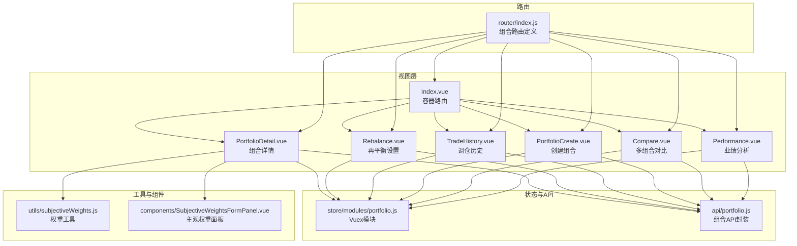
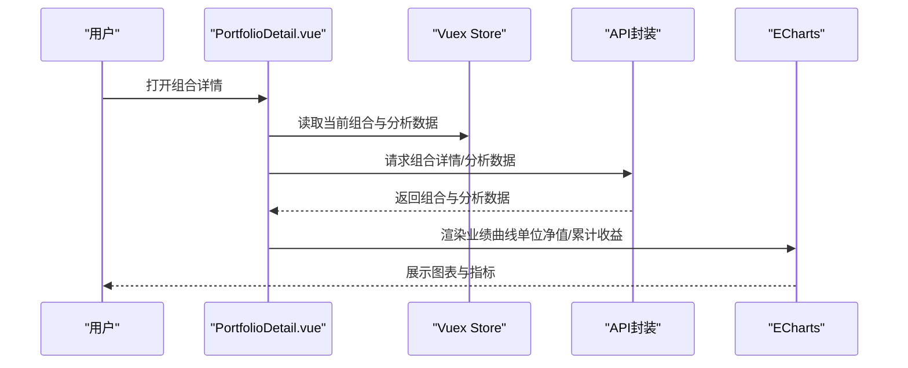
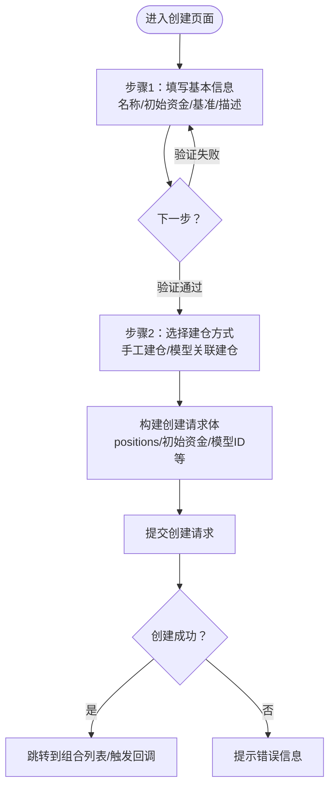
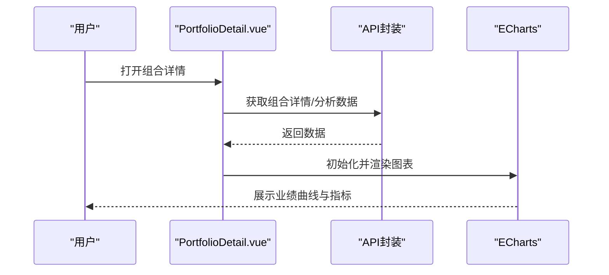
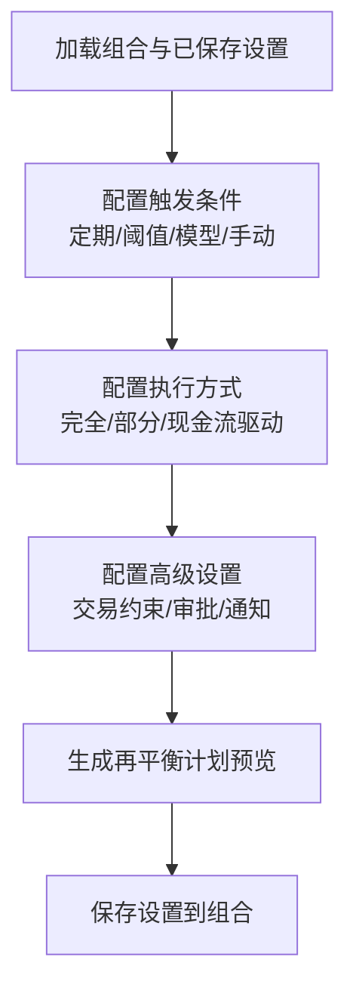
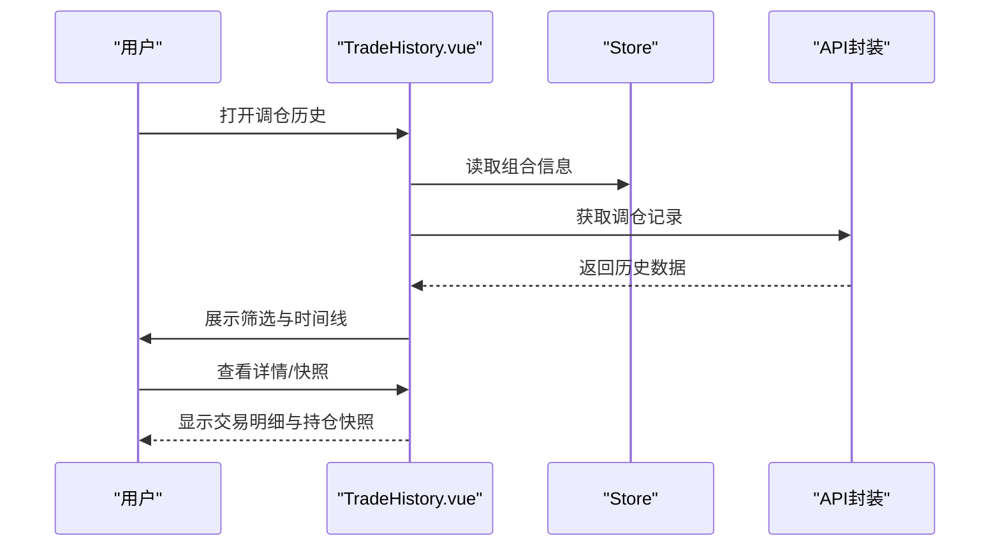
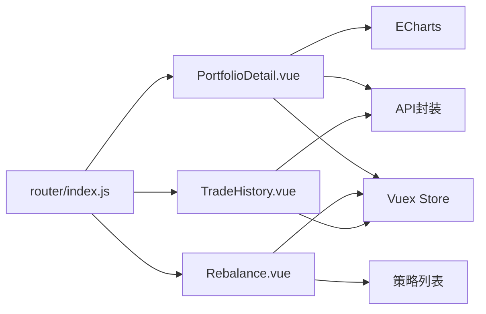

# 组合管理模块

<cite>
**本文档引用的文件**
- [Index.vue](file://src/views/portfolio/Index.vue)
- [PortfolioCreate.vue](file://src/views/portfolio/PortfolioCreate.vue)
- [PortfolioDetail.vue](file://src/views/portfolio/PortfolioDetail.vue)
- [Rebalance.vue](file://src/views/portfolio/Rebalance.vue)
- [TradeHistory.vue](file://src/views/portfolio/TradeHistory.vue)
- [Compare.vue](file://src/views/portfolio/Compare.vue)
- [Performance.vue](file://src/views/portfolio/Performance.vue)
- [portfolio.js](file://src/store/modules/portfolio.js)
- [portfolio.js](file://src/api/portfolio.js)
- [index.js](file://src/router/index.js)
- [subjectiveWeights.js](file://src/utils/subjectiveWeights.js)
- [SubjectiveWeightsFormPanel.vue](file://src/components/SubjectiveWeightsFormPanel.vue)
- [08_risk_domain.js](file://mongo-seed/08_risk_domain.js)
- [09_market_domain.js](file://mongo-seed/09_market_domain.js)
- [zy_data_associated_mock_design_v2.md](file://scripts/zy_data_associated_mock_design_v2.md)
- [MultiStrategyComparison.vue](file://src/views/strategy/backtest/MultiStrategyComparison.vue)
</cite>

## 目录
1. [简介](#简介)
2. [项目结构](#项目结构)
3. [核心组件](#核心组件)
4. [架构总览](#架构总览)
5. [详细组件分析](#详细组件分析)
6. [依赖关系分析](#依赖关系分析)
7. [性能考量](#性能考量)
8. [故障排查指南](#故障排查指南)
9. [结论](#结论)
10. [附录](#附录)

## 简介
本文件系统化梳理“组合管理模块”的设计与实现，覆盖组合生命周期管理（创建、权重配置、动态调整）、多组合对比与归因分析、业绩评估指标（收益曲线、波动率、最大回撤等）、自动再平衡机制与配置、交易历史查询与分析、组合风险度量与压力测试，以及最佳实践与实操案例。文档面向不同技术背景读者，既提供代码级细节，也给出可视化架构与流程图，便于快速理解与落地。

## 项目结构
组合管理模块位于前端工程的 portfolio 子目录，采用按功能分层的组织方式：
- 视图层：Index.vue 作为容器路由，子页面包括 PortfolioCreate、PortfolioDetail、Rebalance、TradeHistory、Compare、Performance 等
- 状态管理层：Vuex 模块 portfolio.js 提供组合列表、当前组合、基准等状态管理
- API 层：portfolio.js 封装组合相关接口（列表、详情、分析、再平衡记录等）
- 路由层：router/index.js 定义组合模块的路由与导航
- 工具与组件：subjectivity 权重工具与主观权重编辑面板组件

**图表来源**
- [Index.vue:1-10](file://src/views/portfolio/Index.vue#L1-L10)
- [PortfolioCreate.vue:1-421](file://src/views/portfolio/PortfolioCreate.vue#L1-L421)
- [PortfolioDetail.vue:1-599](file://src/views/portfolio/PortfolioDetail.vue#L1-L599)
- [Rebalance.vue:1-672](file://src/views/portfolio/Rebalance.vue#L1-L672)
- [TradeHistory.vue:1-615](file://src/views/portfolio/TradeHistory.vue#L1-L615)
- [Compare.vue:1-15](file://src/views/portfolio/Compare.vue#L1-L15)
- [Performance.vue:1-27](file://src/views/portfolio/Performance.vue#L1-L27)
- [portfolio.js:1-106](file://src/store/modules/portfolio.js#L1-L106)
- [portfolio.js:1-72](file://src/api/portfolio.js#L1-L72)
- [index.js:124-178](file://src/router/index.js#L124-L178)

**章节来源**
- [Index.vue:1-10](file://src/views/portfolio/Index.vue#L1-L10)
- [index.js:124-178](file://src/router/index.js#L124-L178)

## 核心组件
- 组合创建（PortfolioCreate）：支持手工建仓与模型关联建仓两种方式，提供初始资金、业绩基准、持仓明细、交易成本率等配置，并将策略结果转换为组合初始持仓
- 组合详情（PortfolioDetail）：展示组合基本信息、当前持仓、业绩曲线（单位净值/累计收益）、关键指标（累计/年化收益、波动率、夏普比率、最大回撤）与快捷操作入口
- 再平衡设置（Rebalance）：定义多种触发条件（定期、阈值、模型信号）与执行方式（完全再平衡、部分再平衡、现金流驱动），并支持审批、通知等高级设置
- 调仓历史（TradeHistory）：提供筛选、时间线展示、调仓详情与持仓快照，支持导出与下载（预留）
- 多组合对比（Compare）：当前为占位页面，后续将支持多组合横向对比与归因分析
- 业绩分析（Performance）：当前为占位页面，后续将提供深度业绩分析与归因
- Vuex 状态（portfolio.js）：维护组合列表、当前组合、基准等状态，并提供获取/创建/更新/删除等动作
- API 封装（portfolio.js）：统一组合相关接口，包括列表、详情、分析、再平衡记录等

**章节来源**
- [PortfolioCreate.vue:1-421](file://src/views/portfolio/PortfolioCreate.vue#L1-L421)
- [PortfolioDetail.vue:1-599](file://src/views/portfolio/PortfolioDetail.vue#L1-L599)
- [Rebalance.vue:1-672](file://src/views/portfolio/Rebalance.vue#L1-L672)
- [TradeHistory.vue:1-615](file://src/views/portfolio/TradeHistory.vue#L1-L615)
- [Compare.vue:1-15](file://src/views/portfolio/Compare.vue#L1-L15)
- [Performance.vue:1-27](file://src/views/portfolio/Performance.vue#L1-L27)
- [portfolio.js:1-106](file://src/store/modules/portfolio.js#L1-L106)
- [portfolio.js:1-72](file://src/api/portfolio.js#L1-L72)

## 架构总览
组合管理模块遵循“视图-状态-接口-路由”分层架构，前端通过 API 与后端交互，Vuex 管理全局状态，路由负责页面导航与参数传递。组合详情页集成图表渲染（ECharts），展示业绩曲线与关键指标；再平衡设置页提供灵活的触发与执行策略配置。

**图表来源**
- [PortfolioDetail.vue:322-351](file://src/views/portfolio/PortfolioDetail.vue#L322-L351)
- [portfolio.js:15-55](file://src/api/portfolio.js#L15-L55)

**章节来源**
- [PortfolioDetail.vue:322-351](file://src/views/portfolio/PortfolioDetail.vue#L322-L351)

## 详细组件分析

### 组合创建（PortfolioCreate）
- 功能要点
  - 步骤式向导：基本信息、建仓方式、确认创建
  - 手工建仓：支持添加/删除持仓，输入数量与成本价格
  - 模型关联建仓：选择策略模型，基于模型权重生成预期持仓
  - 交易成本率：默认0.1%，用于计算交易费用
  - 提交创建：构建后端所需请求体，避免422校验失败
- 关键流程

**图表来源**
- [PortfolioCreate.vue:284-351](file://src/views/portfolio/PortfolioCreate.vue#L284-L351)

**章节来源**
- [PortfolioCreate.vue:1-421](file://src/views/portfolio/PortfolioCreate.vue#L1-L421)

### 组合详情（PortfolioDetail）
- 功能要点
  - 基本信息与当前持仓展示
  - 业绩曲线（单位净值/累计收益）与关键指标（累计/年化收益、波动率、夏普比率、最大回撤）
  - 快捷操作：再平衡、业绩分析、基准对比、调仓历史
  - 图表渲染：基于 ECharts 的折线图，支持切换曲线类型与区域着色
- 关键流程

**图表来源**
- [PortfolioDetail.vue:322-351](file://src/views/portfolio/PortfolioDetail.vue#L322-L351)
- [portfolio.js:15-55](file://src/api/portfolio.js#L15-L55)

**章节来源**
- [PortfolioDetail.vue:1-599](file://src/views/portfolio/PortfolioDetail.vue#L1-L599)

### 再平衡设置（Rebalance）
- 功能要点
  - 触发条件：定期再平衡、阈值触发、模型信号触发、手动触发
  - 执行方式：完全再平衡（考虑交易成本、最小交易金额、价格类型）、部分再平衡（调整比例、调整上限、分批执行）、现金流驱动再平衡（使用流入/流出调整）
  - 高级设置：最小交易单位、交易时间限制、价格冲击、审批流程、通知与异常报警
  - 计划预览：根据所选触发条件生成再平衡计划时间线
- 关键流程

**图表来源**
- [Rebalance.vue:517-553](file://src/views/portfolio/Rebalance.vue#L517-L553)
- [Rebalance.vue:576-603](file://src/views/portfolio/Rebalance.vue#L576-L603)

**章节来源**
- [Rebalance.vue:1-672](file://src/views/portfolio/Rebalance.vue#L1-L672)

### 调仓历史（TradeHistory）
- 功能要点
  - 筛选：按调仓类型、时间范围、涉及资产
  - 展示：时间线卡片，包含调仓原因、操作人员、换手率、交易成本、审批状态
  - 详情：交易明细（买卖方向、数量、价格、金额、成本、权重变化）
  - 快照：调仓前后持仓对比
- 关键流程

**图表来源**
- [TradeHistory.vue:383-388](file://src/views/portfolio/TradeHistory.vue#L383-L388)
- [TradeHistory.vue:447-467](file://src/views/portfolio/TradeHistory.vue#L447-L467)

**章节来源**
- [TradeHistory.vue:1-615](file://src/views/portfolio/TradeHistory.vue#L1-L615)

### 多组合对比（Compare）与业绩分析（Performance）
- 当前状态
  - 多组合对比与业绩分析页面为占位提示，功能开发中
- 后续规划
  - 多组合对比：支持多组合横向对比与归因分析
  - 业绩分析：提供更深入的指标与可视化

**章节来源**
- [Compare.vue:1-15](file://src/views/portfolio/Compare.vue#L1-L15)
- [Performance.vue:1-27](file://src/views/portfolio/Performance.vue#L1-L27)

### 主观权重与资产配置策略
- 主观权重工具
  - 归一化算法：将输入权重按百分比两位小数精度缩放至100%，使用最大余数法分配
  - 滑杆与数值输入：支持滑杆与数值微调，合计建议为100%
- 主观权重表单面板
  - 默认资产权重编辑区与预设调仓权重矩阵编辑区
  - 归一化按钮与合计提示，支持行内归一化、复制、等权填充等

**章节来源**
- [subjectiveWeights.js:1-50](file://src/utils/subjectiveWeights.js#L1-L50)
- [SubjectiveWeightsFormPanel.vue:1-315](file://src/components/SubjectiveWeightsFormPanel.vue#L1-L315)

## 依赖关系分析
- 组件耦合
  - PortfolioDetail 依赖 ECharts 进行图表渲染，依赖 API 封装获取数据
  - Rebalance 依赖策略列表进行模型信号触发配置
  - TradeHistory 依赖 Store 获取组合信息，依赖 API 获取历史数据
- 外部依赖
  - ECharts：用于绘制业绩曲线
  - Element UI：表单、表格、对话框、时间线等组件
  - 路由与状态：Vue Router 与 Vuex 提供导航与状态管理

**图表来源**
- [PortfolioDetail.vue:247-258](file://src/views/portfolio/PortfolioDetail.vue#L247-L258)
- [Rebalance.vue:515-516](file://src/views/portfolio/Rebalance.vue#L515-L516)
- [TradeHistory.vue:383-384](file://src/views/portfolio/TradeHistory.vue#L383-L384)
- [index.js:124-178](file://src/router/index.js#L124-L178)

**章节来源**
- [index.js:124-178](file://src/router/index.js#L124-L178)

## 性能考量
- 图表渲染
  - 使用 ECharts 渲染业绩曲线，建议在数据量较大时启用平滑曲线与区域着色，注意内存占用与重绘频率
- 接口调用
  - 组合详情与分析数据应按需加载，避免重复请求；对历史数据进行分页或时间范围限制
- 再平衡策略
  - 阈值触发与模型信号触发可能带来高频监控，建议合理设置检查频率与执行延迟，避免系统负载过高
- 交易成本与滑点
  - 在部分再平衡与现金流驱动再平衡中，考虑交易成本与价格冲击，设置最小交易金额与批量执行，减少频繁小额交易

## 故障排查指南
- 创建组合失败
  - 现象：提交后返回422校验失败
  - 处理：检查必填项与格式，确保 positions/初始资金/模型ID等字段正确
  - 参考路径：[PortfolioCreate.vue:327-351](file://src/views/portfolio/PortfolioCreate.vue#L327-L351)
- 图表不显示
  - 现象：业绩曲线空白
  - 处理：确认分析数据已返回，检查 ECharts 实例初始化与数据映射
  - 参考路径：[PortfolioDetail.vue:402-535](file://src/views/portfolio/PortfolioDetail.vue#L402-L535)
- 再平衡设置未生效
  - 现象：保存后未触发再平衡
  - 处理：确认至少选择一种自动触发条件；检查触发条件与执行方式配置
  - 参考路径：[Rebalance.vue:576-603](file://src/views/portfolio/Rebalance.vue#L576-L603)
- 调仓历史为空
  - 现象：筛选后无记录
  - 处理：检查筛选条件与时间范围；确认历史数据已导入
  - 参考路径：[TradeHistory.vue:341-368](file://src/views/portfolio/TradeHistory.vue#L341-L368)

**章节来源**
- [PortfolioCreate.vue:327-351](file://src/views/portfolio/PortfolioCreate.vue#L327-L351)
- [PortfolioDetail.vue:402-535](file://src/views/portfolio/PortfolioDetail.vue#L402-L535)
- [Rebalance.vue:576-603](file://src/views/portfolio/Rebalance.vue#L576-L603)
- [TradeHistory.vue:341-368](file://src/views/portfolio/TradeHistory.vue#L341-L368)

## 结论
组合管理模块提供了从创建、配置、动态调整到分析与风险控制的完整能力框架。通过步骤式创建、灵活的再平衡策略、丰富的业绩指标与历史追踪，能够满足多样化的投资组合管理需求。后续可重点完善多组合对比与归因分析、业绩深度分析、风险度量与压力测试功能，以进一步提升系统的专业性与实用性。

## 附录

### 组合性能评估指标
- 收益曲线：单位净值与累计收益率曲线
- 波动率：年化波动率
- 最大回撤：历史最大回撤幅度
- 夏普比率：风险调整后收益
- 换手率：调仓历史中的换手率统计

**章节来源**
- [PortfolioDetail.vue:143-193](file://src/views/portfolio/PortfolioDetail.vue#L143-L193)
- [TradeHistory.vue:13-18](file://src/views/portfolio/TradeHistory.vue#L13-L18)

### 自动再平衡配置选项
- 触发条件
  - 定期再平衡：每日/每周/每月/每季/每年，执行时间与生效日期
  - 阈值触发：偏离阈值、检查频率（每日/实时）、触发模式（任一资产/组合整体）、资产范围
  - 模型信号触发：关联策略、跟随方式、更新频率、执行延迟
- 执行方式
  - 完全再平衡：考虑交易成本、最小交易金额、价格类型
  - 部分再平衡：调整比例、调整上限、分批执行
  - 现金流驱动：使用现金流入/流出调整，不足时暂停或部分调整
- 高级设置
  - 交易约束：最小交易单位、交易时间限制、价格冲击
  - 审批流程：是否需要审批、审批人、审批时限
  - 通知与报警：再平衡前/后通知、异常报警

**章节来源**
- [Rebalance.vue:465-511](file://src/views/portfolio/Rebalance.vue#L465-L511)
- [Rebalance.vue:517-553](file://src/views/portfolio/Rebalance.vue#L517-L553)

### 交易历史查询与分析
- 查询维度：调仓类型、时间范围、涉及资产
- 展示形式：时间线卡片、交易明细、持仓快照
- 导出与报告：预留导出与下载功能

**章节来源**
- [TradeHistory.vue:21-54](file://src/views/portfolio/TradeHistory.vue#L21-L54)
- [TradeHistory.vue:156-307](file://src/views/portfolio/TradeHistory.vue#L156-L307)

### 组合风险度量与压力测试
- 风险域数据
  - 限额检查：单一债券集中度、前十大重仓债券集中度、杠杆率、现金类资产下限等
  - 风险预警：信用风险、期限错配、流动性、跟踪误差、交易对手集中度等
  - VaR：历史模拟与参数法计算的风险价值与期望 shortfall
- 市场域数据
  - 债券、股票、ETF、指数、收益率曲线、回购利率、汇率、商品价格、期权隐含波动率、信用利差、IRS 利率互换等
- 压力测试场景
  - 交易对手集中度风险、估值差异套利机会、现金流匹配、五级分类迁徙、跨域风险传染、流动性压力测试等

**章节来源**
- [08_risk_domain.js:21-75](file://mongo-seed/08_risk_domain.js#L21-L75)
- [09_market_domain.js:23-417](file://mongo-seed/09_market_domain.js#L23-L417)
- [zy_data_associated_mock_design_v2.md:367-597](file://scripts/zy_data_associated_mock_design_v2.md#L367-L597)

### 多组合对比与归因分析（参考）
- 多策略对比：基于净值序列的对比与波动率监控
- 归因分析：基于因子贡献的超额收益分解

**章节来源**
- [MultiStrategyComparison.vue:148-173](file://src/views/strategy/backtest/MultiStrategyComparison.vue#L148-L173)
- [zy_data_associated_mock_design_v2.md:433-454](file://scripts/zy_data_associated_mock_design_v2.md#L433-L454)

### 最佳实践与实操案例
- 资产配置策略
  - 使用主观权重工具进行初始权重设定，建议合计为100%，并进行归一化
  - 结合策略模型进行模型关联建仓，减少手工配置误差
- 风险管理方法
  - 设置合理的再平衡阈值与检查频率，避免过度交易
  - 启用审批流程与通知机制，确保调仓过程透明可控
  - 定期监控风险限额与预警，及时处置超限与异常
- 实战案例
  - 案例1：稳健配置组合
    - 初始资金：1000万元，基准：沪深300/中证500
    - 再平衡策略：阈值触发（5%）+ 定期再平衡（月频）
    - 风险控制：杠杆率≤140%，单一债券集中度≤10%
  - 案例2：指数增强组合
    - 初始资金：6.5亿元，基准：沪深300
    - 再平衡策略：模型信号触发（增强策略）+ 部分再平衡（调整比例50%）
    - 风险控制：跟踪误差预警线3%，交易成本率0.1%

**章节来源**
- [subjectiveWeights.js:1-50](file://src/utils/subjectiveWeights.js#L1-L50)
- [PortfolioCreate.vue:120-163](file://src/views/portfolio/PortfolioCreate.vue#L120-L163)
- [Rebalance.vue:517-553](file://src/views/portfolio/Rebalance.vue#L517-L553)
- [08_risk_domain.js:21-36](file://mongo-seed/08_risk_domain.js#L21-L36)
- [zy_data_associated_mock_design_v2.md:270-284](file://scripts/zy_data_associated_mock_design_v2.md#L270-L284)