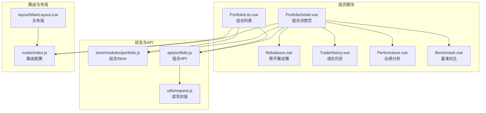
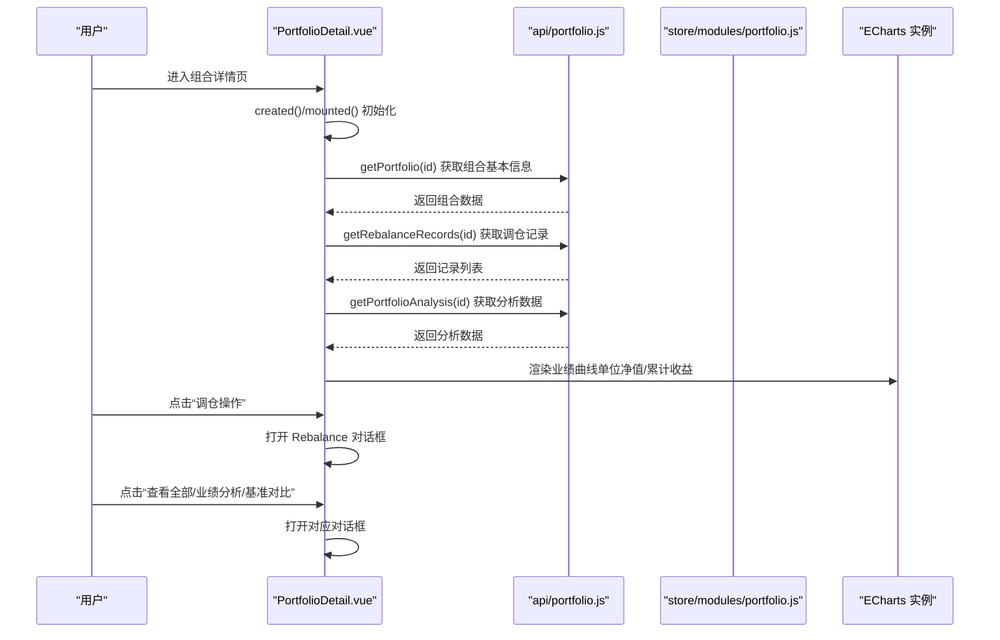
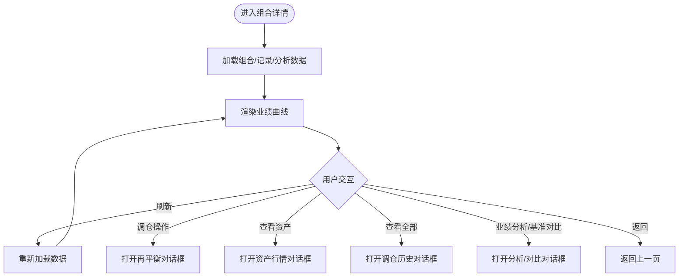
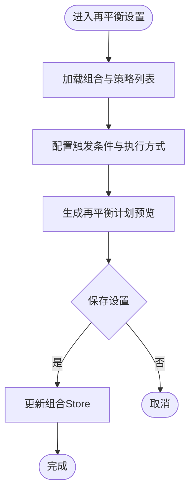
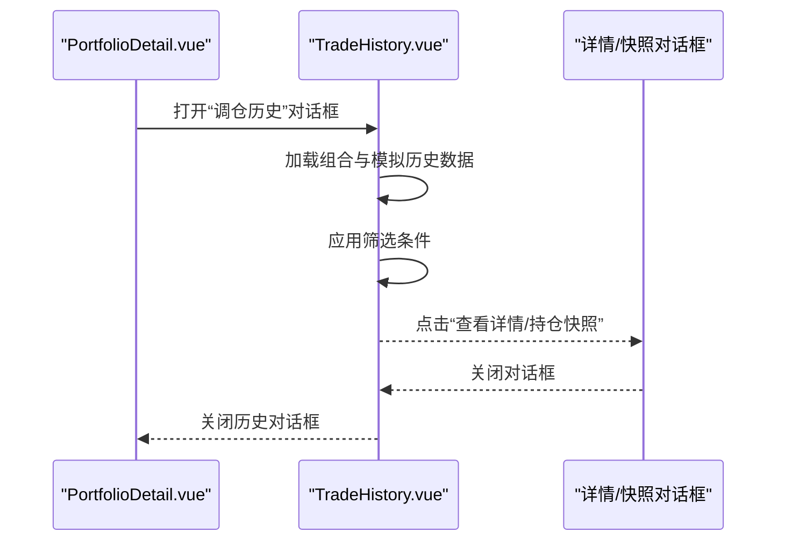
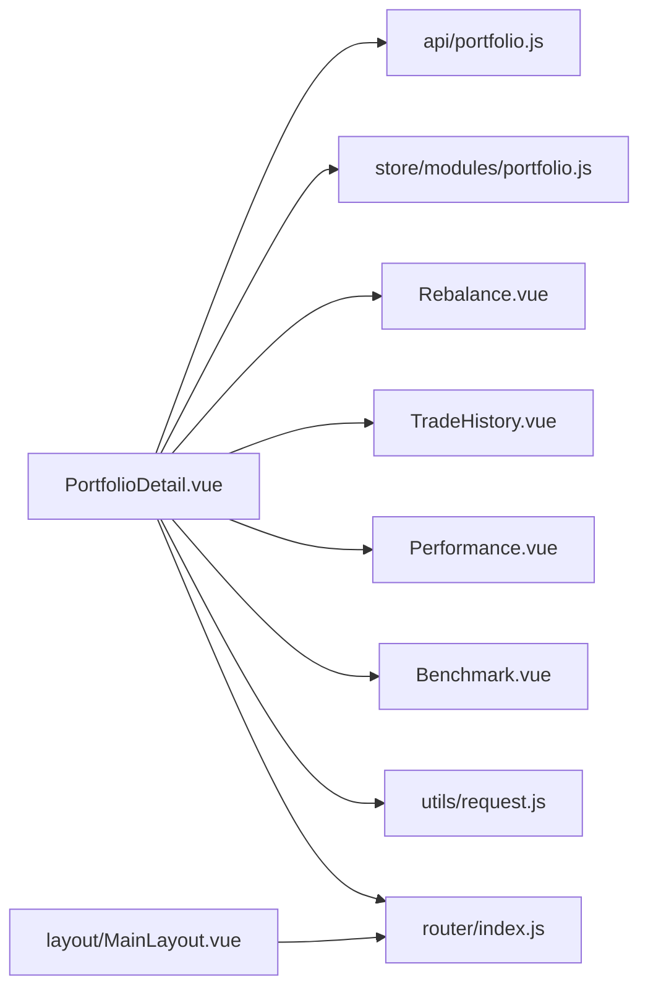

# 组合详情

<cite>
**本文引用的文件**
- [PortfolioDetail.vue](file://src/views/portfolio/PortfolioDetail.vue)
- [portfolio.js](file://src/store/modules/portfolio.js)
- [portfolio.js](file://src/api/portfolio.js)
- [index.js](file://src/router/index.js)
- [Rebalance.vue](file://src/views/portfolio/Rebalance.vue)
- [TradeHistory.vue](file://src/views/portfolio/TradeHistory.vue)
- [Performance.vue](file://src/views/portfolio/Performance.vue)
- [Benchmark.vue](file://src/views/portfolio/Benchmark.vue)
- [PortfolioList.vue](file://src/views/portfolio/PortfolioList.vue)
- [request.js](file://src/utils/request.js)
- [MainLayout.vue](file://src/layout/MainLayout.vue)
</cite>

## 目录
1. [简介](#简介)
2. [项目结构](#项目结构)
3. [核心组件](#核心组件)
4. [架构总览](#架构总览)
5. [详细组件分析](#详细组件分析)
6. [依赖分析](#依赖分析)
7. [性能考量](#性能考量)
8. [故障排查指南](#故障排查指南)
9. [结论](#结论)
10. [附录](#附录)

## 简介
组合详情页面是模拟组合模块的核心入口，用于集中展示单个组合的基本信息、当前持仓、业绩曲线、调仓记录与快捷操作，并提供与回测、监控等模块的跳转能力。页面支持弹窗模式与独立路由两种使用方式，具备数据加载、图表渲染、对话框联动与基础交互功能。

## 项目结构
组合详情功能位于 portfolio 模块下，主要文件与职责如下：
- 视图层
  - 组合详情页：src/views/portfolio/PortfolioDetail.vue
  - 再平衡设置：src/views/portfolio/Rebalance.vue
  - 调仓历史：src/views/portfolio/TradeHistory.vue
  - 业绩分析：src/views/portfolio/Performance.vue
  - 基准对比：src/views/portfolio/Benchmark.vue
  - 组合列表：src/views/portfolio/PortfolioList.vue
- 状态与API
  - 组合 Store：src/store/modules/portfolio.js
  - 组合 API：src/api/portfolio.js
  - 请求封装：src/utils/request.js
- 路由
  - 路由定义：src/router/index.js
- 布局
  - 主布局：src/layout/MainLayout.vue

**图表来源**
- [PortfolioDetail.vue:1-599](file://src/views/portfolio/PortfolioDetail.vue#L1-L599)
- [Rebalance.vue:1-672](file://src/views/portfolio/Rebalance.vue#L1-L672)
- [TradeHistory.vue:1-615](file://src/views/portfolio/TradeHistory.vue#L1-L615)
- [Performance.vue:1-27](file://src/views/portfolio/Performance.vue#L1-L27)
- [Benchmark.vue:1-27](file://src/views/portfolio/Benchmark.vue#L1-L27)
- [PortfolioList.vue:1-372](file://src/views/portfolio/PortfolioList.vue#L1-L372)
- [portfolio.js:1-106](file://src/store/modules/portfolio.js#L1-L106)
- [portfolio.js:1-72](file://src/api/portfolio.js#L1-L72)
- [request.js:1-100](file://src/utils/request.js#L1-L100)
- [index.js:1-378](file://src/router/index.js#L1-L378)
- [MainLayout.vue:1-330](file://src/layout/MainLayout.vue#L1-L330)

**章节来源**
- [index.js:124-178](file://src/router/index.js#L124-L178)
- [MainLayout.vue:47-55](file://src/layout/MainLayout.vue#L47-L55)

## 核心组件
- 组合详情页（PortfolioDetail.vue）
  - 展示组合基本信息、当前持仓、业绩概览、业绩曲线、最近调仓记录与快捷操作
  - 支持弹窗模式与独立路由两种使用方式
  - 动态加载组合数据、调仓记录与分析数据，渲染 ECharts 图表
- 再平衡设置（Rebalance.vue）
  - 提供定期再平衡、阈值触发、模型信号触发等多种触发条件与执行方式配置
  - 支持手动触发与保存设置
- 调仓历史（TradeHistory.vue）
  - 支持按类型、时间范围、涉及资产筛选，查看调仓详情与持仓快照
- 业绩分析（Performance.vue）、基准对比（Benchmark.vue）
  - 当前为占位页面，后续扩展为完整的分析与对比功能
- 组合列表（PortfolioList.vue）
  - 列表页提供“详情”“业绩”“基准”等快捷入口，并内置弹窗式详情与基准对比

**章节来源**
- [PortfolioDetail.vue:1-599](file://src/views/portfolio/PortfolioDetail.vue#L1-L599)
- [Rebalance.vue:1-672](file://src/views/portfolio/Rebalance.vue#L1-L672)
- [TradeHistory.vue:1-615](file://src/views/portfolio/TradeHistory.vue#L1-L615)
- [Performance.vue:1-27](file://src/views/portfolio/Performance.vue#L1-L27)
- [Benchmark.vue:1-27](file://src/views/portfolio/Benchmark.vue#L1-L27)
- [PortfolioList.vue:1-372](file://src/views/portfolio/PortfolioList.vue#L1-L372)

## 架构总览
组合详情的数据流与交互链路如下：

**图表来源**
- [PortfolioDetail.vue:322-351](file://src/views/portfolio/PortfolioDetail.vue#L322-L351)
- [portfolio.js:15-55](file://src/api/portfolio.js#L15-L55)
- [portfolio.js:38-87](file://src/store/modules/portfolio.js#L38-L87)

## 详细组件分析

### 组合详情页（PortfolioDetail.vue）
- 页面结构
  - 基本信息卡片：组合名称、类型、初始/当前资金、建仓日期、创建时间、创建人、关联模型、描述
  - 当前持仓表格：资产代码/名称、数量、权重、查看资产
  - 业绩概览：当前市值、累计/年化收益率、年化波动率、夏普比率、最大回撤
  - 业绩曲线：单位净值/累计收益率双视图切换
  - 最近调仓记录：时间轴展示，支持查看全部
  - 快捷操作：调仓操作、业绩分析、基准对比、调仓历史
- 交互与行为
  - 刷新：重新加载组合、记录与分析数据
  - 调仓操作：打开再平衡对话框
  - 查看资产：打开资产行情对话框
  - 查看全部：打开调仓历史对话框
  - 查看完整业绩分析/基准对比：打开对应对话框
  - 关联模型：点击“查看策略模型”打开策略详情对话框
- 数据加载与图表
  - 使用 ECharts 渲染业绩曲线，支持单位净值与累计收益率切换
  - 格式化数字与百分比、颜色随收益正负变化
- 与路由/弹窗的关系
  - 支持通过路由参数或 isDialog + id 的方式进入
  - 通过多个 el-dialog 承载子功能对话框

**图表来源**
- [PortfolioDetail.vue:322-351](file://src/views/portfolio/PortfolioDetail.vue#L322-L351)
- [PortfolioDetail.vue:402-535](file://src/views/portfolio/PortfolioDetail.vue#L402-L535)

**章节来源**
- [PortfolioDetail.vue:1-599](file://src/views/portfolio/PortfolioDetail.vue#L1-L599)

### 再平衡设置（Rebalance.vue）
- 功能概述
  - 触发条件：定期再平衡、阈值触发、模型信号触发、手动触发
  - 执行方式：完全再平衡、部分再平衡、现金流驱动再平衡
  - 高级设置：交易约束、审批流程、通知与异常报警
  - 计划预览：基于所选触发条件生成执行计划时间线
- 交互要点
  - 保存设置：写入组合 Store 并可回调父组件
  - 与策略模块联动：可选择关联策略并设置跟随方式与更新频率

**图表来源**
- [Rebalance.vue:555-575](file://src/views/portfolio/Rebalance.vue#L555-L575)
- [Rebalance.vue:576-603](file://src/views/portfolio/Rebalance.vue#L576-L603)

**章节来源**
- [Rebalance.vue:1-672](file://src/views/portfolio/Rebalance.vue#L1-L672)

### 调仓历史（TradeHistory.vue）
- 功能概述
  - 筛选：按调仓类型、时间范围、涉及资产
  - 时间线展示：记录类型标签、时间戳、简要统计与审批信息
  - 详情对话框：展示交易明细、原因说明、成本统计
  - 持仓快照：对比调仓前后持仓与权重变化
- 交互要点
  - 导出/下载占位：预留扩展点
  - 与组合详情联动：从详情页打开历史对话框

**图表来源**
- [PortfolioDetail.vue:355-357](file://src/views/portfolio/PortfolioDetail.vue#L355-L357)
- [TradeHistory.vue:370-388](file://src/views/portfolio/TradeHistory.vue#L370-L388)
- [TradeHistory.vue:447-467](file://src/views/portfolio/TradeHistory.vue#L447-L467)

**章节来源**
- [TradeHistory.vue:1-615](file://src/views/portfolio/TradeHistory.vue#L1-L615)

### 业绩分析与基准对比（Performance.vue、Benchmark.vue）
- 当前状态
  - 两个组件为占位页面，提示功能开发中
- 后续扩展建议
  - 业绩分析：引入更多指标与可视化维度（回撤分析、区间收益、风险指标等）
  - 基准对比：支持多基准对比、超额收益分析与归因分解

**章节来源**
- [Performance.vue:1-27](file://src/views/portfolio/Performance.vue#L1-L27)
- [Benchmark.vue:1-27](file://src/views/portfolio/Benchmark.vue#L1-L27)

### 组合列表（PortfolioList.vue）
- 功能概述
  - 列表展示组合关键指标（当前市值、净值、累计/年化收益、最大回撤、夏普比率等）
  - 快捷入口：详情、业绩、基准、删除
  - 弹窗式详情与基准对比：避免页面跳转，提升交互效率
- 与详情页的关系
  - 列表页可直接打开组合详情弹窗，便于批量操作与快速对比

**章节来源**
- [PortfolioList.vue:1-372](file://src/views/portfolio/PortfolioList.vue#L1-L372)

## 依赖分析
- 组件耦合
  - PortfolioDetail 依赖 api/portfolio.js 与 store/modules/portfolio.js
  - PortfolioDetail 通过多个对话框承载 Rebalance、TradeHistory、Performance、Benchmark、AssetQuote 等子功能
- 外部依赖
  - ECharts：用于渲染业绩曲线
  - Element UI：表格、描述列表、对话框、时间线等组件
  - Axios：通过 utils/request.js 封装统一请求与错误处理
- 路由集成
  - 路由定义了组合模块的子路由，支持 detail、rebalance、history、performance、benchmark、compare 等页面
  - 主布局侧边栏提供组合模块导航

**图表来源**
- [PortfolioDetail.vue:248-259](file://src/views/portfolio/PortfolioDetail.vue#L248-L259)
- [portfolio.js:1-72](file://src/api/portfolio.js#L1-L72)
- [portfolio.js:1-106](file://src/store/modules/portfolio.js#L1-L106)
- [request.js:1-100](file://src/utils/request.js#L1-L100)
- [index.js:124-178](file://src/router/index.js#L124-L178)
- [MainLayout.vue:47-55](file://src/layout/MainLayout.vue#L47-L55)

**章节来源**
- [index.js:124-178](file://src/router/index.js#L124-L178)
- [MainLayout.vue:47-55](file://src/layout/MainLayout.vue#L47-L55)

## 性能考量
- 图表渲染
  - 仅在分析数据存在且图表容器可用时初始化与渲染，避免空数据导致的无效计算
  - 使用 ECharts 的 setOption 并传入更新参数，减少重复初始化
- 数据加载
  - 组合详情采用一次性加载组合信息、调仓记录与分析数据，减少多次请求
  - 列表页对图表采用延迟初始化，避免不必要的 DOM 操作
- 交互优化
  - 弹窗承载子功能，减少页面跳转带来的白屏与重复渲染
  - 使用 v-loading 控制加载状态，提升用户体验

[本节为通用指导，不直接分析具体文件]

## 故障排查指南
- 请求失败与错误处理
  - request.js 统一拦截 401、403、404、422 等状态码并给出提示
  - 若出现超时或网络错误，检查后端服务是否启动、网络是否正常、环境变量 VUE_APP_BASE_URL 是否正确
- 组合详情无法加载
  - 确认路由参数 id 或 isDialog + id 是否正确传递
  - 检查 api/portfolio.js 的 getPortfolio、getRebalanceRecords、getPortfolioAnalysis 接口是否可用
- 图表不显示
  - 确认 analysis.equity_curve 存在且非空
  - 检查 ECharts 容器是否存在且有尺寸
- 权限问题
  - 登录状态失效会导致 401，需重新登录

**章节来源**
- [request.js:33-96](file://src/utils/request.js#L33-L96)
- [PortfolioDetail.vue:322-351](file://src/views/portfolio/PortfolioDetail.vue#L322-L351)

## 结论
组合详情页面整合了组合基本信息、持仓、业绩与调仓记录等核心信息，并通过弹窗与对话框串联再平衡、历史查询、业绩分析与基准对比等子功能。其架构清晰、交互友好，具备良好的扩展性。后续可在“业绩分析”“基准对比”“多组合对比”等方面进一步完善，以满足更深入的投资组合分析需求。

[本节为总结性内容，不直接分析具体文件]

## 附录

### 使用场景与分析方法
- 投资组合监控
  - 通过“基本信息”“当前持仓”“业绩概览”快速掌握组合状态
  - 使用“业绩曲线”对比单位净值与累计收益，识别趋势与回撤
- 调仓决策支持
  - “最近调仓记录”帮助回顾近期操作与原因
  - “调仓历史”支持筛选与详情查看，结合“持仓快照”对比前后权重变化
- 自动化再平衡
  - 在“再平衡设置”中配置触发条件与执行方式，降低人工干预成本
- 跨模块联动
  - 从“组合列表”直接打开“详情/基准对比”弹窗，提高操作效率
  - 通过“关联模型”跳转策略详情，辅助理解组合构建逻辑

[本节为概念性内容，不直接分析具体文件]