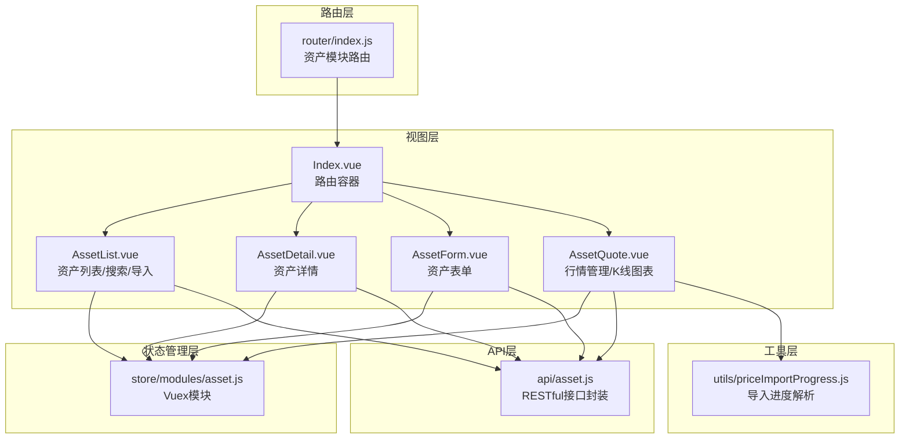
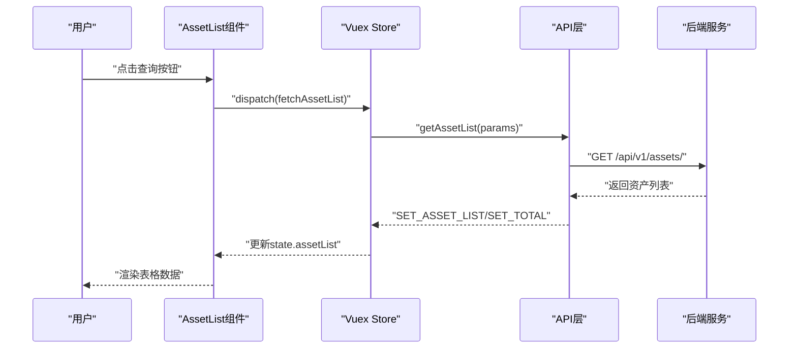
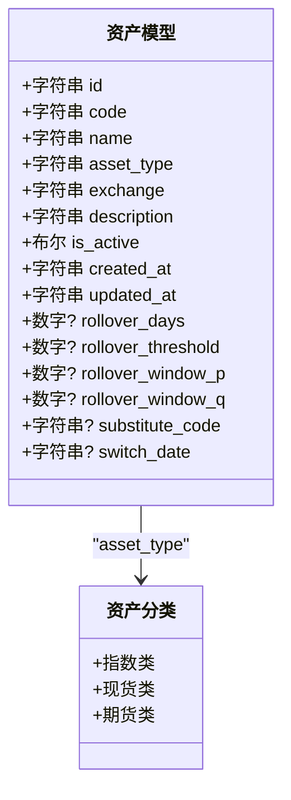
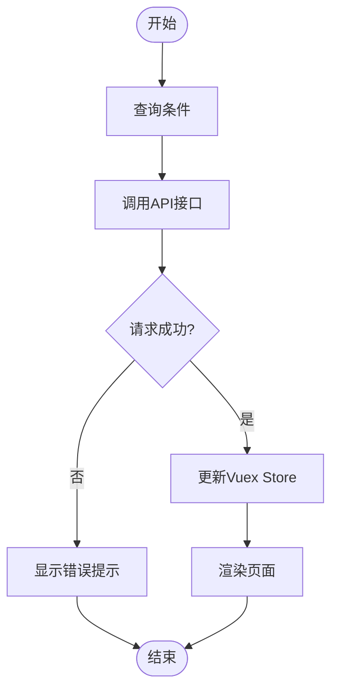
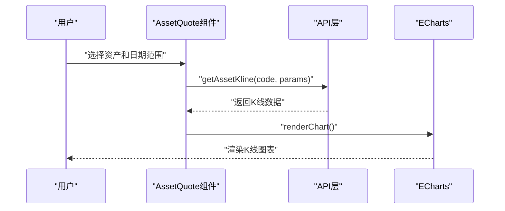
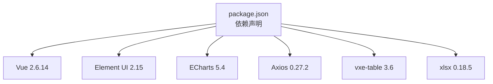

# 资产管理模块

<cite>
**本文档引用的文件**
- [src/views/asset/Index.vue](file://src/views/asset/Index.vue)
- [src/views/asset/AssetList.vue](file://src/views/asset/AssetList.vue)
- [src/views/asset/AssetDetail.vue](file://src/views/asset/AssetDetail.vue)
- [src/views/asset/AssetForm.vue](file://src/views/asset/AssetForm.vue)
- [src/views/asset/AssetQuote.vue](file://src/views/asset/AssetQuote.vue)
- [src/store/modules/asset.js](file://src/store/modules/asset.js)
- [src/api/asset.js](file://src/api/asset.js)
- [src/router/index.js](file://src/router/index.js)
- [src/utils/priceImportProgress.js](file://src/utils/priceImportProgress.js)
- [package.json](file://package.json)
- [README.md](file://README.md)
</cite>

## 目录
1. [简介](#简介)
2. [项目结构](#项目结构)
3. [核心组件](#核心组件)
4. [架构总览](#架构总览)
5. [详细组件分析](#详细组件分析)
6. [依赖关系分析](#依赖关系分析)
7. [性能考虑](#性能考虑)
8. [故障排查指南](#故障排查指南)
9. [结论](#结论)
10. [附录](#附录)

## 简介
资产管理模块是智能投研系统的重要组成部分，负责资产全生命周期管理与行情数据处理。该模块提供资产列表管理、资产详情展示、资产表单编辑、行情数据导入与K线图表展示等核心能力。系统采用前后端分离架构，前端基于Vue 2 + Element UI + ECharts，后端提供RESTful API，支持CSV/Excel格式的资产与行情数据导入导出。

## 项目结构
资产管理模块位于src/views/asset目录下，包含以下核心页面组件：
- Index.vue：资产模块路由容器
- AssetList.vue：资产列表与搜索、批量导入
- AssetDetail.vue：资产详情展示（含分类特有参数）
- AssetForm.vue：资产新增/编辑表单（含分类联动）
- AssetQuote.vue：行情数据管理（K线图表、批量导入、模板下载）

**图表来源**
- [src/router/index.js:26-58](file://src/router/index.js#L26-L58)
- [src/views/asset/Index.vue:1-10](file://src/views/asset/Index.vue#L1-L10)
- [src/views/asset/AssetList.vue:1-346](file://src/views/asset/AssetList.vue#L1-L346)
- [src/views/asset/AssetDetail.vue:1-211](file://src/views/asset/AssetDetail.vue#L1-L211)
- [src/views/asset/AssetForm.vue:1-359](file://src/views/asset/AssetForm.vue#L1-L359)
- [src/views/asset/AssetQuote.vue:1-800](file://src/views/asset/AssetQuote.vue#L1-L800)
- [src/store/modules/asset.js:1-183](file://src/store/modules/asset.js#L1-L183)
- [src/api/asset.js:1-284](file://src/api/asset.js#L1-L284)
- [src/utils/priceImportProgress.js:1-61](file://src/utils/priceImportProgress.js#L1-L61)

**章节来源**
- [src/router/index.js:26-58](file://src/router/index.js#L26-L58)
- [src/views/asset/Index.vue:1-10](file://src/views/asset/Index.vue#L1-L10)
- [src/views/asset/AssetList.vue:1-346](file://src/views/asset/AssetList.vue#L1-L346)
- [src/views/asset/AssetDetail.vue:1-211](file://src/views/asset/AssetDetail.vue#L1-L211)
- [src/views/asset/AssetForm.vue:1-359](file://src/views/asset/AssetForm.vue#L1-L359)
- [src/views/asset/AssetQuote.vue:1-800](file://src/views/asset/AssetQuote.vue#L1-L800)
- [src/store/modules/asset.js:1-183](file://src/store/modules/asset.js#L1-L183)
- [src/api/asset.js:1-284](file://src/api/asset.js#L1-L284)
- [src/utils/priceImportProgress.js:1-61](file://src/utils/priceImportProgress.js#L1-L61)

## 核心组件
资产管理模块的核心组件包括：

### 资产列表组件（AssetList）
- 支持资产搜索（代码、名称、分类）
- 分页查询与状态管理
- 批量导入资产（Excel）
- 模板下载（资产导入模板）
- 行情查看与详情弹窗
- 删除资产（带确认提示）

### 资产详情组件（AssetDetail）
- 展示资产基础信息与分类特有参数
- 支持期货类展期参数（展期天数、阈值、观察窗口）
- 支持现货类替代参数（替代标的、切换日期）
- 加载状态与错误处理

### 资产表单组件（AssetForm）
- 资产新增/编辑（代码在编辑模式下不可修改）
- 分类联动（期货类/现货类特有参数显隐）
- 表单验证（必填字段校验）
- 与Vuex Store交互

### 行情管理组件（AssetQuote）
- 资产选择与日期范围筛选
- K线图表展示（ECharts）
- 手动录入行情（收盘价必填）
- 批量导入行情（Excel）
- 多资产宽表导入（分析与匹配）
- 模板下载（单资产/多资产）
- 行情删除（单条/批量）

**章节来源**
- [src/views/asset/AssetList.vue:1-346](file://src/views/asset/AssetList.vue#L1-L346)
- [src/views/asset/AssetDetail.vue:1-211](file://src/views/asset/AssetDetail.vue#L1-L211)
- [src/views/asset/AssetForm.vue:1-359](file://src/views/asset/AssetForm.vue#L1-L359)
- [src/views/asset/AssetQuote.vue:1-800](file://src/views/asset/AssetQuote.vue#L1-L800)

## 架构总览
资产管理模块采用典型的MVC架构，结合Vuex进行状态管理，通过Axios封装HTTP请求。

**图表来源**
- [src/views/asset/AssetList.vue:204-219](file://src/views/asset/AssetList.vue#L204-L219)
- [src/store/modules/asset.js:47-94](file://src/store/modules/asset.js#L47-L94)
- [src/api/asset.js:7-21](file://src/api/asset.js#L7-L21)

**章节来源**
- [src/views/asset/AssetList.vue:204-219](file://src/views/asset/AssetList.vue#L204-L219)
- [src/store/modules/asset.js:47-94](file://src/store/modules/asset.js#L47-L94)
- [src/api/asset.js:7-21](file://src/api/asset.js#L7-L21)

## 详细组件分析

### 资产模型设计
资产模型包含以下核心属性：
- 基础信息：code（资产代码）、name（资产名称）、asset_type（资产分类）、exchange（交易所）、description（描述）
- 状态：is_active（启用/禁用）、created_at/updated_at（创建/更新时间）
- 分类特有参数：
  - 期货类：rollover_days（展期天数）、rollover_threshold（持仓量阈值）、rollover_window_p/q（观察窗口）
  - 现货类：substitute_code（替代标的）、switch_date（切换日期）

**图表来源**
- [src/store/modules/asset.js:3-13](file://src/store/modules/asset.js#L3-L13)
- [src/store/modules/asset.js:66-82](file://src/store/modules/asset.js#L66-L82)

**章节来源**
- [src/store/modules/asset.js:3-13](file://src/store/modules/asset.js#L3-L13)
- [src/store/modules/asset.js:66-82](file://src/store/modules/asset.js#L66-L82)

### 资产增删改查实现逻辑
- 查询：通过getAssetList接口支持分类、状态、代码、名称筛选，分页加载
- 新增：调用createAsset接口，成功后更新本地Store
- 更新：调用updateAsset接口（后端暂未完全实现，存在404降级提示）
- 删除：调用deleteAsset接口，删除成功后更新本地Store

**图表来源**
- [src/views/asset/AssetList.vue:204-219](file://src/views/asset/AssetList.vue#L204-L219)
- [src/store/modules/asset.js:47-94](file://src/store/modules/asset.js#L47-L94)

**章节来源**
- [src/views/asset/AssetList.vue:204-219](file://src/views/asset/AssetList.vue#L204-L219)
- [src/store/modules/asset.js:47-94](file://src/store/modules/asset.js#L47-L94)

### 数据验证规则
- 资产表单验证：
  - code：必填（编辑模式下禁用）
  - name：必填
  - asset_type：必填
- 行情导入验证：
  - 手动录入：收盘价必填且大于0
  - Excel导入：支持全量覆盖/仅新增缺日/按日合并三种模式
  - 多资产导入：支持按日合并、仅新增缺日、全量覆盖三种模式

**章节来源**
- [src/views/asset/AssetForm.vue:179-183](file://src/views/asset/AssetForm.vue#L179-L183)
- [src/views/asset/AssetQuote.vue:1040-1099](file://src/views/asset/AssetQuote.vue#L1040-L1099)

### 与后端API交互方式
- 资产管理API：
  - GET /api/v1/assets/：获取资产列表
  - GET /api/v1/assets/options：获取资产选项
  - POST /api/v1/assets/：创建资产
  - PUT /api/v1/assets/{id}：更新资产（部分接口未实现）
  - GET /api/v1/assets/{id}：获取资产详情
  - DELETE /api/v1/assets/{id}：删除资产
- 行情管理API：
  - GET /api/v1/assets/{code}/kline：获取K线数据
  - GET /api/v1/assets/template/download：下载资产模板
  - POST /api/v1/assets/import/excel：批量导入资产
  - GET /api/v1/assets/prices/template/download：下载单资产行情模板
  - GET /api/v1/assets/prices/template/download/multi-asset：下载多资产行情模板
  - POST /api/v1/assets/prices/import/excel：Excel导入行情
  - POST /api/v1/assets/prices/import：JSON导入行情
  - DELETE /api/v1/assets/{code}/prices/{date}：删除单条行情
  - DELETE /api/v1/assets/{code}/prices：批量删除行情
  - GET /api/v1/assets/prices/coverage-gaps：获取行情覆盖缺口
  - POST /api/v1/assets/prices/import/multi-asset/analyze：多资产导入分析
  - POST /api/v1/assets/prices/import/multi-asset/single：单资产导入
  - GET /api/v1/assets/prices/import/progress：导入进度查询

**章节来源**
- [src/api/asset.js:7-284](file://src/api/asset.js#L7-L284)

### 资产导入导出功能使用指南
- 资产导入：
  - 下载模板：点击"下载资产模板"
  - Excel导入：选择Excel文件，支持全量覆盖/仅新增缺日/按日合并
  - 导入结果：显示成功/失败数量，错误详情
- 行情导入：
  - 单资产导入：下载模板，选择文件，选择导入模式
  - 多资产导入：分析文件，匹配资产，选择导入模式
  - 模板支持：单资产全列、收盘价、开盘价、最高价、最低价、成交额、成交量、规模
  - 多资产宽表：支持Wind类和基金/证券类布局

**章节来源**
- [src/views/asset/AssetList.vue:282-336](file://src/views/asset/AssetList.vue#L282-L336)
- [src/views/asset/AssetQuote.vue:1401-1429](file://src/views/asset/AssetQuote.vue#L1401-L1429)
- [src/views/asset/AssetQuote.vue:1501-2004](file://src/views/asset/AssetQuote.vue#L1501-L2004)

### K线图表组件配置
- 图表库：ECharts 5.4
- 数据格式：K线图支持开盘/收盘/最低/最高数据，收盘价走势支持折线图
- 交互功能：缩放、提示框、图例
- 数据处理：自动跳过开高低为0的占位数据
- 价格精度：支持2/4/6/8位小数配置

**图表来源**
- [src/views/asset/AssetQuote.vue:920-955](file://src/views/asset/AssetQuote.vue#L920-L955)
- [src/views/asset/AssetQuote.vue:1223-1375](file://src/views/asset/AssetQuote.vue#L1223-L1375)

**章节来源**
- [src/views/asset/AssetQuote.vue:920-955](file://src/views/asset/AssetQuote.vue#L920-L955)
- [src/views/asset/AssetQuote.vue:1223-1375](file://src/views/asset/AssetQuote.vue#L1223-L1375)

## 依赖关系分析
资产管理模块的关键依赖包括：
- Vue 2.6.14：前端框架
- Element UI 2.15：UI组件库
- ECharts 5.4：图表库
- Axios 0.27.2：HTTP客户端
- vxe-table 3.6：表格组件
- xlsx 0.18.5：Excel处理

**图表来源**
- [package.json:11-28](file://package.json#L11-L28)

**章节来源**
- [package.json:11-28](file://package.json#L11-L28)

## 性能考虑
- 表格性能：使用vxe-table的虚拟滚动，大数据量时提升渲染性能
- 图表性能：ECharts按需渲染，避免不必要的重绘
- 请求优化：分页查询减少数据传输，批量导入设置合理超时时间
- 缓存策略：Vuex本地缓存资产列表，减少重复请求
- 导入性能：多资产导入支持进度轮询，避免长时间无反馈

## 故障排查指南
- 资产更新接口未实现：当调用PUT /api/v1/assets/{id}返回404时，系统会提示联系后端开发或删除旧资产后重新创建
- 行情导入失败：检查Excel格式是否符合模板要求，确认日期格式和数值格式
- K线图表无数据：检查资产代码是否正确，确认日期范围是否包含有效交易日
- 模板下载失败：确认网络连接正常，检查后端服务状态

**章节来源**
- [src/views/asset/AssetForm.vue:312-329](file://src/views/asset/AssetForm.vue#L312-L329)
- [src/views/asset/AssetQuote.vue:1994-1997](file://src/views/asset/AssetQuote.vue#L1994-L1997)

## 结论
资产管理模块提供了完整的资产全生命周期管理能力，包括资产列表管理、详情展示、表单编辑、行情导入与K线图表展示。模块采用现代化前端技术栈，具备良好的扩展性和维护性。通过合理的数据模型设计和API交互方式，能够满足资产管理的多样化需求。

## 附录
- 系统技术栈：Vue 2.6.14 + Element UI 2.15 + ECharts 5.4 + Axios + Vuex + Vue Router
- 开发环境：Node.js + npm
- 生产构建：Webpack 5
- 浏览器兼容：Chrome 80+ 或 Edge

**章节来源**
- [README.md:12-22](file://README.md#L12-L22)
- [README.md:58-79](file://README.md#L58-L79)