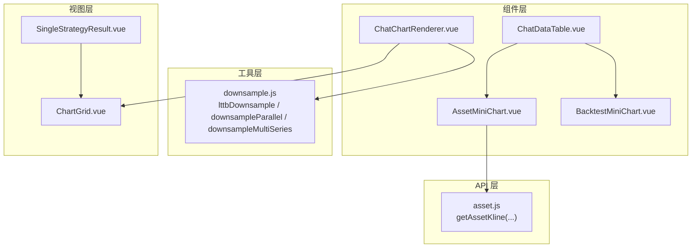
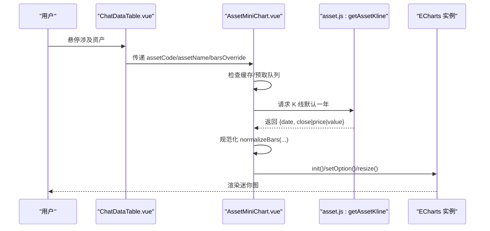
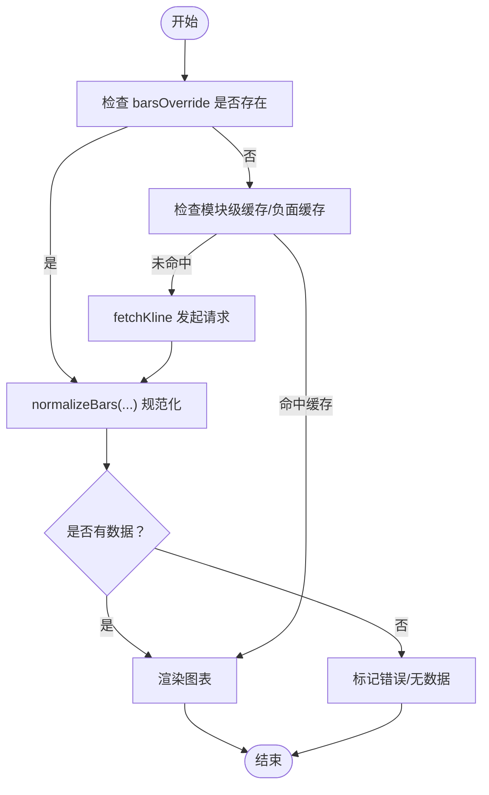
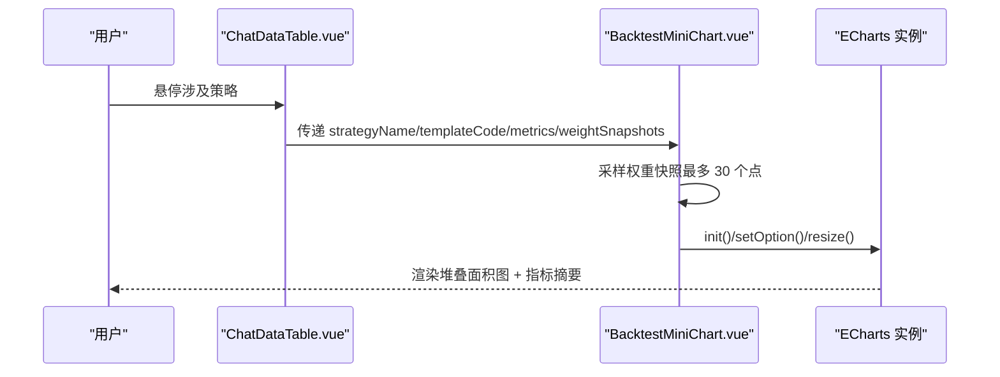
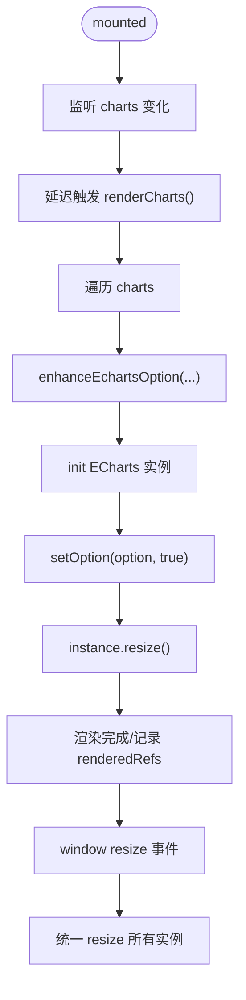
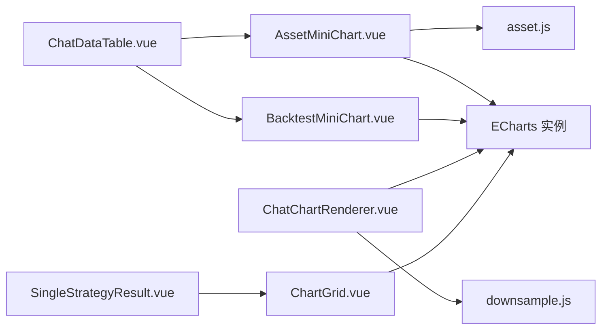

# 图表组件

<cite>
**本文引用的文件**
- [AssetMiniChart.vue](file://src/components/AssetMiniChart.vue)
- [BacktestMiniChart.vue](file://src/components/BacktestMiniChart.vue)
- [ChatChartRenderer.vue](file://src/components/ChatChartRenderer.vue)
- [ChatDataTable.vue](file://src/components/ChatDataTable.vue)
- [asset.js](file://src/api/asset.js)
- [downsample.js](file://src/utils/downsample.js)
- [SingleStrategyResult.vue](file://src/views/strategy/backtest/SingleStrategyResult.vue)
- [ChartGrid.vue](file://src/views/analysis/DataHub/ChartGrid.vue)
</cite>

## 目录
1. [简介](#简介)
2. [项目结构](#项目结构)
3. [核心组件](#核心组件)
4. [架构总览](#架构总览)
5. [详细组件分析](#详细组件分析)
6. [依赖关系分析](#依赖关系分析)
7. [性能考量](#性能考量)
8. [故障排查指南](#故障排查指南)
9. [结论](#结论)
10. [附录](#附录)

## 简介
本文件面向“图表组件”主题，围绕以下三个组件提供系统化文档：
- 资产迷你图表：AssetMiniChart
- 回测迷你图表：BacktestMiniChart
- 聊天图表渲染器：ChatChartRenderer

内容涵盖：
- 配置选项与数据格式
- 图表类型与时间范围设置
- 数据绑定与可视化实现
- 渲染逻辑与动态更新机制
- API 文档与使用示例
- 性能优化、响应式设计、交互行为与动画效果
- 跨浏览器兼容性建议

## 项目结构
本节聚焦与图表组件相关的文件与职责划分。

**图表来源**
- [AssetMiniChart.vue:1-493](file://src/components/AssetMiniChart.vue#L1-L493)
- [BacktestMiniChart.vue:1-350](file://src/components/BacktestMiniChart.vue#L1-L350)
- [ChatChartRenderer.vue:1-599](file://src/components/ChatChartRenderer.vue#L1-L599)
- [ChatDataTable.vue:60-259](file://src/components/ChatDataTable.vue#L60-L259)
- [asset.js:71-84](file://src/api/asset.js#L71-L84)
- [downsample.js:1-127](file://src/utils/downsample.js#L1-L127)
- [SingleStrategyResult.vue:585-594](file://src/views/strategy/backtest/SingleStrategyResult.vue#L585-L594)
- [ChartGrid.vue:1-175](file://src/views/analysis/DataHub/ChartGrid.vue#L1-L175)

**章节来源**
- [AssetMiniChart.vue:1-493](file://src/components/AssetMiniChart.vue#L1-L493)
- [BacktestMiniChart.vue:1-350](file://src/components/BacktestMiniChart.vue#L1-L350)
- [ChatChartRenderer.vue:1-599](file://src/components/ChatChartRenderer.vue#L1-L599)
- [ChatDataTable.vue:60-259](file://src/components/ChatDataTable.vue#L60-L259)
- [asset.js:71-84](file://src/api/asset.js#L71-L84)
- [downsample.js:1-127](file://src/utils/downsample.js#L1-L127)
- [SingleStrategyResult.vue:585-594](file://src/views/strategy/backtest/SingleStrategyResult.vue#L585-L594)
- [ChartGrid.vue:1-175](file://src/views/analysis/DataHub/ChartGrid.vue#L1-L175)

## 核心组件
- AssetMiniChart：资产迷你图，基于 ECharts 的折线面积图，支持 hover 弹出、缓存与预取、数据规范化、颜色自适应涨跌等。
- BacktestMiniChart：回测迷你图，基于 ECharts 的堆叠面积图，展示权重快照随时间的变化，支持指标摘要行。
- ChatChartRenderer：聊天消息中的图表渲染器，负责接收后端下发的 echarts_option，进行增强与布局优化，并支持响应式与骨架屏。

**章节来源**
- [AssetMiniChart.vue:143-432](file://src/components/AssetMiniChart.vue#L143-L432)
- [BacktestMiniChart.vue:69-247](file://src/components/BacktestMiniChart.vue#L69-L247)
- [ChatChartRenderer.vue:315-453](file://src/components/ChatChartRenderer.vue#L315-L453)

## 架构总览
组件间协作关系如下：

**图表来源**
- [ChatDataTable.vue:73-99](file://src/components/ChatDataTable.vue#L73-L99)
- [AssetMiniChart.vue:79-104](file://src/components/AssetMiniChart.vue#L79-L104)
- [asset.js:71-84](file://src/api/asset.js#L71-L84)
- [AssetMiniChart.vue:341-423](file://src/components/AssetMiniChart.vue#L341-L423)

**章节来源**
- [ChatDataTable.vue:60-259](file://src/components/ChatDataTable.vue#L60-L259)
- [AssetMiniChart.vue:33-120](file://src/components/AssetMiniChart.vue#L33-L120)
- [asset.js:71-84](file://src/api/asset.js#L71-L84)

## 详细组件分析

### AssetMiniChart 资产迷你图表
- 功能概述
  - 鼠标悬停弹出迷你图，展示资产近一年 K 线（默认最近 30 个交易日）。
  - 支持 barsOverride 直接传入外部已规范化的数据，避免与表格区间不一致。
  - 内置模块级缓存、负面缓存、并发去重与预取队列，提升交互流畅度。
  - 自动识别涨跌并设置颜色，折线平滑、带渐变面积填充。
- 数据格式
  - 默认接口返回：包含日期与收盘价字段的对象数组（字段名可为 date/trade_date/day 或 price/value/close）。
  - barsOverride：外部传入的原始 records 数组，内部会调用 normalizeBars 规范化。
- 时间范围
  - 默认请求一年期（起止日期通过 fmtDate 计算），最终展示最近 30 个有效点。
- 配置选项
  - assetCode: String（必填）
  - assetName: String（可选）
  - disabled: Boolean（禁用弹出与请求）
  - barsOverride: Array（外部覆盖数据）
- 渲染与交互
  - 使用 ECharts 折线图 + 面积图，网格极小化，隐藏坐标轴，tooltip 简洁。
  - 颜色：涨为绿色、跌为红色；面积渐变。
  - 首次加载采用 requestIdleCallback 或 setTimeout 预取，缩短首次悬浮等待。
- 错误与状态
  - loading/error/fallback 提示；无数据/错误分别写入负面缓存，避免重复请求。
- 性能优化
  - 缓存与预取：模块级 Map/Set/Promise 控制；并发上限常量控制。
  - 规范化：过滤无效字段、排序、截断，减少渲染负担。
  - 实例复用：容器变化才 dispose，避免闪烁与重复初始化。

**图表来源**
- [AssetMiniChart.vue:122-141](file://src/components/AssetMiniChart.vue#L122-L141)
- [AssetMiniChart.vue:79-104](file://src/components/AssetMiniChart.vue#L79-L104)
- [AssetMiniChart.vue:261-339](file://src/components/AssetMiniChart.vue#L261-L339)

**章节来源**
- [AssetMiniChart.vue:143-432](file://src/components/AssetMiniChart.vue#L143-L432)
- [asset.js:71-84](file://src/api/asset.js#L71-L84)

### BacktestMiniChart 回测迷你图表
- 功能概述
  - 展示回测权重快照（多资产堆叠面积图），支持指标摘要行（总收益、夏普比率、最大回撤）。
  - 弹出框内展示策略名、模板编号、日期区间、权重变化图与指标。
- 数据格式
  - metrics：{ total_return, annual_return, max_drawdown, sharpe_ratio }
  - weightSnapshots：[{ date, weights: { code: weight } }]，内部会降采样到最多 30 个点。
- 图表类型
  - 堆叠面积图（stack: 'weight'），每条线对应一个资产权重。
- 时间范围
  - 自动提取首尾日期，展示区间；若相同则只显示一天。
- 配置选项
  - strategyName: String
  - templateCode: String
  - metrics: Object
  - weightSnapshots: Array
  - disabled: Boolean
- 渲染与交互
  - 使用 ECharts，x 轴仅显示 MM-DD 片段；tooltip 支持 confine 与自定义格式。
  - 颜色来自固定调色板，权重值小于 1 视为百分比除以 100。
- 性能优化
  - 降采样：对权重快照进行等距采样，保证迷你图清晰度与性能平衡。

**图表来源**
- [ChatDataTable.vue:159-175](file://src/components/ChatDataTable.vue#L159-L175)
- [BacktestMiniChart.vue:102-112](file://src/components/BacktestMiniChart.vue#L102-L112)
- [BacktestMiniChart.vue:147-245](file://src/components/BacktestMiniChart.vue#L147-L245)

**章节来源**
- [BacktestMiniChart.vue:69-247](file://src/components/BacktestMiniChart.vue#L69-L247)

### ChatChartRenderer 聊天图表渲染器
- 功能概述
  - 接收后端下发的 echarts_option，进行“可视化与交互增强”，然后渲染到消息区域。
  - 支持多种图表类型（line/bar/pie/area_stack/heatmap 等），自动计算高度与尺寸。
  - 提供骨架屏、错误回退、响应式布局与窗口 resize 适配。
- 数据格式
  - charts: Array，每项包含 chart_type 与 echarts_option。
- 渲染逻辑
  - enhanceEchartsOption：统一增强 tooltip、legend、grid、xAxis/yAxis、series、dataZoom 等。
  - getChartHeight：根据 chart_type 与系列数量、x 轴标签长度动态计算高度。
  - getChartSizeClass：多饼图场景下自动半宽布局。
- 动态更新机制
  - 监听 charts 深度变化，延迟触发 renderCharts。
  - 窗口 resize 时统一触发实例 resize。
- 错误处理
  - 渲染失败时记录错误 ref，显示错误回退提示。
- 性能优化
  - 骨架屏减少白屏时间。
  - 大数据量折线/面积图在 x 轴数据较多时自动启用 dataZoom。

**图表来源**
- [ChatChartRenderer.vue:315-453](file://src/components/ChatChartRenderer.vue#L315-L453)
- [ChatChartRenderer.vue:47-313](file://src/components/ChatChartRenderer.vue#L47-L313)

**章节来源**
- [ChatChartRenderer.vue:315-453](file://src/components/ChatChartRenderer.vue#L315-L453)

## 依赖关系分析
- AssetMiniChart
  - 依赖：asset.js 的 getAssetKline；ECharts 全局实例；模块级缓存与预取队列。
  - 与 ChatDataTable 协作：在表格中作为资产芯片展示。
- BacktestMiniChart
  - 依赖：ECharts 全局实例；权重快照降采样；指标格式化工具方法。
  - 与 ChatDataTable 协作：在表格中作为策略芯片展示。
- ChatChartRenderer
  - 依赖：ECharts 全局实例；downsample.js（用于其他场景的大数据量降采样）；自身增强函数。
  - 与视图层协作：在聊天消息与分析视图中渲染图表。

**图表来源**
- [AssetMiniChart.vue:34-42](file://src/components/AssetMiniChart.vue#L34-L42)
- [BacktestMiniChart.vue:151-155](file://src/components/BacktestMiniChart.vue#L151-L155)
- [ChatChartRenderer.vue:420-422](file://src/components/ChatChartRenderer.vue#L420-L422)
- [ChatDataTable.vue:73-99](file://src/components/ChatDataTable.vue#L73-L99)
- [ChatDataTable.vue:159-175](file://src/components/ChatDataTable.vue#L159-L175)
- [SingleStrategyResult.vue:585-594](file://src/views/strategy/backtest/SingleStrategyResult.vue#L585-L594)
- [ChartGrid.vue:19-175](file://src/views/analysis/DataHub/ChartGrid.vue#L19-L175)

**章节来源**
- [AssetMiniChart.vue:34-42](file://src/components/AssetMiniChart.vue#L34-L42)
- [BacktestMiniChart.vue:151-155](file://src/components/BacktestMiniChart.vue#L151-L155)
- [ChatChartRenderer.vue:420-422](file://src/components/ChatChartRenderer.vue#L420-L422)
- [ChatDataTable.vue:73-99](file://src/components/ChatDataTable.vue#L73-L99)
- [ChatDataTable.vue:159-175](file://src/components/ChatDataTable.vue#L159-L175)
- [SingleStrategyResult.vue:585-594](file://src/views/strategy/backtest/SingleStrategyResult.vue#L585-L594)
- [ChartGrid.vue:19-175](file://src/views/analysis/DataHub/ChartGrid.vue#L19-L175)

## 性能考量
- 缓存与预取
  - AssetMiniChart 使用模块级 Map/Set/Promise 控制缓存、负面缓存与并发去重；预取队列受 PREFETCH_CONCURRENCY 限制，避免阻塞主线程。
- 数据降采样
  - BacktestMiniChart 对权重快照进行等距采样；ChatChartRenderer 在大数据量折线/面积图场景启用 dataZoom。
  - downsample.js 提供 LTTB 与并行降采样工具，适用于通用场景。
- 渲染优化
  - AssetMiniChart 与 BacktestMiniChart 复用 ECharts 实例，避免频繁初始化与闪烁。
  - ChatChartRenderer 使用骨架屏与延迟渲染，减少首屏抖动。
- 响应式与尺寸
  - ChatChartRenderer 根据 chart_type 与系列数量、x 轴标签长度动态计算高度；支持窗口 resize 事件统一触发实例 resize。
- 资源释放
  - 组件销毁时统一 dispose 实例，防止内存泄漏。

**章节来源**
- [AssetMiniChart.vue:39-70](file://src/components/AssetMiniChart.vue#L39-L70)
- [AssetMiniChart.vue:109-120](file://src/components/AssetMiniChart.vue#L109-L120)
- [BacktestMiniChart.vue:102-112](file://src/components/BacktestMiniChart.vue#L102-L112)
- [ChatChartRenderer.vue:297-311](file://src/components/ChatChartRenderer.vue#L297-L311)
- [downsample.js:1-127](file://src/utils/downsample.js#L1-L127)
- [ChatChartRenderer.vue:358-389](file://src/components/ChatChartRenderer.vue#L358-L389)

## 故障排查指南
- ECharts 未全局注册
  - 现象：组件打印警告并标记错误。
  - 处理：确保在应用入口正确引入并全局注册 ECharts。
  - 参考
    - [AssetMiniChart.vue:344-349](file://src/components/AssetMiniChart.vue#L344-L349)
    - [BacktestMiniChart.vue:151-155](file://src/components/BacktestMiniChart.vue#L151-L155)
    - [ChatChartRenderer.vue:420-422](file://src/components/ChatChartRenderer.vue#L420-L422)
- 无数据或加载失败
  - 现象：弹出框显示“暂无数据/加载失败”，并写入负面缓存。
  - 处理：检查接口返回格式与网络状态；确认 assetCode 正确。
  - 参考
    - [AssetMiniChart.vue:282-291](file://src/components/AssetMiniChart.vue#L282-L291)
    - [AssetMiniChart.vue:333-338](file://src/components/AssetMiniChart.vue#L333-L338)
- 渲染失败
  - 现象：显示错误回退提示。
  - 处理：检查 echarts_option 结构与数据合法性；查看控制台错误日志。
  - 参考
    - [ChatChartRenderer.vue:428-431](file://src/components/ChatChartRenderer.vue#L428-L431)
- 图表尺寸异常
  - 现象：图表被截断或标签重叠。
  - 处理：确认容器尺寸已确定后再 resize；必要时手动触发 resize。
  - 参考
    - [ChatChartRenderer.vue:426-427](file://src/components/ChatChartRenderer.vue#L426-L427)
    - [ChatChartRenderer.vue:436-442](file://src/components/ChatChartRenderer.vue#L436-L442)

**章节来源**
- [AssetMiniChart.vue:344-349](file://src/components/AssetMiniChart.vue#L344-L349)
- [BacktestMiniChart.vue:151-155](file://src/components/BacktestMiniChart.vue#L151-L155)
- [ChatChartRenderer.vue:428-431](file://src/components/ChatChartRenderer.vue#L428-L431)
- [ChatChartRenderer.vue:426-427](file://src/components/ChatChartRenderer.vue#L426-L427)
- [ChatChartRenderer.vue:436-442](file://src/components/ChatChartRenderer.vue#L436-L442)

## 结论
- AssetMiniChart 专注于资产 K 线的快速预览与缓存优化，适合在表格与聊天场景中即时展示。
- BacktestMiniChart 专注于回测权重的时序可视化与指标摘要，便于快速评估策略表现。
- ChatChartRenderer 提供统一的图表增强与渲染能力，适配多种图表类型与复杂交互需求。
- 三者配合，形成从“数据获取/降采样”到“渲染与交互”的完整链路，兼顾性能与体验。

## 附录

### API 文档

- AssetMiniChart
  - 属性
    - assetCode: String（必填）
    - assetName: String（可选）
    - disabled: Boolean（禁用弹出与请求）
    - barsOverride: Array（外部覆盖数据，内部会规范化）
  - 插槽
    - 默认插槽：作为弹出参考元素（如资产芯片）。
  - 事件
    - 无公开事件；内部通过 ECharts 实例生命周期管理。
  - 样式
    - 支持通过全局样式覆盖 popper-class 与容器尺寸。
  - 参考
    - [AssetMiniChart.vue:143-168](file://src/components/AssetMiniChart.vue#L143-L168)
    - [AssetMiniChart.vue:341-423](file://src/components/AssetMiniChart.vue#L341-L423)

- BacktestMiniChart
  - 属性
    - strategyName: String
    - templateCode: String
    - metrics: Object（{ total_return, annual_return, max_drawdown, sharpe_ratio }）
    - weightSnapshots: Array（[{ date, weights: { code: weight } }]）
    - disabled: Boolean
  - 插槽
    - 默认插槽：作为弹出参考元素（如策略芯片）。
  - 事件
    - 无公开事件；内部通过 ECharts 实例生命周期管理。
  - 样式
    - 支持通过全局样式覆盖 popper-class 与容器尺寸。
  - 参考
    - [BacktestMiniChart.vue:69-79](file://src/components/BacktestMiniChart.vue#L69-L79)
    - [BacktestMiniChart.vue:147-245](file://src/components/BacktestMiniChart.vue#L147-L245)

- ChatChartRenderer
  - 属性
    - charts: Array（每项包含 chart_type 与 echarts_option）
    - refPrefix: String（唯一前缀，用于 refs）
  - 方法
    - getChartHeight(chart): 根据类型与系列数量计算高度
    - getChartSizeClass(chart): 多饼图场景下半宽布局
    - isChartRendered(refKey): 判断是否已渲染
    - isChartError(refKey): 判断是否渲染失败
    - renderCharts(): 渲染所有图表
    - resizeAll(): 统一 resize
    - disposeAll(): 释放所有实例
  - 事件
    - mounted: 注册 window resize 监听
    - beforeDestroy: 解绑监听并释放实例
  - 样式
    - 支持响应式布局与骨架屏样式。
  - 参考
    - [ChatChartRenderer.vue:315-453](file://src/components/ChatChartRenderer.vue#L315-L453)

- 数据接口
  - getAssetKline(assetCode, params)
    - 参数：start_date, end_date, all_calendar_days（可选）
    - 返回：包含日期与价格字段的数组（字段名可为 date/trade_date/day 或 price/value/close）
  - 参考
    - [asset.js:71-84](file://src/api/asset.js#L71-L84)

- 数据降采样工具
  - lttbDownsample(data, threshold)
  - downsampleParallel(dates, values, maxPoints)
  - downsampleMultiSeries(dates, seriesMap, maxPoints)
  - 参考
    - [downsample.js:1-127](file://src/utils/downsample.js#L1-L127)

### 使用示例与最佳实践
- 在表格中展示资产迷你图
  - 在 ChatDataTable 中使用 AssetMiniChart 作为资产芯片，传入 assetCode、assetName、disabled 与 barsOverride。
  - 参考
    - [ChatDataTable.vue:73-99](file://src/components/ChatDataTable.vue#L73-L99)
- 在表格中展示回测迷你图
  - 在 ChatDataTable 中使用 BacktestMiniChart 作为策略芯片，传入 strategyName、templateCode、metrics、weightSnapshots。
  - 参考
    - [ChatDataTable.vue:159-175](file://src/components/ChatDataTable.vue#L159-L175)
- 在聊天消息中渲染图表
  - 准备 charts 数组（每项包含 chart_type 与 echarts_option），传给 ChatChartRenderer，并提供 refPrefix。
  - 参考
    - [ChatChartRenderer.vue:315-453](file://src/components/ChatChartRenderer.vue#L315-L453)
- 数据处理方法
  - 使用 normalizeBars 规范化资产 K 线数据；使用 downsample* 工具进行降采样。
  - 参考
    - [AssetMiniChart.vue:122-141](file://src/components/AssetMiniChart.vue#L122-L141)
    - [downsample.js:1-127](file://src/utils/downsample.js#L1-L127)
- 性能优化技巧
  - 预取与缓存：利用 AssetMiniChart 的预取入口与模块级缓存。
  - 降采样：在大数据量场景启用 dataZoom 或等距采样。
  - 实例复用：避免频繁初始化与销毁。
  - 参考
    - [AssetMiniChart.vue:109-120](file://src/components/AssetMiniChart.vue#L109-L120)
    - [BacktestMiniChart.vue:102-112](file://src/components/BacktestMiniChart.vue#L102-L112)
    - [ChatChartRenderer.vue:297-311](file://src/components/ChatChartRenderer.vue#L297-L311)
- 响应式设计与交互
  - ChatChartRenderer 自动计算高度与尺寸，支持半宽饼图布局；窗口 resize 时统一触发实例 resize。
  - 参考
    - [ChatChartRenderer.vue:358-389](file://src/components/ChatChartRenderer.vue#L358-L389)
    - [ChatChartRenderer.vue:436-442](file://src/components/ChatChartRenderer.vue#L436-L442)
- 动画效果
  - ECharts 默认动画；可通过 setOption 第二个参数控制增量更新。
  - 参考
    - [ChatChartRenderer.vue:421-422](file://src/components/ChatChartRenderer.vue#L421-L422)
- 跨浏览器兼容性
  - 确保 ECharts 版本与浏览器兼容；在低版本浏览器中注意 polyfill 与特性检测。
  - 参考
    - [ChatChartRenderer.vue:334-340](file://src/components/ChatChartRenderer.vue#L334-L340)